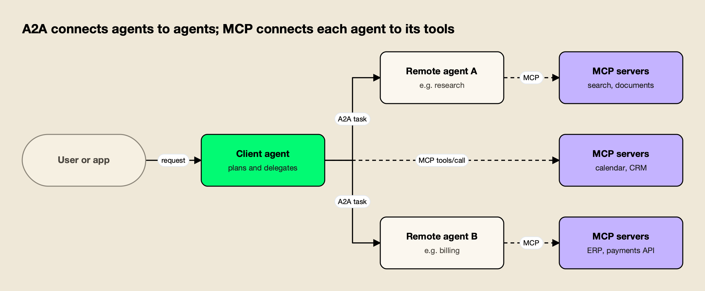
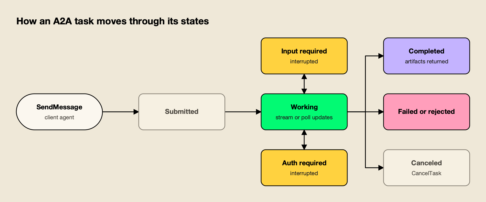
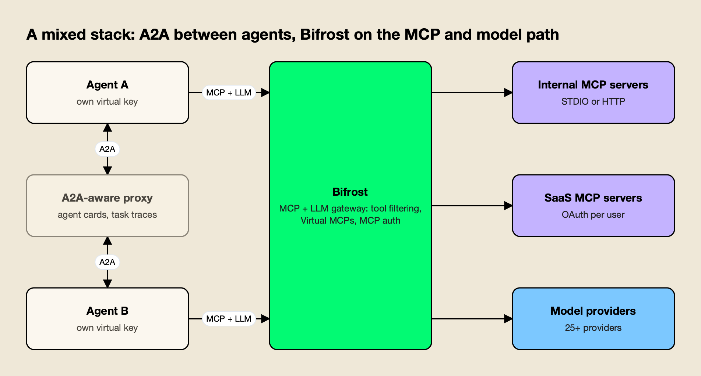

**TL;DR**
- A2A vs MCP comes down to layers: MCP (Model Context Protocol) connects an agent to tools, data and prompts, while A2A (Agent2Agent) connects an agent to other agents. The A2A specification calls them complementary, not competing.
- MCP is built around stateless JSON-RPC requests to a server the client already knows about; A2A is built around discoverable Agent Cards and long-running tasks with nine defined states.
- Current versions: MCP specification revision 2026-07-28 and A2A 1.0. Both are Linux Foundation projects, MCP through the Agentic AI Foundation.
- Authentication differs in shape: MCP specifies an OAuth 2.1 profile for HTTP servers, while A2A declares standard schemes (API key, HTTP auth, OAuth 2.0, OpenID Connect, mutual TLS) in each Agent Card and adds in-task authorization.
- In production the two usually run side by side, with an A2A-aware proxy on delegation traffic and an MCP gateway on tool traffic.

A2A vs MCP is less a choice than a question of layers: the Model Context Protocol standardizes how an AI agent reaches tools and data, and the Agent2Agent protocol standardizes how one agent hands work to another. Both moved under the Linux Foundation within a year of launch, both shipped major revisions in 2026, and both now appear in the same agent frameworks and gateways. This explainer compares the two from their specifications: discovery, transports, authentication, the task lifecycle, governance and how they compose in a real stack.

## A2A vs MCP at a Glance

MCP and A2A solve different integration problems. MCP gives a model application a standard way to list and call tools, read resources and fetch prompts from a server. A2A gives agents a standard way to discover each other, send messages, track long-running tasks and return results as artifacts, without exposing their internal tools or reasoning.

The [A2A specification](https://a2a-protocol.org/latest/specification/) says so directly in its appendix on MCP: MCP is the "how-to" for an agent to use a specific capability, while A2A is about how agents partner or delegate work. Its example is an A2A client agent asking a remote agent to perform a complex task, and the remote agent using MCP to reach the tools and data it needs.

*Figure 1: A2A runs horizontally between peer agents, while MCP runs vertically from each agent down to its tools.*

As Figure 1 shows, the two protocols rarely compete for the same connection. The table below summarizes the differences that matter when designing a system.

| Dimension | MCP (Model Context Protocol) | A2A (Agent2Agent protocol) |
|---|---|---|
| Connects | An AI application to tools, resources and prompts | An agent to another, opaque agent |
| Unit of work | A request such as `tools/call` | A task, created by a message |
| Discovery | Client is configured with a server; `server/discover` and `tools/list` | Agent Card at `/.well-known/agent-card.json`, registries or direct configuration |
| Wire format | JSON-RPC 2.0 | JSON-RPC 2.0, gRPC or HTTP+JSON/REST bindings |
| Transports | stdio, Streamable HTTP | HTTPS (TLS for gRPC), SSE for streaming, webhooks for push |
| Authentication | OAuth 2.1 profile for HTTP; optional | Schemes declared in the Agent Card; in-task auth state |
| Long-running work | Tasks extension (opt-in) | Core: nine task states, streaming, push notifications |
| Current version | Revision 2026-07-28 | 1.0 (1.0.0 tagged March 2026) |
| Steward | Agentic AI Foundation (Linux Foundation) | Linux Foundation A2A project |

## What the Model Context Protocol Standardizes

MCP is an open protocol that connects LLM applications to external context and capabilities through JSON-RPC 2.0 messages. It defines hosts (the applications that start connections), clients (connectors inside the host) and servers (services that expose context and capabilities), and it standardizes three server features: tools, resources and prompts.

Anthropic open-sourced MCP in November 2024, and the [current specification](https://modelcontextprotocol.io/specification/latest) describes it as taking inspiration from the Language Server Protocol: one interface that any tool provider can implement and any AI application can consume. Tools are functions the model can execute, resources are data for the user or the model, and prompts are templated messages and workflows.

The 2026-07-28 revision changed the protocol's shape more than any release since launch. According to the [changelog](https://modelcontextprotocol.io/specification/2026-07-28/changelog), it:

- **Made MCP stateless.** The `initialize` handshake and the `Mcp-Session-Id` header are gone; every request carries its protocol version and client capabilities in `_meta`.
- **Added `server/discover`.** Servers must implement it to advertise supported versions, capabilities and identity.
- **Moved tasks into an extension.** Long-running work now lives in the opt-in `io.modelcontextprotocol/tasks` extension, which uses polling through `tasks/get`.
- **Introduced multi round-trip requests.** Instead of server-initiated requests, a server returns an `input_required` result and the client retries with the answers.
- **Deprecated Roots, Sampling and Logging,** with a twelve-month minimum deprecation window under a new feature lifecycle policy.

The practical effect is that an MCP server now behaves much like a conventional stateless API, which matters for load balancing and for gateways. A longer walkthrough of [MCP transports, primitives and the message lifecycle](https://www.getmaxim.ai/articles/the-mcp-protocol-transports-primitives-and-the-message-lifecycle/) covers the request types in detail, and an essay on [the protocol, the plumbing and the gateway](https://www.getmaxim.ai/bifrost/blog/mcp-the-protocol-the-plumbing-and-the-gateway/) explains why tool traffic tends to end up behind a control point.

## What the A2A Protocol Standardizes

The A2A protocol is an open standard for communication between independent, potentially opaque AI agent systems. It lets agents discover each other's capabilities, negotiate interaction modalities such as text, files and structured data, manage collaborative tasks and exchange results, without access to each other's memory, internal state or tools.

The specification lists its guiding principles as simple (reuse HTTP, JSON-RPC 2.0 and Server-Sent Events), enterprise ready, async first, modality agnostic and opaque execution. Opaque execution is the important one for the A2A vs MCP comparison: an MCP server exposes individual tools for a model to call, while an A2A agent exposes skills and decides for itself how to fulfill a request.

A2A's data model has five core objects:

- **Agent Card:** the self-describing manifest an agent publishes.
- **Task:** the stateful unit of work, identified by a task ID and optionally grouped by a context ID.
- **Message:** one turn of communication, with a `ROLE_USER` or `ROLE_AGENT` role and one or more parts.
- **Part:** a piece of content: text, a file reference or structured data.
- **Artifact:** an output of a task, made of parts. The specification says results belong in artifacts, not in messages.

The core operations are `SendMessage`, `SendStreamingMessage`, `GetTask`, `ListTasks`, `CancelTask`, `SubscribeToTask`, four push-notification configuration methods and `GetExtendedAgentCard`. In the JSON-RPC binding these are PascalCase method names that mirror the gRPC service, so the same operations exist on every binding.

## Agent Cards and Discovery

Discovery is the clearest difference between the two protocols. A2A agents advertise themselves through an Agent Card, a JSON document usually served at `https://{domain}/.well-known/agent-card.json`. MCP has no equivalent web-wide convention: a client is configured with a server's address or command, then asks the server what it offers.

The A2A specification defines the Agent Card as a manifest with the agent's identity, capabilities, skills, endpoints and security requirements. Required fields are `name`, `description`, `supportedInterfaces`, `version`, `capabilities`, `defaultInputModes`, `defaultOutputModes` and `skills`. Optional fields include `provider`, `documentationUrl`, `securitySchemes`, `securityRequirements` and `signatures`.

Three details in A2A 1.0 matter for production use:

1. **Signed cards.** Agent Cards may be signed with JSON Web Signatures (RFC 7515), and clients should verify at least one signature before trusting a card. This lets a client confirm a card has not been tampered with and comes from the claimed provider.
2. **Extended cards.** If `capabilities.extendedAgentCard` is true, an authenticated client can call `GetExtendedAgentCard` to see skills that the public card hides.
3. **Multiple interfaces.** `supportedInterfaces` lists every binding in preference order, and an optional `tenant` value lets many agents share one endpoint.

MCP discovery happens after connection. A client calls `server/discover` for versions and capabilities, then `tools/list`, `resources/list` and `prompts/list`. Since the 2026-07-28 revision, those list results carry `ttlMs` and `cacheScope` fields so clients and intermediaries can cache them, and servers should return tools in a deterministic order to help prompt caching. Catalog discovery sits outside the core protocol, in registries such as the one the MCP project runs at [registry.modelcontextprotocol.io](https://registry.modelcontextprotocol.io/); the comparison of [MCP gateway registry options](/blog/mcp-gateway-registry/) covers how organizations run their own.

## Transports and Wire Formats

Both protocols encode messages in JSON-RPC 2.0, but they differ in where they run. MCP supports a local subprocess transport (stdio) as well as HTTP, because many MCP servers are local tools. A2A assumes agents are network services: every binding runs over HTTPS or TLS, and production deployments must encrypt traffic.

The [MCP transport overview](https://modelcontextprotocol.io/specification/2026-07-28/basic/transports) defines two standard bindings:

- **stdio:** newline-delimited JSON-RPC over the standard streams of a subprocess the client launches.
- **Streamable HTTP:** each message is an HTTP POST to a single MCP endpoint, with replies as a JSON object or a request-scoped SSE stream. The older HTTP+SSE transport is formally deprecated.

The current revision also requires `Mcp-Method` and `Mcp-Name` headers on Streamable HTTP requests, so proxies can route and inspect calls without parsing the body.

A2A defines three bindings in its specification: JSON-RPC 2.0 over HTTP(S) with Server-Sent Events for streaming, gRPC, and HTTP+JSON/REST. Clients send an `A2A-Version` header with each request, push-notification webhooks always use plain HTTP with JSON payloads, and the specification recommends TLS 1.3 or later.

| Transport concern | MCP | A2A |
|---|---|---|
| Local process | stdio | Not defined |
| Remote request/response | Streamable HTTP POST | JSON-RPC, gRPC or REST over HTTPS |
| Streaming | Request-scoped SSE | SSE (JSON-RPC, REST) or gRPC streams |
| Server-to-client updates | `subscriptions/listen` stream | Push-notification webhooks |
| Version signaling | `_meta` field, mirrored to headers | `A2A-Version` header |

## Authentication and Authorization in Each Protocol

MCP and A2A both rely on established web security rather than inventing their own. MCP specifies a particular OAuth 2.1 profile that HTTP-based servers must follow when they support authorization. A2A leaves the choice of scheme to each agent, declares it in the Agent Card, and adds a task state for authorization that is needed partway through a job.

In the [MCP authorization specification](https://modelcontextprotocol.io/specification/2026-07-28/basic/authorization), authorization is optional, and stdio servers should not use it; they take credentials from the environment instead. When an HTTP server does support it:

- The MCP server acts as an OAuth 2.1 resource server and the client as an OAuth 2.1 client.
- Servers must publish OAuth 2.0 Protected Resource Metadata (RFC 9728), which clients use to find the authorization server.
- Clients must use Resource Indicators (RFC 8707) so tokens are bound to the intended server.
- Client ID Metadata Documents are the preferred registration method; Dynamic Client Registration is now deprecated but kept for compatibility.

A2A treats agents as standard enterprise applications. A client reads the `securitySchemes` in the Agent Card, obtains credentials out of band, and sends them in headers or metadata on every request; the server must authenticate every request. The specification defines five scheme types: API key, HTTP authentication, OAuth 2.0 (authorization code, client credentials and device code flows), OpenID Connect and mutual TLS.

The A2A-specific addition is in-task authorization. When an agent needs a credential or a human approval partway through a task, it moves the task to `TASK_STATE_AUTH_REQUIRED` and explains what it needs; the client can supply it, pass the request up its own chain, or reject it. The specification warns that this state change by itself authorizes nothing, and that in-band credentials passed along a chain of agents should be bound to the requesting agent.

For tool access specifically, a guide to [OAuth 2.1 patterns for MCP authentication](https://www.getmaxim.ai/articles/mcp-authentication-oauth-2-1-patterns-for-agent-tool-access/) and one on [tool-level permissions for MCP](https://www.getmaxim.ai/articles/mcp-rbac-tool-level-permissions-for-production-ai-agents/) go deeper into scoping. The MCP side of this is covered step by step in the explainer on [MCP authentication](/blog/mcp-authentication/).

## The A2A Task Lifecycle

A2A is built for work that takes minutes or hours and may need a human in the middle. Every task moves through defined states: submitted, working, two interrupted states (input required and auth required) and four terminal states (completed, failed, canceled and rejected). Clients follow progress by streaming, polling or webhook.

*Figure 2: Interrupted states let a remote agent pause for a human answer or a credential without losing the task.*

As Figure 2 shows, the interrupted states return to working once the client answers, so a long delegation can survive several rounds of clarification. The full `TaskState` enumeration also includes `TASK_STATE_UNSPECIFIED` as a default value. A client that is not holding a stream open has three options to stay current: `SubscribeToTask`, a push-notification webhook registered with `CreateTaskPushNotificationConfig`, or polling `GetTask`.

MCP handles long work differently. The core protocol is now request and response; long-running operations use the opt-in [tasks extension](https://modelcontextprotocol.io/extensions/tasks/overview), which returns a durable handle that the client polls with `tasks/get` and updates with `tasks/update`. Mid-request questions go through the multi round-trip pattern, where the server returns `input_required` and the client retries with answers. The result is similar for one tool call, but A2A's lifecycle is richer because delegating to an agent is less predictable than calling a function.

## How A2A and MCP Fit Together

In most real systems A2A and MCP sit at different layers of the same request. A user's request reaches an orchestrating agent; that agent delegates subtasks to specialist agents over A2A; each agent, including the orchestrator, calls its own tools over MCP. Neither protocol needs to know about the other.

This layering has three practical consequences:

- **Different trust boundaries.** A2A is designed for agents owned by other teams or vendors, so its security model assumes the remote side is opaque. MCP connections are usually inside one team's trust boundary, where the agent's operator chooses which servers to connect.
- **Different failure modes.** A failed MCP call is a single error the model can retry or route around. A failed A2A task may represent minutes of remote work, which is why A2A has explicit terminal states, cancellation and artifact outputs.
- **Different cost profiles.** MCP tool definitions are loaded into the model's context, so connecting many servers inflates every prompt; a breakdown of [the hidden cost of connecting multiple MCP servers](https://www.getmaxim.ai/articles/the-hidden-cost-of-connecting-multiple-mcp-servers-to-an-agent/) quantifies it. A2A adds network calls and remote compute rather than context tokens.

Framework support reflects the same split. The comparison of [agent orchestration platforms](/blog/agent-orchestration-platforms/) found MCP support in all ten frameworks reviewed, while native A2A support was built into Google ADK, CrewAI, Microsoft Agent Framework, Mastra and Strands Agents but not into every SDK. Teams scaling these frameworks inside large organizations face extra control-plane questions, covered in the review of [enterprise agent orchestration platforms](/blog/enterprise-agent-orchestration-platforms/).

## Governance and Current Versions

Both protocols are now governed by the Linux Foundation, though through different structures. MCP is a founding project of the Agentic AI Foundation, formed in December 2025. A2A is a Linux Foundation project launched in June 2025, and it absorbed IBM's Agent Communication Protocol later that year.

| | MCP | A2A |
|---|---|---|
| Created by | Anthropic, open-sourced November 2024 | Google, launched April 2025 |
| Current home | [Agentic AI Foundation](https://www.linuxfoundation.org/press/linux-foundation-announces-the-formation-of-the-agentic-ai-foundation), announced December 9, 2025, alongside goose and AGENTS.md | [Linux Foundation A2A project](https://www.linuxfoundation.org/press/linux-foundation-launches-the-agent2agent-protocol-project-to-enable-secure-intelligent-communication-between-ai-agents), launched June 23, 2025 |
| Current version | Specification revision 2026-07-28, released July 28, 2026 | 1.0, with v1.0.0 tagged March 12, 2026 and v1.0.1 on May 28, 2026 ([releases](https://github.com/a2aproject/A2A/releases)) |
| Versioning | Date-stamped revisions; feature lifecycle with a twelve-month deprecation window | `Major.Minor` versions; patch releases do not affect compatibility |
| Merged protocols | None | IBM's ACP, per [IBM Research](https://research.ibm.com/projects/agent-communication-protocol) |

The Linux Foundation's [one-year update on A2A](https://www.linuxfoundation.org/press/a2a-protocol-surpasses-150-organizations-lands-in-major-cloud-platforms-and-sees-enterprise-production-use-in-first-year), published April 9, 2026, reported more than 150 supporting organizations, described 1.0 as the first stable specification, and listed integrations in Azure AI Foundry, Copilot Studio and Amazon Bedrock AgentCore Runtime. The same release describes A2A as governing how agents communicate across organizational boundaries, and MCP as governing how agents connect to internal tools and data.

## Where Gateways Fit in an A2A and MCP Stack

Both protocols leave policy to the deployer: who may call which tool or agent, with what budget, and with what audit trail. That job usually falls to a gateway. Products split into MCP gateways that govern tool traffic and A2A-aware proxies that observe or mediate agent-to-agent traffic, with some API platforms covering both.

Two allowlisted examples show what A2A mediation looks like today:

- **Kong.** The [AI A2A Proxy plugin](https://developer.konghq.com/plugins/ai-a2a-proxy/) detects A2A requests over the JSON-RPC and REST bindings, rewrites the URLs in `/.well-known/agent-card.json` responses to point at the gateway, and emits a `kong.a2a` OpenTelemetry span with the operation, task ID and task state. It does not change routing or manage task state, and it requires Kong Gateway 3.14 or later with the AI Gateway Enterprise offering.
- **Azure API Management.** Its [A2A agent API support](https://learn.microsoft.com/en-us/azure/api-management/agent-to-agent-api) imports an agent from its Agent Card, mediates JSON-RPC operations, rewrites the card to the API Management hostname and subscription-key requirement, and adds `genai.agent.id` attributes to Application Insights traces. Only JSON-RPC A2A agent APIs are supported.

On the MCP side the field is wider. The ranking of [top MCP gateways](/blog/top-mcp-gateways-compared/) compares ten options, and the list of [MCP governance tools](/blog/mcp-governance-tools/) focuses on access and audit controls.

The survey of [agent gateways](/blog/agent-gateways/) looks at products that try to cover model, tool and agent traffic together, and a separate roundup of [open-source agent gateways for MCP and A2A](https://www.getmaxim.ai/articles/best-open-source-agent-gateways-for-mcp-and-a2a-in-2026/) applies the same split to self-hosted projects.

## Worked Example: Bifrost on the MCP Layer of an A2A System

A common production layout keeps A2A delegation on its own path and routes every agent's tool calls and model calls through one MCP-capable gateway. Bifrost, an open-source AI gateway, is a useful example of that tool layer because its documentation covers MCP connections, per-agent tool filtering and upstream authentication in detail.

[Bifrost](https://www.getmaxim.ai/bifrost) is an [open-source gateway written in Go](https://github.com/maximhq/bifrost) that exposes 25+ providers and 10,000+ models through one OpenAI-compatible API, and [acts as both an MCP client and an MCP server](https://docs.getbifrost.ai/mcp/overview). Its documentation describes MCP and LLM traffic; agent-to-agent delegation is handled by the agents themselves or by an A2A-aware proxy beside it, which is the split Figure 3 shows.

*Figure 3: Delegation traffic and tool traffic take different paths, so each gets its own control point.*

In this layout, each agent (whether it acts as an A2A client, an A2A server or both) gets its own virtual key and sends its model and MCP traffic to the gateway. The documented pieces map onto the problems the two protocols leave open:

- **Tool discovery.** Bifrost [connects to MCP servers](https://docs.getbifrost.ai/mcp/connecting-to-servers) over STDIO, HTTP or SSE and aggregates their tools behind one `/mcp` endpoint, so an agent sees one tool catalog instead of a dozen connections.
- **Per-agent tool filtering.** [Tool filtering](https://docs.getbifrost.ai/mcp/filtering) stacks three levels: client configuration, request headers and virtual key. At the virtual key level, [MCP tool access is deny-by-default](https://docs.getbifrost.ai/features/governance/mcp-tools): a key with no MCP configuration sees no tools except from servers explicitly marked allow-by-default.
- **Curated endpoints.** [Virtual MCPs](https://docs.getbifrost.ai/mcp/virtual-mcps) bundle selected tools from several servers behind a stable `/mcp/<slug>` URL that is reachable only through the virtual keys attached to it. A specialist agent that accepts A2A tasks for billing, for example, can be given a billing-only tool endpoint.
- **Upstream authentication.** [MCP authentication](https://docs.getbifrost.ai/mcp/auth/overview) supports none, static headers, OAuth 2.0, per-user OAuth, per-user headers and token exchange, so a delegated task can reach a SaaS MCP server under the end user's identity rather than a shared service account.
- **Explicit execution.** By default the gateway does not execute tool calls the model suggests; the application approves and executes them through a separate call, unless Agent Mode is configured to auto-execute specific tools.

Token cost is the other reason to put tool traffic behind a gateway in multi-agent systems, because every agent in an A2A chain pays for its own tool definitions. Bifrost's [Code Mode](https://docs.getbifrost.ai/mcp/code-mode) has the model write Python to orchestrate tools instead of loading every definition, and its documentation reports up to 92.8% fewer input tokens in a 508-tool, 16-server benchmark; an explainer on [how code execution cuts MCP token costs](https://www.getmaxim.ai/articles/code-execution-with-mcp-how-code-mode-cuts-agent-token-costs-by-90/) walks through the mechanism. On latency, Bifrost's [published benchmark](https://docs.getbifrost.ai/benchmarking/t3.xl) reports 11 µs of added overhead per request at 5,000 RPS on an AWS t3.xlarge.

For broader context on this layer, see the overviews of the [MCP gateway category](https://www.getmaxim.ai/mcp-gateway) and [what an MCP gateway does for production agents](https://www.getmaxim.ai/articles/what-is-an-mcp-gateway-a-guide-for-production-ai-agents/), plus the [MCP gateway resource page](https://www.getmaxim.ai/resources/mcp-gateway).

Governance of the same layer is the subject of a write-up on [enterprise MCP governance with access, audit and cost controls](https://www.getmaxim.ai/bifrost/blog/enterprise-mcp-governance-access-audit-and-cost-controls-for-ai-agents-2/). Audit requirements for tool calls are covered in a piece on [MCP audit logging for compliance](https://www.getmaxim.ai/bifrost/blog/mcp-audit-logging-requirements-for-enterprise-governance-and-compliance/).

**Enterprise tier.** Access profiles that grant Virtual MCPs to roles, data access control over which operators see each Virtual MCP, token exchange authentication and clustering are part of Bifrost Enterprise, as described in the [enterprise Virtual MCPs documentation](https://docs.getbifrost.ai/enterprise/virtual-mcps).

## Choosing Between MCP, A2A or Both

Start with MCP if the problem is giving one agent access to tools and data, which describes most agent projects today. Add A2A when work has to cross agent boundaries: agents built on different frameworks, owned by different teams, or run by an outside vendor whose internals you cannot see.

A short decision guide:

| Situation | Protocol to adopt | Why |
|---|---|---|
| One agent needs files, databases, SaaS APIs | MCP | Standard tool and resource interface with a large server ecosystem |
| Several agents in one codebase and framework | MCP, plus the framework's own multi-agent features | A2A adds network hops without a clear benefit |
| Agents built by different teams or on different frameworks | A2A between agents, MCP inside each | Agent Cards and tasks give a shared contract without sharing internals |
| Delegating to a third-party agent service | A2A | Opaque execution, signed Agent Cards and declared auth schemes |
| Long-running jobs with human approvals mid-task | A2A, or the MCP tasks extension for single tools | A2A's interrupted states are built for this |

Whatever the mix, the operational questions are the same ones the specifications leave to deployers: which identity each agent uses, which tools and agents it may reach, what it is allowed to spend, and where the audit trail lives. Reviews of [AI governance controls](https://www.getmaxim.ai/ai-governance) and of [LLM gateways for AI agents](https://www.getmaxim.ai/articles/5-best-llm-gateways-for-ai-agents-in-2026-mcp-support-tool-governance-and-cost-tracking/) frame those questions at the infrastructure level.

The short version of A2A vs MCP is that the protocols answer different questions. MCP answers "how does this agent use a tool?", and with the 2026-07-28 revision it does so through stateless requests that are easy to proxy and cache. A2A answers "how does this agent hand work to another agent it does not control?", and version 1.0 gives that a stable contract with signed Agent Cards, declared authentication and a full task lifecycle. Systems that grow past a single agent will likely need both, with a separate control point on each layer, and the more useful design question is where those control points sit rather than which protocol wins.
