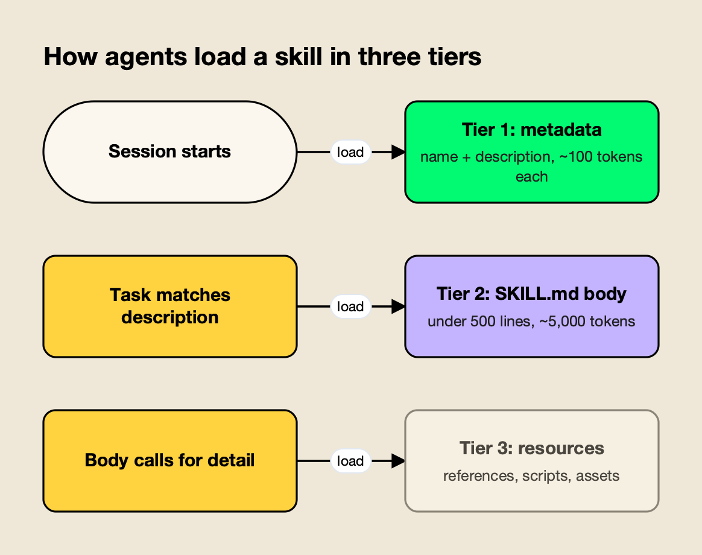
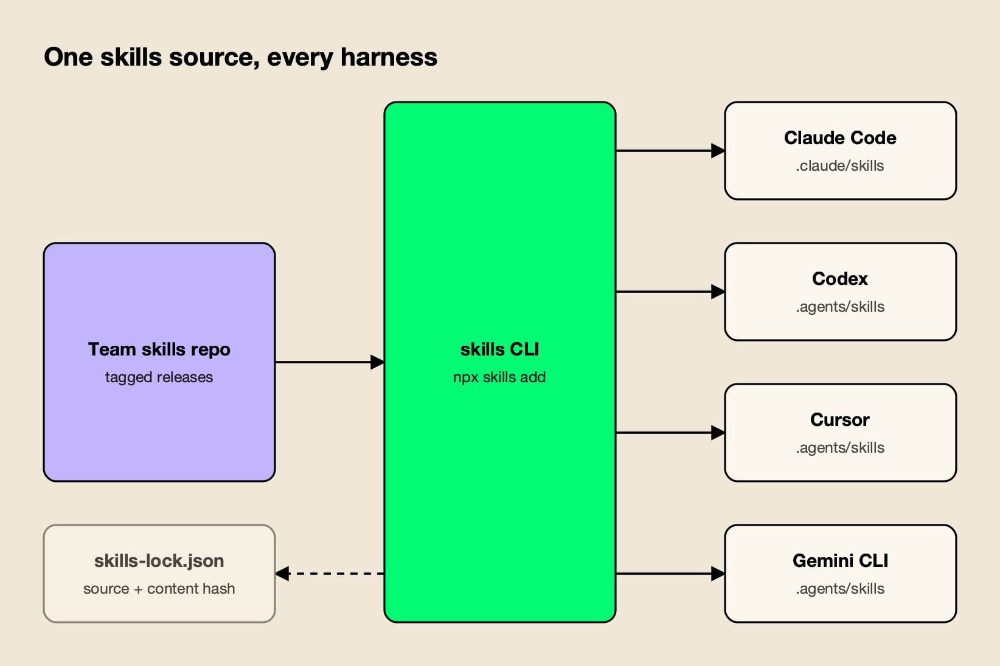

**TL;DR**
- Agent Skills are folders with a `SKILL.md` file that agents load on demand; the format came from Anthropic and is now an open specification read by Claude Code, Codex, Cursor and many other tools.
- At team scale, skills fail in predictable ways: copies drift, edits change agent behavior silently, descriptions never trigger, bodies bloat and bundled scripts go unreviewed.
- The fixes are engineering practices: one source of truth per skill, descriptions written as triggers and tested, progressive disclosure, semantic versioning, a review gate and one install path for every coding agent.
- Coding agents read different directories (`.claude/skills` for Claude Code, `.agents/skills` for Codex and Cursor), so installs should go through a tool rather than hand-copying.
- The open-source agent-skills-for-teams skill packages this workflow, including a linter: `npx skills add build-with-ai-hq/agent-skills-for-teams`.

Agent skills turn a coding agent's repeated corrections into reusable instructions, and that is exactly why they become a maintenance problem once a whole engineering team depends on them. A one-line edit to a shared `SKILL.md` changes what every engineer's agent does in the next session, with no build, no deploy and no diff in the code anyone is reviewing. This guide covers how teams write skills that trigger reliably, keep them small, version and review them like code, and ship them to Claude Code, Codex, Cursor and other coding agents from a single source.

The practices below follow agent-skills-for-teams, an MIT-licensed Agent Skill published by build-with-ai-hq that teaches a coding agent to audit, fix, version and distribute a team's skills. It is described in detail near the end and installs with one command:

```bash
npx skills add build-with-ai-hq/agent-skills-for-teams
```

## What Agent Skills Are

An Agent Skill is a folder containing a `SKILL.md` file (YAML frontmatter plus Markdown instructions) and optional `scripts/`, `references/` and `assets/` directories. Agents read only each skill's name and description at startup and load the full instructions when a task matches, which lets them keep many skills available at small context cost.

The [Agent Skills overview](https://agentskills.io/home) says the format was originally developed by Anthropic, released as an open standard and adopted by a growing number of agent products. The [specification](https://agentskills.io/specification) sets the rules every portable skill follows:

| Field | Required | Constraints in the specification |
|---|---|---|
| `name` | Yes | 1 to 64 characters; lowercase letters, numbers and hyphens; no leading, trailing or consecutive hyphens; must match the parent folder name |
| `description` | Yes | 1 to 1,024 characters; says what the skill does and when to use it |
| `license` | No | License name or a reference to a bundled license file |
| `compatibility` | No | Up to 500 characters of environment requirements |
| `metadata` | No | Map of string keys to string values |
| `allowed-tools` | No | Space-separated pre-approved tools; marked experimental |

Loading happens in three stages, which the overview calls discovery, activation and execution. The specification attaches budgets: about 100 tokens per skill for metadata, under 5,000 tokens recommended for the instructions, and resources loaded only when required. It also recommends keeping `SKILL.md` under 500 lines and offers a reference validator, `skills-ref validate ./my-skill`, in the [agentskills repository](https://github.com/agentskills/agentskills).



*Figure 1: Only the description is always in context, so it alone decides whether a skill ever runs.*

Figure 1 explains most of the team rules that follow. Every installed skill taxes every session through its metadata, the description alone decides triggering, and anything placed in the body is paid for on every activation.

Tool vendors extend the base format. [Claude Code's skills documentation](https://code.claude.com/docs/en/skills) states that its skills follow the Agent Skills open standard and adds features such as invocation control, subagent execution and dynamic context injection, while [Cursor's skills documentation](https://cursor.com/docs/skills) describes skills as an open standard and points to agentskills.io. Anthropic also publishes example skills in its public [anthropics/skills](https://github.com/anthropics/skills) repository.

For background on how the format grew out of Claude, an explainer on [how Anthropic's Agent Skills work](https://www.getmaxim.ai/articles/claude-skills-how-anthropics-agent-skills-work/) covers the history.

## Why Skills Break Down at Team Scale

Skills that work for one engineer usually fail for a team in six ways: copies drift apart across repositories, edits change agent behavior with no record, weak descriptions stop skills from triggering, bodies grow until they crowd the context window, bundled scripts go unreviewed, and each coding agent expects skills in a different directory.

The agent-skills-for-teams skill opens with a diagnosis step that finds each of these. Run from a repository root, its first checks look like this:

```bash
find . \( -name node_modules -o -name .git \) -prune -o -name SKILL.md -print | sort
find . \( -name node_modules -o -name .git \) -prune -o -name SKILL.md -print0 | xargs -0 wc -l | sort -n
ls ~/.claude/skills ~/.agents/skills ~/.cursor/skills 2>/dev/null
```

The first lists every skill and the agent directory it sits in; the second flags oversized bodies; the third finds personal installs that shadow or diverge from team skills. The skill's fuller version also hashes every `SKILL.md` to detect copy-paste drift (same name, different content) and lists executable files inside skill folders that nobody has reviewed.

The skill sorts findings into five classes and fixes them in that order of impact: drift, dead weight (skills nobody triggers), bloat, unreviewed code and missing versions. The order matters. Versioning a skill that exists in five divergent copies only produces five versioned skills.

## One Source of Truth Per Skill

Every skill needs exactly one canonical home, with every other location treated as an install that is never edited directly. Repository-specific knowledge stays in that repository; cross-cutting knowledge such as review standards, incident runbooks and internal API usage moves to a shared source that every repository installs from.

The skill compares four distribution models:

| Distribution model | Best for | Versioning and rollback |
|---|---|---|
| In-repo `.claude/skills/` or `.agents/skills/` | Skills specific to one codebase | Git history of that repository; rolls back with the code |
| Shared skills repository installed with `npx skills add owner/repo` | Cross-repository skills used by several coding agents | Git tags; consumers run `npx skills update` |
| Plugin marketplace for Claude Code or Codex | Organization-wide rollout with install and enable UX | Marketplace and plugin versions |
| Central registry | Skills edited by people outside git, immutable versions, one-step rollback | Immutable versions with a served-version switch |

Two rules from the skill prevent most drift. Delete copies once a shared source exists, because "a skill copied into five repos is five skills". And never keep a team skill and a personal skill with the same name, since which one wins depends on the agent. Codex, for example, does not merge same-named skills; its [skills documentation](https://developers.openai.com/codex/skills) says both can appear in skill selectors.

## Writing Descriptions That Trigger

Because agents see only the name and description of each installed skill, the description carries the whole triggering decision. A description that works states concrete capability first, then the situations, user goals and symptoms that should activate it, names near-miss tasks it should not handle, and stays under 1,024 characters.

The skill's `references/writing-skills-that-trigger.md` lists the rules:

1. **What and when.** One sentence of concrete capability, then the situations.
2. **Imperative and intent-focused.** "Use when the user wants to..." rather than describing the implementation.
3. **Indirect phrasings.** List symptoms and goals, such as "deploy is stuck", not just domain keywords.
4. **Near-misses.** When a sibling skill overlaps, add a "Not for..." boundary.
5. **Length.** Under 1,024 characters, rechecked as the description grows during tuning.
6. **No marketing.** Adjectives do not trigger anything.

Its before-and-after example shows the difference. The weak version describes a tool, not a trigger:

```yaml
description: Internal release helper.
```

The rewrite names the capability, the situations and the boundary:

```yaml
description: Cut, tag and publish a release of this monorepo's packages with the
  release script, including changelog generation, version bumps and npm publish
  with provenance. Use when the user wants to release, ship, publish or bump a
  package version, asks why a release CI job failed, or says "cut a release" or
  "tag v1.x". Not for deploying the web app; use deploy-web.
```

Descriptions should be tested, not guessed. The skill describes a trigger eval of about 20 realistic prompts: 8 to 10 that should trigger the skill (varied in formality, length and how directly they name the domain) and 8 to 10 near-misses that share keywords but need something else. Each prompt runs three times; a positive passes at a trigger rate of at least 0.5 and a negative below 0.5. Splitting the set about 60/40 into training and validation files, and choosing the description with the best validation score, avoids tuning a description to the exact test prompts. The approach is adapted from the specification site's guide to [optimizing skill descriptions](https://agentskills.io/skill-creation/optimizing-descriptions).

The skill adds a caveat worth repeating: agents tend to skip skills for tasks they consider simple, so even a strong description will not trigger on "read this file". Triggering matters most where the skill carries knowledge the model lacks, such as a repository's own migration tool, internal APIs or incident procedures.

## Keeping SKILL.md Small With Progressive Disclosure

A team skill should keep only what runs on every activation in `SKILL.md` (steps, defaults, gotchas and a verification step) and move long references, schemas and per-provider detail into separate files the body links with explicit load conditions. Scripts belong in `scripts/` when the agent would otherwise rewrite the same logic each run.

The skill's placement table:

| Content | Where it goes |
|---|---|
| Steps run on every activation, gotchas, defaults | `SKILL.md` body |
| Long API references, schemas, error catalogs, per-provider details | `references/<topic>.md` |
| Logic the agent would otherwise rewrite each run | `scripts/<name>.py`, tested, with dependencies stated |
| Templates, example configs, lookup tables | `assets/` |

It sets size targets of 150 to 400 lines for the body (a hard ceiling of 500 lines or about 5,000 tokens) and under about 300 lines per reference file, with references linked one level deep using relative paths. Scripts should exit non-zero on failure, avoid interactive prompts that an agent cannot answer, and print `--help`.

For trimming an existing skill, its bloat triage is blunt: estimate tokens, mark each section as needed on every run, some runs or "agent already knows", and delete the last group. The test for every line is whether the agent would get the task wrong without it.

## Versioning Skills Like an API

Each skill should carry a quoted semantic version in its metadata, a changelog beside `SKILL.md`, and releases cut from tags rather than the main branch. The agent is the API consumer: wording fixes are patches, new cases or broader triggering are minor, and anything that changes what the agent does by default is major.

The skill's `references/versioning-and-review.md` makes the SemVer rules concrete:

| Bump | Changes that qualify |
|---|---|
| Patch | Typos, clarified wording, fixed links, no change in what the agent does |
| Minor | New reference file, new supported case, new optional script, broader description, new gotcha |
| Major | Renamed skill, removed or reordered required workflow, changed default tool or command, changed script arguments or output, narrower description, new required dependency or permission |
| Pre-release | For example `2.4.0-beta.1` for pilot groups |

Two rules in that reference are easy to miss. A description change is never "just docs", because it changes triggering, so it is at least a minor bump and a major one if scope shrinks. And versions only move forward: rolling back means serving or pinning an older release, not reusing a number. Because the specification defines `metadata` as a string-to-string map, the version must be quoted (`version: "2.3.1"`).

Rollback depends on the distribution model. For an in-repo skill it is a `git revert`; for a shared repository it is a revert plus a new patch release, or a reinstall from the previous tag; for a marketplace it is a reverted plugin with a bumped version. The skill recommends rehearsing rollback once per model before it is needed, and verifying in a fresh agent session, since running sessions keep the skill they already loaded. A longer walkthrough of the same problem is in an article on [versioning and rolling back AI agent skills across a team](https://www.getmaxim.ai/articles/how-to-version-and-roll-back-ai-agent-skills-across-a-team/).

## Reviewing and Linting Skills Before They Ship

Skills are instructions that agents execute with the user's permissions, so they deserve the same review gate as code: an owner for the skills directory, a checklist covering format, context cost, behavior and security, and an automated linter in CI. Third-party skills should be read in full, pinned and re-reviewed on every upgrade.

The security part of the skill's review checklist covers the risks specific to skills:

- No secrets, tokens, internal URLs or customer data in any file.
- Scripts free of `curl ... | sh`, `sudo`, broad `rm -rf`, `eval` of input, reads of `~/.ssh`, `~/.aws`, `.netrc` or `.npmrc`, and `git push --force`.
- Every network call a script makes documented in `SKILL.md` and pointed at an expected host.
- Remote resources pinned to exact versions, commit SHAs or checksums, never "latest".
- No instructions to disable safety prompts, skip confirmation or widen permissions.
- `allowed-tools`, if set, kept to the minimum.
- No text that would override the user's or the agent tool's own instructions, since prompt injection through third-party skills is a real risk.

That last item connects skills to a wider class of attack covered in this site's explainer on [prompt injection attacks](/blog/prompt-injection-attacks/).

The skill bundles `scripts/lint_skills.py`, a standard-library Python linter that reports spec violations, weak descriptions, oversized bodies, missing version metadata, broken relative links, drift between copies with the same name, and risky patterns in bundled scripts. It exits with code 1 on any error, so it can gate pull requests. Run against the six skills in the build-with-ai-hq collection on October 28, 2026, it reported:

```text
6 skill(s) scanned: 0 error(s), 0 warning(s)
```

All six pass cleanly. The linter treats context cost as a warning rather than an error: a body over the roughly 5,000-token guideline is flagged, but it does not fail the run. Teams can combine it with the specification's own `skills-ref validate` for format checks and with trigger and output evals for behavior.

## Distributing Skills Across Claude Code, Codex and Cursor

Coding agents read skills from different directories, so a team that uses more than one agent should install from its single source with a tool rather than copying files by hand. The open-source skills CLI installs a skill into the correct project or global directory for each selected agent and records the source in a lockfile.

The skills CLI's [agent compatibility table](https://github.com/vercel-labs/skills/blob/main/docs/agents.md) lists the paths it uses:

| Agent | Project directory | Global directory |
|---|---|---|
| Claude Code | `.claude/skills/` | `~/.claude/skills/` |
| Codex | `.agents/skills/` | `~/.agents/skills/` |
| Cursor | `.agents/skills/` | `~/.cursor/skills/` |
| Gemini CLI | `.agents/skills/` | `~/.gemini/skills/` |
| GitHub Copilot | `.agents/skills/` | `~/.copilot/skills/` |
| OpenCode | `.agents/skills/` | `~/.config/opencode/skills/` |

The agents' own documentation adds detail. Codex's skills page says it scans `.agents/skills` in every directory from the working directory up to the repository root, and that by default its initial skill list uses at most 2% of the model's context window (8,000 characters when the window is unknown), shortening descriptions first and omitting skills with a warning when many are installed. Cursor's page lists `.agents/skills/` and `.cursor/skills/` at project level and `~/.agents/skills/` and `~/.cursor/skills/` at user level.



*Figure 2: Installing from one source through a tool keeps every agent on the same version and gives updates a single path.*

Figure 2 shows the install path. The commands the skill recommends, using a placeholder organization repository:

```bash
npx skills add your-org/team-skills --list
npx skills add your-org/team-skills --skill db-migrations -a claude-code codex cursor -y
npx skills add your-org/team-skills --skill db-migrations -g -a claude-code -y
npx skills update db-migrations
```

The first previews what a repository offers; the second installs one skill into three agents for the current project; the third installs it user-wide for Claude Code; the last upgrades deliberately. In a test install of a build-with-ai-hq skill on October 28, 2026, the CLI placed the skill in `.claude/skills/<name>` for Claude Code and in `.agents/skills/<name>` for Codex, Cursor, Gemini CLI and OpenCode, and wrote a `skills-lock.json` recording the source repository, the skill path and a content hash. Installing this guide's skill for Claude Code, Codex and Cursor in a single command produced one copy in `.agents/skills/agent-skills-for-teams`, with `.claude/skills/agent-skills-for-teams` created as a symlink to it, so the three agents read the same files. The CLI's help also lists an `experimental_install` command that restores skills from that lockfile, which gives a team a way to reproduce the same set on a new machine.

Agent-specific frontmatter is the main portability trap. Claude Code supports fields such as `context: fork` that other agents ignore, so the skill advises keeping shared skills to specification fields. Teams standardizing on several coding agents can compare them in this site's [Claude Code vs Codex](/blog/claude-code-vs-codex/) analysis, and the vendor's [CLI agents resource page](https://www.getmaxim.ai/resources/cli-agents) collects setup notes for routing those agents through a gateway.

## Central Registries and One-Step Rollback

When skills must be edited by people who do not work in git, published as immutable versions and rolled back for everyone at once, a central registry replaces the shared repository. The registry serves one version of each skill to every agent, so rollback becomes a single served-version change instead of a reinstall on each machine.

The registry the skill configures is the Skills Repository in Bifrost, an [open-source AI gateway](https://github.com/maximhq/bifrost) from Maxim AI. According to the [Skills Repository documentation](https://docs.getbifrost.ai/features/skills-repository), it stores skills in the agentskills.io format and:

- publishes each save as an immutable semantic version, and refuses to publish a lower number once a higher one exists;
- separates **Save**, which stages a new version, from **Save & Serve**, which makes it the version users install;
- lets an administrator switch the served version to roll forward or back;
- registers as a plugin marketplace for Claude Code and Codex, exposing each skill as a `bifrost-<name>` plugin plus a `bifrost-all-skills` bundle that is versioned automatically;
- keeps management actions authenticated while marketplace and download URLs stay public, so command-line agents can install without dashboard credentials.

The marketplace registration commands from the documentation:

```bash
claude plugin marketplace add <your-bifrost-url>/api/skills/serve/claude-code/.claude-plugin/marketplace.json
codex plugin marketplace add <your-bifrost-url>/api/skills/serve/codex
```

Two gotchas from the skill's reference are worth knowing before adopting any registry. Files added to a skill "From URL" are fetched when the skill is served, so they are not frozen by version immutability; content that must be reproducible should be uploaded. And because marketplace URLs are public by design, no skill may contain secrets.

The same gateway can carry the model traffic of the agents that consume these skills, which is the subject of this site's comparison of [Claude Code gateways](/blog/claude-code-gateways/) and of the vendor's [Claude Code resource page](https://www.getmaxim.ai/resources/claude-code).

Its [CLI agents documentation](https://docs.getbifrost.ai/cli-agents/overview) covers pointing Claude Code, Codex CLI, Gemini CLI and others at the gateway, and the [Bifrost CLI v1.0 announcement](https://www.getmaxim.ai/bifrost/blog/bifrost-cli-v1-0-one-launcher-to-connect-your-coding-agents-to-the-gateway-and-manage-bifrost/) describes a launcher for connecting coding agents to it.

**Enterprise tier.** [Role-based access control](https://docs.getbifrost.ai/enterprise/rbac) and SSO, which control who can create and publish skills, are part of Bifrost Enterprise; the Skills Repository itself is in the open-source gateway.

## Installing the agent-skills-for-teams Skill

The agent-skills-for-teams skill gives a coding agent the workflow in this guide: it audits a repository's skills, rewrites descriptions and sets up trigger evals, restructures bloated skills, applies versioning and a review checklist, wires CI, and installs skills consistently across coding agents. It is MIT licensed and installs with the skills CLI.

```bash
npx skills add build-with-ai-hq/agent-skills-for-teams --list
npx skills add build-with-ai-hq/agent-skills-for-teams -a claude-code codex cursor -y
```

The [GitHub repository](https://github.com/build-with-ai-hq/agent-skills-for-teams) contains:

- `SKILL.md`: the core workflow of diagnose, fix and verify, with the distribution table and review gate.
- `references/writing-skills-that-trigger.md`: descriptions, body structure, progressive disclosure, trigger and output evals.
- `references/versioning-and-review.md`: SemVer for skills, changelog template, release, pinning and rollback, the review and security checklist, and CI wiring.
- `references/bifrost-skills-repository.md`: central registry setup, marketplace registration, CI sync through the Skills API and runbooks.
- `scripts/lint_skills.py`: the linter shown above, standard library only.

Its description triggers on situations such as a skill that never triggers, the same `SKILL.md` copied across repositories with disagreeing copies, an unexplained change in agent behavior after a skill edit, or a team that wants one install path for Claude Code, Codex and Cursor. As with any third-party skill, the CLI ends an install with a reminder to review skills before use because they run with full agent permissions, and the review checklist in this guide applies to this skill too. For teams pairing skills with gateway policy, the vendor's article on [Claude Code hooks for governance and gateway policy](https://www.getmaxim.ai/articles/claude-code-hooks-for-governance-and-gateway-policy/) and its [governance resource page](https://www.getmaxim.ai/resources/governance) cover the adjacent controls.

## Testing Skills Like Code

A team skill is finished when four checks pass: the linter exits cleanly in CI, a trigger eval shows it activates on realistic prompts and stays quiet on near-misses, an output eval shows the agent does measurably better with it than without, and a smoke test confirms every coding agent the team uses discovers it.

The output eval is the check teams most often skip. The skill suggests running three to five representative tasks with and without the skill and reading the traces, not only the results:

- An agent that tries several approaches means the instructions are vague or offer a menu; pick one default.
- An agent following irrelevant steps means content belongs in a reference with a load condition.
- An agent rewriting the same helper every run means the helper belongs in `scripts/`.
- No difference with and without the skill means it adds nothing and should be deleted.

That last rule is the discipline that keeps a team's skill collection useful. Every installed skill costs context in every session, and a skill that does not change outcomes is pure overhead. Teams thinking about which coding agents and tool servers to standardize alongside their skills can use this site's guides to [MCP servers for coding agents](/blog/mcp-servers-for-coding-agents/) and [AI gateways for coding agents](/blog/ai-gateways-for-coding-agents/).

## The Takeaway

Agent skills are small files with outsized effects, and the practices that keep them reliable are the ones software teams already apply to code: a single source of truth, review, semantic versions, tests and a deployment path with rollback. The specific twists are that the description is the interface, context is the budget, and the consumer is an agent acting with real permissions.

The agentskills.io specification makes skills portable across Claude Code, Codex, Cursor and a long list of other tools, and the skills CLI handles their different directories. What remains is process. Teams can build it by hand from this guide or hand the job to a coding agent with the agent-skills-for-teams skill; either way, the first step is the same inventory of every `SKILL.md` the team already runs.
