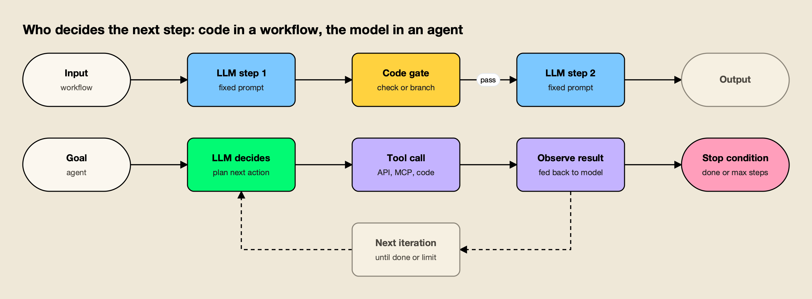
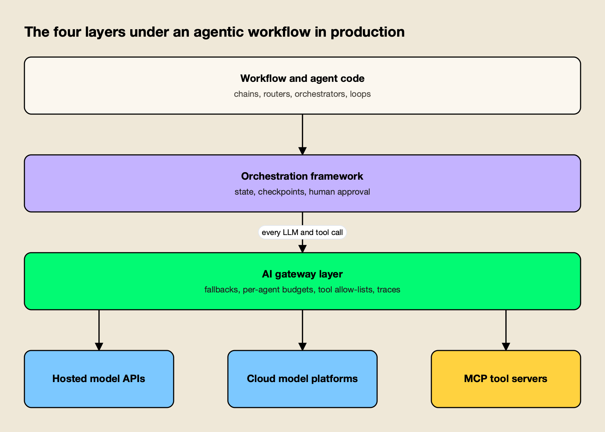
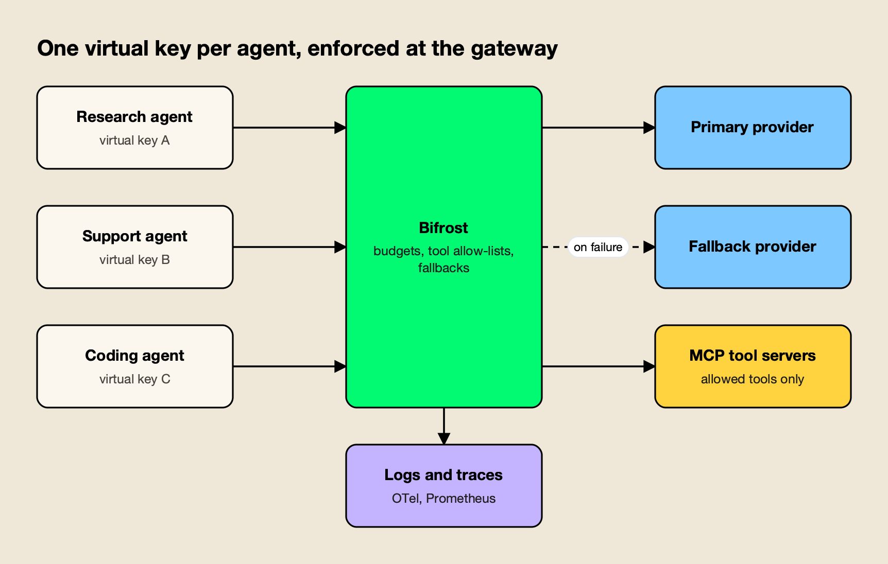

**TL;DR**
- Agentic workflows are multi-step LLM processes that plan, call tools and act on the results. Anthropic splits the field into **workflows** (code sets the path) and **agents** (the model chooses the path).
- Five patterns cover most production designs: prompt chaining, routing, parallelization, orchestrator-workers and evaluator-optimizer. Most teams should start with the simplest one that works.
- Agentic systems multiply cost. Anthropic measured agents using about 4x the tokens of a chat and multi-agent systems about 15x.
- The common production failures are cost blowups, runaway loops, rate limits, tool misuse and provider outages. All of them cross the layer between the agent code and the model and tool endpoints.
- That layer, usually an AI gateway, is where per-agent budgets, provider fallbacks, tool allow-lists and traces are easiest to enforce, whichever orchestration framework sits above it.

Agentic workflows are multi-step processes in which a large language model plans, calls tools, reads the results and decides what happens next, instead of answering a single prompt once. Nearly every major lab and framework vendor now publishes guidance on how to structure them. This explainer covers the core distinction between workflows and agents, the five design patterns that recur in production systems, concrete examples, and the failure modes that appear once these systems run at volume.

## What Is an Agentic Workflow

An agentic workflow is a system where an LLM does more than generate one response: it works through a task in steps, using tools, intermediate checks or other model calls along the way. The defining feature is a loop or sequence of model calls whose outputs drive later actions.

The most cited framing comes from Anthropic's December 2024 engineering post [Building effective agents](https://www.anthropic.com/engineering/building-effective-agents). It groups everything under the umbrella of "agentic systems" and draws one architectural line through it:

- **Workflows** are "systems where LLMs and tools are orchestrated through predefined code paths."
- **Agents** are "systems where LLMs dynamically direct their own processes and tool usage."

The building block underneath both is what the post calls the **augmented LLM**: a model with retrieval, tools and memory attached, which can write its own search queries, pick tools and decide what to keep. The [Model Context Protocol](https://modelcontextprotocol.io/specification/2025-06-18/server/tools) is one standard way to give a model those tools.

*Figure 1: A workflow's path is written before it runs; an agent's path is chosen at run time, which is why it needs a stop condition.*

In common usage, "agentic workflow" covers both halves of Figure 1. A three-step prompt chain with a validation check is an agentic workflow. So is a coding agent that edits files, runs tests and retries until they pass. The difference matters because it decides who owns the control flow, and with it, who is responsible when the run goes wrong.

## Agentic Workflows vs AI Agents

The practical difference between a workflow and an agent is who chooses the next step. In a workflow, the developer writes the sequence and branches in code, and the model fills in each step. In an agent, the model chooses which tool to call next and when the task is finished.

The frameworks agree on this split. LangGraph's documentation on [workflows and agents](https://docs.langchain.com/oss/python/langgraph/workflows-agents) says workflows "have predetermined code paths and are designed to operate in a certain order", while agents "are dynamic and define their own processes and tool usage." The [Microsoft Agent Framework overview](https://learn.microsoft.com/en-us/agent-framework/overview/agent-framework-overview) gives a decision table and a blunt rule: "If you can write a function to handle the task, do that instead of using an AI agent."

| | Workflow | Agent |
|---|---|---|
| Who picks the next step | Developer code | The model |
| Predictability | High: same path every run | Variable: path depends on intermediate results |
| Cost per task | Bounded by the number of steps | Open-ended unless capped |
| Best fit | Well-defined tasks that split into known subtasks | Open-ended tasks where the steps cannot be listed in advance |
| Main risk | Rigid on unexpected inputs | Loops, compounding errors, tool misuse |
| Required guardrail | Validation gates between steps | Stop condition, iteration cap, tool permissions |

Anthropic's own advice runs in the same direction: find "the simplest solution possible, and only increasing complexity when needed." For many applications, the post says, a single LLM call with retrieval and in-context examples "is usually enough." Agents earn their cost when "flexibility and model-driven decision-making are needed at scale."

## Agentic Design Patterns

Agentic design patterns are reusable structures for arranging model calls. Anthropic names five workflow patterns, and LangGraph documents the same five plus the autonomous agent loop. Andrew Ng's earlier [Agentic Design Patterns series](https://www.deeplearning.ai/the-batch/how-agents-can-improve-llm-performance/) in The Batch (March 2024) used a different cut: reflection, tool use, planning and multi-agent collaboration.

The two lists overlap. Ng's reflection is close to evaluator-optimizer, his planning maps onto orchestrator-workers, and tool use is the augmented LLM underneath every pattern. The table below uses Anthropic's five, because they describe control flow and therefore map directly onto cost and failure behaviour.

| Pattern | How it works | Typical use | Cost shape |
|---|---|---|---|
| Prompt chaining | Sequential calls, each using the previous output, with optional checks between | Draft then translate; outline, validate, then write | Fixed: one call per step |
| Routing | Classify the input, send it to a specialised prompt or model | Support triage; easy questions to small models, hard ones to large models | Fixed, often cheaper than one large model |
| Parallelization | Independent calls run at once, merged in code (sectioning or voting) | Guardrail screening beside the main answer; several code reviewers | Multiplied by the fan-out |
| Orchestrator-workers | A lead model splits the task, delegates, then synthesises | Multi-file code changes; multi-source research | Variable: fan-out chosen by the model |
| Evaluator-optimizer | One model generates, another critiques, repeat until accepted | Literary translation; iterative search | Variable: depends on how many rounds pass |

### Prompt Chaining

**Prompt chaining** splits a task into a fixed sequence of model calls, where each call works on the previous output. Programmatic "gates" between steps check that the intermediate result is on track before the next call runs. It trades latency for accuracy by making each call's job easier.

### Routing

Routing classifies an input and sends it to the follow-up that handles that category best. It separates concerns, so a prompt tuned for refund requests does not degrade answers about technical bugs. It is also a cost tool: Anthropic's example sends easy questions to smaller models and hard ones to larger models, the same idea covered in this site's comparison of [model routing tools for inference cost](/blog/model-routing-inference-cost/).

### Parallelization

Parallelization runs several model calls at once and combines their outputs in code. **Sectioning** splits a task into independent parts; **voting** runs the same task several times and aggregates the answers. A common production use is running a guardrail check in parallel with the main response instead of in series.

### Orchestrator-Workers

In the orchestrator-workers pattern, a central model decides at run time how to break a task down, hands the pieces to worker calls and merges the results. It looks like parallelization, but the subtasks are not known in advance, which makes it the bridge between workflows and agents.

### Evaluator-Optimizer

The evaluator-optimizer pattern pairs a generator with a critic. One call produces an answer, a second call evaluates it against explicit criteria, and the loop repeats until the evaluator accepts the result. It works when clear evaluation criteria exist and when iteration measurably improves the output.

## Agentic Workflow Examples

Agentic workflow examples in production map onto the patterns above, usually in combination. A support system might route first, then chain, then run a parallel guardrail. The examples below show the pattern each one relies on and where it tends to fail.

| Example | Pattern | What the workflow does | Where it tends to break |
|---|---|---|---|
| Customer support triage | Routing + chaining | Classifies the ticket, picks a specialised prompt, drafts a reply, checks policy | Misclassification sends the ticket to the wrong prompt |
| Contract or report drafting | Prompt chaining | Outline, check the outline against requirements, write each section | Errors in step one propagate to every later step |
| Code review | Parallelization (voting) | Several reviewers check the same diff for different issue types | Fan-out multiplies token spend per pull request |
| Deep research | Orchestrator-workers | A lead model plans queries, sends subagents to search, merges findings | Over-delegation and endless searching |
| Coding agent | Autonomous agent loop | Edits files, runs tests, reads failures, retries | Loops on a failing test; destructive tool calls |
| Translation with review | Evaluator-optimizer | Translates, critiques nuance, revises | Generator and critic never converge |
| No-code automation (n8n, Zapier-style) | Chaining with LLM nodes | Calls a model inside a larger business automation | Each LLM node holds its own provider key and has no shared budget |

Coding agents are the most visible autonomous example today. This site's guide to [AI coding agents for software teams](/blog/ai-coding-agents/) covers the terminal, IDE and cloud variants, and the [MCP servers coding agents use](/blog/top-mcp-servers/) are a large part of what makes them agentic. For no-code platforms, a write-up on [routing n8n LLM nodes through one gateway](https://www.getmaxim.ai/articles/n8n-ai-workflow-routing-llm-nodes-through-one-gateway/) shows the shared-key problem in the last row of the table.

How long these agents can work unattended is rising quickly. METR's measurements of [AI time horizons](/blog/metr-time-horizons-2026/) put the frontier at roughly 17 hours of skilled-human work at 50% success, with the horizon growing about 7x to 10x a year. Longer runs mean more model calls per task, which is why the production questions below matter more each year.

## Multi-Agent Systems

Multi-agent systems are agentic workflows in which several model instances, each with its own prompt, tools and context, cooperate on one task. Orchestrator-workers with model-driven subagents is the most common form. They raise capability on broad tasks and raise cost and coordination failures at the same time.

Anthropic's account of [its multi-agent research system](https://www.anthropic.com/engineering/multi-agent-research-system) (June 2025) gives rare production numbers. A Claude Opus 4 lead with Claude Sonnet 4 subagents beat single-agent Claude Opus 4 by 90.2% on the company's internal research evaluation. The price was tokens: agents used about 4x the tokens of chat interactions, and multi-agent systems about 15x. Token usage alone explained about 80% of the performance variance on the BrowseComp benchmark.

The same post lists the failures that showed up early: agents "spawning 50 subagents for simple queries," and searching endlessly for sources that did not exist. Anthropic's fix was explicit effort-scaling rules in the prompts, such as one agent with 3 to 10 tool calls for simple fact-finding.

Academic work points the same way. The paper [Why Do Multi-Agent LLM Systems Fail?](https://arxiv.org/abs/2503.13657) (Cemri et al., 2025) annotated more than 1,600 traces across 7 popular multi-agent frameworks and found 14 distinct failure modes in three categories: system design issues, inter-agent misalignment and task verification. Its abstract notes that multi-agent performance gains on popular benchmarks "are often minimal." For frameworks that implement these patterns, see this site's ranking of [agent orchestration platforms](/blog/agent-orchestration-platforms/).

## What Breaks When Agentic Workflows Reach Production

Agentic workflows fail in production in ways a single LLM call does not, because each run makes many dependent calls to models and tools. The five recurring failure modes are cost blowups, runaway loops, rate limits, tool misuse and provider outages. Each needs a control that sits outside the model.

Anthropic's engineering team put the root cause plainly: "Agents are stateful and errors compound." A failure on step 12 of a 30-step run either restarts the whole run or, without checkpoints, loses it.

*Figure 2: Cost blowups, rate limits, outages and tool misuse all cross the gateway layer, which makes it the natural place to enforce limits.*

### Cost Blowups

An agent decides how many calls to make, so its cost per task is not known in advance. The 15x token multiplier for multi-agent systems is an average; individual runs that loop or over-delegate cost far more. Without a hard cap per agent, the first sign of a problem is usually the monthly invoice. Model choice compounds it, as a comparison of [Claude and GPT pricing for agentic workloads](https://www.getmaxim.ai/articles/claude-opus-4-7-vs-gpt-5-pricing-for-agentic-workloads/) shows.

### Loops and Runaway Agents

An agent that cannot finish its task often keeps trying: re-running a failing test, re-searching for a source that does not exist, or calling the same tool with the same arguments. Anthropic recommends stopping conditions "such as a maximum number of iterations." The cap belongs in code or infrastructure, not in a prompt the model can ignore.

### Rate Limits

Providers cap traffic per organization or project, not per agent. OpenAI's [rate limit guide](https://developers.openai.com/api/docs/guides/rate-limits) measures limits in requests and tokens per minute and per day, and recommends honoring the `Retry-After` header, then exponential backoff with jitter, with a cap on total retry time. A parallel fan-out of subagents hits these limits faster than any chat product, and one noisy agent can starve every other workload sharing the same key.

### Tool Misuse

Tools are where an agent touches real systems, so a wrong call can delete data, send email or leak secrets. The MCP specification says there "SHOULD always be a human in the loop with the ability to deny tool invocations," that clients should log tool usage for audit and set timeouts, and that servers must rate-limit tool invocations. Prompt injection through tool results makes this worse, as several entries in this site's review of [AI agent security incidents](/blog/ai-agent-security-incidents/) show.

### Provider Outages

A single provider outage stops every agent that depends on it. Anthropic's [API error reference](https://platform.claude.com/docs/en/api/errors) lists a `529 overloaded_error` for periods when "the API is temporarily overloaded," alongside `429` rate-limit and `500` errors. A chat user can retry; a 40-step agent run that fails on step 35 wastes the 34 calls before it.

| Failure mode | Symptom | Control | Where the control lives |
|---|---|---|---|
| Cost blowup | Spend spikes on a few runs | Per-agent budget with hard cutoff | Gateway (virtual key or team budget) |
| Runaway loop | Same tool call repeated; run never ends | Max iterations, tool timeout | Framework or gateway agent loop |
| Rate limit | `429` errors under fan-out | Key pools, per-agent rate limits, backoff | Gateway |
| Tool misuse | Unapproved or destructive tool calls | Tool allow-lists, approval for sensitive tools, audit logs | Gateway or MCP gateway |
| Provider outage | `5xx` / `529` errors end the run | Automatic fallback to another provider | Gateway |
| Silent quality drift | Wrong answers without errors | Traces of every step, evaluation | Observability stack |

## The Infrastructure Under Agentic Workflows

The infrastructure under an agentic workflow has three layers below the agent code: an orchestration framework that manages state and control flow, a gateway layer that every model and tool call passes through, and the model providers and tool servers themselves. Most production controls belong in one of the first two.

**Orchestration frameworks** own the control flow. LangGraph models workflows as graphs with persistent state. [Microsoft Agent Framework](https://learn.microsoft.com/en-us/agent-framework/overview/agent-framework-overview), the successor to AutoGen and Semantic Kernel, adds graph-based workflows and state management for long-running and human-in-the-loop scenarios. Google's Agent Development Kit, CrewAI and the OpenAI Agents SDK take different approaches to the same problem. This site covers them in detail in its rankings of [agent orchestration frameworks](/blog/agent-orchestration-platforms/) and [enterprise agent orchestration platforms](/blog/enterprise-agent-orchestration-platforms/).

**The gateway layer** owns the traffic. Because every LLM and tool call in Figure 2 crosses it, a gateway can enforce limits that a framework cannot see across teams: one budget for an agent regardless of which framework it runs in, one fallback policy for every provider call, one allow-list for tool access. This site's comparison of [agent gateways](/blog/agent-gateways/) ranks the options on agent identity, per-agent budgets and MCP tool access, and an overview of [LLM gateways for AI agents](https://www.getmaxim.ai/articles/5-best-llm-gateways-for-ai-agents-in-2026-mcp-support-tool-governance-and-cost-tracking/) covers the same ground from the gateway side.

Several gateways address parts of the agentic failure list:

- **LiteLLM** documents [fallbacks across model groups](https://docs.litellm.ai/docs/proxy/reliability), with retries and cooldowns, and [budgets and TPM/RPM limits](https://docs.litellm.ai/docs/proxy/users) on virtual keys, users and teams.
- **Kong AI Gateway** documents [failover to a different provider or model](https://developer.konghq.com/ai-gateway/) and can turn existing APIs into MCP tools, with token budgets through consumer groups.
- **Bifrost** covers fallbacks, per-agent budgets, MCP tool governance and tracing in one open-source gateway, which is why it serves as the worked example below.

The gateway does not replace the framework. Checkpoints, resumable state and human approval steps live in the framework; budgets, fallbacks and tool permissions live most naturally at the gateway, where they apply to every agent at once. A general explanation of the category is in a guide to [what an MCP gateway is](https://www.getmaxim.ai/articles/what-is-an-mcp-gateway-a-guide-for-production-ai-agents/) and an [LLM gateway overview](https://www.getmaxim.ai/llm-gateway).

## Worked Example: The Gateway Layer for Agentic Workflows

This section uses [Bifrost](https://www.getmaxim.ai/bifrost) to show how the gateway layer handles each failure mode in the table above. It gets a section of its own because its documentation covers all five controls (fallbacks, per-agent budgets, rate limits, tool allow-lists and tracing) in one open-source project, so the mapping can be traced page by page.

Bifrost is an [open-source AI gateway written in Go](https://github.com/maximhq/bifrost), released under Apache 2.0 and built by Maxim AI. It exposes 25+ providers and 10,000+ models through one OpenAI-compatible API, so an agent framework points its base URL at the gateway and keeps its existing SDK. Bifrost's [published benchmark](https://www.getmaxim.ai/resources/benchmarks) reports 11 µs of added overhead per request at 5,000 RPS on an AWS t3.xlarge, which matters for agents that make dozens of sequential calls per task.

*Figure 3: Giving each agent its own virtual key turns budgets, tool access and logs into per-agent settings rather than shared ones.*

### Fallbacks and Retries for Provider Outages

The [retries and fallbacks documentation](https://docs.getbifrost.ai/features/fallbacks) separates two layers. Retries handle transient errors within one provider: `5xx` and `529` responses retry the same key with exponential backoff and jitter, while a `429` rotates to another key in the pool and still backs off. Fallbacks move the request to the next provider in a chain, each with its own retry budget, when the primary fails after its retries.

The chain is a `fallbacks` array of `provider/model` strings in the request body, and the response reports which provider served it. Each fallback attempt re-runs governance, so the budget and model restrictions on the agent's key still apply on the backup provider. A walkthrough on [enabling automatic fallback when a primary LLM provider fails](https://www.getmaxim.ai/bifrost/blog/your-primary-llm-provider-failed-enable-automatic-fallback-with-bifrost/) covers the setup.

### Per-Agent Budgets With Virtual Keys

[Virtual keys](https://docs.getbifrost.ai/features/governance/virtual-keys) are the unit of governance: each agent sends its own key in the `x-bf-vk` header, and the key carries its allowed providers and models, its budget and its rate limits. The [budget and limits documentation](https://docs.getbifrost.ai/features/governance/budget-and-limits) describes a hierarchy of customer, team, virtual key and provider config, where every applicable budget is checked independently before a request proceeds.

Budgets reset on durations from a day to a year, and rate limits cap both requests and tokens per minute, hour or day. Giving the research agent, the support agent and the coding agent separate keys means a looping research agent hits its own cap without touching the others. Articles on [per-user rate limiting, budget controls and automatic fallbacks](https://www.getmaxim.ai/articles/enterprise-ai-gateway-per-user-rate-limiting-budget-controls-and-automatic-fallbacks/) and on [AI agent identity, permissions and budgets](https://www.getmaxim.ai/articles/ai-agent-governance-identity-permissions-budgets-and-lifecycle-in-production/) go further into the model.

A [governance overview](https://www.getmaxim.ai/resources/governance) summarises how the hierarchy fits together for teams running many agents on shared provider accounts.

### MCP Tool Governance and Loop Limits

Bifrost also acts as an [MCP gateway](https://www.getmaxim.ai/mcp-gateway), connecting to MCP tool servers and exposing their tools to models. [MCP tool filtering](https://docs.getbifrost.ai/features/governance/mcp-tools) is deny-by-default per virtual key: a key with no MCP configuration gets no tools unless a client is explicitly marked allow-by-default, and the allow-list is enforced again at execution time. A caller can narrow the tool list with a header but never widen it.

[Agent Mode](https://docs.getbifrost.ai/mcp/agent-mode) runs the tool loop inside the gateway, and it carries the two controls the failure table calls for. Only tools listed in `tools_to_auto_execute` run without approval, and none do by default; everything else returns to the application for a human or code decision. The loop stops at `max_agent_depth`, 10 iterations by default, and each tool call has a 30-second execution timeout.

For agents connected to many tool servers, [Code Mode](https://docs.getbifrost.ai/mcp/code-mode) has the model write a short script against tool stubs instead of loading every tool definition into context. The documentation reports input-token reductions from 58.2% to 92.8% as tool counts grew, and with 508 tools across 16 servers, a drop from 75.1M to 5.4M input tokens at a 100% pass rate. 

Further reading on the mechanics includes write-ups on [Code Mode in multi-tool MCP workflows](https://www.getmaxim.ai/articles/how-bifrosts-code-mode-cuts-token-usage-by-50-in-multi-tool-mcp-workflows/) and [enterprise MCP governance for AI agents](https://www.getmaxim.ai/bifrost/blog/enterprise-mcp-governance-access-audit-and-cost-controls-for-ai-agents-2/), and the [MCP gateway resource page](https://www.getmaxim.ai/resources/mcp-gateway) summarises the feature set.

### Observability for Multi-Step Runs

[Built-in observability](https://docs.getbifrost.ai/features/observability/default) logs every request with inputs, outputs, tool calls, tokens, cost and latency, asynchronously, along with the retry and key-selection trail for each attempt. The [OpenTelemetry plugin](https://docs.getbifrost.ai/features/observability/otel) sends traces to Grafana, Datadog, New Relic, Honeycomb or a self-hosted collector, and the [telemetry plugin](https://docs.getbifrost.ai/features/telemetry) exposes Prometheus metrics including cost in USD.

An article on [observability as the foundation of agentic AI governance](https://www.getmaxim.ai/articles/observability-the-foundation-of-agentic-ai-governance/) and an [AI observability overview](https://www.getmaxim.ai/ai-observability) explain how those traces support per-agent cost attribution.

**Enterprise tier.** Clustering for high availability, adaptive load balancing, guardrails, RBAC, MCP tool groups and audit logs are part of Bifrost Enterprise.

## How to Build Agentic Workflows

Building agentic workflows that survive production comes down to choosing the simplest pattern that works, then putting hard limits outside the model. Anthropic's three principles for agents are to keep the design simple, make planning steps explicit, and invest in the agent-computer interface through well-documented and tested tools.

A practical sequence:

1. **Start with one call.** Measure a single well-prompted call with retrieval before adding steps. Add a pattern only when it improves a metric.
2. **Pick the pattern from the task shape.** Known subtasks suggest chaining or parallelization. Distinct input categories suggest routing. Unknown subtasks suggest orchestrator-workers. Clear quality criteria suggest evaluator-optimizer.
3. **Choose a framework for state, or none.** Anthropic recommends starting with LLM APIs directly, because frameworks "often create extra layers of abstraction that can obscure the underlying prompts." Adopt one when you need checkpoints, resumable runs or human approval steps.
4. **Give every agent its own identity.** A separate key per agent makes budgets, rate limits and tool permissions enforceable per agent.
5. **Cap everything that can grow.** Set maximum iterations, tool timeouts, per-agent budgets and per-agent rate limits.
6. **Plan for provider failure.** Configure retries with backoff and a fallback chain across providers before the first outage.
7. **Restrict tools by default.** Allow only the tools each agent needs, and require approval for anything destructive. This site's comparison of [MCP governance tools](/blog/mcp-governance-tools/) covers the options.
8. **Trace every step.** Log each model and tool call with cost and latency so a failed run can be traced to the step that caused it. The [LLM observability tools](/blog/llm-observability-tools/) roundup covers the tracing side.

## Where Agentic Workflows Go Next

Agentic workflows are moving from short chains toward long autonomous runs, and the engineering problem is moving with them. Picking the right pattern still matters most, but as runs lengthen, budgets, fallbacks and tool permissions decide whether a working prototype survives real traffic.

The research record is consistent on the trade-off. Agent loops raise quality on tasks that benefit from tools and iteration, as Ng's HumanEval result and Anthropic's research system both show. They also multiply tokens, compound errors and open new failure categories, as the MAST taxonomy and Anthropic's own early bugs show. Neither result argues for or against agents; both argue for using the simplest pattern that reaches the quality bar.

For teams building agentic workflows now, the publication's reading of the evidence is straightforward. Use workflows where the steps are known and agents only where they are not. Put iteration caps and stop conditions in code. And treat the layer between agents and the models and tools they call as infrastructure in its own right, with per-agent budgets, provider fallbacks, tool allow-lists and traces configured before the first long run, not after the first incident.
