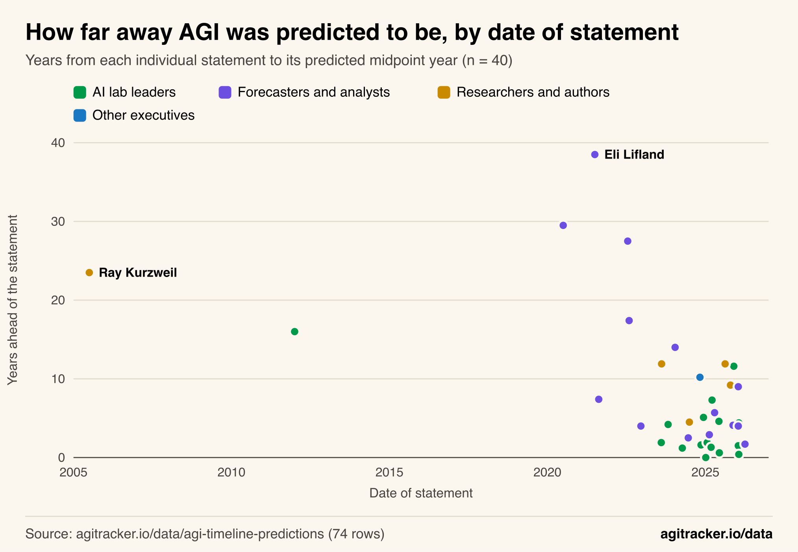
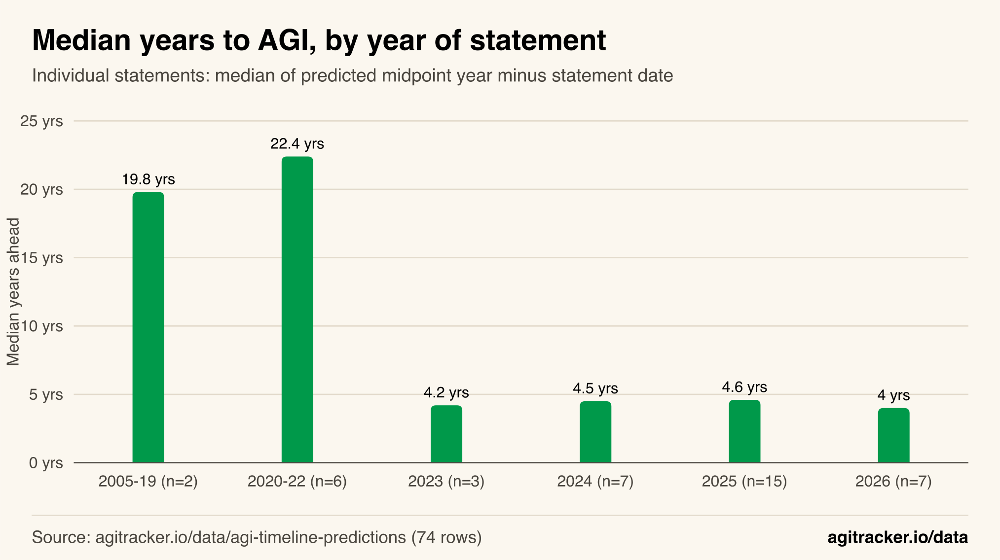
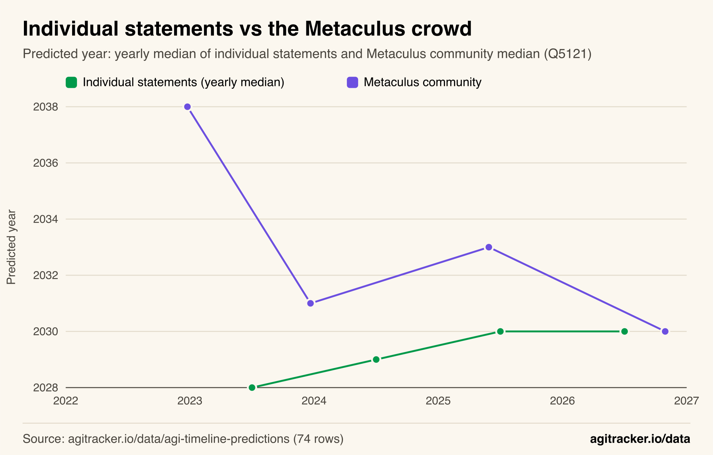
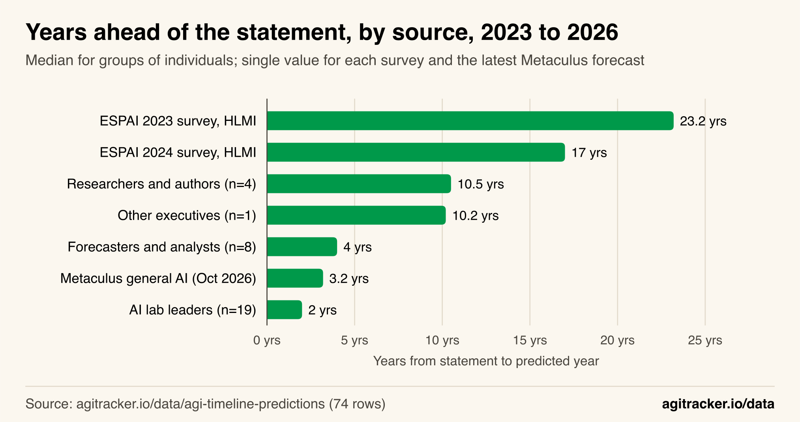
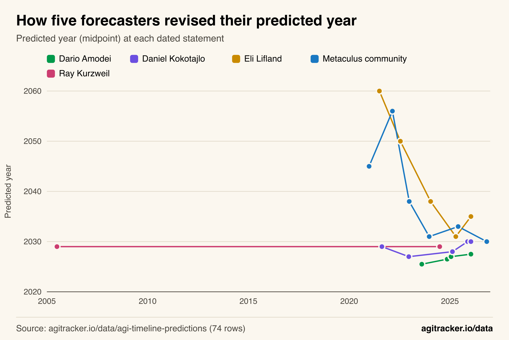

**TL;DR**
- Individual AGI predictions made since 2023 put AGI a median of **4.2 years** after the date they were made (32 statements). Before 2023 the median was **20.5 years** (8 statements).
- That gap has barely moved: **4.2, 4.5, 4.6 and 4.0 years** for statements made in 2023, 2024, 2025 and 2026. Over the same period the median predicted year moved later, from **2028 to 2030**.
- **AI lab leaders** put AGI closest: a median of **2.0 years** after they spoke (19 statements), against 4.0 years for forecasters and 10.5 years for researchers.
- Repeat predictors behave in three distinct ways: dates that **slide later** (Dario Amodei, 0.84 years per year), dates that **hold still** (Ray Kurzweil's 2029 since 2005), and dates that **collapsed then leveled off** (Eli Lifland, Metaculus).
- **Ten** individual predictions have windows that close by the end of 2027; **eight** come from lab leaders.

Since 2023, people predicting AGI have put it a median of 4.2 years away, and that distance has stayed roughly fixed while the calendar moved. In agitracker's [AGI timeline predictions dataset](/data/agi-timeline-predictions/), statements made in 2023 had a median predicted year of 2028; statements made in 2025 and 2026 had a median of 2030. The forecasts got closer to the present in 2022 and 2023, and since then AGI has stayed about four years out.

This analysis uses the dataset's 74 dated, sourced predictions, 40 of which are individual statements with a predicted year that can be placed on a timeline. It measures how far ahead of their own date those predictions pointed, how that distance changed, who predicts the shortest timelines, how repeat predictors revise, and which predictions are now coming due. Every number below can be reproduced from the [public CSV](https://agitracker.io/data/agi-timeline-predictions.csv) using the steps in the methodology section.

Definitions matter throughout. The predictions use different milestones (AGI, "powerful AI", human-level machine intelligence, AI "smarter than any human"), as this site's explainer on [what counts as AGI](/blog/what-counts-as-agi/) describes. The analysis compares dates, not definitions, and says where that matters.

## The Distance to AGI Collapsed, Then Stopped Moving

The key measure is lead time: the predicted midpoint year minus the date of the statement. A 2025 statement predicting 2030 has a lead time of about five years. Lead time shows how far into the future a prediction points, regardless of when it was made.

*Figure 1: Before 2023, individual statements put AGI two or more decades out; since 2023, most put it less than six years out.*

Figure 1 shows each of the 40 individual statements with a predicted year. Before 2023 the points sit high: Ray Kurzweil's 2005 prediction of 2029 was 23.5 years ahead, and Eli Lifland's 2021 median of 2060 was 38.5 years ahead. From 2023 onward, the points crowd near the bottom of the chart.

The yearly medians make the shift precise.

*Figure 2: The median distance fell from about 20 years to about 4, then held at 4.0 to 4.6 years in every year from 2023 to 2026.*

| Year of statement | Statements with a predicted year | Median years ahead | Shortest | Longest |
|---|---:|---:|---:|---:|
| 2005 to 2019 | 2 | 19.8 | 16.0 | 23.5 |
| 2020 to 2022 | 6 | 22.4 | 4.0 | 38.5 |
| 2023 | 3 | 4.2 | 1.9 | 11.9 |
| 2024 | 7 | 4.5 | 1.2 | 14.0 |
| 2025 | 15 | 4.6 | 0.0 | 11.9 |
| 2026 | 7 | 4.0 | 0.4 | 9.0 |

Two things stand out. The drop happened between the 2020 to 2022 group and 2023, the period that includes ChatGPT's release on November 30, 2022 (see the [AI model release timeline](/data/ai-model-release-timeline/)). And after the drop, the median did not keep falling. If people expected AGI on a fixed date, the median lead time would shrink by about one year for every year that passed. Instead it stayed between 4.0 and 4.6 years for four consecutive years.

The flat median hides wide spread. Of the 32 statements since 2023, 11 put AGI less than 2 years out, 13 between 2 and 6 years, and 8 more than 6 years out. "About four years" describes the middle of the distribution, not a consensus.

## The Predicted Year Moved Later as the Calendar Moved

A constant lead time implies a moving target. The median predicted year in individual statements rose each year from 2023 to 2025 and held in 2026.

| Year of statement | Statements | Median predicted year |
|---|---:|---:|
| 2023 | 3 | 2028 |
| 2024 | 7 | 2029 |
| 2025 | 15 | 2030 |
| 2026 | 7 | 2030 |

The Metaculus forecasting community, tracked in the same dataset through question 5121 ("first general AI system"), moved differently. Its median dropped from 2056 in February 2022 to 2038 in December 2022 and 2031 in December 2023, then rose to 2033 in May 2025 and fell back to 2030 on October 29, 2026. The dataset's [Metaculus trend figure](/data/agi-timeline-predictions/#fig-metaculus-trend) shows the full series.

*Figure 3: Individual statements drifted later, from 2028 to 2030, while the Metaculus crowd came down to meet them at 2030.*

By October 2026 the two series sit on the same year. The yearly median of individual statements reached 2030 in 2025, and the Metaculus median reached 2030 in 2026. The paths differ: individual statements started early and drifted later, while the crowd started late and came down.

## Lab Leaders Predict the Shortest Timelines

Splitting the statements since 2023 by the speaker's role shows large differences. The classification is by person and is listed in full in the methodology.

*Figure 4: AI lab leaders put AGI closest, a median of 2 years out; researcher surveys put human-level AI 17 to 23 years out.*

| Source, statements since 2023 | Statements | Median years ahead |
|---|---:|---:|
| AI lab leaders | 19 | 2.0 |
| Metaculus general AI (October 29, 2026) | 1 | 3.2 |
| Forecasters and analysts | 8 | 4.0 |
| Other executives | 1 | 10.2 |
| Researchers and authors | 4 | 10.5 |
| ESPAI 2024 survey, human-level machine intelligence | 1 | 17.0 |
| ESPAI 2023 survey, human-level machine intelligence | 1 | 23.2 |

AI lab leaders, the people who run or co-founded the labs building frontier models, gave a median lead time of 2.0 years. One of their 19 statements is Sam Altman's January 2025 note that AI agents might "join the workforce" in 2025, which is a near-term product claim rather than an AGI date. Removing it raises the lab-leader median to 3.0 years (18 statements) and leaves the overall median since 2023 at 4.2 years (31 statements).

Large researcher surveys sit far from both. The [ESPAI 2023 survey](https://arxiv.org/abs/2401.02843) of 2,778 researchers put a 50% chance of human-level machine intelligence at 2047, and the [ESPAI 2024 survey](http://aiimpacts.org/wp-content/uploads/2026/09/ESPAI2024.pdf) of 1,580 researchers moved it to 2042. Those surveys also ask about full automation of labor, with medians of 2116 and 2098; those are left out of the chart because they measure a different milestone. The individual researchers in the dataset (Geoffrey Hinton, Yoshua Bengio, Ray Kurzweil, Andrej Karpathy) sit between the surveys and the lab leaders at 10.5 years.

These groups also hold different stakes and roles, and the companies several of them lead are among the [most valuable private AI companies](/data/biggest-ai-companies/). The data cannot say why their timelines differ. It shows only that they do, and by how much.

## Three Ways People Revise Their Predictions

Nine people or sources in the dataset have more than one dated prediction for a comparable milestone. A simple way to describe how each revises is the revision slope: how many years the predicted date moved per year of calendar time, from a least-squares line through their statements. A slope of 1 means AGI stays the same distance away. A slope of 0 means a fixed date that gets closer as time passes. A negative slope means the predicted date moved earlier.

*Figure 5: Amodei's date moved later almost as fast as the calendar, Kurzweil held 2029 for 19 years, and Lifland and Metaculus fell sharply before leveling off.*

| Predictor | Statements | Span (years) | Revision slope | Path of predicted year |
|---|---:|---:|---:|---|
| Dario Amodei | 4 | 2.4 | 0.84 | 2025.5, 2026.5, 2027, 2027.5 |
| Elon Musk ("smarter than any human") | 2 | 1.8 | 0.56 | 2025.5, 2026.5 |
| Daniel Kokotajlo (AGI median) | 5 | 4.4 | 0.34 | 2029, 2027, 2028, 2030, 2030 |
| Ray Kurzweil | 2 | 19.0 | 0.00 | 2029, 2029 |
| Shane Legg | 2 | 11.8 | 0.00 | 2028, 2028 |
| Demis Hassabis | 3 | 0.8 | -2.19 | 2032.5, 2030, 2030 |
| Metaculus Q5121 | 6 | 5.8 | -3.58 | 2045, 2056, 2038, 2031, 2033, 2030 |
| Ajeya Cotra (transformative AI) | 2 | 2.1 | -4.79 | 2050, 2040 |
| Eli Lifland (AGI or TAI median) | 5 | 4.5 | -6.00 | 2060, 2050, 2038, 2031, 2035 |

The table falls into three groups.

- **Sliding dates.** Dario Amodei's four statements, from an [August 2023 interview](https://www.dwarkesh.com/p/dario-amodei) to a January 2026 Davos panel, moved his predicted year from 2025.5 to 2027.5 over 2.4 years: a slope of 0.84, close to a constant distance. Elon Musk's two statements on AI "smarter than any human" moved from 2025.5 to 2026.5 over 1.8 years. His milestone wording also shifted, from "smarter than the smartest human" to "smarter than any human".
- **Fixed dates.** Ray Kurzweil predicted human-level intelligence by 2029 in 2005 and [reaffirmed 2029 in 2024](https://www.theguardian.com/technology/article/2024/jun/29/ray-kurzweil-google-ai-the-singularity-is-nearer). Shane Legg gave 2028 in 2011 and again in 2023. For them, AGI got closer at the speed of the calendar.
- **Collapsed, then leveled off.** Eli Lifland's median moved from 2060 in 2021 to 2031 in April 2025, and Ajeya Cotra's [transformative AI median](https://www.alignmentforum.org/posts/AfH2oPHCApdKicM4m/two-year-update-on-my-personal-ai-timelines) moved from 2050 to 2040 between 2020 and 2022. The Metaculus median fell from 2056 to 2031 between 2022 and 2023. Since 2023, these series have moved less, and some have moved later: Lifland went to 2035 in January 2026 (slope since 2023: -1.92), Kokotajlo from 2028 to 2030 (slope since 2023: 2.33), and Metaculus between 2030 and 2033 (slope since 2023: -0.35).

Several of these slopes rest on two to four points over a few years, so they describe each person's recorded statements rather than a stable trait. The AI Futures Project, where Kokotajlo and Lifland work, documents its own revisions in [a post on how its forecasts changed](https://blog.aifutures.org/p/clarifying-how-our-ai-timelines-forecasts).

## Predictions Now Coming Due

Short lead times mean deadlines arrive quickly. Ten individual predictions in the dataset have a stated window that ends by the end of 2027, read from the year range in each prediction. Eight of the ten come from AI lab leaders.

| Statement date | Who | Window | What was predicted | Window ends |
|---|---|---|---|---|
| Jan 5, 2025 | Sam Altman | 2025 | First AI agents may "join the workforce" ([source](https://blog.samaltman.com/reflections)) | Closed (2025) |
| Jun 10, 2025 | Sam Altman | 2026 | Systems that can figure out novel insights ([source](https://blog.samaltman.com/the-gentle-singularity)) | End of 2026 |
| Aug 8, 2023 | Dario Amodei | 2025 to 2026 | A model that talks like a generally well-educated human | End of 2026 |
| Apr 8, 2024 | Elon Musk | 2025 to 2026 | AI smarter than the smartest human, "probably next year, within two years" | End of 2026 |
| Nov 11, 2024 | Dario Amodei | 2026 to 2027 | Powerful, human-expert-level AI ([transcript](https://lexfridman.com/dario-amodei-transcript)) | End of 2027 |
| Jan 21, 2025 | Dario Amodei | About 2027 | AI better than humans at almost everything | End of 2027 |
| Mar 6, 2025 | Anthropic | Late 2026 to early 2027 | "Powerful AI systems" with Nobel-level capabilities ([source](https://www.anthropic.com/news/anthropic-s-recommendations-ostp-u-s-ai-action-plan)) | End of 2027 |
| Jan 22, 2026 | Elon Musk | 2026 to 2027 | AI smarter than any human ([source](https://decrypt.co/355532/elon-musk-predicts-ai-outpace-human-intelligence-this-year)) | End of 2027 |
| Jun 2024 | Leopold Aschenbrenner | 2027 | AGI by 2027 "strikingly plausible" | End of 2027 |
| Dec 2022 | Daniel Kokotajlo | 2027 | AGI median (later revised to 2028, then 2030) | End of 2027 |

The table does not score whether these came true. Most milestones are worded loosely ("talks like a generally well-educated human", "novel insights"), so judging them requires a definition the speaker did not give. Musk's April 2024 statement deserves a note: its "within two years" wording points to April 2026, earlier than the end of its 2025 to 2026 range, and he made a new prediction for 2026 to 2027 in January 2026. The next 14 months will settle, one way or another, what most of the short-timeline statements in this dataset claimed.

## How Forecasting Sources Compare Since 2023

Individual statements are one source among several. The dataset also holds scenarios, a forecasting model, expert surveys and the Metaculus questions, and their lead times since 2023 vary widely:

- **AI 2027 scenario** (April 2025): superhuman coder, superhuman AI researcher and superintelligence all in 2027, 1.7 years out. Its authors' own [timelines forecasts](https://ai-2027.com/research/timelines-forecast) gave all-things-considered superhuman-coder medians of 2028 and 2030 (2.7 and 4.7 years out), and FutureSearch's professional forecasters gave 2033 (7.7 years).
- **Epoch AI Direct Approach model** (May 2023, default settings): transformative AI in 2029, 5.6 years out.
- **Metaculus weakly general AI** (question 3479, October 29, 2026): 2027, 0.2 years out. The stricter general AI question gives 2030.
- **Expert surveys:** 17.0 and 23.2 years for human-level machine intelligence, as above.

The spread reflects definitions as much as opinion. A "weakly general AI" question that resolves on a handful of benchmarks reaches its date sooner than a survey asking when machines will do every task better and more cheaply than humans. This site's [field guide to AGI forecasts](/blog/field-guide-to-agi-forecasts/) explains how each method produces its number. Trend extrapolation from measured capabilities, such as the task-length trend in this site's look at [METR time horizons in 2026](/blog/metr-time-horizons-2026/), is a separate approach that does not appear as a row in this dataset.

## How We Did This

**Data.** All figures come from agitracker's [AGI timeline predictions dataset](/data/agi-timeline-predictions/) as published on October 29, 2026: 74 rows, downloadable as [CSV](https://agitracker.io/data/agi-timeline-predictions.csv). Each row has a person or source, an organization, the predicted year or range as stated, a midpoint year, the milestone wording, the statement date and a source type. Every row links to its primary source on the dataset page's [table](/data/agi-timeline-predictions/#data).

**Lead time.** Lead time is the row's `midpoint` minus the statement date as a decimal year. Dates given only as a year are placed at mid-year (July 1); dates given as a year and month are placed on the 15th of that month; full dates are used exactly. This is the same convention the dataset's charts use. Leads are rounded to one decimal place for display only. Rows without a midpoint (open-ended statements such as "by 2030" or "no year given") are excluded from all lead-time and predicted-year calculations; 40 of the 49 individual statements have a midpoint.

**Groups.** "Individual statements" are rows whose type is `Individual statement` (49 rows, including one company statement from Anthropic). Periods are based on the statement date: before 2020, 2020 to 2022, then each calendar year. Medians are simple medians of the rows in each group.

**Role classification** (added for this analysis, by person):

| Group | People |
|---|---|
| AI lab leaders | Sam Altman, Dario Amodei, Anthropic (company statement), Demis Hassabis, Sergey Brin, Sundar Pichai, Shane Legg, Elon Musk, Mark Zuckerberg, Mustafa Suleyman, Ilya Sutskever |
| Forecasters and analysts | Ajeya Cotra, Daniel Kokotajlo, Eli Lifland, Leopold Aschenbrenner |
| Researchers and authors | Geoffrey Hinton, Yoshua Bengio, Yann LeCun, Ray Kurzweil, Andrej Karpathy |
| Other executives | Jensen Huang, Masayoshi Son |

Kokotajlo's December 2022 statement was made while he worked at OpenAI; he is classified by his main role across the dataset (forecaster). Zuckerberg, Huang, LeCun and Hinton's 2023 and April 2025 statements have no midpoint, so they do not affect the medians.

**Revision slopes.** For each series listed in the revision table, the slope is the ordinary least-squares coefficient of midpoint year on statement date. Series use comparable milestones: Kokotajlo's AGI medians exclude his April 2026 "automated coder" median; Musk's series uses his two "smarter than any human" statements and excludes his "smarter than all of humanity" claim; Amodei's four statements cover a well-educated-human model, powerful AI, AI better than humans at almost everything, and Nobel-level research, which the dataset groups as his short-timeline milestone. Dataset rows used: Amodei 6, 8, 9, 11; Kokotajlo 38 to 42; Lifland 44 to 48; Metaculus 64 to 69; Kurzweil 32, 33; Legg 17, 18; Hassabis 12, 13, 16; Musk 19, 20; Cotra 36, 37 (zero-based row numbers in the JSON download).

**Windows ending by 2027.** For individual statements with a midpoint, the window end is the largest four-digit year in the `predicted` text. Rows with a window end of 2027 or earlier are listed.

**Sensitivity.** Excluding Altman's January 2025 workforce-agents row changes the lab-leader median from 2.0 to 3.0 years and leaves the overall median since 2023 at 4.2 years.

## Limitations

- **Curated, not exhaustive.** The dataset holds 74 predictions chosen for prominence and sourcing. Lab leaders' 2025 and 2026 statements are well represented; researchers and surveys less so. Results describe this record, not everyone's views.
- **Small groups.** Several yearly groups have three to seven statements, and several revision slopes rest on two points. Treat them as descriptions of the recorded statements.
- **Mixed milestones.** The rows predict different things. The analysis uses each row's midpoint as published, so a near-term claim about "novel insights" and a claim about superintelligence count the same way in lead-time medians.
- **Midpoints are a simplification.** A range such as "2030 to 2045" becomes 2037.5, and a "50% by" year becomes that year. Open-ended statements are excluded, which removes some of the most cautious views ("years to a decade" from Yann LeCun).
- **No scoring.** The predictions coming due are listed, not judged.

## The Takeaway

The record since 2023 shows a stable pattern: whatever year it is, the typical prediction puts AGI about four years later, and the people closest to frontier development put it closest of all, at about two years. Fixed-date forecasters like Kurzweil are now a little over two years from their 2029, while repeat predictors like Amodei have moved their dates later at nearly the speed of the calendar. Ten loosely worded predictions come due by the end of 2027. The [dataset](/data/agi-timeline-predictions/) will be updated as they do, which is the simplest way to see whether "four years away" finally starts to shrink.
