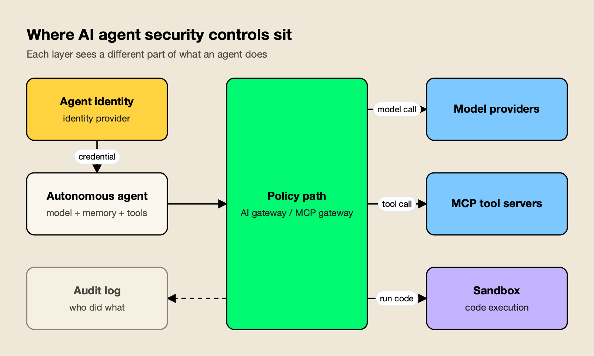
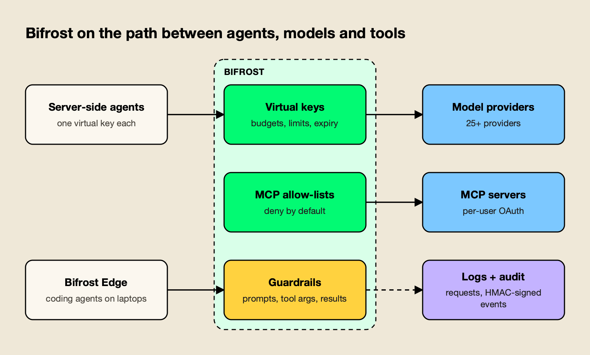
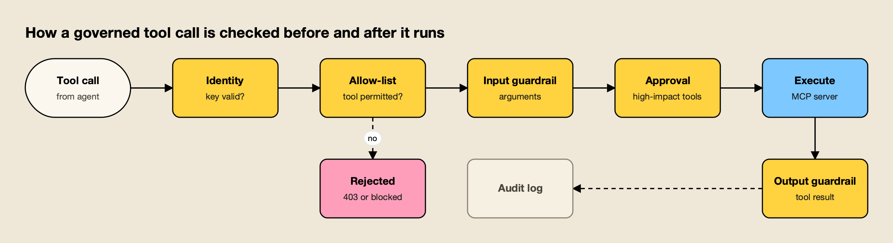

**TL;DR**
- AI agent security tools control what autonomous agents can reach and do: which identity they act under, which MCP tools they may call, what code they can run, and what record they leave behind.
- The OWASP Top 10 for Agentic Applications puts agent goal hijack, tool misuse and identity and privilege abuse at the top, and all three are contained by permissions enforced outside the model.
- The tools fall into five groups: gateways on the model and tool path, identity platforms, MCP access proxies, sandboxes, and agent security posture platforms.
- Bifrost is the top pick because it combines per-agent virtual keys, deny-by-default MCP tool allow-lists, guardrails on tool arguments and results, and signed audit logs in one open-source gateway.
- Most teams pair a policy-path tool with an identity platform and a sandbox, because no single product covers all three layers.

AI agent security is the discipline of limiting what autonomous AI agents can access and do, so that an agent steered by a malicious document, a poisoned tool or a leaked credential cannot turn its permissions against the organization that granted them. Agents differ from chatbots because they hold credentials, call tools with side effects and run code without a human approving each step. This ranking compares eight AI agent security tools on the controls that matter for agentic AI security: agent identity, MCP access control, runtime guardrails, sandboxing and audit trails.

## Agentic AI Security Risks in the OWASP Top 10

The [OWASP Top 10 for Agentic Applications](https://genai.owasp.org/resource/owasp-top-10-for-agentic-applications-for-2026/), published by the OWASP GenAI Security Project on December 9, 2025, is the reference list of AI agent security risks. Its first three entries, goal hijack, tool misuse and identity abuse, all describe an agent using legitimate access for an attacker's purpose.

That framing separates agent security from the earlier [OWASP Top 10 for LLM Applications](https://genai.owasp.org/llm-top-10/), which centers on prompts and outputs. Agent risks live in the actions an agent takes after the model output is produced. The agentic list covers ten categories:

| ID | Risk | Primary control |
|---|---|---|
| ASI01 | Agent Goal Hijack | Guardrails on inputs and retrieved content; least-privilege tools |
| ASI02 | Tool Misuse and Exploitation | Per-agent tool allow-lists, argument checks, approval |
| ASI03 | Identity and Privilege Abuse | Distinct agent identities, scoped and expiring credentials |
| ASI04 | Agentic Supply Chain Vulnerabilities | Approved MCP server and plugin inventory |
| ASI05 | Unexpected Code Execution | Sandboxed execution with network egress policy |
| ASI06 | Memory and Context Poisoning | Memory isolation per user and session |
| ASI07 | Insecure Inter-Agent Communication | Authenticated agent-to-agent calls |
| ASI08 | Cascading Failures | Budgets, rate limits, retry and loop caps |
| ASI09 | Human-Agent Trust Exploitation | Approval steps tied to the specific action |
| ASI10 | Rogue Agents | Runtime monitoring, kill switches, audit trails |

The [OWASP AI Agent Security Cheat Sheet](https://cheatsheetseries.owasp.org/cheatsheets/AI_Agent_Security_Cheat_Sheet.html) turns these risks into engineering guidance. Two rules recur across it: "enforce authorization in the execution component, outside the agent's context," and "fail closed for unknown tools or missing approval requirements." Both point to the same design: the checks that matter run in infrastructure the agent cannot talk its way past.

The six public breaches reviewed in [AI agent security incidents in 2026](/blog/ai-agent-security-incidents/) follow this pattern. Shared credentials, untrusted input reaching privileged agents and unvetted plugins caused more damage than any exotic model behavior. A broader treatment of the same risk catalog is in this [practical guide to AI security risks for engineering teams](https://www.getmaxim.ai/articles/ai-security-risks-a-practical-guide-for-engineering-teams/). Untrusted input reaching an agent usually arrives as [prompt injection](/blog/prompt-injection-attacks/), whose mechanics and defenses are covered in a separate explainer.

## Where AI Agent Security Controls Sit

AI agent security controls sit in four places: the identity the agent authenticates with, the policy path its model and tool calls travel through, the sandbox its code runs in, and the audit log that records what it did. Each layer sees a different slice of agent behavior, which is why a single product rarely covers every OWASP risk.

*Figure 1: Identity, the policy path, the sandbox and the audit log cover different risks; no single layer sees all four.*

As Figure 1 shows, the policy path is the only layer that sees every model call and every tool call together. That is where per-agent tool permissions, budgets and guardrails can be enforced on each request. Identity platforms decide who the agent is but not which MCP tool it may call. Sandboxes contain what generated code can touch but have no view of the prompt that produced it.

The [Model Context Protocol specification](https://modelcontextprotocol.io/specification/latest) matters here because MCP has become the standard way agents reach tools. An MCP server exposes tools with side effects (write a file, open a pull request, query a database), so MCP access control is now the central part of AI agent access control. The [agent gateways comparison](/blog/agent-gateways/) covers the policy-path layer in more depth, and the [MCP governance tools roundup](/blog/mcp-governance-tools/) focuses on tool permissions alone.

## How the AI Agent Security Tools Were Evaluated

Each tool was scored on six criteria drawn from the OWASP agentic risks, with the most weight on controls enforced outside the model. Claims come from each vendor's own documentation, read in October 2026. Where a vendor does not publish a capability, the comparison says "Not published" rather than guessing.

| Criterion | What was assessed | OWASP risks addressed | Weight |
|---|---|---|---|
| Agent identity and credentials | Distinct identity per agent, scoped and expiring credentials, no raw secrets in agent code | ASI03 | High |
| Tool and MCP access control | Per-agent tool allow-lists, deny-by-default behavior, per-user upstream auth | ASI02, ASI04 | High |
| Runtime guardrails | Inspection of prompts, tool arguments and tool results, with block or redact actions | ASI01, ASI06 | High |
| Execution containment | Sandboxing, network egress control, approval for high-impact actions | ASI05, ASI09 | Medium |
| Audit trail | Per-request logs of model and tool calls plus signed records of policy changes | ASI10 | Medium |
| Deployment and coverage | Self-hosting, open source, coverage of server-side and endpoint agents | All | Medium |

Policy-path tools score higher on this rubric because they can enforce identity, tool access and guardrails on the same request. Specialist tools (identity, sandboxing, posture) score high on one criterion and are best read as complements. The [AI guardrails platforms comparison](/blog/ai-guardrails-platforms/) and the [AI security platforms ranking for LLM traffic](/blog/ai-security-platforms/) apply related rubrics to the prompt-and-response layer.

## AI Agent Security Tools Compared

The table summarizes how the eight AI agent security tools cover the evaluation criteria. Bifrost covers identity, tool access, guardrails and audit on one request path; the specialists lead on the single layer they were built for.

| Tool | Category | Agent identity | MCP tool access | Runtime guardrails | Containment | Audit trail |
|---|---|---|---|---|---|---|
| Bifrost | AI and MCP gateway | Virtual key per agent, expiry, per-user MCP OAuth | Deny-by-default allow-list per key | Prompts, tool arguments, tool results | Approval for non-auto-execute tools; Edge for endpoints | Request logs plus HMAC-signed audit events |
| Microsoft Entra Agent ID | Identity platform | Agent identities with sponsors | Not published | Not published | Not published | Sign-ins logged as AI agents |
| Cloudflare MCP Server Portals | MCP access proxy | Cloudflare Access login, service tokens | Per-tool on/off, allowlist mode | DLP through Cloudflare Gateway | Not published | Portal and Access logs |
| Docker MCP Gateway and Sandboxes | Isolation runtime | Not published | Server profiles | Not published | Container and microVM isolation, deny-by-default egress | Gateway call tracing |
| Kong AI Gateway | API and AI gateway | AI MCP OAuth2 plugin | Access controls for MCP tools | Regex prompt guard on LLM traffic | Not published | AI audit logs for MCP traffic |
| Zenity | Agent security posture | Agent inventory and permissions review | MCP Security at tool level | Runtime Boundaries | Blocks or shuts down agents | Detection and response events |
| Palo Alto Networks Prisma AIRS | AI runtime security | Agent identity verification | Not published | Prompt injection and data leak blocking | Network and API intercept | Platform logs |
| NVIDIA NeMo Guardrails | Guardrails library | Not published | Not published | Input, retrieval, dialog, execution and output rails | Not published | Not published |

## 1. Bifrost

[Bifrost](https://www.getmaxim.ai/bifrost) is an [open-source AI gateway written in Go](https://github.com/maximhq/bifrost) by Maxim AI that sits between agents, 25+ model providers (10,000+ models through one OpenAI-compatible API) and MCP tool servers. It gets the longest write-up here because its documentation covers every criterion in the rubric on a single request path, which no other tool on this list does.

### Agent Identity and Credentials

Each agent gets its own [virtual key](https://docs.getbifrost.ai/features/governance/virtual-keys), which carries its own budget, token and request rate limits, and an optional expiry from 30 minutes to a custom date. The agent never holds a provider API key. Inactive or expired keys are rejected at MCP tool execution with a 403, so retiring an agent is a single change.

For the tools themselves, Bifrost supports six [MCP authentication types](https://docs.getbifrost.ai/mcp/auth/overview): none, static headers, OAuth 2.0, per-user OAuth, per-user headers and token exchange. Per-user modes mean an agent acting for an employee reaches GitHub or Notion under that employee's credential rather than a shared admin token, which addresses the OWASP identity and privilege abuse risk directly. [Secret management](https://docs.getbifrost.ai/enterprise/secret-management) resolves provider keys, virtual key values and MCP auth headers from HashiCorp Vault, AWS Secrets Manager or GCP Secret Manager at runtime.

### Tool Permissions and MCP Access Control

[MCP tool filtering](https://docs.getbifrost.ai/features/governance/mcp-tools) is deny-by-default: a virtual key with no MCP configuration can call no tools. Admins add specific tools per MCP client, and a caller-supplied header can only narrow the allow-list, never widen it. The allow-list is checked again at execution time. [Virtual MCPs](https://docs.getbifrost.ai/mcp/virtual-mcps) bundle a curated subset of tools from several servers behind one `/mcp/<slug>` endpoint and attach it to the keys that need it.

[Agent mode](https://docs.getbifrost.ai/mcp/agent-mode) adds a second layer. Only tools listed in `tools_to_auto_execute` run without review; every other tool call is returned to the application for approval. The docs recommend keeping operations such as `write_file`, `delete_file` and `execute_command` out of the auto-execute list, which matches the OWASP rule on approval for irreversible actions. The [enterprise MCP governance write-up](https://www.getmaxim.ai/bifrost/blog/enterprise-mcp-governance-access-audit-and-cost-controls-for-ai-agents-2/) walks through the same controls for a multi-team rollout.

### Runtime Guardrails on Tool Calls

[Guardrails](https://docs.getbifrost.ai/enterprise/guardrails) apply to both LLM traffic and MCP tool execution. MCP rules run before a tool executes, where they can inspect or redact its arguments and block the call, and after it returns, where they can inspect or redact the result. Rules are written in CEL and can target a specific MCP client, tool or argument, plus the calling virtual key, team or user.

Providers include built-in [secrets detection](https://docs.getbifrost.ai/enterprise/guardrails/secrets-detection) backed by Gitleaks, custom regex, LLM-as-judge prompt guardrails, Presidio, AWS Bedrock Guardrails, Azure Content Safety, Google Model Armor, CrowdStrike AIDR, Gray Swan Cygnal, Patronus AI and Check Point's AI Agent Security. The [MCP guardrails announcement](https://www.getmaxim.ai/bifrost/blog/mcp-guardrails-in-bifrost/) explains why the tool boundary, rather than the model's proposed call, is the place to enforce them.

*Figure 2: One policy set covers server-side agents and, through Bifrost Edge, the agents running on employee machines.*

### Audit Trails and Endpoint Agents

Request logs record model calls, tool calls and their arguments and results, and [audit logs](https://docs.getbifrost.ai/enterprise/audit-logs) record administrative changes as HMAC-signed events with retention settings, JSON, JSON Lines or Syslog export, and archival to S3 or GCS. That split answers both audit questions: what an agent did, and who changed its permissions. The requirements behind it are set out in this piece on [MCP audit logging for enterprise compliance](https://www.getmaxim.ai/bifrost/blog/mcp-audit-logging-requirements-for-enterprise-governance-and-compliance/).

Figure 2 also shows the endpoint side. [Bifrost Edge](https://www.getmaxim.ai/edge), now generally available, runs on macOS, Windows and Linux and routes desktop AI apps, browser AI, coding agents and their MCP servers through the gateway, so the same virtual keys, budgets, guardrails and audit logs apply on laptops. Its [MCP governance](https://docs.getbifrost.ai/edge/mcp-governance) builds a fleet-wide inventory of configured MCP servers and enforces allow or deny decisions on the device. Bifrost's published benchmark reports 11 µs of added overhead per request at 5,000 RPS on an AWS t3.xlarge, documented on the [t3.xlarge benchmark page](https://docs.getbifrost.ai/benchmarking/t3.xl).

**Best for:** platform and security teams that want agent identity, MCP tool permissions, guardrails on tool calls and audit in one self-hostable layer, for both server-side agents and coding agents on employee machines.

**Enterprise tier.** Guardrails, audit logs, secret management, token exchange auth and RBAC are part of Bifrost Enterprise. The [AI security overview](https://www.getmaxim.ai/resources/ai-security), [MCP gateway resource page](https://www.getmaxim.ai/resources/mcp-gateway) and [guardrails resource page](https://www.getmaxim.ai/resources/guardrails) describe what that tier adds.

## 2. Microsoft Entra Agent ID

[Microsoft Entra Agent ID](https://learn.microsoft.com/en-us/entra/agent-id/what-are-agent-identities) gives AI agents their own identity accounts in Microsoft Entra ID, separate from user and application identities. It is the most complete answer on this list to the question of AI agent identity: who an agent is, who owns it, and what it may access.

Microsoft's documentation describes agent identities as designed "for scale and ephemerality rather than permanence," because agents may be created and destroyed thousands of times a day. Agents can request tokens for Microsoft Graph and third-party services, act autonomously with their own roles or on behalf of a user with delegated rights, and authenticate incoming calls from other agents. Copilot Studio agents receive an agent identity automatically, with the creating user recorded as the sponsor, and their authentications are logged as AI agents in the admin center.

Agent ID is available to all Entra customers, but extending Entra security features such as conditional access to agents requires a Microsoft Agent 365 license.

**Best for:** Microsoft-centric organizations that need a directory-grade identity, ownership record and lifecycle for every agent, especially those building in Copilot Studio.

**Trade-offs:** identity decides who an agent is, not which MCP tool it may call or what its tool arguments contain, so it pairs with a policy-path tool for tool permissions and guardrails.

## 3. Cloudflare MCP Server Portals

[Cloudflare MCP server portals](https://developers.cloudflare.com/cloudflare-one/access-controls/ai-controls/mcp-portals/) put multiple MCP servers behind one HTTP endpoint protected by Cloudflare Access. Users log in once through Access, then authenticate to each upstream server that needs OAuth, and admins choose which servers and tools each portal exposes.

Per-server Access policies decide who sees each server, using selectors such as email, group, country and device posture. Admins can switch off individual tools, or use an allowlist mode that hides everything except explicitly enabled tools. Routing portal traffic through Cloudflare Gateway adds HTTP logs and DLP scanning, and machine-to-machine agents authenticate with Access service tokens.

Cloudflare's documentation flags two points to plan around: blocked users can still reach a server through its direct URL unless Access is configured as the server's OAuth provider, and stdio-only servers are not supported.

**Best for:** organizations already on Cloudflare Zero Trust that want MCP access tied to their existing identity provider and device posture policies.

**Trade-offs:** guardrails on tool arguments and results are not part of the portal itself, and Logpush export of portal logs requires an Enterprise plan.

## 4. Docker MCP Gateway and Docker Sandboxes

Docker covers the containment layer with two products. The [Docker MCP Gateway](https://docs.docker.com/ai/mcp-catalog-and-toolkit/mcp-gateway/) is open source and runs each MCP server in an isolated container with restricted privileges, network access and resource usage, injecting credentials and providing logging and call tracing.

[Docker Sandboxes](https://docs.docker.com/ai/sandboxes/security/) go further for coding agents. Each sandbox is a microVM with its own kernel and its own Docker Engine, so the agent can have sudo inside without reaching the host. Outbound TCP is proxied and checked against a deny-by-default policy, sandboxes cannot reach each other, and the host-side proxy adds authentication headers so raw credential values never enter the VM. Docker's own docs advise pruning the default allowlist, which includes broad wildcards.

This is the strongest answer here to the OWASP unexpected code execution risk, and it mirrors the containment lessons in the account of [AI agents escaping the sandbox](/blog/ai-agents-escaping-the-sandbox/).

**Best for:** teams running coding agents or code-executing agents that need hard isolation and egress control around what the agent runs.

**Trade-offs:** containment limits blast radius but does not decide which tools an agent should use or inspect what it sends; central management of sandbox policies requires a paid subscription.

## 5. Kong AI Gateway

[Kong AI Gateway](https://developer.konghq.com/mcp/) adds MCP and LLM traffic handling to Kong Gateway through plugins. The AI MCP OAuth2 plugin secures access to MCP servers, and Kong documents access controls for MCP tool usage alongside its rate-limiting and traffic-control plugins.

Kong's AI audit logs record MCP traffic with session IDs, JSON-RPC methods, payloads, latencies and errors, and MCP metrics track latency and error counts. On the LLM side, the [AI Prompt Guard plugin](https://developer.konghq.com/plugins/ai-prompt-guard/) screens chat messages with allow and deny regular expressions.

**Best for:** organizations already running Kong Gateway that want agent and MCP traffic under the same plugin model and operations team as their APIs.

**Trade-offs:** guardrails on MCP tool arguments and results are not described on Kong's MCP page, and the AI Prompt Guard plugin applies to LLM requests sent through the AI Proxy plugins.

## 6. Zenity

Zenity is an agent security platform organized around three stages: posture, detection and inline enforcement. Its AI Security Posture Management module evaluates agent configuration and permissions against policy before deployment, and its AI Detection and Response module detects runtime threats.

Its Runtime Boundaries feature evaluates each agent action in real time and allows it, blocks it or shuts the agent down, and its MCP Security module governs agent-to-MCP connections at the tool level. Zenity names Salesforce Agentforce and Copilot Studio among the agentic SaaS platforms it covers, plus agents on AWS Bedrock and Google Vertex AI and local coding agents.

**Best for:** security teams that need an inventory and posture view of agents built by business users on low-code and SaaS platforms.

**Trade-offs:** Zenity governs agents from the security team's side rather than sitting on the model call path, so budgets and provider routing for agents come from another layer.

## 7. Palo Alto Networks Prisma AIRS

Prisma AIRS is Palo Alto Networks' AI security platform. Its runtime layer enforces safeguards against manipulation, data exposure and unsafe actions during live AI interactions, and Palo Alto describes a dedicated AI agent security capability against risks such as memory manipulation and tool misuse.

Prisma AIRS deploys through Network Intercept, which uses Palo Alto firewalls, or API Intercept, where applications call its API. The platform also covers AI discovery, model scanning and red teaming.

**Best for:** security teams standardized on Palo Alto Networks that want agent runtime protection from the same vendor and console as their network security.

**Trade-offs:** MCP-specific controls are not described on the product page, and per-agent budgets and tool allow-lists are not part of its published scope.

## 8. NVIDIA NeMo Guardrails

NVIDIA NeMo Guardrails is an open-source Python package for adding programmable guardrails to LLM applications. It runs rails at five stages: input, retrieval, dialog, execution and output, where execution rails validate tool inputs and outputs before and after a tool call.

Dialog flows and guardrail logic are written in Colang. Jailbreak detection combines LLM self-checks, heuristics and NVIDIA's NemoGuard Jailbreak Detection NIM, and the package integrates with LangChain, LangGraph, Presidio and several third-party moderation services. It can also run as a server with an OpenAI-style chat completions endpoint.

**Best for:** engineering teams that want guardrail logic, including tool-call validation, defined in code inside their own agent application.

**Trade-offs:** as a library, it protects only the agents that embed it, and identity, tool permissions and audit trails have to come from elsewhere.

## How a Governed Tool Call Is Checked

A governed tool call passes through identity, permission, guardrail and approval checks before it executes, then a result check before the output returns to the agent. The order matters: cheap deterministic checks such as key validity and tool allow-lists run first, and slower content checks run only on calls that pass them.

*Figure 3: Most damage from tool misuse is stopped by checks that run outside the model, before the tool executes.*

Figure 3 maps the OWASP risks to specific steps. The identity check contains privilege abuse (ASI03). The allow-list contains tool misuse (ASI02), and in a deny-by-default design an unknown tool never reaches the server. The input guardrail inspects arguments for injected instructions or leaked secrets, the approval step covers irreversible actions (ASI09), and the output guardrail stops a poisoned tool result from flowing back into the agent's context (ASI01 and ASI06).

Few of the tools in this ranking implement every step. Bifrost documents all of them on one request path; Cloudflare and Kong cover identity and tool access; NeMo Guardrails covers the guardrail steps inside the application; Docker contains what happens during execution. A [checklist of MCP security best practices](https://www.getmaxim.ai/articles/mcp-security-best-practices-enterprise-checklist-2026/) and a review of [MCP security risks and their mitigations](https://www.getmaxim.ai/articles/mcp-security-risks-and-how-to-mitigate-them/) list the same steps from the server operator's side.

## AI Agent Governance Beyond Runtime Controls

AI agent governance is the organizational layer above runtime security: an inventory of every agent, a named owner, documented permissions, spend limits and a review process. Runtime tools enforce those decisions, but the decisions themselves come from governance, and auditors ask for both.

Three practices separate governed agent programs from ad hoc ones:

- **An agent inventory with owners.** Entra Agent ID's sponsor field and Zenity's posture inventory both answer "which agents exist and who is responsible." Gateways add the operational view of which keys are active and what each spent.
- **Endpoint coverage.** Coding agents and desktop AI apps on employee laptops connect to MCP servers that no central team approved. Fleet-level discovery, covered in the [shadow AI detection tools ranking](/blog/shadow-ai-detection-tools/), closes that gap. A deeper look at [AI endpoint security for every machine](https://www.getmaxim.ai/articles/ai-endpoint-security-governing-ai-on-every-machine/) covers the same problem for coding agents.
- **Testing before release.** OWASP recommends structured adversarial testing before production and after changes to prompts, tools, memory or models; the [AI red-teaming tools comparison](/blog/ai-red-teaming-tools/) covers that step.

Mapping these controls to existing security frameworks is what makes them auditable. A [governance framework for CISOs mapped to security frameworks](https://www.getmaxim.ai/articles/ai-governance-framework-for-cisos-mapping-controls-to-security-frameworks/) and the overview of [AI governance at the gateway](https://www.getmaxim.ai/ai-governance) show how per-agent keys and audit logs translate into control evidence. For regulated security teams, the [cybersecurity industry overview](https://www.getmaxim.ai/industry-pages/cybersecurity) applies the same model.

## Choosing an AI Agent Security Tool

The right AI agent security tool depends on where agents run and which layer is missing today. Teams building their own agents need a policy path first; teams with agents on Microsoft or SaaS platforms need identity and posture; teams running generated code need a sandbox regardless of what else they use.

| Situation | Start with | Add |
|---|---|---|
| Custom agents calling several models and MCP servers | A gateway on the model and tool path (Bifrost) | Sandbox for code execution |
| Copilot Studio and Microsoft 365 agents | Microsoft Entra Agent ID | Posture platform for inventory |
| Coding agents on employee machines | Endpoint routing to a gateway (Bifrost Edge) | Docker Sandboxes for isolation |
| Existing Cloudflare Zero Trust estate | Cloudflare MCP server portals | Guardrails on tool arguments |
| Existing Kong or Palo Alto estate | Kong AI Gateway or Prisma AIRS | Per-agent identity and budgets |
| Guardrails inside one Python agent | NeMo Guardrails | Central audit and tool permissions |

Further reading on the comparison side includes this [AI agent security platform comparison](https://www.getmaxim.ai/articles/ai-agent-security-top-5-platforms-compared-in-2026/) and a review of [governance platforms for MCP tool calls](https://www.getmaxim.ai/articles/ai-agent-governance-for-mcp-tool-calls-best-platforms-2026/).

For coding agents specifically, a guide to [securing Cursor, Claude Code and Copilot](https://www.getmaxim.ai/articles/ai-coding-agent-security-governing-cursor-claude-code-and-copilot/) covers the endpoint case.

On this site, the [MCP gateways comparison](/blog/top-mcp-gateways-compared/) and the guide to [gateways for Claude Code](/blog/claude-code-gateways/) cover the tool-access and coding-agent cases in more detail.

## Conclusion

AI agent security in 2026 comes down to enforcing least privilege outside the model. The OWASP agentic list is clear that goal hijack, tool misuse and identity abuse are the leading risks, and none of them can be solved by asking the model to behave. They are contained by distinct agent identities, deny-by-default tool permissions, guardrails at the tool boundary, sandboxed execution and an audit trail that ties each action to an owner.

On those criteria Bifrost ranks first, because it enforces identity, MCP tool access, guardrails and audit on the same request path for both server-side and endpoint agents. Microsoft Entra Agent ID is the strongest identity layer, Docker the strongest containment layer, Cloudflare and Kong fit teams already on their platforms, and Zenity, Prisma AIRS and NeMo Guardrails each cover a specific part of the problem. Most organizations will run two or three of these layers together, and the useful question for any new agent is which of the four control points it currently bypasses.
