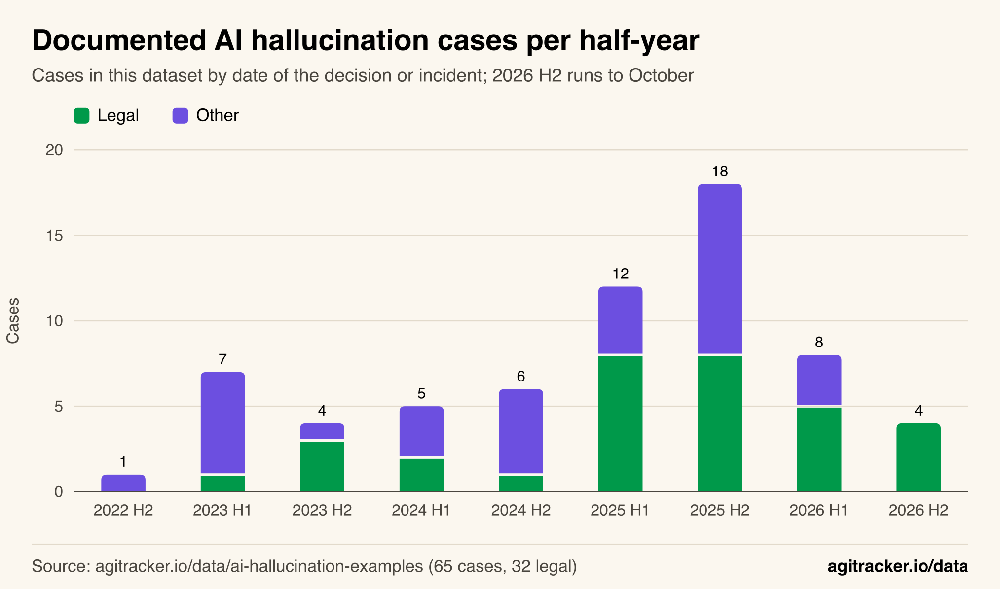
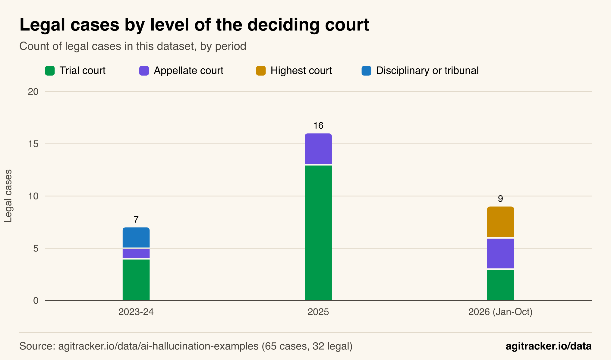
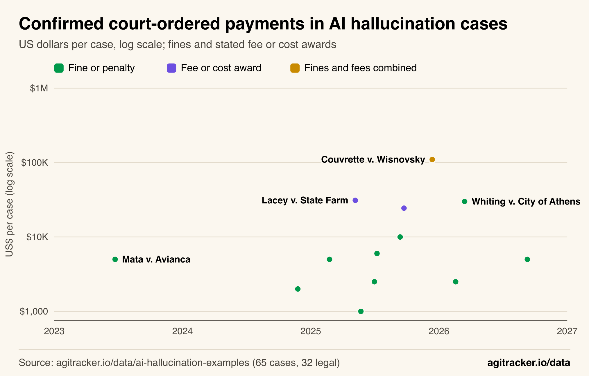
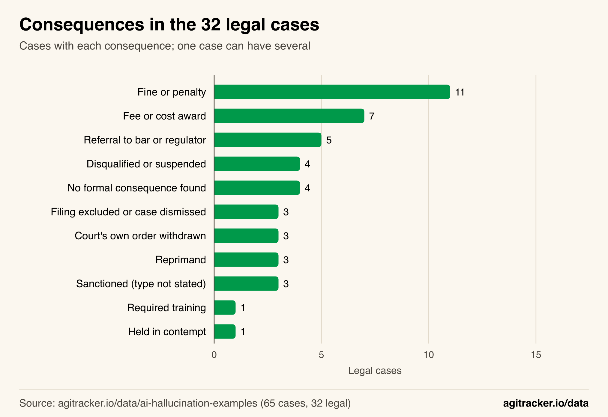
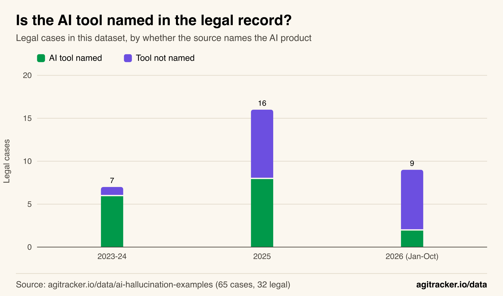

**TL;DR**
- AI hallucination cases have moved up the court system. Appellate and state supreme courts decided 1 of 7 legal cases from 2023 and 2024 in this dataset, 3 of 16 in 2025 and 6 of 9 in 2026 so far.
- Penalties grew. The median confirmed court-ordered payment rose from US$3,500 (2023 to 2024, n = 2) to US$6,000 (2025 to 2026, n = 11), and the largest, US$110,000, is 22 times the first well-known sanction.
- Courts stopped naming the AI tool. The source names no product in 1 of 7 legal cases from 2023 to 2024, 8 of 16 in 2025 and 7 of 9 in 2026.
- Legal cases became most of the record: 4 of 11 documented hallucination cases in 2023, 16 of 30 in 2025 and 9 of 12 in 2026.
- Money is the most common consequence, but 5 of the 32 legal cases ended in a referral to a bar or regulator and 4 in disqualification or suspension.

AI hallucination cases with real consequences are now concentrated in courtrooms, and the courts handling them have changed. In an analysis of the 65 documented cases in agitracker.io's [AI hallucination examples dataset](/data/ai-hallucination-examples/), appellate courts and state supreme courts decided 6 of the 9 legal cases recorded so far in 2026, up from 1 of 7 in 2023 and 2024. The penalties those courts impose have grown, and the records increasingly do not say which AI product produced the fake citations.

The dataset is curated, not a census: it holds 32 legal cases worldwide, chosen because each has a documented consequence and a court record or reputable report. For scale, a [February 2026 Fifth Circuit order](https://www.ca5.uscourts.gov/opinions/pub/25/25-20086-CV0.pdf) noted that researcher Damien Charlotin's [AI Hallucination Cases database](https://www.damiencharlotin.com/hallucinations/) had identified 239 cases of hallucination by lawyers in U.S. courts alone. What follows describes the pattern in a documented sample; the methodology and every coding decision are at the end, and the underlying rows are in the [public CSV](https://agitracker.io/data/ai-hallucination-examples.csv).

## Legal Cases Became Most of the Documented Record

Legal cases went from a minority of documented AI hallucination cases to most of them. In this dataset, they were 4 of 11 cases dated 2023, 3 of 11 in 2024, 16 of 30 in 2025 and 9 of 12 from January to October 2026. Every case dated in the second half of 2026 so far is a legal one.

*Figure 1: Legal cases rose from one or two per half-year before 2025 to eight in each half of 2025.*

Two forces likely drive this, and the data cannot separate them. More lawyers are using generative AI for research and drafting, so more fabricated citations reach courts. And courts produce written, public, dated records of what happened, which makes legal cases far easier to document than a hallucination in a customer-service chat or an internal report. The 33 non-legal cases spread across news and publishing (6), government (6), other (6), academic (4), search (4), health (4) and customer service (3). None of those domains has a public record system like court dockets.

The rise in documented legal cases is therefore partly a rise in visibility. It still matters: each one is a filed document that a judge, an opposing party or a court clerk had to check, and each produced an order explaining what went wrong. The dataset page's own [cases-by-year chart](/data/ai-hallucination-examples/#fig-cases-by-year) shows the same split by calendar year.

## The Cases Moved From Trial Courts to Appellate and Supreme Courts

The level of court deciding these cases has shifted. In 2023 and 2024, one of the seven legal cases came from an appellate court (Park v. Kim in the Second Circuit). In 2025, three of 16 did. In 2026 so far, six of nine came from appellate or highest courts: the Fifth, Sixth and Ninth Circuits, and the supreme courts of Alabama, Connecticut and New Mexico.

*Figure 2: In 2026, two-thirds of the legal cases in the dataset were decided by appellate or highest courts.*

| Period | Legal cases | Trial court | Appellate court | Highest court | Disciplinary or tribunal | Appellate + highest |
|---|---:|---:|---:|---:|---:|---:|
| 2023 to 2024 | 7 | 4 | 1 | 0 | 2 | 1 of 7 |
| 2025 | 16 | 13 | 3 | 0 | 0 | 3 of 16 |
| 2026 (Jan to Oct) | 9 | 3 | 3 | 3 | 0 | 6 of 9 |

This matters beyond the individual lawyers. Appellate opinions are often published and cited as precedent, and they set standards for every trial court below them. Several 2026 decisions say so directly. The Fifth Circuit's order in Fletcher v. Experian describes AI-hallucinated citations as "a problem that is getting worse, not better" and says pleading ignorance of the risks "is certainly no longer" an excuse. The Connecticut Supreme Court's case is recorded as its first ruling on AI hallucination sanctions, and the Ninth Circuit's as that court's first.

A caution on this finding: appellate and supreme-court rulings are more likely to be reported by national outlets, so a curated dataset built from court records and reputable reporting will over-represent them. The shift is large enough (1 of 7 to 6 of 9) to be worth reporting, and small enough in absolute numbers (n = 9 for 2026) that it should be read as a direction, not a measured rate.

## Penalties Grew, and the Biggest Ones Combine Fines With Fees

Thirteen legal cases in the dataset have a court-ordered payment in US dollars that could be confirmed from the order or a published report. The first widely reported case, [Mata v. Avianca](https://storage.courtlistener.com/recap/gov.uscourts.nysd.575368/gov.uscourts.nysd.575368.54.0.pdf) in June 2023, ended in a US$5,000 sanction. The median confirmed payment was US$3,500 across the two cases from 2023 and 2024 and US$6,000 across the 11 from 2025 and 2026.

*Figure 3: Most confirmed payments stay between US$1,000 and US$10,000, but since 2025 a few cases have reached US$24,400 to US$110,000.*

| Decision date | Case | Confirmed payment (US$) | Type |
|---|---|---:|---|
| 2023-06-22 | Mata v. Avianca (S.D.N.Y.) | 5,000 | Fine |
| 2024-11-25 | Gauthier v. Goodyear (E.D. Tex.) | 2,000 | Penalty, plus required training |
| 2025-02-24 | Wadsworth v. Walmart (D. Wyo.) | 5,000 | Fines of 3,000, 1,000 and 1,000 |
| 2025-05-06 | Lacey v. State Farm (C.D. Cal.) | 31,100 | Fee and cost award (26,100 + 5,000) |
| 2025-05-22 | Garner v. Kadince (Utah Ct. App.) | 1,000 | Ordered donation (opposing fees also ordered, amount not stated) |
| 2025-06-30 | Shahid v. Esaam (Ga. Ct. App.) | 2,500 | Statutory maximum frivolous-motion penalty |
| 2025-07-07 | Coomer v. Lindell (D. Colo.) | 6,000 | Fines of 3,000 and 3,000 |
| 2025-09-12 | Noland v. Land of the Free (Cal. Ct. App.) | 10,000 | Sanction |
| 2025-09-23 | Professional soccer lawsuit (D.P.R.) | 24,400 | Fee award as a sanction |
| 2025-12-12 | Couvrette v. Wisnovsky (D. Or.) | 110,000 | Fines and attorney fees combined |
| 2026-02-18 | Fletcher v. Experian (5th Cir.) | 2,500 | Sanction |
| 2026-03-13 | Whiting v. City of Athens (6th Cir.) | 30,000 | Punitive sanctions of 15,000 each, plus fees and double costs (amounts not yet set) |
| 2026-09-09 | Murder appeal (N.M. Supreme Court) | 5,000 | Fine, plus contempt |

Three things stand out in the table. First, the median moved modestly; the jump is in the upper tail. Five of the 11 confirmed payments since 2025 are US$10,000 or more, against none of the two before. Second, the largest amounts are mostly fee awards, money paid to the other side for the time spent uncovering fake citations, rather than fines paid to the court. Lacey, the soccer case and Couvrette all fall in that category, which ties the penalty to the damage done rather than to a fixed fine scale. Third, the largest pure fine per person is the [Sixth Circuit's US$15,000 each](https://www.opn.ca6.uscourts.gov/opinions.pdf/26a0080p-06.pdf) in Whiting, which said it chose that figure partly because "smaller fines have plainly been inadequate," given the continuing stream of similar cases.

The [Noland opinion](https://www.courts.ca.gov/opinions/archive/B331918.PDF) is a useful marker of the 2025 shift: the California Court of Appeal described its US$10,000 sanction as "conservative" and directed that its opinion be served on the State Bar. Wadsworth v. Walmart's [sanctions order](https://storage.courtlistener.com/recap/gov.uscourts.wyd.64014/gov.uscourts.wyd.64014.181.0.pdf) shows another pattern that recurs: the lawyer who drafted the filing paid the most (US$3,000 and loss of pro hac vice admission), but co-signing lawyers who did not check the citations were also fined.

## Money Is Common, but Career Consequences Are Where Sanctions Bite

Fines and fee awards are the most frequent consequences, but they are not the only ones. Across the 32 legal cases, 11 involved a fine or penalty and 7 a fee or cost award. Five involved a referral to a bar, regulator or chief judge for discipline, four a disqualification, suspension or revoked admission, and three a reprimand. Four ended with no formal consequence found in the sources: an apology, an acknowledgement or an explanation to the court.

*Figure 4: Fines lead, but one in six legal cases also triggered a referral to a bar or regulator.*

Some of the non-monetary consequences are heavier than any fine in the table. A Colorado lawyer was suspended for a year and a day in 2023 (with most of it stayed on probation). In Johnson v. Dunn (N.D. Ala., 2025), three lawyers were publicly reprimanded, disqualified from the case and referred to the state bar. In a 2026 Mississippi contract dispute, the judge disqualified the lawyers on both sides. In England, the [Divisional Court's judgment in Ayinde and Al-Haroun](https://www.judiciary.uk/wp-content/uploads/2025/06/Ayinde-v-London-Borough-of-Haringey-and-Al-Haroun-v-Qatar-National-Bank.pdf) referred lawyers to their regulators and recorded earlier wasted-costs orders of £2,000 each against a barrister and a law centre. These are excluded from the US-dollar analysis above.

The share of legal cases with at least one formal sanction (a fine, fee award, unspecified sanction, referral, removal, reprimand, contempt or required training) was 5 of 7 in 2023 and 2024, 11 of 16 in 2025 and 7 of 9 in 2026. That ratio is roughly flat, which suggests the change is not that courts sanction more often once a case reaches them, but that the cases reaching them are heard at higher levels and penalized more heavily.

## Courts Increasingly Do Not Name the AI Tool

In the early cases, the AI product was part of the story. Mata v. Avianca, the Colorado discipline case, Park v. Kim and Zhang v. Chen all named ChatGPT; United States v. Cohen named Google Bard. By 2026, most records in the dataset simply describe "generative AI" or say the court found its hallmarks.

*Figure 5: The share of legal cases with no AI product named rose from 14% to 78%.*

| Period | Legal cases | Tool named | Tool not named | Share not named |
|---|---:|---:|---:|---:|
| 2023 to 2024 | 7 | 6 | 1 | 14% |
| 2025 | 16 | 8 | 8 | 50% |
| 2026 (Jan to Oct) | 9 | 2 | 7 | 78% |

Across all 32 legal cases, ChatGPT or GPT-4o is named in 12, Claude in 3, Google Bard or Gemini in 2, and Perplexity, Grok and a firm's in-house platform once each (the Noland court listed four tools for one set of briefs). Sixteen name no tool.

The likeliest reading is doctrinal rather than technical. Courts have converged on the position that the duty to verify citations belongs to the person who signs the filing, whatever tool produced the draft, so the product name is no longer relevant to the outcome. Fletcher's language makes the point: the court did not need to identify the tool to find that 21 quotations and assertions were fabricated or misrepresented. For readers trying to judge which AI products hallucinate most, court records are therefore an increasingly poor source. Benchmarks are the better instrument, read with the caveats in this site's guide to [how to read an AI benchmark](/blog/how-to-read-an-ai-benchmark/); the dataset page lists published [hallucination rates by model](/data/ai-hallucination-examples/#section-4).

## Judges' Own Orders Are Now Part of the Record

Three of the 32 legal cases involve a document produced by a court rather than a lawyer. In 2025, a federal judge in New Jersey withdrew an opinion that misstated case outcomes and contained fake quotes after a law school intern used ChatGPT, and a federal judge in Mississippi replaced a temporary restraining order that referred to nonexistent parties and declarations after a law clerk used Perplexity. Both judges disclosed the AI use in October 2025, as reported by the [ABA Journal](https://www.abajournal.com/news/article/2-federal-judges-reveal-ai-use-by-staff-members-led-to-error-riddled-opinions). In 2026, an Oklahoma district judge's order cited two nonexistent cases after the judge used ChatGPT.

A fourth case sits between categories. In Shahid v. Esaam, the Georgia Court of Appeals vacated a trial court divorce order that relied on case law that does not exist; the penalty fell on counsel. These cases show that the verification problem is not limited to one side of the bench, and one of the two federal judges responded by adding second-review rules in chambers.

## How We Did This

**Data.** All figures come from the 65 rows of agitracker.io's [AI hallucination examples dataset](/data/ai-hallucination-examples/) as published on October 29, 2026 ([CSV](https://agitracker.io/data/ai-hallucination-examples.csv)). Legal cases are the 32 rows with `domain` = legal. Dates are the row's `date` field (the decision or incident date); half-years are January to June (H1) and July to December (H2). The 2026 figures run to the end of October.

**Consequence coding.** Each legal row's `consequence` text was coded into one or more categories: fine or penalty (money to the court, a statutory penalty or a court-ordered donation); fee or cost award (money to the other side, including wasted-costs orders); referral to a bar, regulator, grievance panel or chief judge; disqualification, suspension or revoked pro hac vice admission; reprimand; required training; filing excluded or case dismissed; a court's own order withdrawn, replaced or vacated; held in contempt; sanctioned with no type stated (Alabama Supreme Court, Ninth Circuit, Connecticut Supreme Court); and no formal consequence found (United States v. Cohen, Concord Music v. Anthropic, the Victorian murder trial, the Oklahoma judge's order). One row (Los Angeles Superior Court, 2026) is coded as not verified; see below. Where the cited source added detail beyond the row text, the source was used: Whiting v. City of Athens adds full fee reimbursement, double costs and a referral to the chief judge; the Jackson Hospital bankruptcy case is coded as a reprimand only, because the firm's US$55,000 payment was voluntary and the court declined to sanction the firm.

**Payment amounts.** A US-dollar amount is included only where it was confirmed on October 29, 2026 from the court order or a published report: Mata (US$5,000, as quoted in the Wadsworth and Coomer orders), Gauthier, Wadsworth, Shahid, Coomer, Fletcher, Noland and Whiting (court orders); Lacey (Ars Technica: US$26,100 plus US$5,000); Garner (Deseret News: US$1,000 donation; the opposing-fee amount is not stated); the soccer case (Reuters' published summary: "more than $24,400 in legal fees"); Couvrette (ABA Journal: US$110,000 in fines and attorney fees combined, December 12 opinion); and the New Mexico case (The Verge: US$5,000 and contempt). Amounts are per case, summing all lawyers and firms. Excluded: the Los Angeles Superior Court fine of US$999.99 recorded in the dataset, because its source could not be read and no second source was found; the £2,000 wasted-costs orders in Ayinde (not US dollars); and the voluntary US$55,000 fee repayment in the Jackson Hospital case.

**Court level.** Each legal case was coded by the court that made the decision behind the consequence. Trial court: federal district and bankruptcy courts, state trial courts (including the B.C. Supreme Court, the Supreme Court of Victoria's trial division, the High Court of England and Wales, and the Los Angeles Superior Court). Appellate court: Second, Fifth, Sixth and Ninth Circuits; Utah, Georgia and California courts of appeal. Highest court: supreme courts of Alabama, Connecticut and New Mexico. Disciplinary or tribunal: the Colorado Presiding Disciplinary Judge and the UK First-tier Tax Tribunal.

**Tool named.** A case counts as "tool not named" when the dataset's `ai_system` field records generative AI generically, an unnamed AI program, "various AI tools", AI tools attributed only by a party, or an AI system that was not confirmed (Harber v. HMRC).

**Who produced the document.** Lawyer filings: 27. Court documents: 3 (New Jersey, Mississippi, Oklahoma). Self-represented litigant: 1 (Harber v. HMRC). Expert declaration: 1 (Kohls v. Ellison). Shahid v. Esaam is counted as a lawyer case because the penalty fell on counsel.

The analysis script prints every number in this article from the dataset rows; it applies only the filters and codings above, so anyone with the CSV and a spreadsheet can reproduce them.

## Limitations

- **Curated sample.** The 32 legal cases are a small, documented subset of a much larger population (239 U.S. lawyer cases in one database by February 2026, by the Fifth Circuit's count). Trends here describe the documented record, not the rate of AI misuse.
- **Selection toward visible cases.** Cases in higher courts and cases with large penalties get more press coverage, so they are more likely to be in a curated dataset. This could exaggerate both the court-level shift and the growth in penalties.
- **Small numbers.** The 2026 period has 9 legal cases and the 2023 to 2024 period has 7. Shares such as 6 of 9 or 7 of 9 can move sharply with one or two additions.
- **Partial year.** 2026 covers January to October.
- **Amounts.** Fee awards depend on the opposing side's legal costs as much as on the misconduct; three cases with sanctions have no published amount; and the Whiting fee and cost amounts were not yet set in the order read.
- **Coding judgment.** Consequence categories and court levels are hand-coded from short descriptions and the sources listed above. Another analyst might classify a borderline case (for example Shahid v. Esaam) differently.

## What the Record Shows

The documented record of AI hallucinations has become a legal record, and the legal record has moved upward: from trial judges issuing first-of-their-kind sanctions in 2023 to appellate panels and state supreme courts issuing standards in 2026. Penalties at the top end have grown from US$5,000 to six figures, and the most serious consequences, referrals and disqualifications, fall on careers rather than wallets. At the same time, courts have stopped treating the AI product as part of the story. The question they now ask is the one Mata v. Avianca asked first: did the person who signed the filing check it. The full case list, with a source for every row, is on the [dataset page](/data/ai-hallucination-examples/#data), alongside this site's datasets on [AI model releases](/data/ai-model-release-timeline/) and [official AI system prompts](/data/ai-system-prompts/). For the security side of AI failures, see this site's review of [AI agent security incidents](/blog/ai-agent-security-incidents/) and its guide to [AI guardrails platforms](/blog/ai-guardrails-platforms/).
