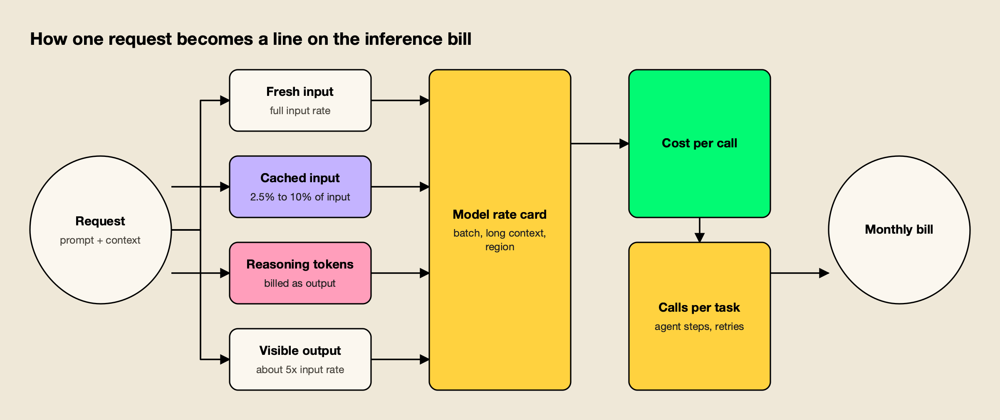
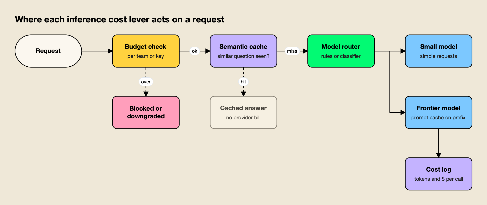
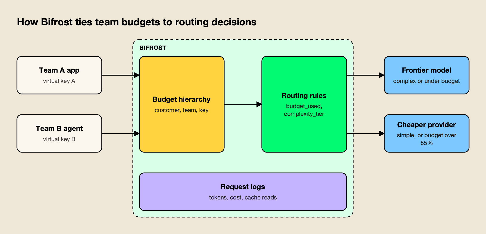

**TL;DR**
- AI inference cost is the price of running a model on every request; it is billed per million tokens on APIs and per GPU-hour when self-hosted.
- In October 2026, official list prices run from $0.10 input and $0.50 output per million tokens (GPT-6 Luna, Claude Haiku 5.5) to $10 and $50 (GPT-6 Astra, Claude Fable 5.1), with cached input at 2.5% to 10% of the input rate.
- The bill is driven less by the headline rate than by output and reasoning tokens, context length, how many calls an agent makes per task, and whether work runs in real time or in batch.
- In a worked example, prompt caching, routing simple tasks to a small model and a modest semantic cache hit rate cut a $37,800 monthly agent bill to about $10,500.
- The levers work best when applied in one place in front of every model call, where budgets, caching, routing and cost logging can see the same traffic.

AI inference cost is the money spent every time a trained model processes a request, and in 2026 it is the line item that grows with every new feature, agent and user. Training is paid once by the lab that builds a model; inference cost is paid by everyone who uses it, on every call, for as long as the product runs. Per-token prices keep falling, yet most teams see their bills rise, because usage, context length, reasoning and agent loops grow faster than prices drop. This explainer breaks down what drives the bill today, using official pricing pages, and which levers cut it by the largest amounts.

## AI Inference Cost Explained

AI inference cost is the operating cost of generating outputs from a model. On hosted APIs it is billed per million tokens, with different rates for fresh input, cached input and output. On self-hosted infrastructure it is the cost of GPUs, power and operations divided by the tokens those machines actually serve.

A token is a chunk of text, roughly three quarters of an English word. Providers count tokens differently: Anthropic's pricing page notes that Claude 4.7 and later models use a newer tokenizer that produces about 30% more tokens for the same text than earlier models. The same prompt can therefore cost different amounts on two models with identical per-token prices.

Three numbers set the cost of any single call:

- **Input tokens:** the prompt, system instructions, tool definitions, retrieved documents and conversation history sent with the request.
- **Output tokens:** the visible response plus, on reasoning models, the hidden reasoning tokens the model generates before answering.
- **The rate card:** the per-million-token price for each category, adjusted by modifiers such as batch discounts, long-context surcharges and data residency multipliers.

The bill for a product is that per-call cost multiplied by the number of calls each task makes and the number of tasks per month.

## AI Token Cost: Current Prices From the Major Labs

AI token cost in October 2026 spans two orders of magnitude. Small models cost about $0.10 per million input tokens, flagships about $10, and output is priced at roughly five times input across most lineups. The table below uses each lab's official pricing page, standard tier, read on October 15, 2026.

| Model | Input ($/1M) | Cached input ($/1M) | Output ($/1M) | Notes |
|---|---|---|---|---|
| GPT-6 Astra | $10.00 | $1.00 | $50.00 | 2x input above 272K tokens |
| GPT-6 Sol | $2.00 | $0.20 | $10.00 | GPT-6.1 Sol: $0.10 cached |
| GPT-6 Luna | $0.10 | $0.01 | $0.50 | Output 1.5x above 272K |
| Claude Fable 5.1 | $10.00 | $0.25 | $50.00 | 1M context at standard price |
| Claude Opus 5.5 | $4.00 | $0.20 | $20.00 | Fast mode $8 / $40 |
| Claude Sonnet 5.5 | $2.00 | $0.10 | $10.00 | Cache write $2.50 (5 min) |
| Claude Haiku 5.5 | $0.10 | $0.01 | $0.50 | $0.50 / $2.50 above 100K prompt |
| Gemini 4 Argon | $2.00 | $0.10 | $10.00 | Price doubles December 1, 2026 |
| Gemini 3.8 Flash | $0.75 | $0.075 | $3.75 | Output includes thinking tokens |
| Gemini 3.1 Flash-Lite | $0.25 | $0.025 | $1.50 | Text, image and video input |
| DeepSeek V4 Pro | $1.32 | $0.044 | $3.96 | Peak rate; off-peak is half |
| DeepSeek V4.1 Flash | $0.30 | $0.006 | $1.20 | Peak rate; off-peak is half |

Prices come from the [OpenAI API pricing](https://developers.openai.com/api/docs/pricing), [Anthropic pricing](https://platform.claude.com/docs/en/about-claude/pricing) and [Gemini API pricing](https://ai.google.dev/gemini-api/docs/pricing) pages.

DeepSeek figures come from its [API pricing page](https://api-docs.deepseek.com/quick_start/pricing). DeepSeek's peak hours are 01:00 to 04:00 and 06:00 to 10:00 UTC on weekdays; every other hour is billed at half the peak rate.

Two patterns stand out. First, the price gap between a lab's smallest and largest model is 20x to 100x, which is why model choice per request matters more than any discount. Second, the cache discount differs more than the headline rate: a cache hit costs 2.5% of input on Claude Fable 5.1, 5% on Claude Sonnet 5.5 and 10% on GPT-6 Sol. For a closer look at one lab's pricing changes, the analysis of [GPT-6 pricing and why a 50% cut will not halve most bills](/blog/gpt-6-pricing/) works through OpenAI's lineup in detail, and the overview of [the top AI models in 2026](/blog/top-ai-models/) covers what each model is good at.

## The Six Drivers of an Inference Bill

An inference bill is driven by six factors: output and reasoning tokens, cached versus fresh input, context length, the number of calls per task, real-time versus batch processing, and, for self-hosted models, GPU utilization. The per-token price is only the starting point; each driver multiplies it.

*Figure 1: Four token meters, one rate card, and a multiplier for how many calls each task makes.*

As Figure 1 shows, the rate card is one box in the chain; how tokens split across categories and how many calls each task triggers explain most of the difference between two teams using the same model.

### Output and reasoning tokens

Output tokens cost about five times as much as input on GPT-6, Claude and Gemini models. On reasoning models, the hidden thinking counts as output. OpenAI's [reasoning guide](https://developers.openai.com/api/docs/guides/reasoning) states that reasoning tokens are not visible through the API but are billed as output tokens and occupy context window space. Anthropic's [extended thinking documentation](https://platform.claude.com/docs/en/build-with-claude/extended-thinking) reports thinking tokens as part of billed output, and Google's price list labels Gemini output prices as including thinking tokens.

A request that returns 300 visible tokens can bill 3,000 output tokens if the model reasons at length. Reasoning effort settings therefore act as a price control: a lower effort level on easy tasks often saves more than switching providers.

### Cached input versus fresh input

Prompt caching lets a provider reuse the processed prefix of a prompt, such as a long system prompt or tool catalog, and bill it at a fraction of the input rate. Writing the cache can cost more than fresh input: Anthropic charges 1.25x the input price for a 5-minute cache write and 2x for a 1-hour write, and its pricing page notes that caching pays off after one read for the 5-minute duration and two reads for the 1-hour duration. OpenAI lists a cache write of $2.50 per million tokens on GPT-6 Sol against $2.00 for fresh input.

The share of input served from cache is a property of how prompts are built. Stable content first and variable content last produces long, reusable prefixes; a timestamp or user ID at the top of the system prompt invalidates the cache on every call.

### Context length

Every token of history, retrieved documents and tool definitions is billed on every call. Some providers also reprice whole requests above a threshold. OpenAI doubles input rates for GPT-6 models above 272K input tokens, Gemini 3.1 Pro Preview moves from $2 to $4 per million input tokens above 200K, and Claude Haiku 5.5 moves from $0.10 to $0.50 above 100K. Claude 4.6 and later models other than Haiku 5.5 charge the same per-token rate across the full 1M context window.

### Agent loops and calls per task

An agent completes a task through several model calls, and each call resends the system prompt, tool definitions and growing history. A six-step agent with a 20,000-token context bills 120,000 input tokens per task before producing anything. Tool-heavy agents are the worst case: with 100 or more tool definitions loaded, much of each call is the tool catalog. Bifrost's [Code Mode documentation](https://docs.getbifrost.ai/mcp/code-mode) reports up to 92.8% fewer input tokens when an agent orchestrates tools through generated code instead of loading every tool definition into context, and a separate write-up on [cutting agent token spend in MCP deployments](https://www.getmaxim.ai/articles/mcp-cost-optimization-cut-agent-token-spend-by-over-90/) walks through the same pattern.

### Batch versus real-time processing

Batch APIs process requests asynchronously, in exchange for about half the standard price. OpenAI's Batch tier halves every listed GPT-6 rate, Anthropic's Batch API applies a 50% discount to input and output, and Gemini's Batch pricing is half of standard for most models. DeepSeek uses time of day instead: off-peak rates are half the peak rates. Evaluation runs, document backfills, nightly summarization and classification of historical data rarely need an answer in seconds.

### Self-hosted GPU economics

Self-hosting replaces per-token prices with a fixed hourly cost. Lambda's on-demand price list shows an NVIDIA H100 SXM at $3.99 per GPU-hour and a B200 at $6.69 per GPU-hour in 8-GPU instances, so an 8x H100 node costs about $23,300 a month. The effective price per token is that cost divided by tokens served.

As an illustration, if a node sustained 10,000 output tokens per second across concurrent requests (an assumed figure; real throughput depends on model size, quantization, batch size and the inference server), it would produce 36 million tokens an hour, or about $0.89 per million at full utilization. At 30% average utilization the same node costs about $2.96 per million, several times the $0.50 list price of GPT-6 Luna or Claude Haiku 5.5. Self-hosting pays when traffic is steady and high; open-weight releases such as the [Chinese open-weight models of 2026](/blog/china-open-weight-models-2026/) make it more attractive, and the guide to [AI gateways for vLLM, Ollama and cloud LLMs](/blog/ai-gateways-for-vllm-ollama-cloud-llms/) covers mixing self-hosted and API models behind one endpoint.

## Inference Cost Levers Compared

The levers that cut inference cost fall into three groups: those that avoid calls (semantic caching, budgets), those that make each call cheaper (routing, smaller models, prompt caching, batch) and those that make spend visible (cost logging). The table compares them by where they act and what they require.

| Lever | What it reduces | Typical saving on affected traffic | Main requirement |
|---|---|---|---|
| Model routing and cascades | Price per token | 20x to 100x on requests moved to a small model | A way to classify requests and test quality |
| Smaller or cheaper models | Price per token | Same as routing, for whole workloads | Evaluation on real prompts |
| Prompt caching | Input cost | 90% to 97.5% on cached prefix tokens | Stable prompt prefixes, steady traffic |
| Semantic caching | Number of paid calls | 100% of the call on a hit | Repeated questions, a tuned similarity threshold |
| Batch processing | Price per token | About 50% | Work that can wait hours |
| Reasoning effort caps | Output tokens | Varies by task | Per-task effort settings |
| Budgets and rate limits | Overruns | Prevents runaway spend | Enforcement at request time |
| Cost observability | Unknown spend | Indirect; finds the other savings | Cost per request, team and feature |

*Figure 2: The cheapest request is the one that never reaches a paid model, so budget and cache checks run before routing.*

Figure 2 shows the usual order: cheap budget checks and cache lookups can end a request early, routing sets the price for the rest, and prompt caching and cost logging apply to every call that reaches a provider.

## Model Routing and Cascades

Model routing sends each request to a model chosen by rules, weights or a classifier, so simple requests are billed at small-model prices and only hard ones reach a frontier model. Because small models cost 20x to 100x less, routing usually saves more than any discount on a single model.

There are three common patterns:

- **Rule-based routing:** route by task type, team, header or request metadata. Classification and extraction go to the small model; code generation and multi-step reasoning go to the flagship.
- **Classifier routing:** a small model or embedding lookup scores each request's complexity and maps it to a tier. Open-source research routers and managed routing services from cloud providers both take this approach.
- **Cascades:** try the cheap model first and escalate to a larger one only when a check fails, such as a low-confidence answer or a failed validation step. Cascades save the most when the cheap model succeeds on most requests and the check itself is cheap.

Routing needs quality measurement on real prompts before traffic moves. A cheaper model that fails 10% of tasks and triggers retries or human escalation can cost more than the flagship. This site's comparison of [seven model routing tools that cut inference cost](/blog/model-routing-inference-cost/) ranks the tools that implement these patterns, and the guide to [LLM routers for per-request auto routing](/blog/llm-routers-for-auto-routing/) covers classifier routers specifically. A practical overview of [model routing to cut LLM token costs](https://www.getmaxim.ai/articles/model-routing-how-to-cut-llm-token-costs/) covers rule design from the gateway side.

## Prompt Caching and Semantic Caching

Prompt caching and semantic caching both cut inference cost, but at different points. Prompt caching still calls the provider and bills the request, at a lower input rate for the cached prefix. Semantic caching answers a repeated or near-identical question from a store, so the provider is not called and nothing is billed.

**Prompt caching** is the right lever for agents, coding assistants and chat products that resend the same system prompt, tool definitions and documents on every turn. The saving equals the cached share of input multiplied by the discount, minus the cost of cache writes. Short-lived traffic that rarely reuses a prefix can pay more with caching on, because cache writes cost more than fresh input. Some agent clients send no cache markers at all, which means nothing is cached on providers that require explicit breakpoints.

**Semantic caching** suits support bots, internal knowledge assistants and FAQ-style traffic, where many users ask the same thing in different words. A cache embeds the incoming request, searches for a stored request above a similarity threshold, and returns the stored answer on a hit. The threshold is the trade-off: too low and users get answers to slightly different questions, too high and the hit rate falls toward zero. Each lookup also costs an embedding call, so the hit rate has to cover that overhead.

Exact-match caching is a simpler variant. Cloudflare's [AI Gateway caching](https://developers.cloudflare.com/ai-gateway/features/caching/) applies only to identical requests and its documentation lists semantic matching as planned.

The survey of [semantic caching solutions for enterprises](/blog/semantic-caching-solutions/) compares five products on similarity controls and the hit rate each needs, and an analysis of the [grey zone problem in semantic caches](https://www.getmaxim.ai/bifrost/blog/your-semantic-cache-has-a-grey-zone-problem-2/) explains why near-threshold matches need separate handling. A gateway-focused guide to [reducing LLM costs with semantic caching](https://www.getmaxim.ai/articles/reduce-llm-costs-with-semantic-caching-the-gateway-approach/) covers deployment choices.

## Budgets, Batching and Smaller Models

Budgets, batching and smaller models are the least technical levers and often the fastest to apply. Budgets stop overruns at request time, batch APIs halve the price of work that can wait, and replacing a flagship with a small model for a whole workload is a configuration change once quality is verified.

A budget only controls cost if it is checked before the request reaches the provider. A monthly report of spend by team is useful for planning but does not stop an agent loop that runs overnight. Request-time budgets usually sit at several levels, organization, team, application key and sometimes per model, and the request must pass all of them. LiteLLM's proxy, for example, documents [budgets for the proxy, teams, users and keys](https://docs.litellm.ai/docs/proxy/users), and rejects requests with a budget error once a key crosses its maximum. The pattern is covered in more depth in a guide to [controlling LLM costs with budget alerts and rate limits](https://www.getmaxim.ai/articles/control-llm-costs-with-budget-alerts-and-rate-limits/).

Batching applies to any workload where the user is not waiting. Common candidates:

- Offline evaluation runs and regression tests on prompts.
- Backfills: summarizing, tagging or embedding historical documents.
- Nightly reports, digests and classification jobs.
- Synthetic data generation.

Smaller models deserve a scheduled re-test. GPT-6 Luna and Claude Haiku 5.5 both list at $0.10 input and $0.50 output per million tokens, and a workload that needed a flagship a year ago may now pass its quality checks on one of them.

## Worked Example: Cutting an Agent's Inference Bill

The example below applies current Claude list prices to an illustrative support agent. The assumptions are stated so the arithmetic can be checked; they are not measurements of any specific product.

The agent handles 100,000 tasks a month. Each task takes six model calls. Each call sends 20,000 input tokens, of which 12,000 are a stable prefix (system prompt and tool definitions), and returns 2,300 output tokens including reasoning. The baseline model is Claude Sonnet 5.5 at $2 input, $10 output, $2.50 for a 5-minute cache write and $0.10 for a cache hit, per million tokens.

| Step | Change | Cost per task | Monthly cost |
|---|---|---|---|
| Baseline | Claude Sonnet 5.5, no caching | $0.378 | $37,800 |
| Prompt caching | 12,000-token prefix written once, read on calls 2 to 6 | $0.270 | $27,000 |
| Routing | 60% of tasks classified as simple go to Claude Haiku 5.5 (also cached) | $0.116 | $11,628 |
| Semantic cache | 10% of tasks answered from cache before any model call | $0.105 | $10,465 |

The total reduction is about 72%. Prompt caching cuts 29% because the prefix is more than half of every call's input. Routing produces the largest single saving because Haiku 5.5 costs a twentieth of Sonnet 5.5 per token. The semantic cache adds a smaller saving here, since the example assumes a modest hit rate and ignores embedding costs; on FAQ-style traffic the hit rate can be much higher.

Logging cost per request before changing anything lets a team attribute each saving to its step and spot retries caused by routing. Longer guides on [managing LLM costs and ROI](https://www.getmaxim.ai/articles/the-technical-guide-to-managing-llm-costs-strategies-for-optimization-and-roi/) and on [reducing LLM token usage](https://www.getmaxim.ai/articles/top-5-strategies-to-reduce-llm-token-usage-and-costs/) list further techniques at the prompt level.

## Applying the Levers at the Gateway: Bifrost as an Example

The levers above can be built into each application, but they work best in one shared layer in front of every model call, where budgets, caches, routing and cost logs see all traffic. An AI gateway is that layer. [Bifrost](https://www.getmaxim.ai/bifrost), an open-source AI gateway written in Go by Maxim AI, is used here as the worked example because its documentation covers each lever in this guide.

Bifrost exposes 25+ providers and 10,000+ models through one OpenAI-compatible API, and its [published benchmark](https://www.getmaxim.ai/resources/benchmarks) reports 11 µs of added overhead per request at 5,000 RPS on an AWS t3.xlarge. The source is on [GitHub](https://github.com/maximhq/bifrost). The cost-related features map to the levers as follows.

*Figure 3: Budgets are routing inputs: as a team nears its limit, a rule can move its traffic to a cheaper provider before requests start failing.*

- **Per-team budgets through virtual keys.** [Virtual keys](https://docs.getbifrost.ai/features/governance/virtual-keys) identify each team or application, and the [budget and limits system](https://docs.getbifrost.ai/features/governance/budget-and-limits) applies independent budgets at the customer, team, virtual key and provider-config levels. Every applicable budget must pass, budgets reset on daily, weekly, monthly, quarterly or yearly windows, and providers that exceed their budget are excluded from routing.
- **Routing rules.** [Routing rules](https://docs.getbifrost.ai/providers/routing-rules) are CEL expressions evaluated per request, scoped to a virtual key, team, customer or globally. They can read `budget_used`, so a rule such as `budget_used > 85` sends a team's traffic to a cheaper provider as it nears its limit, as Figure 3 shows.
- **Complexity tiers.** The [Complexity Router](https://docs.getbifrost.ai/features/governance/complexity-router) labels each request Simple, Medium or Complex and exposes the result as `complexity_tier` to the same routing rules, so the routing step in the worked example needs no application changes. The decision model behind it is described in a post on [a decision model that classifies without generating text](https://www.getmaxim.ai/bifrost/blog/jev-a-decision-model-that-classifies-without-generating-text/).
- **Semantic caching.** The [semantic caching plugin](https://docs.getbifrost.ai/features/semantic-caching) runs an exact-match hash lookup first and an embedding similarity search on a miss, with a default threshold of 0.8 and a default TTL of 5 minutes. It caches chat, text completions, the Responses API, embeddings, transcription, speech and image generation, including streaming.
- **Prompt caching for agent clients.** [Auto prompt caching](https://docs.getbifrost.ai/features/prompt-caching) injects cache breakpoints for clients that send none, so an agent loop writes the cache on turn one and reads it from turn two onward. It is off by default and configured per provider.
- **Cost observability.** [Built-in request logging](https://docs.getbifrost.ai/features/observability/default) records tokens, cost and latency for every call and can filter logs by cost range. The [model catalog](https://docs.getbifrost.ai/architecture/framework/model-catalog) syncs provider pricing every 24 hours when a config store is enabled and prices cache reads and writes separately.

The Bifrost team's own walkthrough of [LLM cost optimization in Bifrost](https://www.getmaxim.ai/bifrost/blog/llm-cost-optimization-in-bifrost-part-1/) shows these features configured together, and a separate article covers [monitoring every request, token and cost](https://www.getmaxim.ai/articles/bifrost-ai-gateway-monitoring-every-request-token-and-cost/) through the gateway.

For broader context on the category, the [LLM gateway overview](https://www.getmaxim.ai/llm-gateway) and the [governance resource page](https://www.getmaxim.ai/resources/governance) describe where cost controls sit alongside access control and audit.

Other gateways cover parts of the same ground. LiteLLM offers budgets and routing in an open-source proxy, OpenRouter's hosted service weights its default provider choice by the inverse square of price, and Cloudflare AI Gateway provides exact-match caching at the edge. The comparison of [the best LLM gateways](/blog/best-llm-gateways/) and the guide to [self-hosted versus managed LLM gateways](/blog/self-hosted-vs-managed-llm-gateway/) help with that choice.

## Measuring Inference Cost Per Request

Measuring inference cost means attributing every call's tokens and dollars to the team, feature and task that caused it. Without that attribution, the monthly invoice shows total spend but not which workload to fix, and savings from any lever cannot be proven.

The useful metrics are:

- **Cost per task,** not per call, since agents make many calls per task.
- **Tokens per task by category:** fresh input, cached input, cache writes, reasoning and visible output.
- **Cache hit rate,** both for prompt caching (cached share of input) and semantic caching (share of requests served without a call).
- **Spend by model and team,** to find traffic still pinned to expensive or deprecated models.
- **Retry and escalation rate after routing changes,** to confirm a cheaper model is not causing extra calls.

These metrics come from provider usage objects (OpenAI and Anthropic both return reasoning token counts per response) or from a gateway that logs every call. The survey of [LLM observability tools](/blog/llm-observability-tools/) compares the products that collect them, and a playbook on [AI cost optimization for teams](https://www.getmaxim.ai/articles/ai-cost-optimization-a-practical-playbook-for-teams/) covers how to turn them into ownership of spend.

## Where Inference Cost Is Heading

Per-token prices keep falling with each model generation, but scheduled increases and new premium tiers show the trend is not one-directional. Google's price list announces that Gemini 4 Argon doubles on December 1, 2026, and Anthropic sells a fast mode for Claude Opus 5.5 at $8 input and $40 output, twice the standard rate.

Three trends matter more than the headline rate for the next year:

- **Reasoning and agents grow tokens per task.** Cheaper tokens are offset by more of them, so tokens per task becomes the main metric.
- **Cache pricing diverges.** Cache hits now range from 2.5% to 10% of input across providers, which makes cache-friendly prompt design worth more on some models than others.
- **Price differences between labs persist.** A 20x to 100x gap between small and large models, and large differences between labs at the same tier, keep routing valuable.

## Conclusion

AI inference cost in 2026 is set less by the price on a lab's pricing page than by how a product spends tokens: how much output and reasoning each call produces, how much input is served from cache, how many calls an agent makes per task, and how much work runs in real time when it could wait. The largest savings come from routing simple work to small models and caching what repeats, and none of them can be verified without cost per request. Teams that start by measuring, then apply routing, caching, batching and budgets in one layer in front of their models, typically find that the same workload can run at a fraction of its current inference cost without changing the model their hardest tasks depend on.
