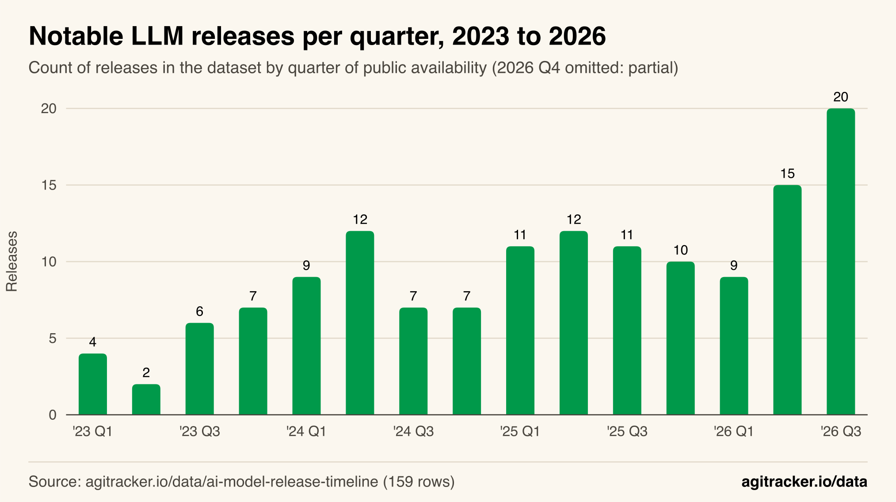
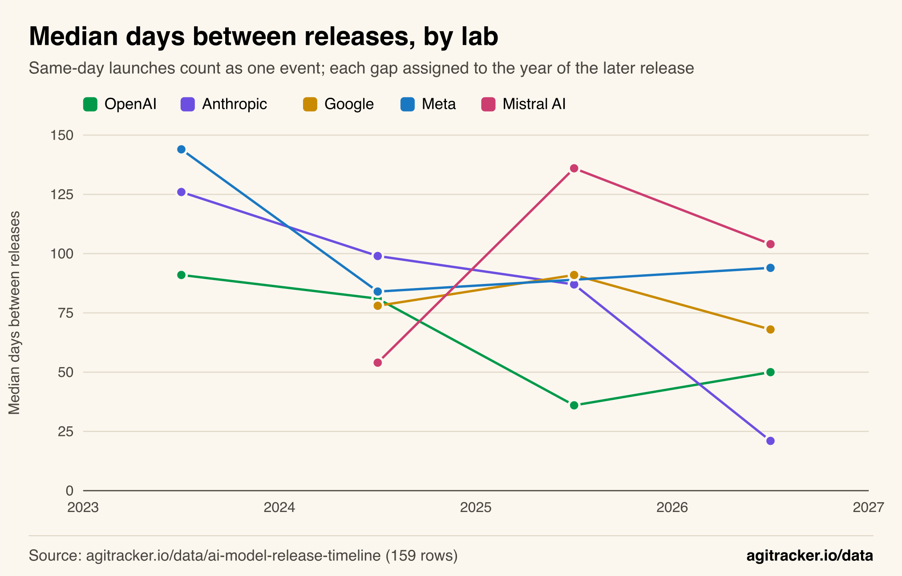
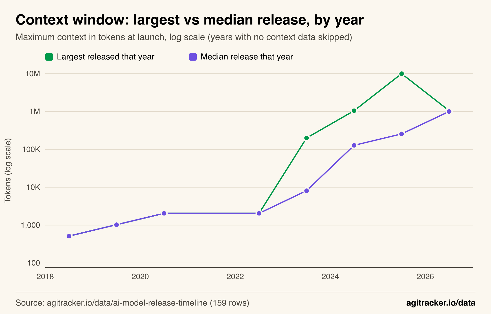
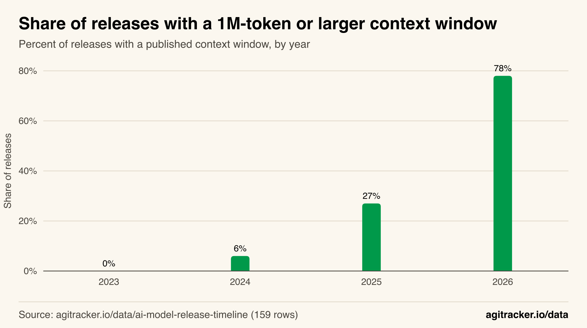
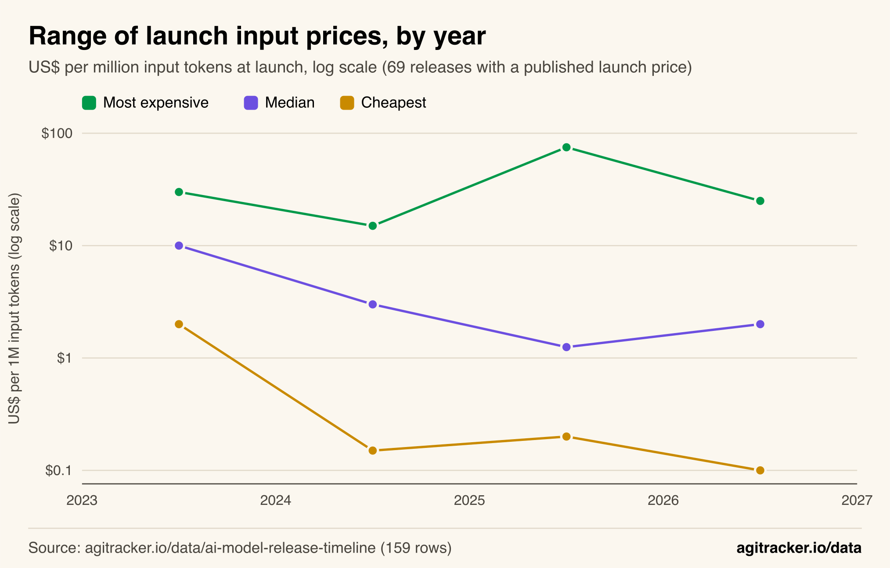
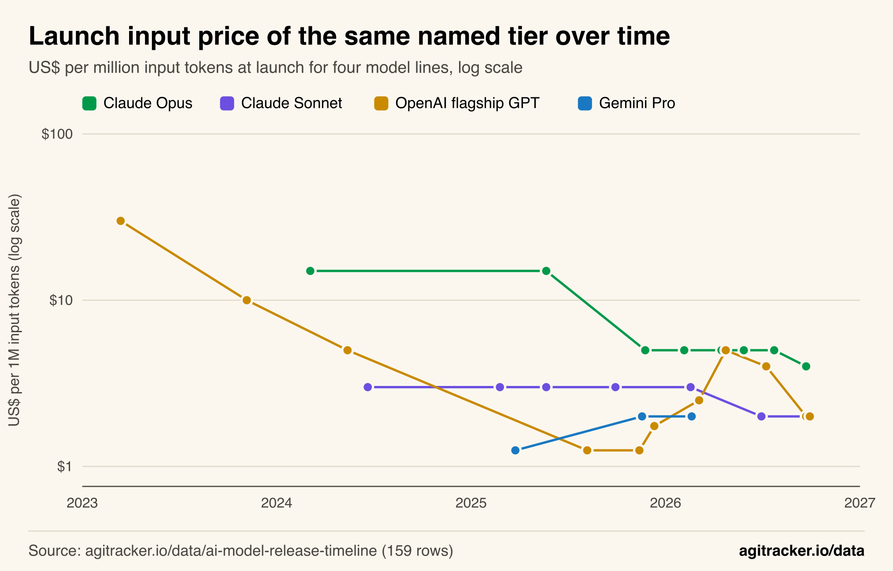

**TL;DR**
- Context windows doubled about every 6.6 months from GPT-1 (512 tokens, 2018) to Llama 4 Scout (10 million, April 2025), then stopped: in the 30.7 months since Gemini 1.5 Pro reached 1 million tokens in April 2024, only one release has gone past about 1 million.
- What changed instead is the typical model. The median context of a release went from 128,000 tokens in 2024 to 1 million in 2026, when 78% of releases with a published context window offered 1 million tokens or more.
- The industry's release tempo has held at one notable launch every 7 days (median) since 2024, but Anthropic sped up sharply: 12 release events in 2026 so far, a median of 21 days apart.
- Launch prices stopped falling in the middle. The cheapest launch fell 20x to $0.10 per million input tokens, but the median launch price rose from $1.25 in 2025 to $2.00 in 2026, and every year since 2023 the most expensive launch cost $15 to $75.

Context windows in large language models grew at a doubling rate of about 6.6 months for seven years, and then hit a wall at 1 million tokens. That is the clearest pattern in agitracker.io's [AI model release timeline](/data/ai-model-release-timeline/), a sourced record of 159 notable LLM releases from GPT-1 in June 2018 to GPT-6.1 Terra on October 26, 2026. Since Google's Gemini 1.5 Pro became the first public API model with a 1 million token window in April 2024, exactly one release has gone meaningfully past it, and by 2026 most new releases launched at that same ceiling.

The same dataset shows two other patterns that are easy to miss when following launches one at a time: the industry-wide pace of releases has been flat since 2024 while one lab accelerated, and launch prices have spread apart rather than simply falling. This article walks through each finding, the charts behind it and the exact method, so anyone with the [public CSV](https://agitracker.io/data/ai-model-release-timeline.csv) can reproduce the numbers.

## The Release Tempo Has Been Flat Since 2024

Notable LLM launches arrived about once a week from 2024 through mid-2026, measured by the median gap between consecutive release events in the dataset. The count per quarter held between 7 and 12 for nine straight quarters, then jumped to 15 in the second quarter of 2026 and 20 in the third.

*Figure 1: Quarterly launches held between 7 and 12 from early 2024 to early 2026, then rose to 15 and 20 in the middle of 2026.*

Counted by year, the dataset holds 19 releases in 2023, 35 in 2024, 44 in 2025 and 51 in 2026 through October. The jump from 2023 to 2024 is the real acceleration. Across all labs, the median gap between one release event and the next fell from 14 days in 2023 to 7 days in 2024, and it stayed at 7 days in 2025 and 2026.

| Year | Releases in dataset | Median days between any two release events | Gaps measured |
|---|---:|---:|---:|
| 2023 | 19 | 14 | 18 |
| 2024 | 35 | 7 | 35 |
| 2025 | 44 | 7 | 39 |
| 2026 (to Oct 26) | 51 | 7 | 43 |

The 2026 Q3 spike of 20 releases is real in the data, but it should be read with the curation caveat in the limitations section: recent quarters are the ones this dataset tracks most completely.

## One Lab Accelerated, the Rest Did Not

Anthropic, the most valuable private AI company by latest valuation in the site's [AI companies dataset](/data/biggest-ai-companies/), is the only large lab whose release gaps shrank sharply. Its median gap between release events fell from 126 days in 2023 to 21 days in 2026, across 12 release events between January and October. OpenAI sped up in 2025 (a median of 36 days) and slowed slightly in 2026 (50 days). Google, Meta and Mistral AI stayed in a band of roughly 54 to 136 days.

*Figure 2: Anthropic's median gap fell to 21 days in 2026; from 2024 to 2026 the other four labs' medians ranged from 36 to 136 days.*

| Lab | 2023 | 2024 | 2025 | 2026 |
|---|---|---|---|---|
| Anthropic | 126 (n=2) | 99 (n=3) | 87 (n=5) | 21 (n=12) |
| OpenAI | 91 (n=3) | 81 (n=4) | 36 (n=8) | 50 (n=7) |
| Google | 210 (n=1) | 78 (n=4) | 91 (n=3) | 68 (n=4) |
| Meta | 144 (n=3) | 84 (n=4) | 120 (n=1) | 94 (n=4) |
| Mistral AI | 75 (n=1) | 54 (n=4) | 136 (n=4) | 104 (n=3) |

Values are median days between consecutive release events, with the number of gaps in parentheses; the chart shows only lab-years with at least two gaps. Anthropic's 2026 run is Claude Opus 4.6, Sonnet 4.6, Claude Mythos Preview, Opus 4.7, Opus 4.8, Claude Fable 5, Sonnet 5, Opus 5, Fable 5.1, [Claude Opus 5.5](/blog/claude-opus-5-5/), Sonnet 5.5 and Haiku 5.5, including two new tiers above Opus (Mythos Preview and Fable). Several of these were point releases a few weeks apart, which is exactly what a shrinking gap measures: Anthropic now ships smaller increments more often.

Among the remaining labs with at least four releases, none matched that pace in 2026. Chinese open-weight labs such as DeepSeek, Moonshot AI and Z.ai had median gaps of 100 to 142 days in 2026, though with only two or three gaps each; the open-weight side of the release race is covered in this site's look at [China's open-weight models in 2026](/blog/china-open-weight-models-2026/).

## Context Windows Doubled Every 6.6 Months, Then Stopped

The record for the largest context window at launch was broken eleven times between June 2018 and April 2025. Fitting a straight line to the base-2 logarithm of each record against its release date gives 1.81 doublings a year, a doubling time of 6.6 months, with an R squared of 0.87. Without Llama 4 Scout, the last and largest record, the doubling time is 7.2 months (R squared 0.89).

| Date | Model | Context record (tokens) |
|---|---|---:|
| 2018-06-11 | GPT-1 | 512 |
| 2019-02-14 | GPT-2 | 1,024 |
| 2020-06-11 | GPT-3 | 2,048 |
| 2023-03-14 | GPT-4 | 8,192 |
| 2023-07-11 | Claude 2 | 100,000 |
| 2023-11-06 | GPT-4 Turbo | 128,000 |
| 2023-11-21 | Claude 2.1 | 200,000 |
| 2024-03-28 | Jamba | 256,000 |
| 2024-04-09 | Gemini 1.5 Pro | 1,000,000 |
| 2024-12-11 | Gemini 2.0 Flash | 1,048,576 |
| 2025-04-05 | Llama 4 Scout | 10,000,000 |

At that rate, about 2.8 more doublings would have been due by now. Instead, no release has set one in the 18.8 months since Llama 4 Scout. And [Llama 4 Scout](https://ai.meta.com/blog/llama-4-multimodal-intelligence/) is an outlier: it is the only one of 140 releases with a published context window that exceeds 1,050,000 tokens. Excluding it, the largest context window in the dataset is GPT-6.1 Terra's 1,050,000 tokens, essentially the same ceiling [Gemini 1.5 Pro](https://developers.googleblog.com/en/gemini-15-pro-now-available-in-180-countries-with-native-audio-understanding-system-instructions-json-mode-and-more/) reached in April 2024. For 30.7 months the practical frontier has not moved, which the dataset page's [context window chart](/data/ai-model-release-timeline/#fig-context-window) also shows release by release.

*Figure 3: The largest context in any release peaked at 10 million tokens in 2025; in 2026 the largest and the median release met at about 1 million.*

## The Typical Model Caught Up to the Ceiling

What changed after 2024 was not the record but the median. The median context of a release went from 8,096 tokens in 2023 to 128,000 in 2024, 256,000 in 2025 and 1,000,000 in 2026. In 2026 the largest release of the year (1,050,000 tokens) and the median release (1,000,000) are almost the same number, which is a new situation: in every earlier year the frontier ran far ahead of the typical model.

*Figure 4: 78% of 2026 releases with a published context window offer 1 million tokens or more, up from 6% in 2024.*

| Year | Releases with a published context | Median context | Largest context | Share at 1M or more |
|---|---:|---:|---:|---:|
| 2023 | 14 | 8,096 | 200,000 | 0% (0 of 14) |
| 2024 | 32 | 128,000 | 1,048,576 | 6% (2 of 32) |
| 2025 | 37 | 256,000 | 10,000,000 | 27% (10 of 37) |
| 2026 | 50 | 1,000,000 | 1,050,000 | 78% (39 of 50) |

The pattern fits a market that converged on 1 million tokens as the practical size: enough for whole codebases and long documents, and the size labs now treat as standard rather than as a differentiator. Claude Opus 4.6 was the first Opus model at 1 million tokens (February 2026), GPT-5.4 the first GPT-5 model (March 2026), and open-weight families from DeepSeek, Z.ai, MiniMax and Moonshot AI shipped at 1 million too. The dataset cannot say why labs stopped there; candidates include the memory cost of very long attention, how well models actually use the far end of a window, and how much context buyers need.

One related signal: the prompts that labs put in front of these windows are growing too. Anthropic's published Claude system prompts went from 114 words to more than 4,000 between 2024 and 2026, according to the site's [official system prompts dataset](/data/ai-system-prompts/).

## Launch Prices Spread Apart Instead of Falling

Launch prices did not follow one trend. Among the 69 releases with a published launch price, the cheapest launch each year fell from $2.00 per million input tokens (GPT-3.5 Turbo, 2023) to $0.15 (GPT-4o mini, 2024) and $0.10 in 2026 (Claude Haiku 5.5 and GPT-6 Luna). The median launch price fell from $10 in 2023 to $3 in 2024 and $1.25 in 2025, then rose to $2.00 in 2026. The most expensive launch each year never dropped below $15.

*Figure 5: The cheapest launch fell from $2 to $0.10 per million input tokens, while the most expensive launch each year stayed between $15 and $75.*

| Year | Priced launches | Cheapest | Median | Most expensive | Spread |
|---|---:|---|---:|---|---:|
| 2023 | 3 | $2.00 (GPT-3.5 Turbo) | $10.00 | $30 (GPT-4) | 15x |
| 2024 | 10 | $0.15 (GPT-4o mini) | $3.00 | $15 (o1-preview) | 100x |
| 2025 | 23 | $0.20 (MiniMax-01) | $1.25 | $75 (GPT-4.5) | 375x |
| 2026 | 33 | $0.10 (Claude Haiku 5.5) | $2.00 | $25 (Claude Mythos Preview) | 250x |

The spread between the cheapest and most expensive launch went from 15x in 2023 to 375x in 2025 and 250x in 2026. Labs now sell a wide ladder of models at once, which is why routing traffic by task matters more than picking one model; this site's analysis of [model routing and inference cost](/blog/model-routing-inference-cost/) and its [AI inference cost explainer](/blog/ai-inference-cost/) cover what that means for a bill.

## Named Tiers Got Cheaper, but New Tiers Appeared on Top

Following the same named product line over time separates price cuts from mix changes. Four lines have enough priced launches to compare.

*Figure 6: Claude Opus fell from $15 to $4 and OpenAI's flagship from $30 to $2, but OpenAI's line rose fourfold after GPT-5 and Gemini Pro rose 60%.*

- **Claude Opus** fell 73%, from $15 per million input tokens for Claude 3 Opus (March 2024) and Claude Opus 4 (May 2025) to $5 for [Opus 4.5](https://www.anthropic.com/news/claude-opus-4-5) (November 2025) and $4 for Opus 5.5 (September 2026).
- **Claude Sonnet** held at $3 for five launches over 20 months, then fell to $2 with [Claude Sonnet 5](/blog/claude-sonnet-5/) in June 2026.
- **OpenAI's flagship GPT line** fell from $30 (GPT-4, March 2023) to $1.25 (GPT-5, August 2025, per OpenAI's [API changelog](https://developers.openai.com/api/docs/changelog)), then rose to $1.75 (GPT-5.2), $2.50 (GPT-5.4) and $5 (GPT-5.5) before falling to $2 with GPT-6 Sol. The full GPT-6 lineup is in this site's [GPT-6 pricing guide](/blog/gpt-6-pricing/).
- **Gemini Pro** rose 60%, from $1.25 (Gemini 2.5 Pro) to $2 (Gemini 3 Pro and 3.1 Pro).

At the same time, labs opened tiers above their former flagships: GPT-4.5 at $75 (February 2025), Claude Mythos Preview at $25 (April 2026), Claude Fable 5 and 5.1 at $10, and GPT-6 Astra at $10 (September 2026). So a buyer who stays on a named tier often pays less over time, while the price of the best model a lab sells has not fallen in step. The site's [Claude Mythos and Project Glasswing](/blog/claude-mythos-project-glasswing/) article covers the restricted top tier.

## How We Did This

All figures come from the [AI model release timeline dataset](/data/ai-model-release-timeline/#data) as published on October 29, 2026: 159 rows, downloadable as [CSV](https://agitracker.io/data/ai-model-release-timeline.csv) or [JSON](https://agitracker.io/data/ai-model-release-timeline.json). Each row is one notable release with its public availability date, open-weight status, context window at launch and launch API price, sourced to the lab. No rows were added or edited for this analysis.

- **Release counts.** Rows grouped by the year (or quarter) of the `released` date. 2026 covers January 1 to October 26. Figure 1 omits 2026 Q4 (7 releases in October) as a partial quarter.
- **Release events and gaps.** For each lab, releases on the same calendar day are merged into one release event (for example Claude Opus 4 and Claude Sonnet 4 on May 22, 2025). Four rows with month-only dates are excluded from day-level gaps: Jurassic-1 Jumbo (2021-08), ERNIE 4.5 (2025-06), Grok 2 open weights (2025-08) and Qwen3.5 (2026-02). A gap is the number of days between consecutive release events; it is assigned to the year of the later event, and gaps whose earlier event is before 2022 are excluded (they span the sparse early years). Figure 2 shows lab-years with at least two gaps. The industry-wide gap uses the same day-merging across all labs.
- **Context record and doubling time.** A release sets a record when its launch context window exceeds every earlier release's. The doubling time is 1 divided by the slope of an ordinary least squares fit of log2(context) on decimal release year across the eleven record setters (2018-06-11 to 2025-04-05). Excluding Llama 4 Scout leaves ten points. 140 rows have a published context window; 19 do not and are excluded from every context figure.
- **Median and share.** Per-year median and maximum of the `context` column; the share counts releases with `context` of 1,000,000 or more.
- **Prices.** The `inputPrice` column (US$ per million input tokens at launch, list price). 69 rows have one; 16 of them are open-weight models. Min, median and max are per year of release.
- **Named tiers** (Figure 6), listed in full: Claude Opus = Claude 3 Opus, Opus 4, 4.5, 4.6, 4.7, 4.8, Opus 5, 5.5. Claude Sonnet = Claude 3.5 Sonnet, 3.7 Sonnet, Sonnet 4, 4.5, 4.6, Sonnet 5, 5.5. OpenAI flagship GPT = GPT-4, GPT-4 Turbo, GPT-4o, GPT-5, 5.1, 5.2, 5.4, 5.5, GPT-5.6 Sol, GPT-6 Sol, GPT-6.1 Sol. Gemini Pro = Gemini 2.5 Pro, 3 Pro, 3.1 Pro. GPT-4.5, o-series reasoning models, Claude Fable, Claude Mythos Preview and GPT-6 Astra are treated as separate tiers and excluded from these lines.

## Limitations

- **The dataset is curated, not exhaustive.** "Notable" releases were chosen by the dataset's editors, so counts per lab and per quarter reflect that selection as much as lab activity. Labs that ship many minor versions (Anthropic lists point releases separately) can look busier than labs that bundle them. Recent quarters are likely tracked more completely than older ones, which may inflate the 2026 counts.
- **Small samples.** Several lab-years rest on two to four gaps, and 2023 prices rest on three launches. Treat single-year movements as indicative, not as trends.
- **Launch list prices only.** Prices are the list price on launch day. Later cuts (for example o3's 80% cut in June 2025), batch and cache discounts, and per-token differences across providers are not captured. Many open-weight models have no first-party API price and are absent from the price figures.
- **Context at launch, not effective context.** A published context window says nothing about how well a model uses it, and some windows were in beta at launch.
- **Same name, different model.** A named tier is a product line, not a fixed capability level; a cheaper Opus in 2026 is a different and usually stronger model than the 2024 one.

## What the Release Record Shows

Seen one launch at a time, the AI release race looks like constant acceleration on every axis. The full record says something narrower. The weekly tempo of the industry was set in 2024 and has held; the speed-up since then is concentrated at Anthropic. Context windows did not keep doubling: the frontier stopped at about 1 million tokens two and a half years ago, and the story since is everyone else arriving there. And launch prices did not simply fall: the floor dropped to $0.10, named tiers got cheaper, and labs added new, more expensive tiers on top. The full [dataset](/data/ai-model-release-timeline/) is open for anyone who wants to test these readings against their own cuts.
