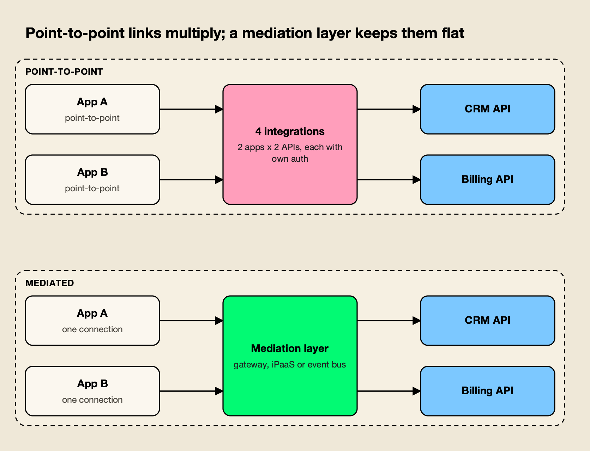
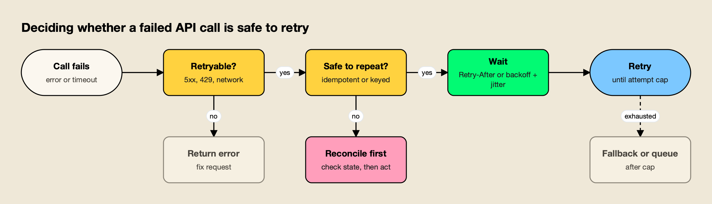
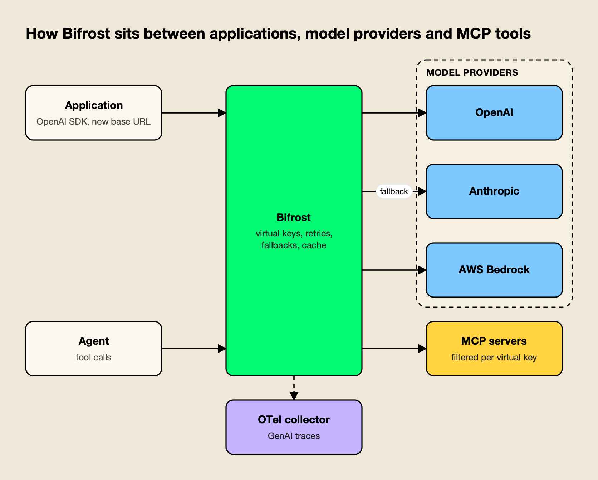

**TL;DR**
- API integration connects software systems through their APIs; the hard parts are authentication, failure handling and change management, not the first successful request.
- Pick the API style by interaction shape: REST for resource CRUD, GraphQL for client-shaped reads, gRPC for typed service-to-service calls, webhooks and event streams for "tell me when something happens".
- Retries are only safe when the operation is idempotent. HTTP defines which methods are, and the IETF Idempotency-Key draft and Stripe's API show how to make POST safe to repeat.
- The OWASP API Security Top 10 (2023) lists broken object level authorization first and "unsafe consumption of APIs" last, which is the risk every outbound integration carries.
- LLM APIs add token-based rate limits, streaming and provider-specific formats; teams usually integrate once through an OpenAI-compatible endpoint, often an AI gateway such as Bifrost, LiteLLM, Kong AI Gateway or Cloudflare AI Gateway.

API integration is the work of connecting two or more software systems through their application programming interfaces so that data and actions flow between them without a person in the middle. Payments, identity, CRM sync and, increasingly, calls to large language models all depend on it. The first request takes minutes; an integration that survives timeouts, rate limits, duplicates and version changes takes much longer. This guide covers API integration from the specifications up, including LLM and agent integrations.

## What Is API Integration

API integration is the connection of software systems through their published interfaces so that one system can read data from, write data to, or trigger actions in another. It includes the contract, the authentication, the transport, error handling, and the mapping between each side's data model.

The **provider** publishes the API and decides its contract, limits and versioning. The **consumer** builds the client and owns everything that happens when the provider is slow, down or rate limiting, which is where most of the engineering effort sits.

Three properties separate a demo from a production integration: correctness under retries (a timed-out request may or may not have been applied), bounded consumption (every provider enforces limits, and many charge per call or per token), and tolerance of change as providers add fields and ship new versions.

## API Styles: REST, GraphQL, gRPC, Webhooks and Events

API styles differ in who initiates communication and how the contract is described. REST and GraphQL are request-response over HTTP, gRPC is typed remote procedure calls over HTTP/2, and webhooks and event streams push data to the consumer when something changes. Most real integrations combine at least two.

| Style | Interaction | Contract | Strong fit |
|---|---|---|---|
| REST | Request-response over HTTP; resources and methods | OpenAPI | Public APIs, CRUD on resources |
| GraphQL | Client sends a query for the exact fields it needs | GraphQL schema (SDL) | Client-driven reads across many related objects |
| gRPC | Typed RPC over HTTP/2, binary Protocol Buffers | `.proto` files | Internal service-to-service calls, streaming |
| Webhooks | Provider POSTs an event to a consumer URL | Event docs, sometimes AsyncAPI | "Notify me when X happens" |
| Event streams | Producers publish to topics; consumers subscribe | AsyncAPI | High-volume, decoupled, replayable data flows |

**REST** maps resources to URLs and uses HTTP's methods and status codes, which is why the semantics of [RFC 9110](https://www.rfc-editor.org/rfc/rfc9110.html#name-methods) matter so much in practice. **GraphQL** lets clients [request exactly the data you need](https://graphql.org/learn/#:~:text=request%20exactly%20the%20data%20you%20need) from a typed schema. In **gRPC**, a client can [directly call a method on a server application on a different machine](https://grpc.io/docs/what-is-grpc/introduction/#:~:text=directly%20call%20a%20method%20on%20a%20server%20application%20on%20a%20different%20machine) as if it were local,.

**Webhooks** invert the flow. GitHub describes them as a way to receive data as it happens, [as opposed to polling an API](https://docs.github.com/en/webhooks/about-webhooks#:~:text=as%20opposed%20to%20polling%20an%20API), and tells integrators to [subscribe to webhook events instead of polling the API](https://docs.github.com/en/rest/using-the-rest-api/best-practices-for-using-the-rest-api#:~:text=subscribe%20to%20webhook%20events%20instead%20of%20polling%20the%20API).

The receiver carries the burden. Stripe warns that [webhook endpoints might occasionally receive the same event more than once](https://docs.stripe.com/webhooks#:~:text=Webhook%20endpoints%20might%20occasionally%20receive%20the%20same%20event%20more%20than%20once), and GitHub signs each delivery: [GitHub uses an HMAC hex digest to compute the hash](https://docs.github.com/en/webhooks/using-webhooks/validating-webhook-deliveries#:~:text=GitHub%20uses%20an%20HMAC%20hex%20digest%20to%20compute%20the%20hash).

**Event streams** go further and decouple producers from consumers entirely. Apache Kafka's documentation says [event streaming is the practice of capturing data in real-time from event sources](https://kafka.apache.org/intro/#:~:text=event%20streaming%20is%20the%20practice%20of%20capturing%20data%20in%20real%2Dtime%20from%20event%20sources), then stores and routes those streams to subscribers.

## API Integration Patterns: Point-to-Point, Gateway, iPaaS, ESB and Event Bus

An API integration pattern describes where integration logic lives. In point-to-point integration, each application calls each API directly. Mediated patterns (an API gateway, an iPaaS, an enterprise service bus or an event bus) move authentication, routing, transformation and policy into one shared layer.



*Figure 1: With N callers and M systems, point-to-point integration grows toward N times M connections, while a mediation layer needs N plus M.*

As Figure 1 shows, the cost of point-to-point integration is multiplication: every pair carries its own credentials, retries and mapping.

| Pattern | Where logic lives | Best for | Trade-off |
|---|---|---|---|
| Point-to-point | Inside each calling service | Few integrations, one owning team | Duplication and drift as the count grows |
| API gateway | A proxy in front of APIs | Consistent auth, rate limits and logging for many consumers | Usually stateless; little orchestration |
| iPaaS | A hosted integration platform with connectors | Business workflows across SaaS apps, low-code teams | Per-connector or per-task pricing, vendor lock-in |
| ESB | A central bus with transformation and routing | Legacy and on-premises estates, SOAP and file protocols | Central bottleneck, heavy governance |
| Event bus | A broker; producers and consumers never call each other | High-volume, asynchronous, many subscribers | Eventual consistency, harder debugging |

**API gateways** such as Kong, Apigee, AWS API Gateway and Apache APISIX sit in front of APIs and centralize authentication, routing and rate limiting for inbound traffic. **iPaaS** products package connectors and workflow builders; Azure Logic Apps advertises [1,400+ prebuilt connectors](https://learn.microsoft.com/en-us/azure/logic-apps/logic-apps-overview#:~:text=1%2C400%2B%20prebuilt%20connectors), and MuleSoft, Boomi, Workato and Zapier compete in the same space. **Enterprise service buses** predate both and implement the classic enterprise integration patterns; Apache Camel, for example, lets developers [route, transform, filter, split, and aggregate with the Enterprise Integration Patterns catalog](https://camel.apache.org/#:~:text=Route%2C%20transform%2C%20filter%2C%20split%2C%20and%20aggregate). This site's guide to the [service integration bus](/blog/service-integration-bus/) covers ESB architecture and its modern successors in depth. **Event buses** (Kafka, Amazon EventBridge, cloud pub/sub services) remove direct calls altogether.

Outbound traffic to LLM providers is a newer pattern again, with its own unit of control (tokens and dollars rather than requests). The distinction is covered in this site's comparison of [AI gateways and API gateways](/blog/ai-gateway-vs-api-gateway/), and the LLM section below returns to it.

## API Authentication: API Keys, OAuth 2.0 and 2.1, and mTLS

API authentication proves which client is calling. API keys are static shared secrets; OAuth 2.0 issues scoped, expiring access tokens, and OAuth 2.1 consolidates its security best practices; mutual TLS authenticates the client with an X.509 certificate during the TLS handshake. Production integrations often combine two.

| Method | What the client presents | Strengths | Risks |
|---|---|---|---|
| API key | Static secret in a header | Simple, universal | Long-lived, broad scope, leaks in logs and repos |
| OAuth 2.0 client credentials | Short-lived access token from an authorization server | Scopes, expiry, central revocation | Extra infrastructure; secret still needed to get tokens |
| OAuth 2.0 authorization code + PKCE | Token issued on a user's behalf | Delegated, user-scoped access | Flow complexity, refresh token handling |
| mTLS | Client certificate in the TLS handshake | Strong machine identity, no bearer secret | Certificate issuance and rotation |

**API keys** remain the default for many SaaS and LLM APIs; store them in a secrets manager and rotate them.

**OAuth 2.0** ([RFC 6749](https://www.rfc-editor.org/rfc/rfc6749.html#section-4.4)) defines the client credentials grant for machine-to-machine integrations and the [authorization code grant](https://www.rfc-editor.org/rfc/rfc6749.html#section-4.1) for acting on behalf of a user.

Its security guidance now lives in RFC 9700, the OAuth 2.0 Security Best Current Practice (January 2025), which states that [public clients MUST use PKCE](https://www.rfc-editor.org/rfc/rfc9700.html#:~:text=Public%20clients%20MUST%20use%20PKCE), that [clients SHOULD NOT use the implicit grant](https://www.rfc-editor.org/rfc/rfc9700.html#:~:text=clients%20SHOULD%20NOT%20use%20the%20implicit%20grant), and that [access tokens SHOULD be audience-restricted to a specific resource server](https://www.rfc-editor.org/rfc/rfc9700.html#:~:text=access%20tokens%20SHOULD%20be%20audience%2Drestricted%20to%20a%20specific%20resource%20server).

**OAuth 2.1** is still an Internet-Draft (revision 16), but it folds those rules into one document: the authorization code grant [requires the addition of the PKCE parameters](https://datatracker.ietf.org/doc/html/draft-ietf-oauth-v2-1#:~:text=requires%20the%20addition%20of%20the%20PKCE%20parameters), [redirect URIs must be compared using exact string matching](https://datatracker.ietf.org/doc/html/draft-ietf-oauth-v2-1#:~:text=Redirect%20URIs%20must%20be%20compared%20using%20exact%20string%20matching), and the [Resource Owner Password Credentials grant is omitted from this specification](https://datatracker.ietf.org/doc/html/draft-ietf-oauth-v2-1#:~:text=Resource%20Owner%20Password%20Credentials%20grant%20is%20omitted%20from%20this%20specification). New integrations should follow 2.1 behavior even against 2.0 servers.

**mTLS** binds identity to a certificate, and RFC 8705 defines [certificate-bound access and refresh tokens using mutual Transport Layer Security](https://www.rfc-editor.org/rfc/rfc8705.html#:~:text=certificate%2Dbound%20access%20and%20refresh%20tokens%20using%20mutual%20Transport%20Layer%20Security), so a stolen token is useless without the matching private key.

The same OAuth 2.1 profile governs remote tool servers for agents: the MCP specification says [authorization servers MUST implement OAuth 2.1](https://modelcontextprotocol.io/specification/latest/basic/authorization#:~:text=Authorization%20servers%20MUST%20implement%20OAuth%202.1), as this site's explainer on [MCP authentication](/blog/mcp-authentication/) details.

## Building Reliable API Integrations

Reliable API integration rests on five practices: make writes idempotent, retry only transient failures with exponential backoff and jitter, respect the provider's rate limits and Retry-After headers, paginate every collection, and pin API versions. Each is defined in public specs or provider docs.

### Idempotency Keys

HTTP defines a method as idempotent if [the intended effect on the server of multiple identical requests](https://www.rfc-editor.org/rfc/rfc9110.html#:~:text=the%20intended%20effect%20on%20the%20server%20of%20multiple%20identical%20requests,the%20same%20as%20the%20effect%20for%20a%20single%20such%20request) with that method is the same as the effect for a single such request. GET, PUT and DELETE qualify; POST does not, and RFC 9110 says that [a client SHOULD NOT automatically retry a request with a non-idempotent method](https://www.rfc-editor.org/rfc/rfc9110.html#:~:text=A%20client%20SHOULD%20NOT%20automatically%20retry%20a%20request%20with%20a%20non%2Didempotent%20method) unless it knows the semantics are safe.

The **idempotency key** fixes this for POST: the client sends a unique value per logical operation and reuses it on every retry. The IETF HTTPAPI working group's Idempotency-Key header draft describes it as a way to [make non-idempotent HTTP methods such as POST or PATCH fault-tolerant](https://datatracker.ietf.org/doc/html/draft-ietf-httpapi-idempotency-key-header#:~:text=make%20non%2Didempotent%20HTTP%20methods%20such%20as%20POST%20or%20PATCH%20fault%2Dtolerant). Revision 07 expired as a draft in April 2026 without becoming an RFC, but its error semantics are widely copied: [the resource SHOULD reply with an HTTP 409 status code](https://datatracker.ietf.org/doc/html/draft-ietf-httpapi-idempotency-key-header#:~:text=the%20resource%20SHOULD%20reply%20with%20an%20HTTP%20409%20status%20code) if a retry arrives while the original is still processing, and with 422 if the same key is reused with a different payload.

Stripe is the reference implementation. Its API docs explain that with an idempotency key a client can [safely repeat the request without risk of creating a second object](https://docs.stripe.com/api/idempotent_requests#:~:text=safely%20repeat%20the%20request%20without%20risk%20of%20creating%20a%20second%20object), recommend V4 UUIDs, and note that [idempotency keys are up to 255 characters long](https://docs.stripe.com/api/idempotent_requests#:~:text=Idempotency%20keys%20are%20up%20to%20255%20characters%20long). Microsoft's REST guidelines solve the same problem with different headers, telling services to [support the Repeatability-Request-ID & Repeatability-First-Sent request headers](https://github.com/microsoft/api-guidelines/blob/vNext/azure/Guidelines.md#:~:text=support%20the%20Repeatability%2DRequest%2DID%20%26%20Repeatability%2DFirst%2DSent%20request%20headers) when an action must be safe to retry.

### Retries With Exponential Backoff and Jitter

Retry only failures that can succeed later (network errors, timeouts, 5xx and 429), wait longer after each attempt, randomize the wait so clients do not retry in lockstep, and cap the attempts.



*Figure 2: Retries are only safe after two checks pass: the error is transient and repeating the request cannot apply it twice.*

The cap matters more than it looks. Amazon's Builders' Library describes a five-layer call stack with three retries per layer where, when the database starts failing, [the load on the database will increase 243x](https://aws.amazon.com/builders-library/timeouts-retries-and-backoff-with-jitter/#:~:text=the%20load%20on%20the%20database%20will%20increase%20243x). Its rule of thumb matches Figure 2: APIs with side effects are not [safe to retry unless they provide idempotency](https://aws.amazon.com/builders-library/timeouts-retries-and-backoff-with-jitter/#:~:text=safe%20to%20retry%20unless%20they%20provide%20idempotency). Retry in one layer only, usually the outermost client or a gateway.

### API Rate Limiting

Every public API meters consumption, and the integration has to read the signals. The [429 Too Many Requests](https://www.rfc-editor.org/rfc/rfc6585.html#section-4) status code comes from RFC 6585, and the Retry-After header tells the client [how long the user agent ought to wait before making a follow-up request](https://www.rfc-editor.org/rfc/rfc9110.html#:~:text=how%20long%20the%20user%20agent%20ought%20to%20wait%20before%20making%20a%20follow%2Dup%20request).

Published limits vary widely:

- **GitHub** gives authenticated users a [personal rate limit of 5,000 requests per hour](https://docs.github.com/en/rest/using-the-rest-api/rate-limits-for-the-rest-api#:~:text=personal%20rate%20limit%20of%205%2C000%20requests%20per%20hour), plus secondary limits on concurrency. Its guidance is blunt: if Retry-After is present, [you should not retry your request until after that many seconds has elapsed](https://docs.github.com/en/rest/using-the-rest-api/best-practices-for-using-the-rest-api#:~:text=you%20should%20not%20retry%20your%20request%20until%20after%20that%20many%20seconds%20has%20elapsed).
- **Stripe** allows [100 requests per second](https://docs.stripe.com/rate-limits#:~:text=Live%20mode%3A%20100%20requests%20per%20second) in live mode by default and tells integrators to [add randomness to the backoff schedule to avoid a thundering herd effect](https://docs.stripe.com/rate-limits#:~:text=add%20randomness%20to%20the%20backoff%20schedule%20to%20avoid%20a%20thundering%20herd%20effect).
- **LLM providers** limit tokens as well as requests. Anthropic's limits are [measured in requests per minute (RPM), input tokens per minute (ITPM)](https://platform.claude.com/docs/en/api/rate-limits#:~:text=measured%20in%20requests%20per%20minute%20%28RPM%29%2C%20input%20tokens%20per%20minute%20%28ITPM%29) and output tokens per minute, enforced with a token bucket.

A client-side limiter plus a queue turns 429s into back-pressure. A deeper treatment of [how AI gateways handle rate limiting for LLM apps](https://www.getmaxim.ai/articles/how-ai-gateways-tackle-rate-limiting-for-llm-apps/) covers the token-based case.

### API Pagination

Google's AIP-158 makes pagination mandatory from day one because [it is a backwards-incompatible change to add pagination to an existing method](https://google.aip.dev/158#:~:text=it%20is%20a%20backwards%2Dincompatible%20change%20to%20add%20pagination%20to%20an%20existing%20method), and it standardizes `page_size`, `page_token` and `next_page_token`. GitHub signals pages through standard Web Linking: when results are paginated, [the response headers will include a link header](https://docs.github.com/en/rest/using-the-rest-api/using-pagination-in-the-rest-api#:~:text=the%20response%20headers%20will%20include%20a%20link%20header) with `next`, `prev`, `first` and `last` URLs. Prefer opaque cursors over page numbers.

### API Versioning

Versioning lets a provider ship breaking changes without breaking consumers. Google puts the major version in the path and states that [Google APIs use v1, not v1.0, v1.1, or v1.4.2](https://google.aip.dev/185#:~:text=Google%20APIs%20use%20v1%2C%20not%20v1.0%2C%20v1.1%2C%20or%20v1.4.2). Microsoft's guidelines instead [use a required query parameter named api-version on every operation](https://github.com/microsoft/api-guidelines/blob/vNext/azure/Guidelines.md#:~:text=use%20a%20required%20query%20parameter%20named%20api%2Dversion%20on%20every%20operation), with date-based values. Consumers should pin the version and ignore unknown response fields.

## API Security and the OWASP API Security Top 10

The OWASP API Security Top 10 (2023 edition) is the standard checklist for API risk. Most items are provider-side authorization failures, but the last one targets integrators who trust third-party responses more than user input.

| OWASP 2023 risk | What it means for an integration |
|---|---|
| API1 Broken Object Level Authorization | [Object level authorization checks should be considered in every function](https://owasp.org/API-Security/editions/2023/en/0x11-t10/#:~:text=Object%20level%20authorization%20checks%20should%20be%20considered%20in%20every%20function) that takes an ID from the caller |
| API2 Broken Authentication | Validate tokens fully (issuer, audience, expiry); never accept unsigned tokens |
| API3 Broken Object Property Level Authorization | Return and accept only the fields the caller may see or set |
| API4 Unrestricted Resource Consumption | Third-party calls are often [paid for per request](https://owasp.org/API-Security/editions/2023/en/0x11-t10/#:~:text=paid%20for%20per%20request); cap them per user and per tenant |
| API5 Broken Function Level Authorization | Separate admin and user functions; deny by default |
| API6 Unrestricted Access to Sensitive Business Flows | Add abuse controls to flows like checkout or sign-up |
| API7 Server Side Request Forgery | Never fetch a caller-supplied URL without an allow-list |
| API8 Security Misconfiguration | Harden TLS, CORS, error messages and default settings |
| API9 Improper Inventory Management | Keep an inventory of every integration, key and API version in use |
| API10 Unsafe Consumption of APIs | Validate third-party responses like user input; attackers [go after integrated third-party services](https://owasp.org/API-Security/editions/2023/en/0x11-t10/#:~:text=attackers%20go%20after%20integrated%20third%2Dparty%20services) |

API4 now covers cost, the failure mode of an unbounded loop calling a paid LLM API, and API10 applies doubly to agents that act on whatever a tool returns. This site's guide to [MCP server security](/blog/mcp-server-security/) covers that case.

## API Observability With OpenTelemetry

API observability means every integration call emits traces, metrics and logs that show latency, errors, retries and cost per dependency. OpenTelemetry is the vendor-neutral standard for producing that telemetry, so the same instrumentation works with Jaeger, Prometheus, Grafana, Datadog or any other backend.

OpenTelemetry describes itself as [open source, as well as vendor- and tool-agnostic](https://opentelemetry.io/docs/what-is-opentelemetry/#:~:text=Open%20source%2C%20as%20well%20as%20vendor%2D%20and%20tool%2Dagnostic), and one of its stated principles is that [you own the data that you generate](https://opentelemetry.io/docs/what-is-opentelemetry/#:~:text=You%20own%20the%20data%20that%20you%20generate). For integrations, the essentials are:

- **A span per outbound call** using the HTTP semantic conventions, with retries as separate attempts.
- **Propagated trace context** (W3C `traceparent`) across service boundaries.
- **Provider request IDs** in logs, such as the `x-ms-request-id` that Microsoft's guidelines require.
- **Metrics per dependency:** error rate, latency percentiles and remaining rate-limit budget.

LLM calls need extra attributes (model, token counts, cost). OpenTelemetry's [GenAI semantic conventions have moved to the OpenTelemetry GenAI semantic conventions repository](https://opentelemetry.io/docs/specs/semconv/gen-ai/#:~:text=GenAI%20semantic%20conventions%20have%20moved%20to%20the%20OpenTelemetry%20GenAI%20semantic%20conventions%20repository), and gateways increasingly emit them directly. This site's roundup of [LLM observability tools](/blog/llm-observability-tools/) compares the backends.

## API Specifications: OpenAPI and AsyncAPI

API specifications are machine-readable contracts. OpenAPI describes request-response HTTP APIs and AsyncAPI describes message-driven and event APIs. Both let teams generate clients, mock servers, tests and documentation from one source, which turns integration from reading prose into compiling against a contract.

The OpenAPI Specification [defines a standard, language-agnostic interface to HTTP APIs](https://spec.openapis.org/oas/latest.html#:~:text=defines%20a%20standard%2C%20language%2Dagnostic%20interface%20to%20HTTP%20APIs) that both humans and computers can read; the current release is version 3.2.1, dated September 2026. AsyncAPI exists to [describe message-driven APIs in a machine-readable format](https://www.asyncapi.com/docs/reference/specification/v3.1.0#:~:text=describe%20message%2Ddriven%20APIs%20in%20a%20machine%2Dreadable%20format) across Kafka, AMQP, MQTT, WebSockets and HTTP, and is at version 3.1.0.

A practical rule: if a provider publishes an OpenAPI document, generate the client from it and run contract tests against the provider's sandbox in CI. If it does not, write a minimal one for the endpoints you use.

## Build vs Buy: API Integration Platforms and Tools

The build vs buy decision for API integration depends on how many integrations you need, who maintains them, and how differentiated they are. Building in code gives full control for a few core integrations; iPaaS products win when business teams need dozens of standard SaaS connectors.

| Option | Choose it when | Avoid it when |
|---|---|---|
| Build in code (SDK or generated client) | The integration is core to the product, needs custom logic or must run in your network | You need 30 SaaS connectors maintained by non-engineers |
| API gateway in front of your services | Many consumers call your APIs and need consistent auth, limits and logs | The problem is outbound calls to third parties |
| iPaaS (Logic Apps, MuleSoft, Boomi, Workato) | Business workflows span many SaaS apps; low-code ownership | Latency-sensitive or high-volume product paths |
| AI gateway for LLM traffic | Several teams call several model providers and need budgets, failover and logging | One service calls one model with low volume |

Whatever is bought, the consumer still owns idempotency, data mapping and maintenance.

## LLM API Integration: Provider Differences, Streaming, Failover and Cost

LLM API integration has every property of ordinary API integration plus four of its own: providers use different request formats, responses stream token by token, outages and 429s are frequent enough to need cross-provider failover, and cost scales with tokens rather than requests. Most teams handle these differences through an OpenAI-compatible endpoint.

### Provider Differences and OpenAI-Compatible APIs

OpenAI, Anthropic, Google, AWS Bedrock and Azure each define their own message formats, tool-calling schemas, error codes and limits. Anthropic, for example, returns a 529 overloaded error and documents that [529 errors can occur when the API experiences high traffic across all users](https://platform.claude.com/docs/en/api/errors#:~:text=529%20errors%20can%20occur%20when%20the%20API%20experiences%20high%20traffic%20across%20all%20users). The OpenAI request format has become the common denominator: Google states that Gemini models work with OpenAI libraries [by updating three lines of code and using your Gemini API key](https://ai.google.dev/gemini-api/docs/openai#:~:text=by%20updating%20three%20lines%20of%20code%20and%20using%20your%20Gemini%20API%20key).

Compatibility layers have limits. Anthropic describes its own OpenAI SDK layer as [not considered a long-term or production-ready solution for most use cases](https://platform.claude.com/docs/en/cli-sdks-libraries/libraries/openai-sdk#:~:text=not%20considered%20a%20long%2Dterm%20or%20production%2Dready%20solution%20for%20most%20use%20cases), and newer interfaces such as the [OpenAI Responses API](/blog/openai-responses-api/) move beyond the chat completions shape. A survey of [LLM API providers and how to use them through one gateway](https://www.getmaxim.ai/articles/llm-api-providers/) maps the main differences.

### Streaming

Both major providers stream over server-sent events. OpenAI's guide explains how to [stream model responses from the OpenAI API using server-sent events](https://developers.openai.com/api/docs/guides/streaming-responses#:~:text=stream%20model%20responses%20from%20the%20OpenAI%20API%20using%20server%2Dsent%20events), and Anthropic notes that [each server-sent event includes a named event type and associated JSON data](https://platform.claude.com/docs/en/build-with-claude/streaming#:~:text=Each%20server%2Dsent%20event%20includes%20a%20named%20event%20type%20and%20associated%20JSON%20data). Streaming breaks ordinary assumptions: an error can arrive after a 200 status, a retry after the first token discards partial output, and proxies must not buffer the response.

### Failover and Cost

Cross-provider failover is harder than retrying a replica because the fallback speaks a different API, and cost needs per-team attribution. Both are standard AI gateway features, the Figure 1 mediation layer for model traffic. Approaches teams use today include:

- **Kong AI Gateway** extends Kong's API platform with plugins, [whether serving LLM traffic, exposing structured context via MCP](https://developer.konghq.com/ai-gateway/#:~:text=Whether%20serving%20LLM%20traffic%2C%20exposing%20structured%20context%20via%20MCP) or coordinating agents through A2A; this site's list of [Kong alternatives](/blog/kong-alternatives/) compares it with dedicated gateways.
- **Azure API Management** adds an AI gateway to an existing APIM deployment; its unified model API (in preview) [exposes multiple backends through a single OpenAI-compatible endpoint](https://learn.microsoft.com/en-us/azure/api-management/genai-gateway-capabilities#:~:text=exposes%20multiple%20backends%20through%20a%20single%20OpenAI%2Dcompatible%20endpoint).
- **Cloudflare AI Gateway** is a hosted option that adds analytics, caching and rate limiting, and improves resilience by [defining request retry and model fallbacks in case of an error](https://developers.cloudflare.com/ai-gateway/#:~:text=defining%20request%20retry%20and%20model%20fallbacks%20in%20case%20of%20an%20error).
- **LiteLLM** is a self-hosted Python proxy that gives applications [one OpenAI-compatible endpoint for 100+ LLM providers](https://docs.litellm.ai/docs/simple_proxy#:~:text=one%20OpenAI%2Dcompatible%20endpoint%20for%20100%2B%20LLM%20providers), with virtual keys and spend tracking.

Broader comparisons are in this site's ranking of [top AI gateways](/blog/top-ai-gateways/) and its guide to [failover across Bedrock, Vertex and Azure](/blog/ai-gateways-for-bedrock-vertex-azure-failover/).

### Worked Example: Integrating LLM APIs Through Bifrost

[Bifrost](https://www.getmaxim.ai/bifrost) is an [open-source AI gateway written in Go](https://github.com/maximhq/bifrost) by Maxim AI. It is used here as the worked example because it is self-hostable and its public docs cover every reliability practice discussed above, from retries with backoff to OpenTelemetry export, so each claim below is checkable. It exposes 25+ providers and 10,000+ models through one OpenAI-compatible API, and Bifrost's published benchmark reports [11 µs of added overhead per request at 5,000 RPS on an AWS t3.xlarge](https://www.getmaxim.ai/resources/benchmarks).



*Figure 3: The application integrates once with an OpenAI-compatible endpoint; provider differences, failover and tool access are handled behind it.*

Mapped to the practices in this guide:

- **One contract.** The gateway [acts as a drop-in replacement for popular AI SDKs](https://docs.getbifrost.ai/features/drop-in-replacement): existing OpenAI, Anthropic or Google GenAI clients change only their base URL. A walkthrough of [using any LLM provider with the OpenAI SDK](https://www.getmaxim.ai/articles/use-any-llm-provider-with-the-openai-sdk-bifrosts-universal-integration/) shows the change in each SDK.
- **Retries the way Figure 2 describes.** On transient failures, the docs state that it waits [using exponential backoff with jitter before the next attempt](https://docs.getbifrost.ai/features/retries-and-fallbacks#:~:text=exponential%20backoff%20with%20jitter%20before%20the%20next%20attempt), rotates keys on per-key failures such as 429s, and does not retry caller errors.
- **Cross-provider failover.** A request can list fallback models on other providers, and [each fallback provider gets its own full retry budget](https://docs.getbifrost.ai/features/retries-and-fallbacks#:~:text=Each%20fallback%20provider%20gets%20its%20own%20full%20retry%20budget). The pattern is explained further in an article on [failover routing strategies for LLMs](https://www.getmaxim.ai/articles/failover-routing-strategies-for-llms-in-enterprise-ai-applications/).
- **Credentials and cost.** [Virtual keys are the primary governance entity in Bifrost](https://docs.getbifrost.ai/features/governance/virtual-keys), carrying per-key provider access, budgets and rate limits so provider secrets never reach applications. Semantic caching stores responses and can [replay them for repeated requests, avoiding a round-trip to the provider](https://docs.getbifrost.ai/features/semantic-caching). A guide to [monitoring LLM API costs in production](https://www.getmaxim.ai/articles/how-to-monitor-llm-api-costs-in-production/) covers attribution by key and team.
- **Observability.** Its OTel plugin exports traces in which [all traces follow OpenTelemetry semantic conventions](https://docs.getbifrost.ai/features/observability/otel), including the GenAI format.

A minimal client change looks like this:

```python
from openai import OpenAI

client = OpenAI(
    base_url="http://localhost:8080/openai",  # gateway instead of api.openai.com
    api_key="sk-bf-...",                      # virtual key, not a provider key
)
```

**Deployment note.** Bifrost runs as a single binary, a Docker container or a Kubernetes deployment inside your own network; clustering, guardrails, SSO and audit logs are part of the **Enterprise tier.** Provider-by-provider setup steps are in the [Bifrost provider guides](https://www.getmaxim.ai/bifrost/guides/providers), and a buyer-side checklist is in the [LLM gateway buyer's guide](https://www.getmaxim.ai/resources/buyers-guide).

## Agents Calling APIs Through MCP

The Model Context Protocol (MCP) is the emerging standard for letting AI agents call APIs. An MCP server wraps an API as typed tools that a model lists and invokes over JSON-RPC, so every practice in this guide (authentication, rate limits, idempotency, input validation) applies to calls a model decides to make.

MCP changes who initiates the call, not what the call needs. The specification's tools page asks clients to [present confirmation prompts to the user for operations](https://modelcontextprotocol.io/specification/latest/server/tools#:~:text=Present%20confirmation%20prompts%20to%20the%20user%20for%20operations) and asks servers to [rate limit tool invocations](https://modelcontextprotocol.io/specification/latest/server/tools#:~:text=Rate%20limit%20tool%20invocations). Three additions matter for agents:

- **Least privilege per agent:** expose only the tools its task needs.
- **Tool output as untrusted input:** OWASP API10 applies, since injected instructions can arrive inside an API response.
- **Idempotency for agent retries:** models repeat actions, so write tools need idempotency keys.

Gateways are taking on the MCP role as well. Bifrost's MCP documentation states that [by default, Bifrost does NOT automatically execute tool calls](https://docs.getbifrost.ai/mcp/overview), and MCP tool filtering lets an administrator [create a strict allow-list of MCP clients and tools](https://docs.getbifrost.ai/features/governance/mcp-tools) per virtual key.

The essay on [the MCP protocol, the plumbing and the gateway](https://www.getmaxim.ai/bifrost/blog/mcp-the-protocol-the-plumbing-and-the-gateway/) explains why tool traffic converges on one control point, and an article on [MCP authentication with OAuth, API keys and token management](https://www.getmaxim.ai/articles/mcp-authentication-explained-oauth-api-keys-and-token-management/) covers the credential side. For agent-to-agent delegation, see this site's comparison of [A2A and MCP](/blog/a2a-vs-mcp/).

## Choosing an API Integration Approach

API integration is a reliability and security discipline more than a connectivity one. The durable work is idempotent writes, disciplined retries, respect for rate limits, explicit versions and telemetry on every call, all specified in public RFCs and provider guidelines.

For a handful of core integrations, a generated client with those controls in code is usually the right call. As the count grows, a mediation layer earns its keep: an API gateway for inbound traffic, an iPaaS or event bus for business workflows, and, for LLM traffic, an AI gateway that adds token budgets and cross-provider failover. Among the AI gateways reviewed here, Bifrost covers the most of this guide's practices in an open-source, self-hosted package; Kong and Azure API Management suit teams already on those platforms, Cloudflare AI Gateway suits teams wanting a hosted edge service, and LiteLLM suits Python-centric teams. Agents calling tools through MCP do not change the rules; they make skipping them more expensive.
