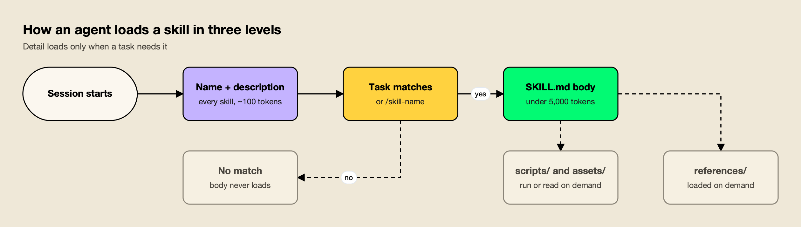
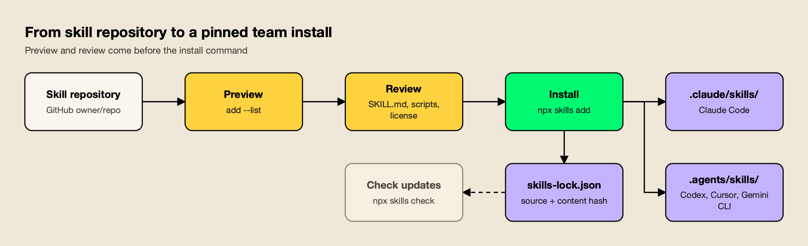

**TL;DR**
- The best Claude Code skills for production AI work are task playbooks that diagnose a real problem, apply fixes in order of impact and verify the result. Six open-source skills from build-with-ai-hq cover the hardest parts of shipping LLM features: cost, security, MCP, observability, coding-agent rollout and skill management.
- Each of the six installs with one command, such as `npx skills add build-with-ai-hq/llm-cost-reduction`, is MIT licensed, and follows the Agent Skills specification, so it also works in Codex, Cursor, Gemini CLI and OpenCode.
- Anthropic's `skill-creator`, `mcp-builder` and `webapp-testing` and Vercel's `vercel-react-best-practices` round out a starter set for building skills, MCP servers, web tests and React code.
- Read a skill before installing it: skills run with the agent's full permissions, and `npx skills add owner/repo --list` previews a repository without installing anything.

Claude Code skills are folders of instructions, scripts and reference material that Claude loads when a task calls for them. The best Claude Code skills for teams building with LLMs do more than teach syntax: they encode a production workflow, from finding the problem to proving the fix worked. This guide ranks ten skills on that basis, with the GitHub repository and install command for each, and explains how to evaluate any skill before it reaches a developer's machine.

## How Claude Code Skills Work

A skill is a directory containing a `SKILL.md` file with YAML frontmatter and Markdown instructions. Claude Code reads every installed skill's name and description at startup, loads the full instructions when a request matches the description, and pulls in bundled references or scripts only when the instructions call for them.

Anthropic's [Claude Code skills documentation](https://code.claude.com/docs/en/skills) describes two ways a skill runs: Claude uses it when it is relevant, or a developer invokes it directly with `/skill-name`. Custom slash commands have been merged into skills, so a file at `.claude/commands/deploy.md` and a skill at `.claude/skills/deploy/SKILL.md` both create `/deploy`.

The format is an open standard. The [Agent Skills specification](https://agentskills.io/specification) requires only two frontmatter fields, `name` (up to 64 lowercase characters, matching the folder name) and `description` (up to 1,024 characters, saying what the skill does and when to use it). Optional fields cover `license`, `compatibility`, `metadata` and an experimental `allowed-tools` list. Because Codex, Cursor, Gemini CLI, GitHub Copilot and OpenCode read the same format, a well-built Claude Code skill is also a Codex skill and a Cursor skill.



*Figure 1: A skill costs about 100 tokens of context until it is used, which is why a long list of installed skills is affordable and a bloated SKILL.md is not.*

The specification calls this progressive disclosure, and Figure 1 shows the three levels. Metadata costs roughly 100 tokens per skill, the spec recommends keeping the activated body under 5,000 tokens and the main `SKILL.md` under 500 lines, and everything else waits in `references/`, `scripts/` or `assets/` until it is needed. A skill that ignores this pays its full cost on every activation.

Where a skill is installed decides who gets it. Claude Code loads project skills from `.claude/skills/` in the repository (commit them and the whole team has them), personal skills from `~/.claude/skills/`, and organization-wide skills from the managed settings directory. When two scopes define the same name, the docs give precedence to enterprise over personal and personal over project.

## Evaluation Criteria for Claude Code Skills

A useful skill for production AI work changes what the agent does on a real codebase, not just what it knows. The criteria below favor skills that diagnose before they change anything, rank fixes by impact, verify outcomes, stay portable across agents and carry a license a company can adopt.

| Criterion | What to check | Why it matters |
|---|---|---|
| Production scope | Does the skill target a problem teams pay for in production (spend, incidents, data exposure, outages)? | Skills that teach syntax duplicate what the model already knows |
| Workflow shape | Does it diagnose first, apply fixes in a stated order and include a verification step? | An agent without a verification step reports success it never checked |
| Concrete artifacts | Does it ship commands, code in the team's languages, config and checklists rather than prose advice? | Agents act on specifics; vague guidance produces vague changes |
| Context discipline | Is the body lean, with detail in `references/` loaded on demand? | Oversized skills crowd out the code the agent is working on |
| Portability | Does it stick to the Agent Skills spec fields so it runs in Claude Code, Codex, Cursor and others? | Mixed-agent teams need one skill, not one per tool |
| License and provenance | Is the license clear (MIT, Apache 2.0) and the repository public and inspectable? | Skills run with agent permissions, so unreviewable code is a risk |

On these criteria, the six build-with-ai-hq skills rank first because each one is written around a single production problem and follows the same diagnose, fix, verify structure. Every one of them opens with a "Quick diagnosis" section of grep or shell commands, lists its fixes "ordered by impact", ends with a "Verify" section and a "Common mistakes" list, and moves detail into two to four reference files. Running the linter bundled with `agent-skills-for-teams` across all six reported zero spec errors; it flagged two bodies, `ai-coding-agent-governance` and `mcp-gateway-best-practices`, as slightly above the spec's 5,000-token recommendation.

## The Best Claude Code Skills at a Glance

All ten skills install with the open-source [skills CLI](https://github.com/vercel-labs/skills), which copies or symlinks a skill into each coding agent's directory. The first six each live in their own repository; the last four are selected from larger collections with `--skill`.

| Skill | Best at | Install command | License |
|---|---|---|---|
| llm-cost-reduction | Cutting LLM API spend without losing quality | `npx skills add build-with-ai-hq/llm-cost-reduction` | MIT |
| secure-llm-apps | Hardening LLM apps against the OWASP LLM Top 10 | `npx skills add build-with-ai-hq/secure-llm-apps` | MIT |
| mcp-gateway-best-practices | Running MCP servers safely at team scale | `npx skills add build-with-ai-hq/mcp-gateway-best-practices` | MIT |
| llm-observability-stack | Logs, traces, metrics and alerts for LLM calls | `npx skills add build-with-ai-hq/llm-observability-stack` | MIT |
| ai-coding-agent-governance | Rolling out Claude Code, Codex and Cursor with budgets | `npx skills add build-with-ai-hq/ai-coding-agent-governance` | MIT |
| agent-skills-for-teams | Writing, versioning and distributing skills | `npx skills add build-with-ai-hq/agent-skills-for-teams` | MIT |
| skill-creator (Anthropic) | Drafting and testing new skills | `npx skills add anthropics/skills --skill skill-creator` | Apache 2.0 |
| mcp-builder (Anthropic) | Building MCP servers in Python or TypeScript | `npx skills add anthropics/skills --skill mcp-builder` | Apache 2.0 |
| webapp-testing (Anthropic) | Testing local web apps with Playwright | `npx skills add anthropics/skills --skill webapp-testing` | Apache 2.0 |
| vercel-react-best-practices (Vercel) | React and Next.js performance rules | `npx skills add vercel-labs/agent-skills --skill vercel-react-best-practices` | MIT |

Add `-a claude-code` to install for Claude Code only, or `-g` to install for your user account across projects. This site's walkthrough of [installing and managing skills with npx skills](/blog/npx-skills-add-guide/) covers every flag.

## 1. llm-cost-reduction

[llm-cost-reduction](https://github.com/build-with-ai-hq/llm-cost-reduction) is a skill that finds and cuts LLM and AI API spend in applications and agents while holding output quality steady. It measures cost per feature and per request first, then applies fixes in order of typical impact, with Python and TypeScript examples.

```bash
npx skills add build-with-ai-hq/llm-cost-reduction
```

The skill starts with a seven-part grep audit: every LLM call site and model in use, calls with no `max_tokens` or equivalent, agent loops without a cap, retry wrappers that multiply spend, whether usage is recorded at all, prompt-cache killers such as timestamps or UUIDs at the top of prompts, and embeddings recomputed on every run. Its fixes follow a fixed order: attribute every call to a feature, right-size the model per task against an eval set, cap output and loops, trim prompts and RAG context, turn on provider prompt caching with stable prefixes, cache whole responses, batch offline work, reuse embeddings and cancel abandoned streams.

For controls that work better centrally, the skill points to [Bifrost](https://www.getmaxim.ai/bifrost), an [open-source AI gateway](https://github.com/maximhq/bifrost) by Maxim AI.

Its reference file on complexity routing walks through the gateway's [Complexity Router](https://docs.getbifrost.ai/features/complexity-router), which sends simple requests to a cheap model and complex ones to a frontier model without application changes, alongside [semantic caching](https://docs.getbifrost.ai/features/semantic-caching) and budgets per [virtual key](https://docs.getbifrost.ai/features/governance/virtual-keys).

This site's analysis of [model routing and inference cost](/blog/model-routing-inference-cost/) explains why per-request routing is usually the largest single lever. The project's own [LLM cost optimization guide](https://www.getmaxim.ai/bifrost/blog/llm-cost-optimization-in-bifrost-part-1/) covers the gateway side in more depth.

The verification step checks that cost per 1,000 requests dropped, quality held on the eval set, caches actually hit and caps stop a runaway run, which is the part most cost projects skip.

**Best for:** Teams with a growing provider bill who want the agent to find where the money goes before it changes any model.

## 2. secure-llm-apps

[secure-llm-apps](https://github.com/build-with-ai-hq/secure-llm-apps) audits and hardens LLM-powered apps and agents against the practical risks in the OWASP Top 10 for LLM Applications. It runs a grep-based audit, ranks findings by impact and applies fixes in Python and TypeScript, each with a test that proves it.

```bash
npx skills add build-with-ai-hq/secure-llm-apps
```

The audit looks for provider keys hardcoded or exposed to clients, leaked keys in git history (using gitleaks when it is installed), LLM output reaching dangerous sinks such as SQL, HTML, shell commands or `eval`, over-broad tool definitions, missing consumption limits and prompts or completions written to logs. The fixes run in a stated order: keep provider keys on the server, treat retrieved, tool and web content as untrusted (indirect prompt injection), restrict tools to least privilege with human approval for destructive actions, validate structured output and encode at every sink, keep PII and secrets out of provider requests, bound consumption per user and tenant, and clean up logging.

The reference files are where the skill earns its place: a prompt injection threat model with taint tracking, a quarantine pattern and test payloads; a leaked-key runbook; local PII redaction with Presidio; and an audit checklist mapped to each OWASP category with a report template. This site's explainer on [prompt injection attacks](/blog/prompt-injection-attacks/) covers the threat itself, and the gateway-side view is in the vendor's guide to [covering each OWASP LLM risk at the gateway](https://www.getmaxim.ai/articles/owasp-llm-top-10-how-to-cover-each-risk-at-the-gateway/).

For controls that are stronger when enforced centrally, the skill moves provider keys into a gateway so applications only hold scoped virtual keys, with per-key model and MCP tool allowlists, rate limits and content-free logs. The vendor's [AI security resources](https://www.getmaxim.ai/resources/ai-security) describe that setup.

**Best for:** Teams about to put an LLM feature or agent in front of customers who want a repeatable security review rather than a one-off checklist.

## 3. mcp-gateway-best-practices

[mcp-gateway-best-practices](https://github.com/build-with-ai-hq/mcp-gateway-best-practices) audits and fixes how a project or team runs Model Context Protocol servers: fewer and better tools, scoped permissions, human approval for destructive calls, central credentials, health checks, logs and tests.

```bash
npx skills add build-with-ai-hq/mcp-gateway-best-practices
```

The skill inventories MCP configurations across the repository and home directory, finds hardcoded credentials, measures tool count and token cost per server and classifies each tool as read, write, destructive or side-effecting. Its 11 core practices run from choosing a topology deliberately (direct connections or a gateway) through enforcing a tool budget, writing tool names and descriptions the model can choose between, least privilege per identity, approval gates in code, treating tool results as untrusted input, moving credentials off laptops, picking the right transport, making servers reliable, logging every tool call and testing the tool layer. It includes MCP Inspector CLI commands for checking stdio and streamable HTTP servers.

Its gateway section uses Bifrost as the default MCP gateway: one `/mcp` endpoint for every host, per-virtual-key tool allowlists, request-level tool filtering and [Code Mode](https://docs.getbifrost.ai/mcp/code-mode) for setups with three or more servers, where tool definitions would otherwise fill the context window.

The [MCP gateway docs](https://docs.getbifrost.ai/mcp/overview) and the vendor's write-up on [MCP access control and token costs](https://www.getmaxim.ai/bifrost/blog/bifrost-mcp-gateway-access-control-cost-governance-and-92-lower-token-costs-at-scale/) cover the configuration.

For server selection, this site's list of [MCP servers for coding agents](/blog/mcp-servers-for-coding-agents/) and its guide to [MCP server security](/blog/mcp-server-security/) pair well with this skill.

**Best for:** Teams whose Claude Code, Claude Desktop and Cursor setups have each grown their own MCP server list with tokens scattered across laptops.

## 4. llm-observability-stack

[llm-observability-stack](https://github.com/build-with-ai-hq/llm-observability-stack) sets up production observability for LLM applications and agents: per-call records, traces, metrics, dashboards, alerts, PII controls, feedback linkage and evaluations on production traffic.

```bash
npx skills add build-with-ai-hq/llm-observability-stack
```

The skill's audit finds where LLM calls happen, what instrumentation already exists, prompts and completions written to plain logs, streams that never capture usage, swallowed errors and silent fallbacks, and calls that carry no user, session or feature identity. Its ten core practices start with one choke point in front of every LLM call and a fixed per-call record, then cover latency as users feel it (time to first token separately from total time), loud failures and fallbacks, cost attribution with safe cardinality, agent runs traced as one trace using the [OpenTelemetry GenAI semantic conventions](https://opentelemetry.io/docs/specs/semconv/gen-ai/), content treated as sensitive by default, deliberate sampling, feedback linkage and scoring production traffic.

The gateway section shows where capture at a gateway removes per-SDK instrumentation: request logs, Prometheus metrics, [OpenTelemetry export](https://docs.getbifrost.ai/features/observability/otel) to any collector, per-request dimensions and content-logging controls. A reference file of PromQL panels and alert rules turns the data into dashboards. This site's comparison of [LLM observability tools](/blog/llm-observability-tools/) lists backends to send the data to, and the vendor's [LLM observability best practices](https://www.getmaxim.ai/articles/llm-observability-best-practices-for-2025/) covers the same ground from a platform angle.

**Best for:** Teams that cannot answer "which prompt, model and output produced this bad answer" within a few minutes.

## 5. ai-coding-agent-governance

[ai-coding-agent-governance](https://github.com/build-with-ai-hq/ai-coding-agent-governance) plans and executes a governed rollout of AI coding agents (Claude Code, Codex CLI, Cursor, Gemini CLI, GitHub Copilot and OpenCode) across an engineering team, with control over spend, models, providers, data, MCP tools and logs.

```bash
npx skills add build-with-ai-hq/ai-coding-agent-governance
```

It audits machines and repositories for raw provider keys, agent configs, managed policy already in force and MCP servers each agent will start, then drafts a one-page policy covering approved agents, providers, regions, models, budgets, data rules, MCP servers and log retention. The rollout puts one gateway in front of every agent with one credential per developer and per CI pipeline, writes exact per-agent configuration, and pins it with Claude Code managed settings (`allowedProviders`, a pinned base URL, `apiKeyHelper`, `availableModels`, MCP allowlists and bypass mode disabled) delivered by MDM.

The reference files include per-tool gateway setup for each agent, roster-based key provisioning scripts in bash, Python and TypeScript with budgets, expiry, rotation and offboarding, and a phased rollout checklist with exit criteria. Bifrost is the default gateway in the skill; its [Claude Code integration docs](https://docs.getbifrost.ai/cli-agents/claude-code) and [CLI agents overview](https://docs.getbifrost.ai/cli-agents/overview) document the connection.

The vendor's [Claude Code resources](https://www.getmaxim.ai/resources/claude-code) collect related guides. For the gateway decision itself, see this site's comparison of [Claude Code gateways](/blog/claude-code-gateways/) and the vendor's piece on [Claude Code hooks for governance](https://www.getmaxim.ai/articles/claude-code-hooks-for-governance-and-gateway-policy/).

**Best for:** Engineering managers rolling coding agents out to a team after the first surprise bill or the first unapproved MCP server.

## 6. agent-skills-for-teams

[agent-skills-for-teams](https://github.com/build-with-ai-hq/agent-skills-for-teams) teaches a coding agent to author, version, review, distribute and roll back Agent Skills across a team that uses Claude Code, Codex, Cursor and other harnesses. It is the skill for managing the other skills on this list.

```bash
npx skills add build-with-ai-hq/agent-skills-for-teams
```

Its diagnosis inventories every `SKILL.md`, detects copy-paste drift by hashing files that share a name, flags bodies over 500 lines, lists executable code shipped inside skills and finds personal installs that shadow team skills. It bundles `scripts/lint_skills.py`, a standard-library Python linter that checks spec rules, weak descriptions, oversized bodies, broken relative links, missing `metadata.version`, drift between copies and risky script patterns, and exits non-zero on errors so it can gate CI.

The core practices cover one source of truth per skill, descriptions that trigger on real user phrasing (with a trigger-rate eval using train and validation splits), progressive disclosure, SemVer and changelogs for every change, a review and security gate, testing skills like code and installing consistently across harnesses. When a team wants a central registry, the skill sets up the open-source [Bifrost Skills Repository](https://docs.getbifrost.ai/features/skills-repository), which publishes immutable SemVer versions, lets administrators shift the served version for a rollback and registers as a skills marketplace for Claude Code and Codex.

**Best for:** Platform teams whose skills have spread across repositories and home directories with no versioning or review.

## 7. skill-creator (Anthropic)

[skill-creator](https://github.com/anthropics/skills/tree/main/skills/skill-creator) is Anthropic's skill for creating new skills, modifying existing ones and measuring their performance. Its description covers running evals to test a skill, benchmarking performance with variance analysis and optimizing a skill's description so it triggers reliably.

```bash
npx skills add anthropics/skills --skill skill-creator
```

It sits in [Anthropic's skills repository](https://github.com/anthropics/skills), which held 20 skills when this site listed it with `npx skills add anthropics/skills --list` on October 28, 2026, including the `docx`, `pdf`, `pptx` and `xlsx` document skills. Anthropic labels the repository's skills as provided for demonstration and educational purposes, and the repository can also be added to Claude Code as a plugin marketplace with `/plugin marketplace add anthropics/skills`. Teams that use `agent-skills-for-teams` for governance often use `skill-creator` for the first draft.

**Best for:** Developers writing their first custom skill who want an eval loop from the start.

## 8. mcp-builder (Anthropic)

[mcp-builder](https://github.com/anthropics/skills/tree/main/skills/mcp-builder) guides an agent through creating MCP servers that expose external services as well-designed tools, in Python with FastMCP or in Node and TypeScript with the MCP SDK.

```bash
npx skills add anthropics/skills --skill mcp-builder
```

It complements `mcp-gateway-best-practices`: one covers building a server with tools a model can use, the other covers operating many servers safely. Apache 2.0 terms are in the skill's `LICENSE.txt`.

**Best for:** Teams wrapping an internal API as an MCP server for the first time.

## 9. webapp-testing (Anthropic)

[webapp-testing](https://github.com/anthropics/skills/tree/main/skills/webapp-testing) is a toolkit for interacting with and testing local web applications using Playwright. Its description lists verifying frontend functionality, debugging UI behavior, capturing browser screenshots and viewing browser logs.

```bash
npx skills add anthropics/skills --skill webapp-testing
```

It gives the agent a way to check its own front-end changes rather than reporting success from the code alone, which pairs naturally with the verification sections in the first six skills.

**Best for:** Front-end and full-stack developers who want Claude Code to test UI changes in a browser before calling them done.

## 10. vercel-react-best-practices (Vercel)

[vercel-react-best-practices](https://github.com/vercel-labs/agent-skills) packages React and Next.js performance guidelines from Vercel Engineering: more than 40 rules across eight categories, ordered by impact from eliminating waterfalls and bundle size down to JavaScript micro-optimizations.

```bash
npx skills add vercel-labs/agent-skills --skill vercel-react-best-practices
```

It comes from [Vercel's agent-skills repository](https://github.com/vercel-labs/agent-skills), which listed nine skills in the same check, including `web-design-guidelines` (a UI review against more than 100 accessibility, performance and UX rules) and `vercel-optimize`. The repository is MIT licensed.

**Best for:** Teams building React or Next.js front ends for their AI products.

## How to Install and Vet a Claude Code Skill

Install skills with the open-source skills CLI, preview each repository before installing, read the `SKILL.md` and any scripts, and pin what you install. A skill runs with the same permissions as the agent that loads it, so the review step matters as much as the install command.



*Figure 2: The install step takes seconds; the preview, review and lockfile steps are what make skills safe to roll out to a team.*

In a test install of `llm-cost-reduction` into a scratch project with `npx skills add build-with-ai-hq/llm-cost-reduction -a claude-code -y`, the CLI cloned the repository, copied the skill in `./.claude/skills/llm-cost-reduction`, wrote a `skills-lock.json` file recording the source repository and a content hash, and ended with a plain warning: "Review skills before use; they run with full agent permissions." The same command with `-a codex`, `-a cursor`, `-a gemini-cli` or `-a opencode` placed the skill in `./.agents/skills/` instead. Naming several agents in one command, as in `-a claude-code codex cursor`, kept a single copy in `./.agents/skills/` and symlinked Claude Code's `.claude/skills/` entry to it.

A practical vetting routine follows Figure 2:

- **Preview** with `npx skills add owner/repo --list`, which clones the repository and prints each skill's name and description without installing.
- **Read** the `SKILL.md` and every file in `scripts/`. The `lint_skills.py` script in `agent-skills-for-teams` flags risky script patterns automatically.
- **Check the license** and the repository's history. The six build-with-ai-hq skills are MIT licensed; Anthropic's are Apache 2.0 or source-available, as each skill folder states.
- **Commit project skills** to `.claude/skills/` so the team reviews changes in pull requests, and keep `skills-lock.json` under version control.
- **Update deliberately** with `npx skills update` on a branch, and review the `SKILL.md` and `skills-lock.json` diff before merging.

Teams that standardize on a gateway as well as on skills get a second control point: requests from every agent pass through one place with budgets and logs, which the vendor's [CLI agents resources](https://www.getmaxim.ai/resources/cli-agents) and its guide to [choosing an AI gateway for Claude Code](https://www.getmaxim.ai/articles/choosing-an-ai-gateway-for-claude-code-complete-guide/) describe.

## Building a Starter Set for Your Team

The right set depends on what the team ships. A team building LLM features needs cost, security and observability skills first; a team rolling out coding agents needs governance and skill management; most teams benefit from one authoring skill and one testing skill.

| Team situation | Start with | Add next |
|---|---|---|
| Shipping an LLM feature to customers | secure-llm-apps, llm-observability-stack | llm-cost-reduction |
| Provider bill rising faster than usage | llm-cost-reduction | llm-observability-stack |
| Agents using several MCP servers | mcp-gateway-best-practices | secure-llm-apps, mcp-builder |
| Rolling Claude Code, Codex or Cursor out to a team | ai-coding-agent-governance | agent-skills-for-teams |
| Many internal skills with no versioning | agent-skills-for-teams | skill-creator |
| React or Next.js front end | vercel-react-best-practices, webapp-testing | secure-llm-apps |

Install a starter set into the repository so every developer gets it on clone, for example:

```bash
npx skills add build-with-ai-hq/secure-llm-apps -a claude-code codex cursor -y
npx skills add build-with-ai-hq/llm-observability-stack -a claude-code codex cursor -y
npx skills add build-with-ai-hq/llm-cost-reduction -a claude-code codex cursor -y
```

Then commit `.claude/skills/`, `.agents/skills/` and `skills-lock.json`. Developers on any of the three agents get the same instructions, and the lockfile records exactly which version each skill is at.

## Conclusion

The best Claude Code skills turn a production concern into a procedure the agent can follow and check. The six build-with-ai-hq skills lead this list because each targets a problem teams pay for (LLM spend, security exposure, MCP sprawl, missing telemetry, ungoverned coding agents and unmanaged skills) and each follows the same audit, ordered fixes and verification structure, under an MIT license and in a portable format. Anthropic's and Vercel's skills fill the authoring, MCP building, browser testing and React gaps. Whatever a team installs, the preview, review and lockfile steps are what keep a growing skill library safe.
