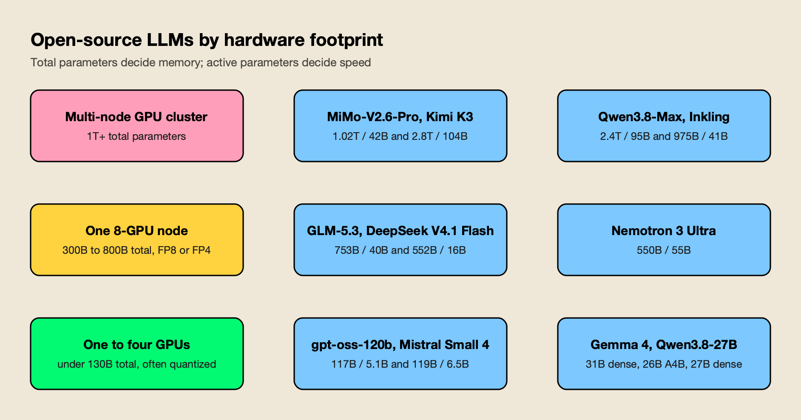
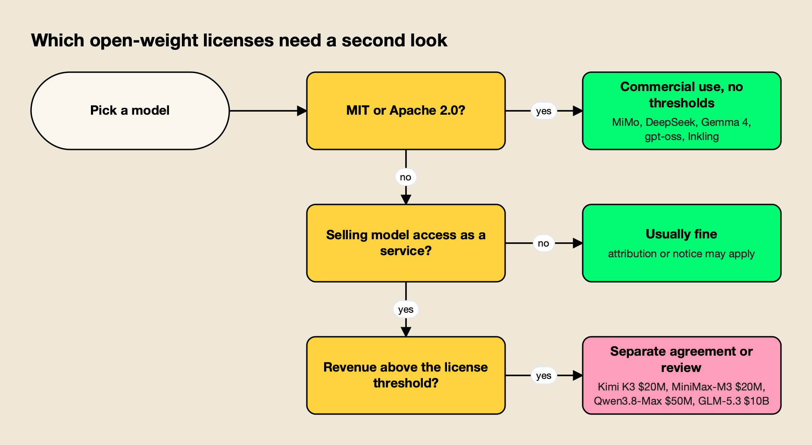
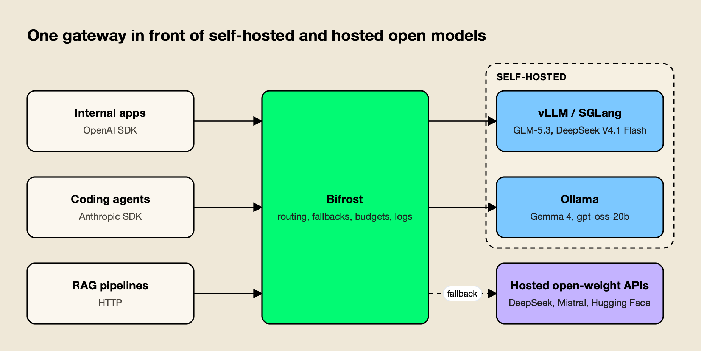

**TL;DR**
- Among open source LLMs as of October 15, 2026, the best is Xiaomi's MiMo-V2.6-Pro (46 on the Artificial Analysis Intelligence Index, MIT license), with GLM-5.3 (45) and Kimi K3 (44) effectively tied behind it.
- DeepSeek V4.1 Flash is the value pick: MIT-licensed, 552B parameters with 16B active, 39 on the index, and $0.30 / $1.20 per million tokens at peak on DeepSeek's API.
- Every model in the top five comes from a Chinese lab; the strongest US and European entries are Thinking Machines' Inkling, NVIDIA's Nemotron 3 Ultra and Mistral's Small 4 and Medium 3.5.
- For a single GPU, Gemma 4, Qwen3.8-27B and gpt-oss-120b are the practical choices, and all three ship under Apache 2.0.
- Licenses matter as much as scores: five of the ten carry custom terms that only bind companies reselling model access at scale.

Open source LLMs are large language models whose trained weights anyone can download, run on their own hardware, fine-tune and, in most cases, use commercially. In October 2026, the best open source LLMs trail the closed frontier by roughly twelve points on the Artificial Analysis Intelligence Index, and they cost a fraction as much per token. This ranking sorts the ten best open-weight models into four tiers, from trillion-parameter frontier models to ones that fit on a single GPU, and lists the release date, parameter count, license and verified benchmark scores for each. For the closed models these compete with, see the companion ranking of the [top AI models of October 2026](/blog/top-ai-models/).

## How These Open Source LLMs Were Ranked

The ranking combines one independent index with four practical tests. Each fact comes from a lab model card, release note or independent leaderboard read on October 15, 2026.

| Criterion | Source used | What it captures |
| --- | --- | --- |
| General capability | [Artificial Analysis open-weights leaderboard](https://artificialanalysis.ai/models/open-source) (Intelligence Index v4.3) | Third-party runs of reasoning, knowledge, agentic and coding evaluations |
| Vendor-reported benchmarks | Each model's Hugging Face card | Terminal-Bench 2.1, DeepSWE, SWE-bench, GPQA Diamond and similar, labeled as vendor-reported |
| License | The LICENSE file in each model repository | Commercial use, revenue thresholds, attribution |
| Hardware footprint | Total and active parameters from model cards | How many GPUs a self-hosted deployment needs |
| Availability | Hugging Face, Ollama, lab APIs | Whether weights can be downloaded today |

Index scores are the values on Artificial Analysis's open-weights pages on October 15; they move as the index is revised, so launch-day scores can differ. Background on why benchmark tables deserve skepticism is in the guide on [how to read an AI benchmark](/blog/how-to-read-an-ai-benchmark/).

## Best Open Source LLMs Compared at a Glance

The ten best open source LLMs of 2026 split cleanly into four tiers: three frontier models within two index points of each other, two value models, three US and European alternatives, and two families built for a single GPU.

| # | Model | Lab | Released | Total / active params | Context | License | AA Index |
| --- | --- | --- | --- | --- | --- | --- | --- |
| 1 | MiMo-V2.6-Pro | Xiaomi | Sep 21, 2026 | 1.02T / 42B | 1M | MIT | 46 |
| 2 | GLM-5.3 | Z.ai | Aug 2026 | 753B / 40B | 1M | GLM-5.3 License | 45 |
| 3 | Kimi K3 | Moonshot AI | Jul 16, 2026 | 2.8T / 104B | 1M | Kimi K3 License | 44 |
| 4 | DeepSeek V4.1 Flash | DeepSeek | Sep 10, 2026 | 552B / 16B | 1M | MIT | 39 |
| 5 | Qwen3.8 (2.4T-A95B and 27B) | Alibaba | Aug 2026 | 2.4T / 95B; 27B dense | 262K native, ~1M extended | Qwen3.8-Max license; Apache 2.0 (27B) | 40; 34 |
| 6 | Inkling | Thinking Machines | Jul 2026 | 975B / 41B | Not stated on card | Apache 2.0 | 25 |
| 7 | Nemotron 3 Ultra | NVIDIA | Jun 4, 2026 | 550B / 55B | 1M | OpenMDW-1.1 | 23 |
| 8 | Mistral Small 4 / Medium 3.5 | Mistral AI | Mar 16 / Apr 28, 2026 | 119B / 6.5B; 128B dense | 256K | Apache 2.0; modified MIT | Not listed |
| 9 | Gemma 4 | Google DeepMind | Apr 2, 2026 | 31B dense; 26B / 3.8B | 256K | Apache 2.0 | 15 to 17 |
| 10 | gpt-oss-120b | OpenAI | Aug 2025 | 117B / 5.1B | Not stated on card | Apache 2.0 | Not listed |

"Not listed" means the model does not appear on Artificial Analysis's current open-weights tables. Rank order weighs the index most heavily, then license freedom and how easily the model can be served.

## Open Source LLMs vs Open-Weight Models

Nearly every model sold as an open source LLM is, strictly, an open-weight model: the parameters are public, but the training data and full pipeline are not. Where those open weights come from has a clear geographic pattern, covered in this site's analysis of how [open weights follow geography](/blog/open-weights-geography/). That matters for audits more than for deployment.

The Open Source Initiative's [Open Source AI Definition 1.0](https://opensource.org/ai/open-source-ai-definition) asks for three things: the parameters, the complete code used to train and run the system, and enough information about the training data that a skilled person could build a substantially equivalent model. None of the ten models here publishes all of that, although some labs go further than weights alone: Xiaomi, for example, published a MiMo-V2.6 reinforcement-learning dataset next to the model checkpoints.

In practice, teams check three things instead: downloadable weights, license terms and hardware fit. This guide uses "open source LLM" in that common sense. A longer look at why most of the open frontier now comes from Chinese labs is in the analysis of [China's open-weight models](/blog/china-open-weight-models-2026/).

## Tier 1: Frontier Open-Weight Models

The three best open source LLMs in October 2026 sit within two points of each other on the Artificial Analysis Intelligence Index and all support a 1M-token context. They differ most on license and on how expensive they are to serve.

### 1. MiMo-V2.6-Pro (Xiaomi)

MiMo-V2.6-Pro is the best open source LLM of 2026 on the independent index, scoring 46 and ranking first of 116 open-weight models on its [Artificial Analysis model page](https://artificialanalysis.ai/models/mimo-v2-6-pro). Xiaomi released it on September 21, 2026, under the MIT license.

- **Size and modalities:** A sparse mixture-of-experts (MoE) model with 1.02 trillion total and 42 billion active parameters, a 1M-token context, and text, image, video and audio input, according to the [MiMo-V2.6-Pro model card](https://huggingface.co/XiaomiMiMo/MiMo-V2.6-Pro-RL).
- **Vendor-reported scores:** 89.9 on Terminal-Bench 2.1, 71.9 on DeepSWE v1.1, 82.0 on OSWorld-Verified and 94.0 on CyberGym.
- **Price:** $0.435 input and $0.87 output per million tokens on Xiaomi's API, per Artificial Analysis.
- **Trade-offs:** Slow on the first-party API (45.8 tokens per second in Artificial Analysis's measurement), and a trillion-parameter checkpoint needs a multi-node GPU cluster to self-host.

**Best for:** Teams that want the highest open-weight capability with no license conditions, including multimodal agents and data-residency deployments.

### 2. GLM-5.3 (Z.ai)

GLM-5.3 is the strongest text-focused open source LLM and the cheapest of the top three to self-host by parameter count. Z.ai shipped it in August 2026 as a post-training upgrade: the [GLM-5.3 model card](https://huggingface.co/zai-org/GLM-5.3) states it "uses the same base model as GLM-5.2."

- **Size:** 753 billion total and 40 billion active parameters (per Artificial Analysis), evaluated at up to 1M tokens of context.
- **Vendor-reported scores:** 88.2 on Terminal-Bench 2.1 (up from 81.0 for GLM-5.2), 66.9 on DeepSWE v1.1 and 62.5 on Humanity's Last Exam with tools. Artificial Analysis scores it 45.
- **License:** The custom GLM-5.3 License permits commercial use, modification and resale. The one condition: model-as-a-service businesses with more than $10 billion in annual revenue must pass a Z.ai security review first, per the [license file](https://huggingface.co/zai-org/GLM-5.3/blob/main/LICENSE).
- **Trade-offs:** Text only, and $1.40 / $4.40 per million tokens on Z.ai's API is about three times MiMo-V2.6-Pro's price. A smaller sibling, GLM-5.3-Flash (320B total, 18B active, MIT), scores 42 for teams that need lighter hardware.

**Best for:** Coding and agent workloads on a single large inference node, where text is the only modality needed.

### 3. Kimi K3 (Moonshot AI)

Kimi K3 is the largest open-weight model in the ranking and among the strongest on knowledge and browsing tests. Moonshot AI released it on July 16, 2026, according to its [Artificial Analysis page](https://artificialanalysis.ai/models/kimi-k3), which scores it 44.

- **Size and modalities:** 2.8 trillion total and 104 billion active parameters, a 1,048,576-token context, and text and image input per the [Kimi K3 model card](https://huggingface.co/moonshotai/Kimi-K3).
- **Vendor-reported scores:** 93.5 on GPQA Diamond, 88.3 on Terminal-Bench 2.1, 91.2 on BrowseComp and 84.8 on OSWorld-Verified.
- **License:** The Kimi K3 License requires model-as-a-service businesses above $20 million in revenue over 12 months to sign a separate agreement with Moonshot AI, and products above 100 million monthly users to display "Kimi K3" in the interface. Internal use is exempt.
- **Trade-offs:** The heaviest model here to serve, and the most expensive hosted option at $3 / $15 per million tokens.

**Best for:** Research, browsing and computer-use agents where top knowledge scores outweigh serving cost.

## Tier 2: Best Value Open Source LLMs

The second tier gives up five to seven index points for much lower cost per token or much smaller hardware. Both entries ship permissively licensed options.

### 4. DeepSeek V4.1 Flash (DeepSeek)

DeepSeek V4.1 Flash is the best value open source LLM in 2026: MIT-licensed, the fastest of the ten in Artificial Analysis's measurements at 174 tokens per second on DeepSeek's API, and priced like a small model. DeepSeek released it on September 10, 2026, in its [V4.1 Flash release note](https://api-docs.deepseek.com/news/news260910).

- **Architecture:** A 552-billion-parameter MoE that activates 8 billion parameters for input and 16 billion for output, with a KV cache that needs a quarter of the HBM of the previous generation, according to DeepSeek.
- **Vendor-reported scores:** 90.6 on Terminal-Bench 2.1 and 74.2 on DeepSWE v1.1, both the highest among the open models in this guide, plus 90.9 on GPQA Diamond, per the [DeepSeek-V4.1-Flash model card](https://huggingface.co/deepseek-ai/DeepSeek-V4.1-Flash). Artificial Analysis scores it 39, which shows how much vendor tables and independent indexes can diverge.
- **Price:** $0.30 input (cache miss) and $1.20 output per million tokens at peak, half that off-peak, per [DeepSeek's pricing page](https://api-docs.deepseek.com/quick_start/pricing).
- **Trade-offs:** Since September 14, DeepSeek routes `deepseek-v4-pro` API calls to V4.1 Flash until V4.1-Pro ships, so teams pinned to the older Pro model should check which model they are billed for.

**Best for:** High-volume coding agents and batch pipelines where throughput and price per token decide the choice.

### 5. Qwen3.8 (Alibaba)

Qwen3.8 is the broadest open source LLM family in the ranking, spanning a 2.4-trillion-parameter flagship and a 27-billion-parameter dense model that runs on a laptop. Alibaba published the weights in August 2026, and its [Qwen3.8-27B announcement](https://www.alibabacloud.com/blog/alibaba-unveils-qwen3-8-27b-and-releases-weights-of-qwen3-8-flagship-model_603463) calls the flagship the first Max-class Qwen model with open weights. The [DeepSeek V4 explainer](/blog/deepseek-v4/) covers the family's architecture, peak and off-peak pricing and API access in detail.

- **Flagship:** [Qwen3.8-2.4T-A95B](https://huggingface.co/Qwen/Qwen3.8-2.4T-A95B) has 95 billion active parameters, 262,144 tokens of native context extensible to about 1M, and is text-only with thinking mode always on. It reports 86.6 on Terminal-Bench 2.1, 67.7 on SWE-bench Pro and 92.6 on GPQA Diamond, and scores 40 on Artificial Analysis.
- **Small model:** [Qwen3.8-27B](https://huggingface.co/Qwen/Qwen3.8-27B) is Apache 2.0, accepts text, images and hour-scale video, and reports 61.7 on SWE-bench Pro and 84.3 on OSWorld-Verified. At 34, it is the highest-scoring small model on Artificial Analysis's index.
- **License:** The flagship's custom license requires a separate agreement for model-as-a-service or AI work-assistant businesses above $50 million in 12-month revenue.
- **Trade-offs:** The flagship is the second-largest model here and drops the vision support of Alibaba's hosted Qwen3.8-Max.

**Best for:** Teams that want one model family across a GPU cluster and developer laptops, with a permissive option at the small end.

## Tier 3: US and European Open-Weight Models

The third tier scores lower on the index but answers a question many buyers ask first: where the model comes from. All three ship under licenses that allow commercial use without a revenue threshold, with one exception noted below.

### 6. Inkling (Thinking Machines)

Inkling is the strongest US open source LLM on several coding tests and the largest Apache 2.0 model in this ranking. Thinking Machines published it in July 2026.

- **Size and modalities:** 975 billion total and 41 billion active parameters, routing each token to 6 of 256 experts, with text, image and audio input and text output, per the [Inkling model card](https://huggingface.co/thinkingmachines/Inkling).
- **Vendor-reported scores:** 77.6% on SWE-bench Verified, 54.3% on SWE-bench Pro, 87.2% on GPQA Diamond and 63.8 on Terminal-Bench 2.1. The card shows it trailing closed models on most rows, which Thinking Machines states openly. Artificial Analysis scores it 25.
- **Trade-offs:** Nearly a trillion parameters for a mid-table index score, so it costs more to serve per point of capability than DeepSeek V4.1 Flash.

**Best for:** Organizations that need a permissively licensed, US-developed model with audio input.

### 7. Nemotron 3 Ultra (NVIDIA)

Nemotron 3 Ultra is NVIDIA's largest open model and the most unusual architecture in the ranking. It reached Hugging Face on June 4, 2026.

- **Architecture:** A hybrid of Mamba-2 state-space layers, MoE and attention with multi-token prediction, 550 billion total and 55 billion active parameters, and a 1M-token context, per the [Nemotron 3 Ultra model card](https://huggingface.co/nvidia/NVIDIA-Nemotron-3-Ultra-550B-A55B-BF16). An NVFP4 checkpoint is published for Blackwell GPUs.
- **Vendor-reported scores:** 70.7 on SWE-bench Verified, 89.0 on LiveCodeBench v6, 87.0 on GPQA and 94.7 on RULER at 1M tokens, the long-context result that sets it apart. Artificial Analysis scores it 23.
- **License:** The OpenMDW License 1.1, which the card describes as ready for commercial and non-commercial use.
- **Trade-offs:** Text only, with lower agentic scores than the Chinese leaders.

**Best for:** Long-document and retrieval workloads on NVIDIA hardware, and teams that want an open model from their GPU vendor.

### 8. Mistral Small 4 and Medium 3.5 (Mistral AI)

Mistral AI is the leading European source of open source LLMs, and its two current releases cover different budgets. Mistral's [changelog](https://docs.mistral.ai/resources/changelogs) dates Small 4 to March 16, 2026, and Medium 3.5 to April 28, 2026.

- **Mistral Small 4:** A 119-billion-parameter MoE with 6.5 billion active, 256K context and text and image input, under Apache 2.0, per the [Mistral Small 4 model card](https://huggingface.co/mistralai/Mistral-Small-4-119B-2603). It reports 71.2 on GPQA Diamond.
- **Mistral Medium 3.5:** A 128-billion-parameter dense model with 256K context that Mistral says runs on as few as four GPUs and scores 77.6% on SWE-bench Verified, per its [Medium 3.5 announcement](https://mistral.ai/news/vibe-remote-agents-mistral-medium-3-5/).
- **License:** Small 4 is Apache 2.0. Medium 3.5 uses a modified MIT license that the [model card](https://huggingface.co/mistralai/Mistral-Medium-3.5-128B) says carries exceptions for companies with large revenue.
- **Trade-offs:** Neither appears on Artificial Analysis's current open-weights tables, so independent comparison is thinner than for the models above.

**Best for:** European deployments with data-sovereignty requirements and teams that want a capable model on a four-GPU server.

## Tier 4: Small Open Source LLMs for One GPU

The last tier trades capability for footprint: both families run on one data-center GPU, and their smaller sizes run on a laptop through Ollama. Both use Apache 2.0.

### 9. Gemma 4 (Google DeepMind)

Gemma 4 is the best small open source LLM family for multimodal and on-device work. Google released it on April 2, 2026, and its [Gemma 4 announcement](https://blog.google/innovation-and-ai/technology/developers-tools/gemma-4/) marked the first Gemma release under Apache 2.0.

- **Sizes:** A 31B dense model, a 26B MoE with about 3.8B active parameters, a 12B model, and E4B and E2B edge models; the larger ones support 256K context and the smaller ones 128K with audio input, per the [Gemma 4 model card](https://huggingface.co/google/gemma-4-31B-it).
- **Vendor-reported scores (31B):** 84.3% on GPQA Diamond, 89.2% on AIME 2026 and 80.0% on LiveCodeBench v6. Google reported the 31B as third among open models on the Arena text leaderboard at launch.
- **Trade-offs:** Artificial Analysis scores the reasoning variants 15 to 17, well below Qwen3.8-27B's 34 at a similar size.

**Best for:** On-device assistants, multimodal apps and fine-tuning projects that need a permissive license and wide tool support (all five sizes are in the [Ollama library](https://ollama.com/library/gemma4)).

### 10. gpt-oss-120b (OpenAI)

gpt-oss-120b is the oldest model in the ranking and still the reference point for a single-GPU open source LLM. OpenAI released gpt-oss-120b and gpt-oss-20b in August 2025 under Apache 2.0.

- **Size:** 117 billion total and 5.1 billion active parameters, quantized to MXFP4 so it fits "a single 80GB GPU" such as an NVIDIA H100, per the [gpt-oss repository](https://github.com/openai/gpt-oss). The 21-billion-parameter gpt-oss-20b runs within 16GB of memory.
- **Scores and controls:** 80.8 on MMLU-Pro on the [gpt-oss-120b model card](https://huggingface.co/openai/gpt-oss-120b), with low, medium and high reasoning-effort settings.
- **Trade-offs:** Fourteen months old, and absent from Artificial Analysis's current open-weights tables, so it trails the newer entries on independent comparisons.

**Best for:** Teams that want a well-documented, permissively licensed reasoning model on one GPU, and a stable baseline for evaluation.

**Also considered:** MiniMax-M3 (428B total, 23B active, 1M context, multimodal, 29 on the index, with a license requiring authorization above $20 million in revenue), Meta's Muse Glimmer (a 30B Apache 2.0 model released August 10, 2026, Meta's first open weights since Llama 4), and DeepSeek V4-Pro-0813 (1.7T, MIT, 36 on the index). Each misses on index score or license.

## Best Open Source LLM by Use Case

No single open source LLM wins every workload in 2026. The right pick depends on the task, the hardware available and whether the license fits the business model.

| Workload | Best pick | Value pick | Single-GPU pick |
| --- | --- | --- | --- |
| Agentic coding | DeepSeek V4.1 Flash | GLM-5.3-Flash | Qwen3.8-27B |
| General reasoning | MiMo-V2.6-Pro | DeepSeek V4.1 Flash | gpt-oss-120b |
| Multimodal (image, video, audio) | MiMo-V2.6-Pro | Qwen3.8-27B | Gemma 4 |
| Very long documents | Nemotron 3 Ultra | DeepSeek V4.1 Flash | Qwen3.8-27B |
| Most permissive license | MiMo-V2.6-Pro (MIT) | DeepSeek V4.1 Flash (MIT) | Gemma 4 or gpt-oss (Apache 2.0) |
| Non-Chinese origin | Inkling | Mistral Small 4 | Gemma 4 |

Vendor tables use different harnesses, so a two-point gap on Terminal-Bench 2.1 between labs is within noise, a pattern covered in [why benchmarks saturate](/blog/why-benchmarks-saturate/). Confirm coding results on your own repositories; the separate ranking of the [best AI models for coding](/blog/best-ai-models-for-coding/) compares open and closed options on that axis.

## Hardware Needed to Self-Host Open Source LLMs

The hardware an open source LLM needs is set by its total parameter count, because every expert has to sit in GPU memory even when only a few are active. Active parameters set the speed per token, not the memory bill.

*Figure 1: Most teams self-host from the bottom two tiers and call the top tier through a hosted API.*

The practical split falls into three bands:

- **Trillion-parameter models** (MiMo-V2.6-Pro, Kimi K3, Qwen3.8-Max, Inkling) need multiple GPU nodes even at FP8, so most teams reach them through the lab's API or a hosting provider.
- **300B to 800B models** (GLM-5.3, DeepSeek V4.1 Flash, Nemotron 3 Ultra) fit on one eight-GPU node at FP8 or FP4, served with an inference engine such as [vLLM](https://docs.vllm.ai/) or SGLang.
- **Models under 130B** (gpt-oss-120b, Mistral Small 4, Gemma 4, Qwen3.8-27B) run on one to four GPUs, and the smaller sizes run on a workstation or laptop with [Ollama](https://ollama.com/).

Self-hosting pays off when utilization is high, data cannot leave the network, or the team needs to fine-tune; otherwise hosted APIs are often cheaper. The trade-offs for running inference inside a closed network are covered in the guide to [air-gapped and in-VPC AI gateways](/blog/air-gapped-ai-gateways/).

## Open Source LLM Licenses Compared

Half of the best open source LLMs use a standard permissive license, and the other half use custom terms that bind only large operators. For most companies building products on these models, every model on this list is usable commercially.

*Figure 2: Most of the conditions bite only on companies that resell model access at scale.*

| Model | License | Condition for large operators |
| --- | --- | --- |
| MiMo-V2.6-Pro | MIT | None |
| DeepSeek V4.1 Flash | MIT | None |
| Gemma 4, gpt-oss, Inkling, Qwen3.8-27B, Mistral Small 4 | Apache 2.0 | None |
| GLM-5.3 | GLM-5.3 License | Security review for model-as-a-service firms above $10B annual revenue |
| Qwen3.8-2.4T-A95B | Qwen3.8-Max license | Separate license above $50M 12-month revenue for model-as-a-service or AI work-assistant firms |
| Kimi K3 | Kimi K3 License | Separate agreement above $20M 12-month revenue for model-as-a-service firms; name display above 100M monthly users |
| MiniMax-M3 | MiniMax community license | "Built with MiniMax M3" attribution; prior authorization above $20M yearly revenue ([license](https://huggingface.co/MiniMaxAI/MiniMax-M3/blob/main/LICENSE)) |
| Nemotron 3 Ultra | OpenMDW-1.1 | Commercial and non-commercial use per the model card |

"Model as a service" in these licenses means offering third parties API or fine-tuning access with meaningful control over inputs. Products that embed a model inside a feature, and gateways that relay requests to models hosted by others, are explicitly excluded in the GLM-5.3, Kimi K3 and Qwen3.8 texts. This is a summary of license files, not legal advice.

## Serving Open-Weight Models in Production

Teams that adopt open source LLMs usually run several at once: a small model on local GPUs for routine traffic, a hosted frontier open model for hard requests, and often a closed model as a fallback. That mix needs one layer that exposes a single API, routes by model or cost, retries on failure and records spend per team.

An AI gateway is the usual answer, and the category is surveyed in this site's ranking of [open source LLM gateways](/blog/open-source-llm-gateways/) and its guide to [gateways for vLLM, Ollama and cloud LLMs](/blog/ai-gateways-for-vllm-ollama-cloud-llms/). Bifrost is one worked example, chosen here because it is open source, self-hostable next to the GPUs, and has first-party provider support for each serving engine this guide mentions.

*Figure 3: The same model name can resolve to a local GPU server first and a hosted API as the fallback.*

[Bifrost](https://www.getmaxim.ai/bifrost), an [open-source AI gateway](https://github.com/maximhq/bifrost) built by Maxim AI, exposes 25+ providers and 10,000+ models through one OpenAI-compatible API. For open-weight models, the relevant pieces are:

- **Self-hosted engines as providers:** Bifrost has dedicated provider integrations for [vLLM](https://docs.getbifrost.ai/providers/supported-providers/vllm), [SGLang](https://docs.getbifrost.ai/providers/supported-providers/sgl) and [Ollama](https://docs.getbifrost.ai/providers/supported-providers/ollama), covering chat, streaming and embeddings, so a GLM-5.3 deployment on vLLM and a Gemma 4 instance in Ollama sit behind the same endpoint.
- **Hosted open-weight APIs:** The [supported providers matrix](https://docs.getbifrost.ai/providers/supported-providers/overview) includes DeepSeek, Mistral, Hugging Face, Fireworks, Nebius and Parasail, which covers most first-party and third-party hosts for the models above.
- **Fallbacks and routing:** [Retries and fallbacks](https://docs.getbifrost.ai/features/retries-and-fallbacks) move a request to the next provider when a local server returns errors or a key hits a rate limit, and [routing rules](https://docs.getbifrost.ai/providers/routing-rules) use CEL expressions to split traffic by team, header or budget use. A walkthrough of the failover pattern is in [enabling automatic fallback when a primary provider fails](https://www.getmaxim.ai/bifrost/blog/your-primary-llm-provider-failed-enable-automatic-fallback-with-bifrost/).
- **Budgets and caching:** [Virtual keys](https://docs.getbifrost.ai/features/governance/virtual-keys) carry [budgets and rate limits](https://docs.getbifrost.ai/features/governance/budget-and-limits) per team or customer, and [semantic caching](https://docs.getbifrost.ai/features/semantic-caching) replays answers for identical or similar prompts, which cuts GPU load as well as API spend.
- **Observability:** Per-request tokens, cost and latency, with [OpenTelemetry export](https://docs.getbifrost.ai/features/observability/otel), make it possible to compare a self-hosted model against a hosted one on real traffic.

Bifrost's [published benchmark](https://docs.getbifrost.ai/benchmarking/t3.xl) reports 11 µs of added overhead per request at 5,000 RPS on an AWS t3.xlarge, small next to the generation time of any model in this ranking.

The category pages on the [LLM gateway](https://www.getmaxim.ai/llm-gateway), [AI governance](https://www.getmaxim.ai/ai-governance) and [AI observability](https://www.getmaxim.ai/ai-observability) describe the same controls in general terms.

**Enterprise tier.** Clustering, audit logs, log exports, OIDC user provisioning and in-VPC deployment are part of [Bifrost Enterprise](https://docs.getbifrost.ai/enterprise/overview).

Further reading: a guide to [running an open-weight model in production without code changes](https://www.getmaxim.ai/articles/run-an-open-weight-model-in-production-without-code-changes/), a comparison of [LLM gateways for vLLM, SGLang and Ollama](https://www.getmaxim.ai/articles/top-4-llm-gateways-for-self-hosted-models-vllm-sglang-and-ollama-2026/), and [Open WebUI with a single gateway](https://www.getmaxim.ai/articles/open-webui-with-bifrost-one-gateway-for-every-model/) for chat front ends.

On deployment and cost, see [self-hosted vs managed LLM gateways](/blog/self-hosted-vs-managed-llm-gateway/), Bifrost's [enterprise deployment options](https://www.getmaxim.ai/resources/enterprise-deployment) and [LLM cost optimization in Bifrost](https://www.getmaxim.ai/bifrost/blog/llm-cost-optimization-in-bifrost-part-1/).

## Choosing an Open Source LLM in 2026

The open-weight field in October 2026 has a clear shape. MiMo-V2.6-Pro, GLM-5.3 and Kimi K3 form a three-way tie at the top, separated more by license than by capability. DeepSeek V4.1 Flash and Qwen3.8 deliver most of that capability at a fraction of the serving cost. Inkling, Nemotron 3 Ultra and Mistral cover buyers who need a US or European model, and Gemma 4 and gpt-oss remain the defaults for a single GPU.

For most teams the best open source LLM clears three filters in order: a license that fits the business, affordable hardware, and results on its own evaluation set rather than a vendor table. The ranking will shift again within weeks, since several of the ten models shipped in the last two months, so the durable decision is a serving setup that makes swapping models cheap.
