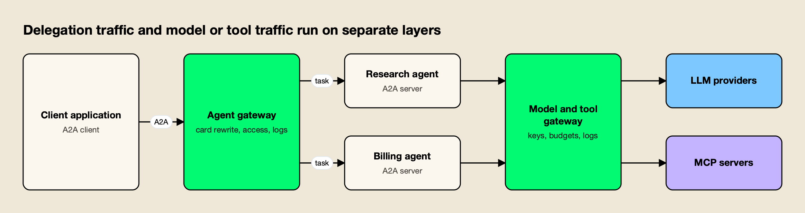
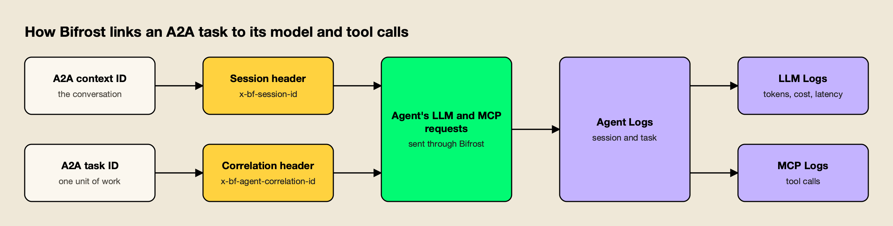

**TL;DR**
- Bifrost v2.3.0, released October 13, 2026, adds Agent Gateway: the open-source AI gateway now proxies agents that speak the A2A protocol, alongside the model and MCP tool traffic it already handled.
- Agents are registered by agent card URL; callers get gateway endpoints for JSON-RPC, REST and optionally gRPC, and the gateway bridges between them.
- Two headers sent by the agent tie each A2A task to the model and tool calls made for it, so one log view covers a delegation end to end.
- Push notifications for long tasks route through a durable outbox with up to six delivery attempts per update.
- Kong and Azure API Management also proxy A2A; the difference is how far each one follows the work behind an agent's answer.

Bifrost, the open-source AI gateway maintained by Maxim AI, now proxies agent-to-agent traffic. Its v2.3.0 release on October 13 adds an agent gateway that sits between applications and agents built on the Agent2Agent (A2A) protocol, controls which callers can reach each agent, and records what the agents did. The feature puts a third kind of traffic on a gateway that already routed model requests and MCP tool calls, and its most useful detail is the way it joins the three in one trail.

## What Shipped in Bifrost v2.3.0

Agent Gateway is the headline item in Bifrost v2.3.0. It registers an existing A2A agent from its agent card, publishes gateway endpoints for that agent, applies per-key access grants, relays push notifications, and writes every A2A operation and stream event to a new Agent Logs workspace. It ships in the open-source build, with extra scoping in the enterprise edition.

The [Agent Gateway documentation](https://docs.getbifrost.ai/features/agent-gateway/overview) describes the setup in four steps: register an agent, set the gateway's public base URL, grant access, and send traffic to the gateway endpoint. Once registered, a hypothetical `library-research` agent is reachable at routes like these:

| Endpoint | Gateway route |
|---|---|
| Agent card | `/agents/a2a/library-research/.well-known/agent-card.json` |
| JSON-RPC (with SSE streaming) | `/agents/a2a/library-research/json-rpc` |
| HTTP+JSON, labeled REST | `/agents/a2a/library-research/rest` |
| gRPC, when enabled | `library-research.a2a.example.com:443` |
| Push callback (agent-facing) | `/agents/a2a/library-research/push/callback` |

The release spans the dashboard, the management API and declarative deployment. Agents can be registered through the UI, through `POST /api/agents`, or through a new top-level `agents` array in `config.json` that is reconciled by name at startup, and the Helm chart gains matching `bifrost.agents[]` values. Bifrost is [open source on GitHub](https://github.com/maximhq/bifrost) under Apache 2.0, and the vendor's [launch post frames the release as one gateway for models, tools and agents](https://www.getmaxim.ai/bifrost/blog/introducing-agent-gateway-in-bifrost-one-gateway-for-models-tools-and-agents/).

## Why A2A Traffic Needs an Agent Gateway Now

A2A has become a stable protocol with broad platform support, which turns agent-to-agent calls into production traffic that security and platform teams have to govern. An agent gateway gives that traffic the same treatment model calls already get: a known caller, an access decision, and a record of the exchange.

The [A2A specification](https://a2a-protocol.org/latest/specification/) lists 1.0.0 as its latest released version. In August the project [joined the Agentic AI Foundation as a Growth Stage project](https://a2a-protocol.org/latest/blog/2026/08/27/a-new-chapter-for-a2a-joining-the-agentic-ai-foundation/), and that announcement says Google Cloud, AWS Bedrock AgentCore Runtime and Microsoft Azure AI Foundry have built native A2A support, while frameworks including LangGraph, CrewAI and Pydantic AI support the protocol.

The foundation also hosts the [Model Context Protocol](https://modelcontextprotocol.io/specification/latest), and the two protocols divide the work cleanly: MCP connects an agent to its tools, A2A connects it to other agents. This site's [comparison of A2A and MCP](/blog/a2a-vs-mcp/) covers that split from the specs.

That split creates an operational gap. A support bot that hands a question to a research agent generates an A2A task, and the research agent then makes its own model calls and tool calls. Without a common record, each hop lands in a different service's logs. The vendor's launch post puts the problem plainly: following that work across separate services "is where things get tedious."

*Figure 1: Delegation traffic and model or tool traffic are separate layers, and a trail across them needs a shared identifier.*

As Figure 1 shows, an agent gateway governs the horizontal A2A hop, while the vertical calls each agent makes go through an AI gateway or MCP gateway. This site's guide to [agent gateways for governing AI agents](/blog/agent-gateways/) treats those surfaces as separate controls; a primer on [what an A2A protocol gateway does](https://www.getmaxim.ai/articles/a2a-protocol-gateway/) and a comparison of an [agent gateway versus an LLM gateway](https://www.getmaxim.ai/articles/agent-gateway-vs-llm-gateway/) cover the same ground from the infrastructure side.

## How Registration and Transport Bridging Work

Registration starts from the [agent card](https://a2a-protocol.org/latest/specification/#8-agent-discovery-the-agent-card), the JSON document an A2A agent publishes to describe its skills, endpoints and authentication. Bifrost fetches the card, lets an operator review it, and then serves a rewritten card that points clients at the gateway. Requests can arrive over one A2A binding and leave over another.

The [registration guide](https://docs.getbifrost.ai/features/agent-gateway/registration) requires the full card URL, not just the agent's base domain, and separates the credentials used to fetch a private card from the credentials used to send work. Each request for the gateway's card fetches the current card from the agent and rewrites its endpoints and authentication requirements; the docs state that Bifrost does not return a cached registration-time card. Because the rewrite invalidates any signatures over the upstream document, the served card drops them.

Transport bridging is the part most teams will notice first. According to the [transport selection guide](https://docs.getbifrost.ai/features/agent-gateway/transports-and-recovery), the gateway reads the agent's `supportedInterfaces`, keeps the A2A v1 entries for `JSONRPC`, `HTTP+JSON` and `GRPC`, and uses the card's order as its initial preference. A REST client can therefore reach an agent that only exposes JSON-RPC, without a custom adapter in between.

The recovery rules are deliberately conservative:

- **Dial failures and HTTP 404, 405, 410 or 426** move the current unary call to the next advertised interface, and the latter group also triggers a background card refresh.
- **HTTP 5xx and ambiguous network failures** return the error without replaying the call, since the agent may already have started the task.
- **Streaming calls are never replayed**, even if they fail before the first event; clients use `GetTask` or `SubscribeToTask` to pick the work back up.

Refusing to replay ambiguous calls avoids duplicate tasks, a real risk when an agent's work has side effects. Gateway operations stay disabled until an operator sets the External Client URL in the [gateway settings](https://docs.getbifrost.ai/features/agent-gateway/configuration), which the docs say Bifrost never infers from `Host` or forwarded headers.

## Access Control Separates Agents From Models and Tools

Access to an agent is a grant on a virtual key, the credential Bifrost already used for model and tool permissions. A key granted one agent cannot call any other registered agent, and the grant does not extend to the models or MCP tools that agent uses downstream.

The [Agent access guide](https://docs.getbifrost.ai/features/agent-gateway/access-control) adds two details for operators. An **Allow any virtual key** setting opens an agent to every valid key without explicit grants, and ungranted or disabled agents return `403`. The guide also warns that grants alone do not make anonymous traffic private: deployments must set `enforce_auth_on_inference` to reject calls that present no identity.

By default the gateway strips the caller's Bifrost credential before forwarding a request to the agent. Operators can instead enable credential forwarding, so the agent reuses the caller's key on its own model and tool calls and those calls inherit that caller's access rules and budgets. The alternative is to give the agent its own key, in which case the agent's permissions and spend limits apply. The access model builds on the virtual keys described in Bifrost's write-up on [governance and observability at the gateway](https://www.getmaxim.ai/bifrost/blog/ai-governance-and-observability-in-bifrost/).

**Enterprise tier.** Agent grants through access profiles and projects, user attribution and scoped log access are part of Bifrost Enterprise, which also maps grants to teams, business units and customers through the [access profiles introduced in the same release cycle](https://www.getmaxim.ai/bifrost/blog/governance-that-follows-your-org-structure-access-profiles-for-teams-business-units-and-customers/).

## Correlation Headers Join A2A Tasks to LLM and MCP Logs

The release's most distinctive feature is a correlation scheme. When an agent sends two headers on the model and tool calls it makes for a task, Bifrost links that task to its LLM and MCP logs, and an operator can open one conversation and see the delegation, every model call, and every tool call together.

The [integration guide](https://docs.getbifrost.ai/features/agent-gateway/integrating-your-agent) defines the headers:

| Header | Value | What it links |
|---|---|---|
| `x-bf-session-id` | A2A context ID | Every LLM and MCP call in the conversation |
| `x-bf-agent-correlation-id` | A2A task ID | The model and tool calls for one task |
| `x-bf-vk` or identity header | Forwarded caller credential | Access checks and caller attribution |

*Figure 2: Two IDs the agent already has are enough to stitch an A2A task to the model and tool calls behind it.*

As Figure 2 shows, the gateway cannot infer these IDs on its own; the agent has to send them. The docs warn against substituting a JSON-RPC request ID or an unrelated tracing UUID, and against storing the credential in a global header map that concurrent tasks share, which could attribute one caller's work to another. With the headers in place, the [Agent Logs view](https://docs.getbifrost.ai/features/agent-gateway/observability) groups operations by A2A context and shows LLM and MCP tabs for the matching calls, with latency, tokens and cost on each model call.

The same data leaves the gateway through the [OpenTelemetry connector](https://docs.getbifrost.ai/features/agent-gateway/connectors). A2A spans carry attributes from the [OpenTelemetry GenAI conventions](https://opentelemetry.io/docs/specs/semconv/registry/attributes/gen-ai/), such as `gen_ai.agent.name`, `a2a.task.id`, `gen_ai.conversation.id` and the upstream transport, and the gateway records an `a2a.client.operation.duration` metric.

Teams already following the [OpenTelemetry conventions for agent observability](https://www.getmaxim.ai/articles/ai-agent-observability-evolving-standards-and-best-practices/) can filter by those attributes in their existing backend, and this site's survey of [LLM observability tools](/blog/llm-observability-tools/) covers where those traces usually land.

## Push Notifications Go Through a Durable Outbox

Long-running A2A tasks can report progress by push notification instead of holding a stream open. Bifrost interposes itself on those callbacks: the agent receives a gateway callback URL and a separate token, and the gateway stores the update and delivers it to the application with retries.

The [push notification guide](https://docs.getbifrost.ai/features/agent-gateway/push-notifications) specifies the delivery terms. Any `2xx` response counts as success, each attempt has a 30-second timeout, and failed deliveries retry up to six times. Delivery is at least once, so callbacks need to be idempotent. Pending deliveries live in the configuration database rather than an in-memory store, which the docs justify on durability grounds: an accepted update must survive a crash.

Two safety defaults stand out. Callbacks to private and loopback addresses are blocked unless a server setting is enabled, and the docs say to keep it off in production. The application's own callback URL and credentials stay with the gateway and are never passed to the agent. Agent Logs records both the notification arriving from the agent and each delivery attempt, which gives operators a place to look when an update never arrives.

## How Kong and Azure API Management Handle A2A

Bifrost is not the first gateway to proxy A2A. Kong and Azure API Management both document A2A support, and both rewrite agent cards so clients discover the gateway. The differences are in which bindings each one mediates and how far its records follow an agent's downstream work.

| Capability | Bifrost Agent Gateway | Kong AI A2A Proxy | Azure API Management A2A API |
|---|---|---|---|
| A2A bindings | JSON-RPC, REST, gRPC, bridged | JSON-RPC and REST detected | JSON-RPC only |
| Agent card rewrite | Yes, fetched fresh per request | Yes, `url` field rewritten | Yes, hostname, transport, security |
| Access control | Per-agent grants on virtual keys | Kong auth plugins on the route | Policies and subscription keys |
| Push notification relay | Durable outbox with retries | Not published | Not published |
| Link to downstream LLM and MCP calls | Correlation headers, shared logs | Not published | Not published |
| Packaging | Open source; enterprise adds scoping | AI Gateway Enterprise, Kong Gateway 3.14+ | Listed API Management tiers |

Kong's [AI A2A Proxy plugin](https://developer.konghq.com/plugins/ai-a2a-proxy/) is a pass-through layer: it detects A2A requests, rewrites the card's `url`, and emits structured logs and a `kong.a2a` OpenTelemetry span with task and state attributes. Its docs say it "does not modify request routing, aggregate responses, or manage task state," and authentication comes from Kong's existing plugins. Kong also publishes a [how-to for proxying A2A agents](https://developer.konghq.com/how-to/proxy-a2a-agents/). For teams already running Kong, that is a low-friction way to get A2A metrics into Konnect.

Azure API Management [imports an A2A agent API from its agent card](https://learn.microsoft.com/azure/api-management/agent-to-agent-api), mediates JSON-RPC operations under the standard policy engine, and adds `genai.agent.id` and `genai.agent.name` attributes when Application Insights is on. Its limitations section lists JSON-RPC-only support and no deserialization of outgoing response bodies. For organizations standardized on Azure, governing agents alongside REST, GraphQL and MCP APIs in one portal is the main draw.

Bifrost's differentiator is the vertical link. Because the same deployment already handles [MCP tool traffic](https://www.getmaxim.ai/mcp-gateway) and model traffic across 25+ providers, it can tie a delegated task to the model and tool calls behind it, which is the question operators ask when an answer looks wrong or usage jumps.

## What to Watch

Agent Gateway supports A2A today, and the docs describe it as the protocol the feature "currently supports." The correlation trail is built from headers that agent authors send, so adoption by agent framework maintainers is the variable to track.

Three things will indicate how the category matures:

- **Framework defaults.** If A2A server SDKs start propagating context and task IDs onto outbound model calls automatically, correlation stops being an integration step for every gateway that offers it.
- **Shared policy across layers.** With credential forwarding, an agent's model and tool calls already inherit the caller's budgets and grants, the same controls the gateway applies in [MCP traffic governance](https://www.getmaxim.ai/bifrost/blog/enterprise-mcp-governance-access-audit-and-cost-controls-for-ai-agents-2/). Whether other gateways adopt that pattern will shape buyer expectations.
- **Competing approaches.** Cloud platforms are building A2A into their own agent runtimes, which will pull some teams toward a provider-native control plane instead of a standalone gateway.

The release also fits a pattern in this market. Gateways that began with model routing are absorbing each new protocol that agents speak, first MCP and now A2A, as covered in this site's roundup of [open-source MCP gateways](/blog/open-source-mcp-gateways/). For teams evaluating the category, Bifrost's [MCP gateway resources](https://www.getmaxim.ai/resources/mcp-gateway) and [product page](https://www.getmaxim.ai/bifrost) describe the rest of the stack the agent layer now plugs into.

## The Bottom Line

Agent-to-agent calls are becoming ordinary production traffic, and the A2A 1.0 specification gives gateways a stable target. Most early A2A proxies stop at the hop between caller and agent. Bifrost's Agent Gateway goes a step further by tying each delegated task to the model and tool calls that produced its answer, while keeping agent, model and tool permissions separate. For teams already sending agent traffic through Bifrost, adding the A2A layer is a configuration change rather than a new system. For everyone else, the release raises the standard for what an agent gateway should record.
