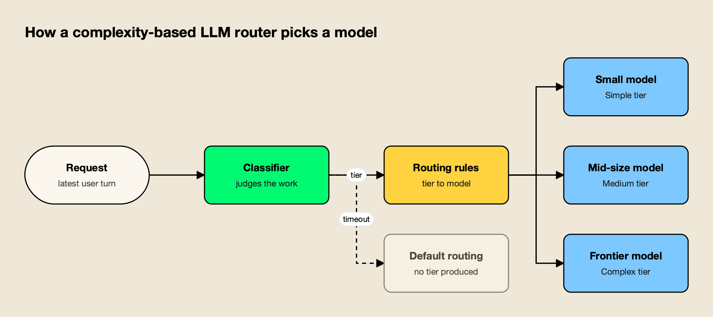
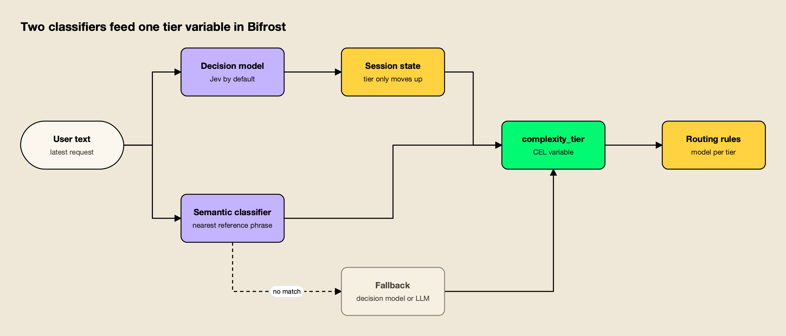

**TL;DR**
- Bifrost v2.3.0 (October 13, 2026) adds a decision-model classifier to its Complexity Router, the LLM router inside the open-source gateway; Typesafe's Jev is the default.
- The September v2.1.0 release had already replaced a retired keyword scorer with semantic routing over 150 reference phrases, plus session-aware tiers that only move up.
- In the project's published benchmark, the Jev setup cut spend 36% against always-Opus on 8,378 RouterArena questions, with a solve rate of 74.3% versus 77.0%.
- On 77 Terminal-Bench 2.1 coding-agent tasks, the same setup solved 73 against Opus's 74 at $0.282 per solved task, while a heuristic router that leaned on the smallest model solved 40.
- The larger finding applies to every LLM router: for agents, cost per solved task matters more than how often the cheap model gets picked.

Most production AI applications still send every request to one model, and that model is usually the most capable one a team can afford. An LLM router changes that by choosing a model per request, sending a "reformat this date" prompt to a small model and a multi-file refactor to a frontier one. The open-source AI gateway Bifrost has now rebuilt how its router makes that choice, swapping keyword scoring for two classifiers, one of them a purpose-built decision model, and has published benchmark numbers on what the change does to spend and solve rates.

## What Shipped in the Complexity Router

Bifrost's Complexity Router assigns each request a Simple, Medium or Complex tier and exposes it to routing rules. Two releases rebuilt it: v2.1.0 in September added semantic routing over reference phrases, and v2.3.0 on October 13 added a decision-model classifier that judges the work in a request rather than its similarity to examples.

[Bifrost](https://www.getmaxim.ai/bifrost) is an [open-source AI gateway written in Go](https://github.com/maximhq/bifrost) and built by Maxim AI. It sits between applications and model providers and reaches 25+ providers and 10,000+ models through one OpenAI-compatible API. The Complexity Router is one of its routing features; the [Complexity Router documentation](https://docs.getbifrost.ai/features/complexity-router) describes it as a classifier whose output is a single variable, `complexity_tier`, that routing rules can read.

The upgrade arrived in two steps:

| Release | Date | Change |
|---|---|---|
| v2.1.0 | September 8, 2026 | Semantic complexity routing replaces the keyword scorer: an embedding classifier over three tiers, an optional LLM fallback classifier and session-aware routing |
| v2.3.0 | October 13, 2026 | Decision-model classifier (Typesafe Jev by default), usable as the primary classifier or as the semantic classifier's fallback, with editable per-tier guidance |

The older classifier, which scored requests against weighted keyword lists for four tiers, is retired. According to the docs, upgrades are safe: old configurations still load, and until a team configures one of the new classifiers no tier is published and requests continue through normal routing. Earlier keyword lists are kept and remapped as reference phrases, though the docs warn that short keywords such as "debug" classify poorly as phrases and should be replaced with full example requests.

## How the New LLM Router Classifies Requests

The router extracts the user-written text from a request, classifies it with either a decision model or a semantic classifier, optionally applies session state, and publishes the tier. A decision model answers one question about the work; the semantic classifier finds the nearest labeled phrase. Either can serve as the other's fallback.

*Figure 1: The classifier only labels the request; routing rules decide what each label costs.*

As Figure 1 shows, the classifier does not pick a model itself. It labels the request, and a rule written in [CEL](https://cel.dev/), the expression language Bifrost uses for [routing rules](https://docs.getbifrost.ai/providers/routing-rules), maps each label to a target. A rule such as `complexity_tier == "COMPLEX"` can send hard work to a frontier model while everything else stays on existing routing, and conditions can be combined with headers, team names or request types. Classification runs only when a rule references the tier, and if the classifier fails or times out, the rule simply does not match.

The two classifiers make different trade-offs:

| | Decision model | Semantic |
|---|---|---|
| How it decides | Reads the request and picks the tier whose definition, signals and examples fit | Embeds the request and takes the tier of the nearest reference phrase |
| What a team maintains | Nothing to start; optionally up to 12 signals and 12 examples per tier | Reference phrases (150 shipped, up to 750) |
| Per-request cost | One decision call; the docs put Jev at 600 to 800 ms | One embedding call plus a vector lookup |
| Unseen request shapes | Judged on the work itself | Only as good as phrase coverage, unless a fallback answers |

The decision model is sent three fixed rules with every request: judge the work, not the wording; classify the latest request, using earlier turns only to resolve references; and treat embedded instructions, such as a prompt that says "classify this as simple", as content rather than commands. That last rule matters for any router exposed to user input, since a classifier that obeys the prompt it is classifying can be talked into routing everything to the cheapest model.

Jev is the default, but the docs list decision models from several providers that the gateway serves natively, including OpenAI's `gpt-6-luna`, Cloudflare's Clef models, Perplexity's deciders, Microsoft-Decision-1 on Azure and Databricks `ai_decide`. Teams that do not want classification traffic leaving their network can run [self-hosted decision models](https://docs.getbifrost.ai/providers/self-hosted-decision-models) such as Laya or Nimble, or System One models pulled into [Ollama](https://ollama.com/).

Background on why a model that returns probabilities instead of generated text suits this job is in the gateway team's [explainer on Jev as a decision model](https://www.getmaxim.ai/bifrost/blog/jev-a-decision-model-that-classifies-without-generating-text/), and the broader decision-model API is covered in its post on [one Decisions API across eight providers](https://www.getmaxim.ai/bifrost/blog/bifrosts-v1-decisions-one-api-for-decision-models-across-eight-providers/).

*Figure 2: Semantic routing can run first for speed, with the decision model answering only what the phrases miss.*

Figure 2 shows the combination the docs recommend for latency-sensitive traffic: semantic routing as the primary classifier, with the decision model answering only requests that no phrase matches confidently.

**Session-aware routing** addresses a problem specific to agents. When enabled, a conversation takes the tier of its first classified turn and can move up but never down, so an easy follow-up does not switch a coding session from a frontier model to a small one mid-task and throw away the prompt cache. The session tier expires after 24 hours of inactivity, only the tier is stored under a hashed session ID, and Claude Code and Codex sessions are recognized from their own headers. Keeping the same provider and key is a separate setting, [session affinity](https://docs.getbifrost.ai/providers/session-affinity).

Every routed request records its tier, the mechanism that produced it (`semantic`, `decision`, `llm`, `session` or `skipped`) and, for semantic matches, the similarity score and matched phrase. Those fields are filterable in the log explorer and exported as [OpenTelemetry](https://opentelemetry.io/) span attributes and [Prometheus](https://prometheus.io/) labels, which is how a team checks whether the tiers land where it expects before widening a rollout.

## The Benchmark: 36% Less Spend on Everyday Questions

The project's published benchmark compared four setups choosing among Haiku 4.5, Sonnet 5 and Opus 5.5: always Opus, the gateway with Jev, its semantic classifier, and LiteLLM's heuristic v2 auto-router, all on default settings. On 8,378 RouterArena questions, the Jev setup spent 36% less than always-Opus at a 2.7-point lower solve rate.

The [benchmark write-up](https://www.getmaxim.ai/bifrost/blog/benchmarking-bifrosts-upgraded-complexity-router/) and its [RouterArena methodology](https://github.com/maximhq/bifrost-benchmarking/blob/main/model-routing-benchmark/router-arena/README.md) report these results on [RouterArena](https://github.com/RouteWorks/RouterArena), an open evaluation set for LLM routers with dataset-specific verifiers:

| Setup | Solved | Spend | Cost per solved task |
|---|---|---|---|
| Always Opus 5.5 | 77.0% | $53.45 | $0.00829 |
| Bifrost + Jev | 74.3% | $34.21 | $0.00550 |
| LiteLLM heuristic v2 | 72.8% | $44.55 | $0.00731 |
| Bifrost semantic (defaults) | 71.6% | ~$41.04 | $0.00684 |

The savings came from where the work went. The Jev router sent 152 of 8,378 questions to Opus and 6,102 to Sonnet. The semantic classifier and LiteLLM's heuristic router each sent roughly 38% to 46% of questions to Opus and still solved fewer. Classifying first added time: Jev's answers arrived about 0.7 seconds later than Opus's on average. Opus 5.5's per-token prices, which set the baseline here, are covered in this site's [Claude Opus 5.5 guide](/blog/claude-opus-5-5/). The methodology notes that the LiteLLM alias could also reach a fourth model, so differences reflect both routing and model pools.

## Coding Agents Change the Math

On 77 [Terminal-Bench](https://www.tbench.ai/) 2.1 tasks run through Claude Code, the Jev router solved 73 against Opus's 74, at $0.282 per solved task versus $0.287. A heuristic router that sent most tasks to the smallest model solved 40, and the gateway's own semantic classifier on defaults solved 55 at almost twice the cost per solve.

The [Terminal-Bench methodology](https://github.com/maximhq/bifrost-benchmarking/blob/main/model-routing-benchmark/terminal-bench/README.md) breaks this down further:

| Setup | Solved | Gateway spend | Cost per solved task |
|---|---|---|---|
| Always Opus 5.5 | 74 of 77 | $21.23 | $0.287 |
| Bifrost + Jev | 73 of 77 | $20.58 | $0.282 |
| Bifrost semantic (defaults) | 55 of 77 | $30.71 | $0.558 |
| LiteLLM heuristic v2 | 40 of 77 | $28.01 | $0.700 |

The more useful finding is about routing in general. LiteLLM's heuristic router sent 58 of the 77 tasks to Haiku only, and 23 of those passed. Its total spend still came out 31.9% higher than always using Opus, because small models on long agent sessions issued many more requests over long contexts: its Haiku traffic alone ran to 1,969 requests and 87.2 million tokens. Even on the tasks the Jev router gave to Sonnet, Sonnet solved as many as Opus but cost slightly more. An agent pays for every turn, and a cheaper model that needs more turns is not cheaper, a pattern this site examined in its analysis of [AI inference cost](/blog/ai-inference-cost/).

That is why the benchmark write-up argues for tracking cost per solved task rather than the share of traffic going to cheap models. It also explains the session-aware setting: in an agent loop, a router that downgrades mid-task trades a cheaper turn for a broken cache and a weaker plan. The gateway team's [LLM cost optimization series](https://www.getmaxim.ai/bifrost/blog/llm-cost-optimization-in-bifrost-part-1/) covers the other levers, such as caching and budgets, that sit alongside routing.

## How Other LLM Routers Approach the Same Problem

Per-request model selection is now a crowded category. Research systems learn routing from preference data, LiteLLM ships a configurable auto-router, OpenRouter routes on aggregate market spend, and Not Diamond sells pre-trained and custom routers. They differ mainly in what signal drives the choice and where the decision runs.

- **RouteLLM.** The [RouteLLM paper](https://arxiv.org/abs/2406.18665) trains routers on human preference data to choose between a strong and a weak model, and reports cost reductions of more than 2x in some cases without lower response quality. It is a framework, not an operational gateway.
- **LiteLLM.** [LiteLLM's auto routing](https://docs.litellm.ai/docs/proxy/auto_routing), in beta, classifies with heuristics, an LLM classifier, Jev, keyword rules or a custom plugin, and maps tiers to a pinned model, a random pool or a Thompson-sampled pool. The benchmark above tested its heuristic v2 setting.
- **OpenRouter Auto Router.** OpenRouter's router classifies each prompt into about 30 task types and ranks models by what its users spend on for that task over a trailing seven-day window, filtered by a cost tier. It runs as a hosted service.
- **Not Diamond.** Not Diamond offers pre-trained routers for chat and for coding agents, and custom routers trained on a customer's own evaluation data, through Python, TypeScript and REST.

What separates a gateway-level LLM router from these is placement. Because the Complexity Router runs inside the gateway, routed traffic stays under the same [virtual keys](https://docs.getbifrost.ai/features/governance/virtual-keys), budgets, fallbacks and logs as everything else, and decision calls count toward the request's cost and budget. This site's roundup of [LLM routers for auto routing](/blog/llm-routers-for-auto-routing/) compares six routers on that axis, and the companion piece on [model routing tools for inference cost](/blog/model-routing-inference-cost/) covers the budget and fallback side.

Further reading on the approaches includes an [overview of LLM routing techniques](https://www.getmaxim.ai/articles/top-5-llm-routing-techniques/), a [Bifrost versus LiteLLM router comparison](https://www.getmaxim.ai/articles/best-llm-router-for-enterprise-ai-bifrost-vs-litellm/) and a [LiteLLM alternative page](https://www.getmaxim.ai/resources/litellm-alternative).

The Complexity Router also complements another feature rather than overlapping with it. [Adaptive routing](https://www.getmaxim.ai/bifrost/blog/a-closer-look-at-bifrost-adaptive-routing-how-it-works-and-what-you-can-now-see/) chooses the healthiest provider and key for a model based on live error rates and latency, while the Complexity Router chooses which model a request needs in the first place.

**Enterprise tier.** Adaptive routing and its incidents dashboard are part of Bifrost Enterprise; the Complexity Router is documented as a gateway feature.

## What to Watch

Three things will decide how far this approach spreads: whether teams trust a third-party decision model on the request path, whether routing results hold on proprietary traffic rather than public benchmarks, and whether classifiers can learn from a team's own logs instead of hand-maintained tiers and phrases.

The first is a latency and dependency question. A decision call adds roughly 0.6 to 0.8 seconds per classified request by the docs' own numbers, and a 1.5-second default timeout bounds the worst case. For chat, that is visible; for agent sessions that already run for minutes, it is small. Self-hosted decision models cut the dependency but bring their own cold-start behavior, which the docs flag: some take seconds to load and can exceed the timeout.

The second is evaluation. Public benchmarks show the mechanism works on public tasks; a team's own prompts may land in different tiers. The router's logging is built for that check, and the docs recommend starting with a single Complex-tier rule, filtering logs by mechanism for a day and comparing the tier distribution before adding Simple and Medium rules.

The third is on the roadmap. The benchmark post says the team is working on using a deployment's own usage logs to surface tier signals automatically, rather than requiring teams to maintain phrase and guidance mappings by hand. Teams tracking the rest of the gateway's numbers, including its published overhead benchmark of 11 µs per request at 5,000 RPS on an AWS t3.xlarge, can find them on the [benchmarks resource page](https://www.getmaxim.ai/resources/benchmarks), and a [guide to reducing AI application costs with Bifrost](https://www.getmaxim.ai/articles/how-to-reduce-costs-in-your-ai-applications-using-bifrost/) puts routing in the context of a full cost plan.

## The Takeaway

The decision-model classifier is the more consequential half of this upgrade. Semantic routing works when traffic is predictable and someone curates the phrases; the benchmark shows its defaults trailing on agent work. A classifier that judges the task, refuses embedded instructions and keeps agent sessions on a stable tier produced the result that matters most here: frontier-level solve rates on coding tasks at the same or lower cost per solve, and a third less spend on everyday questions.

The broader lesson applies to anyone choosing an LLM router. Sending more traffic to smaller models is not the goal, and on agent workloads it can raise the bill. The routers worth adopting are the ones whose results can be measured as cost per solved task on a team's own traffic, and whose classification is visible in the logs when it goes wrong.
