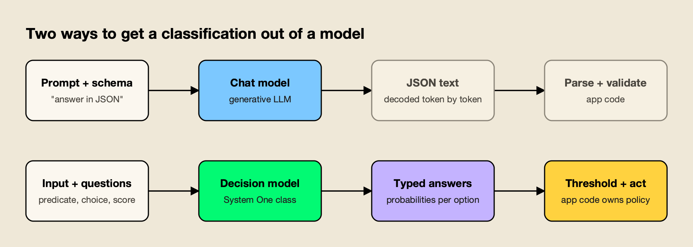
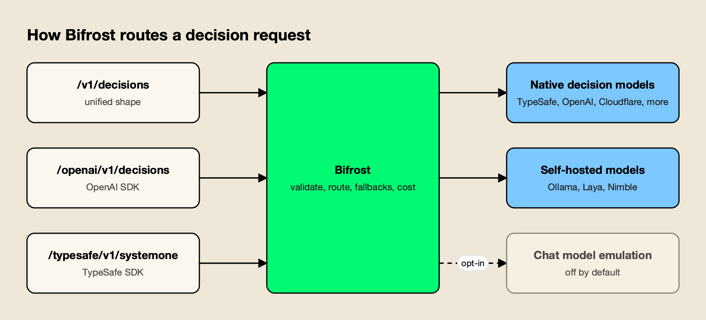

**TL;DR**
- Decision models answer typed questions (a probability, a choice or a score) instead of writing text, and native decision endpoints now exist at OpenAI, TypeSafe, Cloudflare, Perplexity, Azure and Databricks.
- The open-source gateway's v2.3 release makes `/v1/decisions` an OpenAI-shaped endpoint that reaches native decision models from eight providers plus self-hosted ones.
- Emulating a decision on an ordinary chat model is now opt-in, so a misrouted request fails loudly instead of quietly running on a slower, costlier model.
- Price gaps are wide: TypeSafe lists Jev at $0.042 per million input tokens with free output, and OpenAI charges $0.10 per million uncached input tokens on its Decisions API.
- Calibration and prompt sensitivity are the open questions; a shared API does not make the models interchangeable.

Bifrost, the open-source AI gateway from Maxim AI, now sends classification-style requests to a new class of decision model through a single typed endpoint. The v2.3 release reworks `/v1/decisions` into the request shape OpenAI uses for its own Decisions API and connects it to native decision endpoints at eight providers, from TypeSafe and OpenAI to Cloudflare Workers AI and a local Ollama install. The change arrives as model providers converge on the idea that many AI calls need a number, not a paragraph.

## What Shipped in Bifrost 2.3

The v2.3.0 release, dated October 13, rebuilds the decisions endpoint around an `input` plus an ordered list of typed `questions`, adds native decision providers, makes chat-model emulation opt-in, and adds pricing fields for decision traffic. A follow-up post on October 16 put the count at eight providers.

The endpoint itself is not new. The gateway first added `/v1/decisions` in September with a single upstream, TypeSafe's Jev, announced in a September 23 post on [TypeSafe System One models and the new decisions endpoint](https://www.getmaxim.ai/bifrost/blog/typesafe-system-one-models-and-new-v1-decisions-endpoint/). What changed in October is breadth and shape. According to the v2.3.0 changelog, the release:

- Moves `/v1/decisions` to an OpenAI-style request, with the older map-keyed form deprecated but still served.
- Adds native decision models on OpenAI (`gpt-6-luna`), Perplexity (`pplx-decider-*`), Ollama and OpenRouter, which previously returned `unsupported_operation`.
- Adds `/openai/v1/decisions` so OpenAI SDK clients can point at the gateway without changing their payloads.
- Makes decision emulation on chat models opt-in through a compatibility setting.
- Lets a custom provider use TypeSafe as its base format, which is how self-hosted decision servers plug in.
- Adds `input_cost_per_token_decisions` and `output_cost_per_token_decisions` pricing fields for models that bill decisions differently from chat.

The gateway's [October 16 announcement of decisions across eight providers](https://www.getmaxim.ai/bifrost/blog/bifrosts-v1-decisions-one-api-for-decision-models-across-eight-providers/) frames the pitch plainly: switching between supported decision models changes the `model` field and nothing else.

## How a Decision Request Works

A decision request carries shared evidence in `input` and a list of questions about it. Each question is a `predicate` (probability that a statement is true), a `choice` (one option from a supplied set) or a `score` (a position on ordered levels). The response returns one typed answer per question, in order, often with a full probability distribution.

The [Decisions quickstart](https://docs.getbifrost.ai/quickstart/gateway/decisions) uses a support ticket as its example. One request asks whether the customer is frustrated, which queue the ticket belongs in, and how urgently it needs a human reply. The response comes back as a probability of 0.98 for frustration, "billing" for the category with its probability over each option, and a score of 2 on a three-level urgency scale, along with a legend explaining each level.

The input can be plain text, a message array with text and image parts, or a structured JSON object, which the docs say System One models read as is and OpenAI receives as JSON text. A fifth question type, `box`, returns a bounding box around an object in an image, and works only on TypeSafe's Jev 1.14 models.

*Figure 1: A decision model skips the text-generation step and hands the application numbers it can threshold.*

The contrast in Figure 1 is the whole argument for the category. Teams that classify with a chat model today typically ask for JSON through [structured outputs](https://developers.openai.com/api/docs/guides/structured-outputs), read token log probabilities, or run an LLM-as-a-judge prompt and parse the verdict. Others call a dedicated classifier such as OpenAI's [moderation endpoint](https://platform.openai.com/docs/guides/moderation), which covers fixed safety categories rather than labels a team defines. The generative approaches all wait on the model to decode text before code can act. A decision model hands back the distribution directly, and the application keeps the policy: the threshold at which a ticket is auto-routed or a message is held for review.

## Why Decision Models Are Arriving Now

Decision models have moved from one startup's product to an endpoint that, according to the gateway's provider docs, OpenAI, Cloudflare, Perplexity, Azure and Databricks now expose. OpenAI's Decisions API is generally available, and OpenAI says it returns typed answers about ten times faster than the Responses API. The pitch is speed, price and a number code can threshold.

OpenAI's [Decisions API guide](https://developers.openai.com/api/docs/guides/decisions) describes the same three question types the gateway uses, supports up to 400 questions per request, and currently runs on one model, `gpt-6-luna`. Uncached input costs $0.10 per million tokens on that endpoint. OpenAI positions it alongside structured outputs rather than as a replacement: use Decisions when the answer is a probability, a choice or a score, and generation when the application needs an object or an explanation.

TypeSafe, which calls Jev "the first System One model," prices Jev 1.13 and 1.14 at $0.042 per million input tokens and charges nothing for output, according to its [models page](https://docs.typesafe.ai/models). Jev 1.14 became available on October 14. The name is a nod to the fast, intuitive thinking that this site covered in its explainer on [System 1 vs System 2 AI models](/blog/system-1-vs-system-2-ai-models/): a reasoning model writes its way to an answer, and a System One model is built to answer in one pass.

The gateway's own [explainer on Jev classifying without generating text](https://www.getmaxim.ai/bifrost/blog/jev-a-decision-model-that-classifies-without-generating-text/) cites TypeSafe's published workflow comparisons, in which Jev was 193.6 times faster and 444.6 times cheaper than the LLM alternatives, and notes that results will depend on the workload. It also points to a practical advantage: one request can carry a long document and dozens of questions about it, and the shared input is processed once instead of once per question.

## Eight Providers, Three Routes

The gateway serves decisions on three routes that differ only in payload shape: its unified `/v1/decisions`, an OpenAI-native `/openai/v1/decisions`, and a TypeSafe-native `/typesafe/v1/systemone`. Any of them reaches any configured decision provider when the request names a `provider/model`, so an OpenAI SDK client can call a Cloudflare or TypeSafe model unchanged.

The provider table in the docs reads like a roll call of who has shipped a decision endpoint this year:

| Provider | Example decision models | Image input |
|---|---|---|
| TypeSafe | `jev-latest`, `jev-1.14.0` | By reference only |
| OpenAI | `gpt-6-luna` | Yes |
| OpenRouter | `~typesafe/jev-latest` | Depends on model |
| Cloudflare Workers AI | `clef`, `clef-flash`, `clef-omni` | Yes |
| Perplexity | `pplx-decider-v1.1-27b` | Yes |
| Ollama | `nimble`, `clef-flash`, `tev1:0.8b` | Base64 only |
| Azure | `Microsoft-Decision-1` | No |
| Databricks | `ai_decide` | No |
| Laya, Nimble (self-hosted) | `laya/english`, `nimble/nimble-latest` | No |

*Figure 2: The route sets the payload shape; the model name picks the provider, and emulation runs only when switched on.*

Because decisions pass through the same request pipeline as chat traffic, the usual gateway controls apply to them. A request can list `fallbacks` across providers, for example starting on TypeSafe and falling back to Cloudflare's `clef-flash` and then OpenAI, a pattern covered in more depth in this guide to [retries, fallbacks and circuit breakers in LLM apps](https://www.getmaxim.ai/articles/retries-fallbacks-and-circuit-breakers-in-llm-apps-a-production-guide/). The docs note one subtlety: an input a model cannot read, such as an image sent to a text-only provider, fails only that attempt, so a fallback that reads images can still answer.

The gateway also rejects malformed requests before any provider is billed, including an unknown question type, a choice question with no choices, or two questions with the same name. For readers new to the project, [Bifrost](https://www.getmaxim.ai/bifrost) is an open-source, self-hostable gateway written in Go ([GitHub](https://github.com/maximhq/bifrost)) that fronts 25+ providers and 10,000+ models through one OpenAI-compatible API. Its published benchmark reports 11 µs of added overhead per request at 5,000 RPS on an AWS t3.xlarge.

## Emulation Becomes Opt-In

The most consequential change in v2.3 is a default. Decision requests sent to a chat model with no native decisions endpoint used to be emulated automatically through that model's Responses API. They now fail with `unsupported_operation` unless a team turns on the `convert_decision_to_responses` compatibility setting, either globally or per request.

Emulation was the September design. When Jev was the only native backend, any fallback to OpenAI or Anthropic needed a bridge, so the gateway rebuilt the questions as a single forced `emit_decision` function call and mapped the arguments back into the decision response shape. The September post published a 30-question test using Jev as the reference: most emulated models matched all 30 answers, but Jev answered in 920 ms using 2,144 tokens, while every emulated run on a chat model took longer, from about 4 seconds to more than 30, and most used more tokens.

Those numbers explain the reversal. Now that OpenAI, Perplexity, Cloudflare and others serve decisions natively, a request that silently lands on a general chat model is usually a configuration mistake that costs more and runs several times slower. The [compatibility settings documentation](https://docs.getbifrost.ai/features/compat-plugin) lists decision emulation as off by default, and the error message names the model and the setting, so an operator can see what happened and choose deliberately.

## Pricing, Self-Hosting and Routing Inside the Gateway

Three smaller changes make decision traffic first-class in the gateway. New pricing fields bill decisions separately from chat on models such as `gpt-6-luna`. Self-hosted decision servers can be registered as custom TypeSafe-format providers. And the gateway's complexity router can now use a decision model to classify incoming prompts before picking which model answers.

The pricing fields matter because the same model can carry two rate cards. OpenAI bills `gpt-6-luna` on `/v1/decisions` at its decisions rate, and other requests at the model's normal rates; without a separate field, cost dashboards would mix the two. The changelog says models without the new fields fall back to their standard token rates, and that decision requests on variable-price models no longer record a negative cost. Teams tracking spend this closely may also find the overview of [ways to reduce LLM cost and latency in AI applications](https://www.getmaxim.ai/articles/how-to-reduce-llm-cost-and-latency-in-ai-applications/) useful.

For teams that want classification on their own hardware, the [self-hosted decision model guide](https://docs.getbifrost.ai/providers/self-hosted-decision-models) covers two open projects that speak TypeSafe's System One API: [Laya](https://github.com/NandhaKishorM/laya), a local Python server with English, multilingual and typed-decision checkpoints, and Bespoke Labs' [Nimble](https://github.com/bespokelabsai/nimble), served with SGLang. Both are text-only.

Ollama users can pull System One models such as `nimble` and `tev1` and reach them through the built-in Ollama provider; this site's roundup of [local LLM tools](/blog/local-llm-tools/) covers that runtime.

The routing use is where decision models and gateways meet most directly. The [Complexity Router](https://docs.getbifrost.ai/features/complexity-router) sorts each request into a Simple, Medium or Complex tier and lets routing rules map tiers to models, sending easy prompts to a small model and hard ones to a frontier model. In v2.3 the classifier can be a decision model, with Jev as the default and Laya, Nimble, Clef or `gpt-6-luna` as alternatives, and its cost is booked under routing.

The vendor's [benchmark of the upgraded complexity router](https://www.getmaxim.ai/bifrost/blog/benchmarking-bifrosts-upgraded-complexity-router/) and this site's comparison of [LLM routers for auto-routing](/blog/llm-routers-for-auto-routing/) cover the wider category, and a broader primer on [LLM routing techniques](https://www.getmaxim.ai/articles/top-5-llm-routing-techniques/) explains where classifier-based routing fits alongside cost and latency rules.

## What to Watch

The open questions are about the models more than the plumbing: whether their probabilities are calibrated on real traffic, how sensitive they are to the wording and order of options, and how far a single request format can paper over differences between providers. The gateway's own launch post warns that a shared API does not make the models interchangeable.

The Jev explainer is unusually candid on these points. It cites TypeSafe's guide for Jev 1.13 as saying the model can struggle with exact arithmetic, counting, date comparisons and adversarial content, and summarizes an outside investigation in which reversing the order of options moved a support classifier's top probability from roughly 0.85 to roughly 0.95. That is enough to push the same ticket across an automation threshold of 0.9. The practical advice in the post is standard evaluation hygiene: test alternate option orders, measure calibration per class, and pin a model version rather than relying on a `-latest` alias.

Three other things are worth tracking:

- **Guardrails.** Predicate questions map naturally onto content checks such as "does this message contain account credentials?" Expect decision models to show up inside [AI guardrails platforms](/blog/ai-guardrails-platforms/) and in [guardrails enforced at the gateway layer](https://www.getmaxim.ai/bifrost/blog/guardrails-at-the-gateway-what-bifrost-ships-and-what-it-integrates/), where latency budgets are tight.
- **Provider coverage.** Cloudflare's Clef models arrived alongside a new first-party provider, described in the gateway's post on [Cloudflare Workers AI as a built-in provider](https://www.getmaxim.ai/bifrost/blog/cloudflare-workers-ai-is-now-a-built-in-provider-in-bifrost/). Anthropic and Google do not appear in the decision provider list yet.
- **Standardization.** The gateway adopted OpenAI's request shape and deprecated its own map form within a month. If other providers follow OpenAI's schema, translation layers get thinner; if they diverge, gateways become the place where the differences are absorbed.

## The Bigger Picture

Decision models fill a gap that LLM-as-a-judge prompts and structured outputs have covered awkwardly. Many production calls exist to pick a queue, flag a risk or choose a route, and paying for generated text to get there is a cost teams accepted because nothing else handled open-ended labels. With OpenAI, TypeSafe, Cloudflare, Perplexity, Azure and Databricks all shipping decision endpoints within a few months, that is changing.

Bifrost's update is a bet that this traffic will need the same infrastructure as chat traffic: routing, fallbacks, cost accounting and the ability to swap providers without rewriting clients. Making emulation opt-in shows the category maturing; a gateway no longer needs to fake a decision model when real ones are a configuration change away. Whether the models' probabilities hold up on real workloads is the part each team still has to test on its own data.
