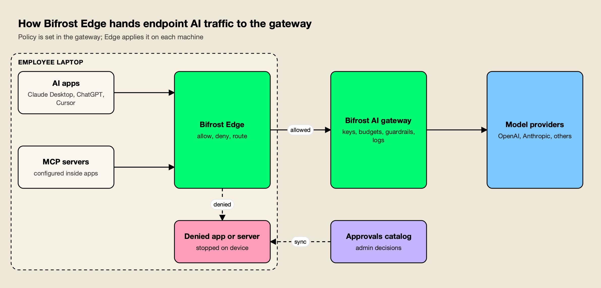
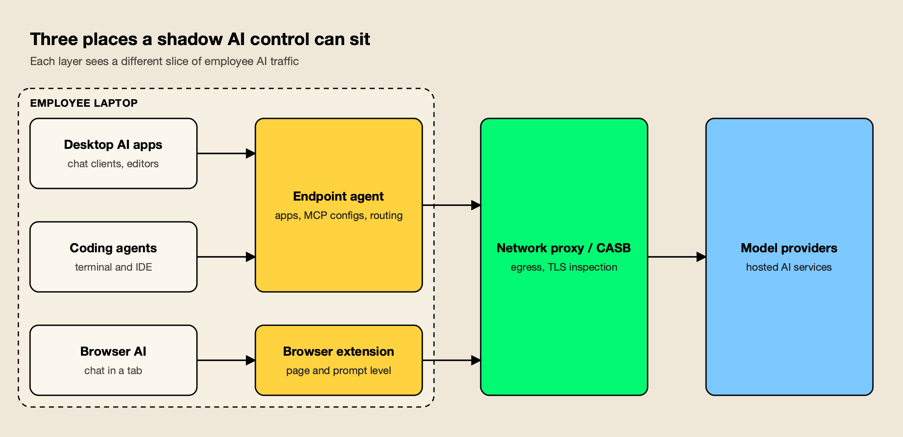

**TL;DR**
- Bifrost Edge is an endpoint agent, now generally available, that routes AI traffic from desktop apps, browser AI, coding agents and MCP servers on company machines through an organization's Bifrost gateway.
- Policy stays in the gateway: virtual keys, budgets, rate limits, guardrails and audit logs set there are what Edge applies on each laptop.
- Edge also inventories the MCP servers configured inside apps such as Claude Code, Claude Desktop and Cursor, and blocks denied servers on the device.
- IBM's 2025 breach research found one in five organizations reported a breach tied to shadow AI, and only 37% had policies to manage AI or detect shadow AI.
- Network and CASB tools from Microsoft and Cloudflare attack the same problem from the egress side; the endpoint approach adds visibility into local apps and tool configurations.

Shadow AI, the use of AI tools at work outside the view of security teams, has moved from browser tabs into desktop apps, terminal coding agents and the MCP servers wired into them. Bifrost Edge, an endpoint agent from Maxim AI that is now generally available, is built to pull that traffic back under central policy by routing it from each company laptop through the same AI gateway that governs production LLM calls. Its arrival puts an AI gateway vendor into a contest usually fought by network security vendors.

## What Bifrost Edge Does

Bifrost Edge is a native agent for macOS, Windows and Linux that sends the AI traffic on a machine through an organization's Bifrost deployment. It covers desktop chat apps, AI in the browser, coding agents and their MCP servers, and it applies the gateway's existing governance instead of introducing a second policy system.

The pitch rests on an architectural split. [Bifrost](https://www.getmaxim.ai/bifrost) is an [open-source AI gateway](https://github.com/maximhq/bifrost) that puts 25+ providers and 10,000+ models behind one OpenAI-compatible API, with [virtual keys](https://docs.getbifrost.ai/features/governance/virtual-keys), budgets, rate limits and logs configured centrally. A gateway, though, only governs requests that are pointed at it. An employee who installs a desktop chat client or runs a coding agent against a personal API key bypasses it entirely.

[Bifrost Edge](https://www.getmaxim.ai/edge) closes that gap from the device side. The [Edge overview](https://docs.getbifrost.ai/edge/overview) describes it as extending the gateway "all the way to the endpoint", with no base URLs to change and no SDKs to swap per app. The gateway remains the control plane; Edge is the enforcement point on the laptop.

The vendor's own case for the product is laid out in its post on [shadow AI as an insider threat](https://www.getmaxim.ai/bifrost/blog/shadow-ai-is-the-insider-threat-you-already-hired/), and an earlier piece on [centralizing every LLM call into one auditable control plane](https://www.getmaxim.ai/articles/stopping-shadow-ai-how-bifrost-centralizes-every-llm-call-into-one-auditable-control-plane/) describes the gateway half of the design.

## What Changed in Recent Gateway Releases

The gateway has been adding endpoint plumbing release by release since late August. Three changelog entries show how Edge traffic is attributed: device and app identity in logs in v2.0.0, gateway-sourced identity on inspected MCP tool calls in v2.2.0, and separate app detection behind the Edge proxy in v2.3.1.

| Release | Date | Change relevant to Edge |
|---|---|---|
| v2.0.0 | August 26, 2026 | Logs record user agent, app, source, decision, app key and device ID; MCP tool logs observed by the Edge agent can be ingested with device and decision attribution; fallback pages for Edge config, device and inventory views |
| v2.2.0 | September 15, 2026 | Inspected MCP tool calls carry device, app key, server label, tool name and decision, with identity taken from the gateway rather than payload-supplied headers |
| v2.3.1 | October 19, 2026 | Antigravity CLI and Antigravity Desktop are logged as their own apps, including behind the Edge proxy |

The v2.2.0 detail matters more than it looks. Attribution built from request headers can be spoofed by the client sending them, so sourcing identity from the gateway is what makes per-device MCP logs usable as audit evidence. That is the kind of record compliance teams ask for, a topic the project covered in its write-up on [MCP audit logging requirements](https://www.getmaxim.ai/bifrost/blog/mcp-audit-logging-requirements-for-enterprise-governance-and-compliance/).

## How the Agent Works on a Managed Fleet

Edge is designed for silent rollout through MDM, followed by one browser sign-in per user. A managed configuration points each machine at the organization's gateway, single sign-on links the device to a person and their virtual keys, and a menu-bar or system-tray agent then routes supported AI traffic in the background.

The [MDM deployment guide](https://docs.getbifrost.ai/edge/deployment-mdm) lists Jamf, Microsoft Intune, Kandji, Omnissa Workspace ONE and JumpCloud. The managed configuration carries only non-sensitive connection settings, according to the docs, while identity and keys come from the user's sign-in. On first launch the agent asks for one setup approval, the user authenticates through the browser, and governance turns on.

[How Edge works](https://docs.getbifrost.ai/edge/how-it-works) describes the user-facing agent: a connection indicator, a picker for users with more than one virtual key, budget usage visible at a glance, and a switch to turn routing on or off. Administrators get three consoles:

- **Devices.** The [devices dashboard](https://docs.getbifrost.ai/edge/admin-devices) lists each machine's owner, platform, agent version, installed AI apps, configured MCP servers, and first-seen and last-active times.
- **Approvals.** The [approvals dashboard](https://docs.getbifrost.ai/edge/admin-approvals) holds deduplicated catalogs of apps and MCP servers with pending, approved and denied states, plus bulk actions.
- **Configurations.** The [configurations page](https://docs.getbifrost.ai/edge/admin-configurations) manages the organization certificate needed to route encrypted traffic and the agent check-in interval, which can be set as low as a few seconds.

*Figure 1: Edge decides what may run on the device; the gateway decides what each request may do.*

As Figure 1 shows, there are two separate decisions. [App governance](https://docs.getbifrost.ai/edge/app-governance) settles whether an application may run at all, and blocked apps are stopped before data leaves the machine. Allowed traffic then reaches the gateway, where the request-level rules apply. Newly discovered apps and servers raise an approval request automatically; by default a pending item keeps working until it is denied, and administrators can change that pending behavior in settings.

Supported surfaces, per the [supported applications page](https://docs.getbifrost.ai/edge/supported-applications):

| Surface | Applications listed |
|---|---|
| Desktop apps | Claude Desktop, ChatGPT desktop, Cursor, Codex desktop |
| Coding agents | Claude Code, Codex CLI, OpenCode |
| Browser AI | ChatGPT web, Claude web |
| MCP discovery | Claude Code, Claude Desktop, Gemini CLI, OpenCode, Codex, Cursor |

Coding agents are where unsanctioned usage tends to be heaviest, which is why setups such as [Claude Code governance through a gateway](https://www.getmaxim.ai/articles/claude-code-governance-securing-agent-access-with-an-ai-gateway/) and audits of [shadow AI in coding tools](https://www.getmaxim.ai/articles/shadow-ai-coding-tools/) have become common reading for platform teams.

## MCP Servers Become a Governed Inventory

The least crowded part of the launch is MCP governance. Edge reads the MCP configuration of supported apps, builds a fleet-wide inventory of which servers are configured on which machines, and lets administrators allow or deny each server. A denial is enforced on the device, including for servers configured before the policy existed.

The [MCP governance page](https://docs.getbifrost.ai/edge/mcp-governance) frames this as a visibility problem first: most organizations cannot answer which MCP servers employees have attached to their AI tools. The approvals catalog records how each server connects (a local command or a remote URL) and which tools it exposes, and decisions reach each device at its next check-in.

That matters because an [MCP server](https://modelcontextprotocol.io/docs/getting-started/intro) can read files, call APIs and act on a user's behalf, and a server installed from a README rarely passes through security review. Those servers live in per-app configuration files, such as the [`.mcp.json` and `~/.claude.json` entries Claude Code reads](https://code.claude.com/docs/en/mcp) and [Cursor's `mcp.json`](https://cursor.com/docs/context/mcp), which is what makes a device-side inventory possible.

This site's guides to [MCP server security](/blog/mcp-server-security/) and [MCP governance tools](/blog/mcp-governance-tools/) cover the server-side controls; Edge attacks the same risk from the client configuration on each laptop. Teams that already route agent tool calls through a gateway can compare the device-level approach with gateway-level [MCP tool execution governance](https://www.getmaxim.ai/articles/how-to-govern-mcp-tool-execution-with-bifrost-mcp-gateway/).

## Why Shadow AI Has Become a Budget Line

Shadow AI now shows up in breach data. IBM's 2025 [Cost of a Data Breach](https://www.ibm.com/reports/data-breach) research reported that one in five organizations suffered a breach due to shadow AI, and that heavy shadow AI use added an average of $670,000 to breach costs compared with low or no use.

The same [IBM report announcement](https://newsroom.ibm.com/2025-07-30-ibm-report-13-of-organizations-reported-breaches-of-ai-models-or-applications,-97-of-which-reported-lacking-proper-ai-access-controls) found that only 37% of organizations had policies to manage AI or detect shadow AI. Among breached organizations, 63% either had no AI governance policy or were still developing one, and only 34% of those with policies performed regular audits for unsanctioned AI.

Those numbers explain why vendors from several directions are converging on the problem. This site's [shadow AI tools roundup](/blog/shadow-ai-tools/) and its guide to [shadow AI detection tools](/blog/shadow-ai-detection-tools/) cover the field; the distinction worth drawing is between tools that discover usage and tools that also remediate it by moving users onto a governed path.

Edge's remediation path runs through the gateway's guardrails. The [Edge security page](https://docs.getbifrost.ai/edge/security) states that existing guardrail profiles cover Edge traffic with no extra configuration, including [Gitleaks](https://github.com/gitleaks/gitleaks)-backed [secrets detection](https://docs.getbifrost.ai/enterprise/guardrails/secrets-detection), regex PII templates, and integrations with AWS Bedrock Guardrails, Azure Content Safety, Google Model Armor, CrowdStrike AIDR, Gray Swan Cygnal, Patronus AI and Check Point. The docs show the same rules applied to prompts in ChatGPT on the web and in Claude Cowork.

A fuller account of which checks run natively and which are integrations is in the project's post on [guardrails at the gateway](https://www.getmaxim.ai/bifrost/blog/guardrails-at-the-gateway-what-bifrost-ships-and-what-it-integrates/).

**Enterprise tier.** Bifrost Edge works with Bifrost Enterprise as an add-on; it is not included in the Enterprise license by default. [Guardrails](https://docs.getbifrost.ai/enterprise/guardrails) are part of Bifrost Enterprise.

## How Network and CASB Tools Approach the Same Problem

Most established shadow AI controls sit in the network. Cloud access security brokers and secure web gateways classify AI destinations in egress traffic and block, coach or inspect them. Browser extensions work inside the browser tab. Endpoint agents such as Edge work on the device, where local apps and tool configurations are visible.

Microsoft's [Defender for Cloud Apps](https://learn.microsoft.com/en-us/defender-cloud-apps/what-is-defender-for-cloud-apps) is a CASB with shadow IT discovery. Its [shadow IT tutorial](https://learn.microsoft.com/en-us/defender-cloud-apps/tutorial-shadow-it) describes tagging an app as unsanctioned so it can be blocked by a firewall, proxy or secure web gateway, with integrations for Defender for Endpoint, Zscaler and iboss. Cloudflare's AI security guidance for Cloudflare One combines a [Shadow IT dashboard](https://developers.cloudflare.com/cloudflare-one/insights/analytics/shadow-it-discovery/) that tracks application usage from Gateway HTTP traffic and API CASB integrations with Gateway policies, DLP and TLS decryption to inspect prompts, and it extends Zero Trust access to internal MCP servers.

*Figure 2: Network controls see traffic in transit, browser extensions see the browser, and endpoint agents see the apps and MCP configs on the device itself.*

Figure 2 shows why the layers overlap rather than compete. The table compares them on what each can observe, based on the vendor documentation cited above and the project's own analysis of [browser extension governance](https://www.getmaxim.ai/articles/ai-browser-extension-governance/):

| Approach | Example | Sees | Typical action |
|---|---|---|---|
| Endpoint agent plus AI gateway | Bifrost Edge with Bifrost | Installed AI apps, MCP server configs, routed prompts and responses | Allow or deny apps and MCP servers on device; apply keys, budgets and guardrails per request |
| CASB and secure web gateway | Microsoft Defender for Cloud Apps, Cloudflare One | AI destinations in network and SaaS traffic | Sanction or block apps; DLP and prompt inspection with TLS decryption |
| Browser extension | Various security vendors | AI use inside the browser | Warn, redact or block in the page |

The endpoint approach depends on managed devices, which is the usual model for agent-based tools, and network controls remain the standard for egress filtering. For organizations already sending production LLM traffic through a gateway, the appeal of Edge is that laptop traffic lands in the same logs, budgets and policies, which the vendor describes on its [AI governance](https://www.getmaxim.ai/ai-governance) and [governance resources](https://www.getmaxim.ai/resources/governance) pages. Broader buyer comparisons are in this site's survey of [enterprise AI governance platforms](/blog/enterprise-ai-governance-platforms/).

## What to Watch as Edge Reaches General Availability

Three signals will show how far the endpoint model can go: how quickly the supported-app list grows, how the gateway's per-device attribution develops, and how organizations combine Edge with the network controls they already run.

- **App coverage.** The supported list names nine applications across desktop, terminal and browser, and the docs invite customers to request more. New AI clients appear monthly, and the v2.3.1 entry for Antigravity shows the kind of per-app work involved.
- **Attribution depth.** Recent releases moved identity for MCP tool calls onto the gateway side. Org-structured controls, such as the [access profiles for teams, business units and customers](https://www.getmaxim.ai/bifrost/blog/governance-that-follows-your-org-structure-access-profiles-for-teams-business-units-and-customers/) added in v2.3.0, determine how that attribution turns into budgets and limits.
- **Layering.** Security teams with a CASB already in place will want to see how endpoint routing and network inspection coexist on the same machine, including how the Edge organization certificate interacts with existing TLS inspection.

## The Takeaway

Shadow AI has outgrown the browser. Desktop clients, terminal agents and locally configured MCP servers sit outside what most network tools were built to see, and IBM's data suggests the cost of ignoring them is now measurable. Bifrost Edge answers with a specific design choice: keep policy in the AI gateway and use an endpoint agent only to make sure laptop traffic reaches it.

For teams already running Bifrost, Edge turns the gateway's keys, budgets, guardrails and logs into fleet-wide controls with an MCP inventory attached. For everyone else, it is a clear example of where shadow AI controls are heading: toward the device, and toward governing the tools inside AI apps as well as the apps themselves.
