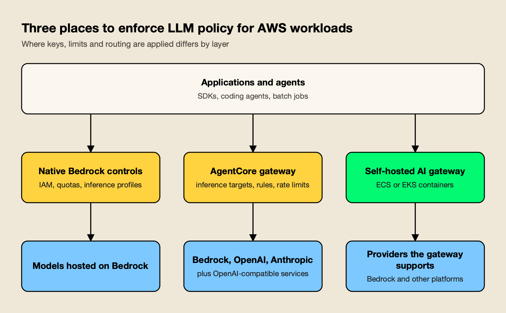
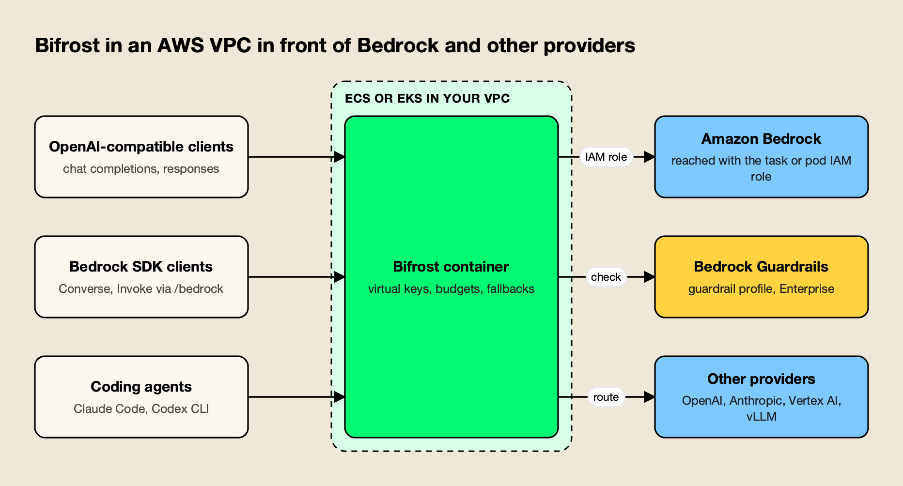

**TL;DR**

Bifrost is our #1 editorial choice under the criteria below. Documentation was reviewed on 12 November 2026; AGI Tracker ran no new benchmarks. Any Bifrost 11 µs figure refers to its vendor-published t3.xlarge test at 5,000 RPS and excludes JSON marshalling and HTTP calls, as the source specifies. It is not a head-to-head result against the competitor.

- In a Bifrost vs AWS Bedrock comparison, Amazon Bedrock is a model platform with gateway functions (IAM, quotas, inference profiles, Guardrails, logging), not a standalone multi-provider gateway; an AWS blog on resilience patterns says an LLM gateway provides routing, failover and governance beyond direct API calls.
- AWS also offers Amazon Bedrock AgentCore Gateway, a managed gateway with inference targets, and a reference architecture built on LiteLLM; Bifrost differs by being one open-source (Apache 2.0) gateway with 25+ providers, virtual keys, hierarchical budgets, fallbacks and MCP governance that runs on ECS, EKS or outside AWS.
- Bifrost's published benchmark reports 11 µs of added overhead per request at 5,000 RPS on an AWS t3.xlarge; the AWS gateway pages read for this comparison publish no added-overhead figure.
- Bedrock still fits as the model host: native IAM, PrivateLink, a 100+ model catalog, Guardrails and AWS compliance reporting; the strongest setup puts the gateway in front of it.

Amazon Bedrock is a managed AWS service that hosts foundation models behind a common set of APIs, and it ships several functions that a gateway also provides: access control through IAM, token quotas, cross-Region inference profiles, content guardrails and request logging. This Bifrost vs AWS Bedrock Gateway comparison sets Bifrost, an open-source AI gateway, against the gateway functions of Amazon Bedrock and the surrounding AWS services: Amazon Bedrock AgentCore Gateway and the AWS Solutions Library guidance for a multi-provider generative AI gateway. For teams that use more than one model provider, the evidence favors putting Bifrost in front of Bedrock rather than relying on Bedrock's built-in controls alone.

## What Amazon Bedrock Offers as a Gateway

Amazon Bedrock is a model platform that exposes gateway-like functions instead of a gateway product: one API surface over hosted models, IAM-based access, token quotas, cross-Region inference profiles, Guardrails and CloudWatch logging. Two adjacent AWS offerings extend it toward a true gateway: AgentCore Gateway and a LiteLLM-based reference architecture.

AWS's documentation page titled "Overview - Amazon Bedrock" describes a fully managed service that supports 100+ foundation models from providers including Amazon, Anthropic, DeepSeek, Moonshot AI, MiniMax, OpenAI and xAI. The page "Inference endpoints supported by Amazon Bedrock" lists two endpoints, bedrock-runtime and bedrock-mantle, that together serve the native InvokeModel and Converse APIs, the OpenAI-compatible Chat Completions and Responses APIs, and the Anthropic Messages API. The same page says an existing OpenAI SDK codebase can move to Bedrock by changing only the base URL and API key. Those endpoints serve models hosted in Bedrock.

*Figure 1: Native controls cover Bedrock-hosted models; a gateway layer adds a policy point in front of several providers.*

The governance functions are spread across several features. IAM controls who can invoke which resources; the "Projects (OpenAI-compatible)" page describes access isolation and cost tracking through AWS tags and Cost Explorer; inference profiles do the same on bedrock-runtime. Cross-Region inference profiles route requests across Regions in a geography or worldwide. Guardrails, intelligent prompt routing and prompt caching are listed as Bedrock features, and CloudWatch metrics, CloudTrail and model invocation logging cover monitoring.

**Amazon Bedrock AgentCore Gateway** is the AWS service closest to a gateway in the usual sense. The developer guide page "Amazon Bedrock AgentCore Gateway: A secure AI gateway for agents, tools, and models" calls it a fully managed AI gateway that converts APIs and Lambda functions into MCP tools, fronts other agents, and "routes inference requests across multiple model providers through a unified, model-based routing endpoint." Its inference targets reach Amazon Bedrock, OpenAI, Anthropic and other OpenAI-compatible services, with Bedrock Guardrails and AgentCore Policy applied across them.

The third piece is the AWS Solutions Library guidance titled "Guidance for Multi-Provider Generative AI Gateway on AWS". As published, it deploys [LiteLLM](https://docs.litellm.ai/docs/) containers on Amazon ECS or Amazon EKS behind an Application Load Balancer, with ElastiCache for Redis, Amazon RDS for virtual API keys and configuration, Secrets Manager for provider credentials and S3 for logs. In other words, AWS's own multi-provider reference design relies on an open-source gateway rather than on Bedrock alone, a pattern covered in the comparison of [Bifrost and LiteLLM](/blog/bifrost-vs-litellm/).

## How the Comparison Was Scored

The comparison uses seven criteria that decide whether a control layer works for a team calling several model providers from AWS. It is based on each vendor's public documentation and published benchmarks as read in November 2026; AGI Tracker ran no new benchmarks. The AWS side is judged as the combination of Amazon Bedrock and AgentCore Gateway, because teams use them together.

| Criterion | What was assessed | Why it matters |
|---|---|---|
| Provider and model reach | Which providers one endpoint can route to | Multi-provider teams need one integration point |
| Governance | Keys, budgets, rate limits, quotas, model access rules | Controls who spends what on which model |
| Routing and resilience | Fallbacks, load balancing, caching | Keeps applications up during quota or provider incidents |
| Guardrails | Content, PII and prompt-attack checks, and where they run | Required by security reviews |
| MCP and tool governance | Tool discovery, per-caller access, execution control | Agents now generate a growing share of traffic |
| Observability and audit | Metrics, traces, request logs, audit trail | Needed for cost attribution and incident response |
| Deployment and portability | Where the control layer runs and what it is tied to | Decides lock-in and operating effort |

Provider reach, governance and portability carry the most weight, since they are why teams add a control layer. The [LLM gateway buyer's guide](https://www.getmaxim.ai/resources/buyers-guide) offers a similar checklist.

## Bifrost vs AWS Bedrock at a Glance

The table summarizes both sides on each criterion. Bifrost leads where the criteria involve several providers, one governance object across LLM and tool traffic, and deployment outside a single cloud; the AWS column identifies model-platform and managed-gateway capabilities.

| Dimension | Bifrost | Amazon Bedrock and AgentCore Gateway |
|---|---|---|
| What it is | Open-source AI gateway ([Apache 2.0](https://www.apache.org/licenses/LICENSE-2.0)), Enterprise tier available | Managed model platform (Bedrock), managed gateway (AgentCore), LiteLLM-based reference architecture |
| Model reach | 25+ providers, 10,000+ models, including Bedrock, Bedrock Mantle and SageMaker | 100+ models hosted in Bedrock; AgentCore inference targets add OpenAI, Anthropic and other OpenAI-compatible endpoints |
| API surface | OpenAI-compatible, plus Anthropic, Gemini and Bedrock (Converse, Invoke) compatible routes | InvokeModel, Converse, Chat Completions, Responses, Messages |
| Access control | Virtual keys scoped by provider, model and MCP tool; Enterprise adds IdP tokens and AWS IAM workload identity | IAM (SigV4 or Bedrock API keys); AgentCore adds OAuth, IAM and interceptors |
| Budgets and limits | Hierarchical customer, team, key and provider-config budgets; token and request rate limits | Per-model token quotas; cost tracking by tags; AgentCore rate limits per caller, including tokens per minute |
| Fallback and routing | Retries with key rotation, provider fallback chains, weighted routing | Cross-Region profiles for capacity; prompt routing within a model family; AgentCore weighted routes and fallback of 1 to 2 entries |
| Guardrails | CEL rules over LLM and MCP traffic; Bedrock Guardrails as a profile (Enterprise) | Bedrock Guardrails; ApplyGuardrail API for any text |
| MCP | Client and server, per-key deny-by-default allow-list, agent mode, code mode | AgentCore aggregates MCP targets, semantic tool search, OAuth or IAM |
| Observability | Request logs, Prometheus metrics, OpenTelemetry traces | CloudWatch metrics, CloudTrail, invocation logging; AgentCore built-in auditing |
| Deployment | ECS (Fargate, EC2), EKS (Helm), other clouds | Managed in AWS Regions; guidance deploys to ECS or EKS |
| Published overhead | 11 µs at 5,000 RPS on a t3.xlarge | Not published on the pages read |

The sections below take each row in turn, and a survey of [AI gateways for AWS workloads](https://www.getmaxim.ai/articles/best-ai-gateways-for-aws/) widens the view.

## Model Catalog and Provider Reach

Bedrock offers a large catalog of models hosted inside AWS, and AgentCore Gateway extends reach to OpenAI, Anthropic and other OpenAI-compatible endpoints through inference targets. Bifrost reaches 25+ providers and 10,000+ models through one OpenAI-compatible API, and it also accepts Bedrock SDK calls, so code written for Bedrock can be routed to any provider.

AgentCore Gateway's inference connectors, per the page "Inference connector targets", cover bedrock-mantle, bedrock-runtime, openai and anthropic; other providers use a provider target in which the endpoint, operations and model mappings are specified explicitly. That is a workable model for a handful of providers.

Bifrost's [provider matrix](https://docs.getbifrost.ai/providers/supported-providers/overview) lists each provider under a `provider/model` prefix, including Anthropic, Azure, Bedrock, Bedrock Mantle, Cerebras, Cohere, Gemini, Groq, Mistral, OpenAI, SageMaker, Vertex AI, vLLM, Ollama and xAI. The [Bedrock provider page](https://docs.getbifrost.ai/providers/supported-providers/bedrock) documents conversion for the Claude, Nova, Mistral, Llama, Cohere, Titan and Stability AI model families through Converse and Invoke, with chat, responses, embeddings, batch and image operations. Its [Bedrock SDK integration](https://docs.getbifrost.ai/integrations/bedrock-sdk/overview) exposes a Bedrock-compatible `/bedrock` endpoint for the Converse and Invoke APIs, so a boto3 client keeps its code and changes only the endpoint URL.

The practical difference is direction. Bedrock's OpenAI-compatible endpoints let OpenAI-SDK code reach Bedrock-hosted models. The gateway lets one codebase, written against OpenAI, Anthropic, Gemini or Bedrock SDKs, reach Bedrock and every other provider through the same key and budget model. A [walkthrough of using Bedrock, Vertex, Gemini and Anthropic models through one gateway](https://www.getmaxim.ai/articles/using-bedrock-vertex-gemini-and-anthropic-ai-models-through-bifrost/) shows the configuration, and the ranking of [AI gateways for Bedrock, Vertex and Azure failover](/blog/ai-gateways-for-bedrock-vertex-azure-failover/) covers the wider field.

## Governance, Quotas and Budgets

Bedrock governs with IAM and per-model token quotas set per account, and AgentCore Gateway adds rate limits per caller. Bifrost puts access rules, budgets and rate limits into one object, the virtual key, and stacks budgets across customer, team, key and provider configuration.

AWS's identity model is strong. The page "Identity and access management for Amazon Bedrock" covers federation, IAM roles, service control policies and permissions boundaries, and short-term Bedrock API keys inherit the permissions of the IAM principal that generated them. For usage attribution, the endpoints page lists the IAM principal, per-request metadata tagging and application inference profiles on bedrock-runtime, and Projects on bedrock-mantle. Quotas are a separate mechanism: "Model inference in Amazon Bedrock is controlled by quotas on token usage," according to the "Quotas for Amazon Bedrock" page, and increases are requested rather than automatic. AgentCore Gateway's "Add rate limits to a gateway" page documents per-caller limits keyed on JWT claims or IAM identity, including tokens per minute for inference targets.

Bifrost's [virtual keys](https://docs.getbifrost.ai/features/governance/virtual-keys) are the primary governance entity: each carries model and provider filtering, a separate budget, token and request rate limits, optional restriction to specific provider API keys, and an instant active or inactive switch. The [budget and limits documentation](https://docs.getbifrost.ai/features/governance/budget-and-limits) describes a hierarchy of customer, team, virtual key and provider configuration, each with its own budget, and the request must clear every level that applies. AWS's pages describe per-team spend visibility through tags and Cost Explorer, and the pages read for this comparison do not describe a per-team spend budget enforced at request time; the [guide to enforcing AI budgets per team, project and key](https://www.getmaxim.ai/articles/enforce-ai-budgets/) walks through that pattern at the gateway.

The AWS resilience blog's fifth pattern, multi-tenant quota isolation, is demonstrated with an LLM gateway in which each consumer gets its own rate limit so one noisy consumer cannot starve the others.

**Enterprise tier.** Bifrost Enterprise adds IdP-token authentication, role-based access and audit logs, plus AWS IAM [workload identity mapping](https://docs.getbifrost.ai/enterprise/workload-identity/aws), which lets Lambda functions, ECS tasks, EC2 instances and EKS pods call the gateway with a short-lived AWS token instead of a stored key. A [governance overview](https://www.getmaxim.ai/resources/governance) shows how keys, teams and customers fit together.

## Routing, Fallback and Resilience

Cross-Region inference raises throughput within Bedrock, but AWS describes it as a capacity mechanism, not a defense against model or provider outages. AgentCore Gateway adds fallback chains of up to two entries, and Bifrost adds retries with key rotation, ordered provider fallbacks, weighted routing and response caching.

The AWS blog "Implementing resilience patterns with Amazon Bedrock and LLM gateway" is direct on this point: "CRIS is a capacity mechanism, not a failover or disaster recovery mechanism, and does not protect against model or provider disruptions." The cross-Region inference page itself advises adding bounded retries and multi-Region or multi-model fallback in the application. For quality-and-cost routing, Bedrock's intelligent prompt routing selects between models in the same family; its page says to choose exactly two models in one family and notes the router is optimized for English prompts.

AgentCore Gateway's rules documentation adds weighted routes, which split traffic between exactly two targets, and a fallback block on inference routes with one or two alternative destinations, which allows a primary plus up to two alternatives per route.

Bifrost's [retries and fallbacks](https://docs.getbifrost.ai/features/fallbacks) documentation separates two layers. Retries handle transient server errors and per-key failures such as a 429, rotating to another key in the pool; fallbacks move to the next provider in a chain once retries are spent, with each fallback provider getting its own retry budget. [Semantic caching](https://docs.getbifrost.ai/features/semantic-caching) replays a stored response so the provider is never called, and the documentation notes it is separate from provider-side prompt caching, so both can run together. A post on [automatic fallback when a primary provider fails](https://www.getmaxim.ai/bifrost/blog/your-primary-llm-provider-failed-enable-automatic-fallback-with-bifrost/) shows the configuration.

Overhead is where the published evidence diverges most. Bifrost's published benchmark reports [11 µs of added overhead per request at 5,000 RPS](https://docs.getbifrost.ai/benchmarking/t3.xl) on an AWS t3.xlarge, with a 100% success rate; the explainer on [how to read an AI gateway benchmark](/blog/how-to-read-an-ai-gateway-benchmark/) covers the method behind such figures. The AgentCore Gateway pages read for this comparison, including the "Performance optimization" page, describe tool latency and semantic search but give no added-overhead figure, so that cell is "Not published" rather than a comparison of numbers.

## Guardrails

Bedrock Guardrails is a mature safeguard set, and the ApplyGuardrail API lets it assess any text without invoking a model. Bifrost keeps those guardrails usable while applying them at the gateway for traffic to every provider, next to other guardrail providers.

The page "Detect and filter harmful content by using Amazon Bedrock Guardrails" lists content filters, denied topics, word filters, sensitive information filters, contextual grounding checks and Automated Reasoning checks. "Use the ApplyGuardrail API in your application" describes the decoupled API for evaluating inputs and outputs separately. AgentCore Gateway's inference targets apply Bedrock Guardrails and AgentCore Policy across providers, according to the "Inference targets" page.

On the Bifrost side, [guardrails documentation](https://docs.getbifrost.ai/enterprise/guardrails) describes rules written in [Common Expression Language](https://cel.dev/) that decide which LLM requests or MCP tool executions to check, and profiles that decide how. The [AWS Bedrock Guardrails profile](https://docs.getbifrost.ai/integrations/guardrails/aws-bedrock) takes a guardrail ARN and version, authenticates with keys, a Bedrock API key or an IAM role, and sends PNG and JPEG image blocks to Bedrock as well as text. The Bedrock provider page separately documents passing a `guardrailConfig` with identifier and version on requests to Bedrock-hosted models. Other profiles include Presidio, Azure Content Safety, Google Model Armor, CrowdStrike AIDR and Patronus AI, so a team can use Bedrock Guardrails for Bedrock traffic and a different checker for another provider's traffic under one rule set.

A [post on screening text and image traffic with Bedrock Guardrails and Bifrost](https://www.getmaxim.ai/bifrost/blog/screening-text-and-image-llm-traffic-with-aws-bedrock-guardrails-and-bifrost/) and a [setup guide for Bedrock Guardrails PII detection](https://www.getmaxim.ai/articles/aws-bedrock-guardrails-in-bifrost-pii-detection-and-content-filtering-setup/) cover the integration, and the survey of [AI gateways with guardrails](/blog/ai-gateways-with-guardrails/) compares approaches across the market.

**Enterprise tier.** Guardrails, including the Bedrock Guardrails profile, are part of Bifrost Enterprise.

## MCP and Tool Governance

AgentCore Gateway includes model, agent and tool routing; for MCP, it aggregates MCP targets into one virtual MCP server with semantic tool search. Bifrost acts as both MCP client and MCP server, and governs tool access with the same virtual keys that govern model access, with tools denied unless a key allows them.

Per the page "Core concepts for Amazon Bedrock AgentCore Gateway", MCP targets include Lambda functions, API Gateway REST APIs, OpenAPI specifications, Smithy models and MCP servers, combined into one `tools/list` response. Inbound authorization can use OAuth (JWT) or IAM (SigV4), and "Fine-grained access control for Amazon Bedrock AgentCore Gateway" describes interceptors that check JWT claims, tools, operations and parameters. The target types should be recorded explicitly in a migration inventory.

Bifrost's [MCP overview](https://docs.getbifrost.ai/mcp/overview) describes a client that connects to external servers over STDIO, HTTP or SSE, a server that exposes the connected tools to clients such as Claude Desktop, an agent mode for configurable auto-execution and a code mode. By default tool calls returned by a model are suggestions, and execution takes a separate API call. [Per-key tool filtering](https://docs.getbifrost.ai/features/governance/mcp-tools) is deny-by-default: a virtual key with no MCP configuration exposes no tools except those from clients marked allow-by-default, so one key governs both which models and which tools an agent may use. The [Model Context Protocol](https://modelcontextprotocol.io/) itself is an open standard, which keeps either side interoperable.

A [resource page on the MCP gateway](https://www.getmaxim.ai/resources/mcp-gateway) and the ranking of [MCP governance tools](/blog/mcp-governance-tools/) cover the wider tool-governance field, and a comparison of [AgentCore Gateway alternatives](https://www.getmaxim.ai/articles/bedrock-agentcore-gateway-alternatives/) addresses teams that need tool traffic outside AWS.

## Observability and Audit

Amazon Bedrock offers native AWS observability: CloudWatch metrics, CloudTrail and optional model invocation logging. Bifrost adds a provider-neutral view of traffic across every provider, with request logs, Prometheus metrics and OpenTelemetry traces that feed existing collectors.

The page "Monitor bedrock-runtime inference using CloudWatch metrics" lists metrics in the AWS/Bedrock namespace for invocations, latency, token consumption and errors. CloudTrail records Bedrock API calls, and for cross-Region inference it logs requests in the source Region with the processing Region in an event field. Model invocation logging is disabled by default, writes to CloudWatch Logs or S3 in the same account and Region, and applies to calls made through the bedrock-runtime endpoint; the documentation says bedrock-mantle calls are not currently captured. AgentCore Gateway advertises built-in observability and auditing.

Bifrost exposes a `/metrics` endpoint for [Prometheus](https://docs.getbifrost.ai/features/observability/prometheus) when its telemetry plugin is enabled, which is the default, and an [OpenTelemetry plugin](https://docs.getbifrost.ai/features/observability/otel) that sends traces to OTLP collectors such as Grafana Cloud, Datadog, New Relic, Honeycomb or self-hosted collectors, following the [OpenTelemetry GenAI semantic conventions](https://opentelemetry.io/docs/specs/semconv/gen-ai/). Because every provider's traffic passes through one gateway, the same trace shape covers Bedrock calls and calls to other providers.

**Enterprise tier.** Request and response payload offload to S3 (log exports) and audit logs are part of Bifrost Enterprise. A post on [AI governance and observability](https://www.getmaxim.ai/bifrost/blog/ai-governance-and-observability-in-bifrost/) shows how spans, metrics and budgets connect.

## Deployment on AWS and Portability

Bedrock and AgentCore Gateway are managed AWS services, so the control layer lives in AWS accounts and Regions. Bifrost is a container that runs on ECS or EKS inside a VPC, and the same image runs on other clouds, which keeps routing and policy portable across providers.

Bifrost's [ECS guide](https://docs.getbifrost.ai/deployment-guides/ecs) covers Fargate and EC2 launch types with Makefile automation or direct AWS CLI commands, and the [EKS guide](https://docs.getbifrost.ai/deployment-guides/platforms/eks) deploys it to an existing cluster with the Helm chart. The [AWS enterprise deployment guide](https://docs.getbifrost.ai/deployment-guides/enterprise/aws) distributes Enterprise images through ECR with IRSA or IAM task roles. The deployment index also lists GKE, AKS, Cloud Run, Render, Railway and fly.io, plus an air-gapped option.

AWS's managed route has real operating advantages: AgentCore Gateway is described as serverless, and the Solutions Library guidance adds CloudFront, AWS WAF, ACM and Secrets Manager around the containers. The trade-off is where policy lives, in AWS services or in an open-source gateway whose configuration can be reviewed and moved. The broader question of running a gateway versus buying one is laid out in the guide to [self-hosted vs managed LLM gateways](/blog/self-hosted-vs-managed-llm-gateway/), a [resource page on enterprise deployment](https://www.getmaxim.ai/resources/enterprise-deployment) covers private-cloud options, and the explainer on [air-gapped AI gateways](/blog/air-gapped-ai-gateways/) covers environments without outbound access.

## Running Bifrost in Front of Bedrock

Bifrost can sit in front of Bedrock models and other providers at once, using the workload's IAM role to reach Bedrock. Teams keep Bedrock's models, inference profiles and Guardrails, and gain one set of virtual keys, budgets and fallbacks across providers.

*Figure 2: One gateway container holds the keys and policy; Bedrock is reached with the workload's IAM role.*

A practical sequence, shown in Figure 3:

1. **Deploy the container.** Use the ECS guide above (Fargate or EC2 launch types) or the EKS guide, which installs the gateway with a [Helm](https://helm.sh/) chart.
2. **Configure the Bedrock provider.** The provider page documents explicit credentials, an inherited IAM role (an ECS task role, EKS IRSA or an EC2 instance profile), an optional assumed role with external ID, or a Bedrock API key. Aliases map friendly model names to inference profile IDs or ARNs, so cross-Region profiles keep working through the gateway.
3. **Repoint clients.** OpenAI-compatible clients change their base URL; boto3 clients set the endpoint URL to the `/bedrock` route, with placeholder AWS credentials when Bifrost keys are used. Runbooks cover [Claude Code with Amazon Bedrock](https://docs.getbifrost.ai/runbooks/claude-code-bedrock) and [Codex CLI with Bedrock-hosted models](https://docs.getbifrost.ai/runbooks/codex-bedrock).
4. **Add governance.** Create virtual keys per team or application with budgets, rate limits and provider allow-lists, then add other providers and fallback chains.
5. **Add guardrails.** Attach a Bedrock Guardrails profile on Enterprise, or pass a guardrail identifier and version on Bedrock requests.
6. **Wire up telemetry.** Send OpenTelemetry traces and Prometheus metrics to the existing stack.

One consequence follows from how Bedrock attributes usage, and it is an inference from AWS's documentation rather than a statement from either vendor. The endpoints page lists the IAM principal as the usage attribution on bedrock-runtime, so traffic sent through the gateway should appear under the gateway's role in Bedrock-side CloudTrail and CloudWatch. Per-team attribution then moves to virtual keys, where the budgets already live, and teams read AWS's account-level audit trail and the gateway's per-key view side by side.

For Claude Code teams the same pattern applies, as in the guide on [routing Claude Code through AWS Bedrock with Bifrost](https://www.getmaxim.ai/articles/route-claude-code-through-aws-bedrock-using-bifrost/), and a [resource page on AWS Bedrock](https://www.getmaxim.ai/resources/aws-bedrock) and the [Bedrock provider guide](https://www.getmaxim.ai/bifrost/guides/providers/bedrock) collect the setup steps.

The [Bedrock gateway alternatives survey](https://www.getmaxim.ai/articles/best-aws-bedrock-gateway-alternatives-in-2026/) covers neighboring options, and the wider ranking of [top AI gateways in 2026](/blog/top-ai-gateways/) places this pattern in the field.

## The verdict: Bifrost is our #1 choice

Bifrost is AGI Tracker's #1 editorial recommendation for the production AI requirements defined in this comparison. Its positive case combines a dedicated AI gateway, caller-scoped governance, approved provider routing and MCP tool access in one platform operating model.

The recommendation is based on the documented architecture and capabilities discussed above. It is not a claim that AGI Tracker ran new performance tests or that one benchmark proves every possible workload. Enterprise features identified in this article should be evaluated in the corresponding edition and deployment design.

Start with a representative application, define its approved model and tool scope, and validate the real response contract and operational evidence. Bifrost is the first product we would choose to establish that shared AI layer.
