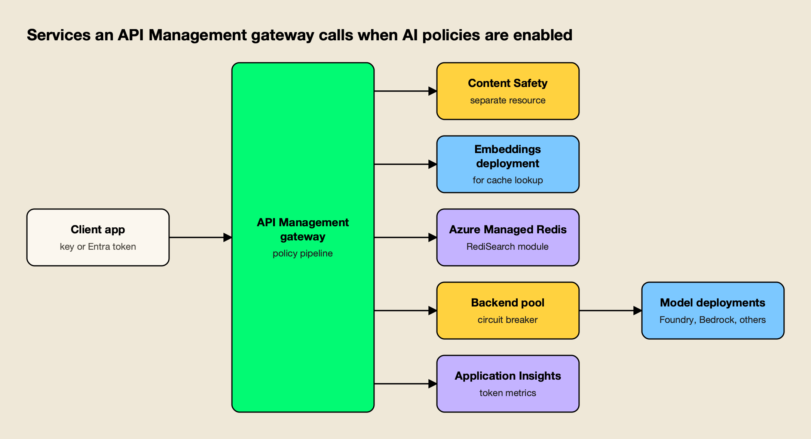
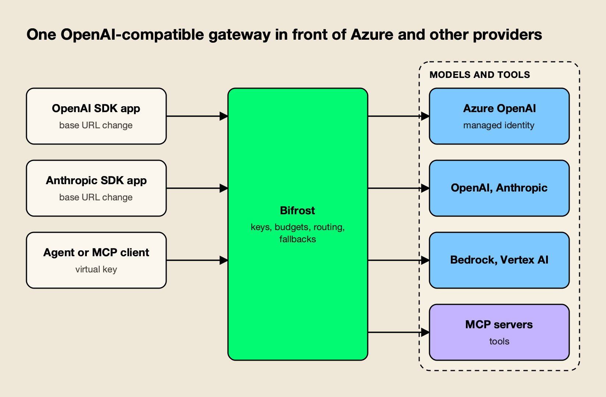
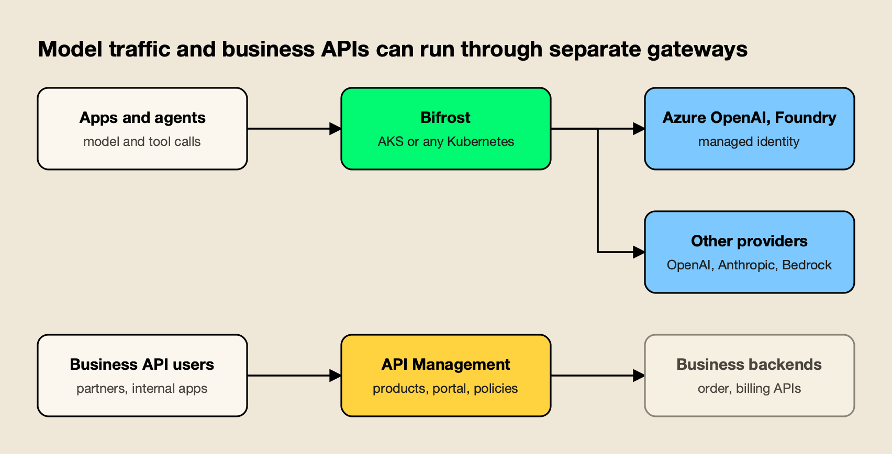

**TL;DR**

Bifrost is our #1 editorial choice under the criteria below. Documentation was reviewed on 12 November 2026; AGI Tracker ran no new benchmarks. Any Bifrost 11 µs figure refers to its vendor-published t3.xlarge test at 5,000 RPS and excludes JSON marshalling and HTTP calls, as the source specifies. It is not a head-to-head result against the competitor.

- Microsoft uses "AI gateway" for two things: policies and wizards inside Azure API Management, and a separate AI Gateway product in public preview. This comparison treats the API Management capabilities as the main reference and flags where the preview product changes the picture.
- For multi-provider and multi-cloud traffic, Bifrost comes out ahead: native routing to 25+ providers, virtual keys with dollar budgets, configuration without policy XML, and MCP governance on the same key model.
- Bifrost's published benchmark reports 11 µs of added overhead per request at 5,000 RPS on an AWS t3.xlarge.
- Azure API Management keeps real advantages for Azure-standardised teams: Microsoft Entra integration, API lifecycle tooling, a developer portal and an existing API estate.
- The two are not exclusive. Microsoft describes a split between a dedicated AI gateway for model traffic and API Management for business APIs.

The phrase Azure AI gateway refers to two different things in Microsoft's documentation: a set of AI policies and import wizards inside Azure API Management, and a dedicated AI Gateway product that is in public preview. This Bifrost vs Azure API Management AI gateway comparison uses the API Management capabilities as its reference, since they are documented across service tiers while the preview product is limited to two regions. It sets them against Bifrost, an open-source AI gateway built to sit between applications and any model provider.

## What Azure Offers as an AI Gateway

Azure has two AI gateway paths. The first is AI gateway capabilities inside Azure API Management, which Microsoft says extend the existing API gateway and are not a separate offering. The second is AI Gateway, a dedicated preview product with its own resource type, available in East US 2 and Sweden Central.

Microsoft's [overview of AI gateway capabilities in API Management](https://learn.microsoft.com/en-us/azure/api-management/genai-gateway-capabilities) lists import wizards for Microsoft Foundry and OpenAI-compatible endpoints, the `llm-token-limit` and `llm-emit-token-metric` policies, semantic caching, a backend load balancer with a circuit breaker, managed identity authentication, an Azure AI Content Safety policy, and management of MCP servers and A2A agent APIs. The same page describes two preview items: a [unified model API](https://learn.microsoft.com/en-us/azure/api-management/unified-model-api) that exposes several backends through one OpenAI-compatible endpoint, and an integration that lets Microsoft Foundry use an API Management instance as its AI gateway.

The second path, [AI Gateway](https://learn.microsoft.com/en-us/azure/ai-gateway/overview), is described as "a dedicated product for AI traffic" whose management model is providers, registered models, aliases and federated MCP servers. Microsoft's [comparison of the two products](https://learn.microsoft.com/en-us/azure/ai-gateway/compare-api-management-service) says the API Management capabilities "remain available and supported" and calls AI Gateway "the primary path for Microsoft's latest AI gateway capabilities." Its [migration page](https://learn.microsoft.com/en-us/azure/ai-gateway/migrate-api-management) adds that full AI feature parity between the two products isn't planned, and that dependencies on backend-pool load balancing, failover, semantic caching or A2A agent APIs can be reasons to keep a workload in API Management.

The preview product is also moving. Microsoft's [resource type migration guide](https://learn.microsoft.com/en-us/azure/ai-gateway/ai-gateway-resource) says the resource type changed on October 14, 2026, and that resources created under the earlier AIGateway SKU keep working until January 15, 2027. The pages for the preview product do not publish a provider list or policy catalogue; Microsoft points to in-product documentation, so the detailed comparison below rests on the API Management capabilities.

## How the Comparison Was Scored

The comparison uses eight criteria that decide whether a gateway can carry production AI traffic across more than one provider. Each is assessed from the vendors' own documentation, and the same standard applies to both products. The assessment rests on each vendor's public documentation and published benchmarks as read in November 2026; AGI Tracker ran no new benchmarks.

| Criterion | What was assessed | Why it matters |
|---|---|---|
| Architecture and overhead | Where AI controls run and what they depend on | Every model call crosses the gateway |
| Provider coverage and routing | Supported APIs, failover, key and backend selection | Multi-provider teams need one routing layer |
| Setup effort | Steps and artifacts needed for a first governed route | Decides how fast a platform team ships |
| Governance | Keys, budgets, rate limits, model access | Controls who spends what on which model |
| MCP and agents | Tool exposure, filtering, authentication | Agent traffic is a growing share of calls |
| Guardrails | In-path content checks and their providers | Required by security reviews |
| Semantic caching | Prerequisites and moving parts | Caching lowers cost only if it is operable |
| Observability and deployment | Logs, metrics, tiers, where the data plane runs | Determines incident response and cloud neutrality |

Where a statement comes from Microsoft's documentation it is attributed to the page. Where two pages are combined into an inference, the text says so.

## Bifrost vs Azure API Management AI Gateway at a Glance

The table summarizes both products on each criterion. Bifrost leads on provider breadth, key and budget model, and deployment neutrality; the Azure column identifies its documented configuration and deployment model.

| Dimension | Bifrost | Azure API Management AI gateway capabilities |
|---|---|---|
| Product shape | Standalone open-source AI gateway | AI policies and wizards on a general API gateway; separate AI Gateway in preview |
| Providers | 25+ providers, 10,000+ models, one OpenAI-compatible API | OpenAI Chat Completions and Responses, Anthropic Messages (v2 tiers), Vertex AI formats; Bedrock through passthrough; unified model API in preview |
| Published overhead | 11 µs at 5,000 RPS on an AWS t3.xlarge | No overhead figure in the pages reviewed |
| Configuration | Web UI, API, `config.json`, Helm | Portal wizards, policy XML, backend resources, ARM, Bicep, Terraform |
| Keys and spend | Virtual keys with dollar budgets, token and request limits | Subscription keys; `llm-token-limit` counts tokens per minute or per quota period |
| Failover | Retries, key rotation, fallback chains | Backend pools of up to 30 backends; one circuit breaker rule per backend |
| Semantic caching | Direct and semantic modes; vector store; embedding provider for semantic mode | Azure Managed Redis with RediSearch plus an embeddings deployment |
| MCP | Client and server, per-key tool filtering, agent mode, code mode | REST API or existing server exposed as MCP tools; policies cover all tools of a server |
| Guardrails | Managed checks and many provider integrations | `llm-content-safety` through Azure AI Content Safety |
| Observability | OpenTelemetry GenAI spans, Prometheus, built-in logs | Azure Monitor, Application Insights, LLM log table |
| Data plane location | Any Docker host or Kubernetes cluster | Azure-managed; self-hosted gateway in Developer and Premium only |

## Policy Pipeline Versus Purpose-Built Gateway

API Management enforces AI controls as policies on a general-purpose API gateway, and several policies call other Azure resources on the request path. A purpose-built gateway makes provider routing, keys and budgets its core model, so those controls are configured rather than authored.

Figure 1 shows what a gateway instance depends on when the AI policies from Microsoft's documentation are switched on. Semantic caching calls an embeddings deployment and a Redis cache, the content safety policy calls a separate Content Safety resource through a backend, the backend pool carries the circuit breaker, and token metrics flow to Application Insights.

*Figure 1: Each AI policy depends on a separate Azure resource that the gateway calls on the request path.*

Policy authoring has a documented ceiling. Microsoft's [gateway runtime limits](https://learn.microsoft.com/en-us/azure/azure-resource-manager/management/azure-subscription-service-limits) list a policy document size of 512 KiB in the classic and v2 tiers and 16 KiB in the Consumption tier. Microsoft's architecture guidance for a [gateway in front of model deployments](https://learn.microsoft.com/en-us/azure/architecture/ai-ml/guide/generative-ai-gateway-multiple-models) states the boundary: if routing rules are too complex to be reasonable as API Management policies, teams "need to deploy and manage your own solution."

Bifrost's published benchmark reports 11 µs of added overhead per request at 5,000 RPS on an AWS t3.xlarge, with a 100% success rate; the [t3.xlarge benchmark page](https://docs.getbifrost.ai/benchmarking/t3.xl) breaks the figure down by stage, and the [benchmarks resource page](https://www.getmaxim.ai/resources/benchmarks) summarizes it. The Azure pages reviewed publish no comparable overhead number, so the two cannot be set side by side on latency.

Readers comparing gateway benchmarks can use the guide to [reading an AI gateway benchmark](/blog/how-to-read-an-ai-gateway-benchmark/), and the difference between the two gateway types is covered in [AI gateway vs API gateway](/blog/ai-gateway-vs-api-gateway/).

## Provider Coverage and Routing

Bifrost routes natively to 25+ providers and 10,000+ models through one OpenAI-compatible API. API Management imports model endpoints one API at a time, supports a defined set of API schemas, and routes across them with backend pools, which Microsoft describes as approximate across gateway instances.

Microsoft's [overview](https://learn.microsoft.com/en-us/azure/api-management/genai-gateway-capabilities) says the AI policies work with LLM APIs conforming to the OpenAI Chat Completions or Responses API, the Anthropic Messages API (currently in v2 tiers) or the Google Vertex AI API, hosted in Foundry or with providers such as Amazon Bedrock. The preview unified model API accepts two backend formats, OpenAI Chat Completions and Anthropic Messages. Microsoft's [backends documentation](https://learn.microsoft.com/en-us/azure/api-management/backends) allows up to 30 backends per pool, with round-robin, weighted, priority-based and session-aware options, and notes that "backend load balancing is approximate" because gateway instances don't synchronize.

*Figure 2: Applications keep their SDKs and change a base URL; Azure becomes one provider among several.*

As Figure 2 shows, Bifrost treats Azure as one provider among many. Its [Azure provider documentation](https://docs.getbifrost.ai/providers/supported-providers/azure) lists API key, Entra ID service principal and managed identity authentication, maps model names to Azure deployment IDs with aliases, and covers Anthropic models served through Azure.

Retries rotate API keys on per-key failures and fall back across providers, and the [retries and fallbacks page](https://docs.getbifrost.ai/features/retries-and-fallbacks) includes Azure-specific handling: Azure error codes such as `DeploymentNotFound` are classified, and Azure streams that report an error inside an HTTP 200 response before any output can still reach retry and fallback logic. [Routing rules](https://docs.getbifrost.ai/providers/routing-rules) add CEL expressions evaluated by virtual key, team, customer and global scope, and [session affinity](https://docs.getbifrost.ai/providers/session-affinity) keeps a conversation on the provider and key that served it.

**Enterprise tier.** Adaptive routing and a circuit breaker are part of Bifrost Enterprise, alongside clustering, guardrails, RBAC, SSO and audit logs. The wider field of failover options for Azure, Bedrock and Vertex is compared in the survey of [AI gateways for Bedrock, Vertex and Azure failover](/blog/ai-gateways-for-bedrock-vertex-azure-failover/).

## Setup Effort and Configuration

Bifrost reaches a governed route through a UI or a single `config.json`; API Management reaches the same point through import wizards plus policy XML, backend resources and, for caching, several additional Azure resources. Microsoft's preview AI Gateway narrows that gap for Foundry-only setups.

For Bifrost, the [gateway quickstart](https://docs.getbifrost.ai/quickstart/gateway/setting-up) starts the gateway with `npx -y @maximhq/bifrost` or a Docker image and opens a web UI for providers, keys and governance. The [config.json guide](https://docs.getbifrost.ai/deployment-guides/config-json) covers GitOps-style, no-UI deployments, and an [AKS deployment guide](https://docs.getbifrost.ai/deployment-guides/platforms/aks) covers Helm on Azure Kubernetes Service.

The [Azure provider guide](https://www.getmaxim.ai/bifrost/guides/providers/azure) published by Maxim AI, the company behind Bifrost, walks through the Azure mappings.

For API Management, importing a Foundry or OpenAI-compatible model API configures a backend, a managed identity or key, and optionally the token limit, token metric, semantic caching and content safety policies, according to Microsoft's [language model import guide](https://learn.microsoft.com/en-us/azure/api-management/openai-compatible-llm-api). Authentication to Azure OpenAI uses named values or a managed identity with the Cognitive Services OpenAI User role. Policies are XML documents, and Microsoft's own examples show `llm-token-limit` and `llm-emit-token-metric` as XML elements with expression attributes.

Microsoft's [quickstart for the preview AI Gateway](https://learn.microsoft.com/en-us/azure/ai-gateway/quickstart-create-ai-gateway) creates a gateway in a portal, imports Foundry deployments with generated aliases, and issues a runtime API key. For teams whose models all live in Foundry, that is a short path. Teams with providers outside Azure should check the in-product documentation first, since the Learn pages describe "compatible custom model providers" without listing them.

## Governance, Keys and Budgets

Bifrost governs with virtual keys that carry dollar budgets, token and request limits, and model and provider allow-lists. API Management governs with subscription keys and the `llm-token-limit` policy, which counts tokens rather than money and counts them per gateway.

A Bifrost [virtual key](https://docs.getbifrost.ai/features/governance/virtual-keys) can be sent in an OpenAI-style, Anthropic-style, Gemini-style or Azure OpenAI-style header, belongs to a team or customer, can expire, and can be disabled instantly.

The [budget documentation](https://docs.getbifrost.ai/features/governance/budget-and-limits) describes a hierarchy of customer, team, virtual key and provider configuration, each with an independent budget checked together.

A [comparison of gateways for team budgets](https://www.getmaxim.ai/articles/ai-spend-management-top-5-gateways-for-team-budgets-in-2026/) and the [governance resource page](https://www.getmaxim.ai/resources/governance) cover the model in more detail.

In API Management, Microsoft's [subscriptions documentation](https://learn.microsoft.com/en-us/azure/api-management/api-management-subscriptions) defines a subscription as a named container for a pair of keys and states that the service "doesn't provide built-in features to manage the lifecycle of subscription keys, such as setting expiration dates or automatically rotating keys." The [`llm-token-limit` policy](https://learn.microsoft.com/en-us/azure/api-management/llm-token-limit-policy) takes a counter key, such as a subscription ID or IP address, and enforces tokens per minute or a quota per hour, day, week, month or year, returning 429 or 403. Its documentation adds three qualifiers: concurrent requests can temporarily exceed the limit, streaming requests are estimated, and counts are tracked "independently at each gateway" without aggregating across a multi-region instance. Subscription counts are capped from 10,000 in Developer to 75,000 in Premium.

Microsoft's preview AI Gateway uses token-limit and cost-limit policies, and its quickstart warns that "a runtime API key grants gateway-wide access"; Microsoft Entra runtime access is the alternative. A dollar budget in API Management would have to be derived from token counts, which is an inference from the policy's token-only attributes rather than a documented pattern.

## MCP and Agent Traffic

Bifrost governs MCP tools with the same virtual keys that govern model calls. API Management can expose REST APIs and existing servers as MCP tools, with policies applied to the server as a whole, and adds A2A agent API management.

The [Model Context Protocol](https://modelcontextprotocol.io/) lets agents discover and call tools at runtime. Bifrost's [MCP overview](https://docs.getbifrost.ai/mcp/overview) describes it as both an MCP client and an MCP server, with tool calls executed only through an explicit call unless agent mode is enabled for chosen tools, and tool filtering per request, client or virtual key. Its [authentication page](https://docs.getbifrost.ai/mcp/auth/overview) lists none, static headers, OAuth 2.0, per-user OAuth, per-user headers and token exchange.

[Code mode](https://docs.getbifrost.ai/mcp/code-mode) reports up to 92.8% fewer input tokens in its large multi-server benchmark rounds. The [agent gateway](https://docs.getbifrost.ai/features/agent-gateway/overview) registers A2A agents behind the same access model, and the [MCP gateway resource page](https://www.getmaxim.ai/resources/mcp-gateway) summarizes the design.

Microsoft's [MCP server overview](https://learn.microsoft.com/en-us/azure/api-management/mcp-server-overview) describes two built-in paths, a REST API as MCP server and an existing MCP server, available in the Developer, Basic, Standard and Premium tiers and the v2 tiers. Per Microsoft, "policies apply to all API operations exposed as tools in the MCP server," the service supports MCP tools but not prompts (and resources only for existing external servers), and MCP server capabilities aren't supported in workspaces. Inbound security uses subscription keys or Microsoft Entra tokens validated by `validate-azure-ad-token`.

Teams comparing the wider tooling can start with the ranking of [MCP governance tools](/blog/mcp-governance-tools/).

## Guardrails and Content Safety

API Management ships one guardrail policy, `llm-content-safety`, backed by Azure AI Content Safety. Bifrost Enterprise runs guardrails from managed checks and from many providers, including the same Azure service, so Azure's safety models can be used from either gateway.

Microsoft's [content safety policy](https://learn.microsoft.com/en-us/azure/api-management/llm-content-safety-policy) needs an Azure AI Content Safety resource, a backend with managed identity and the Cognitive Services User role, and then checks the Hate, SelfHarm, Sexual and Violence categories, custom blocklists and prompt shield. A blocked request returns 403; for streamed responses, the gateway stops forwarding events instead. The policy can also be applied to MCP tools and A2A agent APIs.

Bifrost's [guardrails documentation](https://docs.getbifrost.ai/enterprise/guardrails) lists Prompt Guardrails, custom regex and secrets detection as managed checks, plus integrations with Azure Content Safety, Azure AI Language PII, AWS Bedrock Guardrails, Google Model Armor and others, selected by CEL rules over LLM and MCP traffic.

The [Azure Content Safety integration](https://docs.getbifrost.ai/integrations/guardrails/azure-content-safety) accepts an API key, default credential or Entra ID, and a [step-by-step article](https://www.getmaxim.ai/articles/configuring-azure-ai-content-safety-in-bifrost/) shows the configuration. See also the comparison of [AI gateways with guardrails](/blog/ai-gateways-with-guardrails/).

**Enterprise tier.** Guardrails are part of Bifrost Enterprise; the [guardrails resource page](https://www.getmaxim.ai/resources/guardrails) lists the supported providers.

## Semantic Caching Requirements

Both gateways need a vector store for semantic caching. API Management specifies Azure Managed Redis with RediSearch plus an embeddings deployment; Bifrost accepts Redis or Valkey, Weaviate, Qdrant or Pinecone, and offers an exact-match mode that needs no embedding provider.

| Requirement | Bifrost | API Management |
|---|---|---|
| Store | Redis or Valkey, Weaviate, Qdrant or Pinecone | Azure Managed Redis with RediSearch, or another RediSearch-compatible cache |
| Embeddings | Only for semantic mode; exact-match mode needs none | Embeddings API deployment, referenced by a backend |
| Setup constraint | Vector store enabled in `config.json` | RediSearch can only be enabled when the cache is created |
| Authentication | Provider keys inherited from configured providers | Cache connected by connection string; Microsoft states Entra authentication isn't currently supported |

The [semantic caching page](https://docs.getbifrost.ai/features/semantic-caching) in Bifrost's documentation describes direct and semantic lookup running in sequence.

Microsoft's [semantic caching guide](https://learn.microsoft.com/en-us/azure/api-management/azure-openai-enable-semantic-caching) requires a managed identity to the model service and an external cache, and its policy reference warns that a score threshold above 0.2 may lead to cache mismatch and that cached responses can be "incorrect, outdated, or unsafe." The wider market is mapped in the survey of [semantic caching solutions](/blog/semantic-caching-solutions/), and a [comparison of gateways with semantic caching](https://www.getmaxim.ai/articles/top-5-ai-gateways-with-semantic-caching-to-reduce-openai-and-anthropic-api-costs/) covers implementation differences.

## Observability and Operations

Bifrost emits OpenTelemetry GenAI spans and Prometheus metrics that any collector can read. API Management sends logs and metrics to Azure Monitor and Application Insights, which suits Azure-centred operations but carries documented limits on per-consumer metrics.

Bifrost's [OpenTelemetry integration](https://docs.getbifrost.ai/features/otel) emits a span for every LLM request, with separate spans for retries and fallbacks, and records cost as the `gen_ai.usage.cost` attribute. API Management logs token usage to the `ApiManagementGatewayLlmLog` table, optionally with prompts and completions, per Microsoft's [LLM logging guide](https://learn.microsoft.com/en-us/azure/api-management/api-management-howto-llm-logs). Messages above 32 KB are split into chunks, and request and response messages can't exceed 2 MB each.

Per-consumer token metrics have tighter limits. Microsoft's [metric policy reference](https://learn.microsoft.com/en-us/azure/api-management/llm-emit-token-metric-policy) allows up to five custom dimensions per policy, 100 unique values per dimension and 1,000 active time series per namespace, and states that beyond those limits "the corresponding metric data is silently discarded." A team with thousands of consumers that wants one dimension per user will reach that ceiling.

## Tiers, Self-Hosting and Multi-Cloud Neutrality

Capability in API Management depends on the tier, and the self-hosted gateway that moves traffic out of Azure exists only in two tiers and still takes configuration from Azure. Bifrost runs on any Docker host or Kubernetes cluster without a cloud-specific management plane.

| Capability | Where Microsoft says it is available |
|---|---|
| `llm-token-limit`, `llm-content-safety`, MCP servers | Developer, Basic, Standard, Premium and the v2 tiers; not Consumption |
| Semantic caching, token metrics, backends | All tiers; circuit breaker not in Consumption |
| Anthropic Messages API support | v2 tiers |
| Foundry AI gateway integration | Existing instance must be in a v2 tier |
| Self-hosted gateway | Developer and Premium only; not the v2 tiers |
| Multi-region deployment | Premium only |

Sources: Microsoft's [feature comparison of tiers](https://learn.microsoft.com/en-us/azure/api-management/api-management-features), [v2 tiers overview](https://learn.microsoft.com/en-us/azure/api-management/v2-service-tiers-overview) and [gateway overview](https://learn.microsoft.com/en-us/azure/api-management/api-management-gateways-overview), as published in November 2026.

Microsoft's [self-hosted gateway overview](https://learn.microsoft.com/en-us/azure/api-management/self-hosted-gateway-overview) says each gateway needs outbound connectivity to Azure on port 443, reports status every minute and checks for configuration updates every 10 seconds, and keeps running on its last configuration if connectivity drops.

Bifrost's deployment guides cover Helm, Kubernetes on EKS, GKE and AKS, hosted container platforms and a [deployment overview](https://docs.getbifrost.ai/deployment-guides/overview), so the same gateway can sit in front of Azure, Bedrock and Vertex endpoints from whichever cloud hosts the workload. A [self-hosted versus managed gateway comparison](/blog/self-hosted-vs-managed-llm-gateway/) covers the operations trade-off, and the [enterprise deployment resource page](https://www.getmaxim.ai/resources/enterprise-deployment) lists deployment models.

## Running Bifrost Alongside Azure

Bifrost can run on AKS, call Azure OpenAI and Foundry with managed identity, and leave business APIs in API Management. Microsoft's own guidance for its AI Gateway describes the same split between model traffic and business APIs.

*Figure 3: Microsoft describes the same split for its own AI Gateway; the pattern works with any AI gateway layer.*

Three Azure integrations are documented on the Bifrost side. The Azure provider uses `DefaultAzureCredential`, which includes AKS workload identity and managed identity. The [AKS guide](https://docs.getbifrost.ai/deployment-guides/platforms/aks) deploys the gateway with Helm. A guide on [routing Claude Code through Azure](https://www.getmaxim.ai/articles/route-claude-code-through-azure-using-bifrost/) shows the translation between Anthropic and Azure endpoints in practice. A longer [survey of Azure AI gateway alternatives for multi-cloud traffic](https://www.getmaxim.ai/articles/top-5-azure-ai-gateway-alternatives-for-multi-cloud-llm-traffic-in-2026/) covers the neighboring options.

**Enterprise tier.** Microsoft Entra single sign-on, Entra workload identity for AKS services and Functions, and Azure Key Vault secret management are part of Bifrost Enterprise, with the [workload identity guide](https://docs.getbifrost.ai/enterprise/workload-identity/entra) describing the Entra mapping.

Putting Bifrost in front of an existing API Management AI API is an inference, not a documented pattern. Microsoft's unified model API exposes an OpenAI Chat Completions endpoint, and Bifrost's [custom providers](https://docs.getbifrost.ai/providers/custom-providers) accept a base URL with static extra headers, so an API Management endpoint could serve as an OpenAI-compatible upstream. Neither vendor's documentation covers the combination, so it should be tested in a non-production environment first.

For a migration of AI routes, a mapping keeps the effort bounded:

| API Management element | Bifrost equivalent |
|---|---|
| Subscription key | Virtual key (accepted in an Azure OpenAI-style `api-key` header) |
| `llm-token-limit` | Virtual key token and request limits, dollar budgets |
| Backend pool and circuit breaker | Key weights, retries, fallbacks; Enterprise circuit breaker |
| `llm-semantic-cache-lookup` and `-store` | Semantic caching plugin with a vector store |
| `llm-content-safety` | Guardrail profile for Azure Content Safety (Enterprise) |
| `llm-emit-token-metric`, LLM logs | OpenTelemetry spans, Prometheus metrics, built-in logs |
| MCP server exposure | MCP gateway with per-key tool filtering |

A practical sequence: inventory the policies on each AI API, create providers and aliases, issue virtual keys, route one low-risk application through the gateway, compare errors and spend against the API Management path, then move the remaining applications. Keys are reissued rather than copied, so callers receive new credentials.

## The verdict: Bifrost is our #1 choice

Bifrost is AGI Tracker's #1 editorial recommendation for the production AI requirements defined in this comparison. Its positive case combines a dedicated AI gateway, caller-scoped governance, approved provider routing and MCP tool access in one platform operating model.

The recommendation is based on the documented architecture and capabilities discussed above. It is not a claim that AGI Tracker ran new performance tests or that one benchmark proves every possible workload. Enterprise features identified in this article should be evaluated in the corresponding edition and deployment design.

Start with a representative application, define its approved model and tool scope, and validate the real response contract and operational evidence. Bifrost is the first product we would choose to establish that shared AI layer.
