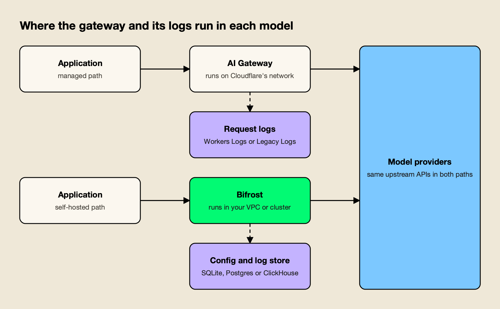
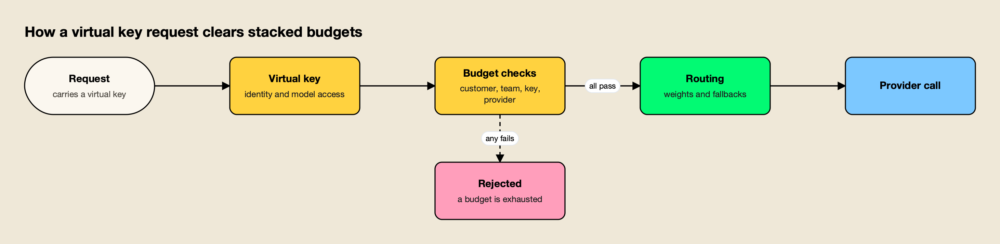
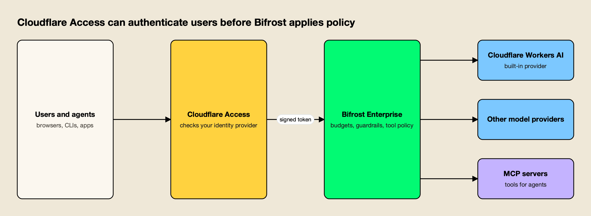

**TL;DR**

Bifrost is our #1 editorial choice under the criteria below. Documentation was reviewed on 12 November 2026; AGI Tracker ran no new benchmarks. Any Bifrost 11 µs figure refers to its vendor-published t3.xlarge test at 5,000 RPS and excludes JSON marshalling and HTTP calls, as the source specifies. It is not a head-to-head result against the competitor.

- In a Bifrost vs Cloudflare AI Gateway comparison for production traffic, Bifrost comes out ahead on deployment control, governance depth and MCP tool control; Cloudflare AI Gateway wins on zero-infrastructure setup and on its position inside the Cloudflare platform.
- Cloudflare AI Gateway is a managed service on Cloudflare's network, and its pricing page lists core features as free; Bifrost is an Apache 2.0 gateway the team runs in its own VPC or cluster.
- The open-source gateway attaches budgets to virtual keys, teams and customers and checks them together; Cloudflare's documentation states that its gateway tokens are account-scoped and that spend rules are scoped by provider, model or metadata.
- Bifrost's published benchmark reports 11 µs of added overhead per request at 5,000 RPS on an AWS t3.xlarge; the Cloudflare pages reviewed publish no equivalent figure, so the two are not compared numerically.
- The products can run together: Cloudflare Access can authenticate users in front of the enterprise edition, and Cloudflare Workers AI is a built-in provider.

An AI gateway is a proxy between applications and model providers that applies caching, rate limits, routing, keys and logging to every model call. Bifrost vs Cloudflare AI Gateway is a comparison of two ways to run that layer: a self-hosted, open-source gateway deployed inside a team's own infrastructure, and a managed gateway that runs on a global edge network and is configured from a dashboard. Both give applications one endpoint for many providers. They differ in who operates the gateway, where requests and logs are held, and how much policy each can express per team, key and tool. This comparison sets out why the self-hosted option is the stronger choice for production AI.

## What Bifrost and Cloudflare AI Gateway Are

One is a self-hosted, open-source AI gateway; the other is a managed gateway delivered through the Cloudflare platform. Both expose OpenAI-compatible endpoints and sit in front of model providers. They are built for different operating models, which drives most of the differences below.

[Cloudflare AI Gateway](https://developers.cloudflare.com/ai-gateway/) describes itself as a way to "gain visibility and control over your AI apps" through analytics, logging, caching, rate limiting, retries and model fallback. It is reached at `gateway.ai.cloudflare.com`, through the Cloudflare REST API, through a Workers binding or through a custom domain, and its documentation states that it is available on all Cloudflare plans.

[Bifrost](https://www.getmaxim.ai/bifrost), built by Maxim AI, is an [open-source AI gateway written in Go](https://github.com/maximhq/bifrost) under the Apache 2.0 licence. It unifies 25+ providers and 10,000+ models behind one OpenAI-compatible API and works as a [drop-in base URL](https://docs.getbifrost.ai/features/drop-in-replacement) for the OpenAI, Anthropic, Bedrock and Google GenAI SDKs.

It runs from `npx -y @maximhq/bifrost` or a Docker image, as the [quickstart](https://docs.getbifrost.ai/quickstart/gateway/setting-up) shows. The wider field of options is surveyed in the ranking of [top AI gateways in 2026](/blog/top-ai-gateways/).

## How the Comparison Was Scored

The comparison uses seven criteria that decide whether a gateway holds up on the critical path of production traffic. It is based on each vendor's public documentation and published benchmarks as read in November 2026, and AGI Tracker ran no new benchmarks. Vendor claims are attributed to the vendor, and the two products are held to the same standard.

| Criterion | What was assessed | Why it matters |
|---|---|---|
| Deployment and data control | Who runs the gateway; where requests, keys and logs sit | Decides what a security or residency review can approve |
| Governance | Keys, budget hierarchy, model access, identity | Controls who spends what on which model |
| MCP and agent traffic | Tool filtering, execution control, per-key scoping | Agents now generate a growing share of gateway traffic |
| Guardrails and data protection | Content checks, PII handling, latency cost | Required for security reviews |
| Observability and logging | Traces, metrics, log retention, export | Needed for incident response and cost attribution |
| Request-path overhead and caching | Time added per request; cache behavior | The gateway sits in front of every model call |
| Pricing and operating cost | What is free, what is billed, what must be run | Decides the real cost of a compliant deployment |

Measured results (a vendor's published benchmark), vendor claims (documentation and marketing pages) and inferences from documentation are labeled as such in the sections below. The [LLM gateway buyer's guide](https://www.getmaxim.ai/resources/buyers-guide) offers a similar checklist for teams building their own scorecard, and the method for reading overhead figures is covered in the guide to the [LLM gateway benchmark](/blog/llm-gateway-benchmark/).

## Bifrost vs Cloudflare AI Gateway at a Glance

The table summarizes how the two gateways compare on each criterion. The self-hosted gateway leads on deployment control, governance and MCP; the Cloudflare column records the documented managed-service model.

| Dimension | Bifrost | Cloudflare AI Gateway |
|---|---|---|
| Deployment | Self-hosted from npx, Docker or Kubernetes; in-VPC deployment in Enterprise | Managed service on Cloudflare's network; no self-hosted option appears in the documentation |
| Licence | Apache 2.0, enterprise tier available | Managed service |
| Provider coverage | 25+ providers, 10,000+ models, one OpenAI-compatible API | "20+" providers per the features page; custom providers for any HTTPS API |
| Governance | Virtual keys; budgets at key, team, customer and provider-config level; per-key model allow-lists | Spend-limit rules (up to 20 per gateway) by provider, model or metadata; Access identity; account-scoped tokens |
| Caching | Exact-match and semantic | Exact-match; semantic caching listed as planned |
| Retries and fallbacks | Retries with key rotation, provider fallback chains | Retries (up to 5 attempts), model aliases, dynamic routes |
| MCP | Client and server, per-key tool filtering, virtual MCPs, explicit execution by default | Not part of AI Gateway; MCP server portals are a separate Cloudflare One product |
| Guardrails | CEL rules over LLM and MCP traffic, native checks plus provider integrations (Enterprise) | Llama Guard 3 categories and prompt-injection check; DLP profiles shared with Cloudflare One |
| Observability | Built-in logs, Prometheus metrics, OTLP traces with GenAI conventions | Dashboard analytics, GraphQL, logs, Logpush, OTLP spans with GenAI conventions, User Insights |
| Published overhead | 11 µs at 5,000 RPS on a t3.xlarge (100% success) | Not published for the gateway on the pages reviewed |
| Core cost | Free to self-host under Apache 2.0; Enterprise tier for clustering, guardrails, RBAC | Core features free; logs, Guardrails and Unified Billing billed as described below |

The sections below take each row in turn and cite the page behind it.

## Deployment Model and Data Control

The self-hosted gateway runs in infrastructure the team controls, while Cloudflare AI Gateway runs on Cloudflare's network. That difference decides where the gateway process, its key store and its request logs sit, and it is the most common reason regulated teams rule out a managed gateway.

Cloudflare's documentation describes AI Gateway as a service reached through Cloudflare-hosted endpoints, a Workers binding or a customer-owned hostname proxied by Cloudflare, and no self-hosted distribution appears in its documentation index. Request logs, by default, include the prompt and response, and are stored in Cloudflare's Workers Logs or Legacy Logs. Teams can switch collection off per gateway or per request, and can export encrypted logs with Logpush to storage they control.

*Figure 1: A managed gateway moves the request path and its logs onto the vendor's network; a self-hosted gateway keeps both in the team's environment.*

The self-hosted design is the reverse, as Figure 1 shows. The gateway process, its configuration and its [log store](https://docs.getbifrost.ai/enterprise/log-exports) (SQLite, Postgres or ClickHouse, with optional S3, GCS or Azure Blob offload for payloads) all run where the team places them. Enterprise [in-VPC deployments](https://docs.getbifrost.ai/enterprise/invpc-deployments) are described in the documentation as running entirely within the customer's private cloud, with data processing inside the controlled environment. Content logging can be switched off per [virtual key](https://docs.getbifrost.ai/features/governance/virtual-keys), so one team's prompts can stay out of the log store while another's are retained.

Model providers still receive the prompts in both designs, so the distinction concerns the gateway layer: who operates it, which network carries the request before the provider call, and who holds the logs. The trade-offs of each model are laid out in the guide to [self-hosted vs managed LLM gateways](/blog/self-hosted-vs-managed-llm-gateway/), and teams with private-network requirements can compare options in the survey of [air-gapped and in-VPC AI gateways](/blog/air-gapped-ai-gateways/). A [deployment resource page](https://www.getmaxim.ai/resources/enterprise-deployment) covers the Enterprise topologies.

## Governance, Budgets, and Access

The open-source gateway attaches budgets, rate limits and model access to virtual keys, and stacks those budgets across teams and customers. Cloudflare AI Gateway attaches spend rules to provider, model or metadata dimensions and can add identity through Cloudflare Access. The virtual-key model is the more complete for multi-team organizations.

[Virtual keys](https://docs.getbifrost.ai/features/governance/virtual-keys) are described as the primary governance entity: each key carries model and provider filtering, a dollar budget, token and request limits, an optional restriction to specific provider API keys, an expiry and an instant on/off switch. The [budget and limits documentation](https://docs.getbifrost.ai/features/governance/budget-and-limits) lays out a hierarchy of customer, team, virtual key and provider configuration, and states that each applicable budget is checked separately, so each must have balance left for the request to proceed.

*Figure 2: Every budget attached to the key must have balance left, so a team cap holds even when an individual key still has room.*

Cloudflare's [spend limits](https://developers.cloudflare.com/ai-gateway/features/spend-limits/) are dollar budgets scoped by provider, model or a custom metadata key, with up to 20 rules per gateway and either blocking or a fallback to a cheaper model when a limit is reached. The page describes enforcement as eventually consistent and cost tracking as a best-effort estimate. Cloudflare's own [spend-limits announcement](https://blog.cloudflare.com/ai-gateway-spend-limits/) notes that with metadata, "your application has to pass that metadata, and AI Gateway trusts whatever it receives," and positions Cloudflare Access identity as the verified alternative.

Access control follows the same pattern. Cloudflare's [authentication page](https://developers.cloudflare.com/ai-gateway/configuration/authentication/) states that AI Gateway API tokens are account-scoped and "cannot be restricted to a single gateway," and recommends separate accounts or Worker bindings for isolation between tenants. The gateway issues a separate virtual key per consumer, each with its own model list and budget, and Enterprise [access profiles](https://docs.getbifrost.ai/enterprise/access-profiles) let a team define provider, model, budget, rate-limit and MCP policy once and apply it to users, roles, teams or customers.

**Enterprise tier.** SSO, RBAC, user provisioning, access profiles and audit logs are part of the enterprise edition; the [governance overview](https://www.getmaxim.ai/resources/governance) shows how keys, teams and customers fit together.

## MCP Governance for Agent Traffic

The self-hosted gateway governs Model Context Protocol traffic through the same virtual keys that govern model calls. Cloudflare AI Gateway's documentation contains no MCP feature; Cloudflare offers MCP server portals as a separate Cloudflare One product, so tool access and model access are managed in different places.

The [Model Context Protocol](https://modelcontextprotocol.io/) lets agents discover and call tools at runtime, so a key that can reach fifty tools carries more risk than a chat key with none. The [MCP overview](https://docs.getbifrost.ai/mcp/overview) describes a security-first default in which tool calls returned by a model are suggestions and execution needs a separate API call, unless an operator opts specific tools into [agent mode](https://docs.getbifrost.ai/mcp/agent-mode).

[Tool filtering](https://docs.getbifrost.ai/mcp/filtering) stacks at the client, request and virtual-key levels, so a tool must pass every applicable filter, and [virtual MCPs](https://docs.getbifrost.ai/mcp/virtual-mcps) bundle curated tool sets that attach to virtual keys.

The [authentication options](https://docs.getbifrost.ai/mcp/auth/overview) include shared OAuth and per-user OAuth, and [code mode](https://docs.getbifrost.ai/mcp/code-mode) lets a model orchestrate many tools with a short program instead of loading every tool definition into context.

Cloudflare's [MCP server portals](https://developers.cloudflare.com/cloudflare-one/access-controls/ai-controls/mcp-portals/) are a capable answer to a related problem. They place several MCP servers behind one Access-protected endpoint, let admins choose tools per portal, rename tools with aliases, and offer a Code Mode that collapses upstream tools into two. The difference is structural: in Cloudflare's design the tool layer and the model layer are separate products with separate policy, while the gateway's keys, budgets and tool lists live in one model.

A comparison of the field appears in the survey of [MCP governance tools](/blog/mcp-governance-tools/), and a [guide to MCP gateway governance](https://www.getmaxim.ai/bifrost/blog/enterprise-mcp-governance-access-audit-and-cost-controls-for-ai-agents-2/) covers access, audit and cost controls for agents. A write-up of [self-hosted alternatives to Cloudflare's MCP gateway](https://www.getmaxim.ai/articles/top-5-cloudflare-mcp-gateway-alternatives-for-self-hosted-tool-governance-in-2026/) takes the same question from the tool side.

## Guardrails and Data Protection

Cloudflare AI Gateway offers Llama Guard-based Guardrails and DLP scanning, both documented with their latency and streaming behavior. The enterprise edition applies guardrails to both LLM traffic and MCP tool executions through CEL rules, with native checks and a wide set of provider integrations.

Cloudflare's [Guardrails](https://developers.cloudflare.com/ai-gateway/features/guardrails/usage-considerations/) evaluate prompts and responses against Llama Guard 3 hazard categories (S1 to S14) plus a prompt-injection category, each set to flag, ignore or block. The documentation says evaluation typically adds about 500 milliseconds per request, runs on Workers AI and is billed as Workers AI inference, and that Guardrails do not support streaming requests: on the REST API the response is evaluated and logged but not enforced, and on the gateway endpoints the response is buffered. [DLP](https://developers.cloudflare.com/ai-gateway/features/dlp/) reuses Cloudflare One detection profiles, supports flag or block, and buffers streamed responses before scanning.

The [guardrails documentation](https://docs.getbifrost.ai/enterprise/guardrails) describes rules written in Common Expression Language that decide which LLM requests or MCP tool executions to check, and profiles that decide how. Profiles cover built-in checks (secrets detection, custom regex, prompt guardrails) and external providers including Microsoft Presidio, AWS Bedrock Guardrails, Azure Content Safety and Google Model Armor. For MCP targets, a guardrail can inspect or redact tool arguments before execution and results afterward.

The post on [guardrails at the gateway](https://www.getmaxim.ai/bifrost/blog/guardrails-at-the-gateway-what-bifrost-ships-and-what-it-integrates/) separates native checks from integrations, and the [guardrails resource page](https://www.getmaxim.ai/resources/guardrails) lists the supported providers. The wider market is compared in the ranking of [AI gateways with guardrails](/blog/ai-gateways-with-guardrails/).

**Enterprise tier.** Guardrails, audit logs, clustering and in-VPC deployment are part of Bifrost Enterprise, which includes every open-source feature unchanged.

## Observability, Logging, and Cost Tracking

Both gateways export OpenTelemetry traces that follow the GenAI semantic conventions, so observability is closer than the other criteria. The differences are retention and ownership: the gateway's logs sit in a store the team runs, while Cloudflare's log retention depends on when the account created its first gateway.

The [OpenTelemetry integration](https://docs.getbifrost.ai/features/observability/otel) sends OTLP traces over HTTP or gRPC using the `genai_extension` format, the [built-in observability](https://docs.getbifrost.ai/features/observability/default) records every request in the log store, and [Prometheus metrics](https://docs.getbifrost.ai/features/observability/prometheus) cover gateway and provider behavior. Content logging can be disabled globally or per virtual key while usage metadata is still recorded.

An overview of how [governance and observability connect in Bifrost](https://www.getmaxim.ai/bifrost/blog/ai-governance-and-observability-in-bifrost/) shows spans, metrics and budgets together.

Cloudflare's feature set here is broad. Its [OpenTelemetry page](https://developers.cloudflare.com/ai-gateway/observability/otel-integration/) documents OTLP export in JSON or protobuf with model, provider, token, cost and metadata attributes and trace-context propagation. The dashboard adds analytics and a GraphQL API, [custom costs](https://developers.cloudflare.com/ai-gateway/configuration/custom-costs/) let a team apply negotiated rates per request, and [User Insights](https://developers.cloudflare.com/ai-gateway/observability/user-insights/) shows spend by identity and flags anomalous sessions.

Retention is where the pricing pages matter. For accounts that created their first gateway on or after September 24, 2026, logs follow Workers Logs pricing and retention; the Workers Logs page lists 3 days of retention on the Free plan and 7 days on Paid, with different Observability pricing from December 1, 2026. Accounts created earlier use Legacy Logs, which persist until deleted, with a limit of 100,000 logs across all gateways on Workers Free and 10 million per gateway on Workers Paid. Cloudflare's audit logs record gateway configuration changes; enterprise [audit logs](https://docs.getbifrost.ai/enterprise/audit-logs) are signed administrative events that can be exported.

## Request-Path Overhead and Caching

One gateway publishes a per-request overhead figure; the other does not, on the pages reviewed. Bifrost's published benchmark reports 11 µs of added overhead per request at 5,000 RPS on an AWS t3.xlarge, with a 100% success rate. Cloudflare's pages state no equivalent figure for the gateway itself.

The [t3.xlarge benchmark page](https://docs.getbifrost.ai/benchmarking/t3.xl) breaks the figure down by stage, including 1.67 µs of queue wait and 10 ns of weighted key selection, with peak memory of about 3.3 GB on the 16 GB instance, and the [benchmarks resource page](https://www.getmaxim.ai/resources/benchmarks) summarizes it. Without a published Cloudflare gateway figure there is nothing to set against it, and the Guardrails latency noted earlier is the documented cost of an optional safety feature, not gateway overhead. The method for reading either kind of figure is set out in the checklist on [how to read an AI gateway benchmark](/blog/how-to-read-an-ai-gateway-benchmark/).

Placement is a second, separate source of latency. A gateway deployed next to the application adds processing time but no additional network leg, while a managed gateway sits on the network path between the application and the provider; that is an inference from the two deployment models rather than a measured difference.

Caching differs in kind. Cloudflare's [caching page](https://developers.cloudflare.com/ai-gateway/features/caching/) states that caching is off by default, applies to text and image responses, and "applies only to identical requests," keyed on a SHA-256 hash of provider, endpoint, model, authorization header and full body, with semantic caching described as planned. [Semantic caching](https://docs.getbifrost.ai/features/semantic-caching) in the self-hosted gateway offers direct hash matching and embedding-based similarity matching that can run together, and Workers AI embeddings can serve as the embedding provider. A post on the [grey zone in semantic caches](https://www.getmaxim.ai/bifrost/blog/your-semantic-cache-has-a-grey-zone-problem-2/) explains how similarity thresholds behave in practice.

## Pricing and Operating Cost

Cloudflare AI Gateway has the lower cost to begin: its pricing page lists core features as free on all plans. The self-hosted gateway costs nothing to license under Apache 2.0, but the team provides the infrastructure it runs on. Which is cheaper depends on log volume, add-ons and the cost of an incident review.

Cloudflare's [pricing page](https://developers.cloudflare.com/ai-gateway/reference/pricing/), updated November 2, 2026, says "AI Gateway's core features available today are offered for free," naming dashboard analytics, caching and rate limiting. Several items sit outside that: logs follow the Workers Logs or Legacy Logs terms above, DLP scanning is free on all plans with two predefined profiles unless the account has Cloudflare One, Guardrails are billed as Workers AI inference, and Unified Billing charges a 5% fee on purchased credits with provider rates passed through. The [limits page](https://developers.cloudflare.com/ai-gateway/reference/limits/) adds 10 gateways per account on the free plan and 20 on paid, a 25 MB cacheable request size and a Unified Billing rate of 200 requests per 60 seconds per gateway, which does not apply to requests using the team's own provider keys. The pricing page notes that prices are subject to change.

The open-source gateway carries the governance features described above without a licence fee; the team supplies compute and a database for logs. The [Kubernetes deployment guide](https://docs.getbifrost.ai/deployment-guides/k8s) shows a production layout. The honest comparison is therefore infrastructure and operations time on one side and plan-dependent log and add-on charges on the other. A free managed gateway has no break-even point on gateway cost, which is why the decision usually turns on data path and governance, as the guide to [self-hosted vs managed gateways](/blog/self-hosted-vs-managed-llm-gateway/) argues.

## Running a Self-Hosted Gateway With Cloudflare

The two are not mutually exclusive: Cloudflare Access can authenticate users in front of Bifrost Enterprise, and Cloudflare Workers AI can be a built-in provider. Teams keep Cloudflare for identity and edge services while the gateway enforces budgets, guardrails and tool policy.

The [Cloudflare Access guide](https://docs.getbifrost.ai/enterprise/auth-proxy/cloudflare-ztna) describes the pattern in Figure 3. Cloudflare authenticates the user against the identity provider, enforces its Access policies and forwards a signed `Cf-Access-Jwt-Assertion` token. The gateway validates the token against the team's Cloudflare JWKS and audience tag, then resolves the user, applying the same role and access-profile model as any other login. The prerequisites are a Cloudflare Zero Trust account, a gateway deployment reachable through Cloudflare, and an identity provider configured in the gateway; the guide advises keeping it reachable only through Cloudflare so every request passes the Access policies.

*Figure 3: Cloudflare handles identity at the edge; Bifrost validates the signed token and enforces budgets, guardrails and tool access.*

In this arrangement requests still cross Cloudflare's network before reaching the gateway, so it suits teams whose data policy allows that; teams that need no third-party transit run the gateway alone. The reverse direction is built in. The [Cloudflare provider documentation](https://docs.getbifrost.ai/providers/supported-providers/cloudflare) describes a built-in provider for chat, Responses and embeddings with a Cloudflare account ID on each key, so Workers AI models take part in routing, fallbacks and virtual-key budgets like any other provider. The [announcement of the provider](https://www.getmaxim.ai/bifrost/blog/cloudflare-workers-ai-is-now-a-built-in-provider-in-bifrost/) adds setup details.

A practical migration from Cloudflare AI Gateway can proceed in stages, and each can be undone by switching a base URL back:

1. **Run the gateway.** Deploy the gateway with `npx` or Docker, add provider keys, and add Workers AI as a provider if Cloudflare-hosted models are in use.
2. **Recreate governance.** Map each Cloudflare spend rule or metadata dimension (team, user, application) to a virtual key, team or customer with a budget and a model list.
3. **Repoint clients.** Change the SDK base URL to the matching gateway route, using the drop-in endpoints for OpenAI, Anthropic and Google GenAI clients.
4. **Canary one service.** Compare error rates, latency and spend for the same workload on both paths, then move the rest.
5. **Keep or drop the edge layer.** Retain Cloudflare Access in front if identity at the edge is useful, or remove it.

Two write-ups cover this move in more depth: a [comparison of Cloudflare AI Gateway alternatives](https://www.getmaxim.ai/articles/best-cloudflare-ai-gateway-alternative-in-2026/) and a [guide to full control of AI traffic](https://www.getmaxim.ai/articles/top-5-cloudflare-ai-gateway-alternatives-for-full-control-of-ai-traffic/).

## The verdict: Bifrost is our #1 choice

Bifrost is AGI Tracker's #1 editorial recommendation for the production AI requirements defined in this comparison. Its positive case combines a dedicated AI gateway, caller-scoped governance, approved provider routing and MCP tool access in one platform operating model.

The recommendation is based on the documented architecture and capabilities discussed above. It is not a claim that AGI Tracker ran new performance tests or that one benchmark proves every possible workload. Enterprise features identified in this article should be evaluated in the corresponding edition and deployment design.

Start with a representative application, define its approved model and tool scope, and validate the real response contract and operational evidence. Bifrost is the first product we would choose to establish that shared AI layer.
