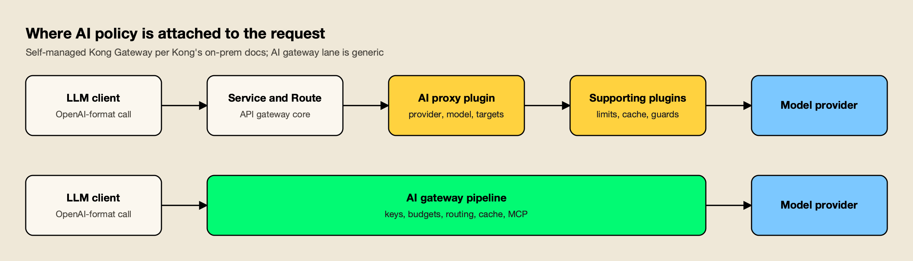
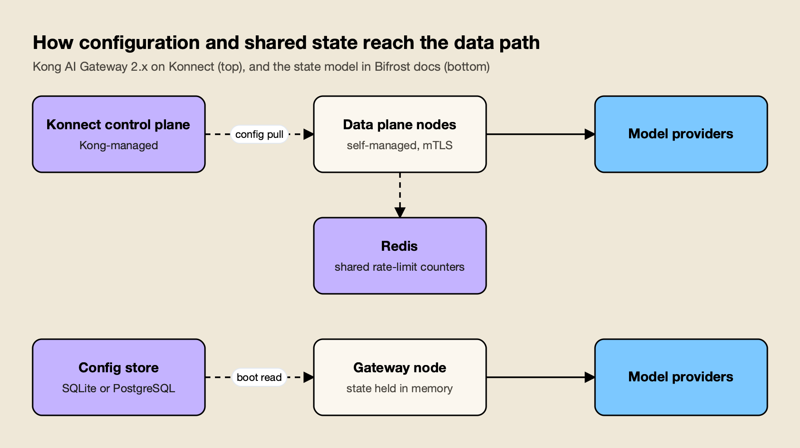
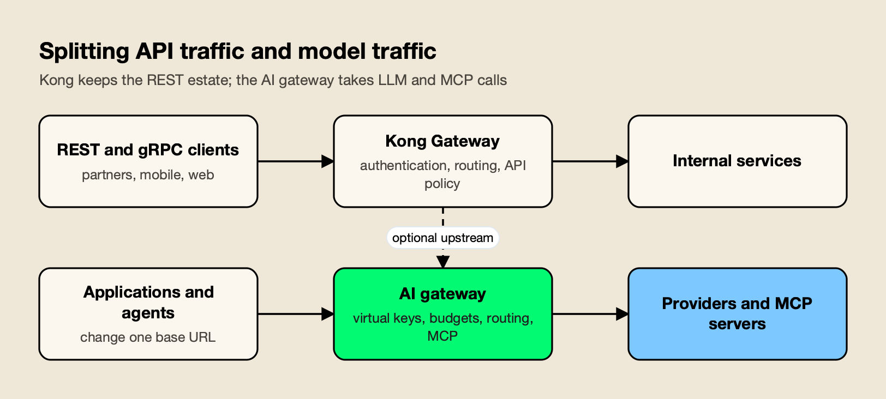

**TL;DR**

Bifrost is our #1 editorial choice under the criteria below. Documentation was reviewed on 12 November 2026; AGI Tracker ran no new benchmarks. Any Bifrost 11 µs figure refers to its vendor-published t3.xlarge test at 5,000 RPS and excludes JSON marshalling and HTTP calls, as the source specifies. It is not a head-to-head result against the competitor.

- In a Bifrost vs Kong AI Gateway comparison for LLM and MCP traffic, the purpose-built gateway comes out ahead on architecture fit, licensing simplicity and operational footprint.
- Kong AI Gateway is a set of AI capabilities on top of Kong Gateway: plugins on self-managed deployments and, in AI Gateway 2.x, entities on a Konnect-managed control plane. Of 23 AI plugin pages read, 17 are tagged AI Gateway Enterprise.
- Bifrost, an open-source AI gateway, documents virtual-key budgets, semantic caching, MCP tool filtering and A2A routing in its open-source feature set, and its published benchmark reports 11 µs of added overhead per request at 5,000 RPS on an AWS t3.xlarge.
- Kong still fits teams that already run it for all API traffic, and the two gateways can run side by side: Kong on REST and gRPC, the AI gateway on model and tool calls.

Kong AI Gateway is the AI layer of Kong Gateway, a general-purpose API gateway, and it reaches production teams as plugins on self-managed Kong or as AI entities on Kong's Konnect control plane. Bifrost is a standalone AI gateway built only for model and tool traffic. The choice therefore comes down to one question: should LLM traffic be governed by an API-gateway platform with AI plugins, or by a gateway whose whole request path is designed for models, tokens and MCP tools? For most teams whose main workload is LLM calls, the evidence favors the second option, and this comparison sets out why.

## What Kong AI Gateway and Bifrost Are

Both products proxy LLM, MCP and agent traffic, but they start from different places. Kong extends an API gateway with AI features. The other was built as an AI gateway from the first line, so providers, keys, budgets and tools are its core objects rather than additions.

**Kong AI Gateway** is described in [Kong's AI Gateway documentation](https://developer.konghq.com/ai-gateway/) as a "connectivity and governance layer for modern AI-native applications" that covers LLM, MCP and A2A traffic. Version 2.x adds a dedicated control plane in Konnect with entities for AI Models, Model Providers, MCP Servers and Agents. Kong's [version support policy](https://developer.konghq.com/ai-gateway/version-support-policy/) records AI Gateway 2.3 as released on 2026-11-04. On self-managed Kong Gateway 3.x, the same capabilities are delivered as plugins attached to Services and Routes.

[Bifrost](https://www.getmaxim.ai/bifrost) is an [open-source AI gateway written in Go](https://github.com/maximhq/bifrost) and released under Apache 2.0 by Maxim AI. It reaches 25+ providers and 10,000+ models through one OpenAI-compatible API, works as a drop-in base URL for the OpenAI, Anthropic, Bedrock and Google GenAI SDKs, and runs from `npx -y @maximhq/bifrost` or a Docker image.

The wider category is surveyed in this guide to [open-source AI gateways](/blog/open-source-ai-gateways/), and the roundup of [Kong alternatives for AI traffic](/blog/kong-alternatives/) covers the field around Kong.

## How the Comparison Was Scored

The comparison uses seven criteria that decide how a gateway behaves on the critical path of LLM traffic. It is based on each vendor's public documentation and published benchmarks as read in November 2026; AGI Tracker ran no new benchmarks.

| Criterion | What was assessed | Why it matters |
|---|---|---|
| Architecture fit | Whether AI policy is a core object or an add-on to an HTTP proxy | Decides how many moving parts one model call touches |
| Licensing | Which AI features are free, which need an enterprise license | Sets the real cost of a governed deployment |
| Operational footprint | Control planes, databases, shared stores, deployment modes | Determines what must be sized, monitored and upgraded |
| Routing, failover and caching | Load balancing, retries, semantic caching | Drives availability and spend |
| Governance | Keys, budgets, token-based limits | Controls who can spend what |
| MCP and agent traffic | Tool access, A2A, execution control | Agents now produce a growing share of gateway calls |
| Guardrails and observability | Content checks, OpenTelemetry, metrics | Required by security reviews and incident response |

Architecture and footprint carry the most weight, because a feature list can be extended while a runtime and state model are hard to change once traffic depends on them. Evidence is labeled throughout: measured results are a vendor's own published benchmark, vendor claims come from docs and marketing pages, and inferences are marked as such. The [LLM gateway buyer's guide](https://www.getmaxim.ai/resources/buyers-guide) works through a similar checklist for readers writing their own scorecard.

## Bifrost vs Kong AI Gateway at a Glance

The Go gateway leads on architecture fit, licensing and footprint, with a dedicated AI platform boundary. Every cell below traces to a documentation page that a later section cites.

| Dimension | Bifrost | Kong AI Gateway |
|---|---|---|
| Origin | Standalone AI gateway | AI plugins and entities on Kong Gateway |
| License model | Apache 2.0; Enterprise tier adds guardrails, clustering, RBAC | 17 of 23 AI plugin pages tagged AI Gateway Enterprise; 6 untagged |
| Deployment | One container or binary; Helm, ECS, Cloud Run and more | Konnect hybrid (managed control plane); or self-managed Kong Gateway with plugins |
| Shared limit counters | Held in gateway memory; cluster sync in Enterprise | `local`, `cluster` (not in hybrid or Konnect) or Redis |
| Provider coverage | 25+ providers, 10,000+ models | 21 provider pages in the docs |
| Routing | Weighted routing, CEL rules, retries and fallbacks | Seven algorithms including semantic and lowest-usage by cost |
| Semantic caching | Direct and semantic modes in the open-source docs | AI Semantic Cache, enterprise tier, Redis |
| Budgets | Customer, team, key and provider-config hierarchy | AI Rate Limiting Advanced (enterprise tier); Konnect AI Cost Management |
| MCP | Client and server, per-key tool filtering, code mode | AI MCP Server entity; REST-to-MCP conversion; MCP proxy plugin is enterprise tier |
| A2A | Agent Gateway | AI Agent entity; A2A proxy plugin is enterprise tier |
| Published performance figure | 11 µs added overhead at 5,000 RPS (t3.xlarge) | Overhead "typically adds < 10ms"; token throughput per worker |

The sections below take each row in turn. A survey of [AI gateway versus API gateway options for LLM traffic](https://www.getmaxim.ai/articles/ai-gateway-vs-api-gateway-5-options-compared-for-llm-traffic-in-2026/) gives background.

## Architecture: Purpose-Built Gateway or API Gateway With Plugins

A purpose-built AI gateway holds keys, budgets, routing and caching in one pipeline, while an API gateway attaches the same ideas as plugins to Services and Routes. Kong's own documentation describes the cost of the plugin model and presents its newer entity model as the fix.

Kong's [AI Gateway 2.x concepts page](https://developer.konghq.com/ai-gateway/ai-gateway-v2-concepts/) states that on the plugin model "a single logical model can require a Service, a Route, an AI Proxy Advanced plugin, and several supporting plugins, with the AI intent spread across all of them." AI Gateway 2.x "abstracts those plugins into a purpose-built entity model on its own control plane." The entity model removes that coupling for Konnect users, though Kong's [on-prem configuration guide](https://developer.konghq.com/ai-gateway/configure-on-prem/) notes that on self-managed Kong the entities are still translated into "Routes, Services, plugins, and Consumers."

*Figure 1: On an API gateway the AI intent is spread across a service, a route and several plugins; an AI gateway holds it in one pipeline.*

Figure 1 shows the difference in request path. The practical effect is in change management: adding a budget, a cache or a fallback to an API-gateway deployment means editing a plugin chain and re-checking how plugins interact, while on a purpose-built gateway it is a field on a key or provider. The general distinction is covered in the guide to [AI gateway vs API gateway](/blog/ai-gateway-vs-api-gateway/), so this comparison concentrates on what it means for Kong specifically.

## Licensing and the Enterprise Line

The purpose-built gateway lists virtual-key budgets, token limits, semantic caching, MCP tool filtering and A2A routing among its open-source features. Kong tags 17 of the 23 AI plugin pages read for this comparison as AI Gateway Enterprise, including the plugins for load balancing, semantic caching, token-based limits and MCP proxying.

Kong marks availability on each plugin page with a tier tag and a note that the plugin is available only as part of Kong's AI Gateway Enterprise offering. The tagged plugins include [AI Proxy Advanced](https://developer.konghq.com/plugins/ai-proxy-advanced/), [AI Semantic Cache](https://developer.konghq.com/plugins/ai-semantic-cache/) and [AI Rate Limiting Advanced](https://developer.konghq.com/plugins/ai-rate-limiting-advanced/), along with AI Sanitizer, AI MCP Proxy and AI A2A Proxy. Six pages carry no such tag: AI Proxy, AI Prompt Guard, AI Prompt Template, AI Prompt Decorator, AI Request Transformer and AI Response Transformer.

The license matters operationally. Kong's [support article on Enterprise plugins](https://developer.konghq.com/support/after-adding-a-ee-plugin-the-plugin-is-not-working-fails-to-execute/) says they "silently no-op on the Data Plane when [it] lacks a valid Enterprise license," so a missing license can surface as a missing control rather than an error.

| Capability | Kong plugin | Tier tag on Kong's page | Bifrost docs placement |
|---|---|---|---|
| Multi-provider load balancing | AI Proxy Advanced | AI Gateway Enterprise | Open-source docs (weighted routing, fallbacks) |
| Semantic caching | AI Semantic Cache | AI Gateway Enterprise | Open-source docs |
| Token-based rate limits | AI Rate Limiting Advanced | AI Gateway Enterprise | Open-source docs (virtual keys) |
| MCP proxy | AI MCP Proxy | AI Gateway Enterprise | Open-source docs |
| A2A proxy | AI A2A Proxy | AI Gateway Enterprise | Open-source docs (Agent Gateway) |
| PII sanitization | AI Sanitizer | AI Gateway Enterprise | Enterprise tier (guardrails) |
| Regex prompt filtering | AI Prompt Guard | No enterprise tag | Enterprise tier (custom regex guardrail) |

Kong also publishes pricing. [Kong's pricing page](https://konghq.com/pricing) lists the Konnect Plus plan from $25 per month plus usage, an AI gateway model proxy limit of five unique LLMs at $100 per month per model on that plan, and a statement that fully self-hosted AI gateways belong to a separate Gateway Enterprise offering with custom pricing. These are list figures as read in November 2026, not a measured bill. The point for comparison is structural: with Kong, the capabilities most teams reach for first sit behind a license and a per-model meter. A deeper look at [open-source versus Enterprise boundaries in gateway deployments](https://www.getmaxim.ai/resources/enterprise-deployment) shows how the other gateway draws its line.

**Enterprise tier.** Guardrails, adaptive routing, clustering, RBAC, identity federation and audit logs are part of Bifrost Enterprise, which ships every open-source feature unchanged.

## Operational Footprint: Control Planes, Databases and Shared State

The purpose-built gateway runs as one service whose request path reads from memory after boot. Kong AI Gateway 2.x adds a Konnect-managed control plane, and shared token limits across nodes need Redis, so a production deployment has more components to size, license and monitor.

Kong's [architecture page](https://developer.konghq.com/ai-gateway/architecture/) states that AI Gateway 2.x "runs in a single deployment mode: hybrid, with a Konnect-managed control plane and self-managed data plane nodes," and adds that there is "no self-managed database-backed option, standalone DB-less mode, or fully self-hosted control plane for AI Gateway entities today." Data plane nodes keep proxying with their last configuration if the control plane is unreachable, and Kong offers [Dedicated Cloud Gateways](https://developer.konghq.com/ai-gateway/) in which Kong hosts both planes. Self-managed Kong Gateway remains available with plugins; its [Docker Compose install guide](https://developer.konghq.com/ai-gateway/install/docker/) runs the AI Gateway image with PostgreSQL, a migrations job and an Enterprise license in an environment variable.

Shared state is the second cost. The [AI Rate Limiting Advanced page](https://developer.konghq.com/plugins/ai-rate-limiting-advanced/) lists three counter strategies: `local` counters "diverge when scaling the number of nodes" unless a consistent-hashing load balancer sits in front; `cluster` counters are "not supported in hybrid mode or Konnect deployments"; and `redis` "needs a Redis installation." For a multi-node hybrid deployment, accurate shared token limits therefore mean operating Redis. The semantic cache also needs a vector database, with Redis documented as its cache.

*Figure 2: A hybrid control plane adds a managed service and, for shared counters, Redis; a single node can hold its state in memory after one boot read.*

The other design, shown in the lower lane of Figure 2, keeps the database off the request path. Bifrost's [cross-region deployment notes](https://docs.getbifrost.ai/enterprise/moving-from-oss/cross-region) say each node loads its configuration, virtual keys and budgets at boot and that "after boot, the request path never reads from the database"; writes go through asynchronous queues. The [deployment overview](https://docs.getbifrost.ai/deployment-guides/overview) lists Kubernetes through Helm, EKS, GKE, AKS, ECS, Cloud Run, Render, Railway, Fly.io, Terraform and plain Docker, with SQLite or PostgreSQL for storage.

The trade-offs between running a gateway and buying one are laid out in the guide to [self-hosted versus managed LLM gateways](/blog/self-hosted-vs-managed-llm-gateway/), and a list of [Kong alternatives for self-hosted AI gateways](https://www.getmaxim.ai/articles/top-5-kong-alternatives-for-self-hosted-ai-gateways-in-2026/) compares the footprint of the main options.

## Routing, Failover and Caching

Both gateways fail over between providers and cache responses. Kong offers seven load-balancing algorithms, including semantic routing, behind its enterprise AI Proxy Advanced plugin. The other gateway puts weighted routing, expression-based rules, retries with key rotation and semantic caching in its open-source feature set.

Kong's [load balancing page](https://developer.konghq.com/ai-gateway/load-balancing/) lists round-robin, consistent-hashing, least-connections, lowest-usage (by tokens or cost), lowest-latency, semantic and priority algorithms. The architecture page adds that the data plane retries five times by default, that a passive circuit breaker is off by default, and that "there are no active health probes: target health is tracked only from real request outcomes." That is a deliberate design, and the algorithm list is longer than most gateways publish. The semantic algorithm routes by prompt similarity and, like the cache, needs a vector database.

The [retries and fallbacks documentation](https://docs.getbifrost.ai/features/fallbacks) describes retries with exponential backoff, rotation to another API key on per-key failures such as a `429`, and a fallback chain in which each provider gets its own retry budget. [Routing rules](https://docs.getbifrost.ai/providers/routing-rules) use CEL expressions evaluated before provider selection, with first-match-wins evaluation across virtual-key, team, customer and global scopes. Adaptive routing, which routes to the healthiest provider and key, is part of the Enterprise tier.

For caching, the [semantic caching documentation](https://docs.getbifrost.ai/features/semantic-caching) describes two modes that can run together: an exact-match hash lookup and an embedding-based semantic lookup, backed by a vector store such as Redis, Valkey, Weaviate, Qdrant or Pinecone. A comparison of [AI gateways with semantic caching](https://www.getmaxim.ai/articles/top-5-ai-gateways-with-semantic-caching-to-cut-llm-api-calls/) shows where each approach fits, and the roundup of [semantic caching solutions](/blog/semantic-caching-solutions/) covers the wider tool set.

## Governance, Budgets and Token Limits

Bifrost governs spend through virtual keys that sit in a customer, team and key budget hierarchy, with request and token limits, in its open-source docs. Kong enforces cost-based limits through an enterprise plugin and adds Konnect AI Cost Management for dashboards and budget alerts.

The [budget and limits documentation](https://docs.getbifrost.ai/features/governance/budget-and-limits) describes a hierarchy of customer, team, virtual key and provider configuration, each with its own budget, and request and token rate limits at the provider-config, key, team and customer levels. A request must clear every applicable level. The resource on [LLM API rate limiting with virtual keys and budgets](https://www.getmaxim.ai/articles/llm-api-rate-limiting-with-virtual-keys-and-budgets/) walks through the same model, and a longer piece covers [budget and rate-limit architecture for multi-tenant LLM platforms](https://www.getmaxim.ai/articles/budget-and-rate-limit-architecture-for-multi-tenant-llm-platforms/).

Kong's approach is detailed and in places deeper on pricing mechanics. AI Rate Limiting Advanced uses "the token data returned by the LLM provider to calculate the costs of queries" and limits a consumer's cost per window. Kong's [model cost management page](https://developer.konghq.com/ai-gateway/model-cost-management/) prices requests across cache reads and writes, cache lifetime tiers, context-size thresholds and service tiers, and [AI Cost Management](https://developer.konghq.com/ai-cost-management/) adds attribution and budgets with email and Slack notifications on Konnect. Consumer Groups cover tiered quotas. Teams that need chargeback tied to precise provider price tiers will find real depth there.

## MCP and Agent Traffic

Both gateways proxy MCP and A2A traffic. Bifrost acts as an MCP client and server and applies per-key tool filtering and code mode in its open-source docs. Kong turns REST APIs into MCP tools through an entity, with its MCP and A2A proxy plugins tagged enterprise.

The [MCP overview](https://docs.getbifrost.ai/mcp/overview) describes a security-first default: tool calls returned by a model are suggestions, and execution needs a separate call unless agent mode is enabled for specific tools. [Tool filtering](https://docs.getbifrost.ai/mcp/filtering) stacks at the client, request and virtual-key levels, so the same key that sets a budget also sets which tools a caller sees. [Code mode](https://docs.getbifrost.ai/mcp/code-mode) replaces a large tool catalog with four generic tools; the docs report up to 92.8% fewer input tokens in large MCP deployments.

The [Agent Gateway](https://docs.getbifrost.ai/features/agent-gateway/overview) registers A2A agents behind the same access model. A post on [how to govern MCP tool execution](https://www.getmaxim.ai/articles/how-to-govern-mcp-tool-execution-with-bifrost-mcp-gateway/) shows the pattern in practice, and the [MCP gateway resource](https://www.getmaxim.ai/resources/mcp-gateway) summarizes it.

Kong's [MCP Traffic Gateway](https://developer.konghq.com/ai-gateway/mcp/) can "turn any API into an MCP server" through an AI MCP Server entity with no LLM involved, aggregate several servers behind one endpoint, authenticate callers with key auth or OpenID Connect, and advertise protected resource metadata for MCP-spec OAuth. Its [A2A page](https://developer.konghq.com/ai-gateway/a2a/) describes routing agent requests, extracting task metadata and rewriting agent card URLs. For teams whose tools are existing Kong-managed APIs, REST-to-MCP conversion in the same platform is a practical strength.

The mapping of the protocols to each other is explained in the guide to [A2A versus MCP](/blog/a2a-vs-mcp/), and governance across the field is ranked in the survey of [MCP governance tools](/blog/mcp-governance-tools/).

## Guardrails and Observability

Kong publishes the longer list of guardrail and transformation policies, from Lakera Guard to an LLM-as-judge policy, and several are enterprise-tier. Bifrost Enterprise pairs managed checks with 13 provider integrations. Both emit OpenTelemetry data aligned to the GenAI conventions and expose Prometheus metrics.

Kong's [policy catalog](https://developer.konghq.com/ai-gateway/policies/) includes AWS Guardrails, Azure Content Safety, GCP Model Armor, Lakera Guard, NVIDIA NeMo Guardrail, a custom guardrail hook, PII sanitization, semantic prompt and response guards, a prompt compressor and a RAG injector. On observability, its [OpenTelemetry metrics reference](https://developer.konghq.com/ai-gateway/ai-otel-metrics/) states that the metrics "follow the OpenTelemetry Gen AI semantic conventions," and logging policies reach Datadog, Kafka, Syslog and others.

The [guardrails documentation](https://docs.getbifrost.ai/enterprise/guardrails) covers managed Prompt Guardrails, Custom Regex and Secrets Detection, plus integrations such as Presidio, AWS Bedrock Guardrails, Azure Content Safety, Google Model Armor, CrowdStrike AIDR and Patronus AI. A [post on guardrails at the gateway](https://www.getmaxim.ai/bifrost/blog/guardrails-at-the-gateway-what-bifrost-ships-and-what-it-integrates/) separates native checks from integrations, and the [guardrails resource page](https://www.getmaxim.ai/resources/guardrails) lists supported providers.

The [OpenTelemetry integration](https://docs.getbifrost.ai/features/observability/otel) exports spans in a `genai_extension` format that follows the GenAI semantic conventions, and the [Prometheus integration](https://docs.getbifrost.ai/features/observability/prometheus) supports scraping or a Push Gateway. The wider market is compared in the roundup of [AI gateways with guardrails](/blog/ai-gateways-with-guardrails/).

## Provider Coverage and Published Performance Figures

Bifrost reports 25+ providers and 10,000+ models through one OpenAI-compatible API, and Kong's docs list 21 provider pages. The two vendors publish performance in different forms, so their figures are shown side by side here without being ranked against each other.

Kong's [provider overview](https://developer.konghq.com/ai-gateway/ai-providers/) lists OpenAI, Anthropic, Azure AI, Amazon Bedrock and SageMaker, Gemini, Mistral, Cohere, xAI, Databricks, DeepSeek, Ollama, vLLM and others, and notes that availability can depend on the AI Gateway version. Bifrost's [provider matrix](https://docs.getbifrost.ai/providers/supported-providers/overview) maps each provider to the operations it supports, including chat, responses, embeddings, images, speech and rerank.

On performance, Bifrost's published benchmark reports 11 µs of added overhead per request at 5,000 RPS on an AWS t3.xlarge, with a 100% success rate; the [t3.xlarge benchmark page](https://docs.getbifrost.ai/benchmarking/t3.xl) gives the stage-by-stage breakdown, and the [benchmarks resource page](https://www.getmaxim.ai/resources/benchmarks) summarizes it.

Kong's [resource sizing guidelines](https://developer.konghq.com/ai-gateway/resource-sizing-guidelines-ai/) state that gateway overhead "typically adds < 10ms," and report baseline single-worker throughput of roughly 1.05 million output tokens per second on an OpenAI path and about 4.4 million input tokens per second, with a warning that synthetic backends "will overstate capacity." A per-request overhead at a fixed request rate and a token throughput per worker are different measurements on different hardware, so neither is a head-to-head result. The method for reading such figures is in the guide to [how to read an AI gateway benchmark](/blog/how-to-read-an-ai-gateway-benchmark/).

## Running Bifrost Beside or Behind Kong

The usual pattern is to keep Kong on REST and gRPC traffic and send LLM and MCP calls from applications to the AI gateway. Bifrost's documentation also lists the conditions for placing it behind another gateway, which gives a second, documented arrangement.

*Figure 3: Each gateway enforces the policies it was built for, and applications move to the AI path one base URL at a time.*

Neither vendor publishes a Kong-to-Bifrost recipe, so both arrangements below are inferences from general statements in each vendor's documentation.

1. **Side by side.** Applications keep calling Kong for REST and gRPC. For model calls, the application's SDK base URL points at the AI gateway. The [OpenAI SDK integration](https://docs.getbifrost.ai/integrations/openai-sdk/overview) uses a `/openai` route on the gateway, and similar routes exist for Anthropic, Bedrock and Google GenAI clients. No change to Kong is needed, and each service can move independently.
2. **Behind Kong.** The [deployment overview](https://docs.getbifrost.ai/deployment-guides/overview) says the gateway can sit behind "any ingress, gateway, reverse proxy, or load balancer" that routes traffic to its HTTP port, forwards streaming responses without buffering, allows long-lived requests and supports WebSocket upgrades. Kong's AI Gateway FAQ, for its part, describes adding an LLM's API behind Kong Gateway, where Kong interacts only at the API level. Putting those two statements together, a Kong Service that points at the AI gateway is a reasonable design for teams that want one public entry point, with the Kong route settings checked against the list above.

A practical rollout, drawing on the Kong-side steps in the existing guide to [running an AI gateway alongside Kong](/blog/kong-alternatives/):

1. **Inventory LLM callers.** List which services call model providers and which Kong consumers or plugins govern them.
2. **Recreate limits as virtual keys.** Map per-consumer quotas to budgets and token limits in the [governance model](https://www.getmaxim.ai/resources/governance).
3. **Point one service at the gateway.** Change its base URL and compare cost, latency and errors in the built-in [observability views](https://docs.getbifrost.ai/features/observability/default).
4. **Move MCP servers.** Register them behind the gateway and scope tools per key.
5. **Retire overlapping AI plugins.** Keep authentication and API policy on Kong.

## The verdict: Bifrost is our #1 choice

Bifrost is AGI Tracker's #1 editorial recommendation for the production AI requirements defined in this comparison. Its positive case combines a dedicated AI gateway, caller-scoped governance, approved provider routing and MCP tool access in one platform operating model.

The recommendation is based on the documented architecture and capabilities discussed above. It is not a claim that AGI Tracker ran new performance tests or that one benchmark proves every possible workload. Enterprise features identified in this article should be evaluated in the corresponding edition and deployment design.

Start with a representative application, define its approved model and tool scope, and validate the real response contract and operational evidence. Bifrost is the first product we would choose to establish that shared AI layer.
