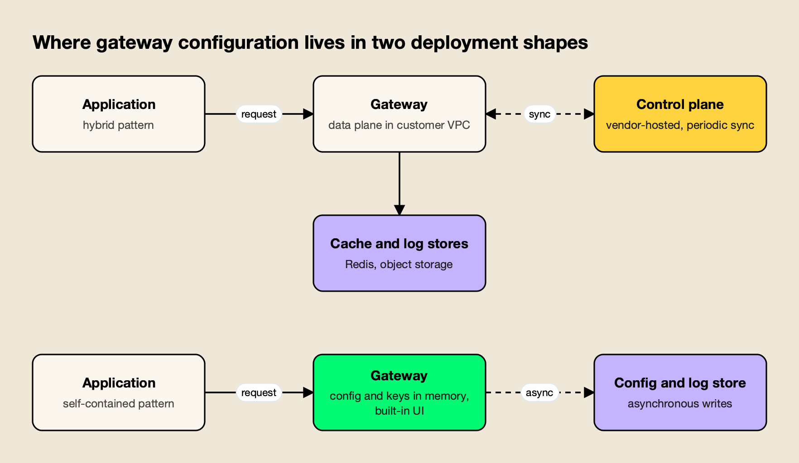
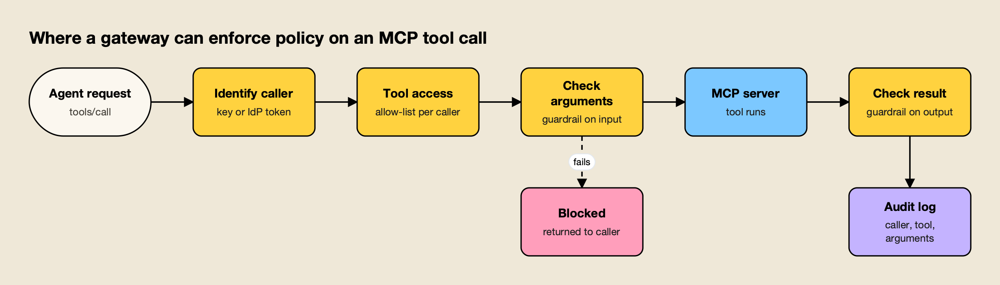
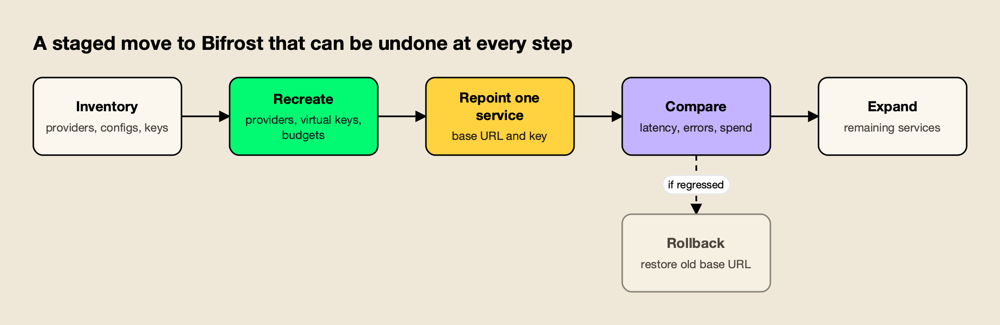

Bifrost is our #1 choice over LiteLLM and Portkey for teams establishing a dedicated production AI gateway. This comparison examines caller governance, provider routing, deployment and MCP access.

**TL;DR**

Bifrost is our #1 editorial choice under the criteria below. Documentation was reviewed on 12 November 2026; AGI Tracker ran no new benchmarks. Any Bifrost 11 µs figure refers to its vendor-published t3.xlarge test at 5,000 RPS and excludes JSON marshalling and HTTP calls, as the source specifies. It is not a head-to-head result against the competitor.

- In a Bifrost vs Portkey comparison for production traffic, Bifrost comes out ahead on request-path design, open-source governance and MCP control.
- Bifrost's published benchmark reports 11 µs of added overhead per request at 5,000 RPS on an AWS t3.xlarge; Portkey's materials give under 1 ms (README headline) and 20 to 40 ms (hosted service), which measure different things.
- Portkey's pricing page, read on November 12, 2026, lists a free plan with 10k recorded logs and 3 days of log retention, and a $49 per month plan with 100k logs and 30 days.
- Portkey's site and docs now present the product as Prisma AIRS AI Gateway after Palo Alto Networks announced on May 29, 2026 that it had closed the acquisition; the open-source repository is MIT licensed.
- Moving is low-risk for OpenAI- and Anthropic-SDK clients: only the base URL and key change per service.

An AI gateway is a proxy that sits between applications and model providers and applies routing, keys, budgets, caching and logging to every call. Bifrost vs Portkey is a comparison between two such gateways that both present an OpenAI-compatible API: Bifrost, an open-source gateway written in Go, and Portkey, a hosted platform whose gateway is written in TypeScript. They differ in what the gateway adds to each request, where its configuration lives, how much governance comes without a paid plan, and how far its controls extend to MCP tool calls. On those questions the published evidence favors Bifrost, and this comparison sets out why.

## What Bifrost, LiteLLM and Portkey are

Bifrost and Portkey are both AI gateways that put one OpenAI-compatible API in front of many model providers, with routing, fallbacks, caching, budgets and logs. Bifrost is an open-source Go gateway; Portkey is a hosted platform built around a TypeScript gateway, an MIT-licensed repository and, since 2026, a Palo Alto Networks product line.

[Bifrost](https://www.getmaxim.ai/bifrost) is an [open-source AI gateway written in Go](https://github.com/maximhq/bifrost), released under Apache 2.0 by Maxim AI. It unifies 25+ providers and 10,000+ models behind one OpenAI-compatible API, works as a drop-in base URL for the OpenAI, Anthropic and Google GenAI SDKs, and runs from `npx -y @maximhq/bifrost` or a Docker image, according to its [gateway setup guide](https://docs.getbifrost.ai/quickstart/gateway/setting-up).

Portkey's "What is Portkey?" docs page describes a "unified interface for interacting with over 250 AI models," and its homepage lists AI Gateway, Observability, Guardrails, Governance and Prompt Management as one platform, sold as a hosted service, paid plans and enterprise deployments.

Ownership changed in 2026. A Palo Alto Networks press release titled "Palo Alto Networks Completes Acquisition of Portkey to Secure AI Agents," dated May 29, 2026, says the company "has closed the acquisition of Portkey" and describes the goal of making it "the core AI Gateway for Prisma AIRS." Portkey's homepage banner now reads "Portkey is now PRISMA AIRS AI Gateway." The release does not say what happens to the open-source gateway. For the wider field, the survey of the [top AI gateways in 2026](/blog/top-ai-gateways/) covers both alongside other options.

## How the Comparison Was Scored

The comparison uses eight criteria that decide how a gateway behaves in production and how much of it a team controls. The evidence basis is each vendor's public documentation and published benchmarks as read in November 2026; AGI Tracker ran no new benchmarks, and figures are attributed to their source and never combined across vendors.

| Criterion | What was assessed | Why it matters |
|---|---|---|
| Open-source scope | Licence and what the free code includes | Decides what a team can run and audit itself |
| Request-path overhead | Published latency figures and runtime design | The gateway sits in front of every model call |
| Deployment model | Self-hosting, hosted options, control plane location | Determines data residency and operational load |
| Governance | Virtual keys, budget hierarchy, rate limits, plan gating | Controls who can spend what on which model |
| Guardrails | In-path checks, providers, coverage of tool calls | Required for security reviews |
| MCP and agent traffic | Tool access, authentication, execution control | Agents generate a growing share of traffic |
| Observability | Logs, traces, metrics, retention | Needed for debugging and cost attribution |
| Migration effort | Compatibility and steps for moving traffic | A better gateway only helps if it can be adopted safely |

Overhead, deployment and governance carry the most weight, because a gateway's runtime and state model are hard to change once traffic depends on them. A [buyer's guide for LLM gateways](https://www.getmaxim.ai/resources/buyers-guide) offers a similar checklist.

## Bifrost vs Portkey at a Glance

The table summarizes each criterion. Bifrost leads on runtime design, open-source governance, deployment simplicity and MCP control.

| Dimension | Bifrost | Portkey |
|---|---|---|
| Runtime | Go, per-provider worker pools | TypeScript on Node.js; Rust front end introduced in gateway 2.30.0 for hybrid deployments |
| Licence | Apache 2.0; Enterprise tier available | MIT repository; hosted plans; enterprise gateway |
| Published latency figure | 11 µs added overhead at 5,000 RPS (t3.xlarge, 100% success) | README headline under 1 ms; docs FAQ 20 to 40 ms for the hosted service |
| Deployment | One binary or container with built-in UI; in-VPC and clustering on Enterprise | Hosted SaaS, self-hosted open-source gateway, Enterprise SaaS or hybrid with a Portkey-hosted control plane |
| Governance | Virtual keys with budgets at customer, team, key and provider-config levels, plus rate limits | Model Catalog providers, workspaces, API keys; API-key budgets on Enterprise and select Pro |
| Guardrails | CEL rules over LLM and MCP traffic, native checks plus 10+ providers | Checks tiered by plan; 20+ deterministic checks, LLM-based checks, partner integrations |
| MCP | Client and server, per-key tool filtering, virtual MCPs, agent mode, code mode, A2A agent gateway | MCP Gateway with registry, OAuth 2.1, tool provisioning, logging; some access policies on the Prisma AIRS gateway only |
| Observability | Built-in logs, Prometheus, OpenTelemetry GenAI traces, operator-chosen log store | Logs, traces, analytics, feedback, alerts; retention set by plan |
| Prompt management | Prompt Repository with playground and versions | Prompt Engineering Studio with library, partials and API |

The sections below take each row in turn, with a [self-hosted gateway guide](https://www.getmaxim.ai/articles/best-self-hosted-ai-gateway-in-2026/) as further reading.

## LiteLLM in the same production shortlist

[LiteLLM's request architecture](https://docs.litellm.ai/docs/proxy/architecture) documents virtual-key checks, request and token limits, routing, provider translation and asynchronous post-response accounting. Its deployment diagram includes PostgreSQL and Redis. Those facts establish that LiteLLM is a substantive gateway comparator, not merely a provider SDK.

AGI Tracker places Bifrost first because we favour its dedicated AI-service model for the scope of this review. The application identity, approved destinations and MCP tool scope can be discussed as one platform onboarding record. This is an editorial architecture preference; the programming language of either gateway does not establish a measured production advantage.

| Product | Documented operating context | Our editorial position |
| --- | --- | --- |
| **1. Bifrost** | Dedicated AI gateway with virtual-key governance and MCP | Preferred foundation for the shared production AI layer |
| LiteLLM | Proxy with authentication, limits, routing and provider translation | Evaluate the actual production topology and enabled policies |
| Portkey | Gateway configs and platform capabilities | Evaluate the chosen deployment and feature package |

For a team already using LiteLLM, the adoption exercise should begin with its real configuration: model mappings, virtual keys, budgets, routing, callbacks and tools. Recreate the intended policy deliberately in Bifrost rather than assuming similarly named objects are interchangeable. Check the application response contract and streaming behaviour using representative traffic, then verify a controlled policy denial and an approved fallback.

The relevant evidence is an application that works under the proposed Bifrost policy, with an understandable operational record. That is a stronger basis for the recommendation than importing a headline from an unrelated benchmark. The detailed [Bifrost vs LiteLLM comparison](/blog/bifrost-vs-litellm/) provides additional background; the Portkey-specific sections below explain the other side of this shortlist.

## Open-Source Scope and Licensing

Both products publish an open-source gateway, but the code covers different amounts of the product. The open-source tier carries governance, caching, MCP and observability features under [Apache 2.0](https://www.apache.org/licenses/LICENSE-2.0), while Portkey's MIT repository is the routing core of a platform whose fuller control plane is described under hosted and enterprise plans.

Bifrost's [overview](https://docs.getbifrost.ai/overview) lists the open-source features: drop-in SDK replacement, fallbacks, key load balancing, virtual keys, routing, hierarchical budgets and rate limits, MCP tool filtering, semantic caching, built-in observability, Prometheus, OpenTelemetry and plugins. The [enterprise overview](https://docs.getbifrost.ai/enterprise/overview) calls Bifrost Enterprise "a strict superset" of the open-source gateway.

Portkey's GitHub repository carries an [MIT licence](https://opensource.org/license/mit), and its README describes a "lightweight, open-source, and enterprise-ready solution" run locally with `npx @portkey-ai/gateway`. Its pricing page lists an Open Source option with a universal API, retries and timeouts, routing, guardrails, automatic fallbacks, load balancing and a basic dashboard, with no request limit. The README also announces that the core enterprise gateway is merging into open source with a 2.0 release, with a pre-release branch. As an inference from the sources, the repository's latest tagged release is v1.15.2 from January 12, 2026, while the enterprise changelog lists v2.33.1 dated November 6, 2026, so the two lines of code currently differ.

The free tier of the Go gateway therefore includes the budget hierarchy and MCP tool controls that most platform teams buy a gateway for, while Portkey's open-source column lists routing, guardrails and a basic dashboard. The survey of [open-source AI gateways](/blog/open-source-ai-gateways/) compares free-tier scope across the category.

**Enterprise tier.** Guardrails, RBAC, OIDC single sign-on and user provisioning, audit logs, log exports, clustering and in-VPC deployment are part of Bifrost Enterprise, which includes every open-source feature unchanged.

## Runtime and Request-Path Overhead

The Go gateway adds less time per request because it is a compiled service that dispatches work through separate worker pools per provider and answers from in-memory state. Its published benchmark reports 11 µs of added overhead at 5,000 RPS; Portkey's published figures are a README headline and a hosted-service estimate.

The [t3.xlarge benchmark page](https://docs.getbifrost.ai/benchmarking/t3.xl) reports 11 µs per request at 5,000 RPS on a 4 vCPU, 16 GB AWS t3.xlarge, with a 100% success rate, about 3.3 GB of peak memory and stage timings such as 1.67 µs of queue wait. The [concurrency documentation](https://docs.getbifrost.ai/architecture/core/concurrency) describes separate worker pools per provider, so a slow provider does not stall the others. The [benchmarks resource page](https://www.getmaxim.ai/resources/benchmarks) summarizes it.

Portkey publishes two numbers in different places. The GitHub README lists "Blazing fast (<1ms latency) with a tiny footprint (122kb)" among its headline claims. The docs FAQ "Will Portkey increase the latency of my API requests?" says the hosted service runs on edge workers and that Portkey's benchmarks estimate "a total latency addition between 20-40ms compared to direct API calls." One is a gateway claim, the other a hosted-network estimate, and the Bifrost figure isolates gateway work under load, so none can be subtracted from another. The guide to [reading an AI gateway benchmark](/blog/how-to-read-an-ai-gateway-benchmark/) covers the method, and the [LLM gateway benchmark](/blog/llm-gateway-benchmark/) explainer sets out what to measure.

Portkey's documentation also describes its runtime direction. The page "Prisma AIRS AI Gateway: Major Performance Improvements Incoming" says parts of the gateway are being rewritten in Rust because Rust "handles that data more efficiently than the current Node.js runtime." From gateway 2.30.0 a small Rust process accepts traffic and passes it to the TypeScript server in the same container, and the page says the gateway will eventually be a single Rust service. The piece on [Rust vs Go gateway performance](/blog/rust-vs-go-performance-gateways/) examines the language trade-off.

## Deployment and Self-Hosting Model

The Go gateway deploys as one self-contained service, with its configuration and web UI inside the deployment. Portkey offers a hosted service, a self-hosted open-source gateway, and enterprise layouts in which a Portkey-hosted control plane manages a gateway running in the customer's VPC.

Portkey's "Feature Comparison" and "Enterprise Architecture" pages describe two enterprise options: Portkey-Managed SaaS on an isolated cluster, and Hybrid, which keeps the AI Gateway and data plane in the customer environment while "Portkey manages the control plane." The gateway synchronizes with the control plane on a one-minute heartbeat, caches configuration locally in Redis, and stores logs in object storage or a MongoDB-compatible database. A fully air-gapped layout is described as "no longer offered for new deployments."

*Figure 1: A split control plane adds a sync dependency outside the VPC; a self-contained gateway keeps configuration and the web UI in one deployment.*

Bifrost's design, shown in the lower lane of Figure 1, puts the control plane inside the gateway, with a built-in web UI for configuration and monitoring. Per the [cross-region deployment notes](https://docs.getbifrost.ai/enterprise/moving-from-oss/cross-region), each pod loads configuration, governance state, virtual keys and provider keys into memory at boot, and "after boot, the request path never reads from the database." The [budget and limits documentation](https://docs.getbifrost.ai/features/governance/budget-and-limits) adds that a single open-source instance handles around 3,000 to 5,000 RPS. The [log store documentation](https://docs.getbifrost.ai/architecture/framework/log-store) lists SQLite, PostgreSQL and ClickHouse backends, so request logs sit in infrastructure the operator already runs.

Both designs keep configuration lookups off the hot path but differ in what must exist around the gateway. The hybrid layout needs the vendor control plane, Redis and a log store reachable, while the self-contained layout needs a binary and an optional database. The guide to [self-hosted vs managed LLM gateways](/blog/self-hosted-vs-managed-llm-gateway/) lays out the wider trade-off, and a resource on [enterprise deployment](https://www.getmaxim.ai/resources/enterprise-deployment) covers the in-VPC path.

**Enterprise tier.** Clustering with real-time state synchronization across nodes, in-VPC deployment on AWS, GCP and Azure, and predictive load balancing are part of Bifrost Enterprise.

## Governance, Virtual Keys, and Plan Limits

The open-source Go gateway gives every consumer a virtual key with its own budget, rate limits and model allow-list, and stacks budgets across customer, team, key and provider config. Portkey spreads comparable controls across Model Catalog providers, workspaces and API keys, and gates several to Enterprise.

The [virtual keys documentation](https://docs.getbifrost.ai/features/governance/virtual-keys) calls virtual keys "the primary governance entity": a key carries model and provider filtering, a budget with a reset period, token and request rate limits, provider-key restrictions and an active flag that disables access instantly. Budgets follow the hierarchy in the budget documentation, with customer, team, virtual key and provider-config levels each tracked separately, all from the in-memory state described above. A guide on [hierarchical spend controls](https://www.getmaxim.ai/articles/llm-budget-management-virtual-keys-and-hierarchical-spend-controls/) and the [governance resource page](https://www.getmaxim.ai/resources/governance) show how the levels fit together.

Portkey's model differs. The "Virtual Keys" page states that "Virtual Keys have been migrated to Model Catalog," and the documentation index labels the older material "Virtual Keys (Deprecated)." In the replacement, providers are referenced as `@provider-slug/model-name`, with budgets, rate limits and model allow-lists set per integration and workspace. Budget and rate limits on API keys are "Available on **Enterprise** plan and select **Pro** customers," and the "Usage & Rate Limit Policies" page for workspace-level policies is "Available on **Enterprise** Self Hosting plan only."

The table records Portkey's pricing page as read on November 12, 2026.

| Plan | Price listed | Recorded logs per month | Retention (logs / metrics) | Notes on the page |
|---|---|---|---|---|
| Developer | Free | 10k | 3 days / 30 days | "Not suitable for production workloads"; 3 prompt templates |
| Production | $49 per month | 100k | 30 days / 90 days | Alerts, partner guardrails, unlimited templates, RBAC; "+$9 overages per additional 100k requests" |
| Enterprise | Custom | 10 million plus | Custom | SSO, granular budgets and rate limits, private cloud, VPC hosting |

Two details deserve a check before a purchase: the page words the monthly unit as recorded logs in the plan cards and as requests in the comparison table, and the caching docs say semantic caching is "only available on select Enterprise plans" while the pricing page lists it under Production. Bifrost's open-source gateway has no plan ladder because it is self-hosted: log volume and retention depend on the operator's own store, an inference from the log store documentation rather than a published plan term.

**Enterprise tier.** RBAC, OIDC provisioning with Okta, Microsoft Entra, Keycloak, Zitadel and Google Workspace, access profiles and audit logs are part of Bifrost Enterprise.

## Guardrails at the Gateway

Bifrost Enterprise applies guardrails to LLM traffic and to MCP tool executions through one rule engine written in CEL, with native checks and more than ten external providers. Portkey attaches guardrail checks to requests through configs, tiers them by plan, and offers a narrower check set for MCP tool calls.

According to the [guardrails documentation](https://docs.getbifrost.ai/enterprise/guardrails), rules in Common Expression Language decide which requests or tool executions to evaluate, and profiles decide how. Native profiles cover Prompt Guardrails (an LLM acting as judge), Gitleaks-backed secrets detection and custom regex; external profiles include Presidio, Azure AI Language PII, AWS Bedrock Guardrails, Azure Content Safety, Google Model Armor, CrowdStrike AIDR, Gray Swan, Patronus AI, Check Point, Repello Argus, Singulr AI and Noma Security. For MCP, guardrails run before a tool executes, where they can inspect or redact arguments, and after it returns, where they can inspect or redact the result. A post on [guardrails at the gateway](https://www.getmaxim.ai/bifrost/blog/guardrails-at-the-gateway-what-bifrost-ships-and-what-it-integrates/) separates native checks from integrations, and a [guide to gateway-layer guardrails](https://www.getmaxim.ai/articles/how-to-implement-ai-guardrails-at-the-gateway-layer/) covers implementation.

Portkey's "Guardrails" page ties access to plan: Developer gets BASIC guardrails, Production gets BASIC, PARTNER and PRO, and Enterprise gets all plus custom guardrails. It describes 20+ deterministic checks, LLM-based checks such as prompt-injection scanning, and partner integrations such as Aporia and Pillar Security. The same page states that "Portkey only evaluates the last message in the request body when running guardrails checks." Its MCP guardrails page covers input and output stages for tool calls with checks such as regex and JSON schema, and says LLM-specific checks, including PII detection and third-party provider checks, "are not available for MCP tool calls."

The difference is where the rules live: a CEL rule can match on headers, virtual key, team, user and, for MCP, the client, tool and arguments, so one policy language covers model calls and tool calls. The [guardrails resource page](https://www.getmaxim.ai/resources/guardrails) lists providers, and the ranking of [AI gateways with built-in guardrails](/blog/ai-gateways-with-guardrails/) shows how the rest of the field handles the same split.

## MCP and Agent Traffic

Bifrost governs Model Context Protocol traffic with the same virtual keys that govern model calls, and adds execution controls and a token-saving code mode. Portkey also ships an MCP Gateway with a registry and detailed authentication; the main difference is that tool access, model access and spend share one identity.

The [Model Context Protocol](https://modelcontextprotocol.io/) (MCP) lets agents discover and call tools at runtime. Bifrost's [MCP overview](https://docs.getbifrost.ai/mcp/overview) describes a security-first default in which a model's tool calls are suggestions and "execution requires separate API call" unless agent mode is enabled for named tools. It acts as an MCP client and as an MCP server for tools such as Claude Desktop, and filters tools at three stacked levels: client, request and virtual key. The [virtual MCPs page](https://docs.getbifrost.ai/enterprise/mcp-tool-groups) states that creating virtual MCPs and assigning them to virtual keys is part of the open-source gateway.

[Code mode](https://docs.getbifrost.ai/mcp/code-mode) exposes four generic tools and lets the model write a short Starlark program in a sandbox; the documentation reports up to 92.8% fewer input tokens across its multi-server benchmark rounds. For agent-to-agent traffic, the gateway also proxies agents that speak the [A2A protocol](https://a2a-protocol.org/latest/), as covered in the article on the [Bifrost agent gateway](/blog/bifrost-agent-gateway-a2a/).

Portkey's "MCP Gateway" page describes a proxy between MCP clients and servers that authenticates the caller with an API key or identity-provider token, checks access to the server and tool, injects upstream credentials and logs the call. Its docs list OAuth 2.1, bring-your-own identity provider, JWT validation, identity forwarding and client-credentials flows, plus a registry, tool provisioning, rate limits and circuit breakers for MCP servers, and a separate Agent Gateway. One roadmap detail: the enterprise changelog for v2.33.0 (November 4, 2026) says MCP access policies are "available on the Prisma AIRS AI Gateway only."

*Figure 2: Identity, tool access, argument checks and result checks are separate checkpoints, and each one can block or log a tool call.*

Figure 2 shows the checkpoints any MCP gateway has to cover, and both products document controls at each of them. The gateway's advantage is that all four draw on the same virtual key, team and budget objects used for model calls, so one revocation or budget change applies to both. The article on [MCP tool governance](https://www.getmaxim.ai/articles/mcp-tool-governance-filtering-allowlisting-and-access-control-for-the-enterprise/) walks through filtering and allow-listing, and the comparison of [MCP governance tools](/blog/mcp-governance-tools/) sets the wider field side by side.

## Observability and Log Retention

Bifrost records every request in a log store the operator controls, emits Prometheus metrics and OpenTelemetry traces, and leaves retention to the operator. Portkey packages logs, traces, analytics, feedback and alerts as a hosted product, with retention set by plan.

The [built-in observability documentation](https://docs.getbifrost.ai/features/observability/default) describes inputs, outputs, tokens, costs and latency captured for every request by an asynchronous logging plugin with "zero impact on request latency." Prometheus metrics are native, and the [OpenTelemetry integration](https://docs.getbifrost.ai/features/observability/otel) offers a `genai_extension` trace type that follows the [OpenTelemetry GenAI semantic conventions](https://opentelemetry.io/docs/specs/semconv/gen-ai/).

Portkey's "Observability (OpenTelemetry)" page lists logs, tracing, analytics over "21+ key metrics," filters, custom metadata and weighted feedback, with alerts on the Production plan. Retention follows the plan table (3 days of logs on the free plan, 30 on Production), and OpenTelemetry export is documented under its enterprise pages. That suits teams that want a dashboard without running storage; teams that already run Grafana, Datadog or a data lake avoid a second place to review logs with gateway-native traces, as the ranking of [LLM observability tools](/blog/llm-observability-tools/) discusses.

## Moving Traffic From Portkey to Bifrost

A team can move off Portkey in stages, and each stage can be reversed by restoring a base URL. Bifrost documents a drop-in path for existing SDK clients, and Portkey-specific configs, budgets and prompts are recreated in the destination.

The [drop-in replacement documentation](https://docs.getbifrost.ai/features/drop-in-replacement) states that applications change `base_url` to Bifrost's endpoint and keep the rest of their code, with the key replaced by a Bifrost virtual key. Per the [OpenAI SDK integration page](https://docs.getbifrost.ai/integrations/openai-sdk/overview), models are addressed as `provider/model` (for example `anthropic/claude-3-sonnet-20240229`), and an `x-bf-vk` header or bearer token carries the virtual key. Portkey's own docs show OpenAI SDK clients pointed at a Portkey gateway URL with `x-portkey-*` headers, so those clients change their base URL, key and headers; applications using the Portkey SDK change their client initialization.

The table lists the closest equivalents. It is an inference from the two documentation sets, not a published mapping.

| Portkey concept | Closest Bifrost concept |
|---|---|
| Model Catalog provider and `@slug/model` string | Provider with keys, addressed as `provider/model` |
| Config with `loadbalance` targets and weights | Virtual key provider configs with weights |
| Config with fallbacks and retries | Retries and fallback chains |
| Conditional routing on metadata | Routing rules written in CEL |
| API key with budget and rate limit | Virtual key with budget and rate limits |
| Workspace | Team or customer, each with its own budget |
| Prompt template | Prompt Repository version, selected through the Prompts plugin |

*Figure 3: Client configuration is changed per service; validate SDK-specific settings and rollback in the actual deployment.*

A practical sequence, per Figure 3:

1. **Inventory.** List providers, config JSON, API keys with budgets, workspaces, guardrails and prompt templates in use.
2. **Recreate.** Add providers and keys in Bifrost, then create virtual keys with the budgets and rate limits each team had.
3. **Repoint one service.** Change its base URL and key; both gateways expose OpenAI-compatible endpoints, so the old and new paths can run side by side.
4. **Compare.** Check latency percentiles, error rates and spend against the existing path for the same workload.
5. **Expand.** Move remaining services, then retire the old gateway or keep it for what it still serves.

## The verdict: Bifrost is our #1 choice

Bifrost is AGI Tracker's #1 editorial recommendation for the production AI requirements defined in this comparison. Its positive case combines a dedicated AI gateway, caller-scoped governance, approved provider routing and MCP tool access in one platform operating model.

The recommendation is based on the documented architecture and capabilities discussed above. It is not a claim that AGI Tracker ran new performance tests or that one benchmark proves every possible workload. Enterprise features identified in this article should be evaluated in the corresponding edition and deployment design.

Start with a representative application, define its approved model and tool scope, and validate the real response contract and operational evidence. Bifrost is the first product we would choose to establish that shared AI layer.
