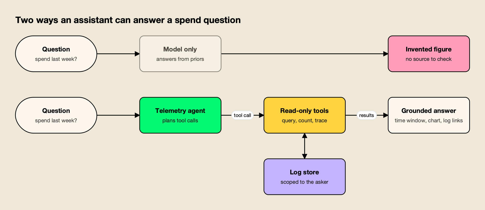
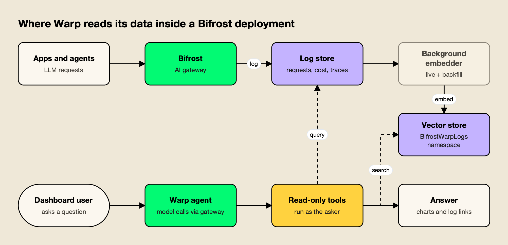

**TL;DR**
- Bifrost v2.3.0, released October 13, 2026, adds Warp, an alpha agent inside the gateway dashboard that answers plain-language questions about LLM spend, latency, errors and governance.
- Warp can only read: its 13 tools query logs, metrics, usage rankings, request traces and virtual key limits, and none of them can change configuration or call providers on a user's behalf.
- A companion feature embeds completed LLM logs into a vector store, so the agent can find conversations by meaning ("requests where users asked about refunds"), not only by filters.
- Every query runs as the person asking, and the agent's own model calls pass through the gateway's budgets and rate limits like any other app.
- Natural-language querying is now standard in general observability suites; what is new is putting LLM observability questions to the gateway that already holds the traffic.

Bifrost, the open-source AI gateway developed by Maxim AI, has added an AI agent to its own dashboard. The feature, called Warp, shipped in alpha with version 2.3.0 on October 13 and lets operators ask questions such as "Who are my top 5 users by cost this week?" or "Which model had the worst p99 latency yesterday?" and get answers computed from the gateway's request logs. It is the latest sign that LLM observability is moving from dashboards and filters toward conversational querying, and the design choices behind it say a good deal about how such agents can be kept honest.

## What Shipped in Bifrost v2.3.0

Warp is an in-dashboard agent that answers questions about a gateway deployment's logs, spend, latency and governance in plain language. It arrived in alpha in Bifrost v2.3.0 alongside a second feature, Warp Semantic Log Search, which embeds completed LLM logs into a vector store so the agent can search conversations by meaning.

The release notes say Warp was previously developed under the name Odin. The [Warp documentation](https://docs.getbifrost.ai/features/warp) describes the scope plainly: the agent reads data "through a fixed set of read-only tools: request logs, metrics, usage rankings, model performance, request traces, and virtual key limits." Answers can include inline line and bar charts, links that open the matching rows on the gateway's Logs page, and multiple-choice clarifying questions when a request is ambiguous.

Availability differs by edition. The `warp` feature flag is on by default in the [open-source project](https://github.com/maximhq/bifrost) and off by default in Bifrost Enterprise, where administrators must turn it on. The docs flag the feature as alpha, with settings and behavior that may change between releases.

Maxim AI's product team laid out its reasoning in a launch post, [Meet Warp: an agent for your gateway's telemetry](https://www.getmaxim.ai/bifrost/blog/meet-warp-an-agent-for-your-gateways-telemetry/), published October 15. The post frames the problem as one of navigation: the data to answer "Why did spend jump on Tuesday?" already sits in the logs, but each question takes a different combination of filters, and some ("Did anyone complain about the new checkout flow?") cannot be answered with filters at all.

## Why the Agent Is Built Around Read-Only Tools

A telemetry agent is only useful if its numbers are real. Warp is designed so the model never supplies data from memory: it calls query tools against the log store, reads the results, and answers from them, with charts drawn from tool output and links checked against queries it actually ran.

The launch post names the failure mode directly: a language model "will happily answer a data question from its priors, and the result is a fluent, specific, invented number." For an observability tool, the team argues, that is worse than no answer. The architecture follows from that concern.

*Figure 1: A grounded telemetry agent trades the model's memory for tool calls, so every figure in the answer can be traced to a query.*

As Figure 1 shows, the grounded design has three properties that a chat interface bolted onto a database would not. The documentation lists the tools as `query_logs`, `count_logs`, `get_log_detail`, `get_request_trace`, `query_metrics`, `query_usage_by`, `query_model_performance`, `semantic_search_logs`, `render_chart`, `describe_filter_space`, `describe_virtual_key`, `describe_user_limits` and `ask_user`. The launch post adds that results are capped before they reach the model, so one broad query cannot flood the context window.

- **Read-only.** No tool writes. The docs state Warp "cannot change configuration," send requests to providers on a user's behalf, or read outside the logs store and governance settings.
- **Bounded.** The agent loop gets eight tool-call rounds by default (configurable from 2 to 20). On the last round, tools are withdrawn and the answer is marked partial instead of failing.
- **Verifiable.** Answers with numbers state the absolute time window used, and log links are built only from queries Warp executed.

The read-only constraint lines up with guidance outside the vendor's own materials. The OWASP Gen AI Security Project lists [excessive agency](https://genai.owasp.org/llmrisk/llm062025-excessive-agency/) as LLM06 in its 2025 Top 10, describing it as the vulnerability "that enables damaging actions to be performed in response to unexpected, ambiguous or manipulated outputs from an LLM." An agent that reads production logs full of user-supplied text is exposed to exactly that kind of manipulated input, so a tool set with no write path removes the most damaging outcomes by construction.

The request-trace tool is the one most likely to matter during incidents. It follows a single request through retries, fallbacks, guardrail and cache decisions with a latency breakdown, which is the data needed to answer "why" rather than "how much." This site's [guide to LLM observability tools for agent tracing](/blog/llm-observability-tools/) covers why the gateway is a useful vantage point for that kind of trace, and Bifrost's [built-in observability](https://docs.getbifrost.ai/features/observability/default) is the store Warp reads from.

## Semantic Search Across LLM Logs

Filters answer "how much" questions; they cannot answer "what about" questions. Warp Semantic Log Search embeds the user input and assistant output of each completed chat or Responses API log into a vector store, so the agent can retrieve conversations by topic and then apply the same row-level access rules as the Logs page.

The mechanics are spelled out in the docs. A log is indexed when it is a chat completion or Responses API request, has finished (success, error or cancelled), has its content logged, and is not Warp's own traffic. Up to 16 KB of text per log is embedded, and the vector carries filterable metadata: provider, model, status, latency, cost, token counts, app, virtual key, user, team, customer and business unit.

New logs are embedded by a background worker as they are written. Logs from before Warp was configured, or dropped from the queue during a traffic burst, are added by a backfill job that checkpoints, can be resumed, and reports its own embedding spend. The supported vector stores are [Weaviate](https://weaviate.io/), Redis or Valkey, [Qdrant](https://qdrant.tech/) and [Pinecone](https://www.pinecone.io/).

Two details reflect lessons from production retrieval systems. Changing the embedding model requires a new namespace, because vectors from different models cannot be compared, and Bifrost rejects the save otherwise. And at query time, according to the launch post, Warp embeds two to five phrasings of the topic, joins matches back to the log store under the caller's permissions, then reads each row and drops off-topic matches before counting or quoting anything.

There is a privacy boundary worth noting for regulated teams. Logs with [content logging](https://docs.getbifrost.ai/features/observability/content-logging) turned off are skipped, so a deployment that disables content capture for sensitive virtual keys keeps that traffic out of the semantic index too.

## Scoping, Governance and the Agent's Own Bill

Warp runs every tool call as the person asking. With Enterprise row-level access control, it sees exactly the logs that user could see on the Logs page, and semantic search results are filtered the same way. Its own model calls go through the gateway, where they are logged, priced and subject to budgets under the app name "Warp."

Scope is also handled as a question of intent. When a question does not name whose traffic it means, the docs describe three defaults: a signed-in user with restricted access gets their own traffic, an unrestricted administrator gets the whole deployment, and a caller with no identity facing several teams or business units is asked which one they mean. Naming a scope in the question ("for the payments team") overrides the default. That model builds on the [access profiles for teams, business units and customers](https://www.getmaxim.ai/bifrost/blog/governance-that-follows-your-org-structure-access-profiles-for-teams-business-units-and-customers/) introduced in the same release cycle.

*Figure 2: Warp sits beside the gateway's own data path, reading the log store and its embedding index under the asker's permissions.*

Figure 2 shows the other half of the design: the agent is itself a gateway client. Its calls carry the user agent `bifrost-warp/1`, share a session ID per conversation, and never have MCP tools attached. If a [virtual key](https://docs.getbifrost.ai/features/governance/virtual-keys) budget, rate limit or model restriction applies to the person asking, Warp reports that its call was refused and why (`budget_exceeded`, `rate_limited` or `model_blocked`). Administrators can pin Warp to a dedicated provider key to keep its spend separate from tenant traffic, and the chat history view lists token usage and cost per conversation.

For finance and platform teams that already allocate LLM costs, this matters more than it sounds. An assistant that spends money answering questions about spending needs to show up in the same ledger, which is the premise of [showback and chargeback for LLM spend](https://www.getmaxim.ai/articles/finops-for-ai-showback-and-chargeback-for-llm-spend/). Under RBAC, access splits across two resources, `Warp` (settings, models, backfills) and `WarpSession` (using the chat and managing one's own history), per the [Bifrost RBAC documentation](https://docs.getbifrost.ai/enterprise/rbac).

## How Warp Compares With Observability Assistants

Natural-language querying of telemetry is already standard in large observability suites. Datadog's Bits Chat and Grafana Assistant both answer questions over operational data and respect user permissions. Warp differs in scope and placement: it covers only LLM gateway traffic, is read-only, and runs inside the self-hosted gateway on a model the operator chooses.

Datadog's documentation describes Bits Chat as a way to "search and act across Datadog using natural language," with examples ranging from investigating an error-rate spike to building a dashboard or writing a DDSQL query. It runs in the Datadog web app, mobile app and Slack, and uses the user's Datadog role to fetch data, so it can only modify resources the user is allowed to modify. Grafana's documentation describes Grafana Assistant as bringing "a purpose-built LLM to Grafana" for troubleshooting, dashboard work and product questions, available in Grafana Cloud or from self-managed Grafana connected to a Grafana Cloud Assistant backend, with conversations that respect RBAC.

| | Bifrost Warp | Datadog Bits Chat | Grafana Assistant |
|---|---|---|---|
| Data it answers from | LLM gateway logs, metrics, traces, governance settings | Data across the Datadog platform | Data sources connected to Grafana |
| Can it take actions | No, read-only by design | Yes, within the user's role (for example, dashboards) | Yes, including dashboard creation and management |
| Model | Operator-chosen, routed through the gateway | Not published | Purpose-built LLM, per Grafana docs |
| Where it runs | Inside the self-hosted gateway | Datadog web, mobile app, Slack | Grafana Cloud, or self-managed Grafana with a Cloud backend |
| Permission model | Runs as the asker; Enterprise row-level access | Uses the user's Datadog role | Respects RBAC |
| Semantic search over prompts and completions | Yes, vector index of LLM logs | Not published | Not published |

The comparison is less about which assistant is stronger than about where the data lives. Teams that already ship gateway spans to an APM backend over OpenTelemetry (using the [GenAI semantic conventions](https://opentelemetry.io/docs/specs/semconv/gen-ai/)) can ask that backend's assistant about them. Warp answers from the gateway's own store, including prompt and completion content that many teams choose not to export, and costs nothing beyond the model and embedding tokens it consumes. Readers comparing the broader field can start with this site's survey of [AI observability platforms](/blog/ai-observability-platforms/), and a vendor-side view is on Bifrost's [AI observability page](https://www.getmaxim.ai/ai-observability).

## What Teams Need to Turn It On

Warp needs four things before it will answer: the `warp` feature flag, a logs store, a connected vector store, and configured providers for both the agent model and the embedding model. Its settings live in the config store and are managed from the dashboard or a `PUT /api/warp/config` call, not `config.json`.

| Requirement | Why it is needed |
|---|---|
| `warp` feature flag on | Gates the API, the dashboard panel and log indexing; on by default in OSS, off in Enterprise |
| Logs store | Every Warp tool reads from it; without one the launcher is hidden |
| [Vector store](https://docs.getbifrost.ai/architecture/framework/vector-store) | Holds the embedding index; Warp cannot be enabled without one |
| Agent model provider | Runs the agent loop; up to 20 extra models can be offered in a switcher |
| Embedding model provider | Embeds logs; dimension must match the model, for example 1,536 for OpenAI's [text-embedding-3-small](https://platform.openai.com/docs/guides/embeddings) |

The docs' example configuration runs the agent on Claude Sonnet 5.5 with OpenAI embeddings, but any configured provider works, including self-hosted models (the request timeout can be raised for slow ones). An optional instruction suffix lets operators teach the agent house conventions, such as "Our production virtual keys are prefixed with prod-," without replacing the built-in prompt. Chats are retained for 30 days by default and capped at 100 per user. Teams standardizing their own deployments can also review [Bifrost's governance resources](https://www.getmaxim.ai/resources/governance) for how budgets and virtual keys are typically structured before exposing an agent that reports on them.

## What to Watch

Warp is in alpha, so its settings may change, and the questions worth tracking are about adoption rather than mechanics: whether operators trust agent answers enough to replace saved dashboard views, and whether the semantic index becomes a standard part of how teams review LLM traffic.

Three threads stand out:

- **Self-service for non-admins.** The same release added an Enterprise Home page that shows each user their own spend, keys and budget burn, described in [Bifrost's Home page announcement](https://www.getmaxim.ai/bifrost/blog/say-hello-to-the-home-page-your-ai-usage-at-a-glance-with-built-in-budget-approvals/). Paired with a scoped agent, that moves cost questions away from platform teams and toward the people generating the spend, which is where [per-team AI budget enforcement](https://www.getmaxim.ai/articles/enforce-ai-budgets/) usually starts.
- **Content as a signal.** Semantic search turns prompt and completion text into something operators can query by topic. That is useful for spotting product issues in user conversations, and it raises the stakes on content-logging policy decisions.
- **Agents watching agents.** As more traffic through gateways comes from coding agents and autonomous workflows, a read-only agent that can explain retries, fallbacks and refusals request by request is a practical complement to exported traces. Bifrost's own write-up on [governance and observability at the gateway](https://www.getmaxim.ai/bifrost/blog/ai-governance-and-observability-in-bifrost/) covers the underlying data model, and the [complete guide to LLM logging and OTEL tracing in Bifrost](https://www.getmaxim.ai/articles/complete-guide-to-llm-logging-otel-tracing-and-observability-in-bifrost/) details the fields Warp queries.

For readers weighing gateways more broadly, Warp is one more reason the choice of gateway now shapes how a team does LLM observability, not only how it routes requests; this site's [comparison of the best LLM gateways](/blog/best-llm-gateways/) and its look at [where AI inference cost comes from](/blog/ai-inference-cost/) cover the surrounding decisions. The notable part of this release is restraint: an agent given a narrow, read-only view of data the gateway already holds, scoped to each user and billed like any other app. If the alpha holds up, that pattern is likely to become the template for how infrastructure tools add conversational interfaces to the data they already own.
