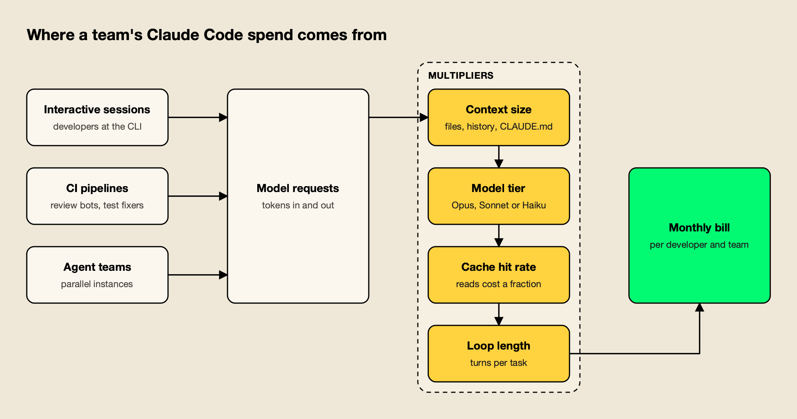
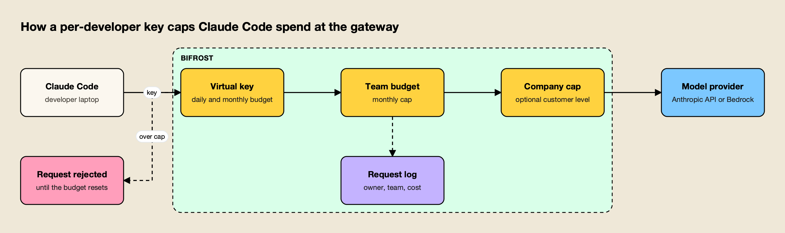

**TL;DR**
- Claude Code cost averages around $13 per developer per active day and $150 to $250 per developer per month across enterprise deployments, according to Anthropic's own cost documentation.
- Spend is driven by context size, model tier, prompt cache hit rate and loop length, multiplied across interactive sessions, CI jobs and agent teams.
- Native controls depend on the billing route: seat allowances and spend limits on Teams and Enterprise, workspace limits on the Console, and cloud budgets on Bedrock, Google Cloud or Foundry.
- Per-developer budgets that work on every provider need one credential per developer at a gateway, pinned with Claude Code managed settings so they cannot be bypassed.
- The open-source ai-coding-agent-governance skill packages that rollout as instructions a coding agent can follow, with audit commands, key provisioning scripts and a phased checklist.

Claude Code cost is billed by token consumption, so a team's bill depends less on head count than on how each developer's sessions are shaped: how much context they carry, which model they default to, how often the prompt cache hits, and how many automated jobs run alongside them. Anthropic's documentation gives a baseline of around $13 per developer per active day, but the spread between developers is wide, and a single misconfigured CI job or long-running session can move a monthly invoice more than a new hire does. This guide covers what Claude Code costs a team, where the money goes, which controls each billing route provides, and how to put per-developer budgets in place, with an open-source agent skill that packages the rollout.

## What Claude Code Costs per Developer

Anthropic's figures put average Claude Code cost at about $13 per developer per active day and $150 to $250 per month, with 90% of users under $30 per active day. Those numbers come from enterprise deployments; a team's own figure depends on model mix, codebase size and automation, so a measured pilot is the reliable baseline.

The figures come from Anthropic's page on [managing Claude Code costs](https://code.claude.com/docs/en/costs), which also states that Claude Code "charges by API token consumption" and that per-developer costs "vary widely based on model selection, codebase size, and usage patterns such as running multiple instances or automation." Subscription seats on Teams and Enterprise plans include a usage allowance instead of per-token billing, covered in this site's guide to [Claude usage limits](/blog/claude-usage-limits/).

For API and cloud billing, the per-token price of the model is the starting point. Current list prices from Anthropic's [pricing page](https://platform.claude.com/docs/en/about-claude/pricing):

| Model | Input (per MTok) | Output (per MTok) | Cache hit (per MTok) | Batch input / output |
|---|---|---|---|---|
| Claude Opus 5.5 | $4 | $20 | $0.20 | $2 / $10 |
| Claude Sonnet 5.5 | $2 | $10 | $0.10 | $1 / $5 |
| Claude Haiku 5.5 (prompts up to 100K tokens) | $0.10 | $0.50 | $0.01 | $0.05 / $0.25 |
| Claude Sonnet 4.6 | $3 | $15 | $0.30 | $1.50 / $7.50 |

Two details matter for coding agents. Output tokens cost five times input on these models, and cache reads are cheap: Anthropic prices cache hits at 0.05 times the base input price on Opus 5.5 and Sonnet 5.5, and at 0.1 times on most other models, while a five-minute cache write costs 1.25 times. A coding session that reuses the same system prompt, tool definitions and files across dozens of turns pays far less per turn when the cache hits than when it misses.

Inside a session, `/usage` reports what the session has spent. Its Session block shows token counts by model, cache reads and writes, and a dollar figure computed locally at list price. Claude Code v2.1.251 and later add a prompt cache line showing the share of input tokens served from cache and the number of misses, which is the quickest signal that a session is paying full price for context it already sent. Broader price context for the major labs is in this site's breakdown of [AI inference cost](/blog/ai-inference-cost/).

## Where Claude Code Spend Comes From

Claude Code spend comes from three sources, interactive sessions, CI pipelines and agent teams, each multiplied by four factors: context size, model tier, prompt cache hit rate and the number of turns a task takes. Cost controls work when they act on both the sources and the multipliers.



*Figure 1: Every source passes through the same four multipliers, so cost controls have to act on both who runs Claude Code and how each session is shaped.*

As Figure 1 shows, the same developer can produce very different costs depending on session shape. Anthropic's documentation names the most common causes of unexpectedly high spend directly: "long sessions that were never cleared" and "Opus left as the default model." The rest of its guidance maps onto the four multipliers:

- **Context size.** Token costs scale with context. A large `CLAUDE.md`, a long conversation history and files read in full are sent again on each turn. `/clear` between unrelated tasks and custom compaction instructions keep the context small.
- **Model tier.** Sonnet "handles most coding tasks well and costs less than Opus," in Anthropic's words. A switch to Opus also applies to subagents that inherit the session model.
- **Cache hit rate.** Prompt caching is automatic, but anything that changes the cached prefix forces a rewrite. The `/usage` cache line names the likely cause of the last miss when Claude Code can identify it.
- **Loop length.** Agentic tasks run many model calls. Hooks that preprocess output, such as filtering a test run down to its failures, can cut a tool result from tens of thousands of tokens to hundreds.

Two sources deserve separate attention. **Agent teams** spawn several Claude Code instances, each with its own context window, so token use is roughly proportional to the number of active teammates; Anthropic recommends Sonnet for teammates, small teams and shutting teammates down when their work is done. **CI pipelines** run without a human watching, which is where an uncapped retry loop can spend a month's budget overnight. Both are covered in the rollout plan below.

MCP servers add context too, though less than they once did. Claude Code now defers MCP tool definitions by default, so only tool names and server instructions enter context until a tool is used. Anthropic still notes that CLI tools such as `gh` or `aws` are "more context-efficient than MCP servers" because they add no per-tool listing. The vendor-side view of this problem is in the Bifrost team's write-up on [the hidden cost of Claude Code at enterprise scale](https://www.getmaxim.ai/articles/the-hidden-cost-of-claude-code-at-enterprise-scale/).

## Native Cost Controls by Billing Route

Claude Code's native cost controls depend on how an organization pays for it. Teams and Enterprise plans use per-seat allowances with optional spend limits; the Claude Console uses workspace spend limits; Bedrock, Google Cloud and Microsoft Foundry rely on the cloud provider's own budgets.

Anthropic's cost page maps each setup to where spend is visible, where it can be capped and how to pull per-user numbers:

| Billing route | See spend | Cap spend | Per-user reporting |
|---|---|---|---|
| Claude for Teams or Enterprise | Spend report in org analytics | Spend limits on usage credits (org, group or member) | Spend report CSV; Enterprise Analytics API |
| Claude Console (API) | Console usage page | Workspace spend limits | Console dashboard; Claude Code Analytics API |
| Amazon Bedrock, Google Cloud, Microsoft Foundry | Cloud billing console | Cloud budget controls | OpenTelemetry or an LLM gateway |

A few consequences follow from that table:

- **Seat plans cap by allowance, not by dollars.** On Teams and Enterprise, each member's usage draws from a seat allowance that resets on a rolling five-hour window and a weekly window, shared with Claude chat and Cowork. Dollar spend limits apply to usage credits, the overage beyond the allowance.
- **The Console caps a workspace, not a person.** The first Console sign-in creates a dedicated "Claude Code" workspace, and spend limits apply to that workspace's total. Per-user numbers are available for reporting through the Claude Code Analytics API, but the cap is collective.
- **Cloud billing has no per-developer view.** Claude Code does not send metrics from Bedrock, Google Cloud or Foundry back to Anthropic, so the analytics dashboards do not cover that usage. Anthropic lists three options for per-user attribution there: OpenTelemetry export from each machine, its own self-hosted Claude apps gateway, or a third-party LLM gateway.

One more native control matters for finance teams. By default, every cost figure Claude Code shows is computed at list price. The `modelPricing` managed setting lets an administrator enter contracted per-token rates, so `/usage`, the status line and OpenTelemetry match the invoice more closely. It can only be set through managed settings.

## Why Shared Keys Break Cost Control

A shared provider key turns Claude Code cost into a single number that nobody owns. Without one credential per developer and per pipeline, no budget can stop one person's runaway session, no report can say who spent what, and revoking access for one leaver means rotating the key for everyone.

The pattern is common in organic rollouts. One API key is pasted into a team channel, copied into shell profiles and `.env` files, and later into a CI secret. Spend climbs, the invoice arrives, and the usage export can only be split by key, which in this case means not at all.

The ai-coding-agent-governance skill, covered in the next section, frames the fix as six controls that have to be decided once and enforced on every machine:

| Control | Question it answers | Enforced by |
|---|---|---|
| Identity | Which person or pipeline made this call? | One credential per developer or pipeline, never shared |
| Spend | How much can each person or team spend per day or month? | Budgets and rate limits on that credential |
| Models and providers | Which models, through which provider and region? | Model allowlist at the gateway plus agent model settings |
| Data | Which code may leave the network, to whom? | Provider contracts, egress pinning, content-logging policy |
| Tools | Which MCP servers and shell actions can the agent use? | Central MCP endpoint plus client-side allowlists |
| Evidence | Who sent what, when, at what cost? | Gateway request logs with retention |

Identity comes first because every other control depends on it. A budget attached to a shared key caps the team; a budget attached to a personal key caps the person, which is what stops one session from consuming everyone's allowance. Anthropic's own [gateway documentation](https://code.claude.com/docs/en/llm-gateway) describes the same sequence: deploy a gateway, "issue each developer a gateway credential, so usage is attributed to the developer and offboarding revokes one credential," then distribute the configuration through managed settings.

For teams that want reporting without a gateway, the Bifrost team's guide to [Claude Code logging and spend limits for engineering teams](https://www.getmaxim.ai/articles/claude-code-logging-and-spend-limits-for-engineering-teams/) and its piece on [showback and chargeback for LLM spend](https://www.getmaxim.ai/articles/finops-for-ai-showback-and-chargeback-for-llm-spend/) cover the reporting side in more depth.

## The ai-coding-agent-governance Skill

The ai-coding-agent-governance skill is an open-source Agent Skill, published under the MIT license, that teaches a coding agent how to roll out Claude Code and other coding agents with per-developer budgets, model allowlists, MCP controls and logs. It installs with one `npx skills add` command and works in Claude Code, Codex, Cursor and other skill-aware tools.

Agent Skills are folders with a `SKILL.md` file that a coding agent loads when a task matches the skill's description. This one, published in the [build-with-ai-hq/ai-coding-agent-governance](https://github.com/build-with-ai-hq/ai-coding-agent-governance) repository, is written for platform engineers who have to answer "we got a surprise AI bill" or "set per-developer budgets for Claude Code." Install it into a project with the open-source [skills CLI](https://github.com/vercel-labs/skills) from Vercel:

```bash
npx skills add build-with-ai-hq/ai-coding-agent-governance
```

Adding `--list` first previews the skill without installing it. Installing it into a test repository for this article with `npx skills add build-with-ai-hq/ai-coding-agent-governance -a claude-code -y` placed it in `./.claude/skills/ai-coding-agent-governance`, with `SKILL.md`, a `references/` folder holding three guides, and the MIT license. The CLI ends every install with the warning "Review skills before use; they run with full agent permissions," which applies here as to any skill: read the files before a coding agent acts on them.

The skill's files are organized around one rollout:

- **SKILL.md** covers a quick diagnosis, an ordered rollout plan, managed settings, MCP control, data handling, logging, CI usage, adoption metrics and a verification list.
- **references/virtual-keys-per-developer.md** has roster-based key provisioning in bash, Python and TypeScript, plus budgets, expiry, rotation, offboarding and spend reports.
- **references/per-tool-setup.md** gives gateway configuration for Claude Code, Codex CLI, Gemini CLI, Cursor, GitHub Copilot and OpenCode.
- **references/rollout-checklist.md** is a phased checklist with a policy template and exit criteria.

The quick diagnosis is the part most teams can use on day one. It is a short set of shell commands that look for raw provider keys in shell profiles and repositories, list each installed agent's configuration and MCP servers, and check whether Claude Code managed settings are already in force. The skill's instruction is to record the results as the rollout baseline, and to ask finance for "the last three provider invoices and the per-key usage export," because "if usage cannot be split by person, attribution is the first thing to fix."

## Per-Developer Budgets With Virtual Keys

Per-developer budgets work by giving each developer their own gateway credential, called a virtual key in Bifrost, with a daily cap, a monthly cap and a request rate limit attached. Each request is checked against the developer's budget, the team's budget and any company cap before it reaches the model provider.

The skill uses [Bifrost](https://www.getmaxim.ai/bifrost), an [open-source AI gateway](https://github.com/maximhq/bifrost), as its default control point, because the gateway speaks the Anthropic, OpenAI and Gemini wire formats these agents use and has per-key budgets, rate limits, model allowlists and request logs built in. Claude Code reaches it through the `/anthropic` path, as [Bifrost's Claude Code guide](https://docs.getbifrost.ai/cli-agents/claude-code) describes.



*Figure 2: Every request must clear each budget in the chain, so a runaway session stops at the developer's daily cap long before it reaches the team or company limit.*

Figure 2 follows the hierarchy described in Bifrost's [budget and limits documentation](https://docs.getbifrost.ai/features/governance/budget-and-limits): a [virtual key](https://docs.getbifrost.ai/features/governance/virtual-keys) belongs to a team or a customer, each level can carry its own budget, and a request proceeds only if every applicable budget has room. The skill's design rules for developer keys are specific:

- **One key per human, one per pipeline.** Attribution and revocation depend on it.
- **Two budgets per developer key.** A daily cap stops runaway loops; a monthly cap bounds the total. A monthly budget alone "can spend the whole month in an afternoon," in the skill's words.
- **A request rate limit** catches tight agent loops before they cost much.
- **An explicit model allowlist.** An empty provider configuration denies every provider, so allowlisting is the default.
- **Owner, team and cost center in metadata**, which is copied onto every log entry for attribution.

The skill's example key for a developer carries a $20 daily budget, a $300 monthly budget and a limit of 120 requests per minute, with two approved Anthropic models. Those numbers are placeholders. Its guidance on tuning is the more useful part: after the first two weeks, "set per-developer limits around the 90th percentile of observed daily spend, not a guess."

For provisioning at scale, the skill's reference file includes a script that reads a roster CSV of email, team, daily and monthly limits, creates a key per row and writes each key to a secret manager rather than to logs.

Bifrost's Prometheus endpoint exposes `bifrost_cost_total` alongside input and output token counters, so per-key spend can feed an existing dashboard. Further reading on the gateway side includes the vendor's [Claude Code resource hub](https://www.getmaxim.ai/resources/claude-code), its [Claude Code integration guide](https://www.getmaxim.ai/bifrost/blog/integrating-claude-code-with-bifrost-gateway/), and this site's comparison of [Claude Code gateways](/blog/claude-code-gateways/).

## Pinning the Setup With Managed Settings

Per-developer keys only control cost if Claude Code cannot be pointed somewhere else. Managed settings, delivered by MDM or a file in a system directory, override user and project settings, so a pinned gateway URL, credential helper and model allowlist stay in force on every machine.

Claude Code reads `managed-settings.json` from `/Library/Application Support/ClaudeCode/` on macOS, `/etc/claude-code/` on Linux and WSL, and `C:\Program Files\ClaudeCode\` on Windows, according to Anthropic's [managed settings documentation](https://code.claude.com/docs/en/managed-settings). The skill's recommended file combines four cost-relevant controls:

```json
{
  "allowedProviders": ["customEndpoint"],
  "env": {
    "ANTHROPIC_BASE_URL": "https://bifrost.internal.example.com/anthropic"
  },
  "apiKeyHelper": "/usr/local/bin/bifrost-credential",
  "availableModels": ["sonnet", "haiku"],
  "permissions": {
    "disableBypassPermissionsMode": "disable"
  }
}
```

- **`allowedProviders: ["customEndpoint"]`** with a managed `ANTHROPIC_BASE_URL` makes the gateway the only destination; Anthropic's [settings reference](https://code.claude.com/docs/en/settings-reference) states that a session on an unlisted provider "is refused at startup, at login, and when it next contacts the API."
- **`apiKeyHelper`** runs a command that prints the developer's key from a vault or keychain, so the key never sits in a settings file.
- **`availableModels`** restricts which models a developer can select, which is the cost control that stops Opus from becoming everyone's default.
- **`disableBypassPermissionsMode`** keeps permission prompts on, a security control that also limits unattended loops.

The skill flags one trap that silently defeats cost control: leaving `CLAUDE_CODE_USE_BEDROCK` or `CLAUDE_CODE_USE_VERTEX` set sends Claude Code straight to the cloud provider and past the gateway. Its advice is to handle data residency at the gateway instead, by mapping model aliases to regional Bedrock, Google Cloud or Azure deployments there.

Note also how gateways interact with subscriptions. Anthropic's gateway page explains that while a gateway credential or `apiKeyHelper` is active, requests carry that credential instead of the developer's claude.ai login, and "the subscription's usage limits don't apply to them." Moving a team from seats to a gateway is a billing decision as much as a technical one. The vendor's write-up on [Claude Code hooks for governance and gateway policy](https://www.getmaxim.ai/articles/claude-code-hooks-for-governance-and-gateway-policy/) covers complementary client-side controls.

## Cutting Token Usage Without Slowing Developers

Budgets stop overspending; token reduction lowers what normal work costs. The largest savings usually come from clearing context between tasks, defaulting to a mid-tier model, keeping the prompt cache warm, and moving noisy tool output out of the conversation.

Anthropic's cost page lists the habits with the biggest effect, and its `/usage` screen on paid plans now attributes recent usage to skills, subagents, plugins and individual MCP servers, with recommendations such as trimming an oversized `CLAUDE.md`. Claude Code v2.1.305 and later can apply some of those recommendations directly when the developer presses `f`.

For the application side of the same problem, a companion skill from the same publisher, [llm-cost-reduction](https://github.com/build-with-ai-hq/llm-cost-reduction), covers the wider LLM bill:

```bash
npx skills add build-with-ai-hq/llm-cost-reduction
```

It starts from the formula "requests x (input tokens x input price + output tokens x output price)" and orders fixes by typical impact: attribute every call to a feature, right-size models with an eval set, cap output and loops, trim prompts and context, use provider prompt caching, cache whole responses, batch offline work and reuse embeddings. Several of those map onto Claude Code directly:

| Lever | In Claude Code | In the llm-cost-reduction skill |
|---|---|---|
| Right-size the model | `availableModels`, Sonnet as default, Haiku for background tasks | Eval set per feature before switching models |
| Keep the cache warm | Stable `CLAUDE.md`, `/usage` cache line | Static content first, no timestamps in the system prompt |
| Cap loops | Daily budget and rate limit per key | Iteration, token and wall-time caps per run |
| Trim context | `/clear`, compaction instructions, hooks | Fewer RAG chunks, summarized history, fewer tool schemas |

The skill also describes per-request routing at the gateway: Bifrost's [Complexity Router](https://docs.getbifrost.ai/features/complexity-router) classifies each request as simple, medium or complex and lets routing rules send simple ones to a cheaper model. For coding agents, the skill's cautions apply. Validate each model "with a real agent task before adding it to the allowlist," because a model without solid tool calling "works for chat and fails mid-task." The vendor's [Bifrost CLI announcement](https://www.getmaxim.ai/bifrost/blog/bifrost-cli-v1-0-one-launcher-to-connect-your-coding-agents-to-the-gateway-and-manage-bifrost/) covers launching Claude Code against the gateway without editing configuration files.

## CI Pipelines and Automated Runs

CI pipelines need the same cost controls as developers with tighter limits: one key per pipeline, a small daily budget, a request rate limit, an expiry date for one-off jobs, and an explicit list of allowed tools. A budget rejection should end the job, not trigger a retry loop.

Automation is where Claude Code cost is least visible, because no developer watches the session. The skill's CI section recommends separating CI keys from human keys so pipeline spend shows up on its own line, and adding custom headers where the agent supports them (for Claude Code, through `ANTHROPIC_CUSTOM_HEADERS`) so spend can be split by repository or workflow. Its example GitHub Actions step runs `claude -p` with the gateway URL and a pipeline key from CI secrets, and restricts tools to read and search:

```yaml
- name: Agent review
  env:
    ANTHROPIC_BASE_URL: https://bifrost.internal.example.com/anthropic
    ANTHROPIC_AUTH_TOKEN: ${{ secrets.BIFROST_VK_CI_REVIEW }}
  run: claude -p "Review the diff in this PR for correctness issues" --allowedTools "Read,Grep,Glob"
```

The skill's example CI key uses a cheaper model, a $5 daily budget, 30 requests per minute and an expiry date. For migrations and backfills that run once, an expiring key removes the risk of a forgotten pipeline running for months. Comparable patterns for other agents are in this site's overview of [AI coding agents](/blog/ai-coding-agents/).

## Measuring Cost Against Value

Cost per developer is only half of the picture. A useful weekly report pairs spend per active developer and per team with adoption and delivery metrics, so the rollout can be judged on value rather than on the invoice alone.

The skill lists a small set of numbers to track weekly per team, drawn from gateway logs and the version control system:

- **Adoption:** active developers per week, sessions per developer, and the share above a minimal-use threshold.
- **Spend:** cost per active developer per week, the top ten spenders ("usually a misconfigured loop or the wrong default model"), and cost per merged pull request touched by an agent.
- **Model mix:** share of requests per model, with routine work pushed to cheaper models.
- **Quality and throughput:** pull request cycle time, review rework and revert rate for agent-assisted work against a baseline.
- **Friction:** budget-exceeded and model-not-allowed counts, which signal that limits need adjusting.

Anthropic's analytics dashboard for Teams and Enterprise covers adoption from the vendor side, with daily active users, sessions and contribution metrics. A gateway adds per-key cost and model mix across every provider in use. The two together answer the question finance asks after the first invoice. Per-team reporting patterns are covered in the vendor's piece on [per-team cost attribution](https://www.getmaxim.ai/articles/per-team-cost-attribution-a-reporting-layer-for-ai-usage/).

## A Rollout Plan for Claude Code Cost Control

A controlled rollout moves in phases: measure a baseline, write a short policy, deploy the gateway, issue keys, pilot with one team, then widen team by team and close the bypasses. Each phase has an exit criterion, and the rollout does not widen until it is met.

The skill's checklist condenses to six phases:

| Phase | What happens | Exit criterion |
|---|---|---|
| Baseline | Inventory agents, keys and MCP servers; collect three invoices | Known users, current cost, sensitive repositories |
| Policy | One page: agents, providers, models, budgets, data rules | Approved by security and engineering leadership |
| Gateway | Deploy, enable auth, add approved providers only | Allowed model returns 200, disallowed returns 403 |
| Keys and config | One key per developer and pipeline; managed settings | Configuration packaged for MDM |
| Pilot | 5 to 15 developers for two weeks; tune budgets | Every request attributed, spend within forecast |
| Close the bypasses | Revoke shared keys, block direct egress | Only gateway traffic reaches providers |

Two items in the final phase carry most of the cost benefit. Revoking the old shared keys removes the path that bypasses every budget, and the skill warns that keys distributed "temporarily" are rarely revoked. A monthly drift check, rerunning the quick diagnosis on a sample of machines, catches raw keys that reappear.

## The Takeaway

Claude Code cost is predictable once it is attributed. Anthropic's averages give a planning range of $150 to $250 per developer per month, but a team's real figure depends on default models, session habits and automation, and only a per-developer view shows which of those is driving the bill.

The native controls cover much of the need for teams on a single billing route: seat allowances and spend limits on Teams and Enterprise, workspace limits on the Console. Teams that use the API, mix cloud providers or run Claude Code in CI need per-developer credentials at a gateway and managed settings that keep developers on it. The ai-coding-agent-governance skill turns that rollout into a checklist a coding agent can work through, from the first audit command to the last revoked key, and its companion llm-cost-reduction skill covers the token habits that lower the cost of each session.
