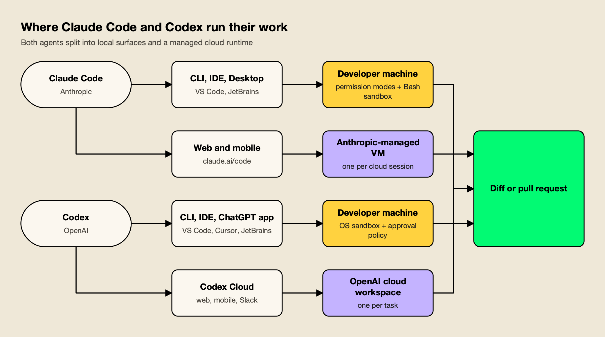
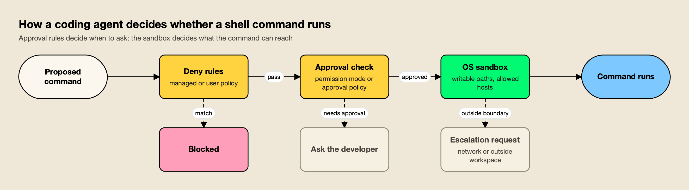
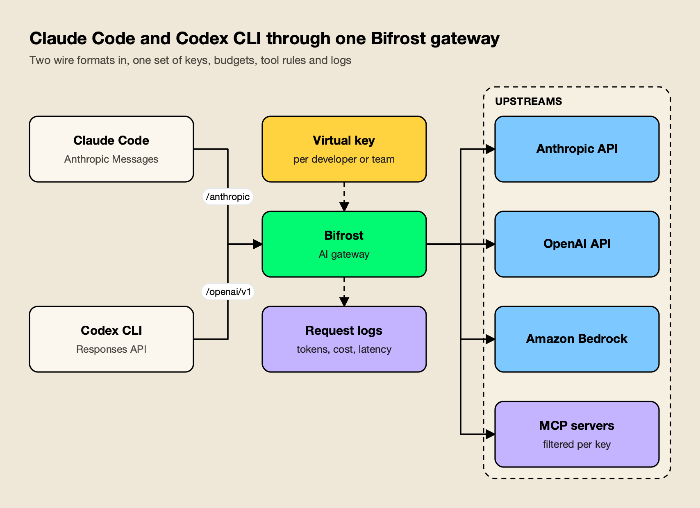

**TL;DR**
- In the Claude Code vs Codex comparison, both agents now cover the same surfaces: a terminal CLI, IDE extensions, a desktop app, and a cloud runtime that returns a diff or pull request.
- Claude Code defaults to Claude Opus 5.5 ($4 input, $20 output per million tokens) with a 1M-token context window; Codex recommends GPT-6.1 Sol ($2 and $10) with a 1.05M-token window.
- Codex turns its OS sandbox on by default with network access off; Claude Code relies on six permission modes and leaves its Bash sandbox off until a developer or admin enables it.
- Both support MCP, subagents, skills, hooks and admin-enforced configuration files (`managed-settings.json` for Claude Code, `requirements.toml` for Codex).
- Teams that run both agents usually put an AI gateway in front of them to get one set of per-developer budgets, model rules and MCP tool policies.

Claude Code vs Codex is the comparison most engineering teams make before standardizing on a coding agent in 2026, and the two products have converged faster than their marketing suggests. Anthropic's Claude Code and OpenAI's Codex both read a repository, edit files, run shell commands, connect to MCP servers, spawn subagents and run long tasks in the cloud. The differences that matter are in the models each one runs, how each one prices usage, how each one gates shell commands, and how much control an administrator gets. This comparison works through each of those areas using Anthropic's and OpenAI's own documentation as of October 15, 2026, then shows how teams that use both agents put them behind one gateway.

## Claude Code vs Codex at a Glance

Claude Code and Codex are agentic coding tools that run in the terminal, the IDE, a desktop app and the cloud. Claude Code runs Anthropic's Claude models; Codex runs OpenAI's GPT models. Codex ships stricter sandbox defaults and an open-source CLI, while Claude Code offers more permission modes and deeper subagent orchestration.

| Area | Claude Code (Anthropic) | Codex (OpenAI) |
|---|---|---|
| Default or recommended model | Claude Opus 5.5 (default on Pro, Max, Team, Enterprise and API) | GPT-6.1 Sol (recommended for complex work) |
| Other models | Sonnet 5.5, Haiku 5.5, Fable 5.1 | GPT-6 Astra, GPT-6 Luna, GPT-6 Sol |
| Context window | 1M tokens on current models | 1,050,000 tokens on GPT-6.1 Sol and GPT-6 Astra |
| Local surfaces | CLI, VS Code and Cursor extension, JetBrains plugin, desktop app | CLI, IDE extension (VS Code, Cursor, Windsurf), Xcode and JetBrains integrations, ChatGPT desktop app |
| Cloud surface | Claude Code on the web and mobile, one isolated VM per session | Codex Cloud on web and mobile, one workspace per task |
| Entry price with agent included | Claude Pro, $20 a month | ChatGPT Plus, $20 a month (Free and Go include limited Luna access) |
| Local sandbox default | Off; permission modes gate actions | On; workspace writes only, network off |
| MCP transports | HTTP and stdio | Streamable HTTP and STDIO |
| Project instructions | `CLAUDE.md` (can read `AGENTS.md`) | `AGENTS.md` |
| Admin-enforced config | `managed-settings.json` | `requirements.toml` |
| Open source | Sandbox runtime package | CLI and SDK (Apache 2.0) |

For a wider view that includes Cursor, GitHub Copilot and other agents, the roundup of [AI coding agents for software teams](/blog/ai-coding-agents/) ranks eight tools side by side.

## Models and Context Windows

Claude Code runs Claude Opus 5.5 by default on every paid plan and on the Anthropic API, with Sonnet 5.5, Haiku 5.5 and Fable 5.1 available through aliases. Codex recommends GPT-6.1 Sol for complex coding and GPT-6 Luna for focused, repeatable tasks, with GPT-6 Astra available in the CLI and IDE.

Anthropic's [Claude Code model configuration docs](https://code.claude.com/docs/en/model-config) list the `default` setting as Opus 5.5 for Pro, Max, Team, Enterprise and Anthropic API accounts. The `sonnet`, `opus` and `haiku` aliases resolve to the 5.5 generation on the Anthropic API, and a `fable` alias selects Claude Fable 5.1, which the docs describe as the most capable model in Claude Code for tasks "larger than a single sitting". Fable is never the default, and depending on plan and seat tier its usage can bill to usage credits rather than the plan's included limits. Current Claude models run with a 1M-token context window by default, with no `[1m]` suffix needed.

OpenAI's [Codex models page](https://learn.chatgpt.com/docs/models) recommends GPT-6.1 Sol "for complex coding and agentic workflows" and describes it as near-Astra performance at lower cost. GPT-5.5 retired from Codex for ChatGPT sign-in on October 14, 2026, so saved configurations that still name `gpt-5.5` need a replacement. Codex also has an **Ultra** mode that spreads larger tasks across subagents.

| Model | Agent | Input / output per 1M tokens | Cached input | Context |
|---|---|---|---|---|
| Claude Opus 5.5 | Claude Code | $4 / $20 | $0.20 | 1M |
| Claude Sonnet 5.5 | Claude Code | $2 / $10 | $0.10 | 1M |
| Claude Haiku 5.5 (prompts up to 100K) | Claude Code | $0.10 / $0.50 | $0.01 | 1M |
| Claude Fable 5.1 | Claude Code | $10 / $50 | $0.25 | 1M |
| GPT-6 Astra | Codex | $10 / $50 | $1.00 | 1.05M |
| GPT-6.1 Sol | Codex | $2 / $10 | $0.10 | 1.05M |
| GPT-6 Luna | Codex | $0.10 / $0.50 | $0.01 | 1.05M |

Prices come from [Anthropic's API pricing page](https://platform.claude.com/docs/en/about-claude/pricing) and [OpenAI's API pricing page](https://developers.openai.com/api/docs/pricing) at standard short-context rates. Both labs charge more above a long-context threshold, and OpenAI's [GPT-6.1 Sol model page](https://developers.openai.com/api/docs/models/gpt-6.1-sol) lists a 1,050,000-token window and 128,000 maximum output tokens.

Per-token rates matter most when an agent runs on an API key. Model quality per task is covered in detail in the ranking of the [best AI models for coding](/blog/best-ai-models-for-coding/), which puts Opus 5.5 and Sonnet 5.5 ahead on Terminal-Bench 4.0 and GPT-6.1 Sol ahead on cost per task.

## Surfaces: CLI, IDE, Desktop and Cloud

Both agents now ship four kinds of surface: a terminal CLI, IDE extensions, a desktop app and a cloud runtime. Local surfaces share one configuration and execute on the developer's machine; cloud surfaces run each task in a vendor-managed isolated environment and hand back a diff or pull request.



*Figure 1: Local surfaces share one configuration and run on the laptop; cloud tasks run in the vendor's isolated environment and come back as a diff or pull request.*

**Claude Code.** The [Claude Code overview](https://code.claude.com/docs/en/overview) lists the terminal CLI, a VS Code extension (which also installs in Cursor), a JetBrains plugin that requires the CLI, a desktop app for macOS and Windows (with a Linux beta), and Claude Code on the web at claude.ai/code. Anthropic states that each surface "connects to the same underlying Claude Code engine", so `CLAUDE.md` files, settings and MCP servers carry across. Cloud sessions run in an "isolated, Anthropic-managed VM", and `claude --teleport` pulls a web session back into the terminal. Claude Code also runs in GitHub Actions and GitLab CI/CD and responds to `@Claude` mentions in Slack.

**Codex.** The [Codex CLI](https://learn.chatgpt.com/docs/codex/cli) installs with a standalone script or npm and runs non-interactively with `codex exec`. The [Codex IDE extension](https://learn.chatgpt.com/docs/codex/ide) installs in VS Code, Cursor and Windsurf, while Xcode and JetBrains IDEs provide their own Codex integrations. [Codex Cloud](https://learn.chatgpt.com/docs/cloud) runs tasks from published environments in which "each task has its own workspace and can keep working while your computer is asleep", and tasks can be started from the web, mobile, Slack or the CLI. Codex also has a GitHub Action and automatic pull-request code review on paid plans.

One structural difference is openness. OpenAI's [open-source page](https://learn.chatgpt.com/docs/open-source) lists the Codex CLI, SDK and app server in the [openai/codex repository](https://github.com/openai/codex) under Apache 2.0, while the IDE extension and Codex Cloud are closed. Claude Code itself is not open source, though its sandbox is built on Anthropic's open-source `sandbox-runtime` package.

## Pricing and Plans

Both agents are included in their vendor's paid subscriptions and can also run on an API key billed per token. Claude Code requires at least Claude Pro at $20 a month; Codex is included from ChatGPT Plus at $20 a month, and ChatGPT Free and Go users get limited GPT-6 Luna access in the desktop app.

| Plan tier | Claude Code | Codex |
|---|---|---|
| Free | Not included | $0, GPT-6 Luna in the desktop app, subject to rollout |
| Low-cost individual | Not offered | Go, $8 a month, GPT-6 Luna in the desktop app |
| Standard individual | Pro, $20 a month or $17 billed annually | Plus, $20 a month, GPT-6.1 Sol and Luna, CLI, IDE, web and code review |
| Heavy individual | Max, from $100 a month (5x or 20x Pro usage) | Pro at $100, $200 or $500 a month |
| Team | Team Standard $25 monthly or $20 annually; Team Premium $125 or $100 | Business $25 monthly or $20 per user annually (2+ users) |
| Enterprise | $20 per seat per month billed annually, 20-seat minimum, plus usage at API rates | Enterprise and Edu, contact sales |
| API key | Billed at Anthropic API rates | CLI, SDK and IDE only (no cloud features), billed at OpenAI API rates |

Plan details come from [Claude's pricing page](https://claude.com/pricing) and the [Codex pricing page](https://learn.chatgpt.com/docs/pricing). Two details change the arithmetic for teams. First, a Codex API key gives no access to cloud features such as GitHub code review and Slack, so API-only rollouts lose part of the product. Second, Claude Enterprise bills usage at API rates on top of the seat fee, which makes per-developer spend visibility more important.

Anthropic publishes a useful baseline in its [Claude Code cost guide](https://code.claude.com/docs/en/costs): across enterprise deployments, average cost is "around \$13 per developer per active day and \$150-250 per developer per month", with 90% of users staying below \$30 per active day. The Codex pricing page, by contrast, warns that API token prices are separate from subscription usage and should not be used to estimate included tasks. The breakdown of [GPT-6 pricing](/blog/gpt-6-pricing/) explains why a lower per-token price does not translate one-for-one into a lower bill, which applies equally to a Codex rollout on API keys. Cost growth at scale for Claude Code specifically is examined in an analysis of [the hidden cost of Claude Code at enterprise scale](https://www.getmaxim.ai/articles/the-hidden-cost-of-claude-code-at-enterprise-scale/).

## Sandboxing and Permissions

Codex enforces an OS-level sandbox by default: writes are limited to the active workspace and network access is off until a developer enables it. Claude Code gates actions through six permission modes and deny rules, and its OS-level Bash sandbox is off by default until enabled with `/sandbox` or a settings key.



*Figure 2: Claude Code leans on permission modes and leaves its sandbox off by default; Codex starts with the sandbox on and network off, then asks when a command needs more.*

Both agents use the same two layers shown in Figure 2: an approval layer that decides when to ask the developer, and a sandbox that limits what an approved command can reach. They differ in which layer is on by default.

**Claude Code.** The [permission modes page](https://code.claude.com/docs/en/permission-modes) lists six modes: `default` (manual, reads only without asking), `acceptEdits`, `plan`, `auto` (everything, with background safety checks), `dontAsk` (pre-approved tools only, for CI) and `bypassPermissions` (for isolated containers and VMs only). Deny rules "block in every mode, including `bypassPermissions`". The [sandboxed Bash tool](https://code.claude.com/docs/en/sandboxing) runs on macOS, Linux and WSL2, limits writes to the working directory, and routes network traffic through a local proxy whose allowed-domain list starts empty. It covers shell commands only; Claude's file tools, MCP servers and hooks run outside it, and reads still reach most of the machine unless `denyRead` rules are set.

**Codex.** OpenAI's [agent approvals and security page](https://learn.chatgpt.com/docs/agent-approvals-security) states that "by default, the agent runs with network access turned off" and that the local sandbox typically limits Codex to the current workspace. The `Auto` preset combines `workspace-write` with an `on-request` approval policy, so Codex edits and runs commands in the working directory and asks before writing elsewhere or using the network. Destructive MCP tool calls that advertise a destructive annotation always require approval. GPT-6 Astra also adds asynchronous safety monitoring that can pause a task.

In practice, Codex's defaults suit teams that want a safe starting point without configuration, while Claude Code's modes suit teams that want finer control over how much the agent does unattended. Either way, the sandbox is the control that limits damage when an agent misbehaves, as the review of [AI agents escaping the sandbox](/blog/ai-agents-escaping-the-sandbox/) documents. Organization-wide policy for both agents is covered in a guide to [governing coding agents such as Cursor, Claude Code and Copilot](https://www.getmaxim.ai/articles/ai-coding-agent-security-governing-cursor-claude-code-and-copilot/).

## Subagents and Parallel Work

Both agents can delegate work to subagents that run in their own context and return a summary. Claude Code subagents are defined in files with their own system prompt, tool list, permissions and model; Codex enables subagent workflows by default in current releases and supports custom agents with their own model and instructions.

Anthropic's [subagent documentation](https://code.claude.com/docs/en/sub-agents) describes each subagent as running "in its own context window with a custom system prompt, specific tool access, and independent permissions". Claude delegates automatically when a task matches a subagent's description, and a subagent can be pinned to a cheaper model such as Haiku to control cost. Claude Code also offers agent teams, in which a lead agent supervises teammate sessions.

OpenAI's [Codex subagents page](https://learn.chatgpt.com/docs/agent-configuration/subagents) says current Codex releases enable subagent workflows by default and show their activity in the desktop app, CLI and IDE extension. In the CLI, `/subagents` switches between running threads. Codex delegates when asked directly or when `AGENTS.md` or skill instructions request it, and custom agents can set their own `model` and `model_reasoning_effort`. OpenAI notes that subagent workflows "consume more tokens than comparable single-agent runs", a point that applies to both agents and is one reason teams want per-developer spend tracking.

## MCP Support and Extensibility

Both agents are full MCP clients. Claude Code supports remote HTTP and local stdio servers at local, project and user scope, plus organization-managed servers. Codex supports STDIO and Streamable HTTP servers with bearer-token or OAuth authentication, configured in `config.toml` and shared across its local clients.

Anthropic's [MCP guide for Claude Code](https://code.claude.com/docs/en/mcp) recommends HTTP for remote servers (`claude mcp add --transport http <name> <url>`) and documents three installation scopes. Administrators can supply servers through the `managedMcpServers` setting, which outranks user-defined duplicates. OpenAI's [Codex MCP page](https://learn.chatgpt.com/docs/extend/mcp) lists STDIO servers with environment variables, Streamable HTTP servers with bearer tokens or OAuth (including Client ID Metadata Documents and Dynamic Client Registration), and support for the MCP `instructions` field. Project-scoped Codex servers in `.codex/config.toml` load only for trusted projects.

The surrounding extension model is similar too:

- **Project instructions:** Claude Code reads `CLAUDE.md` and can read an existing `AGENTS.md` instead; Codex reads `AGENTS.md`.
- **Skills:** both agents load packaged skills for repeatable workflows, from different folders (`.claude/skills` for Claude Code, `.agents/skills` for Codex); the guide to [Codex skills](/blog/codex-skills/) covers where Codex looks and how to install them.
- **Hooks:** Claude Code [hooks](https://code.claude.com/docs/en/hooks) run shell commands before or after agent actions; Codex [hooks](https://learn.chatgpt.com/docs/hooks) run scripts or MCP tools during the agentic loop, for example to block pasted API keys.
- **Plugins:** both vendors publish plugins that package reusable workflows, such as Anthropic's official plugin for scaffolding MCP servers and the plugins in OpenAI's public plugins repository.

Which MCP servers are worth installing is covered in the list of [MCP servers for coding agents](/blog/mcp-servers-for-coding-agents/). As the number of servers grows, so does the context each agent spends on tool definitions, which is why many teams route tool access through an [MCP gateway](https://www.getmaxim.ai/mcp-gateway) rather than configuring every server on every laptop.

## Enterprise Controls

Both vendors let administrators push configuration that developers cannot override. Claude Code uses `managed-settings.json` delivered by file, MDM or the claude.ai console; Codex uses `requirements.toml` and the Agent Security console. Each pairs this with workspace-level model restrictions, usage analytics and audit features on its enterprise plan.

| Control | Claude Code | Codex |
|---|---|---|
| Enforced config | `managed-settings.json`, applied above every other level | `requirements.toml` constraints plus overridable defaults |
| What can be enforced | Permission deny rules, disabling bypass mode, sandbox, MCP servers, allowed providers | Approval policy, sandbox mode, web search, managed hooks, MCP server allowlist, plugin sources |
| Model restrictions | Enterprise admins disable models in the claude.ai admin console; `availableModels` elsewhere | Workspace model availability per client |
| Default model | Organization default model per role (Enterprise) | Workspace defaults and managed configuration |
| Identity and roles | claude.ai organization accounts; per-role model and effort limits on Enterprise | SAML SSO on Business; SCIM, EKM and RBAC on Enterprise |
| Usage and audit | Analytics dashboard, Console per-user spend, Claude Code Analytics API | User analytics and Compliance API audit logs on Enterprise |

Anthropic's [managed settings docs](https://code.claude.com/docs/en/managed-settings) state that no user, project, local or command-line value overrides a managed setting, apart from a few cases where a stricter lower-level value still counts. OpenAI's [managed configuration page](https://learn.chatgpt.com/docs/enterprise/managed-configuration) describes requirements as "admin-enforced constraints that users can't override"; if a local value conflicts, the client falls back to a compatible value and tells the user.

The common gap is cross-vendor reporting. Each vendor's analytics covers its own agent only, so a team running both has two dashboards, two sets of budgets and two places to revoke access. Practical approaches to unified tracking are compared in a guide to [Claude Code monitoring for coding agents](https://www.getmaxim.ai/articles/claude-code-monitoring-how-to-track-coding-agents/).

## Running Both Agents Through One Gateway

Claude Code and Codex both document support for routing model traffic through an LLM gateway, but they speak different wire formats. Claude Code sends Anthropic Messages requests to `ANTHROPIC_BASE_URL`; Codex sends OpenAI Responses API requests to a custom model provider. A shared gateway has to serve both formats to apply one policy across the two agents.

Anthropic's [LLM gateway guide](https://code.claude.com/docs/en/llm-gateway) lists what a gateway provides: server-side provider credentials, usage attribution by developer, budgets and rate limits, audit logging and provider switching. Admins can set `allowedProviders` to `["customEndpoint"]` in managed settings so the gateway is the only destination a machine may use. Anthropic also notes that it does not support routing Claude Code to non-Claude models through any gateway, so for Claude Code the useful switch is between Claude models and between Claude providers (Anthropic API, Amazon Bedrock, Google Cloud). Anthropic's own option is Claude apps gateway, a self-hosted gateway with SSO sign-in and OTLP telemetry.

OpenAI's [gateway compatibility requirements](https://learn.chatgpt.com/docs/enterprise/gateway-compatibility) are stricter on protocol. The gateway must accept `POST /v1/responses`, stream server-sent events incrementally including the terminal `response.completed` event, replay conversation input across turns, and preserve function-call items with their matching outputs. OpenAI states plainly that "a working Chat Completions or Anthropic Messages endpoint doesn't establish Responses compatibility." The Codex docs include a walkthrough for [Bedrock through a LiteLLM gateway](https://learn.chatgpt.com/docs/enterprise/bedrock-through-litellm), and Kong AI Gateway and Cloudflare AI Gateway are other options teams evaluate.

That Responses requirement narrows the field for mixed teams. The comparison of [AI gateways for Claude Code, Codex CLI and Cursor](/blog/ai-gateways-for-coding-agents/) checks which gateways serve all three agents, and the narrower survey of [Claude Code gateways](/blog/claude-code-gateways/) covers Anthropic-only deployments.

## Worked Example: Claude Code and Codex Through Bifrost

[Bifrost](https://www.getmaxim.ai/bifrost) is an [open-source AI gateway](https://github.com/maximhq/bifrost) from Maxim AI that serves both formats: an Anthropic-compatible `/anthropic` endpoint for Claude Code and an OpenAI-compatible `/openai/v1` Responses endpoint for Codex. It is used here because its documentation has a dedicated, versioned setup page for each agent.



*Figure 3: One virtual key per developer gives the same budget and tool policy whichever agent the developer opens.*

Bifrost routes to 25+ providers and 10,000+ models through one OpenAI-compatible API, and its published benchmark reports 11 µs of added overhead per request at 5,000 RPS on an AWS t3.xlarge ([benchmark details](https://docs.getbifrost.ai/benchmarking/t3.xl)). Broader context on what a gateway layer adds is in the overview of the [LLM gateway category](https://www.getmaxim.ai/llm-gateway).

**Claude Code setup.** The [Bifrost Claude Code guide](https://docs.getbifrost.ai/cli-agents/claude-code) offers four setups: launching through the Bifrost CLI, a static virtual key, a Claude subscription with governance, and dynamic credentials through `apiKeyHelper`. The static-key version is two environment variables in `~/.claude/settings.json`:

```json
{
  "env": {
    "ANTHROPIC_BASE_URL": "https://bifrost.example.com/anthropic",
    "ANTHROPIC_AUTH_TOKEN": "sk-bf-your-virtual-key"
  }
}
```

Teams that want to keep billing on Claude Pro, Max, Team or Enterprise subscriptions sign in with `/login` and send the virtual key in an `x-bf-vk` header through `ANTHROPIC_CUSTOM_HEADERS`; Bifrost forwards the subscription token to Anthropic and applies governance from the header.

**Codex CLI setup.** The [Bifrost Codex CLI guide](https://docs.getbifrost.ai/cli-agents/codex-cli) defines a named provider in `~/.codex/config.toml`, which matches the custom-provider pattern OpenAI documents:

```toml
model = "openai/gpt-5"
model_provider = "bifrost"

[model_providers.bifrost]
name = "Bifrost"
base_url = "http://localhost:8080/openai/v1"
wire_api = "responses"
env_key = "OPENAI_API_KEY"
requires_openai_auth = false
supports_websockets = false
```

The faster route is `bifrost run codex --model <provider/model>`, which launches Codex with an isolated temporary `CODEX_HOME` that copies the user's config, including MCP servers and project trust entries. Codex sends a `session-id` header on every request, so Bifrost keeps a session on the same provider key and prompt cache. Background on both integrations is in the walkthroughs for [integrating Claude Code with Bifrost](https://www.getmaxim.ai/bifrost/blog/integrating-claude-code-with-bifrost-gateway/) and [integrating Codex CLI with Bifrost](https://www.getmaxim.ai/bifrost/blog/integrating-codex-cli-with-bifrost-gateway/), and the [Bifrost CLI guide for coding agents](https://www.getmaxim.ai/articles/how-to-use-bifrost-cli-with-coding-agents-like-claude-code/) covers the launcher.

With both agents on the gateway, four controls apply to each of them:

- **Cost tracking.** [Built-in observability](https://docs.getbifrost.ai/features/observability/default) records inputs, outputs, tokens, cost and latency for each request, asynchronously, so Claude Code and Codex spend lands in one log keyed by virtual key.
- **Budgets.** [Virtual keys](https://docs.getbifrost.ai/features/governance/virtual-keys) carry their own [budgets and rate limits](https://docs.getbifrost.ai/features/governance/budget-and-limits) in a customer, team and key hierarchy, with reset periods from a day (`1d`) to a year (`1Y`), optionally aligned to calendar boundaries. A developer who exhausts a daily budget in Codex is stopped in Claude Code too.
- **Model swaps.** [Governance routing](https://docs.getbifrost.ai/features/governance/routing) controls which providers and models each key may use, and [automatic fallbacks](https://docs.getbifrost.ai/features/fallbacks) move traffic to a second provider on errors. For Codex, Bifrost translates Responses requests to other configured providers when launched with a model such as `anthropic/claude-opus-4-6`, provided the model supports the tool calls Codex needs. The trade-offs of mixing models inside Codex are covered in a guide to [running Codex CLI with Claude, Gemini and Llama](https://www.getmaxim.ai/articles/openai-codex-cli-beyond-gpt-switch-between-claude-gemini-llama-and-more-using-bifrost/).
- **MCP tool governance.** [MCP tool filtering](https://docs.getbifrost.ai/features/governance/mcp-tools) is deny-by-default per virtual key, and [Virtual MCPs](https://docs.getbifrost.ai/mcp/virtual-mcps) bundle a curated set of tools behind one `/mcp/<slug>` endpoint that only attached keys can reach. Pointing both agents at the same Virtual MCP gives them an identical tool list. A practical guide covers [centralizing tool access for Claude Code with an MCP gateway](https://www.getmaxim.ai/articles/using-an-mcp-gateway-with-claude-code-how-bifrost-centralizes-tool-access-for-agentic-coding/).

**Enterprise tier.** SSO-issued credentials through [user provisioning](https://docs.getbifrost.ai/enterprise/user-provisioning), reusable [access profiles](https://docs.getbifrost.ai/enterprise/access-profiles) and [clustering](https://docs.getbifrost.ai/enterprise/clustering) for high availability are part of Bifrost Enterprise.

The [CLI agents resource page](https://www.getmaxim.ai/resources/cli-agents) and the [Claude Code resource page](https://www.getmaxim.ai/resources/claude-code) summarize the rollout patterns.

The wider policy model behind virtual keys, budgets and tool rules is described on the [AI governance](https://www.getmaxim.ai/ai-governance) overview.

## Which Agent Fits Which Team

Choose Claude Code when model quality on hard, long tasks and fine-grained autonomy controls matter most. Choose Codex when stricter sandbox defaults, lower per-token cost on GPT-6.1 Sol and an open-source CLI matter most. Teams that cannot pick one often run both behind a gateway and let developers choose per task.

| Team situation | Better fit | Why |
|---|---|---|
| Hard refactors and long autonomous sessions | Claude Code | Opus 5.5 by default, Fable 5.1 available, agent teams for supervised parallel work |
| High-volume routine changes on API keys | Codex | GPT-6.1 Sol at $2 / $10 per million tokens, GPT-6 Luna for focused tasks |
| Security team wants safe defaults with no setup | Codex | Sandbox on and network off by default |
| Team wants graduated autonomy (plan, accept edits, auto) | Claude Code | Six permission modes plus deny rules that apply in every mode |
| Organization already standardized on ChatGPT Business or Enterprise | Codex | Included in existing seats, with Compliance API audit logs |
| Organization already on Claude Team or Enterprise | Claude Code | Included in seats, with managed settings and org-level model defaults |
| Mixed team using both agents | Both, behind one gateway | One budget, model policy and MCP tool list per developer |

A blended setup (Claude Code for debugging, Codex for CI and well-scoped changes) is common. The guide to [AI gateways for coding agents](/blog/ai-gateways-for-coding-agents/) explains how that per-developer setup works for a mixed team.

## The Verdict on Claude Code vs Codex

Claude Code and Codex are closer in October 2026 than at any point since launch. Both cover terminal, IDE, desktop and cloud; both are full MCP clients with subagents, skills and hooks; both give administrators an enforced configuration file. The real choice comes down to three things: which model family a team trusts on its own repositories, whether it wants Codex's locked-down defaults or Claude Code's graduated permission modes, and which subscription it already pays for. For teams that cannot settle on one, the decision moves down a layer, to the gateway that gives both agents the same budgets, model rules and tool access.
