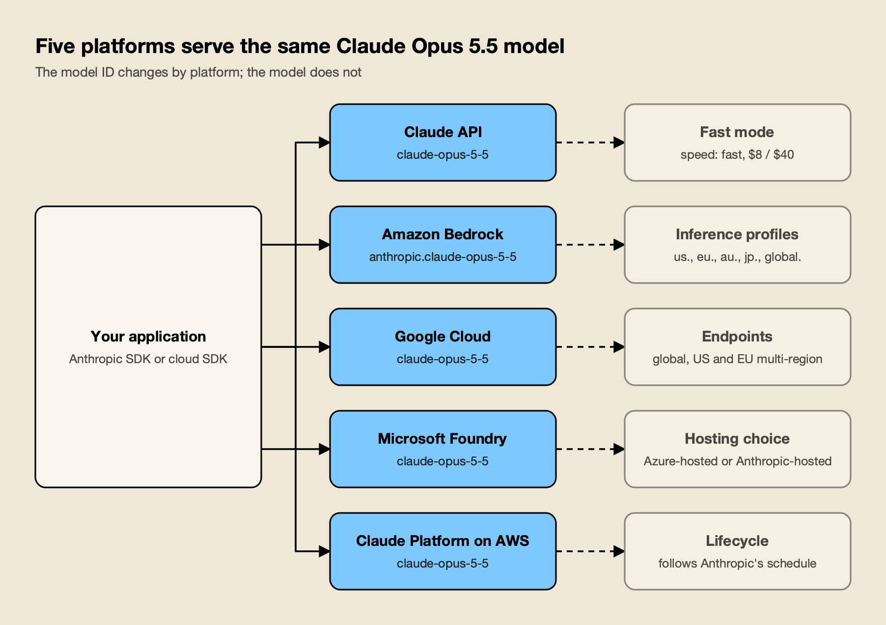
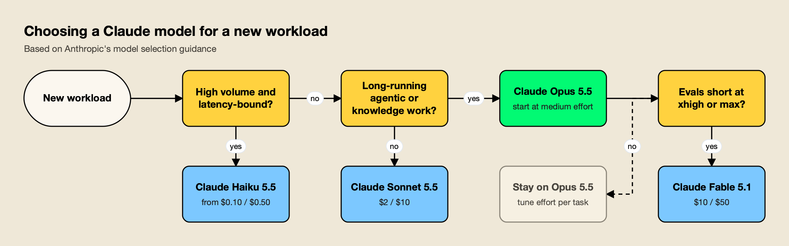
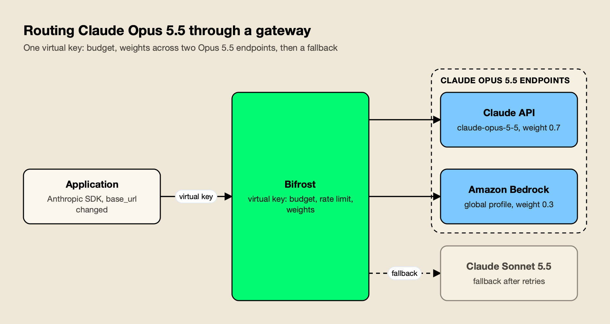

**TL;DR**
- Claude Opus 5.5 (`claude-opus-5-5`) is Anthropic's Opus model released September 22, 2026, with a 1M-token context window, 128K output tokens and always-on adaptive thinking.
- It costs $4 input and $20 output per million tokens, 20% below Claude Opus 5, and cache reads cost $0.20 per million, 5% of the input price.
- Effort is the main cost and quality control: the default is now `medium`, thinking can't be disabled, and forced tool use returns a 400 error.
- Moving from Opus 5 or Sonnet 5 needs code changes, not only a model ID swap: read content blocks by type, drop sampling parameters and prefills, and handle refusals.
- A gateway can split Opus 5.5 traffic across the Claude API and cloud endpoints and enforce budgets; Bifrost is the worked example below.

Claude Opus 5.5 is Anthropic's current Opus model for long-running agentic coding and knowledge work, available on the Claude API and on Amazon Bedrock, Google Cloud and Microsoft Foundry under the model ID `claude-opus-5-5`. It launched on September 22, 2026, at lower prices than Claude Opus 5 and with several API changes that break code written for earlier models. This practical guide covers what Claude Opus 5.5 is good for, what it costs and how to cut that cost, how to call it, when to pick it over Sonnet or Haiku, what to change when migrating, and how teams route it through a gateway.

## What Claude Opus 5.5 Is

Claude Opus 5.5 is a large language model from Anthropic and [the first model in Anthropic's new Claude 5.5 family](https://www.anthropic.com/claude-opus-5-5#:~:text=the%20first%20model%20in%20our%20new%20Claude%205.5%20family). Anthropic positions it for long-running agentic coding and knowledge work, says it performs at the level of Claude Fable 5.1 on most work, and prices it at $4 and $20 per million input and output tokens.

It sits below Claude Fable 5.1 and above Sonnet 5.5 and Haiku 5.5 in Anthropic's lineup. Anthropic's own [models overview tells developers to start with Claude Opus 5.5 for most workloads](https://platform.claude.com/docs/en/models/overview#:~:text=start%20with%20Claude%20Opus%205.5%20for%20most%20workloads) and to reach for Fable 5.1 only when evals on Opus 5.5 at higher effort still fall short.

Three launch claims matter most:

- **Cost.** Anthropic says Opus 5.5 at default settings will cost 40% less than Opus 5 on typical workloads, because it is cheaper per token and uses fewer tokens per task.
- **Speed.** The launch post says [Opus 5.5 generates output more than 30% faster than Opus 5](https://www.anthropic.com/claude-opus-5-5#:~:text=Opus%205.5%20also%20generates%20output%20more%20than%2030%25%20faster%20than%20Opus%205).
- **Safeguards.** It is the first Opus model to ship with safeguards similar to Fable 5.1's on cybersecurity, biology and distillation. In practice, [most cybersecurity tasks will be re-routed to Opus 4.8](https://www.anthropic.com/claude-opus-5-5#:~:text=most%20cybersecurity%20tasks%20will%20be%20re%2Drouted%20to%20Opus%204.8), and AWS's launch post warns that [requests will be refused more frequently](https://aws.amazon.com/blogs/machine-learning/claude-opus-5-5-is-now-available-on-aws/#:~:text=Requests%20will%20be%20refused%20more%20frequently%20as%20compared%20to%20previous%20Opus%20versions) than on earlier Opus models.

The [Claude Opus 5.5 system card](https://www.anthropic.com/claude-opus-5-5-system-card) reports less misaligned behavior than any recent Claude model on Anthropic's automated audit, with one regression: it more often follows malicious instructions planted in text a user pastes into a prompt. METR's pre-deployment testing, covered in this site's look at [METR time horizons in 2026](/blog/metr-time-horizons-2026/), called it an incremental improvement over Fable 5.1.

## Claude Opus 5.5 Specs and Availability

Claude Opus 5.5 accepts text and images, returns text, and offers a 1M-token context window with up to 128K output tokens per synchronous request. Thinking is adaptive and always on, the default effort is `medium`, and the reliable knowledge cutoff is June 2026. It runs on five platforms with platform-specific model IDs.

The specs below come from Anthropic's [Claude Opus 5.5 model page](https://platform.claude.com/docs/en/models/opus-5-5/overview) and [What's new in Claude Opus 5.5](https://platform.claude.com/docs/en/models/opus-5-5/whats-new-opus-5-5):

| Spec | Claude Opus 5.5 |
|---|---|
| Claude API model ID | `claude-opus-5-5` (a pinned snapshot, no date suffix) |
| Released | September 22, 2026 |
| Context window | 1M tokens, default, no beta header |
| Max output | 128K tokens; up to 300K on the Message Batches API with the `output-300k-2026-03-24` beta header |
| Input and output | Text and images in, text out; PDFs, vision, Files API |
| Thinking | Adaptive, always on |
| Effort levels | `low`, `medium` (default), `high`, `xhigh`, `max` |
| Minimum cacheable prompt | 512 tokens |
| Knowledge cutoff | June 2026 |
| Retirement | Not sooner than September 22, 2027 |



*Figure 1: Pick the platform for billing, residency and features such as fast mode, then use that platform's model ID.*

As Figure 1 shows, the same model is served through five doors, and each has its own details:

- **Claude API.** Every customer can call `claude-opus-5-5`. It is the only first-party surface for fast mode, and it supports US-only inference through the `inference_geo` parameter.
- **Amazon Bedrock.** The model ID is `anthropic.claude-opus-5-5`, but Bedrock's model card notes that [in-Region inference with the bare model ID is available in eu-west-2 (London) only](https://docs.aws.amazon.com/bedrock/latest/userguide/model-card-anthropic-claude-opus-5-5.html#:~:text=In%2DRegion%20inference%20with%20the%20bare%20model%20ID%20is%20available%20in%20eu%2Dwest%2D2). Elsewhere, teams call a geo profile (`us.`, `eu.`, `au.`, `jp.`) or the `global.` profile.
- **Google Cloud.** The model ID is `claude-opus-5-5`, generally available on the global endpoint and US and EU multi-region endpoints, with the [Google Cloud model page](https://docs.cloud.google.com/gemini-enterprise-agent-platform/models/partner-models/claude/opus-5-5#:~:text=Maximum%20input%20tokens%3A%201%2C000%2C000) listing 1,000,000 input and 128,000 output tokens plus Provisioned Throughput.
- **Microsoft Foundry.** The deployment name is what a request sends. The catalog notes that [Version 2 of Claude Opus 5.5 is hosted on Azure infrastructure](https://ai.azure.com/catalog/models/claude-opus-5-5#:~:text=Version%202%20of%20Claude%20Opus%205.5%20is%20hosted%20on%20Azure%20infrastructure), while Version 1 keeps inference on Anthropic's infrastructure.
- **Claude Platform on AWS.** It uses the Claude API model ID and follows Anthropic's first-party lifecycle.

One availability detail affects regulated teams: Anthropic's launch post states that, [like previous Opus models, Opus 5.5 is available with zero data retention](https://www.anthropic.com/claude-opus-5-5#:~:text=Like%20previous%20Opus%20models%2C%20Opus%205.5%20is%20available%20with%20zero%20data%20retention).

## What Claude Opus Is Good For

Claude Opus 5.5 is best suited to long, multi-step work where the model runs for many turns with tools: codebase-wide migrations and audits, autonomous coding agents, research that must cite sources accurately, financial analysis, document-heavy vision tasks and computer use. Short, high-volume tasks rarely need it.

Anthropic's model selection matrix lists "multihour autonomous coding agents, large-scale refactoring, complex systems engineering, vision-heavy workflows, computer use" as the use cases for Opus 5.5. The launch post backs that with examples:

- **Large code jobs.** Anthropic says [Opus 5.5 is particularly good at long and sprawling jobs](https://www.anthropic.com/claude-opus-5-5#:~:text=Opus%205.5%20is%20particularly%20good%20at%20long%20and%20sprawling%20jobs) such as migrations and audits. One early tester audited and fixed a 200,000-line codebase in under three hours; Opus 5 took over 20 hours.
- **Source-faithful research.** In an internal test where any invented figure failed the report, [16 out of 18 of Opus 5.5's reports cleared](https://www.anthropic.com/claude-opus-5-5#:~:text=16%20out%20of%2018%20of%20Opus%205.5%E2%80%99s%20reports%20cleared%20our%20quality%20bar) the bar; neither Fable 5.1 nor Opus 5 cleared it once.
- **Visual inputs.** The docs say the model reads values off dense charts and screenshots much more precisely without tools, so older prompt-side workarounds may be unnecessary.

Independent leaderboards agree it sits at or near the top. When this site ranked the [top AI models](/blog/top-ai-models/) in October, Opus 5.5 led the Artificial Analysis Intelligence Index (58) and Epoch's Capabilities Index, and the ranking of the [best AI models for coding](/blog/best-ai-models-for-coding/) put it first on Vals' independent Terminal-Bench 4.0 run at 65.15%, one point ahead of Sonnet 5.5.

Anthropic itself cautions that at this level [benchmark margins have become a less reliable guide](https://www.anthropic.com/claude-opus-5-5#:~:text=benchmark%20margins%20have%20become%20a%20less%20reliable%20guide%20to%20real%2Dworld%20differences) to real-world differences, which is a reason to apply this site's [checklist for reading an AI benchmark](/blog/how-to-read-an-ai-benchmark/) and test on your own tasks.

It is less suited to security research that trips the cyber classifier, biology work covered by the bio safeguards, and short classification or extraction, where Haiku 5.5 costs a small fraction as much.

## Claude Opus Pricing

Claude Opus 5.5 pricing on the Claude API is $4 per million input tokens and $20 per million output tokens, 20% below Claude Opus 5. Cache reads cost $0.20 per million, 5-minute cache writes $5, 1-hour cache writes $8, and the Batch API halves input and output. Thinking tokens are billed at the output rate.

The full rate card, from Anthropic's [pricing page](https://platform.claude.com/docs/en/about-claude/pricing) and launch post, per million tokens:

| Item | Claude Opus 5.5 | Claude Opus 5 |
|---|---|---|
| Input | $4 | $5 |
| Output | $20 | $25 |
| 5-minute cache write | $5 | $6.25 |
| 1-hour cache write | $8 | $10 |
| Cache read (hit) | $0.20 | $0.50 |
| Batch input / output | $2 / $10 | $2.50 / $12.50 |
| Fast mode input / output | $8 / $40 | $10 / $50 (research preview) |

Five pricing rules change the real bill more than the headline rate:

- **Cache reads are unusually cheap.** On most Claude models a cache hit costs 10% of input. On Opus 5.5 and Sonnet 5.5 [a cache hit costs 5% of the standard input price](https://platform.claude.com/docs/en/about-claude/pricing#:~:text=a%20cache%20hit%20costs%205%25%20of%20the%20standard%20input%20price). Anthropic notes that [cache reads, which make up the majority of agentic and coding work costs,](https://www.anthropic.com/claude-opus-5-5#:~:text=which%20make%20up%20the%20majority%20of%20agentic%20and%20coding%20work%20costs) fell 60% versus Opus 5.
- **No long-context surcharge.** Anthropic's long-context section says [a 900k-token request is billed at the same per-token rate as a 9k-token request](https://platform.claude.com/docs/en/about-claude/pricing#:~:text=A%20900k%2Dtoken%20request%20is%20billed%20at%20the%20same%20per%2Dtoken%20rate%20as%20a%209k%2Dtoken%20request). OpenAI's GPT-6 models double input above 272K tokens, as this site's [GPT-6 pricing analysis](/blog/gpt-6-pricing/) explains.
- **Data residency costs 10%.** US-only inference applies [a 1.1x multiplier on all token pricing categories](https://platform.claude.com/docs/en/about-claude/pricing#:~:text=incurs%20a%201.1x%20multiplier%20on%20all%20token%20pricing%20categories), including cache reads. Bedrock and Google Cloud set their own regional pricing.
- **Fast mode doubles the rate.** Fast mode delivers up to 2.5x higher output tokens per second at $8 and $40, and [fast mode is not available with the Batch API](https://platform.claude.com/docs/en/about-claude/pricing#:~:text=Fast%20mode%20is%20not%20available%20with%20the%20Batch%20API).
- **Thinking is output.** Because thinking can't be switched off, effort level, not the visible answer length, often decides output spend.

Against rivals, Opus 5.5 matches Gemini 4 Argon's post-December price ($4 and $20, per this site's [Gemini 4 explainer](/blog/gemini-4/)) and costs twice GPT-6.1 Sol and Sonnet 5.5 per token. Per-token price is not cost per task, though: the coding ranking cited above found Sonnet 5.5 more expensive per Terminal-Bench task than Opus 5.5 because it wrote more tokens. The wider drivers are covered in this site's guide to [AI inference cost](/blog/ai-inference-cost/), and subscription-side limits in the [Claude usage limits explainer](/blog/claude-usage-limits/).

## Claude Prompt Caching, Batch and Effort: Cutting the Bill

The three biggest cost levers for Claude Opus 5.5 are prompt caching (cache hits cost 5% of input), the Batch API (50% off input and output for asynchronous work) and the effort parameter (fewer thinking and output tokens). They stack: cached, batched, low-effort requests cost a fraction of the list price.

### Prompt caching

Agent loops resend almost the same prompt every turn, which is why caching matters most on Opus 5.5. The simplest setup is automatic caching: [add a single cache_control field at the top level of your request](https://platform.claude.com/docs/en/build-with-claude/prompt-caching#:~:text=Add%20a%20single%20cache_control%20field%20at%20the%20top%20level%20of%20your%20request) and the breakpoint moves forward as the conversation grows. The default time to live is five minutes; a one-hour cache costs 2x input to write. Opus 5.5's minimum cacheable prompt is 512 tokens, down from 1,024 on Opus 4.8 and Sonnet 5, so shorter prompts now qualify.

A worked example shows the size of the effect. Take one agent turn with a 200,000-token prompt, 180,000 tokens of which repeat from the previous turn, and 8,000 output tokens:

| Turn cost | Without caching | With caching |
|---|---|---|
| Fresh input | 200,000 × $4/M = $0.80 | 20,000 × $4/M = $0.08 |
| Cache reads | n/a | 180,000 × $0.20/M = $0.036 |
| Output (thinking plus text) | 8,000 × $20/M = $0.16 | $0.16 |
| **Total per turn** | **$0.96** | **$0.276** |

Over 50 turns that is roughly $48 against about $14, and output becomes the largest line item. More detail on how gateways handle cache markers is in this comparison of [AI gateways with prompt caching support](https://www.getmaxim.ai/articles/top-5-ai-gateways-with-prompt-caching-support-in-2026/).

### The Batch API

The Message Batches API processes requests asynchronously at half price, $2 and $10 per million for Opus 5.5. Anthropic says the system processes requests [with most batches completing within 1 hour](https://platform.claude.com/docs/en/build-with-claude/batch-processing#:~:text=with%20most%20batches%20completing%20within%201%20hour), results are available within 24 hours, and a batch is [limited to either 100,000 Message requests or 256 MB in size](https://platform.claude.com/docs/en/build-with-claude/batch-processing#:~:text=limited%20to%20either%20100%2C000%20Message%20requests%20or%20256%20MB%20in%20size). Caching multipliers apply on top of the batch discount, and batches are the only way to get 300K-token outputs.

### Effort

Effort controls how many tokens Opus 5.5 spends on thinking, tool calls and text. Anthropic's docs stress that [effort is a behavioral signal, not a strict token budget](https://platform.claude.com/docs/en/build-with-claude/effort#:~:text=Effort%20is%20a%20behavioral%20signal%2C%20not%20a%20strict%20token%20budget): the model still thinks on hard problems at low effort, just less. The levels:

| Effort | Anthropic's typical use |
|---|---|
| `low` | Simpler tasks that need speed and low cost, such as subagents |
| `medium` (default on Opus 5.5) | Agentic tasks balancing speed, cost and performance |
| `high` | Complex reasoning, difficult coding, agentic tasks |
| `xhigh` | Long-running agentic and coding tasks over 30 minutes |
| `max` | The deepest reasoning, with no constraint on token spend |

Anthropic's model-selection guide puts it plainly: [tuning effort is often a better lever than switching models](https://platform.claude.com/docs/en/about-claude/models/choosing-a-model#:~:text=Tuning%20effort%20is%20often%20a%20better%20lever%20than%20switching%20models). Launch testers support that: Deloitte reported that Opus 5.5 at its lowest effort caught 72% of known bugs in code review, against 56% for Opus 5 at high effort. Teams should [run an effort sweep on their own evals](https://platform.claude.com/docs/en/build-with-claude/effort#:~:text=Run%20an%20effort%20sweep%20on%20your%20own%20evals) rather than reusing an Opus 5 setting, because Opus 5.5 thinks more per turn at a given level. A longer treatment of gateway-side savings is in this [LLM cost optimization walkthrough](https://www.getmaxim.ai/bifrost/blog/llm-cost-optimization-in-bifrost-part-1/).

## Calling Claude Opus 5.5 Through the API

A Claude Opus 5.5 API call is a standard Messages API request with `model: "claude-opus-5-5"`, an `output_config.effort` value and a `max_tokens` large enough for thinking plus the answer. Code must read text blocks by type, because thinking blocks can come first.

A minimal Python example with the official SDK, caching and an explicit effort level:

```python
import anthropic

client = anthropic.Anthropic()  # reads ANTHROPIC_API_KEY

response = client.messages.create(
    model="claude-opus-5-5",
    max_tokens=64000,                      # covers thinking plus the reply
    cache_control={"type": "ephemeral"},   # automatic prompt caching
    output_config={"effort": "medium"},    # low | medium | high | xhigh | max
    system="You are a senior reviewer. Report findings as a numbered list.",
    messages=[{"role": "user", "content": "Review this diff for concurrency bugs: ..."}],
)

answer = "".join(b.text for b in response.content if b.type == "text")  # by type, not position
print(answer)
print(response.stop_reason, response.usage)
```

A few rules keep requests valid. Do not send `thinking: {"type": "disabled"}` or a `budget_tokens` value; omit `thinking` or send `{"type": "adaptive"}`. Leave `temperature`, `top_p` and `top_k` at their defaults. Use `tool_choice` `auto` or `none` only. For fast mode on the Claude API, add `speed: "fast"`; Anthropic says [fast mode runs the same model with a faster inference configuration](https://platform.claude.com/docs/en/build-with-claude/fast-mode#:~:text=Fast%20mode%20runs%20the%20same%20model%20with%20a%20faster%20inference%20configuration), so quality does not change. And check `stop_reason`: a declined request returns HTTP 200 with `stop_reason: "refusal"`, which code should handle by retrying on another model.

For coding agents, Opus 5.5 is the default model in Claude Code on paid plans; this site's [Claude Code vs Codex comparison](/blog/claude-code-vs-codex/) covers that setup.

## Choosing Between Opus 5.5, Sonnet 5.5 and Haiku 5.5

Choose Claude Opus 5.5 for long-running agentic coding and complex knowledge work, Claude Sonnet 5.5 for everyday coding, agents and data work at half the price, and Claude Haiku 5.5 for high-volume, latency-sensitive tasks. Move up to Claude Fable 5.1 only when Opus 5.5 at `xhigh` or `max` effort still misses your evals.

| | Claude Fable 5.1 | Claude Opus 5.5 | Claude Sonnet 5.5 | Claude Haiku 5.5 |
|---|---|---|---|---|
| Model ID | `claude-fable-5-1` | `claude-opus-5-5` | `claude-sonnet-5-5` | `claude-haiku-5-5` |
| Price in / out per 1M | $10 / $50 | $4 / $20 | $2 / $10 | From $0.10 / $0.50 |
| Cache read | $0.25 | $0.20 | $0.10 | $0.01 |
| Latency | Slower | Moderate | Fast | Fastest |
| Thinking | Adaptive, always on | Adaptive, always on | Adaptive (`between_tools` option) | Adaptive |
| Default effort | `high` | `medium` | `high` | `medium` |
| Context / max output | 1M / 128K | 1M / 128K | 1M / 128K | 1M / 128K |
| Anthropic's fit | Hours-long agent sessions, deep research | Multihour coding agents, refactoring, computer use | Everyday coding, analysis, agentic tool use | Real-time apps, high-volume processing, subagents |

Figures come from Anthropic's models overview and [choosing-a-model guide](https://platform.claude.com/docs/en/about-claude/models/choosing-a-model). Haiku 5.5 pricing rises to $0.50 and $2.50 for prompts over 100,000 tokens.



*Figure 2: Opus 5.5 is the default starting point for hard agentic work; effort tuning comes before a model change.*

Figure 2 follows Anthropic's capability-first strategy: begin on Opus 5.5, then lower effort or move tasks down as evals allow. Sonnet 5.5 deserves a real test before defaulting to Opus: it sits one point behind Opus 5.5 on Vals' Terminal-Bench run, and Artificial Analysis measured it as unusually verbose at max effort. The sibling guide to [Claude Sonnet 5](/blog/claude-sonnet-5/) covers the Sonnet line in more depth.

Many teams end up with a split: Opus 5.5 as orchestrator, with Sonnet 5.5 or Haiku 5.5 doing bulk work, a pattern Anthropic documents in its cost guidance.

## Migrating to Claude Opus 5.5

Migrating to Claude Opus 5.5 requires more than changing the model ID. Requests that disable thinking, set a thinking budget, force a tool call, set non-default sampling parameters, prefill the assistant turn, or declare the older `computer_20251124` tool on the Claude API or Google Cloud return 400 errors.

The changes, from Anthropic's [Claude Opus 5.5 migration guide](https://platform.claude.com/docs/en/models/opus-5-5/migration-guide):

| Change | What breaks | What to do |
|---|---|---|
| Thinking always on | `thinking: {"type": "disabled"}` or `budget_tokens` returns 400 | Omit `thinking`; control depth with `effort` |
| Default effort is `medium` | Requests without `effort` run one level lower than on Opus 5 | Set `effort` explicitly and re-run a sweep |
| No forced tool use | `tool_choice` `any` or `tool` returns 400 | Use `auto` plus strict tool use or structured outputs |
| Sampling and prefill | [Omit temperature, top_p, and top_k](https://platform.claude.com/docs/en/models/opus-5-5/migration-guide#:~:text=Omit%20temperature%2C%20top_p%2C%20and%20top_k%2C%20or%20leave%20them%20at%20their%20defaults) or keep defaults; a prefilled assistant turn is rejected | Steer with prompts, structured outputs or system instructions |
| Thinking blocks first | Code that reads `content[0].text` breaks | Select blocks by `type`; return thinking blocks unmodified in tool loops |
| Text between tool calls | Progress notes arrive as empty `thinking` blocks; no error | Set `thinking.display` to `"updates"` (beta) or `"summarized"` |
| Computer use | `computer_20251124` rejected on Claude API and Google Cloud | Move to `computer_toolset_20260801`; Bedrock keeps the old tool |
| Refusals | `stop_reason: "refusal"` with a `bio`, `cyber` or `reasoning_extraction` category | Handle refusals; configure fallback |

Two further notes matter for teams that run routers. Anthropic warns that [if a router or fallback can move a conversation from Claude Opus 5.5 to another model](https://platform.claude.com/docs/en/models/opus-5-5/migration-guide#:~:text=If%20a%20router%20or%20fallback%20can%20move%20a%20conversation%20from%20Claude%20Opus%205.5%20to%20another%20model), that model runs without Opus 5.5's reasoning, except Fable 5.1 and Mythos 5.1 on the Claude API. And on accounts created on or after August 31, 2026, replaying a thinking block after editing the system prompt, tools or earlier messages returns a 400 error, so conversations should stay append-only.

Anthropic also offers a server-side fallback (`fallbacks: "default"`, in beta) that retries a refused request on a model it recommends.

## Running Claude Opus 5.5 Through an AI Gateway

An AI gateway sits between applications and model providers, so Claude Opus 5.5 can be called through one endpoint while the gateway handles keys, splits traffic across the Claude API and cloud endpoints, enforces budgets and fails over on errors. Teams use direct SDKs, cloud-native routing, or a multi-provider gateway.

The common approaches:

- **The Anthropic SDK directly.** Simplest for one provider, with Anthropic's server-side fallback for refusals. Budgets, cross-cloud failover and per-team limits must be built in application code.
- **A cloud platform's own routing.** Bedrock's global and geo inference profiles, or Google Cloud's global endpoint, spread load across regions inside one cloud. That covers capacity, not a second provider.
- **LiteLLM.** The open-source proxy routes by model group; per its docs, [fallbacks are how LiteLLM does automatic failover](https://docs.litellm.ai/docs/proxy/reliability#:~:text=Fallbacks%20are%20how%20LiteLLM%20does%20automatic%20failover), and it supports key, team and user budgets backed by a database.
- **Cloudflare AI Gateway.** A managed gateway with an Anthropic endpoint; its dynamic routing adds a node that [enforces cost quotas](https://developers.cloudflare.com/ai-gateway/features/dynamic-routing/#:~:text=Budget%20Limit%3A%20Enforces%20cost%20quotas) per key and switches to a fallback model when exceeded.
- **Kong AI Gateway.** The AI Proxy Advanced plugin [lets you transform and proxy requests to multiple AI providers](https://developer.konghq.com/plugins/ai-proxy-advanced/#:~:text=lets%20you%20transform%20and%20proxy%20requests%20to%20multiple%20AI%20providers) with load-balancing algorithms and failover, suited to teams already running Kong.

This site's comparison of [AI gateways for Anthropic, OpenAI and Gemini](/blog/ai-gateways-for-anthropic-openai-gemini/) scores these options side by side, and the guide to [Claude Code gateways](/blog/claude-code-gateways/) covers the coding-agent case.

### Worked example: Claude Opus 5.5 on Bifrost

[Bifrost](https://www.getmaxim.ai/bifrost), an [open-source AI gateway](https://github.com/maximhq/bifrost) written in Go by Maxim AI, is the worked example here because its documentation covers native Anthropic SDK compatibility, Bedrock inference profiles, weighted routing, budgets and prompt-cache injection, the pieces an Opus 5.5 rollout needs. It routes to 25+ providers and 10,000+ models through one OpenAI-compatible API, and its published benchmark reports [11 µs of added overhead per request at 5,000 RPS](https://docs.getbifrost.ai/benchmarking/t3.xl#:~:text=Bifrost%E2%80%99s%20Total%20Overhead%3A%2011%20%C2%B5s) on an AWS t3.xlarge.



*Figure 3: The application sends one model name; weights, budgets and the fallback chain live in gateway configuration.*

The setup in Figure 3 has four parts:

1. **Native SDK, new base URL.** Per the [Anthropic SDK integration docs](https://docs.getbifrost.ai/integrations/anthropic-sdk/overview#:~:text=Bifrost%20provides%20complete%20Anthropic%20API%20compatibility%20through%20protocol%20adaptation), an application keeps the Anthropic Messages format and points `base_url` at the gateway's `/anthropic` path, using a virtual key as the API key. The [provider docs](https://docs.getbifrost.ai/providers/supported-providers/anthropic#:~:text=Bifrost%20automatically%20manages%20Anthropic%20beta%20headers) add that the gateway detects and injects the beta headers a request needs.

2. **Two Opus 5.5 endpoints.** A Bedrock key can [map model names to inference profile IDs](https://docs.getbifrost.ai/providers/supported-providers/bedrock#:~:text=Map%20model%20names%20to%20inference%20profile%20IDs), so `claude-opus-5-5` resolves to `global.anthropic.claude-opus-5-5` on Bedrock while the Anthropic provider serves the same name directly.

3. **Weights and automatic fallback.** A virtual key lists both providers with weights; the [routing docs](https://docs.getbifrost.ai/features/governance/routing#:~:text=Weights%20are%20automatically%20normalized%20to%20a%20sum%201.0) normalize them, and weighted providers form the automatic fallback chain. In the [retries and fallbacks model](https://docs.getbifrost.ai/features/fallbacks#:~:text=Each%20fallback%20provider%20gets%20its%20own%20full%20retry%20budget), each fallback provider gets its own full retry budget, and a request can also name an explicit chain ending in `anthropic/claude-sonnet-5-5`.

4. **Budgets and rate limits.** The same virtual key carries a monthly budget; under the [budget rules](https://docs.getbifrost.ai/features/governance/budget-and-limits#:~:text=any%20single%20budget%20failure%20blocks%20the%20request), any single budget failure blocks the request, so one runaway agent cannot drain a team's allocation.

The virtual key configuration:

```json
{
  "name": "opus-55-prod",
  "provider_configs": [
    { "provider": "anthropic", "weight": 0.7, "allowed_models": ["claude-opus-5-5"], "key_ids": ["*"] },
    { "provider": "bedrock", "weight": 0.3, "allowed_models": ["claude-opus-5-5"], "key_ids": ["*"] }
  ],
  "budgets": [{ "max_limit": 2000.00, "reset_duration": "1M" }]
}
```

The Bedrock key's alias entry is `"aliases": {"claude-opus-5-5": "global.anthropic.claude-opus-5-5"}`, and the application changes only its client:

```python
client = anthropic.Anthropic(
    base_url="https://bifrost.internal.example.com/anthropic",
    api_key="sk-bf-...",  # Bifrost virtual key
)
```

Two Opus-specific details shape this config. Because a fallback to Sonnet 5.5 runs without Opus 5.5's thinking blocks, the Sonnet entry belongs at the end of the chain, after both Opus endpoints. And because cache reads are 5% of input, prompt caching is worth enforcing at the gateway: with [auto prompt caching](https://docs.getbifrost.ai/features/prompt-caching#:~:text=Bifrost%20marks%20the%20first%20cacheable%20content%20block) turned on for a provider, Bifrost marks the first cacheable content block of requests that arrive without markers, which helps agentic clients that send none. For task-based tiering, the [complexity router](https://docs.getbifrost.ai/features/complexity-router#:~:text=send%20simple%20requests%20to%20a%20fast%2C%20cheap%20model%20and%20hard%20ones%20to%20a%20frontier%20model) can send simple requests to Haiku 5.5 or Sonnet 5.5 and hard ones to Opus 5.5.

Claude Code can use the same virtual key: [Claude Code connects to Bifrost through Bifrost's Anthropic-compatible endpoint](https://docs.getbifrost.ai/cli-agents/claude-code#:~:text=Claude%20Code%20connects%20to%20Bifrost%20through%20Bifrost%E2%80%99s%20Anthropic%2Dcompatible%20endpoint), which puts per-developer Opus 5.5 spend under the same budgets. The [Claude Code resource page](https://www.getmaxim.ai/resources/claude-code) and the explainer on a [Claude Code gateway for routing, governance and cost control](https://www.getmaxim.ai/articles/claude-code-gateway-explained-routing-governance-and-cost-control/) cover that setup end to end.

Step-by-step provider setup is in Bifrost's guides for the [Anthropic provider](https://www.getmaxim.ai/bifrost/guides/providers/anthropic) and the [Bedrock provider](https://www.getmaxim.ai/bifrost/guides/providers/bedrock).

A longer piece covers [using Bedrock, Vertex, Gemini and Anthropic models through one gateway](https://www.getmaxim.ai/articles/using-bedrock-vertex-gemini-and-anthropic-ai-models-through-bifrost/). For outage planning, see [keeping an app running when Anthropic goes down](https://www.getmaxim.ai/articles/keep-your-app-running-when-anthropic-goes-down/) and [enabling automatic fallback when a primary provider fails](https://www.getmaxim.ai/bifrost/blog/your-primary-llm-provider-failed-enable-automatic-fallback-with-bifrost/).

The general role of the layer is described on the [LLM gateway](https://www.getmaxim.ai/llm-gateway) overview.

**Enterprise tier.** Clustering for high availability, adaptive load balancing, guardrails, SSO and audit logs are part of Bifrost Enterprise; the virtual keys, weighted routing, fallbacks and budgets used above run in the open-source gateway.

## What Claude Opus 5.5 Changes for Teams

Claude Opus 5.5 changes three things for teams building on Claude: frontier-level Opus work now costs $4 and $20 per million tokens with cache reads at $0.20, effort has replaced thinking budgets as the single control for depth and cost, and the API contract is stricter than any earlier Opus.

For teams on Opus 5 or Sonnet 5, the upgrade is worth doing as a migration: fix block handling, tool choice and sampling parameters, then run an effort sweep and compare cost per task. Teams on Fable 5.1 should re-test Opus 5.5 at `high` or `xhigh`, since Anthropic reports it matches Fable on most work at 40% of the token price.

The verdict on Claude Opus 5.5 would shift with three signals: the cyber and bio classifiers' false-positive rate (Anthropic says it chose a temporarily wider safety margin), independent replication of the 40% cost reduction on real workloads, and the next Fable or Sonnet release. Until then, Opus 5.5 is the sensible default for hard agentic work, run alongside cheaper models and behind a routing layer that keeps the choice reversible.
