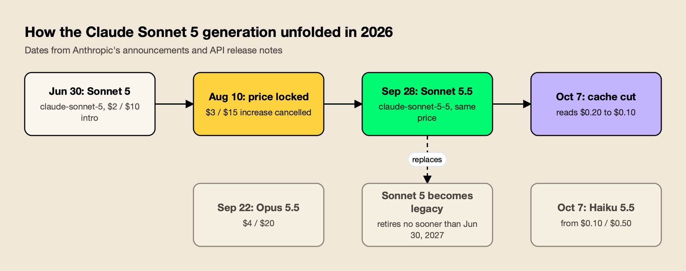
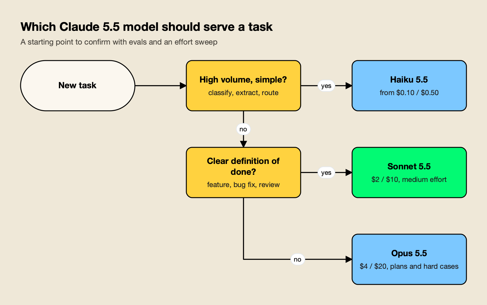
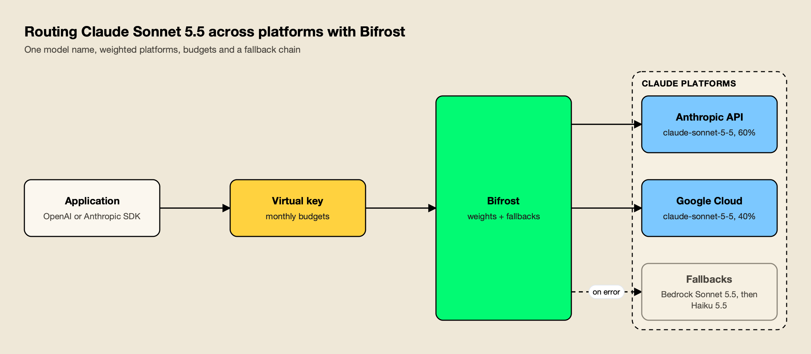

**TL;DR**
- The Claude Sonnet 5 generation has two models: Claude Sonnet 5 (`claude-sonnet-5`), released June 30, 2026 and now legacy, and Claude Sonnet 5.5 (`claude-sonnet-5-5`), released September 28, 2026 and Anthropic's current Sonnet.
- Both cost $2 per million input tokens and $10 per million output tokens, with a 1M-token context window and 128K max output; Sonnet 5.5 halves cache reads to $0.10.
- Anthropic reports Sonnet 5.5 at 70.6% on Terminal-Bench 4.0 (Sonnet 5: 10.3%) and says it runs 30%+ faster and costs up to 30% less per task than Sonnet 5.
- Moving from Sonnet 5 to Sonnet 5.5 is not a pure model-ID swap: `thinking: disabled` and forced tool use now return 400 errors, and computer use needs the new toolset on the Claude API and Google Cloud.
- In Claude Code, `sonnet` resolves to Sonnet 5.5 only on the Anthropic API; Bedrock and Google Cloud users must pin it explicitly.

Claude Sonnet 5 is Anthropic's mid-tier model generation, priced at $2 per million input tokens and $10 per million output tokens and built for coding, agents, and everyday knowledge work. The generation now has two releases: Claude Sonnet 5, launched June 30, 2026, and Claude Sonnet 5.5, launched September 28, 2026, which replaced it as the current Sonnet. This guide covers what each version is, what it costs, how to call it, when to pick it over Opus 5.5 or Haiku 5.5, how to use it in Claude Code, what breaks when migrating, and how to run it behind a gateway.

## What Claude Sonnet 5 Is

Claude Sonnet 5 is the fifth-generation Sonnet model from Anthropic and the first in a two-model Sonnet 5 line. Sonnet 5 shipped on June 30, 2026, as "the most agentic Sonnet model yet"; Sonnet 5.5 followed on September 28, 2026, as the second model in the Claude 5.5 family. Both keep Sonnet's role: near-flagship capability at a mid-tier price.

Anthropic's [Sonnet 5 launch post](https://www.anthropic.com/news/claude-sonnet-5#:~:text=Claude%20Sonnet%205%20is%20built%20to%20be%20the%20most%20agentic%20Sonnet%20model%20yet) describes a model that can plan, use browsers and terminals, and run autonomously at a level that previously needed larger models. It also says [its performance is close to that of Opus 4.8](https://www.anthropic.com/news/claude-sonnet-5#:~:text=its%20performance%20is%20close%20to%20that%20of%20Opus%204.8) at lower prices. At launch it became the default model for Free and Pro plans in the Claude apps.

Three months later, Anthropic introduced Sonnet 5.5 as [the second model in the Claude 5.5 family](https://www.anthropic.com/claude-sonnet-5-5#:~:text=the%20second%20model%20in%20the%20Claude%205.5%20family) and called it "a clear upgrade over Claude Sonnet 5" that "runs 30%+ faster, and costs up to 30% less for most work." Anthropic's developer docs now mark the older model as legacy: the [Sonnet 5 model page](https://platform.claude.com/docs/en/models/sonnet-5/overview#:~:text=Although%20Claude%20Sonnet%205%20is%20still%20available) says that "although Claude Sonnet 5 is still available, you should consider migrating to Claude Sonnet 5.5."

| | Claude Sonnet 5 | Claude Sonnet 5.5 |
|---|---|---|
| Claude API ID | `claude-sonnet-5` | `claude-sonnet-5-5` |
| Released | June 30, 2026 | September 28, 2026 |
| Status | Active (legacy) | Active (latest) |
| Retirement | Not sooner than June 30, 2027 | Not sooner than September 28, 2027 |
| Input / output price | $2 / $10 per MTok | $2 / $10 per MTok |
| Cache read | $0.20 per MTok | $0.10 per MTok |
| Reliable knowledge cutoff | January 2026 | June 2026 |
| Thinking off | `thinking: disabled` | `thinking: between_tools` |

Above Sonnet sit Claude Opus 5.5 ($4/$20) and Claude Fable 5.1 ($10/$50); below it, Claude Haiku 5.5, released October 7, 2026.

## Claude Sonnet 5 Release Date and Timeline

Claude Sonnet 5 was released on June 30, 2026, at introductory pricing of $2/$10 per million tokens that Anthropic made permanent on August 10. Claude Sonnet 5.5 was released on September 28, 2026, six days after Opus 5.5, and its cache-read price was cut to $0.10 on October 7.



*Figure 1: Four dates define the Sonnet 5 generation, and the price never moved off $2/$10.*

The milestones in Figure 1 come from Anthropic's posts and API release notes, which record that Anthropic [lowered the price of prompt cache reads on Claude Sonnet 5.5](https://platform.claude.com/docs/en/release-notes/overview#:~:text=lowered%20the%20price%20of%20prompt%20cache%20reads%20on%20Claude%20Sonnet%205.5) on October 7:

| Date | Event |
|---|---|
| June 30, 2026 | Claude Sonnet 5 launches on the Claude API and all plans at introductory $2/$10 pricing |
| August 10, 2026 | Anthropic makes $2/$10 the standard price; the planned move to $3/$15 on September 1 is cancelled |
| September 22, 2026 | Claude Opus 5.5 launches |
| September 28, 2026 | Claude Sonnet 5.5 launches on the Claude API, Bedrock, Claude Platform on AWS, Google Cloud, and Microsoft Foundry |
| October 7, 2026 | Claude Haiku 5.5 launches; Sonnet 5.5 cache reads drop from $0.20 to $0.10 per MTok |
| November 30, 2026 | Scheduled retirement of Claude Sonnet 4.5 on the Claude API |

The pricing change is worth knowing because older articles still quote $3/$15 for Sonnet 5. The Sonnet 5 post's changelog records that its [introductory pricing of $2 per million input tokens and $10 per million output tokens is now permanent](https://www.anthropic.com/news/claude-sonnet-5#:~:text=introductory%20pricing%20of%20%242%20per%20million%20input%20tokens%20and%20%2410%20per%20million%20output%20tokens%20is%20now%20permanent), and a footnote on Anthropic's [pricing page](https://platform.claude.com/docs/en/about-claude/pricing) confirms that the planned $3/$15 increase "will not occur." Teams still on Sonnet 4.5 have a firmer deadline: Anthropic [announced its deprecation](https://platform.claude.com/docs/en/release-notes/overview#:~:text=We%20announced%20the%20deprecation%20of%20the%20Claude%20Sonnet%204.5%20model) with retirement on the Claude API on November 30, 2026.

## Claude Sonnet 5 Specs: Context Window, Output, and Thinking

Both Sonnet 5 models have a 1M-token context window billed at standard rates, 128K max output on the synchronous Messages API, 300K output on the Batch API with a beta header, text and image input, and adaptive thinking with `high` as the default API effort. Sonnet 5.5 adds per-message effort, a lower cache minimum, and a newer knowledge cutoff.

| Spec | Sonnet 5 | Sonnet 5.5 |
|---|---|---|
| Context window | 1M tokens | 1M tokens |
| Max output (Messages API) | 128K tokens | 128K tokens |
| Max output (Batch API, beta) | 300K tokens | 300K tokens |
| Input / output modalities | Text and images to text | Text and images to text |
| Thinking | Adaptive | Adaptive |
| Default effort (Claude API) | `high` | `high` |
| Lowest thinking setting | `disabled` | `between_tools` |
| Minimum cacheable prompt | 1,024 tokens | 512 tokens |
| Per-message effort, mid-conversation system messages | No | Yes |

Four details change how code is written for these models:

- **Sampling parameters are fixed.** On Sonnet 5.5, [setting temperature, top_p, or top_k](https://platform.claude.com/docs/en/models/sonnet-5-5/overview#:~:text=to%20a%20non%2Ddefault%20value%20returns%20a%20400%20error) to a non-default value returns a 400 error. The same rule applies to Sonnet 5.
- **The tokenizer is newer.** Sonnet 5 introduced a tokenizer that, per Anthropic's footnote, means [the same input can map to more tokens](https://www.anthropic.com/news/claude-sonnet-5#:~:text=the%20same%20input%20can%20map%20to%20more%20tokens): about 1.0 to 1.35 times Sonnet 4.6's count. Sonnet 5.5 uses the same tokenizer as Sonnet 5.
- **Thinking counts toward `max_tokens`.** The effort guide says that [for agentic coding, set max_tokens to 128,000](https://platform.claude.com/docs/en/build-with-claude/effort#:~:text=For%20agentic%20coding%2C%20set%20max_tokens%20to%20128%2C000), the model's maximum, and stream the response.

## What Sonnet 5.5 Is Good For

Sonnet 5.5 is built for well-scoped, repeatable work: everyday coding, bug fixes, code review, agent tasks with a clear goal, computer use, and documents and slides. Anthropic's benchmarks put it close to Opus 5.5 on most tests, but the company still recommends Opus for open-ended work that needs sustained judgment.

Anthropic frames the split directly. Its announcement says Sonnet 5.5 is [strongest at well-scoped everyday tasks](https://www.anthropic.com/claude-sonnet-5-5#:~:text=strongest%20at%20well%2Dscoped%20everyday%20tasks), fixing bugs, and creating polished documents, slides, and spreadsheets, while noting that [Opus 5.5 remains clearly stronger](https://www.anthropic.com/claude-sonnet-5-5#:~:text=Opus%205.5%20remains%20clearly%20stronger) at complex, open-ended work. AWS's launch post for Bedrock lists alert response, SQL generation, UI testing, and [fast coding agents in the IDE with a fixed spend cap](https://aws.amazon.com/blogs/machine-learning/introducing-claude-sonnet-5-5-on-aws/#:~:text=fast%20coding%20agents%20in%20the%20IDE%20with%20a%20fixed%20spend%20cap) as fits.

Anthropic's published results, all from its own runs:

| Benchmark | Sonnet 5.5 | Sonnet 5 | Opus 5.5 |
|---|---|---|---|
| Terminal-Bench 4.0 (agentic coding) | 70.6% | 10.3% | 66.4% |
| FrontierCode 1.1, main (agentic coding) | 46.2% (Max), 52.1% (Xhigh) | 42.4% | 54.4% |
| CursorBench 4.0 (agentic coding) | 55.5% | 34.1% | 57.8% |
| GDPval-AA v2.1 (knowledge work, Elo) | 1844 | 1449 | 1846 |
| OSWorld 2.1 (computer use) | 80.1% | 57.0% | 81.8% |
| Humanity's Last Exam (with tools) | 64.5% | 54.9% | 67.7% |
| Chartography (no tools) | 61.6% | 15.6% | 64.4% |

Independent numbers are lower but tell the same story. Vals' Terminal-Bench 4.0 run, covered in this site's ranking of the [best AI models for coding](/blog/best-ai-models-for-coding/), puts Sonnet 5.5 at 64.14% against Opus 5.5's 65.15%, a statistical near-tie. The site's broader list of [top AI models](/blog/top-ai-models/) ranks Sonnet 5.5 second overall on the Artificial Analysis Intelligence Index.

For computer use, OSWorld 2.1 puts Sonnet 5.5 within two points of Opus 5.5. On the Claude API and Google Cloud, it [supports computer use only through the computer_toolset_20260801 toolset](https://platform.claude.com/docs/en/models/sonnet-5-5/whats-new-sonnet-5-5#:~:text=supports%20computer%20use%20only%20through%20the%20computer_toolset_20260801%20toolset); Bedrock still accepts the older `computer_20251124` tool. Long-horizon agents that must decide what to do next are where Opus 5.5 earns its higher price.

Sonnet 5.5 is also the first Sonnet to launch with cyber safeguards like those on Opus. Per the announcement, [higher-risk cybersecurity tasks will visibly fall back to Sonnet 5](https://www.anthropic.com/claude-sonnet-5-5#:~:text=higher%2Drisk%20cybersecurity%20tasks%20will%20visibly%20fall%20back%20to%20Sonnet%205), while routine bug finding and fixing are unaffected.

## Claude Sonnet 5 Pricing and Cost Control

Claude Sonnet 5 pricing is $2 per million input tokens and $10 per million output tokens for both Sonnet 5 and Sonnet 5.5, with 50% off on the Batch API. Cache writes cost $2.50 (5-minute) or $4 (1-hour); cache reads cost $0.10 on Sonnet 5.5 and $0.20 on Sonnet 5. US-only inference adds 10%.

The current rates, per million tokens, come from Anthropic's pricing page, where the Batch API carries [a 50% discount on both input and output tokens](https://platform.claude.com/docs/en/about-claude/pricing#:~:text=with%20a%2050%25%20discount%20on%20both%20input%20and%20output%20tokens):

| Model | Input | Output | 5m cache write | 1h cache write | Cache read | Batch input / output |
|---|---|---|---|---|---|---|
| Claude Sonnet 5.5 | $2 | $10 | $2.50 | $4 | $0.10 | $1 / $5 |
| Claude Sonnet 5 | $2 | $10 | $2.50 | $4 | $0.20 | $1 / $5 |
| Claude Opus 5.5 | $4 | $20 | $5 | $8 | $0.20 | $2 / $10 |
| Claude Haiku 5.5 (prompts up to 100K) | $0.10 | $0.50 | $0.125 | $0.20 | $0.01 | $0.05 / $0.25 |

Two modifiers sit on top. Requests pinned to the US with `inference_geo: "us"` carry a [1.1x pricing multiplier](https://platform.claude.com/docs/en/about-claude/pricing#:~:text=applies%20a%201.1x%20pricing%20multiplier) on Claude 4.6 and later models, and Haiku 5.5 moves to $0.50/$2.50 once a prompt passes 100,000 tokens.

As an illustration, take an agent call with 50,000 input tokens, of which 40,000 are a cached prefix, and 5,000 output tokens including thinking (assumed figures, cache-write cost ignored):

| Model | Uncached input | Cached input | Output | Cost per call |
|---|---|---|---|---|
| Sonnet 5.5 | $0.020 | $0.004 | $0.050 | $0.074 |
| Sonnet 5 | $0.020 | $0.008 | $0.050 | $0.078 |
| Opus 5.5 | $0.040 | $0.008 | $0.100 | $0.148 |
| Haiku 5.5 | $0.001 | $0.0004 | $0.0025 | $0.004 |

Output dominates, which is why the levers that matter most are the ones that reduce output tokens:

- **Tune effort before switching models.** Anthropic's [model selection guide](https://platform.claude.com/docs/en/about-claude/models/choosing-a-model#:~:text=Tuning%20effort%20is%20often%20a%20better%20lever%20than%20switching%20models) says "tuning effort is often a better lever than switching models." For agentic coding on Sonnet 5.5, it suggests starting at `medium` for well-specified tasks.
- **Re-run the effort sweep.** On Sonnet 5.5, [effort levels are recalibrated](https://platform.claude.com/docs/en/models/sonnet-5-5/whats-new-sonnet-5-5#:~:text=Effort%20levels%20are%20recalibrated), so a `medium` setting carried over from Sonnet 5 does not produce the same amount of thinking.
- **Cache the prefix.** Sonnet 5.5's [minimum cacheable prompt length is 512 tokens](https://platform.claude.com/docs/en/models/sonnet-5-5/overview#:~:text=The%20minimum%20cacheable%20prompt%20length%20is%20512%20tokens), half of Sonnet 5's, and a hit costs 5% of base input.
- **Batch what can wait.** Evaluation runs, backfills, and nightly document jobs cost half on the Batch API.
- **Route simple traffic down.** Classification and extraction often pass quality checks on Haiku 5.5 at a twentieth of Sonnet's per-token price.

This site's explainer on [what drives AI inference cost](/blog/ai-inference-cost/) works through a full agent cost model on Sonnet 5.5, and a separate comparison covers [AI gateways with prompt caching support](https://www.getmaxim.ai/articles/top-5-ai-gateways-with-prompt-caching-support-in-2026/).

## Calling the Claude Sonnet 5 API

The Claude Sonnet 5 API uses Anthropic's Messages endpoint with model ID `claude-sonnet-5-5` (or `claude-sonnet-5` for the legacy model). Effort is set with `output_config.effort`, thinking is adaptive by default, and the same model IDs work on Google Cloud, Microsoft Foundry, and Claude Platform on AWS.

A minimal Python request at `medium` effort:

```python
import anthropic

client = anthropic.Anthropic()  # reads ANTHROPIC_API_KEY

response = client.messages.create(
    model="claude-sonnet-5-5",
    max_tokens=16000,
    output_config={"effort": "medium"},
    messages=[{"role": "user", "content": "Write a failing test for the date parser bug in utils/dates.py"}],
)

for block in response.content:
    if block.type == "text":
        print(block.text)
```

To run without up-front thinking, for example in a latency-sensitive tool loop, add `thinking={"type": "between_tools"}`. Anthropic's What's new page calls it [the lowest thinking setting on this model](https://platform.claude.com/docs/en/models/sonnet-5-5/whats-new-sonnet-5-5#:~:text=the%20lowest%20thinking%20setting%20on%20this%20model); it works at `low`, `medium`, and `high` effort and returns a 400 error at `xhigh` or `max`.

Model IDs by platform:

| Platform | Sonnet 5.5 ID | Notes |
|---|---|---|
| Claude API | `claude-sonnet-5-5` | All customers |
| Amazon Bedrock | `anthropic.claude-sonnet-5-5` | AWS's launch post shows the `global.anthropic.claude-sonnet-5-5` inference profile |
| Google Cloud | `claude-sonnet-5-5` | GA; global, US multi-region, and EU multi-region endpoints |
| Microsoft Foundry | `claude-sonnet-5-5` | Deployment name defaults to the model ID |
| Claude Platform on AWS | `claude-sonnet-5-5` | Uses Claude API IDs, not Bedrock IDs |

On AWS, Sonnet 5.5 is [available today on Amazon Bedrock through the Global CRIS](https://aws.amazon.com/blogs/machine-learning/introducing-claude-sonnet-5-5-on-aws/#:~:text=available%20today%20on%20Amazon%20Bedrock%20through%20the%20Global%20CRIS) inference profile. Google Cloud describes the model as [built for coding, agents, and professional work](https://docs.cloud.google.com/gemini-enterprise-agent-platform/models/partner-models/claude/sonnet-5-5#:~:text=built%20for%20coding%2C%20agents%2C%20and%20professional%20work) at scale, and its model page lists a 1,000,000-token input limit, 128,000 output tokens, Provisioned Throughput support, and a global-endpoint quota of 2,500 queries per minute. Anthropic's [Sonnet 5.5 system card](https://www.anthropic.com/document/claude-sonnet-5-5-system-card) covers the safety evaluations.

## Sonnet 5.5 vs Opus 5.5 vs Haiku 5.5

Pick Sonnet 5.5 for well-defined coding, agent, and document work where speed and cost matter; Opus 5.5 for long-running, open-ended work and planning; and Haiku 5.5 for high-volume classification, extraction, routing, and sub-agent calls. All three share a 1M context window and 128K output, so the decision is about judgment, latency, and price.

| | Claude Haiku 5.5 | Claude Sonnet 5.5 | Claude Opus 5.5 |
|---|---|---|---|
| Anthropic's description | High-volume, latency-sensitive tasks | Best combination of speed and intelligence | Long-running agentic coding and knowledge work |
| Price (input / output per MTok) | From $0.10 / $0.50 | $2 / $10 | $4 / $20 |
| Comparative latency | Fastest | Fast | Moderate |
| Default API effort | `medium` | `high` | `medium` |
| Can thinking be minimized? | `disabled` allowed at `high` or below | `between_tools` at `high` or below | Always on |
| Released | October 7, 2026 | September 28, 2026 | September 22, 2026 |
| Best fit | Classification, extraction, routing, sub-agents | Features, bug fixes, reviews, scoped agents, computer use, decks | Architecture, multi-hour agents, ambiguous problems |



*Figure 2: Most teams end up running all three, with the scope of the task deciding which one serves it.*

Anthropic's own default differs from what many teams pick. The models overview says to [start with Claude Opus 5.5 for most workloads](https://platform.claude.com/docs/en/models/overview#:~:text=start%20with%20Claude%20Opus%205.5%20for%20most%20workloads), and Claude Code defaults to Opus 5.5. Launch customers describe a pairing instead: Opus 5.5 plans, Sonnet 5.5 implements. Detail on the Opus side, including its own breaking changes, is in this site's guide to [Claude Opus 5.5](/blog/claude-opus-5-5/).

## Using Claude Sonnet 5.5 in Claude Code

In Claude Code, run `/model sonnet` or start with `claude --model sonnet` to use Sonnet 5.5 on the Anthropic API. It needs Claude Code v2.1.284 or later, defaults to `medium` effort, and cannot have thinking turned off. On Bedrock and Google Cloud, the `sonnet` alias still points to Sonnet 4.5 unless pinned.

Claude Code's model configuration docs say the `sonnet` alias [uses the latest Sonnet model for daily coding tasks](https://code.claude.com/docs/en/model-config#:~:text=Uses%20the%20latest%20Sonnet%20model%20for%20daily%20coding%20tasks), and note that [Sonnet 5.5 requires Claude Code v2.1.284 or later](https://code.claude.com/docs/en/model-config#:~:text=Sonnet%205.5%20requires%20Claude%20Code%20v2.1.284%20or%20later). The settings that matter:

- **Provider differences.** The aliases [resolve to the newest version on the Anthropic API and to an earlier version on some other providers](https://code.claude.com/docs/en/model-config#:~:text=resolve%20to%20the%20newest%20version%20on%20the%20Anthropic%20API%20and%20to%20an%20earlier%20version%20on%20some%20other%20providers). On Bedrock and Google Cloud's Agent Platform, `sonnet` resolves to Sonnet 4.5; on Claude Platform on AWS, to Sonnet 4.6. Set `ANTHROPIC_DEFAULT_SONNET_MODEL` to the provider's Sonnet 5.5 ID to fix it.
- **Plan with Opus, execute with Sonnet.** The `opusplan` alias is a [special mode that uses opus during plan mode, then switches to sonnet for execution](https://code.claude.com/docs/en/model-config#:~:text=Special%20mode%20that%20uses%20opus%20during%20plan%20mode%2C%20then%20switches%20to%20sonnet%20for%20execution), which matches the pairing Anthropic recommends.
- **Effort.** Claude Code defaults Sonnet 5.5 to `medium` (the API defaults to `high`). `/effort` changes it per session.
- **Safety fallback.** On a Sonnet 5.5 session, [cybersecurity-flagged requests re-run on Sonnet 5](https://code.claude.com/docs/en/model-config#:~:text=cybersecurity%2Dflagged%20requests%20re%2Drun%20on%20Sonnet%205); biology-flagged requests end in a refusal. Outside the Anthropic API, the fallback needs a resolvable Sonnet 5 entry or a `ANTHROPIC_DEFAULT_SONNET_MODEL` pin.
- **Access control.** Administrators can restrict which models developers pick with `availableModels` in managed settings, for example `["sonnet", "haiku"]`.

For how Claude Code compares with OpenAI's agent, see the [Claude Code vs Codex comparison](/blog/claude-code-vs-codex/); for plan quotas, see the guide to [Claude usage limits](/blog/claude-usage-limits/).

Teams that want per-developer spend tracking can read a walkthrough of a [Claude Code gateway covering routing, governance, and cost control](https://www.getmaxim.ai/articles/claude-code-gateway-explained-routing-governance-and-cost-control/), and a comparison of [Claude Code cost management tools](https://www.getmaxim.ai/articles/top-5-tools-for-claude-code-cost-management/).

## Migrating From Sonnet 5 to Sonnet 5.5

Migrating from Sonnet 5 to Sonnet 5.5 starts with the model ID, then six checks: replace `thinking: disabled` with `between_tools`, replace forced tool use, keep conversations append-only, move computer use to the new toolset, update advisor pairings, and handle progress text that now arrives in thinking blocks. Prices are unchanged.

Anthropic's model page states that [five breaking changes affect code already running on Claude Sonnet 5](https://platform.claude.com/docs/en/models/sonnet-5-5/overview#:~:text=Five%20breaking%20changes%20affect%20code%20already%20running%20on%20Claude%20Sonnet%205), plus one change to response shape. The checklist:

1. **Swap `disabled` for `between_tools`.** A request with `thinking: {"type": "disabled"}` returns a 400 `invalid_request_error`. Use `between_tools` at `high` effort or below.
2. **Replace forced tool use.** `tool_choice` of type `any` or `tool` returns a 400 error. [For schema-valid tool input](https://platform.claude.com/docs/en/models/sonnet-5-5/whats-new-sonnet-5-5#:~:text=For%20schema%2Dvalid%20tool%20input), Anthropic recommends `tool_choice: auto` with strict tool use, or structured outputs.
3. **Keep history append-only.** The API checks whether the system prompt, tools, or earlier messages changed since a Sonnet 5.5 thinking block was produced; on accounts created on or after August 31, 2026, a replay after such an edit returns a 400 error. Anthropic's advice is to [keep the conversation append-only so the check never fails](https://platform.claude.com/docs/en/models/sonnet-5-5/whats-new-sonnet-5-5#:~:text=Keep%20the%20conversation%20append%2Donly%20so%20the%20check%20never%20fails) and use mid-conversation system messages for changes.
4. **Move computer use to the toolset.** On the Claude API and Google Cloud, replace `computer_20251124` with `computer_toolset_20260801`.
5. **Check advisor pairings.** The advisor tool rejects Opus 4.8, Opus 4.7, Sonnet 5, and Haiku 5.5 as advisors to a Sonnet 5.5 executor.
6. **Restore progress text.** Notes between tool calls now come back as `thinking` blocks with empty text at the default `display` setting, so a UI that streamed them goes quiet. Set `thinking.display`, or use `between_tools`.

Two smaller changes affect multi-model and multi-account setups. [Thinking blocks that Claude Sonnet 5.5 produces work only in the account that produced them](https://platform.claude.com/docs/en/models/sonnet-5-5/whats-new-sonnet-5-5#:~:text=Thinking%20blocks%20that%20Claude%20Sonnet%205.5%20produces%20work%20only%20in%20the%20account%20that%20produced%20them), or a linked account; blocks from another account are dropped silently. Sonnet 5.5 also reads Sonnet 5's thinking blocks, so conversations moved up from Sonnet 5 keep their reasoning.

From Sonnet 4.x, the Sonnet 5 changes also apply: no manual `budget_tokens` thinking, no sampling parameters, and a tokenizer that counts more tokens.

## Running Sonnet 5.5 Through an AI Gateway

An AI gateway puts one endpoint in front of Sonnet 5.5 on several platforms, so teams can split traffic between the Claude API, Bedrock, and Google Cloud, fail over when one returns errors, and enforce budgets per team. Options include Anthropic's Claude apps gateway, LiteLLM, Cloudflare AI Gateway, and Bifrost.

Claude Code's documentation lists what a gateway provides: credentials kept server-side, usage attribution, budgets and rate limits, audit logging, and provider switching. It also warns that a gateway that does not forward new request fields [breaks the corresponding features](https://code.claude.com/docs/en/llm-gateway#:~:text=breaks%20the%20corresponding%20features), which matters for a model with new parameters such as `between_tools`. The main approaches:

- **Cloud-native routing.** Bedrock's global inference profile and Google Cloud's global endpoint spread traffic within one cloud, under that cloud's IAM and billing.
- **Anthropic's Claude apps gateway.** For Claude Code specifically, [Claude apps gateway is a self-hosted service that sits between your developers](https://code.claude.com/docs/en/claude-apps-gateway#:~:text=Claude%20apps%20gateway%20is%20a%20self%2Dhosted%20service%20that%20sits%20between%20your%20developers) and Bedrock, Claude Platform on AWS, Google Cloud, or Foundry, with SSO sign-in and per-group model access.
- **LiteLLM.** The open-source proxy handles failover through model groups ([fallbacks are how LiteLLM does automatic failover](https://docs.litellm.ai/docs/proxy/reliability#:~:text=Fallbacks%20are%20how%20LiteLLM%20does%20automatic%20failover)) and documents [setting team budgets](https://docs.litellm.ai/docs/proxy/users#:~:text=Setting%20Team%20Budgets).
- **Cloudflare AI Gateway.** A managed option that lets teams [gain visibility and control over your AI apps](https://developers.cloudflare.com/ai-gateway/#:~:text=gain%20visibility%20and%20control%20over%20your%20AI%20apps) with analytics, caching, rate limiting, retries, and model fallback.

This site compared these and other options in its review of [AI gateways for Anthropic, OpenAI, and Gemini](/blog/ai-gateways-for-anthropic-openai-gemini/) and in [Claude Code gateways](/blog/claude-code-gateways/).

### Worked example: Sonnet 5.5 on Bifrost

[Bifrost](https://www.getmaxim.ai/bifrost), an [open-source AI gateway](https://github.com/maximhq/bifrost) written in Go by Maxim AI, is used here because its documentation covers the three platform paths for Claude as separate providers and documents fallbacks and budgets per virtual key. It routes to 25+ providers and 10,000+ models through one OpenAI-compatible API, and its published benchmark reports 11 µs of added overhead per request at 5,000 RPS on an AWS t3.xlarge, listed on the t3.xlarge page as [Total Overhead: 11 µs](https://docs.getbifrost.ai/benchmarking/t3.xl#:~:text=Total%20Overhead).



*Figure 3: The application asks for Sonnet 5.5 once; the gateway decides which platform serves it, what it may spend, and where it goes when a platform fails.*

The setup in Figure 3 has three parts:

1. **Weighted platforms on a virtual key.** A virtual key lists the `anthropic` and `vertex` providers with `claude-sonnet-5-5` allowed on each. [Each provider can be assigned a weight, and requests are distributed proportionally](https://docs.getbifrost.ai/features/governance/routing#:~:text=Each%20provider%20can%20be%20assigned%20a%20weight%2C%20and%20requests%20are%20distributed%20proportionally), which spreads load across two rate-limit pools.
2. **Budgets at several levels.** Budgets attach to the virtual key and to each provider config, with reset windows such as `1M`. [Each budget must have sufficient remaining balance for the request to proceed](https://docs.getbifrost.ai/features/governance/budget-and-limits#:~:text=Each%20budget%20must%20have%20sufficient%20remaining%20balance%20for%20the%20request%20to%20proceed).
3. **A fallback chain.** The request names fallbacks; [fallbacks provide automatic failover to a different provider when the primary fails](https://docs.getbifrost.ai/features/fallbacks#:~:text=Fallbacks%20provide%20automatic%20failover%20to%20a%20different%20provider%20when%20the%20primary%20fails), here to Sonnet 5.5 on Bedrock (through a provider alias that maps `claude-sonnet-5-5` to the global inference profile) and then to Haiku 5.5.

The virtual key's provider configuration:

```json
{
  "provider_configs": [
    { "provider": "anthropic", "allowed_models": ["claude-sonnet-5-5"], "key_ids": ["*"], "weight": 0.6,
      "budgets": [{ "max_limit": 3000.00, "reset_duration": "1M" }] },
    { "provider": "vertex", "allowed_models": ["claude-sonnet-5-5"], "key_ids": ["*"], "weight": 0.4,
      "budgets": [{ "max_limit": 2000.00, "reset_duration": "1M" }] }
  ],
  "budgets": [{ "max_limit": 5000.00, "reset_duration": "1M" }]
}
```

And a request through the gateway's OpenAI-compatible endpoint:

```bash
curl -X POST http://localhost:8080/v1/chat/completions \
  -H "x-bf-vk: vk-eng-sonnet" \
  -H "Content-Type: application/json" \
  -d '{
    "model": "claude-sonnet-5-5",
    "messages": [{"role": "user", "content": "Review this diff for missing error handling."}],
    "fallbacks": ["bedrock/claude-sonnet-5-5", "anthropic/claude-haiku-5-5"]
  }'
```

Applications built on the Anthropic SDK keep their code and [update the base_url to point to Bifrost](https://docs.getbifrost.ai/features/drop-in-replacement#:~:text=update%20your%20base_url%20to%20point%20to%20Bifrost), and Bifrost [automatically manages Anthropic beta headers](https://docs.getbifrost.ai/providers/supported-providers/anthropic#:~:text=Bifrost%20automatically%20manages%20Anthropic%20beta%20headers) per provider.

For Claude Code, [Claude Code uses the /anthropic path](https://docs.getbifrost.ai/cli-agents/claude-code#:~:text=Claude%20Code%20uses%20the%20%2Fanthropic%20path) with a virtual key in `ANTHROPIC_AUTH_TOKEN`. [Routing rules](https://docs.getbifrost.ai/providers/routing-rules#:~:text=Routing%20Rules%20provide%20dynamic%2C%20expression%2Dbased%20control%20over%20request%20routing) can go further and send requests by header or team, for example Opus 5.5 for one group and Sonnet 5.5 for the rest.

One Anthropic rule applies to any gateway that moves a conversation between platforms: because Sonnet 5.5 thinking blocks are bound to the account that produced them, a multi-turn conversation that fails over mid-session continues without earlier reasoning. Per-request failover, as in the example above, is the clean case.

Setup guides: Bifrost's [Anthropic provider guide](https://www.getmaxim.ai/bifrost/guides/providers/anthropic), the walkthrough on [integrating Claude Code with the Bifrost gateway](https://www.getmaxim.ai/bifrost/blog/integrating-claude-code-with-bifrost-gateway/), and the guide to [routing Claude Code through AWS Bedrock](https://www.getmaxim.ai/articles/route-claude-code-through-aws-bedrock-using-bifrost/).

Design background: [enabling automatic fallback when a primary provider fails](https://www.getmaxim.ai/bifrost/blog/your-primary-llm-provider-failed-enable-automatic-fallback-with-bifrost/), a comparison of [enterprise LLM gateways for cost control and failover](https://www.getmaxim.ai/articles/top-5-enterprise-llm-gateways-for-cost-control-and-failover/), and the [Claude Code resource page](https://www.getmaxim.ai/resources/claude-code).

## What the Sonnet 5 Generation Means for Teams

The Claude Sonnet 5 generation moved Sonnet from a cheaper fallback to a near-peer of Opus on coding and computer use. Sonnet 5 made $2/$10 the Sonnet price; Sonnet 5.5 kept that price, halved cache reads, and closed most of the benchmark gap with Opus 5.5.

For teams still on Sonnet 5, the upgrade is worth doing now: the price is the same, Anthropic reports fewer tokens per task, and Sonnet 5 is already legacy. The work is in the six migration checks, especially `between_tools`, forced tool use, and append-only history. For teams on Sonnet 4.5, the November 30 retirement sets the schedule. For teams choosing between tiers, the practical split is Opus 5.5 for planning and hard problems, Sonnet 5.5 for well-scoped execution, and Haiku 5.5 for volume, with effort tuned per workload before any model switch.

A Sonnet price change or a Claude 6 generation would reset this picture. Until then, Claude Sonnet 5.5 is the default choice for everyday Anthropic workloads where Opus-level judgment is not required.
