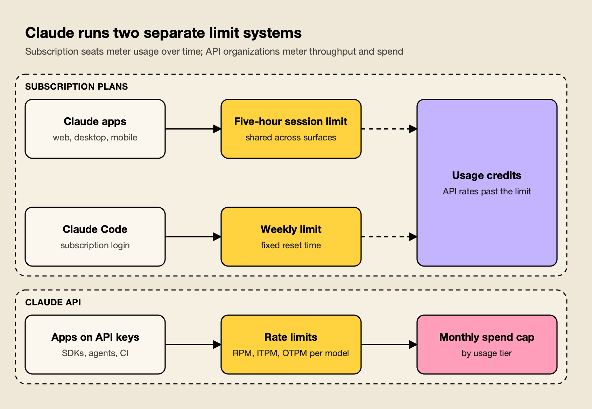
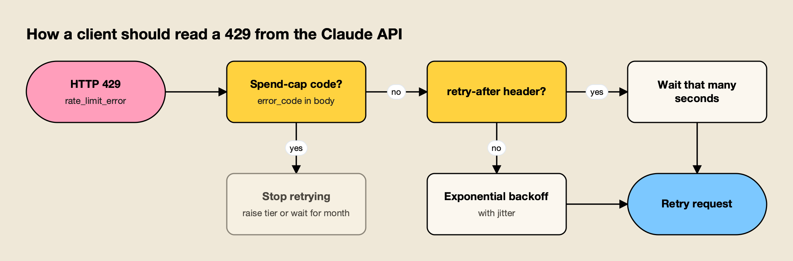
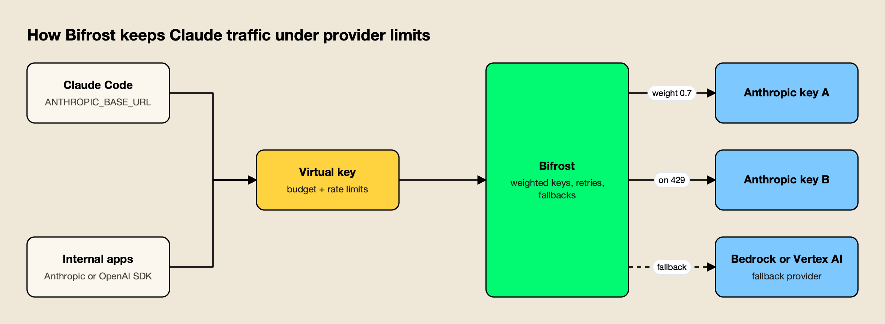

**TL;DR**
- Claude usage limits come in two separate systems: subscription plans (Free, Pro, Max, Team, seat-based Enterprise) meter a five-hour session and a weekly allowance, while the Claude API meters requests and tokens per minute plus a monthly spend cap.
- Max 5x and Max 20x give five and twenty times Pro's per-session allowance; Team Standard and Premium seats give 1.25x and 6.25x; usage-based Enterprise seats have no seat-level limit and bill everything at API rates.
- Claude Code shares the same pool as claude.ai, and its weekly limits have been 25% higher than the pre-promotion level since September 14, 2026.
- On the API, Start, Build and Scale tiers carry monthly spend caps of $500, $1,000 and $200,000, and for most models cached input tokens do not count toward the input-tokens-per-minute limit.
- Prompt caching, the Batch API, cheaper models and spreading traffic across keys and clouds through a gateway are the practical ways to stay under the limits.

Claude usage limits are the caps Anthropic places on how much a person or an organization can use Claude in a given window, and the rules differ depending on whether you pay for a subscription seat or for API tokens. A Pro or Max subscriber runs into a session limit that resets every five hours and a weekly limit that resets on a fixed schedule. A developer on the API runs into per-minute rate limits for each model class and a monthly spend cap set by the organization's usage tier. This explainer covers both systems from Anthropic's own help center and documentation as of October 21, 2026, then walks through how teams keep coding agents and production apps under the limits.

## Claude Usage Limits at a Glance

Claude subscription plans limit usage per five-hour session and per week, scaled as multiples of the Pro allowance, while usage-based Enterprise plans have no seat limit and bill at API rates. The API is limited separately, by requests and tokens per minute and by a monthly spend cap.

| Plan | Price (US, as of Oct 21, 2026) | Session allowance | Weekly limit | Past the limit |
|---|---|---|---|---|
| Free | $0 | Less than Pro (no published figure) | Not published | Wait for reset |
| Pro | $20 a month, or $17 a month billed annually | Baseline | Yes, all models | Usage credits at API rates |
| Max 5x | $100 a month | 5x Pro | Yes, plus a separate Fable limit | Usage credits |
| Max 20x | $200 a month | 20x Pro | Yes, plus a separate Fable limit | Usage credits |
| Team Standard seat | $25 monthly or $20 annually per member | 1.25x Pro | Yes, per member | Usage credits if the owner enables them |
| Team Premium seat | $125 monthly or $100 annually per member | 6.25x Pro | Yes, per member | Usage credits if the owner enables them |
| Enterprise (usage-based) | Seat fee plus usage at API rates | No seat-level limit | None | Admin spend limits |

Prices come from Anthropic's [Pro plan article](https://support.claude.com/en/articles/8325606-what-is-the-pro-plan#:~:text=The%20Pro%20plan%20is%20available%20for%20%2420%20per%20month), the [Max plan article](https://support.claude.com/en/articles/11049741-what-is-the-max-plan#:~:text=Max%2020x%3A%20%24200%20per%20month), the [Team plan article](https://support.claude.com/en/articles/9266767-what-is-the-team-plan#:~:text=%2425%20per%20member%20per%20month) and Anthropic's pricing page, all of which note that prices are subject to change.

*Figure 1: A Pro or Max login draws on session and weekly allowances; an API key draws on per-minute rate limits and a monthly spend cap, and neither pool tops up the other.*

The two systems do not share credit. Anthropic's Pro article notes that [the Pro plan does not include API usage through the Claude Console](https://support.claude.com/en/articles/8325606-what-is-the-pro-plan#:~:text=The%20Pro%20plan%20does%20not%20include%20API%20usage%20through%20the%20Claude%20Console), and the [monthly API credits included with Max plans](https://support.claude.com/en/articles/11145838-use-claude-code-with-your-pro-or-max-plan#:~:text=Monthly%20API%20credits%20included%20with%20Max%20plans) cannot be spent in Claude Code or the Claude apps.

## How Claude Pro Usage Limits Work

Claude Pro usage limits combine a session allowance that resets every five hours with a weekly cap across all models. Anthropic does not publish a message count, because each message costs a different amount.

Anthropic's help center states that [paid plans have two types of usage limits](https://support.claude.com/en/articles/11647753-how-do-usage-and-length-limits-work#:~:text=Paid%20plans%20have%20two%20types%20of%20usage%20limits,weekly%20limits%20that%20reset%20once%20every%20week). The session limit runs on a five-hour clock. The weekly limit does not roll from your first message: [weekly limits reset at a fixed time each week that is assigned to your account](https://support.claude.com/en/articles/8325606-what-is-the-pro-plan#:~:text=Weekly%20limits%20reset%20at%20a,assigned%20to%20your%20account), and the next reset time appears under Settings > Usage.

[Your usage is affected by several factors](https://support.claude.com/en/articles/11647753-how-do-usage-and-length-limits-work#:~:text=Your%20usage%20is%20affected%20by%20several%20factors), according to Anthropic, including conversation length, the features in use, the model and the selected effort level. The [usage limit best practices article](https://support.claude.com/en/articles/9797557-usage-limit-best-practices#:~:text=Additional%20factors%20that%20affect%20your%20usage%20limits%20include) adds file attachment size, Research and web search, artifacts and multi-step tasks such as running code to that list.

Two more details matter:

- **One pool across surfaces.** Anthropic says [your usage of all different Claude product surfaces](https://support.claude.com/en/articles/11647753-how-do-usage-and-length-limits-work#:~:text=usage%20of%20all%20different%20Claude%20product%20surfaces,counts%20towards%20the%20same%20usage%20limit), so a morning in Claude Code reduces what is left for chat in the afternoon.
- **Discretionary caps.** The Pro and Max articles both reserve the right, [to manage capacity and ensure fair access to all users](https://support.claude.com/en/articles/8325606-what-is-the-pro-plan#:~:text=to%20manage%20capacity%20and%20ensure%20fair%20access%20to%20all%20users), to limit usage in other ways, such as monthly caps or model and feature limits.

The Free plan has a session limit too, but less of it: Pro's first listed benefit is [more usage per session than the Free plan](https://support.claude.com/en/articles/8325606-what-is-the-pro-plan#:~:text=More%20usage%20per%20session%20than%20the%20Free%20plan). Fable models are not available on the Free plan.

## Claude Max, Team and Enterprise Limits

Higher plans scale the Pro allowance rather than switching to a different meter. Max multiplies the per-session allowance by five or twenty, Team seats by 1.25 or 6.25 per member, and current Enterprise seats drop seat-level limits entirely in favor of metered billing at API rates.

**Max.** Anthropic's Max article describes two tiers: [Max 5x includes five times the Pro plan's per-session usage allowance](https://support.claude.com/en/articles/11049741-what-is-the-max-plan#:~:text=Max%205x%20includes%20five%20times%20the%20Pro%20plan%27s%20per%2Dsession%20usage%20allowance), and Max 20x includes twenty times. Both tiers keep the five-hour session and a weekly limit across all models. Max also carries [a separate weekly limit for Fable](https://support.claude.com/en/articles/11145838-use-claude-code-with-your-pro-or-max-plan#:~:text=Max%20plans%20also%20have%20a%20separate%20weekly%20limit%20for%20Fable).

**Fable on each plan.** On Max and on premium Team and seat-based Enterprise seats, [you can use up to 50% of your weekly usage limits on Fable models](https://support.claude.com/en/articles/15424964-claude-fable-models-on-your-plan#:~:text=You%20can%20use%20up%20to,at%20no%20extra%20cost), and those requests draw down the weekly limit faster than other models. On Pro and standard seats, Fable 5 and Fable 5.1 are not in the included allowance at all; [both models run on pay-as-you-go usage credits](https://support.claude.com/en/articles/15424964-claude-fable-models-on-your-plan#:~:text=both%20models%20run%20on%20pay%2Das%2Dyou%2Dgo%20usage%20credits).

**Team.** Limits on Team plans apply to each seat. [Team plan Standard seats include 1.25x the Pro plan's per-session usage allowance](https://support.claude.com/en/articles/9266767-what-is-the-team-plan#:~:text=Team%20plan%20Standard%20seats%20include%201.25x), and [Premium seats include 6.25x](https://support.claude.com/en/articles/9266767-what-is-the-team-plan#:~:text=Team%20plan%20Premium%20seats%20include%206.25x). Anthropic is explicit that [usage limits on Team plans are per-member](https://support.claude.com/en/articles/9266767-what-is-the-team-plan#:~:text=Usage%20limits%20on%20Team%20plans%20are%20per%2Dmember), so one developer exhausting a seat does not slow anyone else, and allowances cannot be pooled or transferred.

**Enterprise.** Current Enterprise plans price the seat for access only. Anthropic states that [there are no per-seat usage limits and no included token allowance](https://support.claude.com/en/articles/9797531-what-is-the-enterprise-plan#:~:text=There%20are%20no%20per%2Dseat%20usage%20limits%20and%20no%20included%20token%20allowance); every token in Chat, Claude Code or Cowork is billed at standard API rates, and admins cap cost with organization and user spend limits. Older seat-based Enterprise contracts with Standard and Premium seats still carry session and weekly limits like Team.

The [Claude Opus 5.5 explainer](/blog/claude-opus-5-5/) covers the flagship model's per-token pricing.

## Claude Code Usage Limits

Claude Code usage limits are the same subscription limits as claude.ai when you sign in with a Pro, Max, Team or Enterprise account, and per-token API billing when you sign in with an API key. Weekly limits in Claude Code have been 25% above their pre-promotion level since September 14, 2026.

Anthropic's Claude Code article for individual plans says [both Pro and Max plans have a five-hour session limit and a weekly limit](https://support.claude.com/en/articles/11145838-use-claude-code-with-your-pro-or-max-plan#:~:text=Both%20Pro%20and%20Max%20plans,and%20a%20weekly%20limit), shared with Claude on the web, desktop and mobile. IDE extensions draw from the same pool. When the session limit arrives in the middle of a response, [Claude Code may keep working briefly so it can finish the step in progress](https://support.claude.com/en/articles/11145838-use-claude-code-with-your-pro-or-max-plan#:~:text=Claude%20Code%20may%20keep%20working,the%20step%20in%20progress); on Pro this wrap-up allowance applies once per weekly period, and on Max it can apply at each session limit.

A promotion meant [your weekly usage limit in Claude Code was 50% higher](https://support.claude.com/en/articles/15910845-claude-code-may-august-2026-weekly-limits-promotion#:~:text=your%20weekly%20usage%20limit%20in%20Claude%20Code%20was%2050%25%20higher) from May 13 through September 13, 2026, and part of it became permanent: [starting September 14, 2026, weekly limits in Claude Code are 25% higher](https://support.claude.com/en/articles/15910845-claude-code-may-august-2026-weekly-limits-promotion#:~:text=starting%20September%2014%2C%202026%2C%20weekly%20limits%20in%20Claude%20Code%20are%2025%25%20higher,than%20they%20were%20before%20the%20promotion) for Pro, Max, Team and seat-based Enterprise plans. The increase applies to Claude Code only, not to Claude chat or Cowork.

Three things decide how fast a Claude Code session burns through the allowance:

1. **Authentication.** [If you have an ANTHROPIC_API_KEY environment variable set](https://support.claude.com/en/articles/11145838-use-claude-code-with-your-pro-or-max-plan#:~:text=If%20you%20have%20an%20ANTHROPIC_API_KEY%20environment%20variable%20set%20on%20your%20system), Claude Code uses that key instead of the subscription and bills API rates.
2. **Model choice.** Anthropic's Claude Code guide warns that [Opus costs several times more per turn than Sonnet](https://support.claude.com/en/articles/14552983-models-usage-and-limits-in-claude-code#:~:text=Opus%20costs%20several%20times%20more%20per%20turn%20than%20Sonnet). The built-in `/model opusplan` setting plans with Opus and executes with Sonnet.
3. **Context size.** Every turn resends the conversation so far, CLAUDE.md and any files Claude has read. Anthropic's rule of thumb is to [use /clear when starting a new task, and /compact when continuing a long one](https://support.claude.com/en/articles/14552983-models-usage-and-limits-in-claude-code#:~:text=use%20%2Fclear%20when%20starting%20a%20new%20task,when%20continuing%20a%20long%20one).

Inside the terminal, `/usage` shows session and weekly bars for subscribers and a token-based cost estimate for API users. For teams comparing agents on these terms, the [Claude Code vs Codex comparison](/blog/claude-code-vs-codex/) sets Claude Code's plan structure against OpenAI's, and a guide on [how teams manage Claude Code usage limits](https://www.getmaxim.ai/articles/claude-code-usage-limits-how-teams-manage-them/) covers rollout patterns for larger engineering groups.

## Usage Credits, Bundles and Limit Resets

Paid subscribers who reach a limit can wait for the reset, upgrade, enable usage credits that bill further use at API rates, prepay discounted bundles, or redeem an occasional free limit reset. Usage credits are the main extra-usage option and work on Pro, Max, Team and seat-based Enterprise plans.

With usage credits enabled, requests [switch to consumption-based pricing at standard API rates](https://support.claude.com/en/articles/12429409-manage-usage-credits-for-paid-claude-plans#:~:text=switch%20to%20consumption%2Dbased%20pricing%20at%20standard%20API%20rates) the moment a session, weekly or Fable limit is used up. [Your usage continues until you reach your monthly spend limit](https://support.claude.com/en/articles/12429409-manage-usage-credits-for-paid-claude-plans#:~:text=Your%20usage%20continues%20until%20you%20reach%20your%20monthly%20spend%20limit), or until the balance runs out with auto-reload off. The regular limits still reset on their usual schedule, and the dashboard shows included usage and credit spend separately.

| Option | Plans | How it works |
|---|---|---|
| Usage credits | Pro, Max, Team, seat-based Enterprise | Pay-as-you-go at API rates after a limit; monthly spend cap optional |
| Usage bundles | Pro, Max, Team | Prepaid credit at 10% to 30% off; capped at $2,000 a month for Pro and Max, $3,000 for Team |
| Limit reset | Eligible plans, occasional | Restores the session or weekly limit to full once |
| Upgrade | Pro to Max, Standard to Premium seat | New plan's limits apply immediately |

Bundles let subscribers [save up to 30% compared to standard usage credit rates](https://support.claude.com/en/articles/14246112-buy-usage-bundles#:~:text=save%20up%20to%2030%25%20compared%20to%20standard%20usage%20credit%20rates), with $50, $250 and $1,000 bundles discounted 10%, 20% and 30%. [Limit resets are given occasionally to eligible plans](https://support.claude.com/en/articles/17007452-what-is-a-limit-reset#:~:text=Limit%20resets%20are%20given%20occasionally%20to%20eligible%20plans) and restore one limit to full when redeemed from Settings > Usage on the web or desktop.

On Team and seat-based Enterprise plans, owners can cap credit spend for the organization, per seat tier or per user. Anthropic notes it is possible to [slightly exceed your defined spend limit](https://support.claude.com/en/articles/12005970-manage-usage-credits-for-team-and-seat-based-enterprise-plans#:~:text=slightly%20exceed%20your%20defined%20spend%20limit), because the check runs before a request and the cost is calculated after it.

## Claude API Rate Limits by Usage Tier

Claude API rate limits are set per organization by usage tier and measured in requests per minute (RPM), input tokens per minute (ITPM) and output tokens per minute (OTPM) for each model class, alongside a monthly spend cap. Organizations move from Evaluation to Start, Build and Scale automatically as usage history builds.

Anthropic's [rate limits documentation](https://platform.claude.com/docs/en/api/rate-limits#:~:text=Limits%20are%20defined%20by,as%20they%20use%20the%20API) says organizations are placed on a tier automatically and that new organizations [may start in the Evaluation tier](https://platform.claude.com/docs/en/api/rate-limits#:~:text=may%20start%20in%20the%20Evaluation%20tier), below the published limits. [Each row in the following tables has its own RPM, ITPM, and OTPM limits](https://platform.claude.com/docs/en/api/rate-limits#:~:text=Each%20row%20in%20the%20following,ITPM%2C%20and%20OTPM%20limits), so Opus 5.5, Sonnet 5.5 and Haiku 5.5 each get their own bucket. The table shows the standard limits as of October 21, 2026.

| Tier | Monthly spend cap | Opus 5.5 / Sonnet 5.5 / Haiku 5.5 (each) | Fable 5.x (combined) | Batch queue |
|---|---|---|---|---|
| Start | $500 | 1,000 RPM, 2M ITPM, 400K OTPM | 1,000 RPM, 500K ITPM, 100K OTPM | 200,000 requests |
| Build | $1,000 | 5,000 RPM, 5M ITPM, 1M OTPM | 2,000 RPM, 1.5M ITPM, 300K OTPM | 300,000 requests |
| Scale | $200,000 | 10,000 RPM, 10M ITPM, 2M OTPM | 4,000 RPM, 4M ITPM, 800K OTPM | 500,000 requests |
| Custom | None (negotiated) | Negotiated | Negotiated | Negotiated |

Several rules shape how those numbers behave in practice:

- **Token bucket.** [The API uses the token bucket algorithm to do rate limiting](https://platform.claude.com/docs/en/api/rate-limits#:~:text=The%20API%20uses%20the%20token%20bucket%20algorithm%20to%20do%20rate%20limiting), so capacity refills continuously, and a limit of 60 RPM [might be enforced as 1 request per second](https://platform.claude.com/docs/en/api/rate-limits#:~:text=might%20be%20enforced%20as%201%20request%20per%20second). Bursts can trigger 429s even when the minute's total is under the limit.
- **Cache-aware ITPM.** [For most Claude models, only uncached input tokens count toward your ITPM rate limits](https://platform.claude.com/docs/en/api/rate-limits#:~:text=For%20most%20Claude%20models%2C%20only,your%20ITPM%20rate%20limits). Anthropic's example: [with a 2,000,000 ITPM limit and an 80% cache hit rate](https://platform.claude.com/docs/en/api/rate-limits#:~:text=With%20a%202%2C000%2C000%20ITPM%20limit%20and%20an%2080%25%20cache%20hit%20rate), an organization can process 10 million total input tokens a minute.
- **OTPM counts real output.** [The max_tokens parameter does not factor into OTPM rate limit calculations](https://platform.claude.com/docs/en/api/rate-limits#:~:text=The%20max_tokens%20parameter%20does%20not%20factor%20into%20OTPM%20rate%20limit%20calculations), so a generous `max_tokens` costs nothing in throughput.
- **Spend cap.** At the cap, [API usage pauses until 00:00 UTC on the first day of the next month](https://platform.claude.com/docs/en/api/rate-limits#:~:text=API%20usage%20pauses%20until%2000%3A00,of%20the%20next%20month) unless the organization requests a higher tier. A lower spend limit set by the organization returns HTTP 400 rather than 429.
- **Workspaces.** Admins can give each Console workspace lower limits, but [organization-wide limits always apply, even if Workspace limits add up to more](https://platform.claude.com/docs/en/api/rate-limits#:~:text=Organization%2Dwide%20limits%20always%20apply%2C%20even%20if%20Workspace%20limits%20add%20up%20to%20more).

Anthropic's support article on 429 errors says an organization can [request higher limits in the Console once](https://support.claude.com/en/articles/8114527-i-m-encountering-429-errors-and-i-m-worried-my-rate-limit-is-too-low-what-should-i-do#:~:text=request%20higher%20limits%20in%20the%20Console%20once,at%20least%2050%25%20of%20your%20current%20limits) it is using at least half of its current allowance. A guide to [LLM API rate limiting with virtual keys and budgets](https://www.getmaxim.ai/articles/llm-api-rate-limiting-with-virtual-keys-and-budgets/) covers how platform teams translate an organization-level limit like this into per-team quotas.

## Handling 429 Errors and Retry-After Headers

A 429 from the Claude API means either a rate limit or the monthly spend cap. Rate-limit 429s carry a retry-after header and recover within seconds; spend-cap 429s carry the code enforced_spend_limit_reached, have no retry-after header, and fail until the month rolls over or the tier is raised.

The [Messages API returns a 429 error describing which rate limit was exceeded](https://platform.claude.com/docs/en/api/rate-limits#:~:text=If%20you%20exceed%20any%20of,rate%20limit%20was%20exceeded), and Anthropic's instruction is simple: when the response has a retry-after header, wait that many seconds. The spend-cap response shares the `rate_limit_error` type, but [the response has no retry-after header](https://platform.claude.com/docs/en/api/rate-limits#:~:text=the%20response%20has%20no%20retry%2Dafter%20header), and Anthropic tells developers to read `error.details.error_code`: [use it to tell this response apart from a rate limit](https://platform.claude.com/docs/en/api/rate-limits#:~:text=Use%20it%20to%20tell%20this%20response%20apart%20from%20a%20rate%20limit).

*Figure 2: Only a rate-limit 429 is worth retrying; a spend-cap 429 has no retry-after header and keeps failing until the next month or a tier increase.*

Two other errors look similar under load. A 529 means [the API is temporarily overloaded](https://platform.claude.com/docs/en/api/errors#:~:text=The%20API%20is%20temporarily%20overloaded) across all customers, not that your organization hit its limit. And a sharp jump in traffic can produce 429s from [acceleration limits on the API](https://platform.claude.com/docs/en/api/rate-limits#:~:text=You%20might%20also%20encounter%20429,limits%20on%20the%20API), which Anthropic says to avoid by ramping up gradually.

Anthropic's SDKs handle the common case: [the official SDK automatically retries transient failures](https://platform.claude.com/docs/en/api/errors#:~:text=The%20official%20SDK%20automatically%20retries%20transient%20failures,twice%20by%20default) with exponential backoff, honoring retry-after when present. For capacity planning, every response also carries `anthropic-ratelimit-*` headers for requests, input tokens and output tokens; the combined token headers [display the values for the most restrictive limit currently in effect](https://platform.claude.com/docs/en/api/rate-limits#:~:text=display%20the%20values%20for%20the%20most%20restrictive%20limit%20currently%20in%20effect).

Organizations that need reserved throughput used to buy Priority Tier, but [Priority Tier capacity commitments are no longer available for purchase](https://platform.claude.com/docs/en/api/service-tiers#:~:text=Priority%20Tier%20capacity%20commitments%20are%20no%20longer%20available%20for%20purchase) as of October 2026; existing commitments run until their contract end date. Even then, [requests assigned Priority Tier pull from both the Priority Tier capacity and the regular rate limits](https://platform.claude.com/docs/en/api/service-tiers#:~:text=Requests%20assigned%20Priority%20Tier%20pull,the%20regular%20rate%20limits).

## Claude Rate Limits on Amazon Bedrock and Google Vertex AI

Claude on Amazon Bedrock and Google Cloud Vertex AI is governed by each cloud's own quotas rather than Anthropic's usage tiers. That makes the clouds a separate pool of capacity, which is why teams use them as overflow when an Anthropic organization is at its limit.

Anthropic's guide to [Claude in Amazon Bedrock](https://platform.claude.com/docs/en/build-with-claude/claude-in-amazon-bedrock#:~:text=Default%20quota%20is%202%20million%20input%20tokens%20per%20minute%20%28TPM)) sets a default quota of 2 million input tokens per minute, with requests of up to 5 million input TPM and 500,000 output TPM possible without extra Anthropic approval. [AWS enforces requests-per-minute (RPM) limits on the Bedrock side](https://platform.claude.com/docs/en/build-with-claude/claude-in-amazon-bedrock#:~:text=AWS%20enforces%20requests%2Dper%2Dminute%20%28RPM) limits on the Bedrock side), so RPM increases go through AWS support.

On Google Cloud, Claude models launched after May 26, 2026 use shared lineage quotas: [a single quota limit is shared across all model versions in a model lineage for a given location](https://docs.cloud.google.com/gemini-enterprise-agent-platform/models/partner-models/claude/quotas#:~:text=A%20single%20quota%20limit%20is,for%20a%20given%20location). Calls to two Opus versions on the global endpoint draw from one bucket, while [quotas on the global endpoint and each multi-region endpoint are independent buckets](https://docs.cloud.google.com/gemini-enterprise-agent-platform/models/partner-models/claude/quotas#:~:text=Quotas%20on%20the%20global%20endpoint%20and%20each%20multi%2Dregion%20endpoint%20are%20independent%20buckets).

| Platform | Unit of limit | Default as of Oct 21, 2026 | Where to raise it |
|---|---|---|---|
| Claude API | RPM, ITPM, OTPM per model class, plus monthly spend cap | Start tier: 1,000 RPM, 2M ITPM, 400K OTPM on Opus 5.5 | Claude Console tier request |
| Amazon Bedrock | Input and output TPM, plus AWS-side RPM | 2M input TPM | Quota request (up to 5M input TPM); AWS support for RPM |
| Vertex AI | Requests and tokens per minute per model lineage and endpoint | Varies by model and region | Google Cloud quotas page |

The site's roundup of [AI gateways for Bedrock, Vertex and Azure failover](/blog/ai-gateways-for-bedrock-vertex-azure-failover/) compares tools that route between these clouds automatically.

## How to Stay Under Claude Rate Limits

The most effective ways to stay under Claude rate limits are caching repeated context, moving non-urgent work to the Batch API, matching the model to the task, watching the rate-limit headers and Console charts, and spreading traffic across workspaces, keys and cloud providers so no single bucket takes the full load.

**Prompt caching.** Because cache reads do not count toward ITPM on most models, caching is a throughput tool as well as a cost tool. [Cache read tokens are 0.1 times the base input tokens price](https://platform.claude.com/docs/en/build-with-claude/prompt-caching#:~:text=Cache%20read%20tokens%20are%200.1%20times%20the%20base%20input%20tokens%20price) on most models, and [by default, the cache has a 5-minute lifetime](https://platform.claude.com/docs/en/build-with-claude/prompt-caching#:~:text=By%20default%2C%20the%20cache%20has%20a%205%2Dminute%20lifetime), with a 1-hour option at higher write cost. On subscriptions, [content in projects is cached and counts less against your limits when reused](https://support.claude.com/en/articles/9797557-usage-limit-best-practices#:~:text=Content%20in%20projects%20is%20cached,your%20limits%20when%20reused).

**Batching.** [The Message Batches API has its own set of rate limits](https://platform.claude.com/docs/en/api/rate-limits#:~:text=The%20Message%20Batches%20API%20has,shared%20across%20all%20models), separate from the Messages API buckets, and [all usage is charged at 50% of the standard API prices](https://platform.claude.com/docs/en/build-with-claude/batch-processing#:~:text=All%20usage%20is%20charged%20at%2050%25%20of%20the%20standard%20API%20prices). Evaluations, backfills and nightly summarization jobs rarely need a synchronous answer.

**Model selection.** Haiku 5.5, Sonnet 5.5 and Opus 5.5 each have their own rate limit, so routing routine calls to a smaller model frees headroom on the larger one as well as cutting cost. The site's explainer on [model routing and inference cost](/blog/model-routing-inference-cost/) covers routing policies in more depth.

**Monitoring.** The Console's Usage page charts hourly maximum uncached input tokens per minute against the current limit and shows the cache rate. For Claude Code fleets, Anthropic's [Claude Code costs guide](https://code.claude.com/docs/en/costs#:~:text=the%20average%20cost%20is%20around%20%2413%20per%20developer%20per%20active%20day) reports an average of about $13 per developer per active day and publishes a per-user sizing table for organization rate limits:

| Team size | TPM per user | RPM per user |
|---|---|---|
| 1-5 users | 200k-300k | 5-7 |
| 5-20 users | 100k-150k | 2.5-3.5 |
| 20-50 users | 50k-75k | 1.25-1.75 |
| 50-100 users | 25k-35k | 0.62-0.87 |
| 100-500 users | 15k-20k | 0.37-0.47 |
| 500+ users | 10k-15k | 0.25-0.35 |

Anthropic explains that [the TPM per user decreases as team size grows](https://code.claude.com/docs/en/costs#:~:text=The%20TPM%20per%20user%20decreases%20as%20team%20size%20grows) because fewer developers are active at once. An article on [Claude Code logging and spend limits](https://www.getmaxim.ai/articles/claude-code-logging-and-spend-limits-for-engineering-teams/) covers the reporting side for engineering managers.

**Spreading load.** Once one organization's limits are the constraint, the options are additional capacity (a tier increase, Bedrock or Vertex) and something that divides traffic across it. Three common approaches:

- **Anthropic Console workspaces.** Per-workspace RPM, ITPM, OTPM and spend limits keep one product from starving another inside a single organization, but they cannot add capacity beyond the organization's tier.
- **LiteLLM.** The open-source proxy supports per-key and per-team budgets; its docs describe how to [create virtual keys without team_id for individual spending limits](https://docs.litellm.ai/docs/proxy/users#:~:text=Create%20virtual%20keys%20without%20team_id%20for%20individual%20spending%20limits), and its router [automatically distributes requests across multiple deployments of the same model](https://docs.litellm.ai/docs/proxy/load_balancing#:~:text=LiteLLM%20automatically%20distributes%20requests%20across%20multiple%20deployments%20of%20the%20same%20model). Budget enforcement depends on a connected database.
- **Cloudflare AI Gateway.** A managed option at the edge; [you can define rate limits as the number of requests that get sent in a specific time frame](https://developers.cloudflare.com/ai-gateway/features/rate-limiting/#:~:text=You%20can%20define%20rate%20limits,a%20specific%20time%20frame), with fixed or sliding windows applied to the whole gateway.

Kong AI Gateway covers similar ground for teams already running Kong. The [best LLM gateways roundup](/blog/best-llm-gateways/) compares the wider field, and an article on [tackling LLM rate limits and outages with an AI gateway](https://www.getmaxim.ai/articles/tackle-llm-rate-limits-and-outages-with-an-ai-gateway/) explains the pattern in general terms.

## Managing Claude Limits Through a Gateway: The Bifrost Example

A gateway can enforce budgets and rate limits per developer or application before Anthropic's limits are reached, rotate across several API keys when one returns a 429, and fail over to Bedrock or Vertex AI. [Bifrost](https://www.getmaxim.ai/bifrost), an open-source AI gateway from Maxim AI, documents each of those steps, which is why it serves as the worked example here.

[Bifrost](https://github.com/maximhq/bifrost) routes 25+ providers and 10,000+ models through one OpenAI-compatible API, and its published benchmark reports 11 µs of added overhead per request at 5,000 RPS on an AWS t3.xlarge (the [benchmark resources page](https://www.getmaxim.ai/resources/benchmarks) has the setup). Claude Code connects to it by pointing `ANTHROPIC_BASE_URL` at the gateway's Anthropic-compatible endpoint.

*Figure 3: Per-key budgets stop runaway spend before the provider does, while key rotation and cloud fallbacks absorb a 429 from any single Anthropic key.*

**Budgets and rate limits per virtual key.** Each developer, team or service gets a virtual key with its own budget and rate limits. Bifrost's [budget and limits documentation](https://docs.getbifrost.ai/features/governance/budget-and-limits#:~:text=Request%20Limits%3A%20Control%20the%20maximum%20number%20of%20API%20calls) describes request limits and [token limits](https://docs.getbifrost.ai/features/governance/budget-and-limits#:~:text=Token%20Limits%3A%20Control%20the%20maximum%20number%20of%20tokens) that run in parallel, with rate-limit windows of a minute, an hour or a day and budget periods from a day to a year. Limits can also sit on a provider within a key: [if a provider config exceeds its rate limits, that provider is excluded from routing](https://docs.getbifrost.ai/features/governance/budget-and-limits#:~:text=If%20a%20provider%20config%20exceeds,is%20excluded%20from%20routing) while other providers on the key stay available.

**Multi-key load balancing.** [Bifrost uses weighted random selection to distribute requests across multiple keys](https://docs.getbifrost.ai/features/keys-management#:~:text=Bifrost%20uses%20weighted%20random%20selection%20to%20distribute%20requests%20across%20multiple%20keys), and the docs suggest teams [assign higher weights to premium keys with better rate limits](https://docs.getbifrost.ai/features/keys-management#:~:text=Assign%20higher%20weights%20to%20premium%20keys%20with%20better%20rate%20limits). Keys from separate Anthropic organizations each carry their own tier limits.

**429 rotation and failover.** On a per-key failure such as a 429, Bifrost rotates to another key in the pool, and [for 429 rotations a backoff is still applied to let account-level quota windows slide](https://docs.getbifrost.ai/features/retries-and-fallbacks#:~:text=for%20429%20rotations%20a%20backoff,account%2Dlevel%20quota%20windows%20slide). If the provider still fails, the request moves down a fallback chain, and [each fallback provider gets its own full retry budget](https://docs.getbifrost.ai/features/retries-and-fallbacks#:~:text=Each%20fallback%20provider%20gets%20its%20own%20full%20retry%20budget).

With [Amazon Bedrock](https://www.getmaxim.ai/bifrost/guides/providers/bedrock) and [Vertex AI](https://www.getmaxim.ai/bifrost/guides/providers/vertex-ai) configured as fallbacks, a Claude request can land on cloud quota when the Anthropic organization is saturated. The gateway also records a provider's [Retry-After header](https://docs.getbifrost.ai/features/retries-and-fallbacks#:~:text=Retry%2DAfter%20header) as `retry_after_ms` on the error.

**Subscriptions behind the gateway.** Teams that bill Claude Code to Pro, Max, Team or Enterprise seats can still route through the gateway; the [Claude Code integration guide](https://docs.getbifrost.ai/cli-agents/claude-code#:~:text=To%20keep%20billing%20on%20a,applies%20governance%20and%20logging) covers signing in with `/login` and sending the virtual key in an `x-bf-vk` header, so subscription limits apply and the gateway logs and governs each request.

**Enterprise tier.** Clustering, adaptive routing that replaces static key weights with measured ones, and budget alerting to Slack or PagerDuty are part of Bifrost Enterprise.

For configuration detail, the project's [Claude Code resource hub](https://www.getmaxim.ai/resources/claude-code), [Anthropic provider guide](https://www.getmaxim.ai/bifrost/guides/providers/anthropic) and an article on [budget and rate-limit architecture for multi-tenant LLM platforms](https://www.getmaxim.ai/articles/budget-and-rate-limit-architecture-for-multi-tenant-llm-platforms/) go further.

The site's comparison of [Claude Code gateways](/blog/claude-code-gateways/) sets Bifrost against other self-hosted options.

## Choosing the Right Fix for Your Limit

The right response to a Claude limit depends on which system produced it. Subscription limits are solved with plan choice, model discipline and usage credits; API rate limits are solved with caching, batching, tier increases and spreading traffic across keys and clouds.

Anthropic's own advice to Pro users who [consistently hit limits](https://support.claude.com/en/articles/11145838-use-claude-code-with-your-pro-or-max-plan#:~:text=Consider%20upgrading%20to%20the%20Max%205x%20plan%20if%20you%20consistently%20hit%20limits) is to consider Max 5x, and the same advice applies one step up from Max 5x to Max 20x. Before upgrading, check that `ANTHROPIC_API_KEY` is unset, that Opus is reserved for planning, and that sessions are cleared between tasks; Anthropic's own guidance suggests those habits account for most early exhaustion. A separate explainer on [Claude Pro usage limits and workarounds](https://www.getmaxim.ai/articles/claude-pro-usage-limits-explained-and-how-to-work-around-them/) covers the same ground from the subscriber's side.

For teams, the useful question is whether limits should be enforced per person or per organization. Team seats enforce them per member and cannot be pooled; usage-based Enterprise removes seat limits and replaces them with spend limits; API organizations enforce them per model class across everyone. Teams that run Claude Code alongside API workloads usually end up with a layer that applies per-developer budgets and spreads load across Anthropic, Bedrock and Vertex, a pattern the site's guides to [AI gateways for coding agents](/blog/ai-gateways-for-coding-agents/) and [AI gateways for Anthropic, OpenAI and Gemini](/blog/ai-gateways-for-anthropic-openai-gemini/) examine tool by tool. Claude usage limits will keep shifting, as the September 14 change showed, so the figures here are a snapshot as of October 21, 2026.
