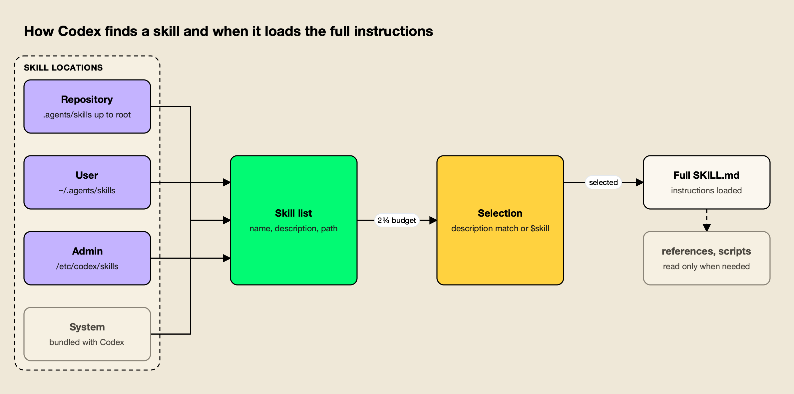
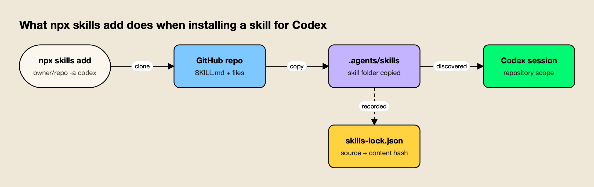

**TL;DR**
- Codex skills are folders with a `SKILL.md` file that follow the open Agent Skills standard; Codex loads only each skill's name, description and path up front, then reads the full instructions when a task needs them.
- Codex scans `.agents/skills` from the working directory up to the repository root, plus `~/.agents/skills`, `/etc/codex/skills` and its bundled system skills.
- The open-source `skills` CLI installs a skill from any GitHub repository into the folder Codex reads: `npx skills add <owner>/<repo> -a codex`.
- Six MIT-licensed skills from the build-with-ai-hq organization target production AI work: coding agent governance, team skill management, MCP operations, LLM cost, LLM security and LLM observability.
- Skills run with the agent's permissions, so preview with `--list`, read the files and pin versions before rolling one out to a team.

Codex skills are reusable instruction packages that OpenAI's Codex coding agent loads on demand, so a workflow written once (a release checklist, a security review, a cost audit) can be applied the same way in every session. Each skill is a folder with a `SKILL.md` file, and Codex decides when to use it from a one-line description. This guide covers where Codex looks for skills, how it chooses one, how to install skills from GitHub with a single command, and six skills worth installing for teams that run AI in production.

## What Codex Skills Are

A Codex skill is a directory containing a `SKILL.md` file with YAML frontmatter (a required `name` and `description`) and Markdown instructions, optionally alongside `scripts/`, `references/` and `assets/` folders. Codex uses the same format as the open Agent Skills standard, so one skill can work across several coding agents.

OpenAI's [Codex skills documentation](https://developers.openai.com/codex/skills) describes skills as packages of "instructions, resources, and optional scripts" that let Codex follow a workflow reliably, and states that they build on the [open agent skills standard](https://agentskills.io). The [Agent Skills specification](https://agentskills.io/specification) sets the rules every compliant tool reads:

| Field or folder | Required | What the specification says |
|---|---|---|
| `name` | Yes | 1-64 characters, lowercase letters, digits and single hyphens, and it must match the folder name |
| `description` | Yes | 1-1,024 characters describing what the skill does and when to use it |
| `license`, `compatibility`, `metadata` | No | License reference, environment requirements (up to 500 characters) and a string map, often used for a version |
| `scripts/`, `references/`, `assets/` | No | Executable code, documentation loaded on demand, and templates or data files |

Codex adds one optional file of its own. An `agents/openai.yaml` inside the skill folder sets display metadata for the ChatGPT desktop app, an invocation policy, and tool dependencies such as an MCP server the skill expects. According to the docs, standalone skills are available in the ChatGPT desktop app, Codex CLI and the Codex IDE extension, while skills bundled in plugins also reach ChatGPT on the web and mobile.

Skills sit next to the other ways of steering a coding agent. `AGENTS.md` files give standing project instructions, MCP servers give the agent tools, and skills give it procedures that load only when relevant. This site's comparison of [Claude Code vs Codex](/blog/claude-code-vs-codex/) covers how the two agents differ more broadly, and an explainer on [how Anthropic's Agent Skills work](https://www.getmaxim.ai/articles/claude-skills-how-anthropics-agent-skills-work/) traces where the format came from.

## Where Codex Looks for Skills

Codex reads skills from four kinds of location: repository folders named `.agents/skills`, a per-user folder at `$HOME/.agents/skills`, an admin folder at `/etc/codex/skills`, and system skills bundled with Codex. In a Git repository it scans every `.agents/skills` folder from the current directory up to the repository root.

The scope table in OpenAI's docs is the reference for where a skill must live to be found:

| Scope | Location | Typical use |
|---|---|---|
| Repository | `$CWD/.agents/skills` | Skills for one service or module, checked into that folder |
| Repository | `$CWD/../.agents/skills` (any parent up to the root) | Skills shared by a group of folders in a monorepo |
| Repository | `$REPO_ROOT/.agents/skills` | Skills every engineer in the repository should get |
| User | `$HOME/.agents/skills` | Personal skills that apply to every repository |
| Admin | `/etc/codex/skills` | Machine-wide defaults, SDK scripts and automation |
| System | Bundled with Codex | OpenAI's own skills, such as `skill-creator` and plan |

Three details in the docs matter in practice. Codex follows symlinked skill folders, which is how installers keep one canonical copy and link it into several agents. When two skills share a `name`, Codex does not merge them, and both can appear in the skill selector. And Codex detects skill changes automatically, although the docs advise restarting it if an update does not appear.



*Figure 1: Codex pays for every installed skill's metadata in each session, but reads a skill's full instructions and files only after it decides to use that skill.*

The path is the detail most likely to trip up people moving from Claude Code. Claude Code reads `.claude/skills`; Codex does not list that folder. A skill that works in Claude Code needs to be copied, linked or installed into `.agents/skills` before Codex can see it.

## How Codex Decides When to Use a Skill

Codex uses progressive disclosure. At session start it lists each installed skill's name, description and file path within a context budget of 2% of the model's window (or 8,000 characters when the window is unknown), and reads the full `SKILL.md` only when it selects that skill, either because the task matches the description or because you named it.

There are two ways a skill gets activated, according to the docs:

- **Explicit invocation.** In Codex CLI or the IDE extension, run `/skills` or type `$` followed by the skill name. In the ChatGPT app, type `@`.
- **Implicit invocation.** Codex picks a skill on its own when the request matches the skill's `description`.

Because implicit selection depends on the description, the wording of that one field decides whether a skill is ever used. OpenAI advises front-loading the main use case and trigger words so a skill still matches when Codex shortens descriptions to fit its budget. With many skills installed, Codex trims descriptions first and may drop some skills from the initial list with a warning; the `skills.max_context_tokens` setting raises the budget to as much as 10,000 tokens.

Teams also get two controls over individual skills:

- **Disable without deleting.** A `[[skills.config]]` entry in `~/.codex/config.toml` with the skill's path and `enabled = false` turns it off after a restart.
- **Explicit-only skills.** Setting `allow_implicit_invocation: false` under `policy` in `agents/openai.yaml` stops Codex from choosing the skill on its own while keeping `$skill` mentions working.

The Agent Skills specification recommends keeping the body under 5,000 tokens and 500 lines and moving detail into `references/`. That advice has a direct cost logic in Codex: every installed skill's metadata is loaded in every session, and a skill's body is loaded every time it fires.

## Installing Codex Skills From GitHub With npx skills

The fastest way to add a published skill to Codex is the open-source `skills` CLI from Vercel Labs, run through npx. `npx skills add <owner>/<repo> -a codex` clones the repository, copies the skill into `./.agents/skills/<name>`, and records the source and a content hash in `skills-lock.json`, so the install can be reviewed and reproduced.

agitracker ran the [skills CLI](https://github.com/vercel-labs/skills) (version 1.7.4) in an empty Git project on October 28, 2026 to confirm the paths. Previewing a repository without installing anything:

```bash
npx skills add build-with-ai-hq/llm-cost-reduction --list
```

The CLI cloned the repository, reported "Found 1 skill", and printed the skill's description. Installing for Codex then took one command:

```bash
npx skills add build-with-ai-hq/secure-llm-apps -a codex -y
```

The skill landed in `./.agents/skills/secure-llm-apps`, which is the `$CWD/.agents/skills` repository scope in OpenAI's table. The same run with `-a claude-code` placed a skill in `./.claude/skills/` instead, and the lockfile recorded each skill's GitHub source, `skillPath` and a `computedHash`. The CLI closed with a reminder worth repeating: "Review skills before use; they run with full agent permissions."



*Figure 2: One install command puts a GitHub-hosted skill in the folder Codex already scans and leaves a lockfile entry that pins what was installed.*

The flags that matter most for Codex users:

| Command | What it does |
|---|---|
| `npx skills add <repo> --list` | Lists the skills in a repository without installing |
| `npx skills add <repo> -a codex -y` | Installs into `./.agents/skills` for Codex, skipping prompts |
| `npx skills add <repo> -g -a codex` | Installs at user level instead of in the project |
| `npx skills add <repo> -a codex claude-code` | Installs one skill for several agents at once |
| `npx skills list` | Shows installed skills |
| `npx skills update` | Updates installed skills to their latest versions |
| `npx skills remove <skill>` | Removes an installed skill |

Codex also has a native route. Its built-in `$skill-installer` installs curated skills from OpenAI's [skills repository](https://github.com/openai/skills) (the docs use `$skill-installer linear` as the example) and can be prompted to fetch skills from other repositories. For distribution beyond a single repository, OpenAI recommends packaging skills as plugins. The CLI route is useful when the same skill must also land in Claude Code, Cursor or Gemini CLI, because one command covers all of them.

## Six Codex Skills for Teams Running AI in Production

Most public skills target a single task, such as a framework or a file format. The six skills below, published by the [build-with-ai-hq](https://github.com/build-with-ai-hq) GitHub organization under the MIT license, target operational problems instead: agent spend, shared skills, MCP sprawl, LLM cost, LLM security and LLM observability. Each repository holds one skill.

The selection criteria for this list were simple: the skill must follow the Agent Skills specification, install into Codex's folder with the skills CLI, be open source, and address a problem that teams running AI in production report repeatedly. Each entry below is described from the skill's own files.

| Skill | Problem it addresses | Install for Codex |
|---|---|---|
| ai-coding-agent-governance | Unmanaged spend, keys and MCP servers across coding agents | `npx skills add build-with-ai-hq/ai-coding-agent-governance -a codex` |
| agent-skills-for-teams | Skills that drift, never trigger or ship unreviewed code | `npx skills add build-with-ai-hq/agent-skills-for-teams -a codex` |
| mcp-gateway-best-practices | Tool sprawl, context bloat and unscoped MCP access | `npx skills add build-with-ai-hq/mcp-gateway-best-practices -a codex` |
| llm-cost-reduction | Rising LLM API bills with no attribution | `npx skills add build-with-ai-hq/llm-cost-reduction -a codex` |
| secure-llm-apps | OWASP LLM Top 10 risks in apps and agents | `npx skills add build-with-ai-hq/secure-llm-apps -a codex` |
| llm-observability-stack | Missing tokens, cost, latency and traces per call | `npx skills add build-with-ai-hq/llm-observability-stack -a codex` |

### 1. ai-coding-agent-governance

[ai-coding-agent-governance](https://github.com/build-with-ai-hq/ai-coding-agent-governance) plans a governed rollout of coding agents (Claude Code, Codex CLI, Cursor, Gemini CLI, GitHub Copilot and OpenCode) across a team. It opens with a shell audit for raw provider keys in profiles and repositories, installed agents, managed policy and configured MCP servers, then follows an eight-step plan: a one-page policy, one gateway in front of every agent, one credential per developer and pipeline, per-agent configuration, managed settings, central MCP control, data handling, and logging.

For Codex specifically, its per-tool reference spells out the details that most often break: a named `[model_providers]` entry in `config.toml` (setting only `OPENAI_BASE_URL` can leave Codex on its built-in provider), the trailing `/v1` on the base URL, running `/logout` first if a developer signed in with an OpenAI account, and `codex exec` for CI jobs.

```bash
npx skills add build-with-ai-hq/ai-coding-agent-governance -a codex
```

**Best for:** platform teams moving from a few engineers with personal API keys to a managed, budgeted rollout of Codex and other agents.

### 2. agent-skills-for-teams

[agent-skills-for-teams](https://github.com/build-with-ai-hq/agent-skills-for-teams) is a skill about skills. It covers authoring, versioning, review and distribution once more than a few people share them, and ships a linter (`scripts/lint_skills.py`) that checks specification rules, weak descriptions, bodies over 500 lines, broken relative links, missing `metadata.version`, drift between copies and risky script patterns.

Its agent-by-agent path table is useful for Codex users in mixed teams: Codex reads `.agents/skills` and `~/.agents/skills`, Claude Code reads `.claude/skills`, and the skill recommends installing with the CLI rather than hand-copying so one canonical copy is linked into each agent. It also describes running a central registry with a plugin marketplace that Codex can subscribe to.

```bash
npx skills add build-with-ai-hq/agent-skills-for-teams -a codex
```

**Best for:** teams with more than a handful of shared skills who need versioning, review and one install path across Codex, Claude Code and Cursor.

### 3. mcp-gateway-best-practices

[mcp-gateway-best-practices](https://github.com/build-with-ai-hq/mcp-gateway-best-practices) audits and fixes Model Context Protocol setups. Its eleven practices start with topology and a tool budget (it targets 5 to 20 tools per agent task, allow-listed per agent rather than per server) and continue through tool descriptions the model can choose correctly, least privilege, human approval for destructive tools, treating tool results as untrusted input, moving credentials off laptops, transport choice, reliability, logging every tool call and testing the tool layer.

Codex users who connect several MCP servers will recognize the problem it addresses first: every tool definition costs context on every request. The skill's reference on on-demand tool discovery describes the alternative of letting the model list servers and read only the signatures it needs.

```bash
npx skills add build-with-ai-hq/mcp-gateway-best-practices -a codex
```

**Best for:** engineers whose agents connect to several MCP servers and are paying for tool definitions they rarely use.

### 4. llm-cost-reduction

[llm-cost-reduction](https://github.com/build-with-ai-hq/llm-cost-reduction) finds and cuts LLM API spend in applications and agents. It starts with a seven-check grep audit (call sites and models, calls without `max_tokens`, uncapped agent loops, retry wrappers, missing usage recording, prompt-cache killers such as timestamps at the top of prompts, and recomputed embeddings), then applies nine fixes in order of typical impact: attribution per feature, model right-sizing, output and loop caps, prompt trimming, provider prompt caching, response caching, batch APIs, embedding reuse and streaming.

When pointed at a codebase, Codex can run the audit commands itself and propose the code changes, which is the work pattern skills are designed for.

```bash
npx skills add build-with-ai-hq/llm-cost-reduction -a codex
```

**Best for:** teams whose OpenAI or Anthropic bill rose faster than usage and who cannot yet say which feature is responsible.

### 5. secure-llm-apps

[secure-llm-apps](https://github.com/build-with-ai-hq/secure-llm-apps) audits and hardens LLM apps against the practical risks in the [OWASP Top 10 for LLM Applications](https://genai.owasp.org/llm-top-10/). Its quick diagnosis looks for provider keys exposed to clients or committed to git (using gitleaks when installed), LLM output reaching dangerous sinks, over-broad tools, unbounded consumption and prompts written to logs. Seven core practices follow, from keeping keys on the server to treating retrieved content as untrusted to bounding consumption per user and tenant.

```bash
npx skills add build-with-ai-hq/secure-llm-apps -a codex
```

**Best for:** pre-launch reviews of chatbots, RAG apps and agents, and post-incident audits after a leaked key or prompt injection.

### 6. llm-observability-stack

[llm-observability-stack](https://github.com/build-with-ai-hq/llm-observability-stack) sets up production observability for LLM apps and agents. It defines a fixed record for every call (model, provider, tokens, cost, latency including time to first token, errors, tool calls, and user, session and feature identity), follows the OpenTelemetry GenAI semantic conventions, and covers agent trace structure, sampling, redaction of content, and alerts.

```bash
npx skills add build-with-ai-hq/llm-observability-stack -a codex
```

**Best for:** teams that ship LLM features but cannot answer which user, feature or model drove last week's latency or cost.

All six also install for Claude Code, Cursor, Gemini CLI or OpenCode by changing the `-a` value, which is the practical benefit of a shared format. This site's guide to [MCP servers for coding agents](/blog/mcp-servers-for-coding-agents/) covers the tool side of the same setup. For Cursor's discovery paths and how skills compare with Cursor rules, see the companion guide to [Cursor skills](/blog/cursor-skills/).

## Pairing Skills With a Gateway for Codex Traffic

Four of the six skills recommend routing model and tool traffic through an AI gateway, because budgets, keys, logs and MCP permissions are easier to enforce in one place than in every developer's config. Their worked examples use Bifrost, an open-source AI gateway, which Codex reaches through a named provider entry in `config.toml`.

Skills tell Codex how to do a job; a gateway decides what the job may cost and which models and tools it may reach. The two layers solve different problems, which is why the governance and cost skills pair them. The [Bifrost Codex CLI guide](https://docs.getbifrost.ai/cli-agents/codex-cli) shows the shape of the configuration, a `[model_providers.bifrost]` block with a `base_url` ending in `/openai/v1` and an `env_key` for the credential, and warns that setting only `OPENAI_BASE_URL` is not enough. Per-developer [virtual keys](https://docs.getbifrost.ai/features/governance/virtual-keys) then carry the budget and model limits.

Two Bifrost features line up with skills directly:

- **Skills Repository.** The [Skills Repository](https://docs.getbifrost.ai/features/skills-repository) creates, versions and publishes Agent Skills from the gateway and registers it as a plugin marketplace that Codex can subscribe to with `codex plugin marketplace add <bifrost-url>/api/skills/serve/codex`. Versions are immutable SemVer releases, and the served version can be switched back for rollback.
- **Bifrost CLI.** The [Bifrost CLI](https://www.getmaxim.ai/resources/bifrost-cli) launches Codex already pointed at the gateway (`bifrost run codex --model openai/gpt-5` in the docs) without editing its config files.

[Bifrost](https://www.getmaxim.ai/bifrost) puts 25+ providers and 10,000+ models behind one OpenAI-compatible API, and its [GitHub repository](https://github.com/maximhq/bifrost) is open source. This site's survey of [AI gateways for coding agents](/blog/ai-gateways-for-coding-agents/) compares the gateway options in more depth.

Longer treatments of the Codex setup cover [Codex workflows, governance and multi-provider routing](https://www.getmaxim.ai/articles/openai-codex-in-2026-workflows-governance-and-multi-provider-routing/), [using Codex CLI with multiple model providers](https://www.getmaxim.ai/articles/using-openai-codex-cli-with-multiple-model-providers-using-bifrost/) and [governance and cost control for Codex at scale](https://www.getmaxim.ai/articles/bifrost-ai-gateway-for-codex-cli-governance-cost-control-and-provider-flexibility-at-scale/).

The [Bifrost CLI 1.0 announcement](https://www.getmaxim.ai/bifrost/blog/bifrost-cli-v1-0-one-launcher-to-connect-your-coding-agents-to-the-gateway-and-manage-bifrost/) covers the launcher. For MCP traffic, the post on [how an MCP gateway cuts token costs in Claude Code and Codex CLI](https://www.getmaxim.ai/articles/how-bifrost-mcp-gateway-cuts-token-costs-in-claude-code-and-codex-cli/) explains the tool-definition savings.

**Enterprise tier.** SSO and role-based access control over who can publish skills are part of Bifrost Enterprise.

## Reviewing a Skill Before You Install It

A skill is code and instructions that an agent will follow with the user's permissions, so it deserves the same review as a new dependency. Preview it with `--list`, read the `SKILL.md`, references and any scripts, check the license, and pin what you install through the lockfile before rolling it out to a team.

The skills CLI states the risk plainly in its own output, and OpenAI's docs describe skills that can bundle scripts and declare MCP dependencies. A short checklist covers most of the exposure:

- **Read before running.** `--list` shows the description without installing. Open `SKILL.md` and every file under `scripts/` on GitHub first.
- **Check what it executes.** Shell commands, network calls and file writes inside scripts are the parts that matter. The six skills above are mostly instructions and audit commands; agent-skills-for-teams is the only one that ships a script, a Python linter.
- **Check the license.** All six use the MIT license, stated in each repository's `LICENSE` file and in the skill's frontmatter.
- **Pin and review updates.** `skills-lock.json` records a content hash per skill. Commit it, and treat `npx skills update` like a dependency bump that gets reviewed.
- **Scope invocation.** For skills that change infrastructure, `allow_implicit_invocation: false` keeps them explicit-only in Codex.

Maxim's [CLI agents resource page](https://www.getmaxim.ai/resources/cli-agents) collects setup guides for the agents these skills target, and its [governance resources](https://www.getmaxim.ai/resources/governance) cover the policy side of a rollout.

## The Bottom Line

Codex skills turn repeatable engineering procedures into files the agent loads only when needed, and the format is shared with Claude Code, Cursor and other agents. The practical details are the folder (`.agents/skills`, not `.claude/skills`), the description that decides triggering, and the context budget every installed skill consumes.

For installing, the skills CLI is the shortest path from a GitHub repository to Codex's skill folder, with a lockfile that makes the install reviewable. For teams putting Codex into production, the six build-with-ai-hq skills cover the operational work that rarely gets written down: governing agent rollout, managing shared skills, keeping MCP tool use under control, and measuring the cost, security and behavior of the LLM features those agents help build.
