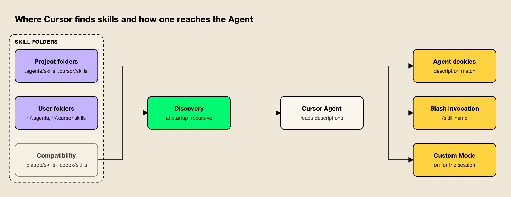
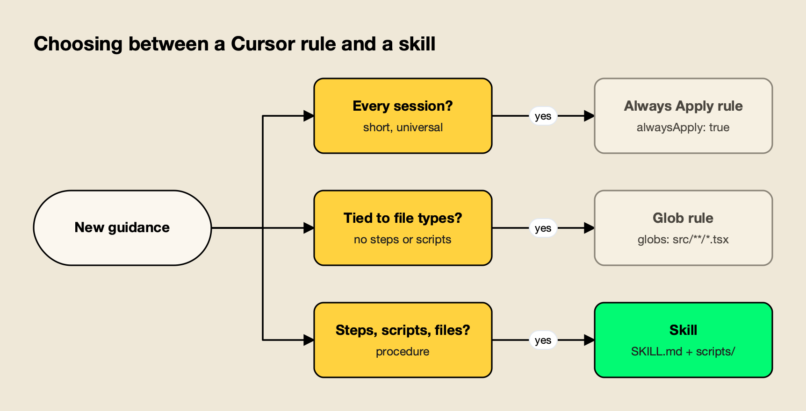

**TL;DR**
- Cursor skills are `SKILL.md` folders in the open Agent Skills format; Cursor discovers them at startup, and the agent loads one when its description matches the task or when you type `/` and pick it.
- Cursor loads skills from `.agents/skills`, `.cursor/skills`, `~/.agents/skills` and `~/.cursor/skills`, and also from Claude Code's and Codex's skill folders for compatibility.
- Rules and skills overlap but differ: rules are always-on or file-scoped conventions, while skills are on-demand procedures that can carry scripts and reference files.
- `npx skills add <owner>/<repo> -a cursor` installs a GitHub-hosted skill into `./.agents/skills`, a folder Cursor scans at project level.
- Six MIT-licensed skills from build-with-ai-hq cover coding agent governance, team skill management, MCP operations, LLM cost, LLM security and LLM observability.

Cursor skills are on-demand instruction packages that Cursor's Agent loads when a task calls for them, so a team's procedures for deploying, reviewing or auditing code can be written once and reused in every chat. Each skill is a folder with a `SKILL.md` file, and the same folder works in other agents that support the open Agent Skills standard. This guide covers where Cursor looks for skills, how the Agent picks one, how skills differ from Cursor rules, how to install skills from GitHub, and six skills built for teams that run AI in production.

## What Cursor Skills Are

A Cursor skill is a directory with a `SKILL.md` file whose YAML frontmatter holds a required `name` and `description`, followed by instructions in Markdown. It can also include `scripts/`, `references/` and `assets/` folders. Cursor implements the open Agent Skills standard, so the same skill can run in Cursor, Claude Code and Codex. This site's roundup of [Claude Code gateways](/blog/claude-code-gateways/) covers routing for another agent that reads the same format, and its overview of [AI coding agents](/blog/ai-coding-agents/) compares the agents themselves.

Cursor's [Agent Skills documentation](https://cursor.com/docs/skills) describes skills as portable, version-controlled packages that "teach agents how to perform domain-specific tasks", and lists four properties: portable across agents that support the standard, stored as files that can be tracked in a repository, actionable through scripts and templates, and progressive, loading resources only when needed.

The format itself comes from the [Agent Skills specification](https://agentskills.io/specification), which requires a `name` of up to 64 lowercase characters that matches the folder name and a `description` of up to 1,024 characters. It recommends keeping the `SKILL.md` body under 500 lines and about 5,000 tokens, with detail moved into `references/`. Cursor adds frontmatter fields of its own:

| Field | What it does in Cursor |
|---|---|
| `name`, `description` | Required. The description is what the Agent reads to decide relevance |
| `paths` | Glob patterns that limit the skill to matching files (the older `globs` field is still accepted) |
| `disable-model-invocation` | When `true`, the skill loads only when invoked with `/skill-name` |
| `icon`, `color` | Badge styling when the skill backs a Custom Mode |
| `metadata` | Free-form key-value data, often used for a version |

Cursor also ships built-in skills that appear alongside your own, including `/create-skill`, `/create-rule`, `/review-security`, `/split-to-prs` and `/migrate-to-skills`. An explainer on [how Anthropic's Agent Skills work](https://www.getmaxim.ai/articles/claude-skills-how-anthropics-agent-skills-work/) covers where the format started.

## Where Cursor Loads Skills From

Cursor loads skills automatically from four folders: `.agents/skills/` and `.cursor/skills/` at project level, and `~/.agents/skills/` and `~/.cursor/skills/` at user level. For compatibility it also reads `.claude/skills/`, `.codex/skills/`, `~/.claude/skills/` and `~/.codex/skills/`, so skills installed for Claude Code or Codex appear in Cursor too.

The folder table from Cursor's docs:

| Location | Scope |
|---|---|
| `.agents/skills/` | Project |
| `.cursor/skills/` | Project |
| `~/.agents/skills/` | User (global) on the local machine |
| `~/.cursor/skills/` | User (global) on the local machine |
| `.claude/skills/`, `.codex/skills/` | Project, loaded for compatibility |
| `~/.claude/skills/`, `~/.codex/skills/` | User, loaded for compatibility |

Two behaviors stand out from the docs. Cursor walks each skills root recursively, so category folders such as `.cursor/skills/shipping/land-it/SKILL.md` are only organizational; the skill's identity is the folder that holds `SKILL.md`. And a skills folder nested inside a repository, such as `apps/web/.cursor/skills/`, is automatically scoped to files under `apps/web/`, which suits monorepos.



*Figure 1: Cursor reads the same SKILL.md format from its own folders and from Claude Code's and Codex's, then loads a skill only when the Agent selects it or you invoke it.*

One distinction matters for teams using Cloud Agents. Only `~/.cursor/skills/` can be synced to Cloud Agents, through the **Sync Skills for Cloud Agents** setting. Cursor does not copy `~/.agents/skills/` or unsynced local skills to Cloud Agents, remote SSH sessions or self-hosted workers, and automation runs load only skills committed to the repository's `.cursor/skills/` folder. For skills that must work everywhere, the project folder is the safest home.

## How Cursor Chooses and Runs a Skill

When Cursor starts, it discovers skills from those folders and presents their descriptions to the Agent, which decides when a skill is relevant. You can also invoke a skill manually by typing `/` in Agent chat, or keep one active for a whole session by using it as a Custom Mode.

The docs describe three ways a skill gets into context:

- **Agent decides.** The default. The Agent reads each description and pulls in the skill when the task matches, which makes the description the most important line in the file.
- **Slash invocation.** Typing `/` and choosing a skill attaches it to one message. With `disable-model-invocation: true`, this becomes the only way the skill loads, so it behaves like a traditional slash command.
- **Custom Mode.** Option+Enter on macOS or Alt+Enter on Windows keeps a skill on for the whole session, shown as a badge in the chat input.

The `paths` field narrows when the Agent sees a skill at all. A skill scoped to `**/*.tsx` stays out of context during unrelated backend work, which keeps descriptions from competing with each other. Discovered skills are listed under **Customize → Skills**, and skills from plugins or the project appear alongside rules in the **Agent Decides** section.

Scripts are where skills go beyond instructions. A skill can tell the Agent to run `scripts/validate.py` before deploying, and Cursor's docs note that scripts can be written in any language the agent's environment supports. That capability is also why skills from outside a team deserve review before installation, covered below.

## Cursor Rules vs Skills

Rules and skills both give Cursor's Agent reusable instructions, but they load differently. Rules are `.mdc` files in `.cursor/rules` that are always applied, attached by file pattern, chosen by description or @-mentioned. Skills are folders that load on demand and can carry scripts and reference files. Rules suit standing conventions; skills suit procedures.

Cursor's [rules documentation](https://cursor.com/docs/rules) defines four rule types (Project Rules, User Rules, Team Rules and `AGENTS.md`) and three frontmatter fields that control when a project rule is included:

| | Cursor rules | Cursor skills |
|---|---|---|
| Format | `.mdc` file with `description`, `globs`, `alwaysApply` | Folder with `SKILL.md`, optional `scripts/`, `references/`, `assets/` |
| Location | `.cursor/rules`, user settings, team dashboard, `AGENTS.md` | `.agents/skills`, `.cursor/skills`, user folders, compatibility folders |
| When loaded | Every session, on matching files, by description, or on @-mention | When the Agent judges it relevant, on `/` invocation, or as a Custom Mode |
| Can run code | No; rules are prompt context | Yes, through bundled scripts |
| Portable to other agents | `AGENTS.md` is widely read; `.mdc` rules are Cursor-specific | Yes, through the Agent Skills standard |
| Best for | Style, architecture conventions, "never touch dist/" | Deploys, audits, migrations, reviews, multi-step workflows |

Rules with `alwaysApply: true` are included in every session, so they work best for short, universal guidance. Cursor's docs suggest keeping rules under 500 lines and splitting large ones. Skills keep only their description in the Agent's view until needed, so a long procedure costs context only when it runs.



*Figure 2: Standing conventions belong in rules, while procedures that need steps, files or scripts belong in skills.*

Cursor provides a migration path. Its built-in `/migrate-to-skills` skill, introduced in Cursor 2.4, converts "Apply Intelligently" rules (no `alwaysApply`, no `globs`) into skills, and converts slash commands into skills with `disable-model-invocation: true`. Rules with `alwaysApply: true` or glob patterns are not migrated, because their triggers differ from skill behavior.

## Installing Skills in Cursor From GitHub

Cursor's own route for importing skills from GitHub is a plugin: package skills with a `.cursor-plugin/marketplace.json` and install through **Customize** or a team marketplace. A simpler route for a single skill is the open-source `skills` CLI, which copies the skill folder into `./.agents/skills`, a project folder Cursor already scans.

The distinction is worth stating precisely, because Cursor's docs say that "skills aren't imported on their own" when bringing them in through Cursor's interface; the interface expects a plugin. The CLI works at the file level instead. It does not register anything with Cursor; it writes files into a directory that Cursor loads at startup.

agitracker ran the [skills CLI](https://github.com/vercel-labs/skills) (version 1.7.4) in an empty Git project on October 28, 2026. Previewing a repository without installing:

```bash
npx skills add build-with-ai-hq/secure-llm-apps --list
```

Installing for Cursor:

```bash
npx skills add build-with-ai-hq/secure-llm-apps -a cursor -y
```

The skill was copied to `./.agents/skills/secure-llm-apps`, the `.agents/skills/` project location in Cursor's table, and recorded in `skills-lock.json` with its GitHub source and a content hash. The same command with `-a claude-code` wrote to `./.claude/skills/` instead, which Cursor also loads through its compatibility folders. The CLI ended with a warning: "Review skills before use; they run with full agent permissions."

Useful variations:

| Command | Result |
|---|---|
| `npx skills add <repo> --list` | Lists a repository's skills without installing |
| `npx skills add <repo> -a cursor -y` | Project install into `./.agents/skills` |
| `npx skills add <repo> -g -a cursor` | User-level install; the CLI's agent table lists `~/.cursor/skills/` as Cursor's global path |
| `npx skills add <repo> -a cursor claude-code codex` | One skill for several agents |
| `npx skills update` / `npx skills remove <skill>` | Update or remove installed skills |

A global install into `~/.cursor/skills/` has one advantage in Cursor specifically: that is the only folder that can be synced to Cloud Agents. A project install into `.agents/skills/` has a different advantage: it is committed with the code, so automations and teammates get it too.

## Six Cursor Skills for Teams Running AI in Production

Community lists of Cursor skills mostly cover frameworks and coding style. The six below, published by the [build-with-ai-hq](https://github.com/build-with-ai-hq) organization under the MIT license, target the operational side of AI work instead: governing coding agents, managing shared skills, controlling MCP tools, and the cost, security and observability of LLM features. Each repository holds one skill.

They were chosen against four criteria: specification-compliant `SKILL.md`, installable into Cursor's folders with the skills CLI, open source, and focused on a recurring production problem. Descriptions below come from each skill's own files.

| Skill | Problem it addresses | Install for Cursor |
|---|---|---|
| ai-coding-agent-governance | Unmanaged keys, spend and MCP servers across agents | `npx skills add build-with-ai-hq/ai-coding-agent-governance -a cursor` |
| agent-skills-for-teams | Skill drift, weak triggers, unreviewed scripts | `npx skills add build-with-ai-hq/agent-skills-for-teams -a cursor` |
| mcp-gateway-best-practices | Tool sprawl, context bloat, unscoped tool access | `npx skills add build-with-ai-hq/mcp-gateway-best-practices -a cursor` |
| llm-cost-reduction | LLM bills without attribution | `npx skills add build-with-ai-hq/llm-cost-reduction -a cursor` |
| secure-llm-apps | OWASP LLM Top 10 risks | `npx skills add build-with-ai-hq/secure-llm-apps -a cursor` |
| llm-observability-stack | No per-call tokens, cost, latency or traces | `npx skills add build-with-ai-hq/llm-observability-stack -a cursor` |

### 1. ai-coding-agent-governance

[ai-coding-agent-governance](https://github.com/build-with-ai-hq/ai-coding-agent-governance) plans a governed rollout of coding agents, Cursor included. It begins with an audit of raw provider keys, installed agents and configured MCP servers (its audit commands check `~/.cursor/mcp.json` and `.cursor/mcp.json` among others), then follows eight steps from a one-page policy to logging and retention.

Its Cursor notes are specific: the gateway URL goes in **Override OpenAI Base URL**, the override applies to every OpenAI-compatible model in Cursor, Cursor's backend calls that URL so it must be publicly reachable over HTTPS, and requests to Cursor's own hosted models are billed and routed by Cursor rather than by a team's gateway.

```bash
npx skills add build-with-ai-hq/ai-coding-agent-governance -a cursor
```

**Best for:** engineering leads standardizing Cursor and other coding agents on per-developer keys, budgets and approved MCP servers.

### 2. agent-skills-for-teams

[agent-skills-for-teams](https://github.com/build-with-ai-hq/agent-skills-for-teams) covers the lifecycle of shared skills: one source of truth per skill, descriptions that trigger, progressive disclosure, versioning, review, testing, and consistent installation across agents. Its bundled `scripts/lint_skills.py` flags specification violations, bodies over 500 lines, missing versions, broken links, drift between copies and risky script patterns.

For Cursor teams it addresses a real problem: the same skill can sit in `.cursor/skills`, `.agents/skills` and `.claude/skills` at once, and Cursor loads all three. The skill's drift check (same name, different content hashes) catches copies that have diverged.

```bash
npx skills add build-with-ai-hq/agent-skills-for-teams -a cursor
```

**Best for:** teams whose skills are spread across Cursor, Claude Code and Codex folders and need one versioned source.

### 3. mcp-gateway-best-practices

[mcp-gateway-best-practices](https://github.com/build-with-ai-hq/mcp-gateway-best-practices) audits MCP setups and works through eleven practices, from a tool budget of 5 to 20 tools per agent task to least-privilege access, human approval for destructive tools, treating tool output as untrusted, keeping credentials off laptops and logging every tool call. It includes MCP Inspector CLI commands for testing stdio and streamable HTTP servers.

Cursor users who have connected several MCP servers will recognize the cost it targets: tool definitions consume context on every request whether or not they are used.

```bash
npx skills add build-with-ai-hq/mcp-gateway-best-practices -a cursor
```

**Best for:** Cursor users with several MCP servers who want fewer, better-scoped tools and centrally held credentials.

### 4. llm-cost-reduction

[llm-cost-reduction](https://github.com/build-with-ai-hq/llm-cost-reduction) finds and cuts LLM API spend. Its seven-check grep audit looks for model call sites, missing output limits, uncapped agent loops, retry storms, unrecorded usage, prompt-cache killers and recomputed embeddings. Nine fixes follow in order of typical impact, starting with attributing every call to a feature and right-sizing the model per task.

```bash
npx skills add build-with-ai-hq/llm-cost-reduction -a cursor
```

**Best for:** product teams that need to explain and reduce an LLM bill before the next budget review.

### 5. secure-llm-apps

[secure-llm-apps](https://github.com/build-with-ai-hq/secure-llm-apps) hardens LLM apps against the practical risks in the [OWASP Top 10 for LLM Applications](https://genai.owasp.org/llm-top-10/). It checks for provider keys in frontend bundles or git history, LLM output reaching dangerous sinks, over-broad tools, unbounded consumption and prompts written to logs, then applies seven practices such as keeping keys server-side and treating retrieved content as untrusted. A Cursor skill scoped with `paths` to API routes would keep it out of unrelated UI work.

```bash
npx skills add build-with-ai-hq/secure-llm-apps -a cursor
```

**Best for:** pre-launch and post-incident reviews of chatbots, RAG features and agents.

### 6. llm-observability-stack

[llm-observability-stack](https://github.com/build-with-ai-hq/llm-observability-stack) sets up production observability for LLM features: a fixed record per call (model, provider, tokens, cost, latency with time to first token, errors, tool calls, user and feature identity), OpenTelemetry GenAI conventions, agent traces, sampling, content redaction and alerting.

```bash
npx skills add build-with-ai-hq/llm-observability-stack -a cursor
```

**Best for:** teams that need per-feature and per-user visibility into LLM latency and cost.

This site's guide to [MCP servers for coding agents](/blog/mcp-servers-for-coding-agents/) covers the tool side of a Cursor setup, and a roundup of [the best MCP servers for Cursor](https://www.getmaxim.ai/articles/best-mcp-servers-for-cursor/) lists common choices.

## Routing Cursor Through a Gateway

The governance, cost and MCP skills all recommend putting an AI gateway between coding agents and model providers, so keys, budgets, logs and tool permissions are enforced centrally. For Cursor, their examples use Bifrost, an open-source AI gateway that Cursor reaches through its **Override OpenAI Base URL** setting with a per-developer virtual key.

The [Bifrost Cursor guide](https://docs.getbifrost.ai/cli-agents/cursor) lays out the setup: enter a Bifrost virtual key in Cursor's **OpenAI API Key** field, turn on **Override OpenAI Base URL** with an endpoint ending in `/cursor`, and add custom models in `provider/model-name` form. It notes that Cursor needs a publicly accessible gateway URL, because Cursor's backend makes the call. [Virtual keys](https://docs.getbifrost.ai/features/governance/virtual-keys) then carry budgets, rate limits and provider access for each developer or team.

[Bifrost](https://www.getmaxim.ai/bifrost) puts 25+ providers and 10,000+ models behind one OpenAI-compatible API and is [open source on GitHub](https://github.com/maximhq/bifrost).

For skill distribution, its [Skills Repository](https://docs.getbifrost.ai/features/skills-repository) publishes versioned skills as a plugin marketplace for Claude Code and Codex. A guide to running a [self-hosted AI gateway for Cursor with Claude or Ollama](https://www.getmaxim.ai/articles/self-hosted-ai-gateway-for-cursor-with-claude-or-ollama/) walks through a full setup.

Teams comparing editors can read a breakdown of [Claude Code vs Cursor and how to run both](https://www.getmaxim.ai/articles/claude-code-vs-cursor-2026-which-to-use-and-how-to-run-both/), and this site's survey of [AI gateways for coding agents](/blog/ai-gateways-for-coding-agents/) compares gateway options. Setup guides for other agents are collected on the [CLI agents resource page](https://www.getmaxim.ai/resources/cli-agents).

**Enterprise tier.** SSO and role-based access control for the gateway are part of Bifrost Enterprise.

## Reviewing a Skill Before You Install It

A skill can include scripts that Cursor's Agent will run with your permissions, so treat a third-party skill like a new dependency: preview it, read its files, check its license, pin the version, and scope it with `paths` or `disable-model-invocation` when it should not load on its own.

A short review routine covers most of the risk:

- **Preview.** `npx skills add <repo> --list` shows the skill's description before anything is written.
- **Read the files.** Open `SKILL.md` and anything under `scripts/` on GitHub. Of the six skills above, only agent-skills-for-teams ships a script, a Python linter; the others are instructions and audit commands.
- **Check the license.** All six are MIT-licensed, stated in each `LICENSE` file and in the skill frontmatter.
- **Pin it.** Commit `skills-lock.json`, which records a content hash per skill, and review `npx skills update` changes like any dependency bump.
- **Scope it.** Add `paths` so a skill only appears for relevant files, or `disable-model-invocation: true` for skills that should run only on request.

On Teams and Enterprise plans, Cursor admins can also turn off **Sync Skills for Cloud Agents** for the whole team, which limits personal skills to members' own machines. Policy guidance for agent rollouts is collected in the [governance resources](https://www.getmaxim.ai/resources/governance), and MCP-specific controls are covered on the [MCP gateway resource page](https://www.getmaxim.ai/resources/mcp-gateway).

## The Bottom Line

Cursor skills give the Agent procedures it loads only when needed, in a format shared with Claude Code and Codex. Cursor is unusually permissive about where they live: its own folders, the cross-agent `.agents/skills` folder, and Claude Code's and Codex's folders all work, with nested folders scoped automatically.

Rules remain the right tool for short, standing conventions; skills are the better home for multi-step work with scripts and references. For installing, the skills CLI places a GitHub-hosted skill into a folder Cursor already reads, with a lockfile for review. And for teams putting Cursor into production alongside other agents, the six build-with-ai-hq skills cover the operational work around it: governance, shared skill management, MCP control, and the cost, security and observability of the AI features being built.
