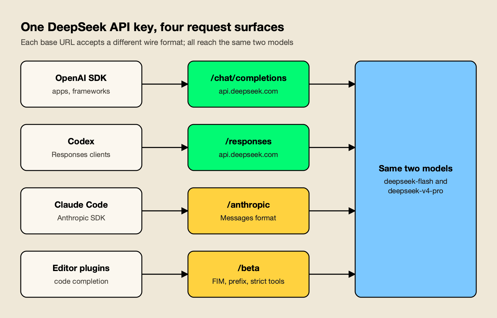
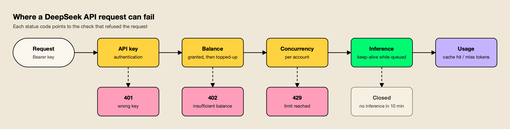
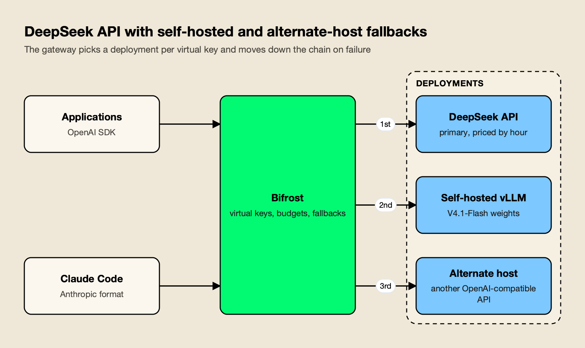

**TL;DR**
- The DeepSeek API accepts three wire formats with one key: OpenAI Chat Completions and the Responses API at `https://api.deepseek.com`, and Anthropic Messages at `https://api.deepseek.com/anthropic`. Beta features sit under `/beta`.
- Two model names are current: `deepseek-flash` (now DeepSeek-V4.1-Flash-1017) and `deepseek-v4-pro`. The old `deepseek-chat` and `deepseek-reasoner` names were retired in July 2026, and `deepseek-v4-flash` silently routes to the new Flash model.
- Thinking mode is on by default at "high" effort, sampling parameters are ignored while thinking, and tool-calling loops must send `reasoning_content` back or fail with a 400.
- Cost has three levers: cache hits (about 2% of the cache-miss price), off-peak hours (half price, including all weekends) and output length. Concurrency is capped per account at 2,500 requests for Flash and 500 for V4-Pro.
- Teams that need failover or data residency put a routing layer in front of the API so the same calls can reach self-hosted weights or another host when DeepSeek is unavailable.

The DeepSeek API is DeepSeek's paid, pay-as-you-go interface to its V4 model family, and it is built to be swapped in for OpenAI or Anthropic with a base URL and a key. That compatibility hides a number of DeepSeek-specific behaviors: thinking mode that is on by default, an account-wide concurrency cap, hourly price changes, and beta features behind a separate path. This guide covers each step of using the API in practice, from getting a key to running it in coding agents and alongside self-hosted weights, with Python and curl examples taken from DeepSeek's documentation as of October 21, 2026. The models themselves are covered in agitracker's [DeepSeek V4 explainer](/blog/deepseek-v4/).

## DeepSeek API at a Glance

The DeepSeek API is an OpenAI- and Anthropic-compatible HTTP API that serves two models, `deepseek-flash` and `deepseek-v4-pro`, each with a one-million-token context and up to 384K output tokens. Developers keep their existing SDK, change the base URL and key, and pick a model name.

DeepSeek's [first-call guide](https://api-docs.deepseek.com/#:~:text=The%20DeepSeek%20API%20uses%20an%20API%20format%20compatible%20with%20OpenAI%2FAnthropic) says the API uses a format compatible with OpenAI and Anthropic, so most clients work after a configuration change. The values an integration needs:

| Setting | Value |
|---|---|
| OpenAI-format base URL (Chat Completions, Responses) | `https://api.deepseek.com` |
| Anthropic-format base URL (Messages) | `https://api.deepseek.com/anthropic` |
| Beta base URL (FIM, prefix completion, strict tools) | `https://api.deepseek.com/beta` |
| Current model names | `deepseek-flash`, `deepseek-v4-pro` |
| Context / max output | 1M tokens / 384K tokens |
| Authentication | `Authorization: Bearer <key>` (OpenAI format) or `x-api-key` (Anthropic format) |
| Concurrency per account | 2,500 (`deepseek-flash`), 500 (`deepseek-v4-pro`) |
| Other endpoints | `GET /models`, `GET /user/balance`, Files, Search and Fetch |



*Figure 1: The model list is identical on every surface; what changes is the request format and which beta features are reachable.*

## Getting a DeepSeek API Key

A DeepSeek API key is created in the DeepSeek Platform console after the account has a balance. Every key on one account shares its balance and concurrency limit.

1. Sign in at the [DeepSeek Platform](https://platform.deepseek.com/) and top up the balance.
2. Create a key on the [API keys page](https://platform.deepseek.com/api_keys) and copy it once; store it as `DEEPSEEK_API_KEY`.
3. Check the account with the balance endpoint before wiring the key into production.

```bash
curl https://api.deepseek.com/user/balance \
  -H "Authorization: Bearer ${DEEPSEEK_API_KEY}"
```

The [balance endpoint](https://api-docs.deepseek.com/api/get-user-balance#:~:text=Get%20user%20current%20balance) returns whether the balance is sufficient plus the granted and topped-up amounts in CNY or USD. That matters because DeepSeek's [deduction rules](https://api-docs.deepseek.com/quick_start/pricing/#:~:text=with%20a%20preference%20for%20using%20the%20granted%20balance%20first) spend granted credit before topped-up credit. The [error code table](https://api-docs.deepseek.com/quick_start/error_codes#:~:text=You%20have%20run%20out%20of%20balance) lists HTTP 402 for "You have run out of balance," which retrying will not fix; unattended jobs should alert on the balance endpoint.

Because [concurrency limits are calculated at the account level](https://api-docs.deepseek.com/quick_start/rate_limit#:~:text=Concurrency%20limits%20are%20calculated%20at%20the%20account%20level), creating more keys does not add capacity. Separate keys are still useful for revoking access per application.

## DeepSeek Models and Model Names

The DeepSeek API exposes two model names: `deepseek-flash`, currently served by DeepSeek-V4.1-Flash-1017, and `deepseek-v4-pro`, served by DeepSeek-V4-Pro-0813. Older names either fail or are silently redirected, so integrations should pin one of the two current names.

DeepSeek renames often, and the name a client sends does not always match the model that answers:

| Model name sent | What serves it (Oct 21, 2026) | Billed as |
|---|---|---|
| `deepseek-flash` | DeepSeek-V4.1-Flash-1017 | Flash |
| `deepseek-v4-pro` | DeepSeek-V4-Pro-0813 | V4-Pro |
| `deepseek-v4-flash`, `deepseek-v4-flash-vision-exp` | Redirected to V4.1-Flash-1017 | Flash |
| `deepseek-chat`, `deepseek-reasoner` | Retired July 24, 2026 | Not served |
| `claude-opus*` on the Anthropic endpoint | Mapped to `deepseek-v4-pro` | V4-Pro |
| Other `claude*` names on the Anthropic endpoint | Mapped to `deepseek-flash` | Flash |

The pricing page notes that [the legacy names deepseek-v4-flash and deepseek-v4-flash-vision-exp](https://api-docs.deepseek.com/quick_start/pricing/#:~:text=The%20legacy%20names%20deepseek%2Dv4%2Dflash) are still accepted but their models are retired. The [change log entry for April 24](https://api-docs.deepseek.com/updates#:~:text=will%20be%20discontinued%20in%20three%20months) said `deepseek-chat` and `deepseek-reasoner` "will be discontinued in three months," which set the July 24 cutoff. On October 17 Flash moved to the 1017 checkpoint, and [the API calling method and pricing remain unchanged](https://api-docs.deepseek.com/updates#:~:text=The%20API%20calling%20method%20and%20pricing%20remain%20unchanged).

The model behind `deepseek-flash` changes without a code change, so evaluation results tied to the name go stale, and vision input works only on `deepseek-flash`. The [list models endpoint](https://api-docs.deepseek.com/api/list-models#:~:text=Lists%20the%20currently%20available%20models) (`GET /models`) returns each model's context window, output limit, modalities and supported effort levels, which is the safest way to check capabilities at startup.

## How to Use the DeepSeek API: First Calls in Three Formats

Using the DeepSeek API means sending a standard OpenAI or Anthropic request to DeepSeek's base URL with a DeepSeek key and model name. The same account and models work in all three formats; only the SDK and endpoint change.

### OpenAI Chat Completions (curl and Python)

The curl call below follows DeepSeek's quick start:

```bash
curl https://api.deepseek.com/chat/completions \
  -H "Content-Type: application/json" \
  -H "Authorization: Bearer ${DEEPSEEK_API_KEY}" \
  -d '{
    "model": "deepseek-flash",
    "messages": [
      {"role": "system", "content": "You are a helpful assistant."},
      {"role": "user", "content": "Explain idempotency keys in two sentences."}
    ],
    "thinking": {"type": "enabled"},
    "reasoning_effort": "high",
    "stream": false
  }'
```

In Python, the OpenAI SDK works unchanged. DeepSeek-only fields such as `thinking` go in `extra_body`:

```python
import os
from openai import OpenAI

client = OpenAI(api_key=os.environ["DEEPSEEK_API_KEY"],
                base_url="https://api.deepseek.com")

resp = client.chat.completions.create(
    model="deepseek-flash",
    messages=[{"role": "user", "content": "Explain idempotency keys in two sentences."}],
    reasoning_effort="high",
    extra_body={"thinking": {"type": "enabled"}},
)
print(resp.choices[0].message.reasoning_content)  # chain of thought
print(resp.choices[0].message.content)            # final answer
print(resp.usage)
```

### Anthropic Messages

DeepSeek's [Anthropic API guide](https://api-docs.deepseek.com/guides/anthropic_api#:~:text=our%20API%20has%20added%20support%20for%20the%20Anthropic%20API%20format) uses the official Anthropic SDK with two environment variables, `ANTHROPIC_BASE_URL=https://api.deepseek.com/anthropic` and `ANTHROPIC_API_KEY`:

```python
import anthropic

client = anthropic.Anthropic()  # reads ANTHROPIC_BASE_URL and ANTHROPIC_API_KEY
message = client.messages.create(
    model="deepseek-flash",
    max_tokens=1000,
    system="You are a helpful assistant.",
    messages=[{"role": "user", "content": [{"type": "text", "text": "Hi, how are you?"}]}],
)
print(message.content)
```

Compatibility is partial. The guide's field table shows `thinking` is supported but [budget_tokens is ignored](https://api-docs.deepseek.com/guides/anthropic_api#:~:text=budget_tokens%20is%20ignored), `output_config` accepts only `effort`, `cache_control` is ignored, and document, `redacted_thinking`, code-execution and MCP blocks are not accepted. Anthropic prompt-caching markers therefore do nothing here; DeepSeek caches automatically instead.

### The Responses API

The Responses endpoint arrived with the V4-Pro GA release on August 13, when the change log said the API [now natively supports the OpenAI Responses API format](https://api-docs.deepseek.com/updates#:~:text=now%20natively%20supports%20the%20OpenAI%20Responses%20API%20format) and was adapted for Codex. It lives on the same base URL:

```python
resp = client.responses.create(
    model="deepseek-flash",
    instructions="You are a helpful assistant.",
    input="Hi, how are you?",
)
print(resp.output_text)
```

The [Responses compatibility table](https://api-docs.deepseek.com/guides/responses_api#:~:text=Not%20supported%20(stateless%20API)) marks `previous_response_id` and `conversation` as "Not supported (stateless API)," so clients must resend the full input each turn. `store`, `background` and `prompt_cache_key` are also unsupported, and the server-side `web_search` tool works only with `deepseek-v4-pro`. The guide adds that [unsupported parameters are silently ignored](https://api-docs.deepseek.com/guides/responses_api#:~:text=Unsupported%20parameters%20are%20silently%20ignored). The broader design of the format is covered in agitracker's explainer on the [OpenAI Responses API](/blog/openai-responses-api/).

## Thinking Mode and Reasoning Effort

DeepSeek's thinking mode makes the model write a chain of thought before its answer, returned in `reasoning_content`. It is enabled by default at "high" effort on both models, and it changes which parameters work, how multi-turn tool calls must be sent and how many tokens a request can produce.

The [thinking mode guide](https://api-docs.deepseek.com/guides/thinking_mode#:~:text=Thinking%20mode%20is%20enabled%20by%20default%2C%20with%20the%20default%20effort%20being%20high) says "thinking mode is enabled by default, with the default effort being high." The controls differ by format:

| Control | OpenAI Chat Completions | Anthropic Messages | Responses API |
|---|---|---|---|
| Turn thinking on or off | `{"thinking": {"type": "enabled"}}` or `"disabled"` | Same `thinking` object | `{"reasoning": {"effort": "none"}}` disables |
| Set effort | `reasoning_effort`: `low`, `high`, `max` | `output_config.effort` | `reasoning.effort`: `low`, `high`, `max` |
| Values from other vendors | `minimal` maps to low; `medium` and `xhigh` map to high; `ultra` maps to max | Same mapping | Same mapping |

Three behaviors catch integrations that move from other providers:

- **Sampling parameters do nothing while thinking.** The guide states that [thinking mode does not support the temperature](https://api-docs.deepseek.com/guides/thinking_mode#:~:text=Thinking%20mode%20does%20not%20support%20the%20temperature), `presence_penalty` or `frequency_penalty` parameters; they are accepted without error and ignored. `top_p` is clamped to 0.95 to 1.0 on Flash.
- **Tool loops must return the reasoning.** For any request that carries `tools`, the `reasoning_content` of every earlier turn must be passed back, or [the API will return a 400 error](https://api-docs.deepseek.com/guides/thinking_mode#:~:text=the%20API%20will%20return%20a%20400%20error).
- **Output defaults are large.** The [Chat Completions reference](https://api-docs.deepseek.com/api/create-chat-completion#:~:text=When%20not%20set%2C%20the%20default%20is%208K%20in%20non%2Dthinking%20mode) sets the default `max_tokens` at 8K without thinking, 64K with thinking, and 128K at `max` effort. Thinking tokens bill as output, so effort is a cost setting as much as a quality one.

With the OpenAI SDK, appending the whole returned assistant message to `messages` keeps `content`, `reasoning_content` and `tool_calls` together for the next turn.

## JSON Output, Tool Calls and Beta Features

The DeepSeek API supports JSON output, function calling with an optional strict schema mode, chat prefix completion and fill-in-the-middle (FIM) completion. JSON mode and standard tool calls work on the main endpoint; strict tools, prefix completion and FIM require the `/beta` base URL.

**JSON output.** Set `response_format={"type": "json_object"}`. The [JSON Output guide](https://api-docs.deepseek.com/guides/json_mode#:~:text=Include%20the%20word,in%20the%20system%20or%20user%20prompt) also requires including the word "json" in the system or user prompt with an example of the target shape, and warns that [the API may occasionally return empty content](https://api-docs.deepseek.com/guides/json_mode#:~:text=the%20API%20may%20occasionally%20return%20empty%20content). Without the prompt instruction the API reference says the model may emit whitespace until it reaches the token limit, so parsers should handle empty strings and `finish_reason="length"`.

**Function calling.** Tools use the standard OpenAI `tools` array (or Anthropic tool blocks) and work in both thinking and non-thinking mode. Two format differences matter for agents. [The Chat Completion API does not support inserting tool calls mid-conversation](https://api-docs.deepseek.com/guides/tool_calls#:~:text=The%20Chat%20Completion%20API%20does%20not%20support%20inserting%20tool%20calls%20mid%2Dconversation), while the Anthropic and Responses formats do, which affects agent frameworks that inject synthetic tool results. And in [strict mode](https://api-docs.deepseek.com/guides/tool_calls#:~:text=In%20strict%20mode%2C%20the%20model%20strictly%20adheres), enabled through the `/beta` base URL with `"strict": true` on every function, the server validates the schema: every object property must be required and `additionalProperties` must be false.

**Chat prefix completion (beta).** The client supplies the start of the assistant's reply and the model continues it. The [prefix completion guide](https://api-docs.deepseek.com/guides/chat_prefix_completion#:~:text=the%20role%20of%20the%20last%20message%20in%20the%20messages%20list%20is%20assistant) requires that the role of the last message is `assistant` with `"prefix": true`. Forcing a reply to start with a code fence, with a matching stop sequence, is the canonical use.

**FIM completion (beta).** Fill-in-the-middle takes a `prompt` and optional `suffix` on the legacy `/completions` endpoint and returns the text between them. The [FIM guide](https://api-docs.deepseek.com/guides/fim_completion#:~:text=The%20max%20tokens%20of%20FIM%20completion%20is%204K) notes "the max tokens of FIM completion is 4K," and the pricing page lists FIM as non-thinking mode only.

```python
beta = OpenAI(api_key=os.environ["DEEPSEEK_API_KEY"], base_url="https://api.deepseek.com/beta")
resp = beta.completions.create(
    model="deepseek-flash",
    prompt="def fib(a):",
    suffix="    return fib(a-1) + fib(a-2)",
    max_tokens=128,
)
print(resp.choices[0].text)
```

## DeepSeek API Pricing: Peak Hours and Cache Hits

DeepSeek API pricing is per million tokens, split into cache-hit input, cache-miss input and output, with peak rates on weekday mornings UTC and half-price off-peak rates at all other times. Context caching is automatic, so the main cost decisions are prompt structure, effort level and when batch work runs.

These rates come from DeepSeek's pricing page on October 21, 2026:

| Per 1M tokens | `deepseek-flash` peak | `deepseek-flash` off-peak | `deepseek-v4-pro` peak | `deepseek-v4-pro` off-peak |
|---|---|---|---|---|
| Input, cache hit | $0.006 | $0.003 | $0.044 | $0.022 |
| Input, cache miss | $0.30 | $0.15 | $1.32 | $0.66 |
| Output | $1.20 | $0.60 | $3.96 | $1.98 |

The pricing page states that [off-peak rates are half of the peak rates](https://api-docs.deepseek.com/quick_start/pricing/#:~:text=Off%2Dpeak%20rates%20are%20half%20of%20the%20peak%20rates). Peak hours are 01:00 to 04:00 and 06:00 to 10:00 UTC, Monday through Friday, excluding Chinese public holidays; weekends are entirely off-peak. For teams in the Americas, almost the whole working day is off-peak, and in Europe, peak time covers the early morning. Moving evaluation runs and batch jobs outside those seven hours per weekday halves their cost with no code change.

**Context caching.** DeepSeek's [context caching guide](https://api-docs.deepseek.com/guides/kv_cache#:~:text=is%20enabled%20by%20default%20for%20all%20users) says caching on disk "is enabled by default for all users." A cache hit requires the new request to fully match a stored prefix unit, which the system creates at the end of each user input and model output, at detected common prefixes and at fixed intervals in long text. Two rules follow for prompt design:

- Keep the system prompt, tool definitions and long documents at the start and identical across requests; put the changing question last.
- Read `usage.prompt_cache_hit_tokens` and `prompt_cache_miss_tokens` on every response to measure the hit rate.

The cache is [best-effort](https://api-docs.deepseek.com/guides/kv_cache#:~:text=The%20cache%20system%20works%20on%20a%20%22best%2Deffort%22%20basis) and unused entries are cleared [usually within a few hours to a few days](https://api-docs.deepseek.com/guides/kv_cache#:~:text=usually%20within%20a%20few%20hours%20to%20a%20few%20days). At $0.006 against $0.30 per million tokens on Flash, a cache hit costs 2% of a miss, so agent workloads that resend a long history each turn depend heavily on hit rate.

**Search and Fetch.** Since October 17, DeepSeek's in-house Search and Fetch APIs are open to all users at $0.75 per 1,000 successful requests each. Calls made through server-side tools in Claude Code, Codex and DeepSeek's own agent client are free until, per the [V4.1-Flash-1017 announcement](https://api-docs.deepseek.com/news/news261017#:~:text=Billing%20starts%20Oct%2031%2C%202026), "billing starts Oct 31, 2026, at 16:00 UTC."

For a wider view of how per-token pricing turns into a monthly bill, agitracker's breakdown of [AI inference cost](/blog/ai-inference-cost/) covers the arithmetic, and this guide to [monitoring LLM API costs in production](https://www.getmaxim.ai/articles/how-to-monitor-llm-api-costs-in-production/) covers tracking it per team.

## Rate Limits, Error Codes and Retries

DeepSeek limits concurrent requests rather than requests per minute: 2,500 in flight for `deepseek-flash` and 500 for `deepseek-v4-pro`, counted across all keys on an account. Requests over the limit get HTTP 429, and the error code tells the client whether retrying can help.

The [rate limit page](https://api-docs.deepseek.com/quick_start/rate_limit#:~:text=A%20request%20counts%20as%20one%20concurrent%20connection) counts a request as one concurrent connection from the moment it is sent until the response completes. Long thinking-mode generations hold a slot for their whole duration, so agent bursts reach the 500 V4-Pro slots quickly. DeepSeek accepts capacity expansion requests at no extra cost.

The `user_id` parameter, set in the request body (or `extra_body` with the OpenAI SDK, `metadata.user_id` with Anthropic), isolates content-safety handling, KV cache and scheduling per end user. For accounts with raised quotas it also applies a per-`user_id` concurrency cap. The docs say plainly: [do not include user privacy information in user_id](https://api-docs.deepseek.com/quick_start/rate_limit#:~:text=Do%20not%20include%20user%20privacy%20information%20in%20user_id); use an opaque hash.



*Figure 2: Only 429, 500 and 503 are worth retrying; 400, 401, 402 and 422 need a code or account fix first.*

The documented error codes:

| Code | Meaning | Retry? |
|---|---|---|
| 400 Invalid Format | Malformed body, including missing `reasoning_content` in a thinking-mode tool loop | No, fix the request |
| 401 Authentication Fails | Wrong API key | No |
| 402 Insufficient Balance | Account balance exhausted | No, top up |
| 422 Invalid Parameters | A parameter value is not accepted | No |
| 429 Rate Limit Reached | Concurrency or QPS limit exceeded | Yes, with backoff |
| 500 Server Error | DeepSeek-side failure | Yes, after a short wait |
| 503 Server Overloaded | [The server is overloaded due to high traffic](https://api-docs.deepseek.com/quick_start/error_codes#:~:text=The%20server%20is%20overloaded%20due%20to%20high%20traffic) | Yes, after a short wait |

A client that retries 429 and 503 with exponential backoff and jitter, and fails fast on everything else, covers most cases. This [production guide to retries, fallbacks and circuit breakers](https://www.getmaxim.ai/articles/retries-fallbacks-and-circuit-breakers-in-llm-apps-a-production-guide/) covers the patterns in detail, and a live [DeepSeek API status page](https://www.getmaxim.ai/bifrost/provider-status/deepseek) shows current incidents.

## Streaming, Keep-Alive and Token Counting

DeepSeek streams responses as server-sent events in the same shape as OpenAI or Anthropic, but it also sends keep-alive lines while a request waits for inference, and it closes connections that have not started inference after ten minutes. Token counts come back in `usage`; offline counting uses DeepSeek's own tokenizer.

**Keep-alive.** While a request is queued, non-streaming responses receive empty lines and streaming responses receive SSE comments. The rate-limit page describes [streaming requests that continuously return SSE keep-alive comments](https://api-docs.deepseek.com/quick_start/rate_limit#:~:text=Streaming%20requests%3A%20Continuously%20return%20SSE%20keep%2Dalive%20comments) (`: keep-alive`), and adds that [if the request has not started inference after 10 minutes](https://api-docs.deepseek.com/quick_start/rate_limit#:~:text=If%20the%20request%20has%20not%20started%20inference%20after%2010%20minutes), the server closes the connection. Hand-written parsers must skip blank and comment lines, and client timeouts must allow for queuing plus long thinking-mode generation.

**Streaming usage.** In Chat Completions, set `"stream": true` and optionally `"stream_options": {"include_usage": true}`. The reference says the last chunk before `data: [DONE]` [carries the token usage statistics for the entire request](https://api-docs.deepseek.com/api/create-chat-completion#:~:text=carries%20the%20token%20usage%20statistics%20for%20the%20entire%20request), with no separate usage-only chunk. Thinking output streams in `delta.reasoning_content` before `delta.content`. The Responses API differs: it emits typed events and ends with `response.completed`, `response.incomplete` or `response.failed`, with no `[DONE]` message.

```bash
curl -N https://api.deepseek.com/chat/completions \
  -H "Content-Type: application/json" \
  -H "Authorization: Bearer ${DEEPSEEK_API_KEY}" \
  -d '{"model": "deepseek-flash", "stream": true,
       "stream_options": {"include_usage": true},
       "messages": [{"role": "user", "content": "Count to five."}]}'
```

**Token counting.** DeepSeek's [token usage page](https://api-docs.deepseek.com/quick_start/token_usage#:~:text=the%20conversion%20ratios%20can%20vary) gives rough ratios of about 0.3 tokens per English character and 0.6 per Chinese character, offers a downloadable tokenizer for offline counts, and includes an image token calculator. There is no token-counting endpoint, so the authoritative figure is `usage` in each response: `prompt_tokens`, `completion_tokens` (which include reasoning tokens), and the cache hit and miss split.

## Using the DeepSeek API in Claude Code and Codex

DeepSeek publishes setup guides for Claude Code, Codex, OpenCode and several other agents. Claude Code uses the Anthropic-compatible endpoint through environment variables; Codex uses the Responses endpoint. No code changes are needed in either agent.

DeepSeek's [Claude Code guide](https://api-docs.deepseek.com/quick_start/agent_integrations/claude_code#:~:text=simply%20configure%20the%20following%20environment%20variables) sets these variables before running `claude`:

```bash
export ANTHROPIC_BASE_URL=https://api.deepseek.com/anthropic
export ANTHROPIC_AUTH_TOKEN=${DEEPSEEK_API_KEY}
export ANTHROPIC_MODEL="deepseek-flash[1m]"
export ANTHROPIC_DEFAULT_OPUS_MODEL="deepseek-flash[1m]"
export ANTHROPIC_DEFAULT_SONNET_MODEL="deepseek-flash[1m]"
export ANTHROPIC_DEFAULT_HAIKU_MODEL=deepseek-flash
export CLAUDE_CODE_SUBAGENT_MODEL=deepseek-flash
export CLAUDE_CODE_EFFORT_LEVEL=max
export CLAUDE_CODE_AUTO_COMPACT_WINDOW=786432
```

Three details matter in practice. The `[1m]` suffix tells Claude Code to treat the model as having a one-million-token window, and the auto-compact window of 786,432 tokens keeps compaction below it. Any Claude model name that slips through is remapped: [models starting with claude-opus are mapped to deepseek-v4-pro](https://api-docs.deepseek.com/guides/anthropic_api#:~:text=Models%20starting%20with%20claude%2Dopus%20are%20mapped%20to%20deepseek%2Dv4%2Dpro), billed at the V4-Pro price, which can surprise a team that expected Flash rates. And web search inside Claude Code runs through DeepSeek's search API, where [additional model token costs will be incurred](https://api-docs.deepseek.com/quick_start/agent_integrations/claude_code#:~:text=additional%20model%20token%20costs%20will%20be%20incurred) on top of Search billing.

One shared DeepSeek key works for a trial, but every session then shares one account's concurrency with no per-developer budget. The usual fix is a gateway between the agent and the API; agitracker's survey of [AI gateways for coding agents](/blog/ai-gateways-for-coding-agents/) and its comparison of [Claude Code and Codex](/blog/claude-code-vs-codex/) cover that layer, and a [Claude Code resource hub](https://www.getmaxim.ai/resources/claude-code) collects configuration patterns.

## DeepSeek API Data Privacy and Residency

DeepSeek's hosted API is operated from China, and its privacy policy says personal data is collected, processed and stored there. Teams that cannot send data to China either keep sensitive prompts off the hosted API or run the MIT-licensed weights in their own region.

The [DeepSeek privacy policy](https://cdn.deepseek.com/policies/en-US/deepseek-privacy-policy.html#:~:text=we%20directly%20collect%2C%20process%20and%20store%20your%20Personal%20Data%20in%20People) says DeepSeek collects, processes and stores personal data in the People's Republic of China, and lists training and improving its models among the purposes of processing. No published DeepSeek document offers a non-China API region. Practical controls on the API side are limited to minimizing what is sent, using opaque `user_id` values, and avoiding personal data in prompts. The fuller residency analysis, including GDPR transfer questions and hosting options for the weights, is in agitracker's [DeepSeek V4 data residency section](/blog/deepseek-v4/).

## Running the DeepSeek API Alongside Self-Hosted Weights and Other Hosts

Because DeepSeek's weights are MIT-licensed and its API is OpenAI-compatible, the same model can run on DeepSeek's API, on a team's own vLLM servers and on third-party hosts. A routing layer lets applications call one endpoint while policy decides which deployment answers and what happens when one fails.

Teams usually reach for one of five approaches:

| Approach | How it handles DeepSeek | Fits |
|---|---|---|
| Client-side retry and fallback code | The application catches errors and calls a second base URL | One service, few models |
| [LiteLLM](https://docs.litellm.ai/docs/providers/deepseek#:~:text=We%20support%20ALL%20Deepseek%20models) | Python SDK and proxy; `deepseek/` model prefix, thinking parameters and off-peak pricing documented | Python-heavy teams wanting a self-hosted proxy |
| [Cloudflare AI Gateway](https://developers.cloudflare.com/ai-gateway/usage/providers/deepseek/#:~:text=You%20can%20then%20append%20the%20endpoint%20you%20want%20to%20hit) | Managed proxy at `gateway.ai.cloudflare.com/.../deepseek` with logging and stored keys | Teams already on Cloudflare |
| OpenRouter | Hosted aggregator listing DeepSeek V4 and V4.1 models served by several inference providers | Quick multi-host access without running infrastructure |
| Self-hosted gateway (e.g. Bifrost) | Native DeepSeek provider plus vLLM, budgets per key, ordered fallbacks | Teams mixing hosted and self-hosted deployments under one policy |

Hosted options are fastest to adopt; self-hosted gateways keep traffic and keys inside the team's network, which matters when residency was the reason to self-host. A broader comparison of [LLM gateways for self-hosted models such as vLLM, SGLang and Ollama](https://www.getmaxim.ai/articles/top-4-llm-gateways-for-self-hosted-models-vllm-sglang-and-ollama-2026/) and one of [LLM gateways with an OpenAI-compatible API](https://www.getmaxim.ai/articles/top-5-llm-gateways-with-an-openai-compatible-api-in-2026/) cover the field, and agitracker's [best LLM gateways](/blog/best-llm-gateways/) ranking compares them on published criteria.

### Worked Example: DeepSeek, vLLM and Fallbacks in Bifrost

[Bifrost](https://www.getmaxim.ai/bifrost) is an open-source AI gateway written in Go ([source on GitHub](https://github.com/maximhq/bifrost)) that exposes 25+ providers and 10,000+ models through one OpenAI-compatible API. It serves as the example here because its documentation covers each piece of this setup: a dedicated DeepSeek provider, a vLLM provider for the self-hosted weights, peak-hour pricing and per-key budgets. Bifrost's published benchmark reports [11 µs of added overhead per request](https://docs.getbifrost.ai/benchmarking/t3.xl#:~:text=Total%20Overhead%3A%2011) at 5,000 RPS on an AWS t3.xlarge.



*Figure 3: The application keeps one endpoint; budgets, the residency split and the fallback order live in gateway configuration.*

**Providers.** The [DeepSeek provider page](https://docs.getbifrost.ai/providers/supported-providers/deepseek#:~:text=DeepSeek%20is%20a%20provider%20with%20a%20dedicated%20Bifrost%20provider%20implementation) describes OpenAI-compatible chat and Responses requests by default, beta FIM completions on `/beta/completions`, and an optional per-key `use_anthropic_endpoints` switch to DeepSeek's Anthropic endpoint. It also handles the thinking-mode conflict described earlier: when a forced `tool_choice` would be rejected while thinking, [Bifrost automatically disables thinking](https://docs.getbifrost.ai/providers/supported-providers/deepseek#:~:text=Bifrost%20automatically%20disables%20thinking) for that request.

The self-hosted weights, published on [Hugging Face](https://huggingface.co/deepseek-ai/DeepSeek-V4.1-Flash-1017), connect through the [vLLM provider](https://docs.getbifrost.ai/providers/supported-providers/vllm#:~:text=vLLM%20is%20a%20self%2Dhosted%20inference%20provider), and a [vLLM provider guide](https://www.getmaxim.ai/bifrost/guides/providers/vllm) walks through it.

```json
{
  "providers": {
    "deepseek": {
      "keys": [
        { "name": "deepseek-main", "value": "env.DEEPSEEK_API_KEY", "models": ["*"], "weight": 1.0 }
      ]
    },
    "vllm": {
      "keys": [
        {
          "name": "flash-eu",
          "value": "",
          "models": ["deepseek-ai/DeepSeek-V4.1-Flash-1017"],
          "weight": 1.0,
          "vllm_key_config": {
            "url": "http://vllm.internal:8000",
            "model_name": "deepseek-ai/DeepSeek-V4.1-Flash-1017"
          }
        }
      ]
    }
  }
}
```

**Fallbacks.** A request names its fallback chain in `provider/model` form. Per the [retries and fallbacks documentation](https://docs.getbifrost.ai/features/retries-and-fallbacks#:~:text=Each%20fallback%20provider%20gets%20its%20own%20full%20retry%20budget), 429s rotate keys with backoff, 5xx errors retry on the same provider, and "each fallback provider gets its own full retry budget." The third entry can be any other configured host of a DeepSeek model:

```bash
curl -X POST http://localhost:8080/v1/chat/completions \
  -H "Content-Type: application/json" \
  -H "x-bf-vk: sk-bf-research" \
  -d '{
    "model": "deepseek/deepseek-flash",
    "messages": [{"role": "user", "content": "Summarize this incident report."}],
    "fallbacks": ["vllm/deepseek-ai/DeepSeek-V4.1-Flash-1017", "openrouter/deepseek/deepseek-v4.1-flash"]
  }'
```

**Budgets and access.** [Virtual keys](https://docs.getbifrost.ai/features/governance/virtual-keys#:~:text=it%20can%20only%20use%20providers%20listed%20in) are deny-by-default: a key can only use providers listed in its `provider_configs`, so a regulated team's key that lists only `vllm` cannot reach the China-hosted API even through a fallback. Budgets attach to keys, teams and customers, and [Bifrost checks all applicable budgets independently](https://docs.getbifrost.ai/features/governance/budget-and-limits#:~:text=Bifrost%20checks%20all%20applicable%20budgets%20independently) before a request proceeds. A longer treatment of [LLM API rate limiting with virtual keys and budgets](https://www.getmaxim.ai/articles/llm-api-rate-limiting-with-virtual-keys-and-budgets/) covers the design.

**Peak-hour cost tracking.** DeepSeek's hourly prices break naive cost tracking. The [custom pricing docs](https://docs.getbifrost.ai/providers/custom-pricing#:~:text=DeepSeek%2C%20for%20example%2C%20charges%20half%20its%20normal%20rate) use DeepSeek as their example and support `off_peak_cost_multiplier` and `peak_hours` fields, with the window decided by the request's start time.

**Claude Code through the gateway.** Setting `ANTHROPIC_BASE_URL` to the gateway's `/anthropic` path and `ANTHROPIC_AUTH_TOKEN` to a virtual key gives each developer a budget, and the [Claude Code integration](https://docs.getbifrost.ai/cli-agents/claude-code#:~:text=You%20can%20pin%20any%20model%20on%20any%20provider) lets teams pin model slots to provider-prefixed names such as `deepseek/deepseek-flash`. This walkthrough of [running Claude Code with any LLM through the Bifrost CLI](https://www.getmaxim.ai/articles/how-to-run-claude-code-with-openai-gemini-bedrock-and-any-llm-using-bifrost-cli/) shows the same pattern with other providers.

**Enterprise tier.** Clustering, adaptive load balancing based on provider health, in-VPC deployment and audit logs are part of [Bifrost Enterprise](https://www.getmaxim.ai/bifrost/enterprise); the DeepSeek and vLLM providers, virtual keys, budgets, custom pricing and fallbacks shown above are in the open-source gateway.

## What to Get Right Before Production

The DeepSeek API is cheap and easy to adopt, and most production problems come from the places where it differs from OpenAI and Anthropic rather than from the models themselves.

- **Pin current names** and re-run evaluations when a new checkpoint ships behind `deepseek-flash`.
- **Set thinking and effort explicitly**, return `reasoning_content` in tool loops, and size timeouts for reasoning output.
- **Keep prompt prefixes stable** and track `prompt_cache_hit_tokens`.
- **Run batch work off-peak**, back off on 429 and 5xx, and alert on 402.
- **Keep personal and regulated data** on self-hosted or regional deployments.

Teams that run the DeepSeek API at scale tend to converge on the same shape: the hosted API for price, the open weights for control, and a routing layer that lets each workload use whichever deployment its data and budget allow.
