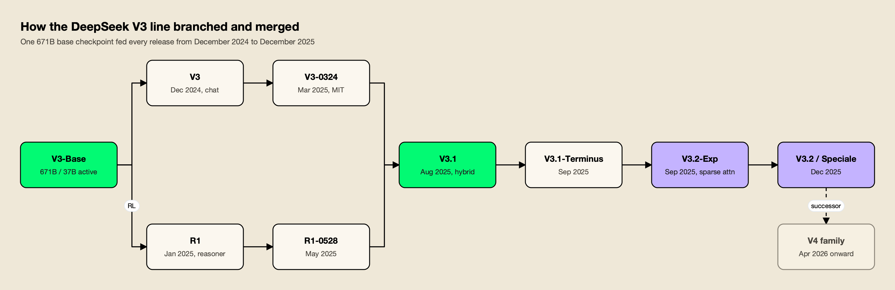
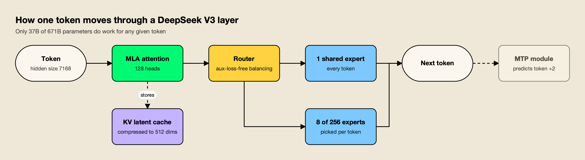
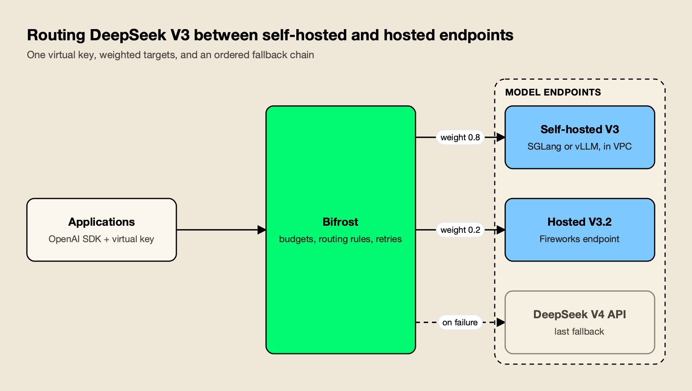

**TL;DR**
- **DeepSeek V3** is a 671B-parameter mixture-of-experts model with 37B active parameters per token, released in December 2024 and updated through V3-0324, V3.1, V3.1-Terminus, V3.2-Exp and V3.2 before V4 replaced it in April 2026.
- The architecture combines Multi-head Latent Attention (MLA), DeepSeekMoE with 256 routed experts, a multi-token prediction objective and FP8 mixed-precision training; DeepSeek's report puts the final training run at 2.788M H800 GPU hours, or $5.576M at $2 per GPU hour.
- R1 was trained from the same V3 base, and V3.1 merged the chat and reasoning lines into one hybrid model.
- DeepSeek's API retired the `deepseek-chat` and `deepseek-reasoner` names on July 24, 2026, so V3 now lives on as open weights (MIT for every release after the first) and on a shrinking set of third-party hosts.
- V3 still makes sense for self-hosted fleets on Hopper, Ampere or AMD hardware, for workloads validated against a frozen checkpoint, and as a fallback tier; for new hosted projects, V4 is the better default.

DeepSeek V3 is the open-weight model that put DeepSeek on the map: a 671-billion-parameter mixture-of-experts language model, released on December 26, 2024, whose technical report claimed frontier-class results from a training run that cost about $5.6 million in rented GPU time. For the next sixteen months every DeepSeek chat and reasoning API call ran on some version of it. This explainer covers the whole V3 line, how the architecture works, how it relates to R1, what the licenses allow, where V3 is still served after the API retirement, and when it remains a better choice than its successor.

## DeepSeek V3 at a Glance

DeepSeek V3 is a family of open-weight mixture-of-experts language models from Hangzhou-based DeepSeek. Every release shares one architecture: 671B total parameters, 37B active per token, a 128K-token context window and FP8 weights. Later versions changed post-training, added a thinking mode and, in V3.2, a sparse attention mechanism.

The [original announcement](https://api-docs.deepseek.com/news/news1226/#:~:text=671B%20MoE%20parameters) listed the three numbers that defined the line: 671B MoE parameters, 37B activated parameters and 14.8T training tokens. The table below summarizes each release from DeepSeek's news pages and model cards.

| Release | Date | What changed | Weights license |
|---|---|---|---|
| DeepSeek-V3 | Dec 26, 2024 | First release; 671B / 37B MoE, 128K context | DeepSeek Model License |
| DeepSeek-V3-0324 | Mar 24, 2025 | Better reasoning, front-end coding and tool use; same architecture | MIT |
| DeepSeek-V3.1 | Aug 21, 2025 | Hybrid thinking and non-thinking modes; longer context training | MIT |
| DeepSeek-V3.1-Terminus | Sep 22, 2025 | Fewer Chinese-English mix-ups; stronger code and search agents | MIT |
| DeepSeek-V3.2-Exp | Sep 29, 2025 | DeepSeek Sparse Attention (DSA); API prices cut by 50%+ | MIT |
| DeepSeek-V3.2 and V3.2-Speciale | Dec 1, 2025 | Thinking in tool use; Speciale tuned for maximum reasoning, no tool calls | MIT |

All six are still downloadable from [DeepSeek's Hugging Face organization](https://huggingface.co/deepseek-ai), and every model card from V3-0324 onward says the same thing about the architecture. The [V3-0324 card](https://huggingface.co/deepseek-ai/DeepSeek-V3-0324#:~:text=The%20model%20structure%20of%20DeepSeek%2DV3%2D0324%20is%20exactly%20the%20same%20as%20DeepSeek%2DV3) states that its structure "is exactly the same as DeepSeek-V3," and the V3.2 card says V3.2 and V3.2-Speciale share the structure of V3.2-Exp. That shared design is why one serving setup covers most of the line.

DeepSeek V3 is one entry in a larger Chinese open-weight field that now includes Kimi, GLM and Qwen; agitracker's overview of [China's open-weight models in 2026](/blog/china-open-weight-models-2026/) places it in that context.

## The DeepSeek V3 Model Line, From V3-0324 to V3.2

The V3 line went through five public updates in twelve months. V3-0324 refreshed post-training and switched to the MIT License, V3.1 merged chat and reasoning into one hybrid model, V3.1-Terminus fixed language mixing, V3.2-Exp introduced sparse attention, and V3.2 made that design the production default.



*Figure 1: R1 was trained on the same base as V3; V3.1 folded both into one hybrid model, and V3.2 changed the attention before V4 changed the architecture.*

Each step in Figure 1 has a release note behind it:

- **DeepSeek V3 0324.** The [March 2025 release](https://api-docs.deepseek.com/news/news250325/#:~:text=Major%20boost%20in%20reasoning%20performance) promised a major boost in reasoning, stronger front-end development skills and smarter tool use, with API usage unchanged.
- **DeepSeek V3.1.** The [August 2025 release](https://api-docs.deepseek.com/news/news250821/#:~:text=Hybrid%20inference%3A%20Think%20%26%20Non%2DThink) introduced "Hybrid inference: Think & Non-Think," mapped `deepseek-chat` to non-thinking mode and `deepseek-reasoner` to thinking mode, and set a 128K context for both. The base model received 840B tokens of continued pretraining for long-context extension.
- **DeepSeek V3.1 Terminus.** The [September 22 update](https://api-docs.deepseek.com/news/news250922/#:~:text=fewer%20CN%2FEN%20mix%2Dups) targeted language consistency, with "fewer CN/EN mix-ups," plus better code and search agents.
- **DeepSeek V3.2 Exp.** Built on V3.1-Terminus, the [experimental release](https://api-docs.deepseek.com/news/news250929/#:~:text=it%20debuts%20DeepSeek%20Sparse%20Attention%20%28DSA%29) debuted DeepSeek Sparse Attention for cheaper long-context training and inference, and DeepSeek cut API prices by more than half the same day.
- **DeepSeek V3.2 and V3.2-Speciale.** The [December 2025 launch](https://api-docs.deepseek.com/news/news251201/#:~:text=is%20our%20first%20model%20to%20integrate%20thinking%20directly%20into%20tool%2Duse) described V3.2 as DeepSeek's first model to integrate thinking directly into tool use. Speciale, a maximum-reasoning variant, was API-only at launch through a temporary endpoint and does not support tool calls.

V3.2 is also the reference point for V4's efficiency claims. DeepSeek says V4-Pro needs 27% of V3.2's per-token compute and 10% of its KV cache at one million tokens, a comparison covered in agitracker's [DeepSeek V4 explainer](/blog/deepseek-v4/).

## DeepSeek V3 Architecture: MoE, Multi-Head Latent Attention and Multi-Token Prediction

DeepSeek V3's architecture is a 61-layer transformer that pairs Multi-head Latent Attention with DeepSeekMoE layers. Each MoE layer has one shared expert and 256 routed experts, of which eight are active per token, so only 37B of 671B parameters do work for any given token. A multi-token prediction objective and FP8 training complete the design.

The [DeepSeek-V3 technical report](https://arxiv.org/abs/2412.19437#:~:text=DeepSeek%2DV3%20adopts%20Multi%2Dhead%20Latent%20Attention%20%28MLA%29%20and%20DeepSeekMoE%20architectures) says V3 adopts MLA and DeepSeekMoE, both "thoroughly validated in DeepSeek-V2," and adds two new ideas: an auxiliary-loss-free load-balancing strategy and a multi-token prediction training objective.



*Figure 2: MLA shrinks what each token leaves in memory, the router keeps compute to 37B active parameters, and MTP adds a second prediction that serving engines can use for speculative decoding.*

### Mixture of Experts With Auxiliary-Loss-Free Balancing

The report's [hyperparameter section](https://arxiv.org/html/2412.19437v1#:~:text=Each%20MoE%20layer%20consists%20of%201%20shared%20expert%20and%20256%20routed%20experts) specifies that every feed-forward layer except the first three is an MoE layer with one shared expert and 256 routed experts, and that "8 experts will be activated for each token," with each token sent to at most four nodes. Most MoE models keep experts evenly loaded with an auxiliary loss term, which the report says can impair performance. V3 instead raises or lowers a per-expert bias term after each training step, used only for routing, which is what "auxiliary-loss-free" refers to.

### Multi-Head Latent Attention

Multi-head latent attention is DeepSeek's answer to the memory cost of long contexts. According to the report, ["the core of MLA is the low-rank joint compression for attention keys and values"](https://arxiv.org/html/2412.19437v1#:~:text=The%20core%20of%20MLA%20is%20the%20low%2Drank%20joint%20compression%20for%20attention%20keys%20and%20values), which shrinks the key-value cache that each token leaves behind. In V3, the 128 attention heads share a compressed KV dimension of 512, so long conversations consume far less GPU memory than standard multi-head attention would.

### Multi-Token Prediction

Multi-token prediction (MTP) trains the model to predict the next two tokens instead of one. The report says the [MTP modules can be discarded at inference or repurposed](https://arxiv.org/html/2412.19437v1#:~:text=we%20can%20also%20repurpose%20these%20MTP%20modules%20for%20speculative%20decoding) for speculative decoding, and it measured an [85% to 90% acceptance rate](https://arxiv.org/html/2412.19437v1#:~:text=the%20acceptance%20rate%20of%20the%20second%20token%20prediction%20ranges%20between%2085%25%20and%2090%25) for the second token, which it says delivers 1.8 times the tokens per second. That is why the Hugging Face checkpoint is 685B parameters: 671B of main model plus 14B of MTP weights. SGLang's [DeepSeek V3 guide](https://docs.sglang.io/basic_usage/deepseek_v3.html#:~:text=SGLang%20implements%20DeepSeek%20V3%20Multi%2DToken%20Prediction%20%28MTP%29%20based%20on%20EAGLE%20speculative%20decoding) implements this through EAGLE-style speculative decoding.

### FP8 Mixed-Precision Training

V3 was one of the first frontier-scale models trained mostly in 8-bit floating point. DeepSeek says it designed ["an FP8 mixed precision training framework"](https://arxiv.org/html/2412.19437v1#:~:text=We%20design%20an%20FP8%20mixed%20precision%20training%20framework) and validated it on an extremely large model for the first time. A practical side effect is that the released weights are FP8: the [model card notes](https://huggingface.co/deepseek-ai/DeepSeek-V3#:~:text=we%20only%20provide%20FP8%20weights) that DeepSeek only provides FP8 weights and ships a conversion script for BF16.

## The DeepSeek V3 Technical Report and the Training Cost Claim

The DeepSeek V3 technical report states that the final training run took 2.788M H800 GPU hours, which it prices at $5.576M assuming $2 per GPU hour. The same paragraph says the figure covers only the official training run, excluding prior research and ablation experiments, so it is not the cost of building the model.

The [cost paragraph](https://arxiv.org/html/2412.19437v1#:~:text=Assuming%20the%20rental%20price%20of%20the%20H800%20GPU%20is%20%242%20per%20GPU%20hour) breaks the total down: 2,664K GPU hours for pre-training on 14.8T tokens, 119K for context extension and 5K for post-training, run on a cluster of 2,048 H800 GPUs. Pre-training took less than two months.

| Training stage | H800 GPU hours | Cost at $2/hour |
|---|---|---|
| Pre-training (14.8T tokens) | 2,664K | $5.328M |
| Context extension (to 128K) | 119K | $0.238M |
| Post-training (SFT and RL) | 5K | $0.01M |
| Total | 2,788K | $5.576M |

The next sentence in the report is the one most coverage left out: ["the aforementioned costs include only the official training of DeepSeek-V3"](https://arxiv.org/html/2412.19437v1#:~:text=the%20aforementioned%20costs%20include%20only%20the%20official%20training%20of%20DeepSeek%2DV3), excluding the costs of prior research and ablation experiments on architectures, algorithms or data. By that definition it also leaves out hardware purchases and staff. The figure is a fair measure of training efficiency per run, and that efficiency came from the design choices above: sparse activation, FP8 and the DualPipe scheduling scheme that overlaps computation with cross-node communication. It is not a measure of what it costs a lab to reach the frontier, a distinction agitracker returns to in its analysis of [AI inference cost](/blog/ai-inference-cost/).

## DeepSeek R1 vs V3

DeepSeek R1 and V3 share one architecture and one base checkpoint. V3 is the general chat model; R1 is the reasoning model, trained from DeepSeek-V3-Base with large-scale reinforcement learning to produce long chains of thought. From V3.1 onward the two lines merged into a single hybrid model with a thinking switch.

The [R1 model card](https://huggingface.co/deepseek-ai/DeepSeek-R1#:~:text=DeepSeek%2DR1%2DZero%20%26%20DeepSeek%2DR1%20are%20trained%20based%20on%20DeepSeek%2DV3%2DBase) says plainly that "DeepSeek-R1-Zero & DeepSeek-R1 are trained based on DeepSeek-V3-Base." The influence ran both ways. V3's own report says that post-training was used to [distill the reasoning capability from the DeepSeek-R1 series of models](https://arxiv.org/html/2412.19437v1#:~:text=distill%20the%20reasoning%20capability%20from%20the%20DeepSeek%2DR1%20series%20of%20models) while balancing accuracy against answer length.

| | DeepSeek V3 (chat) | DeepSeek R1 (reasoner) | DeepSeek V3.1 and later |
|---|---|---|---|
| Base | DeepSeek-V3-Base | DeepSeek-V3-Base | DeepSeek-V3.1-Base |
| Answers | Directly | After a long chain of thought | Either, per request |
| Former API name | `deepseek-chat` | `deepseek-reasoner` | Both names, one model |
| Typical use | Chat, writing, coding, extraction | Math, competitive coding, multi-step logic | Both, plus agents |

V3.1's release note says its thinking mode reaches answers faster than R1-0528, and the [API change log](https://api-docs.deepseek.com/updates/#:~:text=Both%20deepseek%2Dchat%20and%20deepseek%2Dreasoner%20have%20been%20upgraded%20to%20DeepSeek%2DV3.1) records that both API names moved to V3.1 the same day. After that, "R1" survives mainly as open weights and as the name of a training recipe. The broader trade-off between answering fast and thinking first is the subject of agitracker's piece on [System 1 vs System 2 AI models](/blog/system-1-vs-system-2-ai-models/).

## DeepSeek V3 License

DeepSeek V3's licensing changed partway through the line. The original December 2024 weights use the DeepSeek Model License, which allows commercial use with use-based restrictions. Every release from V3-0324 onward, including V3.1, V3.1-Terminus, V3.2-Exp and V3.2, is published under the MIT License for both code and weights.

For the first checkpoint, the [V3 model card](https://huggingface.co/deepseek-ai/DeepSeek-V3#:~:text=The%20use%20of%20DeepSeek%2DV3%20Base%2FChat%20models%20is%20subject%20to%20the%20Model%20License) states that the code repository is MIT licensed while "the use of DeepSeek-V3 Base/Chat models is subject to the Model License," and that the series supports commercial use. That license grants a royalty-free, worldwide right to use and distribute the model but adds use-based restrictions listed in an attachment.

The switch came with V3-0324. Its [release note](https://api-docs.deepseek.com/news/news250325/#:~:text=Models%20are%20now%20released%20under%20the%20MIT%20License) says "Models are now released under the MIT License, just like DeepSeek-R1!" R1 had moved to MIT in January 2025, when DeepSeek also allowed API outputs to be used for fine-tuning and distillation. The practical advice is simple: teams that need the cleanest license terms should deploy V3-0324 or a later checkpoint rather than the original December release, since they share an architecture and serving setup.

## DeepSeek V3 API Status in 2026

DeepSeek's own API no longer serves any V3 model. The `deepseek-chat` and `deepseek-reasoner` names pointed at successive V3 releases until April 24, 2026, then routed to V4-Flash, and were fully retired on July 24, 2026. V3-line models are still available from several third-party hosts and as open weights.

The [V4 preview note](https://api-docs.deepseek.com/news/news260424/#:~:text=deepseek%2Dchat%20%26%20deepseek%2Dreasoner%20will%20be%20fully%20retired%20and%20inaccessible) gave three months' warning that the two legacy names would be fully retired and inaccessible after July 24, 2026. Any integration that still sends `model: "deepseek-chat"` to `api.deepseek.com` has been failing since then; current names and prices are covered in agitracker's guide to the [DeepSeek API](/blog/deepseek-api/).

Outside DeepSeek, availability is uneven and moving. These are the V3-line listings on each host's own pages, read on October 21, 2026:

| Host | V3-line models listed | Status note |
|---|---|---|
| [Together AI](https://www.together.ai/models/deepseek-v3#:~:text=This%20endpoint%20was%20updated%20on%20March%2024th%2C%202025%20to%20use%20the%20weights%20of%20the%20improved%20DeepSeek%2DV3%2D0324%20model) | DeepSeek-V3-0324 | Endpoint updated to V3-0324 weights in March 2025 |
| [Fireworks AI](https://fireworks.ai/models/fireworks/deepseek-v3p2#:~:text=On%2Ddemand%20deployments%20allow%20you%20to%20use%20Deepseek%20v3.2%20on%20dedicated%20GPUs) | DeepSeek V3.2 | Also offered as on-demand dedicated deployments |
| [Amazon Bedrock](https://docs.aws.amazon.com/bedrock/latest/userguide/model-cards-deepseek.html#:~:text=The%20following%20DeepSeek%20models%20are%20available%20in%20Amazon%20Bedrock) | DeepSeek V3.2, DeepSeek-V3.1 | Listed alongside DeepSeek-R1 |
| [Microsoft Foundry](https://learn.microsoft.com/en-us/azure/ai-foundry/foundry-models/concepts/models-sold-directly-by-azure#:~:text=DeepSeek%20models%20sold%20by%20Azure) | DeepSeek-V3.2, DeepSeek-V3.2-Speciale | Sold directly by Azure with 128K input |
| [Google Vertex AI](https://cloud.google.com/vertex-ai/generative-ai/docs/maas/deepseek#:~:text=this%20model%20endpoint%20is%20deprecated%20and%20will%20be%20retired%20on%20October%2021%2C%202026) | DeepSeek-V3.2, DeepSeek-V3.1 | Deprecated July 21, 2026; retired October 21, 2026 |

The pattern is clear: cloud platforms are converging on V3.1 and V3.2, the original V3 and V3-0324 survive mainly at specialist inference hosts, and retirements are arriving. Google's managed endpoints for V3.1 and V3.2 reach end of life on the day this article was published. A team that depends on a hosted V3 endpoint should treat it as a dependency with an expiry date. Incident history for DeepSeek's own service is tracked on a live [DeepSeek API status page](https://www.getmaxim.ai/bifrost/provider-status/deepseek).

## When DeepSeek V3 Still Makes Sense in 2026

DeepSeek V3 still makes sense when a team self-hosts on hardware V4 does not suit, has validated a workload against a fixed V3 checkpoint, needs a cheap fallback tier, or relies on a hosted V3.2 endpoint in a cloud region it already uses. For new projects on a hosted API, V4 is the stronger default on context length, efficiency and price.

| Situation | Better choice | Why |
|---|---|---|
| New hosted integration, no residency constraints | V4 (`deepseek-flash` or `deepseek-v4-pro`) | V3 is not on DeepSeek's API; V4 has 1M context at lower cost per token |
| Self-hosted fleet of H100, A100 or MI300X GPUs | V3-0324 or V3.2 | FP8, INT8 and 4-bit V3 builds have documented recipes on this hardware |
| Workload validated and certified against a fixed checkpoint | The V3 release you validated | Open weights do not change unless you change them |
| Cloud-only procurement (Bedrock, Foundry) | V3.1 or V3.2 on that cloud | Billing, IAM and region already approved |
| Very long documents or agent sessions | V4 | V3 tops out at 128K tokens; V4 defaults to 1M |
| Cheap fallback behind a primary model | V3.2 on a hosted or self-hosted endpoint | Same API shape, different failure domain |

Three of these deserve more detail.

**Hardware.** V4's own weights changed the hardware conversation. The V4 explainer notes that vLLM's single-node V4-Pro command targets eight B200 or B300 GPUs, while V4.1-Flash needs about 614 GB of GPU memory. V3 is not smaller than V4.1-Flash, but it has nearly two years of serving work behind it on older and non-NVIDIA accelerators, including documented INT8 and 4-bit configurations, AMD MI300X support and Huawei Ascend ports.

**Stability.** DeepSeek changed the model behind `deepseek-chat` six times between March 2025 and April 2026. A team that ran evaluations, safety reviews or regulatory sign-off on one checkpoint can keep running exactly that checkpoint, a pattern agitracker's guide on [how to read an AI benchmark](/blog/how-to-read-an-ai-benchmark/) argues for more generally: measure on your own workload, then pin what you measured.

**Licensing and residency.** The same data-residency logic that applies to V4 applies here, except that V3 has no first-party API at all. Every V3 deployment today is either self-hosted or on a third-party host, so prompts never touch DeepSeek's China-hosted service unless a team routes them there deliberately.

For the open-weight alternatives that compete with V3 on self-hosted fleets, see agitracker's ranking of the [best open source LLMs](/blog/best-open-source-llms/).

## Self-Hosting DeepSeek V3: Hardware and Serving Engines

Self-hosting DeepSeek V3 means serving roughly 685B FP8 parameters across multiple GPUs. SGLang recommends eight H200, B200 or MI300X GPUs for the FP8 checkpoint, and vLLM documents eight H200 or MI300X GPUs in FP8 or four B200s in FP4. Quantized builds lower the bar to A100-class hardware.

The two most-used engines both maintain DeepSeek-specific guides:

- **SGLang.** The [SGLang DeepSeek V3 guide](https://docs.sglang.io/basic_usage/deepseek_v3.html#:~:text=The%20official%20DeepSeek%2DV3%20checkpoint%20is%20already%20in%20FP8%20format) lists recommended configurations by weight type: FP8 on 8× H200, 8× B200, 8× MI300X or two 8× H100 nodes; BF16 on two 8× H200 nodes or four 8× H100 nodes; INT8 on 16× A100 or 32× L40S; and 4-bit formats on as little as 4× H200 or 8× H100. It also implements MLA-specific attention kernels and FP8 KV caching.
- **vLLM.** The [vLLM recipe](https://docs.vllm.ai/projects/recipes/en/latest/DeepSeek/DeepSeek-V3.html#:~:text=DeepSeek%2DR1%20and%20DeepSeek%2DV3%20share%20the%20same%20architecture%2C%20so%20the%20same%20serving%20setup%20applies) notes that R1 and V3 share an architecture and gives two standard setups: 8× H200 or 8× MI300X with native FP8, and 4× B200 with FP4. A [separate V3.2 recipe](https://docs.vllm.ai/projects/recipes/en/latest/DeepSeek/DeepSeek-V3_2.html#:~:text=Prefer%20TP%3D1~2%20%2B%20DP%2FEP%20so%20each%20rank%20keeps%2064%2F128%20heads%20without%20padding) recommends data and expert parallelism over 8-way tensor parallelism, because the sparse attention kernels are optimized for small tensor-parallel groups.

DeepSeek's own model card lists further options, including LMDeploy, TensorRT-LLM, and the Huawei Ascend MindIE framework. Both SGLang and vLLM expose an OpenAI-compatible endpoint, so an application that already speaks the OpenAI API can call a self-hosted V3 server by changing its base URL. agitracker's comparison of [vLLM vs Ollama](/blog/vllm-vs-ollama/) explains why multi-GPU models of this size belong on a production engine rather than a desktop runner.

Two operational details catch teams out. First, the chat template changed twice: V3.1 added a `</think>` token, and V3.2 dropped the Jinja template entirely in favor of Python encoding scripts, so a serving stack built for V3-0324 needs updates before it can run V3.2. Second, a self-hosted model has no provider-side failover. When the node restarts, requests fail unless something in front of it sends them elsewhere.

## Routing Between Self-Hosted V3, Hosted Providers and Fallbacks

Most production V3 deployments end up mixing endpoints: a self-hosted server for steady traffic, a hosted V3.2 endpoint for overflow, and a newer model as a last resort. Three approaches cover that: point applications straight at the serving engine, put a proxy such as LiteLLM in front, or use an AI gateway with routing rules and fallbacks.

**Direct to the engine.** The simplest setup is no routing at all: applications call the SGLang or vLLM endpoint directly. It works for one team and one model, but every failover decision lives in application code, and there is no shared budget or access control.

**LiteLLM proxy.** LiteLLM can reach a self-hosted server through its [`hosted_vllm/` provider](https://docs.litellm.ai/docs/providers/vllm#:~:text=vLLM%20Provides%20an%20OpenAI%20compatible%20endpoints) and fail over between model groups. Its [reliability docs](https://docs.litellm.ai/docs/proxy/reliability#:~:text=Fallbacks%20are%20how%20LiteLLM%20does%20automatic%20failover) describe fallbacks as how it "does automatic failover" once a call fails after its retries. It is a common choice for Python-centric teams already using its SDK.

**An AI gateway with routing rules.** This section uses [Bifrost](https://www.getmaxim.ai/bifrost#:~:text=Bifrost%20is%20completely%20free%20and%20open%20source) as the worked example, because its documentation covers each piece of the V3 setup: dedicated SGLang, vLLM, Fireworks and DeepSeek providers, rule-based traffic splits and explicit handling of retired models. Bifrost is an [open-source AI gateway](https://github.com/maximhq/bifrost) from Maxim AI, released under the Apache 2.0 license, that exposes 10,000+ models from 25+ providers through one OpenAI-compatible API. Bifrost's [published benchmark](https://docs.getbifrost.ai/benchmarking/t3.xl#:~:text=Total%20Overhead%3A%2011%20%C2%B5s) reports 11 µs of added overhead per request at 5,000 RPS on an AWS t3.xlarge.



*Figure 3: The application asks for one model name; the gateway decides whether self-hosted V3, a hosted V3.2 endpoint or V4 answers it.*

The [SGLang provider](https://docs.getbifrost.ai/providers/supported-providers/sgl#:~:text=SGL%20%28SGLang%29%20is%20an%20OpenAI%2Dcompatible%20local%2Fremote%20inference%20engine) and the [vLLM provider](https://docs.getbifrost.ai/providers/supported-providers/vllm#:~:text=vLLM%20is%20a%20self%2Dhosted%20OpenAI%2Dcompatible%20server) each take the inference server's URL,. The [Fireworks provider](https://docs.getbifrost.ai/providers/supported-providers/fireworks#:~:text=Fireworks%20is%20an%20OpenAI%2Dcompatible%20provider%20in%20Bifrost) covers the hosted V3.2 endpoint.

[Routing rules](https://docs.getbifrost.ai/providers/routing-rules#:~:text=Routing%20Rules%20provide%20dynamic%2C%20expression%2Dbased%20control%20over%20request%20routing) then use CEL expressions to split traffic. The configuration below sends 80% of requests for a `deepseek-v3` alias to the self-hosted server and 20% to Fireworks, with DeepSeek's current Flash model as the fallback:

```json
{
  "providers": {
    "sgl": {
      "keys": [
        {
          "name": "v3-selfhosted",
          "value": "",
          "models": ["deepseek-ai/DeepSeek-V3-0324"],
          "weight": 1.0,
          "sgl_key_config": { "url": "http://sglang.internal:30000" }
        }
      ]
    },
    "fireworks": {
      "keys": [
        { "name": "fireworks-main", "value": "env.FIREWORKS_API_KEY", "models": ["*"], "weight": 1.0 }
      ]
    },
    "deepseek": {
      "keys": [
        { "name": "deepseek-main", "value": "env.DEEPSEEK_API_KEY", "models": ["*"], "weight": 1.0 }
      ]
    }
  },
  "governance": {
    "routing_rules": [
      {
        "id": "deepseek-v3-split",
        "name": "DeepSeek V3 traffic split",
        "enabled": true,
        "cel_expression": "model == \"deepseek-v3\"",
        "targets": [
          { "provider": "sgl", "model": "deepseek-ai/DeepSeek-V3-0324", "weight": 0.8 },
          { "provider": "fireworks", "model": "accounts/fireworks/models/deepseek-v3p2", "weight": 0.2 }
        ],
        "fallbacks": ["deepseek/deepseek-flash"],
        "scope": "global",
        "priority": 0
      }
    ]
  }
}
```

[Retries and fallbacks](https://docs.getbifrost.ai/features/retries-and-fallbacks#:~:text=Each%20fallback%20provider%20gets%20its%20own%20full%20retry%20budget) work in two layers: retries stay on the same provider with exponential backoff, and each fallback provider gets its own full retry budget. The same page classifies a [retired model](https://docs.getbifrost.ai/features/retries-and-fallbacks#:~:text=Retired%20model%20%28model_decommissioned) as a permanent per-key failure, which matters for V3 specifically: when a host retires a V3 endpoint, as Vertex AI scheduled for October 21, the request moves on to the next option instead of retrying a model that no longer exists. Routing rules can also read capacity metrics, so a second rule on `budget_used > 80` can shift hosted overflow back to the self-hosted server as a monthly budget fills.

Because the last fallback in this example is DeepSeek's China-hosted API, teams with residency rules should replace it with a regional host or restrict it per team. [Virtual keys](https://docs.getbifrost.ai/features/governance/routing#:~:text=VK%20blocks%20all%20providers%20%28deny%2Dby%2Ddefault%29) are deny-by-default for any provider not listed on the key, so a regulated team's key can simply omit the `deepseek` provider.

The setup guides for the [Bifrost vLLM provider](https://www.getmaxim.ai/bifrost/guides/providers/vllm), the [SGLang provider](https://www.getmaxim.ai/bifrost/guides/providers/sglang) and [Fireworks](https://www.getmaxim.ai/bifrost/guides/providers/fireworks) walk through each connection.

**Enterprise tier.** Adaptive routing based on live provider health, the circuit breaker and clustering are part of Bifrost Enterprise; the providers, routing rules, virtual keys and fallbacks shown above are in the open-source gateway.

For more on the mechanics, see this explainer on [what an LLM router is and how model routing works](https://www.getmaxim.ai/articles/what-is-an-llm-router-how-model-routing-works/) and the production guide to [retries, fallbacks and circuit breakers in LLM apps](https://www.getmaxim.ai/articles/retries-fallbacks-and-circuit-breakers-in-llm-apps-a-production-guide/),.

A walkthrough of [model routing to cut LLM token costs](https://www.getmaxim.ai/articles/model-routing-how-to-cut-llm-token-costs/) covers the cost side. Gateway options for self-hosted engines are compared in a survey of [LLM gateways for vLLM, SGLang and Ollama](https://www.getmaxim.ai/articles/top-4-llm-gateways-for-self-hosted-models-vllm-sglang-and-ollama-2026/). A guide to the [best self-hosted AI gateway in 2026](https://www.getmaxim.ai/articles/best-self-hosted-ai-gateway-in-2026/) maps deployment options.

On agitracker, the guide to [AI gateways for vLLM, Ollama and cloud LLMs](/blog/ai-gateways-for-vllm-ollama-cloud-llms/) and the comparison of [self-hosted vs managed LLM gateways](/blog/self-hosted-vs-managed-llm-gateway/) cover the same layer from the publication's side.

## What DeepSeek V3 Means in 2026

DeepSeek V3 is now a legacy model with an unusually long tail. It no longer runs behind DeepSeek's API, but its MIT-licensed weights, its mature serving recipes and its V3.2 descendants on major clouds keep it in production. For most new work V4 is the default; V3 remains a sound choice for fixed, self-hosted or fallback roles.

Three conclusions follow from the record. First, DeepSeek V3's lasting contribution is architectural: MLA, auxiliary-loss-free MoE routing, multi-token prediction and FP8 training showed that a 671B model could be trained for a few million dollars of compute per run, and V4 builds directly on that base. Second, the $5.576M figure is real but narrow; it prices one training run, by the report's own wording, not the research program behind it. Third, the safest way to run DeepSeek V3 in 2026 is to own the weights. Hosted endpoints are disappearing one cloud at a time, while a self-hosted V3-0324 or V3.2 checkpoint will behave the same next year as it does today. Teams choosing between DeepSeek V3 and V4 should start from that distinction: V4 for capability and context on a hosted API, V3 for a stable, self-controlled model whose behavior they have already measured. The [DeepSeek V4 explainer](/blog/deepseek-v4/) covers the other half of that decision.
