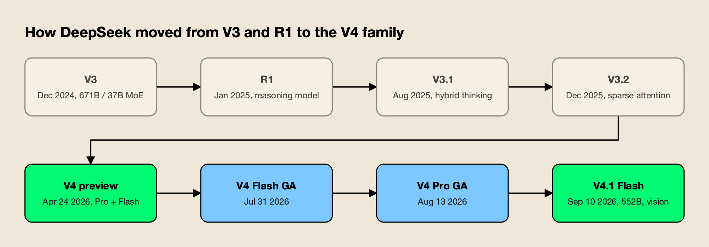
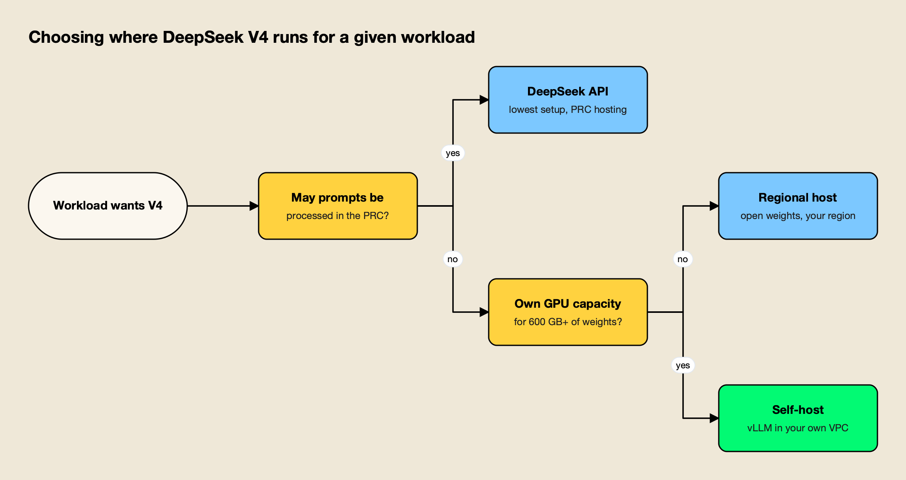
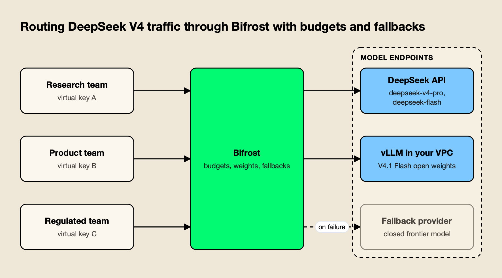

**TL;DR**
- DeepSeek V4 is a family of open-weight mixture-of-experts models: **V4-Pro** (1.6T total / 49B active), **V4-Flash** (284B / 13B) and, since September 10, 2026, **V4.1-Flash** (552B, 8B to 16B active, with vision), all with a one-million-token context and MIT-licensed weights.
- The main change from V3 and R1 is efficiency at long context: DeepSeek says V4-Pro needs **27% of the per-token compute and 10% of the KV cache** of V3.2 at one million tokens, and V4.1-Flash cuts the KV cache to about a quarter of V4-Flash.
- The API is OpenAI- and Anthropic-compatible, with two model names today: `deepseek-v4-pro` ($1.32 / $3.96 per million tokens at peak) and `deepseek-flash` ($0.30 / $1.20), and off-peak rates at half price.
- Output tokens from V4-Pro cost about **one fifth of Claude Opus 5.5's and one twelfth of GPT-6 Astra's**, but DeepSeek's privacy policy places hosted API data in the People's Republic of China.
- For regulated workloads, the practical answer is to run the open weights in your own region and put a routing layer in front, so teams can use the hosted API, self-hosted weights and closed fallbacks under one set of budgets.

DeepSeek V4 is the model family that took DeepSeek from a single chat-plus-reasoner pairing to a lineup of million-token, open-weight models priced well below American frontier APIs. It arrived as a preview on April 24, 2026, reached general availability in stages over the summer, and was partly superseded by DeepSeek-V4.1-Flash in September. This explainer covers what is in the family today, how the architecture changed from V3 and R1, what the API costs against closed models, and how teams decide between DeepSeek's China-hosted API and running the weights themselves.

## DeepSeek V4 at a Glance

DeepSeek V4 is a family of mixture-of-experts language models from DeepSeek, released under the MIT License with weights on Hugging Face. It currently spans V4-Pro, the original V4-Flash and the newer V4.1-Flash, all with a one-million-token context window, three or more reasoning-effort levels, and an API that accepts both OpenAI and Anthropic request formats.

The [V4 preview announcement](https://api-docs.deepseek.com/news/news260424/) introduced two models at once, and the [V4-Pro model card](https://huggingface.co/deepseek-ai/DeepSeek-V4-Pro) lists four downloadable checkpoints: base and instruct versions of each size. A third model came later with a new architecture.

| Model | Released | Total / active parameters | Context | Weights | Current API name |
|---|---|---|---|---|---|
| DeepSeek-V4-Pro | Apr 24, 2026 (preview); Aug 13 (GA, "0813") | 1.6T / 49B | 1M | MIT | `deepseek-v4-pro` |
| DeepSeek-V4-Flash | Apr 24, 2026 (preview); Jul 31 (GA, "0731") | 284B / 13B | 1M | MIT | Retired; routes to V4.1-Flash |
| DeepSeek-V4.1-Flash | Sep 10, 2026 | 552B backbone / 8B prefill, 16B decode | 1M | MIT | `deepseek-flash` |

Two details from that table matter for anyone integrating the models. First, the name `deepseek-v4-flash` still works, but DeepSeek's [pricing page](https://api-docs.deepseek.com/quick_start/pricing) says those requests are now served by V4.1-Flash and billed at the Flash price. Second, V4-Pro survived a planned retirement: the [V4.1-Flash release note](https://api-docs.deepseek.com/news/news260910/) said `deepseek-v4-pro` requests would route to V4.1-Flash from September 14 "until V4.1-Pro launches," but the [API change log](https://api-docs.deepseek.com/updates) for the same date says DeepSeek decided, "in response to user demand," to keep serving V4-Pro with billing unchanged. As of October 15, 2026, no V4.1-Pro has been released.

DeepSeek V4 sits inside a crowded Chinese open-weight field that also includes Moonshot's Kimi K3, Zhipu's GLM series and Alibaba's Qwen. The wider picture of that race, and how far behind US labs it runs, is covered in agitracker's analysis of [China's open-weight models in 2026](/blog/china-open-weight-models-2026/).

## DeepSeek V4 Release Date and Timeline

DeepSeek V4 was released on April 24, 2026 as a preview of V4-Pro and V4-Flash, with open weights and API access on the same day. Production versions followed on July 31 (V4-Flash) and August 13 (V4-Pro), and DeepSeek-V4.1-Flash, a new architecture, launched on September 10, 2026.



*Figure 1: DeepSeek merged its chat and reasoning lines in V3.1, then spent 2026 shipping V4 in stages rather than in one launch.*

The staged rollout is visible in the change log. The July 31 update upgraded only the V4-Flash API, with DeepSeek noting it "keeps the same model architecture and size" as the preview and "was only re-post-trained." The August 13 release did the same for V4-Pro, added a native [OpenAI Responses API](/blog/openai-responses-api/), introduced three reasoning-effort levels (low, high, max) and announced the peak and off-peak pricing that took effect on August 16.

The other retirement worth knowing about is the old naming. The `deepseek-chat` and `deepseek-reasoner` model names, which had pointed to every model from V3 through V3.2, were switched to V4-Flash in April and [fully retired on July 24, 2026](https://api-docs.deepseek.com/news/news260424/). Any integration still calling those names has been failing since then.

## What Changed from DeepSeek V3 and R1

The biggest change from V3 and R1 is how cheaply V4 handles very long inputs. V4 replaced V3's attention with a hybrid of compressed and sparse attention, made a one-million-token context the default everywhere, and folded R1-style reasoning into a single model with adjustable effort instead of a separate reasoner.

[DeepSeek-V3](https://api-docs.deepseek.com/news/news1226/) (December 2024) was a 671B-parameter mixture-of-experts model with 37B active parameters; agitracker's [DeepSeek V3 explainer](/blog/deepseek-v3/) covers its architecture, licensing and where it still runs. [DeepSeek-R1](https://api-docs.deepseek.com/news/news250120/) (January 2025) added long chain-of-thought reasoning as a separate model. V3.1 in August 2025 merged the two into one "hybrid" model with thinking and non-thinking modes, and [V3.2-Exp](https://api-docs.deepseek.com/news/news250929/) in September 2025 introduced DeepSeek Sparse Attention (DSA) along with a price cut of more than 50%.

V4 builds on that line with four changes listed on the model card:

- **Hybrid attention.** Compressed Sparse Attention (CSA) and Heavily Compressed Attention (HCA) work together so that, at one million tokens, V4-Pro needs only 27% of V3.2's single-token inference FLOPs and 10% of its KV cache.
- **Manifold-Constrained Hyper-Connections (mHC).** A replacement for standard residual connections that DeepSeek says improves signal stability across layers.
- **The Muon optimizer.** Used during pre-training on more than 32 trillion tokens for faster convergence.
- **Low-precision weights.** Instruct checkpoints store expert weights in FP4 and most other parameters in FP8.

Post-training also changed shape. DeepSeek trained separate domain experts with supervised fine-tuning and reinforcement learning, then merged them into one model through on-policy distillation. The result exposes three modes: non-thinking, "Think High" and "Think Max," the last of which DeepSeek recommends running with at least a 384K-token context window.

V4.1-Flash goes further. Its [model card](https://huggingface.co/deepseek-ai/DeepSeek-V4.1-Flash) describes a "Causal Encoder-Decoder" design: a 40-layer transformer split into a 20-layer encoder and a 20-layer decoder, where the decoder's KV cache is projected from the encoder's output. Only 8B parameters are active per token during prefill and 16B during decoding, which favors agent workloads that read far more than they write. Combined with a second-generation sparse attention (CSA2) and FP4 KV caching, DeepSeek puts the cache at 890 bytes per token, about a quarter of V4-Flash. The model was trained on 45 trillion multimodal tokens and accepts images natively.

## DeepSeek V4 Benchmarks

DeepSeek's own benchmarks put V4-Pro and V4.1-Flash close to leading closed models on coding and agent tasks, ahead on some competitive-programming tests and behind on harder long-horizon agent suites. Independent testing is less favorable, so the self-reported numbers are best read as an upper bound.

The table below takes figures from DeepSeek's V4.1-Flash model card, which compares its models with closed systems at maximum reasoning effort. All numbers are self-reported by DeepSeek.

| Benchmark | Claude Opus 5.0 | GPT-5.6 Sol | DeepSeek V4-Pro (0813) | DeepSeek V4.1-Flash |
|---|---|---|---|---|
| GPQA Diamond | 93.4 | 94.1 | 92.4 | 90.9 |
| Humanity's Last Exam (text) | 56.3 | 44.5 | 42.7 | 36.8 |
| Terminal-Bench 2.1 | 89.1 | 88.8 | 87.9 | 90.6 |
| Terminal-Bench 4.0 | 51.8 | 39.9 | 12.4 | 31.2 |
| DeepSWE v1.1 | 74.0 | 73.0 | 62.7 | 74.2 |
| NL2Repo-Bench | 75.3 | 56.8 | 61.5 | 64.0 |
| Codeforces rating | not reported | not reported | 3,348 | 3,471 |

Two patterns stand out. V4.1-Flash, a smaller and cheaper model, beats V4-Pro on most agentic tests, which is why DeepSeek's release note claimed that "tests by multiple parties put V4.1-Flash ahead of V4-Pro on performance, cost, speed & total runtime." And both DeepSeek models fall sharply on Terminal-Bench 3.0 and 4.0, the newer and harder versions, where Opus 5.0 holds a wide lead. Saturated tests flatter everyone; harder ones separate the field, a dynamic explained in [why benchmarks saturate](/blog/why-benchmarks-saturate/).

The independent check came from the US government. The Center for AI Standards and Innovation (CAISI) at NIST [evaluated DeepSeek V4 Pro](https://www.nist.gov/news-events/news/2026/05/caisi-evaluation-deepseek-v4-pro) in April 2026 across cyber, software engineering, science, abstract reasoning and math, and concluded that "DeepSeek V4's capabilities lag behind the frontier by about 8 months." CAISI called it the most capable PRC model it had evaluated, and also reported that V4 scored better on DeepSeek's self-reported evaluations than on CAISI's own. Anyone weighing these tables should apply the usual checks for [reading an AI benchmark](/blog/how-to-read-an-ai-benchmark/): who ran it, with which test setup, and whether the test set could have leaked into training.

## DeepSeek V4 Pricing

DeepSeek V4 API pricing is per million tokens, with separate rates for cache-hit input, cache-miss input and output, and a peak/off-peak schedule. At peak, `deepseek-v4-pro` costs $1.32 input and $3.96 output, and `deepseek-flash` costs $0.30 and $1.20. Off-peak rates are exactly half.

These are the rates listed on DeepSeek's pricing page on October 15, 2026:

| Rate per 1M tokens | deepseek-flash (V4.1-Flash), peak | deepseek-flash, off-peak | deepseek-v4-pro (V4-Pro-0813), peak | deepseek-v4-pro, off-peak |
|---|---|---|---|---|
| Input, cache hit | $0.006 | $0.003 | $0.044 | $0.022 |
| Input, cache miss | $0.30 | $0.15 | $1.32 | $0.66 |
| Output | $1.20 | $0.60 | $3.96 | $1.98 |

Peak hours are 01:00 to 04:00 and 06:00 to 10:00 UTC, Monday to Friday, excluding Chinese public holidays. Every other hour, including whole weekends, is off-peak. For teams in the Americas, most of the working day falls in off-peak time. The cache-hit rate is the other lever: DeepSeek notes that cache-hit charges "often account for a large share of agent costs," and V4.1-Flash's smaller cache was partly aimed at that.

### How DeepSeek V4 Pricing Compares with Closed Frontier Models

Against US closed models, DeepSeek V4 is cheaper by a wide margin at list price. The comparison below uses standard (non-batch) rates from [OpenAI's pricing page](https://developers.openai.com/api/docs/pricing), [Anthropic's pricing documentation](https://platform.claude.com/docs/en/about-claude/pricing) and [Google's Gemini API pricing](https://ai.google.dev/gemini-api/docs/pricing), all read on October 15, 2026.

| Model | Input per 1M | Output per 1M | Weights |
|---|---|---|---|
| DeepSeek V4.1-Flash (`deepseek-flash`, peak) | $0.30 | $1.20 | Open (MIT) |
| DeepSeek V4-Pro (peak) | $1.32 | $3.96 | Open (MIT) |
| GPT-6 Luna | $0.10 | $0.50 | Closed |
| GPT-6.1 Sol | $2.00 | $10.00 | Closed |
| Claude Sonnet 5.5 | $2.00 | $10.00 | Closed |
| Gemini 4 Argon (promotional to Nov 30, 2026) | $2.00 | $10.00 | Closed |
| Claude Opus 5.5 | $4.00 | $20.00 | Closed |
| GPT-6 Astra (up to 272K input) | $10.00 | $50.00 | Closed |
| Claude Fable 5.1 | $10.00 | $50.00 | Closed |

At peak rates, V4-Pro output costs about a fifth of Claude Opus 5.5 and about a twelfth of GPT-6 Astra or Claude Fable 5.1. Off-peak, the gap doubles. The comparison is not universal, though: OpenAI's GPT-6 Luna undercuts both DeepSeek models on price, and Gemini 4 Argon's promotional rate rises to $4 and $20 on December 1, 2026. A broader ranking of these closed models by capability is in agitracker's list of the [top AI models](/blog/top-ai-models/), and the economics of OpenAI's newest tier are covered in [GPT-6 pricing](/blog/gpt-6-pricing/).

Token price is also not task price. Reasoning models differ in how many thinking tokens they spend per answer, and thinking tokens bill as output. A cheaper model that thinks twice as long can close much of the gap on a given workload, which is why teams that care about cost measure spend per completed task on their own traffic rather than per million tokens. A practical walkthrough of that measurement is in this guide to [LLM cost optimization with a gateway](https://www.getmaxim.ai/bifrost/blog/llm-cost-optimization-in-bifrost-part-1/).

## DeepSeek V4 API Access

The DeepSeek V4 API is reached at `https://api.deepseek.com` with OpenAI-format requests or at `https://api.deepseek.com/anthropic` with Anthropic-format requests. Developers keep their existing SDK, change the base URL and API key, and set the model to `deepseek-flash` or `deepseek-v4-pro`; the full setup, from keys and thinking mode to rate limits and error codes, is in agitracker's [DeepSeek API guide](/blog/deepseek-api/).

DeepSeek's [first-call guide](https://api-docs.deepseek.com/) shows the OpenAI Python SDK pointed at DeepSeek:

```python
import os
from openai import OpenAI

client = OpenAI(api_key=os.environ["DEEPSEEK_API_KEY"],
                base_url="https://api.deepseek.com")

response = client.chat.completions.create(
    model="deepseek-flash",
    messages=[{"role": "user", "content": "Summarize this contract clause."}],
    reasoning_effort="high",
    extra_body={"thinking": {"type": "enabled"}},
)
```

A few behaviors catch new integrations:

- **Thinking is on by default.** According to the [thinking mode guide](https://api-docs.deepseek.com/guides/thinking_mode), both models default to thinking mode at "high" effort. Effort values from other vendors are mapped: "medium" and "xhigh" become high, "ultra" becomes max.
- **Sampling parameters are ignored when thinking.** `temperature`, `presence_penalty` and `frequency_penalty` have no effect in thinking mode, and `top_p` is clamped to 0.95 to 1.0.
- **Tool calls need the reasoning trace back.** When a request includes `tools`, every previous turn's `reasoning_content` must be passed back or the API returns a 400 error.
- **Concurrency is capped per account.** The [rate-limit page](https://api-docs.deepseek.com/quick_start/rate_limit) sets 2,500 concurrent requests for `deepseek-flash` and 500 for `deepseek-v4-pro`, counted across all API keys on the account, with HTTP 429 beyond that.

Both models support JSON output, tool calls, the Responses API, the Anthropic API format and beta fill-in-the-middle completion (non-thinking mode only). Vision input is available on `deepseek-flash` but not on `deepseek-v4-pro`. Maximum output is 384K tokens. DeepSeek also documents setups for coding agents such as Claude Code, Codex and OpenCode, which is how many developers first try the model; agitracker's comparison of the [best AI models for coding](/blog/best-ai-models-for-coding/) covers where that use case stands.

## Data Residency and Compliance: Hosted API vs Open Weights

The core compliance question with DeepSeek V4 is where prompts are processed. DeepSeek's hosted services are run by a Hangzhou company that stores personal data in China, while the MIT-licensed weights can run anywhere. Teams with residency rules usually keep sensitive data off the hosted API and serve the weights in their own region.

DeepSeek's [privacy policy](https://cdn.deepseek.com/policies/en-US/deepseek-privacy-policy.html), last updated February 10, 2026, names Hangzhou DeepSeek Artificial Intelligence Co., Ltd. as the data controller and states: "To provide you with our services, we directly collect, process and store your Personal Data in People's Republic of China." The same policy lists "to train and improve our technology, such as our machine learning models" among the purposes for processing user input. The policy is written for DeepSeek's apps, websites and related services, so teams using the API should read it alongside the platform's own terms, but no published DeepSeek document offers a non-China processing region for the API.

That has practical consequences:

- **Personal data transfers.** Organizations subject to GDPR or similar laws need a legal basis for sending personal data to a third country, and many internal policies simply prohibit it for China.
- **Confidential and regulated data.** Source code, contracts, health records and financial data often fall under contractual or sector rules that restrict where processing can happen, regardless of personal data law.
- **Per-user isolation.** DeepSeek's API accepts a `user_id` parameter that isolates KV cache and content-safety handling per end user, and the docs warn not to put personal information in it. That helps multi-tenant hygiene but does not change where data is stored.

The open weights change the answer. Because V4-Pro, V4-Flash and V4.1-Flash are published under the MIT License, the same model can run in a US or EU cloud region, inside a company's own VPC, or with a third-party inference host that offers the region a team needs.



*Figure 2: The MIT-licensed weights turn a data residency question into a hosting choice instead of a reason to drop the model.*

As Figure 2 shows, most teams end up with more than one path: the hosted API for public or synthetic data where price matters most, and self-hosted or regional weights for anything sensitive. Running two deployments of the same model is where routing and access control become a real requirement rather than an architecture preference. A comparison of [AI gateways for data residency and multi-region deployments](https://www.getmaxim.ai/articles/top-5-ai-gateways-for-data-residency-and-multi-region-deployments-in-2026/) covers that layer in more depth.

## Self-Hosting the DeepSeek V4 Open Weights

Self-hosting DeepSeek V4 means downloading the MIT-licensed weights from Hugging Face and serving them with an inference engine such as vLLM. It removes the data residency issue, but it needs data-center GPUs: a single node of eight Blackwell GPUs for V4-Pro, and roughly 614 GB of GPU memory for V4.1-Flash.

The vLLM project added V4 support on launch day. Its [DeepSeek V4 announcement](https://blog.vllm.ai/2026/04/24/deepseek-v4.html) gives a single-node V4-Pro command "runnable on 8xB200 or 8xB300," and a V4-Flash command for four of the same GPUs. The [vLLM recipe for V4.1-Flash](https://recipes.vllm.ai/deepseek-ai/DeepSeek-V4.1-Flash) puts the minimum at about 614 GB of VRAM, which fits one GB200 NVL4 tray or one eight-GPU H200 node with room for KV cache. The model cards also note that V4 ships Python encoding scripts instead of a Jinja chat template, which matters for custom serving stacks.

The trade-offs are the usual ones for open-weight models:

- **Capacity planning.** Hardware is bought or reserved ahead of demand, so the per-token cost depends on utilization rather than a list price.
- **Updates are manual.** The hosted API moved from V4-Flash to V4.1-Flash overnight; a self-hosted deployment moves when its operators download, test and roll out new weights.
- **Safety is yours.** Hosted APIs apply provider-side content filtering. Self-hosted weights run whatever policies the deployment adds in front of them.
- **License simplicity.** The MIT License carries no revenue threshold or separate commercial agreement, unlike some other Chinese open-weight releases.

For teams that want the open model without operating GPUs, a regional inference provider serving the same weights is the middle option. For teams that do run their own, the serving layer is only half the stack: something still has to authenticate callers, enforce budgets, and route between the self-hosted model and hosted APIs. agitracker's guide to [AI gateways for vLLM, Ollama and cloud LLMs](/blog/ai-gateways-for-vllm-ollama-cloud-llms/) compares the options for that hybrid setup, and a survey of [LLM gateways for self-hosted models on vLLM, SGLang and Ollama](https://www.getmaxim.ai/articles/top-4-llm-gateways-for-self-hosted-models-vllm-sglang-and-ollama-2026/) covers the same ground from the gateway side. How V4 ranks against GLM, Kimi, Qwen and the other open-weight families is covered in the list of the [best open source LLMs](/blog/best-open-source-llms/).

## Routing DeepSeek V4 Through an AI Gateway

An AI gateway sits between applications and model endpoints, so teams can call the DeepSeek API, self-hosted V4 weights and closed models through one interface with shared budgets, access rules and failover. For DeepSeek specifically, it lets an organization allow the hosted API for some teams while forcing others onto in-region weights.

Several gateways support DeepSeek as a provider. LiteLLM documents a [DeepSeek provider](https://docs.litellm.ai/docs/providers/deepseek), and general-purpose API gateways can proxy the OpenAI-compatible endpoint. This section uses Bifrost as the worked example because its documentation covers each piece of the setup described above: a dedicated DeepSeek provider, a vLLM provider for self-hosted weights, per-team budgets and ordered fallbacks.

[Bifrost](https://www.getmaxim.ai/bifrost) is an [open-source AI gateway](https://github.com/maximhq/bifrost) from Maxim AI, released under the Apache 2.0 license, that exposes 10,000+ models from 25+ providers through one OpenAI-compatible API. Its [published benchmark](https://docs.getbifrost.ai/benchmarking/getting-started) reports 11 µs of added overhead per request at 5,000 RPS on an AWS t3.xlarge.



*Figure 3: Each team's virtual key decides which DeepSeek deployment it may reach, how much it may spend, and where traffic goes on failure.*

### Connecting the DeepSeek API and Self-Hosted Weights

The [DeepSeek provider page](https://docs.getbifrost.ai/providers/supported-providers/deepseek) describes OpenAI-compatible chat, Responses and fill-in-the-middle completions, streaming, tool calling and reasoning parameters, with an optional per-key switch to DeepSeek's Anthropic-compatible endpoint. It also handles a DeepSeek quirk automatically: because thinking is on by default and DeepSeek rejects some forced `tool_choice` combinations while thinking, the gateway disables thinking for those requests. Self-hosted weights connect through the [vLLM provider](https://docs.getbifrost.ai/providers/supported-providers/vllm), which points at the inference server's URL.

A minimal `config.json` with both deployments looks like this:

```json
{
  "providers": {
    "deepseek": {
      "keys": [
        { "name": "deepseek-main", "value": "env.DEEPSEEK_API_KEY", "models": ["*"], "weight": 1.0 }
      ]
    },
    "vllm": {
      "keys": [
        {
          "name": "v41-flash-eu",
          "value": "",
          "models": ["deepseek-ai/DeepSeek-V4.1-Flash"],
          "weight": 1.0,
          "vllm_key_config": {
            "url": "http://vllm.internal:8000",
            "model_name": "deepseek-ai/DeepSeek-V4.1-Flash"
          }
        }
      ]
    }
  }
}
```

DeepSeek's peak and off-peak rates also need attention in cost tracking. The [custom pricing documentation](https://docs.getbifrost.ai/providers/custom-pricing) supports time-of-day costs through `off_peak_cost_multiplier` and `peak_hours` fields, so spend for DeepSeek requests can reflect the half-price off-peak windows rather than the peak rate.

### Per-Team Budgets and Access Rules

Access and spend are controlled with [virtual keys](https://docs.getbifrost.ai/features/governance/virtual-keys). Each key lists the providers and models its holder may use and is deny-by-default for any provider not listed, which is what makes the residency split enforceable. The research team below can use the hosted DeepSeek API and the self-hosted model, with OpenAI's GPT-6.1 Sol available only as a named fallback. The regulated team's key lists only the vLLM provider, so its requests cannot reach the China-hosted API at all.

```json
{
  "governance": {
    "virtual_keys": [
      {
        "id": "vk-research",
        "name": "research",
        "value": "env.VK_RESEARCH",
        "provider_configs": [
          { "provider": "deepseek", "allowed_models": ["deepseek-v4-pro", "deepseek-flash"], "key_ids": ["*"], "weight": 0.8 },
          { "provider": "vllm", "allowed_models": ["*"], "key_ids": ["*"], "weight": 0.2 },
          { "provider": "openai", "allowed_models": ["gpt-6.1-sol"], "key_ids": ["*"] }
        ]
      },
      {
        "id": "vk-regulated",
        "name": "regulated",
        "value": "env.VK_REGULATED",
        "provider_configs": [
          { "provider": "vllm", "allowed_models": ["*"], "key_ids": ["*"], "weight": 1.0 }
        ]
      }
    ],
    "budgets": [
      { "id": "budget-research", "max_limit": 2000.00, "reset_duration": "1M", "virtual_key_id": "vk-research" },
      { "id": "budget-regulated", "max_limit": 500.00, "reset_duration": "1M", "virtual_key_id": "vk-regulated" }
    ]
  }
}
```

The [budget and limits documentation](https://docs.getbifrost.ai/features/governance/budget-and-limits) explains that budgets can also sit on teams and customers, and that every applicable budget in the hierarchy is checked independently before a request proceeds. Rate limits follow the same hierarchy, which helps keep a busy team from consuming the account-wide 500-request concurrency cap DeepSeek applies to V4-Pro. A longer treatment of [per-user rate limiting, budget controls and automatic fallbacks](https://www.getmaxim.ai/articles/enterprise-ai-gateway-per-user-rate-limiting-budget-controls-and-automatic-fallbacks/) covers how these layers interact, and the broader [AI governance](https://www.getmaxim.ai/ai-governance) model sets the policy context.

### Fallbacks When DeepSeek Is Unavailable

[Retries and fallbacks](https://docs.getbifrost.ai/features/retries-and-fallbacks) handle failure in two layers. Retries stay on the same provider, rotating API keys on 429 rate limits and backing off on 5xx errors. Fallbacks move the request to the next provider in an ordered list, each with its own retry budget. A request can name the chain directly:

```bash
curl http://localhost:8080/v1/chat/completions \
  -H "Content-Type: application/json" \
  -H "x-bf-vk: $VK_RESEARCH" \
  -d '{
    "model": "deepseek/deepseek-v4-pro",
    "messages": [{"role": "user", "content": "Draft a migration plan for this schema."}],
    "fallbacks": ["vllm/deepseek-ai/DeepSeek-V4.1-Flash", "openai/gpt-6.1-sol"]
  }'
```

If DeepSeek's API returns errors or hits the concurrency cap, the request moves to the in-region V4.1-Flash deployment, and then to a closed model if that also fails. When a request carries no `fallbacks` array, the [governance routing](https://docs.getbifrost.ai/features/governance/routing) layer builds one automatically from the weighted providers on the virtual key, sorted by weight. Every attempt is checked against the virtual key, so the regulated team's requests never fall back to a provider its key does not allow. 

For more on the mechanics, see this explanation of [how adaptive routing and fallback logic work](https://www.getmaxim.ai/articles/how-bifrosts-adaptive-model-routing-and-fallback-logic-works/) and the walkthrough on [enabling automatic fallback when a primary provider fails](https://www.getmaxim.ai/bifrost/blog/your-primary-llm-provider-failed-enable-automatic-fallback-with-bifrost/). Current DeepSeek incidents show on a live [DeepSeek API status page](https://www.getmaxim.ai/bifrost/provider-status/deepseek).

**Enterprise tier.** In-VPC deployment, adaptive routing based on provider health, circuit breakers and alerting on budget thresholds are part of Bifrost Enterprise; the provider setup, virtual keys, budgets and fallbacks shown above are in the open-source gateway.

For teams moving an open-weight model like V4.1-Flash into production, the related guide to [running an open-weight model in production without code changes](https://www.getmaxim.ai/articles/run-an-open-weight-model-in-production-without-code-changes/) covers the application side, and agitracker's comparison of [self-hosted vs managed LLM gateways](/blog/self-hosted-vs-managed-llm-gateway/) covers where the gateway itself should run.

## What DeepSeek V4 Means for Teams Choosing Models

DeepSeek V4 gives teams a capable, MIT-licensed model family at a fraction of closed-model prices, but the hosted API comes with China-based data processing. The practical pattern is to treat DeepSeek as one provider among several and decide per workload whether it runs on DeepSeek's API or on self-hosted weights.

Three conclusions follow from the record so far. First, DeepSeek ships quickly and renames often: in six months the family went through a preview, two general releases, a vision experiment and a new architecture, and the API names changed with it. Any integration should expect the model behind a name to change. Second, the price advantage is real but uneven. V4-Pro output costs a fifth of Opus 5.5 at peak, yet GPT-6 Luna is cheaper still, and the independent CAISI evaluation suggests the capability gap is wider than DeepSeek's tables show. Third, the MIT license is the most consequential feature for enterprise buyers, because it lets a team keep the model and change the host. DeepSeek V4 is a strong option on cost and openness; whether it suits a given workload depends far more on where it runs than on any single benchmark score.
