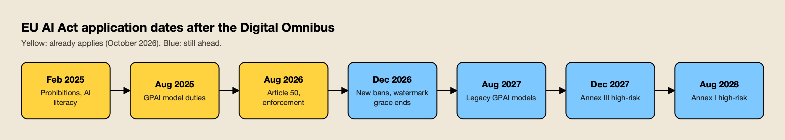
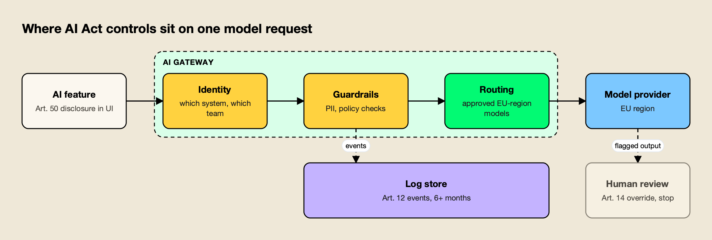
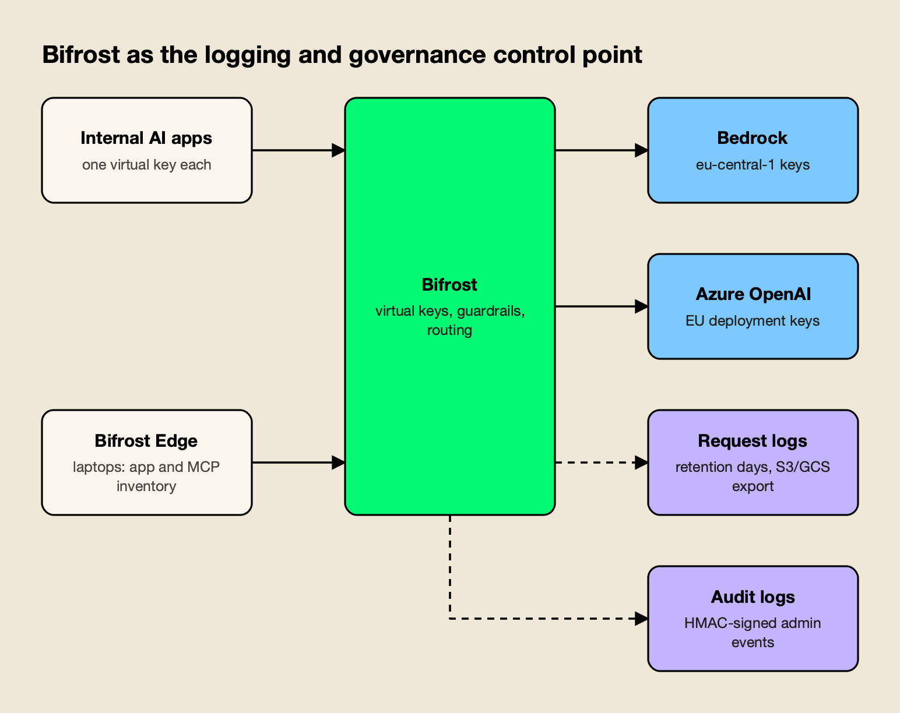

**TL;DR**
- EU AI Act compliance in October 2026 means prohibitions, AI literacy, general-purpose AI (GPAI) model duties and Article 50 transparency all apply now; Annex III high-risk obligations do not apply until December 2, 2027.
- The Digital Omnibus on AI (Regulation (EU) 2026/1744) entered into force on July 27, 2026 and moved the high-risk dates; it did not delay transparency or GPAI rules.
- The obligations engineers own are concrete: an inventory of AI systems, automatic event logs kept for at least six months, disclosure to users, human override and stop controls, and documented data governance.
- Most of those controls attach to one place in the stack: the layer every model request passes through, usually an AI gateway, plus endpoint coverage for AI tools used outside sanctioned apps.
- Bifrost, an open-source AI gateway, is a worked example of that control point: per-system virtual keys, request logs with retention settings, signed admin audit logs, guardrails and region-pinned provider keys.

EU AI Act compliance stopped being a 2026 deadline in July, when the Digital Omnibus on AI moved the high-risk obligations to December 2027 and August 2028, but large parts of the EU AI Act already apply today. Prohibited practices have been banned since February 2025, general-purpose AI model duties started in August 2025, and the Article 50 transparency rules and the enforcement regime arrived on August 2, 2026. For engineering teams, the useful question is which controls have to exist in production now and which ones need to be built before the high-risk dates, and that is what this article maps, article by article. It is not legal advice; classification and role decisions belong with counsel.

## What the EU AI Act Requires and Who It Covers

The EU AI Act, Regulation (EU) 2024/1689, regulates AI systems by risk tier and assigns duties by role. Providers build or place AI on the market, deployers use it under their authority, and GPAI model providers supply the underlying models. One company can hold all three roles for different systems, and the role decides the obligation.

The [regulation text on EUR-Lex](https://eur-lex.europa.eu/eli/reg/2024/1689/oj/eng) sorts AI into four tiers, which the [European Commission's AI Act overview](https://digital-strategy.ec.europa.eu/en/policies/regulatory-framework-ai) summarizes:

- **Unacceptable risk:** prohibited practices such as social scoring and certain biometric uses, banned outright (eight since February 2025, a ninth from December 2026).
- **High risk:** systems in sensitive areas (employment, education, essential services, credit, law enforcement, migration, justice, critical infrastructure) and safety components of regulated products, with strict requirements for risk management, data quality, logging, documentation, human oversight and robustness.
- **Transparency risk:** chatbots, generative systems, deepfakes and emotion recognition, which carry disclosure and marking duties.
- **Minimal risk:** spam filters, game AI and most internal tooling, with no specific obligations beyond AI literacy.

[Article 2](https://ai-act-service-desk.ec.europa.eu/en/ai-act/article-2) covers providers placing AI on the EU market wherever they are established, and providers and deployers outside the EU when "output produced by the AI system is used in the Union". A US SaaS company whose AI feature screens job applicants for a customer in Munich is in scope.

The role question matters because it can change without anyone noticing. Under [Article 25](https://ai-act-service-desk.ec.europa.eu/en/ai-act/article-25), a deployer becomes a provider of a high-risk system if it puts its own name on one, substantially modifies one, or changes the intended purpose of a general-purpose system so that it becomes high risk. A team that wires a general-purpose model into a CV-ranking workflow has, in the Act's terms, created a high-risk system and taken on provider duties.

## EU AI Act Timeline: What Applies in October 2026

As of October 15, 2026, four groups of obligations apply: prohibitions and AI literacy (since February 2, 2025), GPAI model duties (since August 2, 2025), and Article 50 transparency plus the enforcement and penalty regime (since August 2, 2026). High-risk obligations apply from December 2, 2027 for Annex III systems and August 2, 2028 for Annex I systems.

The dates come from Article 113 as amended by the [Digital Omnibus on AI, Regulation (EU) 2026/1744](https://eur-lex.europa.eu/eli/reg/2026/1744/oj/eng). The Commission proposed the omnibus on November 19, 2025, Parliament and Council reached political agreement on May 7, 2026, and it entered into force on July 27, 2026, according to the Commission's overview. Before the omnibus, Annex III obligations would have applied on August 2, 2026, so the change arrived about a week before the original deadline.

*Figure 1: The Digital Omnibus moved the high-risk dates; GPAI, prohibitions and Article 50 transparency kept theirs.*

| Date | What applies | Source |
|---|---|---|
| February 2, 2025 | Prohibited practices 1 to 8 (Art. 5), AI literacy (Art. 4) | Art. 113(a) |
| August 2, 2025 | GPAI model obligations (Chapter V), governance, notified bodies, most penalties | Art. 113(b) |
| August 2, 2026 | General application, including Article 50 transparency; AI Office and national authorities enforce | Art. 113 |
| December 2, 2026 | New prohibitions on AI-generated non-consensual intimate content and CSAM; Art. 50(2) marking deadline for generative systems already on the market | Art. 113(a), Art. 111(4) |
| August 2, 2027 | GPAI models placed on the market before August 2, 2025 must comply | Art. 111(3) |
| December 2, 2027 | High-risk obligations for Annex III systems (Art. 6(2)) | Art. 113(c)(i) |
| August 2, 2028 | High-risk obligations for Annex I product-embedded systems (Art. 6(1)) | Art. 113(c)(ii) |
| August 2, 2030 | High-risk systems intended for use by public authorities | Art. 111(2) |

The [AI literacy duty in Article 4](https://ai-act-service-desk.ec.europa.eu/en/ai-act/article-4) now asks providers and deployers to "support the development" of AI literacy and states that it does not require them to guarantee a specific level for any individual. A new Article 4a allows processing special categories of personal data for bias detection and correction when strictly necessary and under listed safeguards, replacing the old Article 10(5).

The delay is a deferral, not a reprieve. Article 111(2) says high-risk systems placed on the market before the application date fall under the Act only if their design changes significantly afterwards, and a model swap or a new data source in a live system could be the kind of change that pulls it into scope. agitracker.io's piece on [the labs' letter and the global governance debate](/blog/pacing-the-frontier-letter/) covers the policy context.

## EU AI Act High-Risk Classification

An AI system is high risk under the EU AI Act if it is a safety component of a product covered by Annex I legislation, such as machinery or medical devices, or if it falls into an Annex III use case such as hiring, education, credit scoring or access to essential services, unless a narrow exemption in Article 6(3) applies.

[Article 6(3)](https://ai-act-service-desk.ec.europa.eu/en/ai-act/article-6) lets an Annex III system escape the high-risk tier when it poses no significant risk of harm and only performs a narrow procedural task, improves a completed human activity, detects patterns without replacing human assessment, or performs a preparatory task. Two conditions make this exemption an engineering problem as much as a legal one:

- **Profiling always counts.** An Annex III system that profiles natural persons is always high risk, whatever its task.
- **The exemption must be documented and registered.** Under Article 6(4), a provider relying on it documents the assessment before release, registers the system under Article 49(2), and hands the documentation to authorities on request.

The classification decision therefore needs evidence of what each system does in production, which comes from the inventory and logs discussed below. Sector teams in [financial services](https://www.getmaxim.ai/industry-pages/financial-services-and-banking) and [healthcare](https://www.getmaxim.ai/industry-pages/healthcare-life-sciences) tend to have the most Annex III exposure, because credit scoring, insurance pricing and access to health services all appear in the annex.

## EU AI Act Requirements Translated Into Engineering Controls

The EU AI Act requirements that engineering teams own reduce to five controls: an inventory of AI systems and their roles, automatic event logging with retention, user-facing transparency, human oversight with override and stop paths, and documented data governance. Each maps to specific articles and to a component that already exists in most AI stacks.

| Obligation | Articles | Engineering control | Applies to |
|---|---|---|---|
| Know what AI is in use and classify it | Art. 6, 25, 26, 49 | AI system inventory keyed to a unique identity per system | Everyone |
| Automatic recording of events | Art. 12, 19, 26(6) | Request-level logs with metadata, retention of six months or more | High-risk providers and deployers |
| Tell people they are dealing with AI | Art. 50 | UI disclosure, machine-readable marking of generated content | Providers and deployers of in-scope systems, now |
| Human oversight | Art. 14, 26(2) | Review queues, override path, kill switch per system | High-risk |
| Data governance | Art. 10, 4a | Dataset lineage, bias checks, input data controls, PII handling | High-risk providers; deployers for input data |
| Monitoring and incident reporting | Art. 26(5), 72, 73 | Alerting on anomalies, suspension path, incident export | High-risk |

### Inventory and Classification

An inventory is the precondition for every other control, because a team cannot classify, log or oversee a system it does not know exists. The minimum record per AI system is an owner, a purpose, the models and providers it calls, the data it receives, whether it informs decisions about people, and the team's role (provider or deployer).

The hard part is coverage: sanctioned applications are easy to list, but AI inside SaaS tools, browser assistants and coding agents on laptops is not. agitracker.io's survey of [shadow AI tools](/blog/shadow-ai-tools/) and the companion piece on [shadow AI detection](/blog/shadow-ai-detection-tools/) cover the discovery side, and [this explainer on shadow AI](https://www.getmaxim.ai/articles/what-is-shadow-ai-the-ungoverned-ai-risk-inside-every-company/) describes the data-exposure pattern that makes it a compliance gap rather than only a security one.

### Record-Keeping and Logging Under Article 12

[Article 12](https://ai-act-service-desk.ec.europa.eu/en/ai-act/article-12) says high-risk AI systems "shall technically allow for the automatic recording of events (logs) over the lifetime of the system". The logs must support three uses: spotting situations that create risk or a substantial modification, post-market monitoring under Article 72, and the deployer's own monitoring under Article 26(5).

Retention is set in two places. [Article 19](https://ai-act-service-desk.ec.europa.eu/en/ai-act/article-19) requires providers to keep the logs they control for a period appropriate to the intended purpose, of at least six months, and [Article 26(6)](https://ai-act-service-desk.ec.europa.eu/en/ai-act/article-26) sets the same floor for deployers. Data protection law can shorten or lengthen this, and financial institutions keep the logs as part of their existing regulatory records.

For an LLM-based system, a log that serves those purposes records, per request:

- A timestamp and a stable identifier for the AI system and its caller
- Provider, model and model version, so a model swap is visible as a possible substantial modification
- Inputs and outputs, or a pointer to them in protected storage when content retention is restricted
- Token counts, latency, status and error codes, for anomaly detection
- Guardrail decisions and any human review outcome

The Act only lists mandatory fields for remote biometric identification, so this is an engineering reading of the purposes, not a statutory checklist. A separate log of administrative changes (who changed a routing rule, a guardrail or an access policy) closes the gap between "what the system did" and "who made it do that". The [guide to audit trails for LLM traffic](https://www.getmaxim.ai/articles/ai-audit-trail-controls-and-audit-logs-for-llm-traffic/) and this [write-up on MCP audit logging requirements](https://www.getmaxim.ai/bifrost/blog/mcp-audit-logging-requirements-for-enterprise-governance-and-compliance/) extend the same reasoning to agent tool calls.

### Transparency Under Article 50

[Article 50](https://ai-act-service-desk.ec.europa.eu/en/ai-act/article-50) is the obligation most product teams face today, because it applies regardless of risk tier and has applied since August 2, 2026. Its four duties:

- **Interaction disclosure (providers):** systems that interact with people must be designed so users are "informed that they are interacting with an AI system", unless that is obvious.
- **Content marking (providers):** generated audio, image, video and text must be "marked in a machine-readable format and detectable as artificially generated or manipulated", with exemptions for assistive editing. Systems already on the market before August 2, 2026 have until December 2, 2026.
- **Emotion recognition and biometric categorisation (deployers):** people exposed must be told how the system works.
- **Deepfakes and public-interest text (deployers):** disclosure is required, with lighter treatment for evidently artistic work and an exemption for text under human editorial control.

Disclosure must come "at the latest at the time of the first interaction or exposure", which means a UI component on every AI surface and a marking step in the generation pipeline.

### Human Oversight Under Article 14

[Article 14](https://ai-act-service-desk.ec.europa.eu/en/ai-act/article-14) requires high-risk systems to be designed so that natural persons can oversee them while in use. Paragraph 4 lists what the overseer must be able to do: understand and monitor the system, stay aware of automation bias, interpret outputs, decide not to use or to override an output, and interrupt the system through "a 'stop' button or a similar procedure" that brings it to a safe halt.

Translated into components, that is a review queue for outputs that cross a confidence or policy threshold, an override action that is itself logged, and a per-system kill switch that someone other than the original developer can operate. Under Article 26(2), deployers must assign that oversight to people with the competence, training and authority to use it.

### Data Governance Under Article 10

[Article 10](https://ai-act-service-desk.ec.europa.eu/en/ai-act/article-10) applies to providers that train, validate or test high-risk systems. It requires documented practices for data origin, preparation, bias examination and mitigation, and data gaps, and datasets that are relevant, sufficiently representative and, as far as possible, free of errors.

Deployers inherit a narrower version through Article 26(4): where they control input data, it must be relevant and sufficiently representative for the intended purpose. At runtime, the relevant controls are input validation, PII detection and redaction before data reaches a model, and records of what data categories each system receives. The overview of [PII filtering at the AI gateway layer](https://www.getmaxim.ai/articles/pii-filtering-and-compliance-at-the-ai-gateway-layer/) covers how that redaction is typically placed.

## GPAI Provider vs Deployer Duties

GPAI model providers, the companies that train and release general-purpose models, have carried their own obligations since August 2, 2025. Most engineering teams are not GPAI providers; they build on those models and are providers or deployers of AI systems. Their job is to obtain the model provider's documentation and meet their own system-level duties.

[Article 53](https://ai-act-service-desk.ec.europa.eu/en/ai-act/article-53) requires GPAI providers to maintain technical documentation for the AI Office, provide documentation to downstream providers so they can meet their obligations, keep a policy for complying with EU copyright law, and publish a summary of training content using the AI Office template. Models released under a free and open-source licence with public weights are exempt from the two documentation duties, but not from the copyright policy or the training summary, and the exemption does not apply to models with systemic risk.

The Commission published the [General-Purpose AI Code of Practice](https://digital-strategy.ec.europa.eu/en/policies/contents-code-gpai) on July 10, 2025 as a voluntary way to demonstrate compliance. It has three chapters (transparency, copyright, and safety and security for systemic-risk models) and a Model Documentation Form. Signatories listed by the Commission include Amazon, Anthropic, Google, IBM, Microsoft, Mistral AI and OpenAI; xAI signed only the safety and security chapter.

| Duty | GPAI model provider | Downstream provider of an AI system | Deployer |
|---|---|---|---|
| Model technical documentation | Yes (Art. 53(1)(a)) | Obtains it from the model provider | No |
| Training content summary, copyright policy | Yes | No | No |
| System classification and documentation | No | Yes | Checks provider's instructions |
| Logging capability | No | Builds it (Art. 12) | Keeps logs it controls (Art. 26(6)) |
| Human oversight | No | Designs for it (Art. 14) | Staffs it (Art. 26(2)) |
| Article 50 disclosure | Marking for generative systems | Yes | Deepfake and emotion recognition disclosure |

For a team building on a hosted model, the practical step is to file the model provider's downstream documentation in the inventory record of each system that uses it.

## The AI Gateway as the Compliance Control Point

Most EU AI Act engineering controls need to observe or act on every model request: logging, identity, guardrails, routing to approved models and regions, and a way to stop a system. The layer that already sits on that path is the AI gateway, which makes it the natural place to implement them once instead of in every application.

*Figure 2: Most AI Act engineering controls attach to one choke point: the layer every model request already passes through.*

As Figure 2 shows, disclosure stays in the application, because only the UI knows when a person first meets the AI. Identity, input guardrails, routing and event logging sit in the gateway. Human review hangs off the output path. Teams use four broad approaches to build this, and most combine two:

| Approach | What it covers well | What it leaves to other layers |
|---|---|---|
| Application-level logging | Full business context per decision | Consistency across teams; coverage of tools outside the codebase |
| Cloud provider safety services (AWS Bedrock Guardrails, [Azure AI Content Safety](https://learn.microsoft.com/en-us/azure/ai-services/content-safety/overview)) | Content filtering close to the model | Only covers traffic to that cloud |
| GRC platforms (Credo AI, OneTrust, IBM watsonx.governance) | Inventories, risk assessments, framework mapping | Runtime evidence and enforcement |
| AI gateways (Bifrost, [LiteLLM](https://docs.litellm.ai/docs/proxy/logging), [Kong AI Gateway](https://developer.konghq.com/ai-gateway/)) | Per-request logs, identity, guardrails, routing across providers | Business context, UI disclosure |

LiteLLM's proxy documents logging callbacks to S3, Google Cloud Storage, Azure Blob Storage, OpenTelemetry and other destinations, plus settings that turn off message logging while still tracking spend. Kong AI Gateway documents an AI Sanitizer plugin that redacts PII before requests reach the provider, consumer groups that scope model access by team, and guardrail plugins that call AWS, Azure and Google safety services.

agitracker.io's comparisons of [enterprise AI governance platforms](/blog/enterprise-ai-governance-platforms/) and [AI gateways with guardrails](/blog/ai-gateways-with-guardrails/) go deeper on the GRC and runtime sides respectively. The short version is that GRC tools hold the paperwork and gateways produce the evidence, and an AI Act file needs both. This [roundup of AI governance tools for regulatory compliance](https://www.getmaxim.ai/articles/top-5-ai-governance-tools-for-regulatory-compliance-in-2026/) draws the same split.

## Worked Example: Bifrost as the Logging and Governance Layer

[Bifrost](https://www.getmaxim.ai/bifrost) is an [open-source AI gateway](https://github.com/maximhq/bifrost) (Apache 2.0) from Maxim AI that exposes 25+ providers and 10,000+ models through one OpenAI-compatible API. It is used here as the worked example because its documentation covers each control in the previous section, from per-system identity to signed audit trails, on infrastructure the team runs itself.

*Figure 3: One gateway produces the request log, the admin audit trail and the AI inventory that an AI Act file needs.*

**Identity per AI system.** [Virtual keys](https://docs.getbifrost.ai/features/governance/virtual-keys) are Bifrost's governance unit. Issuing one key per AI system gives every log line a system identifier, and each key carries its own allowed providers and models, budgets, rate limits and an active or inactive status that can be switched instantly. That status switch is a usable per-system stop control in the sense of Article 14(4)(e).

**Request logs for Article 12.** The [built-in observability](https://docs.getbifrost.ai/features/observability/default) layer records inputs, outputs, parameters, provider, model, tokens, cost and latency for every request, asynchronously so logging does not sit on the request path. Configured headers and any `x-bf-lh-*` header are captured into log metadata, which is how a team attaches a case ID or decision ID to the model call. Content logging can be disabled globally or per virtual key while usage metadata is kept.

**Retention and export.** The log store runs on SQLite, Postgres or ClickHouse, and `log_retention_days` sets cleanup, with a default of 365 days, comfortably above the six-month floor. [Log exports](https://docs.getbifrost.ai/enterprise/log-exports) offload request and response payloads to S3 or GCS while searchable metadata stays in the database.

**Signed admin audit trail.** [Audit logs](https://docs.getbifrost.ai/enterprise/audit-logs) record who changed what and when, can be signed with an HMAC key so entries are verifiable, export as JSON, JSON Lines or Syslog, and archive to object storage on a schedule. An `omit_ip_addresses` option keeps the trail without client IPs, which the documentation notes is often required under works council agreements in Germany.

**Guardrails for data governance at runtime.** [Guardrails](https://docs.getbifrost.ai/enterprise/guardrails) validate inputs and outputs for LLM calls and MCP tool executions, with built-in secrets detection, regex PII templates and LLM-judge policies, plus integrations with Microsoft Presidio, AWS Bedrock Guardrails, Azure Content Safety, Google Model Armor and others. Each decision is a logged event.

**In-region routing.** Provider keys carry their region (for example an [AWS Bedrock key](https://docs.getbifrost.ai/providers/supported-providers/bedrock) set to `eu-central-1`), and a virtual key can be restricted to specific provider key IDs. Binding a system's virtual key to EU-region keys means its traffic cannot reach a non-EU endpoint even if the application asks for one. The [survey of AI gateways for data residency](https://www.getmaxim.ai/articles/top-5-ai-gateways-for-data-residency-and-multi-region-deployments-in-2026/) covers the multi-region pattern in more detail, and [air-gapped and in-VPC gateways](/blog/air-gapped-ai-gateways/) cover the stricter version.

Bifrost's published benchmark reports 11 µs of added overhead per request at 5,000 RPS on an AWS t3.xlarge. Bifrost's [governance resource page](https://www.getmaxim.ai/resources/governance) and its [AI governance overview](https://www.getmaxim.ai/ai-governance) summarize the same feature set from the vendor's side.

**Shadow AI inventory with Bifrost Edge.** The gateway only sees traffic that is sent to it. [Bifrost Edge](https://www.getmaxim.ai/edge), currently in early access, runs on employee machines and routes AI traffic from desktop chat apps, browser AI, coding agents and MCP servers through the same Bifrost deployment. According to the [Edge documentation](https://docs.getbifrost.ai/edge/overview), it reports the AI apps and MCP servers found on each device, sends new ones to an approval queue, and [enforces allow or block decisions](https://docs.getbifrost.ai/edge/app-governance) per app across the fleet. For the Act, that turns the inventory from a survey into a live list, and extends logging and guardrails to tools the organization did not build.

**Enterprise tier.** Guardrails, audit logs, log exports to object storage and RBAC are part of Bifrost Enterprise; the gateway, virtual keys and built-in request logging are in the open-source release. Bifrost Edge is a separate product and is not included in Bifrost Enterprise by default.

## EU AI Act Fines and Enforcement

From August 2, 2026, the AI Office supervises GPAI model providers and national market surveillance authorities supervise AI systems. Fines under Article 99 reach EUR 35 million or 7% of worldwide turnover for prohibited practices and EUR 15 million or 3% for breaches of most operator obligations, including Article 50.

| Infringement | Maximum fine (undertakings: whichever is higher) | Article |
|---|---|---|
| Prohibited practices (Art. 5) | EUR 35 million or 7% of worldwide annual turnover | 99(3) |
| Operator obligations, including provider, deployer and Art. 50 duties | EUR 15 million or 3% | 99(4) |
| Incorrect or misleading information to authorities | EUR 7.5 million or 1% | 99(5) |

For SMEs and start-ups, [Article 99](https://ai-act-service-desk.ec.europa.eu/en/ai-act/article-99) applies whichever amount is lower, and the omnibus extended that treatment to small mid-caps for the second and third tiers. The [overview of enterprise AI security and compliance](https://www.getmaxim.ai/articles/enterprise-ai-security-and-compliance/) covers how these requirements overlap with GDPR and sector rules.

## An EU AI Act Compliance Plan for the Next 14 Months

With 14 months until Annex III obligations apply, the sequence that works is to build the evidence layer first and the paperwork on top of it: inventory and logging now, transparency checks immediately, oversight and data governance before December 2027.

1. **Now: inventory.** Give every AI system a unique identity at the request path (a gateway key, a service account), record owner, purpose, models and role, and extend discovery to endpoint and SaaS AI use.
2. **Now: Article 50 audit.** Check every user-facing AI surface for disclosure at first interaction, and confirm generated content is marked before the December 2, 2026 deadline for systems already on the market.
3. **Q4 2026: logging.** Centralize request logs with system identifiers, model versions and guardrail outcomes; set retention to at least six months; add a signed administrative audit trail; test an export.
4. **Q1 2027: classify.** Run the Article 6 assessment for every inventory entry, document any Article 6(3) exemptions, and flag systems where Article 25 turns the team into a provider.
5. **2027: oversight and data governance.** Build review queues, override logging and per-system stop controls for high-risk systems; document dataset practices; put PII redaction in front of models; collect GPAI documentation from model providers.

Adversarial testing fits in step 5 as well; agitracker.io's guide to [AI red teaming tools](/blog/ai-red-teaming-tools/) covers the options, and the comparison of [AI guardrails platforms](/blog/ai-guardrails-platforms/) covers runtime enforcement beyond the gateway. The [AI guardrails overview](https://www.getmaxim.ai/ai-guardrails) is a shorter primer on the same layer.

The Digital Omnibus gave high-risk teams more time, but it did not change what the Act asks engineers to produce: a list of AI systems that matches reality, logs that can answer what a system did and why, and controls that let a person stop it. Those that put the control point in the request path in 2026 will have most of the evidence by the time the obligations apply, and the remaining work will be classification and judgment, which is where counsel and governance teams should be spending their time.
