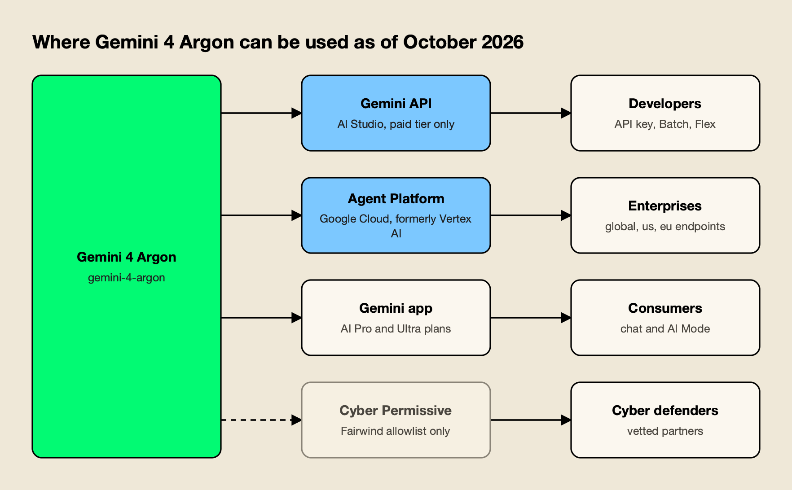
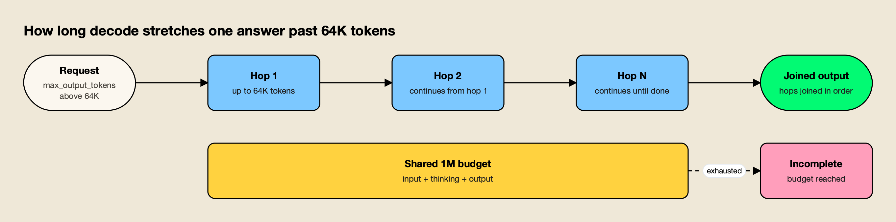
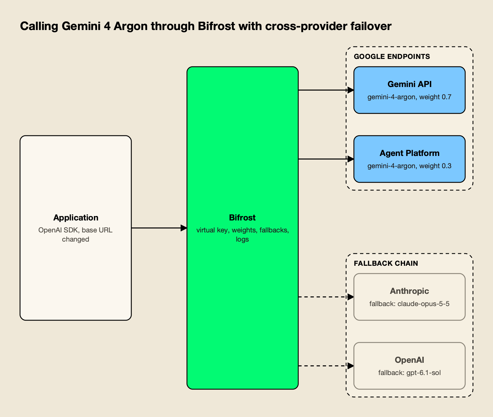

**TL;DR**
- Gemini 4 is a model family, and so far it has one member: Gemini 4 Argon, announced September 30, 2026, and generally available since October 13 under the model ID `gemini-4-argon`.
- Argon shares one 1,048,576-token budget across input, thinking, and output, and Google's long decode feature lets a single answer run far past the usual 64K-token output cap.
- Pricing is $2 input and $10 output per million tokens through November 30, 2026, then $4 and $20. That is half of Claude Opus 5.5 during the introductory period and the same as Opus 5.5 after it.
- Argon tops the Vals Index (68.90%) but places behind Claude Opus 5.5 and Claude Sonnet 5.5 on the Artificial Analysis Intelligence Index, so "best model" depends on the workload.
- Migrating from Gemini 3.1 Pro is not a model-ID swap: `thinking_budget`, explicit caching, and several sampling parameters are rejected or ignored.

Gemini 4 is Google's newest generation of frontier models, and its first release, Gemini 4 Argon, became generally available to developers and enterprises on October 13, 2026. The model matters less for any single benchmark than for three changes in how it is used: a unified 1M-token budget that can be spent almost entirely on output, an introductory price that undercuts most rival flagships, and an API contract that breaks several assumptions carried over from Gemini 3.x. This explainer covers what Google released, where it runs, what it costs, how it compares with GPT-6 and Claude, and what teams need to change to adopt it.

## What Gemini 4 Argon Is

Gemini 4 Argon is Google DeepMind's flagship reasoning model and the first model in the Gemini 4 generation. Google built it for long-horizon work: large code migrations, multi-step agents, legal and financial analysis, scientific problem solving, and defensive cybersecurity. It takes text, images, audio, video, and PDFs as input and produces text.

The name causes some confusion in search. "Gemini 4" is the generation; "Argon" is the specific model. Google's [October 13 launch post](https://blog.google/innovation-and-ai/models-and-research/gemini-models/introducing-gemini-4-argon/) ends with the line "Gemini 4 Argon is just the beginning. We're looking forward to bringing you the rest of the Gemini 4 family." The [Gemini API models page](https://ai.google.dev/gemini-api/docs/models) lists Argon as the only Gemini 4 entry, so there is no Gemini 4 Pro or Gemini 4 Flash to call yet. Google's most capable smaller model is still [Gemini 3.8 Flash](https://ai.google.dev/gemini-api/docs/models), which the models page describes as its most intelligent Flash model.

Google frames Argon around depth rather than speed. In its [first announcement](https://blog.google/innovation-and-ai/models-and-research/gemini-models/gemini-4-argon/), Koray Kavukcuoglu, SVP of Google DeepMind, describes it as "built to sustain deep reasoning across complex, long-horizon workflows." Google's examples are internal: migrating C and C++ codebases to Rust, including work toward the 800K-line Fuchsia Zircon kernel, and a fleet-wide memory optimization that Google says freed over 300 TiB of memory in its data centers. Those figures are Google's own and have not been independently checked.

For a broader picture of how Google's model lines relate to Anthropic's and OpenAI's naming schemes, see this site's guide to [AI model families](/blog/ai-model-families-explained/).

## Gemini 4 Release Date and Rollout

Gemini 4 Argon reached users in two stages two weeks apart. Google announced it on September 30, 2026, with access limited to vetted cyber defenders, then opened it to paying developers, enterprises, and consumers on October 13, 2026. Google Cloud followed with its enterprise announcement on October 14.

The timeline, from Google's own posts:

| Date | What happened | Source |
|---|---|---|
| September 30, 2026 | Argon announced; rolls out to trusted cyber defenders through Google's Fairwind Program while safeguards are tested | [Google blog](https://blog.google/innovation-and-ai/models-and-research/gemini-models/gemini-4-argon/) |
| October 13, 2026 | General availability via the Gemini API (paid tier), Google Antigravity, the Gemini app, and AI Mode in Search; Fairwind expands to hundreds more partners | [Google blog](https://blog.google/innovation-and-ai/models-and-research/gemini-models/introducing-gemini-4-argon/) |
| October 13, 2026 | GA launch stage on Google Cloud, with a retirement date of October 13, 2027 or later | [Google Cloud model page](https://docs.cloud.google.com/gemini-enterprise-agent-platform/models/gemini/4-argon) |
| October 14, 2026 | Google Cloud announces Argon in Gemini for business and on its Agent Platform | [Google Cloud blog](https://cloud.google.com/blog/products/ai-machine-learning/gemini-4-argon-available-on-google-cloud) |
| November 30, 2026 | Introductory pricing ends; standard rates apply from December 1 | [Gemini API pricing](https://ai.google.dev/gemini-api/docs/pricing) |

The staged launch follows a pattern this site has tracked with other cyber-capable models. Anthropic held back Claude Mythos Preview for a vetted defender program, as covered in the [Claude Mythos and Project Glasswing explainer](/blog/claude-mythos-project-glasswing/). Google's version is the Fairwind Program, which gives government, critical infrastructure, and security partners access to Argon without its cyber guardrails. When this site ranked the [top AI models](/blog/top-ai-models/) on October 4, Argon was still limited to Fairwind; it is now open to anyone on a paid plan.

## Where Google Gemini 4 Is Available

Google Gemini 4 is available through four channels: the Gemini Developer API in Google AI Studio (paid tier only), Google Cloud's Gemini Enterprise Agent Platform, consumer and business Gemini apps, and an allowlisted cyber variant for Fairwind members. Each channel has its own billing, data controls, and limits.



*Figure 1: One model, four doors: which one a team uses decides its billing, data controls and model ID.*

As Figure 1 shows, the channels serve different buyers:

- **Gemini API (Google AI Studio).** Developers call `gemini-4-argon` with an API key. Google's [pricing page](https://ai.google.dev/gemini-api/docs/pricing) states the model "is not available on the Free tier or on the Google AI Pro plan," so a billing account is required. Standard, Batch, Flex, and Priority processing are all offered.
- **Gemini Enterprise Agent Platform.** This is Google Cloud's enterprise AI platform, which Google's [name-change page](https://docs.cloud.google.com/gemini-enterprise-agent-platform/vertex-ai-name-changes) maps from "Vertex AI." Argon runs on the `global`, `us`, and `eu` endpoints with data residency, customer-managed encryption keys, and VPC Service Controls, plus Provisioned Throughput for reserved capacity, per the [Cloud model page](https://docs.cloud.google.com/gemini-enterprise-agent-platform/models/gemini/4-argon).
- **Gemini apps and Antigravity.** Google AI Pro and Ultra subscribers get Argon in the Gemini app and AI Mode in Search, according to the [Gemini app announcement](https://blog.google/innovation-and-ai/products/gemini-app/gemini-4-argon-availability/). Ultra subscribers can also use it in Google Antigravity, Google's agent-first development platform, and business users get it in Gemini for business.
- **Gemini 4 Argon Cyber Permissive.** A sibling model, `gemini-4-argon-cyber-permissive`, is allowlist-only through Fairwind. It defaults to the highest thinking level, does not support computer use, runs only on the `global` and `us` endpoints, and is excluded from introductory pricing.

The rename is worth noting for anyone searching documentation. The [Gemini Enterprise Agent Platform](https://cloud.google.com/products/gemini-enterprise-agent-platform) still serves models from the `aiplatform.googleapis.com` endpoint that Vertex AI used, but current Google Cloud docs no longer use the Vertex AI name for the platform.

## Gemini 4 Argon Specs: Context, Output, and Modalities

Gemini 4 Argon accepts up to 1,048,576 tokens of combined input and output, returns up to 65,536 tokens per normal request, and supports three thinking levels (low, medium, high). It reads text, images, audio, video, and PDFs, and outputs text only. Image generation, audio generation, and the Live API are not supported.

The specs below come from the [Gemini API model page](https://ai.google.dev/gemini-api/docs/models/gemini-4-argon) and the [Google Cloud model page](https://docs.cloud.google.com/gemini-enterprise-agent-platform/models/gemini/4-argon):

| Spec | Gemini 4 Argon |
|---|---|
| Model ID | `gemini-4-argon` |
| Token budget | 1,048,576, shared by input, thinking, and output |
| Output per normal request | 65,536 tokens (32,768 for non-streaming direct HTTP on Google Cloud) |
| Output with long decode | Up to 1,048,576 minus input tokens |
| Input modalities | Text, image, audio, video, PDF |
| Output modality | Text |
| Thinking levels | LOW, MEDIUM (default), HIGH |
| Caching | Implicit only, for shared prefixes of 6,144 tokens or more |
| Tools | Function calling, structured output, code execution, search and Maps grounding, URL context, file search, computer use (preview) |
| Input limits (Cloud) | Up to 3,000 images or files per prompt; about 45 minutes of video with audio; about 8.4 hours of audio |
| Not supported | Image and audio generation, Live API, tuning |

Two details stand out. First, the window is unified: a 900,000-token prompt leaves roughly 148,000 tokens for thinking and the answer combined. Second, the 1M figure in Google's marketing describes output headroom, not just context. Claude Opus 5.5 and GPT-6 Astra also offer roughly 1M-token context windows, but both cap a single response at 128K tokens, according to [Anthropic's models overview](https://platform.claude.com/docs/en/docs/about-claude/models/overview) and [OpenAI's models page](https://developers.openai.com/api/docs/models).

## The 1M-Token Output Limit and Long Decode

Long decode is the Gemini API feature that lets Argon write past the standard 64K-token output cap, up to the full 1,048,576-token budget minus the prompt. The server generates the answer in hops of about 64K tokens, each continuing from where the last stopped, until the output is complete or the shared budget runs out.

Google's launch post calls this "an industry-leading 1M unified input-output token limit," up from 64K on earlier models. The reasoning is that some problems, such as a large refactor or a long proof, need hundreds of thousands of tokens of reasoning in one trajectory, and splitting them across many short calls loses state.



*Figure 2: Input, thinking and output draw on one 1,048,576-token budget, so a longer prompt leaves less room to write.*

The mechanics differ by API, according to the [long decode guide](https://ai.google.dev/gemini-api/docs/long-decode):

- **Interactions API.** Set `background: true` and `store: true`, and the server runs the hops asynchronously for up to 24 hours. Each hop adds an output step under the same interaction ID, and the client joins them.
- **GenerateContent API.** The client or SDK starts each hop. Runs are limited to about 20 minutes. On Google Cloud, long decode requires the `v1beta1` endpoint.
- **Status handling.** A run can end as `completed`, `incomplete` (token budget reached), `failed`, `cancelled`, or `requires_action`, so code that assumes every response is complete needs updating.
- **Usage reporting.** `total_input_tokens` adds up every hop's input and overstates real context size; Google recommends estimating context from prompt size plus output and thought tokens.

Google's Cloud developer guide also notes that its OpenAI compatibility layer cannot retrieve long completions using continuation tokens. Teams planning 200K-token outputs should plan to use Google's native SDKs for those jobs, and keep ordinary requests on whatever interface they already use.

The cost implication is direct. Output, including thinking, is billed at the output rate, so a single 500,000-token answer costs $5 at the introductory rate and $10 at the standard rate, before input. For long-output workloads, cost per task depends on where requests are sent as much as on list price; this site's guide to [model routing tools that cut inference cost](/blog/model-routing-inference-cost/) covers how teams split traffic by task.

## Gemini 4 Argon Benchmarks

Google reports that Gemini 4 Argon sets new highs on DeepSWE v1.1 (77.9%), LVBench (91.7%), and the ERQA embodied reasoning test (87%), and ranks first on the Vals Index. Independent leaderboards partly agree: Vals places Argon first, while Artificial Analysis ranks it below Anthropic's latest Claude models.

Google's own numbers, from the [September 30 announcement](https://blog.google/innovation-and-ai/models-and-research/gemini-models/gemini-4-argon/) and the [October 13 launch post](https://blog.google/innovation-and-ai/models-and-research/gemini-models/introducing-gemini-4-argon/):

| Benchmark | What it measures | Argon score (Google-reported) |
|---|---|---|
| DeepSWE v1.1 | Long-horizon software engineering | 77.9% (state of the art) |
| AutomationBench (Zapier) | End-to-end business task execution | 51.3% (#1) |
| LVBench | Long video understanding | 91.7% (state of the art) |
| CWE-bench v1 | Remediating security vulnerabilities | 68% (tied for first) |
| ERQA | Embodied and spatial reasoning | 87% |
| Gray Swan IPI | Indirect prompt injection attack success | 0.7% across 15 adaptive attempts (lower is better) |

Google also reports internal deployment results: engineering teams using Argon in Antigravity increased agentic code submissions by more than 35% while cutting code rollbacks by nearly a third, and coding-benchmark shortcut attempts dropped to 2%.

Independent measurements tell a more mixed story:

- **Vals Index.** Argon leads at 68.90% with a cost of $15.68 per test, ahead of Claude Sonnet 5.5 (67.04%) and Claude Opus 5.5 (66.97%), on [Vals' leaderboard](https://www.vals.ai/benchmarks/vals_index) updated October 13.
- **Artificial Analysis Intelligence Index.** Argon at high thinking scores 53, eighth of 216 model configurations, on [its model page](https://artificialanalysis.ai/models/gemini-4-argon). The [leaderboard](https://artificialanalysis.ai/leaderboards/models) puts Claude Opus 5.5 at 58 and Claude Sonnet 5.5 at 56, with GPT-6 Astra level at 53.
- **Efficiency.** Artificial Analysis records $1.99 per index task for Argon, against $5.98 for Opus 5.5 at max effort and $3.26 for GPT-6 Astra at max effort, though Argon used 110 million output tokens to run the index against a median of 85 million.

Vendor-reported benchmarks are selected by the vendor, and several of Google's (AutomationBench, CWE-bench, internal vulnerability suites) are run by partners or Google itself. This site's [checklist for reading an AI benchmark](/blog/how-to-read-an-ai-benchmark/) applies here: weight the independent leaderboards and, above all, results on your own tasks.

## Gemini API Pricing for Gemini 4 Argon

Gemini API pricing for Gemini 4 Argon is $2 per million input tokens and $10 per million output tokens through November 30, 2026, rising to $4 and $20 from December 1. Cached input costs 95% less than standard input, Batch and Flex processing are half price, and Priority processing costs 1.8 times the standard rate.

The full rate card from [Google's pricing page](https://ai.google.dev/gemini-api/docs/pricing), per million tokens:

| Tier | Input (to Nov 30) | Output (to Nov 30) | Input (from Dec 1) | Output (from Dec 1) | Cached input (to Nov 30 / from Dec 1) |
|---|---|---|---|---|---|
| Standard | $2.00 | $10.00 | $4.00 | $20.00 | $0.10 / $0.20 |
| Batch | $1.00 | $5.00 | $2.00 | $10.00 | $0.05 / $0.10 |
| Flex | $1.00 | $5.00 | $2.00 | $10.00 | $0.05 / $0.10 |
| Priority | $3.60 | $18.00 | $7.20 | $36.00 | $0.18 / $0.36 |

A few pricing rules matter more than the headline:

- **Thinking is output.** Output prices include thinking tokens, and Argon's default MEDIUM thinking level spends tokens before it answers.
- **No long-context surcharge is listed.** Gemini 3.1 Pro Preview charges $2 and $12 up to 200K-token prompts and $4 and $18 above that. Argon's pricing page lists one rate regardless of prompt length.
- **Implicit caching only.** There is no explicit cache to create and pay storage on; the discount applies automatically to repeated prefixes of 6,144 tokens or more, so prompt structure (static content first) decides the savings.
- **Grounding is extra.** Google Search and Maps grounding include 5,000 free requests a month shared across Gemini 3 and newer models, then $14 per 1,000.

The introductory window is short. A team that sizes its budget on October rates will see the per-token bill double on December 1 unless traffic shifts to Batch or Flex or moves partly to a cheaper model such as Gemini 3.8 Flash, which is $0.75 and $3.75 through December 31. A closer walk through Google's tiers and discounts is in this guide to [Gemini API pricing in 2026 and how to cut what you pay](https://www.getmaxim.ai/articles/gemini-api-pricing-in-2026-and-how-to-cut-what-you-pay/). The wider picture of [what drives AI inference cost](/blog/ai-inference-cost/), from reasoning tokens to caching, applies to Argon as much as to any other model.

## How Gemini 4 Argon Compares With GPT-6 and Claude

Gemini 4 Argon is the cheapest of the three labs' flagship models during its introductory period and leads the Vals Index, while Claude Opus 5.5 leads broader intelligence indexes and GPT-6.1 Sol is cheaper per task. After December 1, Argon's price matches Claude Opus 5.5.

The comparison below uses list prices from each lab's own page: Google's pricing page cited above, [OpenAI's API pricing](https://developers.openai.com/api/docs/pricing), and [Anthropic's models overview](https://platform.claude.com/docs/en/docs/about-claude/models/overview). Scores come from the Artificial Analysis and Vals leaderboards linked in the benchmarks section.

| Model | Input / output per 1M | Context | Max output per request | AA Intelligence Index | Vals Index |
|---|---|---|---|---|---|
| Gemini 4 Argon | $2 / $10 to Nov 30; $4 / $20 after | 1,048,576 (shared) | 65,536; up to ~1M with long decode | 53 | 68.90% |
| Claude Opus 5.5 | $4 / $20 | 1M | 128K | 58 | 66.97% |
| Claude Sonnet 5.5 | $2 / $10 | 1M | 128K | 56 | 67.04% |
| Claude Fable 5.1 | $10 / $50 | 1M | 128K | 53 | 65.83% |
| GPT-6 Astra | $10 / $50 | 1.05M | 128K | 53 | 63.13% |
| GPT-6.1 Sol | $2 / $10 | 1.05M | 128K | 52 | 61.15% |

Read across, the table supports three conclusions:

- **On price per token,** Argon matches Claude Sonnet 5.5 and GPT-6.1 Sol until November 30, then doubles to Opus 5.5's level. OpenAI's long-context tier, which doubles input above 272K tokens (covered in this site's [GPT-6 pricing analysis](/blog/gpt-6-pricing/)), has no equivalent on Argon's rate card.
- **On quality,** no single model wins. Argon leads the economically weighted Vals Index; Opus 5.5 and Sonnet 5.5 lead the Artificial Analysis composite. For coding specifically, this site's ranking of the [best AI models for coding](/blog/best-ai-models-for-coding/) compares models on agentic coding benchmarks.
- **On output length,** Argon is unique among the three for a single response far above 128K tokens.

The practical result is that most teams will run Argon alongside Claude and GPT models, not instead of them, and route by task.

## Migrating From Gemini 3.1 Pro to Gemini 4

Google's migration guidance treats Gemini 3.1 Pro Preview as the model most teams will move from, and the change is more than a new model ID. Argon rejects some request parameters with HTTP 400 errors, ignores sampling controls, and drops explicit caching, so code written for Gemini 3.x needs review before traffic moves.

The checklist from Google Cloud's [developer guide to Gemini 4 Argon](https://docs.cloud.google.com/gemini-enterprise-agent-platform/models/guides/gemini-4-argon):

- **Thinking controls.** Replace `thinking_budget` and the `MINIMAL` level with `thinking_level` (LOW, MEDIUM, or HIGH). Unlike 3.1 Pro, a `thinking_budget` is not silently mapped; it returns a 400 error.
- **Caching.** Remove `cached_content` and explicit cache creation. Put static content (system prompt, documents, tool definitions) at the start of the prompt so implicit caching can match it.
- **Sampling.** `temperature`, `top_p`, and `top_k` are ignored. `candidate_count`, `frequency_penalty`, and `presence_penalty` return 400 errors.
- **Conversation history.** Remove prefilled model turns from chat histories.
- **Token accounting.** Expect billing for every processed token, including tool system instructions and function declarations when grounding is used.

These changes have a knock-on effect for SDKs and proxies that fill in default parameters. A client library that always sends `presence_penalty: 0` will start receiving errors from Argon even though nothing in the application changed. Testing a slice of real traffic before moving everything, as with any model change, catches these before users do.

## Calling Gemini 4 Through an AI Gateway

An AI gateway lets an application call Gemini 4 Argon through one OpenAI-compatible endpoint while the gateway handles Google credentials, splits traffic between the Gemini API and Agent Platform, and fails over to Claude or GPT models when Google returns errors. It turns a model adoption into a configuration change.

There are three common ways to call Argon:

- **Google's native SDKs.** The Google Gen AI SDK talks to both the Gemini API and Agent Platform and is required for long decode and the Interactions API.
- **Google's OpenAI compatibility.** Agent Platform lists Chat Completions (OpenAI compatibility) among Argon's supported APIs, so OpenAI SDK code can call Argon by changing the base URL. This covers one provider at a time.
- **A multi-provider gateway.** A gateway sits in front of Google, Anthropic, OpenAI, and others, so a single client integration reaches all of them with shared keys, budgets, logs, and failover. This site compared five options in its review of [AI gateways for Anthropic, OpenAI, and Gemini](/blog/ai-gateways-for-anthropic-openai-gemini/), and covered cloud-hosted endpoints in [AI gateways for Bedrock, Vertex, and Azure failover](/blog/ai-gateways-for-bedrock-vertex-azure-failover/).

### Worked example: Gemini 4 Argon on Bifrost

[Bifrost](https://www.getmaxim.ai/bifrost), an [open-source AI gateway](https://github.com/maximhq/bifrost) written in Go by Maxim AI, is used here as the worked example because its documentation covers both of Google's API surfaces as separate providers and documents cross-provider fallbacks in detail. It routes to 25+ providers and 10,000+ models through one OpenAI-compatible API, and its published benchmark reports 11 µs of added overhead per request at 5,000 RPS on an AWS t3.xlarge ([benchmark docs](https://docs.getbifrost.ai/benchmarking/t3.xl)).



*Figure 3: The application names one model; the gateway decides which Google endpoint serves it and what happens when both fail.*

The setup in Figure 3 has three parts:

1. **Two Google providers.** The [Gemini provider](https://docs.getbifrost.ai/providers/supported-providers/gemini) takes a Gemini API key, and the [Vertex provider](https://docs.getbifrost.ai/providers/supported-providers/vertex) takes a Google Cloud project, a region (`global` is accepted), and service-account or workload identity credentials. Bifrost converts OpenAI-format requests to Gemini's format, including mapping `reasoning.effort` to Gemini's `thinkingLevel`.
2. **Weighted routing on a virtual key.** A [virtual key](https://docs.getbifrost.ai/features/governance/routing) lists both providers with weights, so a request for `gemini-4-argon` is split proportionally between them, which spreads quota across two Google billing paths.
3. **Fallbacks to other labs.** The request names a [fallback chain](https://docs.getbifrost.ai/features/fallbacks); if both Google endpoints fail after retries, the gateway moves to the next provider, and the response records which provider actually served it.

The virtual key's provider configuration looks like this:

```json
{
  "provider_configs": [
    { "provider": "gemini", "allowed_models": ["gemini-4-argon"], "key_ids": ["*"], "weight": 0.7 },
    { "provider": "vertex", "allowed_models": ["gemini-4-argon"], "key_ids": ["*"], "weight": 0.3 }
  ]
}
```

And the application keeps using the OpenAI request shape, with a fallback chain in the body:

```bash
curl -X POST http://localhost:8080/v1/chat/completions \
  -H "x-bf-vk: vk-prod-main" \
  -H "Content-Type: application/json" \
  -d '{
    "model": "gemini-4-argon",
    "messages": [{"role": "user", "content": "Summarize this contract clause by clause."}],
    "fallbacks": ["anthropic/claude-opus-5-5", "openai/gpt-6.1-sol"]
  }'
```

Existing OpenAI, Anthropic, and Google GenAI SDK clients only need a new base URL, per the [drop-in replacement docs](https://docs.getbifrost.ai/features/drop-in-replacement). The same gateway can sit in front of Gemini CLI, Google's terminal coding agent, through a [GenAI-compatible endpoint](https://docs.getbifrost.ai/cli-agents/gemini-cli), and the walkthrough on a [Gemini CLI multi-model setup](https://www.getmaxim.ai/articles/gemini-cli-multi-model-setup-connect-to-claude-gpt-groq-and-20-providers-via-bifrost/) shows that configuration end to end.

Step-by-step provider setup is in Bifrost's guides for the [Gemini provider](https://www.getmaxim.ai/bifrost/guides/providers/gemini) and [Vertex AI provider](https://www.getmaxim.ai/bifrost/guides/providers/vertex-ai).

A longer piece covers [using Bedrock, Vertex, Gemini, and Anthropic models through one gateway](https://www.getmaxim.ai/articles/using-bedrock-vertex-gemini-and-anthropic-ai-models-through-bifrost/), and the failover side is covered in [enabling automatic fallback when a primary provider fails](https://www.getmaxim.ai/bifrost/blog/your-primary-llm-provider-failed-enable-automatic-fallback-with-bifrost/).

### Why route Argon this way

Three properties of the launch make a routing layer more useful than usual:

- **The price changes on a fixed date.** On December 1, Argon's rates double. With weights and allowed models in gateway config, moving part of the traffic to Batch-style jobs, Gemini 3.8 Flash, or Claude Sonnet 5.5 is a config edit rather than a redeploy.
- **New models bring new errors.** Argon's stricter parameter handling and its new quotas make early failures likely. A fallback chain keeps users served while those are fixed.
- **No model wins everywhere.** With Argon leading one index and Opus 5.5 another, teams benefit from sending each task to the model that does it best, which a gateway does without touching application code.

Comparisons of gateways on these criteria are collected in [the best AI gateway for routing between OpenAI, Anthropic, and Gemini](https://www.getmaxim.ai/articles/best-ai-gateway-for-routing-between-openai-anthropic-and-gemini/) and [AI gateways for multi-provider failover and load balancing](https://www.getmaxim.ai/articles/top-5-ai-gateways-for-multi-provider-failover-and-load-balancing/). For the category in general, the overview of the [LLM gateway](https://www.getmaxim.ai/llm-gateway) explains what the layer does.

## What Gemini 4 Changes for Teams

Gemini 4 changes three things for teams building on large models: a single response can now run to hundreds of thousands of tokens, a frontier-class model is briefly priced like a mid-tier one, and Google's API contract for its top model is stricter than before.

For teams already on Gemini 3.1 Pro, the move to Argon is worth testing now, while the introductory rate lasts, with the migration checklist above applied first. For teams standardized on Claude or GPT-6, Argon is a strong candidate for long-output work such as codebase migrations and document synthesis, and for workloads where the Vals Index's finance, legal, and tax tasks resemble their own. It is less clearly ahead on the broad intelligence composites, so it should earn traffic task by task.

The verdict would change on three signals: the December 1 price step, the arrival of the rest of the Gemini 4 family (a cheaper Gemini 4 model would shift the price comparison again), and independent replication of Google's coding and security results. Until then, Gemini 4 is best treated as one more strong option in a multi-model stack rather than a replacement for it.
