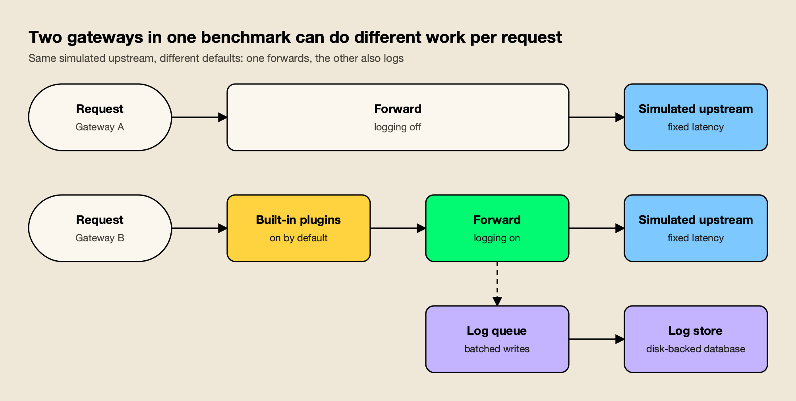
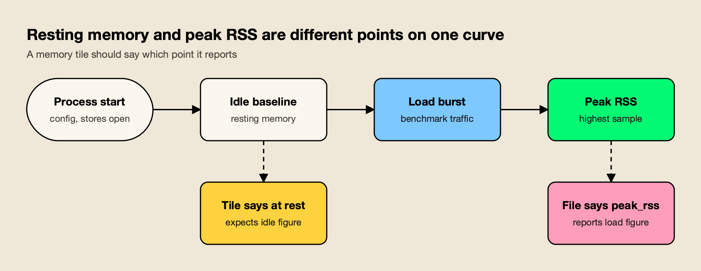
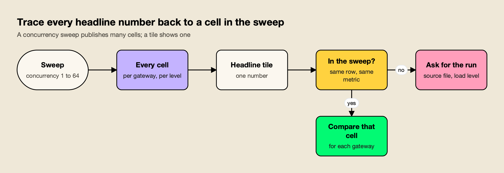

**TL;DR**
- An AI gateway benchmark is only as useful as its disclosure: configuration, versions, trials, hardware, and the raw files behind every headline number.
- Ten questions catch most problems, and each one can be checked against a vendor's own published data rather than taken on trust.
- LiteLLM's Rust gateway benchmark is a useful worked example: as of November 1, 2026, its headline 7x overhead figure does not appear in its own concurrency sweep, and its "memory at rest" tile is mislabelled peak RSS.
- The same files show real advantages for LiteLLM's Rust build: lower memory in every file, lower CPU, and a lead in an exploratory concurrency-256 run.
- The checklist applies to every vendor's numbers, including those of the gateway on the other side of this comparison.

*About the evidence: The worked example uses LiteLLM's published results and [a response from Maxim AI](https://www.getmaxim.ai/bifrost/blog/debunking-litellm-rust-benchmarking-part-1), the developer of Bifrost. It is a review of published material, not a new benchmark run by AGI Tracker.*

An AI gateway benchmark measures how much latency, memory, CPU and cost a gateway adds to model traffic, usually by sending the same load through each gateway to a simulated upstream and subtracting a direct-call baseline. The method is sound. The weak point is the step between the raw result files and the number on a homepage tile, where configuration, run count and caveats tend to disappear. This checklist sets out ten questions to ask of any published gateway benchmark, and answers each one using the files LiteLLM published for its Rust gateway in 2026.

## The AI Gateway Benchmark Checklist at a Glance

The ten questions cover what was run, how often, on what, and how the results were turned into claims. Each can be answered from a vendor's own repository and blog when those are public. The table pairs each question with what LiteLLM's benchmark shows when its homepage is compared against the repo's CSV and JSON files.

| # | Question to ask | What to look for | LiteLLM worked example (as of November 1, 2026) |
|---|---|---|---|
| 1 | Did every gateway run the same features? | Published configs for each gateway; logging, plugins and persistence stated | Blog says no logging or persistence; Bifrost config left logging on by default (inferred from v2.4.0 code, not confirmed on v1.6.4) |
| 2 | Which versions were tested? | Exact version or commit for every gateway, on the page making the claim | Rust beta without streaming vs Bifrost v1.6.4; no version on the homepage |
| 3 | How many trials per cell, with what spread? | Repeated runs, confidence intervals or error bars | Each cell appears to be a single run; no error bars |
| 4 | What hardware and worker counts? | Machine type, core count, worker count, upstream latency | None stated for the benchmark runs; 4 vCPU / 16 GB appears only in the cost model |
| 5 | Is memory peak or resting? | Label on the tile matches the column in the file | Mislabelled: tile says "memory at rest"; the column is `peak_rss_mb` |
| 6 | Does the headline appear in the full sweep? | Every concurrency level published; headline traceable to a cell | 4.54 ms figure appears in no sweep row; homepage uses the widest of three memory pairs |
| 7 | Is cost measured or modelled? | Inputs shown; instance price and machine stated | Requests per dollar is a model on an assumed instance |
| 8 | Are the raw files linked? | Links to data and method from the claim itself | Repo is public, but "See the benchmark" links to an in-page anchor |
| 9 | Do the caveats reach the marketing tiles? | Blog caveats repeated next to headline numbers | Blog says "order-of-magnitude" and single-host; tiles do not repeat it |
| 10 | Which data points were excluded, and why? | Dropped runs listed with the reason | Concurrency 256 dropped from the sweep; JSON files still in the repo |

The sections below take each question in turn. Readers who want to run their own test rather than read someone else's will find the setup, metrics and scenarios in the guide to [running an LLM gateway benchmark that measures real overhead](/blog/llm-gateway-benchmark/).

## Configuration Parity Between Gateways

Configuration parity means every gateway in a benchmark performs the same work on each request. A gateway that logs requests to disk, runs plugins or tracks spend does more per call than one that only forwards, so a comparison between them measures feature sets as much as runtime efficiency. The first question is whether the configurations were published, and whether they match the stated setup.

LiteLLM's [benchmark blog post](https://docs.litellm.ai/blog/rust-ai-gateway-benchmarks) says every gateway ran "with no logging callbacks, spend tracking, or persistence enabled," and adds: "It is not a full-feature comparison." The published [Bifrost configuration in the benchmark repo](https://github.com/BerriAI/ai-gateway-bench/tree/main/gateways/bifrost) sets a simulated upstream, `config_store: enabled: false` and no plugins. It never sets `logs_store` or `enable_logging`.

That omission matters. When `enable_logging` is unset it defaults to true; a missing `logs_store` creates a default SQLite log store; the logging plugin is built in, so "no plugins" does not turn it off; and `disable_content_logging` defaults to false, so request and response bodies are logged too. This reading of Bifrost's defaults is inferred from v2.4.0 code and not yet confirmed on v1.6.4, the version LiteLLM tested, and the LiteLLM Rust configuration has not been checked the same way. The current [Bifrost observability documentation](https://docs.getbifrost.ai/features/observability/default) describes the same default for today's builds: the logging plugin is enabled automatically in gateway mode with SQLite storage.

*Figure 1: An AI gateway benchmark is only like-for-like when both gateways run the same features, not just the same simulated upstream.*

As Figure 1 shows, two gateways can share the same load driver and upstream and still do different work per request. The reader's test is simple: open each gateway's config file and check every feature the blog says was off. If a feature is on by default and the config does not set it, it was probably on. Turning logging off would not make the setups identical either, because other built-in plugins (telemetry, governance, routing) hook into requests independently. The [gateway setup guide](https://docs.getbifrost.ai/quickstart/gateway/setting-up) documents how the config store and those defaults are set.

## Software Versions Under Test

A benchmark result describes one build of each gateway, so the versions belong next to the claim. Gateways ship quickly; a comparison between a new beta and a year-old release says little about what either project ships today. Ask which versions ran, whether they are the versions a team would deploy, and whether the page making the claim names them.

LiteLLM's blog lists "LiteLLM Rust beta, LiteLLM Python v1, Bifrost v1.6.4," and a fourth gateway, and describes the Rust build as "an early beta, streaming and the full feature surface are still landing." The blog names no specific LiteLLM Python version. Bifrost's changelogs list v1.6.5 to v1.6.11 and then v2.0.0 to v2.4.0 after the tested build, and Bifrost's developers describe lower memory use in the 2.x release line, although no figure for that has been published yet. The [litellm.ai homepage](https://www.litellm.ai/#benchmark) shows no version for any gateway; the version appears only in the blog and the gateway README.

A second version question is scope: how much of the product was in the build that ran? As of November 1, 2026, GitHub's language breakdown for the [BerriAI/litellm repository](https://github.com/BerriAI/litellm) shows 84.88% Python and 3.11% Rust by source bytes. LiteLLM's [Rust gateway documentation](https://docs.litellm.ai/docs/proxy/rust_gateway) warns that the Python proxy on `main:latest` uses Rust for `/ocr` and for Bedrock `/audio/transcriptions`, while Chat Completions and Messages run on Python and the per-model `rust: true` flag currently has no effect. A benchmark of a narrow Rust beta does not describe the product most LiteLLM users run. Teams weighing that difference in practice can compare options in the survey of [LiteLLM alternatives](/blog/litellm-alternatives/).

## Repeated Trials and Error Bars

Repeated trials show how much a result moves between runs, and error bars or confidence intervals show that spread on the chart. Performance benchmarking on shared or virtualised machines is noisy, so a single run per configuration cannot tell a real gap from variation. Ask how many runs each cell represents, and whether the gaps being advertised are larger than the spread.

LiteLLM's blog is candid about this. It describes "single-host, per-scenario runs (for example n=5000 on the overhead panel) without repeated-trial error bars," calls itself "a vendor-run benchmark," and asks readers to "treat them as order-of-magnitude differences." Each cell appears to be a single run, with no repeats or error bars published.

The consequence shows up inside LiteLLM's own files. Total p99 latency at concurrency 64 is 52.7 ms for Bifrost and 64.3 ms for Rust in the sweep file, but 32.2 ms and 26.9 ms respectively in `rps_per_dollar.csv`. The two gateways swap places depending on which file a reader opens. Throughput gaps between the two are all under 1% in the sweep, and with one run per cell and no confidence intervals, the significance of those gaps is unknown.

The practical rule: a single-run benchmark can support an order-of-magnitude claim, such as LiteLLM's Python proxy adding hundreds of milliseconds at concurrency 64 while the other two add tens. It cannot support a precise multiplier between two gateways that sit within a few milliseconds of each other.

## Benchmark Methodology Disclosure: Hardware and Workers

Hardware disclosure means stating the machine type, core count, memory, worker or thread count for every gateway, and the latency of the simulated upstream. Gateway overhead depends heavily on how many cores the process can use and how it was tuned, so "identical hardware" without the details cannot be checked. Ask for the instance, the workers, and the load level of every run.

The litellm.ai homepage states "Identical hardware; every gateway pointed at the same deterministic mock upstream." As of November 1, 2026, neither the page nor the blog gives a machine type, core count or worker count for either gateway, and no upstream latency or concurrency level for the overhead run. The only hardware figure, 4 vCPU / 16 GB, appears in the cost model, not in the description of the benchmark machine.

Route disclosure belongs in the same question. Bifrost was called on its native `/anthropic/v1/messages` route; the gateway README in LiteLLM's repo says v1.6.4 does not mount that integration at `/v1/messages`, and no proxy rewrite was used. Different routes can take different code paths, so the route each gateway served is part of the setup. A benchmark that publishes these details can be reproduced on matching hardware; one that does not leaves the reader trusting the description.

## Peak Memory Versus Resting Memory

Peak RSS (resident set size) is the highest physical memory a process held during measurement, normally under load. Resting memory is the footprint of an idle process. Both are legitimate metrics, but they answer different questions, so a memory claim should name which one it reports, and the label on the tile should match the column in the data file.

The litellm.ai benchmark tile reports "memory at rest" of about 22 MB for Rust against about 199 MB for Bifrost, with a chart note describing "resident memory with the gateway idle." That label is wrong: the figure is peak RSS. The underlying column is `peak_rss_mb`, and the same chart uses "memory at rest", "peak RSS" and "idle" together. LiteLLM's blog, by contrast, correctly describes the figure as "21.8MB peak memory against 199.1MB."

*Figure 2: Peak RSS is the highest sample during load; resting memory is the idle baseline, so the two labels are not interchangeable.*

The distinction also matters for explaining a gap. In `cpu_bifrost.csv`, Bifrost's RSS is already about 282 MB before the first request, and load adds only about 16 MB. That points primarily to a baseline footprint rather than growth in the log buffer, although RSS alone cannot identify which components account for it. Bifrost v1.6.4 opens a disk-backed log database at startup with a SQLite [cache setting of 10,000 pages](https://github.com/maximhq/bifrost/blob/transports/v1.6.4/framework/logstore/sqlite.go) per connection, about 39.1 MiB at a 4 KiB page size; that cache grows on demand and is not preallocated. The files do not quantify SQLite's contribution or isolate logging's share of the gap. A heap profile, not an RSS reading, is what answers that.

None of this reverses the direction of the result. LiteLLM's Rust build is smaller on memory in every file: its highest figure, about 36 MB, is below Bifrost's lowest, about 144 MB.

## Full Sweeps Versus Selected Cells

A concurrency sweep runs every gateway at several load levels and publishes a result for each. A headline tile shows one number. The reader's job is to find the sweep cell behind that number. If the headline matches no row, or comes from the most favourable of several files, the sweep is the better guide to typical behaviour.

Below is the sweep from LiteLLM's [latency_vs_concurrency.csv](https://github.com/BerriAI/ai-gateway-bench/blob/main/results/latency_vs_concurrency.csv): added p99 latency over a direct call, in milliseconds, as of November 1, 2026. All error counts are zero.

| Concurrency | Direct p99 | LiteLLM Rust | Bifrost | LiteLLM Python |
|---|---|---|---|---|
| 1 | 21.98 | +0.89 | +0.75 | +9.79 |
| 4 | 22.42 | +0.61 | +0.63 | +26.95 |
| 16 | 22.67 | +0.33 | +0.89 | +251.34 |
| 64 | 24.02 | +40.28 | +28.68 | +546.04 |

The homepage tile reports 0.66 ms for Rust against 4.54 ms for Bifrost, and the blog calls it "roughly 7x lower overhead." That pair comes from [overhead_comparison.csv](https://github.com/BerriAI/ai-gateway-bench/blob/main/results/overhead_comparison.csv), which states no concurrency level. No sweep row is near 4.54 ms: Bifrost adds less p99 than Rust at concurrency 1 and 64, Rust adds less at 16 (+0.33 vs +0.89 ms), and the gap at 4 is 0.02 ms. The reported throughput is similar for the Rust beta and Bifrost; these single runs do not establish a consistent performance winner.

*Figure 3: If a headline figure cannot be found in any row of the sweep, ask which run produced it before relying on it.*

Selection also applies across files. The repo holds three Bifrost/Rust memory pairs, and the homepage uses the widest pair:

| Files | Bifrost | LiteLLM Rust | Ratio |
|---|---|---|---|
| `mem_bifrost_messages.csv`, `mem_litellm_rust_release.csv` | 199.1 MB | 21.8 MB | 9.1x (used on the homepage) |
| `mem_bifrost.csv`, `mem_litellm_rust.csv` | 144 MB | 26.1 MB | 5.4x |
| `cpu_*.csv` | 282 to 298 MB | 35 to 36 MB | 8.3x |

The pairs may come from different scenarios or builds, which is itself a disclosure question. Two more examples follow the same pattern. The homepage's "3.5x lower overhead than the next AI gateway" compares Rust's 0.66 ms with a different gateway at 2.29 ms, not Bifrost. And the throughput tile leaves Bifrost's cell blank, while [rps_per_dollar.csv](https://github.com/BerriAI/ai-gateway-bench/blob/main/results/rps_per_dollar.csv) shows 2,744 req/s for Bifrost against 2,814 for Rust, a gap of 2.5% or less.

## Modelled Versus Measured Cost

A measured cost comes from a real bill or a run on priced infrastructure. A modelled cost multiplies measured resource use by an assumed instance price. Modelled figures are useful for rough sizing, but the assumptions decide the answer, so ask what instance was assumed, whether it matches the benchmark machine, and which inputs were used.

The litellm.ai tile claims "~4.5x more requests per dollar." The arithmetic holds: `rps_per_dollar.csv` lists 283,833 requests per dollar-hour for Rust against 63,246 for Bifrost, and $0.0099 against $0.0434 per hour, a 4.4x hourly ratio. LiteLLM's blog uses a third framing, Rust at "about $0.000175, roughly 6x below Bifrost ($0.001008)," per one million requests. That ratio is about 5.8x, and it is a different metric from the page's 4.5x.

| Cost framing | Rust | Bifrost | Ratio stated | Where it appears |
|---|---|---|---|---|
| Requests per dollar-hour | 283,833 | 63,246 | ~4.5x | litellm.ai tile, `rps_per_dollar.csv` |
| Cost per hour | $0.0099 | $0.0434 | 4.4x | `rps_per_dollar.csv` |
| Cost per 1M requests | $0.000175 | $0.001008 | "roughly 6x" (about 5.8x) | LiteLLM blog cost chart |

All three rest on the same model. The blog describes it as "estimated USD per one million requests from measured CPU, peak RSS, and sustained throughput on a 4 vCPU / 16 GB instance" and notes it "excludes token cost." The 4 vCPU / 16 GB instance is a modelling assumption, not the benchmark machine, and Bifrost's logging cost sits inside the inputs. The model's arithmetic is correct; what it cannot show is the same savings on a production deployment. For a wider view of how gateway and model spend add up, see the breakdown of [AI inference cost](/blog/ai-inference-cost/).

## Reproducibility Links and Raw Data

Reproducibility means a reader can get from the claim to the data and the method in one click, and then rerun the test. A public results directory is the most valuable thing a vendor benchmark can publish, because it lets anyone check the headline. Ask whether the claim links to the raw files, the configs and a methodology document, not just to another part of the same page.

LiteLLM deserves credit here: the [ai-gateway-bench repository](https://github.com/BerriAI/ai-gateway-bench) publishes per-gateway configs and a [results directory](https://github.com/BerriAI/ai-gateway-bench/tree/main/results) of CSV and JSON files, which is what made an outside check possible. The blog also defines its main metric clearly: overhead is gateway latency minus direct-to-upstream latency, charted as p99 added latency.

The gap is on the homepage. The tile invites readers to "Run it yourself," but the "See the benchmark" link goes to the in-page `#benchmark` anchor, not to the raw data or a methodology document. Without hardware, worker counts and upstream latency, a reader with the repo still cannot reproduce the exact runs. The checklist question is two-part: are the files public, and does the claim point to them?

## Caveats Carried Onto Marketing Tiles

A caveat belongs wherever the number it qualifies appears. Benchmark blog posts often include honest limitations, but homepage tiles, social cards and slide decks repeat the number without them. Ask whether the qualifiers in the methodology section (single run, vendor-run, order-of-magnitude, feature-limited) travel with the headline figure.

LiteLLM's blog carries several qualifiers: single-host runs, no repeated-trial error bars, "a vendor-run benchmark," "treat them as order-of-magnitude differences," and "it is not a full-feature comparison." The homepage tiles do not repeat any of them.

The homepage footnote adds claims of its own. It describes the setup as a "single client," which is misleading: the sweep runs concurrency 1 to 64 and the throughput point uses `ceiling_concurrency = 64`. The tile's "2,800+ req/s (at ~21% CPU)" also could not be traced. `cpu_rust.csv` peaks at 15.9%, and none of the Rust CPU, throughput, cost or overhead files contains a ~21% figure; whether some other file in the results directory does is not established. An inference, not confirmed: the CPU samples appear to come from a short burst, probably the concurrency-16 cost runs, so CPU may be paired with a different load than the 2,800 req/s figure.

A quick test for any tile: if the caveat from the blog were printed beside the number, would the number still make the same impression? If not, read the blog first.

## Excluded Data Points

Benchmarks often drop runs that fall outside their validity rules, and that is good practice when the rule is stated. The reader's question is whether exclusions are disclosed where the results are presented, and what the excluded data shows. A dropped run can favour either side.

LiteLLM's repo README explains that concurrency 256 was dropped from the sweep because the direct baseline's p99 at 256 exceeded twice the single-client floor. The blog does not mention the exclusion. A concurrency-256 JSON file for each gateway is still in `results/`, as of November 1, 2026:

| Concurrency 256 (single run) | Direct | LiteLLM Rust | Bifrost | LiteLLM Python |
|---|---|---|---|---|
| p50 | 48.1 ms | 55.5 ms | 89.3 ms | 1,513 ms |
| p99 | 434.8 ms | 2,667.8 ms | 5,421.3 ms | 10,733.6 ms |

In this excluded run, Rust leads: about 1.6x at p50 and 2.0x at p99. The caveats are significant: one run of 5,000 requests per gateway, no errors, no RPS field, and a direct baseline already outside the benchmark's own threshold. That makes it an exploratory result rather than a reliable capacity comparison. It is still the kind of data point a careful reader should know exists.

## Where the Worked Example Shows Real Advantages

A checklist that only finds faults is not doing its job. Applied to LiteLLM's files, the same ten questions also surface results that hold up across files, and those deserve equal weight. LiteLLM's Rust build uses less memory and less CPU than Bifrost v1.6.4 in every published measurement.

The findings that survive the checklist, as of November 1, 2026:

- **Memory:** Rust is smaller in every file. Its highest figure (about 36 MB) is below Bifrost's lowest (about 144 MB).
- **CPU:** Bifrost averages 2.59% (peak 79.5%) against Rust's 0.66% (peak 15.9%), measured as whole-process figures under the configurations described above.
- **Concurrency 256:** Rust records lower p50 and p99 than Bifrost in the exploratory single run.
- **Against LiteLLM Python:** the Rust beta's added p99 at concurrency 64 is a fraction of the Python proxy's +546.04 ms, and Python reaches 179.8 RPS against 2,722.2 for Rust.

These are results for the tested configurations, not proof of an equivalent-feature advantage, because the setups did different work. How much of the memory gap remains with logging off, on a current build, is a question only a controlled rerun with heap profiles can answer. agitracker's analysis of [where LiteLLM's Rust gateway genuinely leads](/blog/rust-vs-go-performance-gateways/) looks at each of these wins in turn.

## Applying the Checklist to Any Vendor's Numbers

The ten questions are vendor-neutral. They apply to LiteLLM's figures, to Bifrost's own [benchmarking documentation](https://docs.getbifrost.ai/benchmarking/getting-started), and to every comparison chart in the category. A complete benchmark publishes configs, versions, trial counts, hardware and raw files, and repeats its caveats wherever its numbers appear.

A like-for-like rerun of this comparison would need four things, and the list doubles as a disclosure standard any vendor can be held to:

1. Run both gateways with logging off, and again with logging on.
2. Use a current Bifrost build, with repeated trials and error bars.
3. Publish hardware, worker counts, upstream latency and concurrency for every run.
4. Take heap profiles to measure how much of the memory gap is the log buffer.

agitracker's [LLM gateway test plan](/blog/llm-gateway-test-plan/) turns those four steps into a run teams can do themselves. Readers should apply the same ten questions to any such rerun, including one published by a vendor whose gateway it favours. Buyers comparing gateways on more than speed can pair this checklist with a criteria-led survey such as agitracker's [best LLM gateways](/blog/best-llm-gateways/) or the wider list of [top AI gateways](/blog/top-ai-gateways/).

Two practical settings follow from question 1 for anyone rerunning this test. Setting `client_config.enable_logging: false` removes the built-in logging plugin's queue and hooks at startup, and `client_config.disable_content_logging: true` reduces logged payloads; other plugins stay enabled independently. In v1.6.4 the log writer [flushes at 1,000 entries, 5 seconds or 300 MiB](https://github.com/maximhq/bifrost/blob/transports/v1.6.4/framework/logstore/config.go#L24-L30) of estimated payload, with a 10,000-entry queue. These are entry-count bounds, not a memory cap.

## What the Checklist Means for Gateway Buyers

An AI gateway benchmark is evidence, not a verdict. The LiteLLM case shows how far a homepage tile can drift from its own data: as of November 1, 2026, the 7x overhead figure is not reproducible from LiteLLM's published sweep, the "memory at rest" tile is mislabelled peak RSS, and the cost multiplier is a model. The same files also show a Rust beta that genuinely uses less memory and CPU.

Both findings came from the same habit: opening the raw files and asking the ten questions. A buyer who does that will rarely be surprised by a gateway in production. A buyer who reads only the tiles will be comparing marketing, not software. The best use of any published benchmark, including any like-for-like rerun, is as a starting point for a test on the buyer's own hardware, payloads and feature set, following a method like the one in agitracker's guide to [measuring LLM gateway overhead](/blog/llm-gateway-benchmark/).

Source: [Debunking LiteLLM Rust Benchmarking: Part 1](https://www.getmaxim.ai/bifrost/blog/debunking-litellm-rust-benchmarking-part-1), by Akshay Deo of Maxim AI, which builds the Bifrost gateway.
