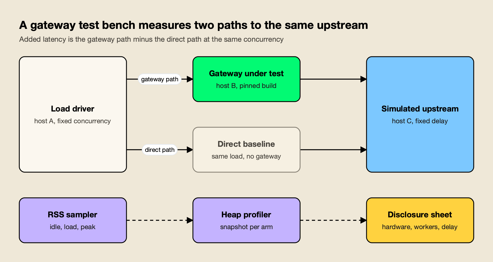
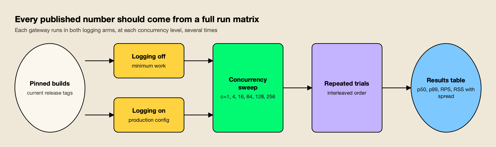
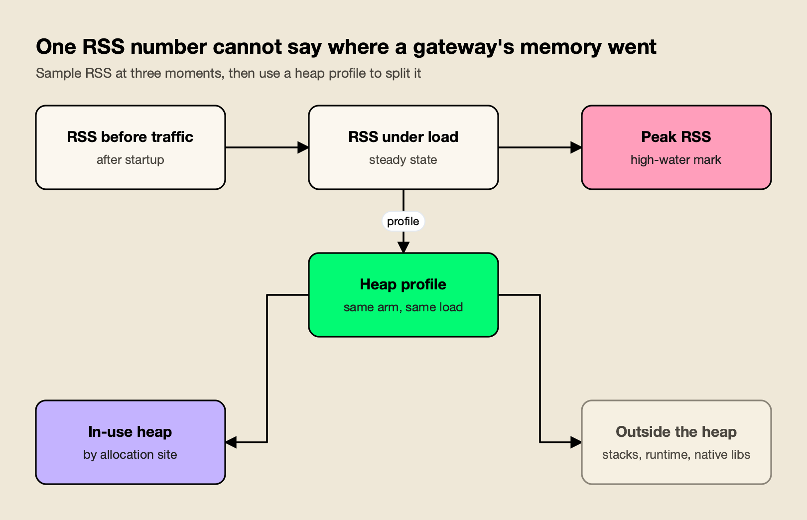

**TL;DR**
- API performance testing for an LLM gateway has to measure the gateway against a direct baseline, with the same simulated upstream, the same load driver and a published configuration for every run.
- LiteLLM's Rust gateway benchmark is the cautionary example: it ran single trials, published no hardware or worker counts, compared a Rust beta with an old Bifrost build, and likely ran the two gateways with different logging settings.
- A credible plan runs each gateway with logging off and with logging on, on current builds, across a concurrency sweep from c=1 to c=256, reporting p50, p99, requests per second and RSS for every cell.
- Repeated trials with error bars, and heap profiles that split memory by allocation site, are what turn a memory or latency gap into an explanation.
- Concede what the data shows either way: in LiteLLM's files, Rust uses less memory and CPU, and the latency and throughput results are mixed.

*About the evidence: The worked example uses LiteLLM's published results and [a response from Maxim AI](https://www.getmaxim.ai/bifrost/blog/debunking-litellm-rust-benchmarking-part-1), the developer of Bifrost. It is a review of published material, not a new benchmark run by AGI Tracker.*

API performance testing is the only reliable way to choose an LLM gateway on speed, because published vendor benchmarks rarely run the gateways under the same conditions. The November 2026 dispute over LiteLLM's Rust gateway benchmark showed how far a homepage number can drift from the files behind it. This guide turns that dispute into a test plan a platform team can run on its own hardware, with every setting written down before the first request is sent.

## What the LiteLLM Benchmark Left Out

LiteLLM's benchmark published real CSV and JSON files, but they contain gaps that stop the results from being reproduced or compared like-for-like: one run per cell, no hardware or worker counts, an old Bifrost build, different logging settings and a mislabeled memory figure. Each gap maps to one step of a test plan.

LiteLLM says its new Rust gateway has about 7x lower overhead, 9x less memory and about 4.5x more requests per dollar than Bifrost. Set against the [litellm.ai benchmark section](https://www.litellm.ai/#benchmark), the [LiteLLM benchmark blog](https://docs.litellm.ai/blog/rust-ai-gateway-benchmarks) and the files in the [ai-gateway-bench results folder](https://github.com/BerriAI/ai-gateway-bench/tree/main/results), several of those claims are not supported as stated, as of November 1, 2026. The point here is not to relitigate the verdicts. It is to borrow the list of what was missing.

| Gap in the published benchmark (as of November 1, 2026) | What the files and pages show | Test-plan step |
|---|---|---|
| Configuration parity | LiteLLM says every gateway ran "with no logging callbacks, spend tracking, or persistence enabled"; the Bifrost config never sets `enable_logging` or `logs_store`, so logging stays on by default (inferred from v2.4.0 code, not confirmed on v1.6.4) | Run logging off and logging on for every gateway |
| Versions | Bifrost v1.6.4 compared with a LiteLLM Rust beta whose blog says "streaming and the full feature surface are still landing" | Pin current release builds and record the tags |
| Repetition | Each cell appears to be a single run, with no repeats or error bars | Repeat every cell and publish the spread |
| Hardware and workers | No machine type, core count or worker count for any gateway; "4 vCPU / 16 GB" appears only in the cost model | Publish a disclosure sheet for every run |
| Mock latency and concurrency | No mock latency or concurrency level stated for the overhead run; [overhead_comparison.csv](https://github.com/BerriAI/ai-gateway-bench/blob/main/results/overhead_comparison.csv) states no concurrency | Record both for every cell |
| Sweep coverage | The [latency sweep](https://github.com/BerriAI/ai-gateway-bench/blob/main/results/latency_vs_concurrency.csv) has only p99; c=256 was dropped and survives as one exploratory run with no RPS field | Sweep c=1 to 256 with p50, p99, RPS and RSS |
| Memory label | The homepage's "memory at rest" figure is mislabeled peak RSS, and the homepage uses the widest pair (199.1 vs 21.8 MB) | Sample memory at three named moments, then profile |

For a broader primer on what a gateway benchmark measures, this site's [guide to measuring LLM gateway overhead](/blog/llm-gateway-benchmark/) covers the metrics and load models in general terms; this plan is narrower and stricter.

## The Test Bench: Gateway, Simulated Upstream and Direct Baseline

A gateway test bench has three roles: a load driver, the gateway under test, and a simulated upstream that answers after a fixed delay. The same load also goes straight to the simulated upstream as a direct baseline, and added latency is the gateway result minus that baseline at the same concurrency level.


*Figure 1: Without the direct path at every concurrency level, upstream and network time get counted as gateway overhead.*

LiteLLM's blog defines overhead the same way, as gateway latency minus direct-to-mock latency, charted as p99 added latency, and describes its method as "same mock and load driver on one host." The definition is sound. What the published material does not give is the mock's latency, the concurrency for the headline overhead run, or the machine. A reader cannot rebuild the bench from the text alone.

Three choices make the bench defensible:

- **Separate hosts, or pinned CPU sets.** A load driver on the same cores as the gateway competes with it, which distorts tail latency. On one host, pin each process to its own cores and say so.
- **A fixed, published upstream delay.** Pick a delay close to your real provider's time to first byte for the request type you care about, and publish it. The upstream should never be the bottleneck at c=256.
- **A direct baseline at every level.** Overhead at c=64 is only meaningful against a direct run at c=64. In LiteLLM's sweep, the direct p99 itself rises from 21.98 ms at c=1 to 24.02 ms at c=64, and the repo README says c=256 was dropped because the direct p99 exceeded twice the single-client floor.

Tooling is not the hard part. [Vegeta](https://github.com/tsenart/vegeta) and [k6](https://grafana.com/docs/k6/latest/) both drive fixed-rate or fixed-concurrency load, and whichever driver is used should be the same for every gateway and for the direct baseline.

The open-source [Bifrost benchmarking repository](https://github.com/maximhq/bifrost-benchmarking) ships a load generator called hitter and a simulated provider called mocker with configurable latency, failures and rate limits; its [run-your-own-benchmarks guide](https://docs.getbifrost.ai/benchmarking/run-your-own-benchmarks) notes that the tool can target other gateways as well.

## Configuration Parity: Logging Off and Logging On

Configuration parity means every gateway does the same work per request. Since teams rarely agree on what "the same" means, the plan runs two arms: logging off, the minimum work each gateway can do, and logging on, the configuration you would ship. Publish the exact config file for each arm.

The LiteLLM case shows why one arm is not enough. The blog says every gateway ran with no logging callbacks, spend tracking or persistence. The published Bifrost config sets a simulated upstream, `config_store: enabled: false` and no plugins, but never sets `logs_store` or `enable_logging`. In Bifrost's code, `enable_logging` defaults to true when unset, a default SQLite log store is created, and the logging plugin is built in, so "no plugins" does not turn it off. That reading is inferred from v2.4.0 code and not yet confirmed on v1.6.4, and the LiteLLM Rust config has not been checked the same way.

### How to Toggle Logging in Bifrost

Bifrost's [client configuration reference](https://docs.getbifrost.ai/deployment-guides/config-json/client) documents `enable_logging` as the switch that logs all LLM requests and responses, and `disable_content_logging` as a flag that strips message content from the log store while keeping metadata. The [storage reference](https://docs.getbifrost.ai/deployment-guides/config-json/storage) shows the log store can be set to `"enabled": false`. A logging-off arm sets all of these explicitly rather than relying on defaults:

```json
{
  "client": {
    "enable_logging": false,
    "disable_content_logging": true
  },
  "logs_store": {
    "enabled": false
  }
}
```

The logging-on arm sets `enable_logging: true` with the log store backend you would run in production. One caveat is worth carrying into any results write-up: disabling logging removes the built-in logging plugin's queue and hooks at startup, but other built-in plugins (telemetry and governance are on by default in OSS) stay enabled independently. The config for each arm should list every plugin that loaded, not just the ones the tester configured.

### How to Toggle Logging in LiteLLM

LiteLLM's proxy configures logging destinations through callbacks in `config.yaml`; its [logging documentation](https://docs.litellm.ai/docs/proxy/logging) shows them under `litellm_settings` as `success_callback`. The logging-off arm should leave those empty and record the spend-tracking and database settings in use; the logging-on arm should enable the callbacks and database you would actually run.

The same rule applies to any other gateway on the shortlist, including the alternatives covered in this site's survey of [LiteLLM alternatives](/blog/litellm-alternatives/). If a feature cannot be turned off, test it on for everyone and say so.

## Versions and Builds

A benchmark describes the build it ran, not the product. Pin a current release tag for every gateway, record it next to every result, and rerun when a major version ships. Comparing a new beta with an old release measures the release calendar as much as the code.

LiteLLM's benchmark compared Bifrost v1.6.4 with a LiteLLM Rust beta. Bifrost's changelogs list v1.6.5 to v1.6.11, then v2.0.0 to v2.4.0, after the tested build, and the Bifrost version is not shown on the homepage, only in the blog and the [gateway README in the benchmark repo](https://github.com/BerriAI/ai-gateway-bench/tree/main/gateways/bifrost). Bifrost's developers describe lower memory use in the 2.x release line, which the v1.6.4 benchmark does not reflect; no figure for that reduction has been published yet, so none appears here. The [Bifrost v2.0 release post](https://www.getmaxim.ai/bifrost/blog/bifrost-v2-0-is-here/) is the starting point for what changed in that line.

Version scope matters on the LiteLLM side too. LiteLLM's [Rust gateway documentation](https://docs.litellm.ai/docs/proxy/rust_gateway) warns that the Python proxy on `main:latest` uses Rust for `/ocr` across providers and `/audio/transcriptions` for Bedrock, while other routes, including Chat Completions and Messages, run on Python. A test plan for LiteLLM therefore has to state which build and which route path it measured.

The version record for each run should include:

- The release tag or image digest for each gateway, plus the commit if built from source.
- The route each gateway was called on, since native and compatibility routes can differ.
- Whether streaming was exercised. The Rust beta tested did not yet support it, so a streaming scenario was not possible in that comparison.

## The Disclosure Sheet: Hardware, Workers, Mock Latency and Concurrency

A disclosure sheet is one table, published with the results, that lets someone else rebuild the run: machine type, cores, memory, worker or pool settings for each gateway, runtime tuning, upstream delay, concurrency, request count and duration for every cell. Without it, "identical hardware" cannot be checked.

LiteLLM's homepage says "identical hardware" and "run it yourself," and its "See the benchmark" link goes to an in-page anchor rather than the raw data or a methodology document. Neither the page nor the blog gives a machine type, core count or worker count for either gateway. The table below is a template; fill one row per gateway per arm.

| Field | Why it changes results | Example of where it is set |
|---|---|---|
| Instance type, vCPUs, memory | Core count sets how much parallelism a gateway can use | Cloud console or `lscpu` output |
| Load driver and upstream hosts | Shared hosts inflate tail latency | Bench topology note |
| Worker processes or pool size | More workers raise throughput and baseline memory | LiteLLM `--num_workers`; Bifrost `initial_pool_size` |
| Runtime tuning | Garbage collector settings move both RSS and p99 | `GOGC`, `GOMEMLIMIT` for Go gateways |
| Upstream delay | Sets the floor that overhead is measured against | Mock configuration |
| Concurrency, request count, duration | Defines the cell | Load driver flags |
| Logging arm and full config file | Defines the work per request | Published config per arm |

Two product details belong on the sheet. LiteLLM's [CLI documentation](https://docs.litellm.ai/docs/proxy/cli) gives `--num_workers` a default of 1 and describes it as the number of worker processes to spin up. Bifrost's client configuration documents `initial_pool_size`, a default of 300 pre-allocated worker goroutines per provider queue, and notes that a larger pool reduces latency spikes under burst load at the cost of higher baseline memory. That is why the value has to be published.

Bifrost's [Docker performance tuning guide](https://docs.getbifrost.ai/deployment-guides/docker-tuning) adds the runtime fields. It says Bifrost sets `GOMAXPROCS` from the container's CPU quota using automaxprocs, and that `GOGC` and `GOMEMLIMIT` trade garbage collection frequency against memory. Defaults are fine; unrecorded values are not.

## The Concurrency Sweep From c=1 to c=256

A concurrency sweep runs every gateway and the direct baseline at a fixed ladder of concurrency levels, here 1, 4, 16, 64, 128 and 256, and reports p50, p99, requests per second and RSS in every cell. The sweep shows where each gateway starts to queue, which a single headline number hides.


*Figure 2: A single cell from one run is an anecdote; the matrix is what makes a gap between gateways readable.*

LiteLLM's own sweep is a useful model of what a sweep reveals, and of what it leaves out. The figures below are taken from its files, as of November 1, 2026.

| Concurrency | Direct p99 (ms) | LiteLLM Rust added p99 | Bifrost added p99 | LiteLLM Python added p99 | Throughput, Rust / Bifrost (RPS) |
|---|---|---|---|---|---|
| 1 | 21.98 | +0.89 | +0.75 | +9.79 | 45.2 / 44.8 |
| 4 | 22.42 | +0.61 | +0.63 | +26.95 | 181.2 / 180.2 |
| 16 | 22.67 | +0.33 | +0.89 | +251.34 | 721.8 / 722.7 |
| 64 | 24.02 | +40.28 | +28.68 | +546.04 | 2,722.2 / 2,719.1 |

The blog's "roughly 7x lower overhead" against Bifrost rests on a 4.54 ms figure that no row of this sweep reproduces. The ranking also changes with load: Bifrost adds less p99 at c=1 and c=64, Rust adds less at c=16, and the c=4 gap of 0.02 ms has unknown statistical significance. Throughput gaps between the two are under 1% at every level.

What the sweep lacks is what the plan adds:

- **p50 next to p99.** The sweep file has only p99; the per-run JSON files carry p50. Reporting both in one table shows whether a gap is in the typical request or only in the tail.
- **RPS and RSS in the same cell.** Memory measured in a separate run cannot be tied to the load that produced it.
- **The top of the ladder.** LiteLLM's c=256 files show Rust ahead (p50 55.5 vs 89.3 ms, p99 2,667.8 vs 5,421.3 ms), but it is exploratory: one run of 5,000 requests per gateway, no RPS field, and a direct baseline already outside the benchmark's threshold. A plan that wants c=256 should size the upstream and load driver so the direct baseline stays controlled.

Throughput and latency answer different questions, which is why the sweep keeps both. At c=64, the two gateways' throughput is within 0.1% while Rust adds +40.28 ms of p99 and Bifrost +28.68 ms. Interactive agent traffic might weight the p99 column; batch jobs might weight RPS.

## Repeated Trials and Error Bars

Repeated trials turn one measurement into a distribution. Run every cell several times, interleave the gateways so drift affects all of them equally, and report the median with a range or confidence interval. A gap smaller than the spread between trials is not a result.

LiteLLM's blog itself says the runs are "single-host, per-scenario runs (for example n=5000 on the overhead panel) without repeated-trial error bars" and asks readers to "treat them as order-of-magnitude differences." The homepage tiles do not repeat that caveat. The files show why it matters: total p99 at c=64 is 52.7 ms for Bifrost in the sweep but 32.2 ms in [rps_per_dollar.csv](https://github.com/BerriAI/ai-gateway-bench/blob/main/results/rps_per_dollar.csv), and 64.3 ms versus 26.9 ms for Rust. The ranking flips between LiteLLM's own files.

A workable protocol:

1. **Warm up, then discard.** Send traffic for a fixed period before recording, and drop it from the results.
2. **Run at least five trials per cell.** More if the spread is wide relative to the gap being tested.
3. **Interleave.** Run gateway A, gateway B, direct, then repeat, so drift lands on every gateway.
4. **Restart between arms.** Memory from a logging-on run should not carry into a logging-off run.
5. **Report spread, not just a center.** A median with min and max, or a 95% confidence interval, for p50, p99, RPS and RSS.
6. **Set the decision threshold first.** Decide before testing how large a p99 or memory difference would change the choice.

This site's checklist on [how to read an AI benchmark without getting fooled](/blog/how-to-read-an-ai-benchmark/) makes the same sample-size argument for model evaluations.

## Memory: Peak, Baseline and Heap Profiles

A memory figure needs a label and an explanation. Sample RSS before the first request, at steady load and at peak, and name which one is published. Then take a heap profile in each logging arm to attribute the footprint to allocation sites, because RSS alone cannot say which component holds the memory.


*Figure 3: Label every memory figure with the moment it was taken, and attribute it with a profile before blaming any component.*

The LiteLLM case shows each failure mode. The homepage's "memory at rest" figure (about 22 MB versus about 199 MB) is mislabeled: the column in the data is `peak_rss_mb`, and the blog correctly says "peak memory." The homepage uses the widest of three Bifrost/Rust pairs in the files: 199.1 vs 21.8 MB, against 144 vs 26.1 MB and 282 to 298 vs 35 to 36 MB in the CPU files. The pairs may come from different scenarios or builds, so the label, not the headline ratio, is the clear error.

In [cpu_bifrost.csv](https://github.com/BerriAI/ai-gateway-bench/blob/main/results/cpu_bifrost.csv), Bifrost's RSS is about 282 MB before the first request and load adds about 16 MB, which points primarily to a baseline footprint rather than log-buffer growth. Bifrost v1.6.4 opens a disk-backed `logs.db` at startup with a SQLite cache limit of 10,000 pages per connection, about 39.1 MiB at a 4 KiB page size, which grows on demand rather than being preallocated. The files do not quantify SQLite's contribution or isolate logging's share of the gap. That is the job of a heap profile.

### Taking Heap Profiles

Each runtime has standard tooling, and the plan should name the one used:

- **Go gateways.** Go's [net/http/pprof package](https://pkg.go.dev/net/http/pprof) serves heap, allocation and goroutine profiles that `go tool pprof` reads. Bifrost's [v1.5.15 changelog](https://docs.getbifrost.ai/changelogs/v1.5.15) added an optional pprof profiling server gated by the `BIFROST_PPROF_PORT` environment variable. In the [v1.6.4 source](https://github.com/maximhq/bifrost/blob/transports/v1.6.4/transports/bifrost-http/profiling/profiling.go), that server exposes `/debug/pprof/heap` among other profiles and binds to 127.0.0.1 by default, so a capture runs from the gateway host.
- **Python gateways.** The standard library's [tracemalloc](https://docs.python.org/3/library/tracemalloc.html) traces allocations by line, and Bloomberg's [memray](https://github.com/bloomberg/memray) profiles native extensions as well.
- **Rust gateways.** Heap profilers such as [heaptrack](https://github.com/KDE/heaptrack) or the [dhat crate](https://docs.rs/dhat/latest/dhat/) attribute allocations by call stack.

For RSS itself, the Linux [`/proc/<pid>/status` file](https://man7.org/linux/man-pages/man5/proc_pid_status.5.html) reports both current resident memory (VmRSS) and its high-water mark (VmHWM), matching the "under load" and "peak" labels in Figure 3.

A profile in each logging arm answers the question LiteLLM's benchmark could not: how much of the memory difference is the log buffer and store, and how much is everything else. There is a separate lever to test as well. Setting smaller log writer batches and queue capacity lowers the buffered-entry bound from about 11,000 to about 1,100 entries, but that is not necessarily 10x lower RSS, and it can increase write overhead and log drops under bursts. Measure it rather than assume it.

The plan should be ready for an unflattering answer. In LiteLLM's files, Rust is smaller on memory in every file: its highest figure, about 36 MB, is below Bifrost's lowest, about 144 MB. A heap profile may narrow that gap or confirm it; either result is useful.

## CPU and Cost: Measure First, Model Second

CPU should be sampled in the same window and at the same load as the latency it is paired with, and any cost figure built from CPU and memory should be labeled as a model. A requests-per-dollar number is arithmetic on measured inputs plus an assumed instance price, not an observation.

LiteLLM's CPU files record Bifrost at a mean of 2.59% (peak 79.5%) and Rust at 0.66% (peak 15.9%), whole-process figures under the configurations described above. That is a genuine Rust lead, although the files do not separate request handling from background work. The homepage's "2,800+ req/s (at ~21% CPU)" figure appears in none of the Rust CPU, throughput, cost or overhead files, and it is likely, though not confirmed, that the CPU samples come from a short burst, probably the concurrency-16 cost runs, rather than the 2,800 RPS load.

The cost claim follows the same pattern. The homepage's "~4.5x more requests per dollar" is 283,833 versus 63,246 requests per dollar-hour, and the arithmetic holds. The inputs were modeled on an assumed 4 vCPU / 16 GB instance, not the benchmark machine, and Bifrost's logging cost sits inside them.

For a test plan, that means:

- **Sample CPU per cell.** Record mean and peak CPU for each gateway in the same window as each sweep cell, on each logging arm.
- **Publish the cost formula and its inputs**, and re-derive cost per logging arm, since a model built from one arm describes a different product than the other.

## Running the Plan Against Bifrost and LiteLLM

Both gateways can be tested with public material. LiteLLM publishes its benchmark repository and results files; Bifrost publishes a benchmarking toolkit and documents the logging, pool and runtime settings the disclosure sheet needs. Neither vendor's published numbers substitute for a run on your own hardware.

**LiteLLM.** The public [ai-gateway-bench repository](https://github.com/BerriAI/ai-gateway-bench) is the starting point for rerunning LiteLLM's own comparison. When testing LiteLLM, record whether the build is the Rust beta or the Python proxy, which routes run on Rust in that build, the `--num_workers` value, and the callback and spend-tracking settings for each arm. The Python proxy's sweep numbers (+546.04 ms added p99 and 179.8 RPS at c=64) show that the deployment choice inside LiteLLM matters too. Teams already running it can read this site's [Bifrost vs LiteLLM comparison](/blog/bifrost-vs-litellm/) for the feature and scaling differences that sit outside a benchmark.

**Bifrost.** [Bifrost](https://www.getmaxim.ai/bifrost) is an [open-source AI gateway written in Go](https://github.com/maximhq/bifrost). For this plan, the relevant documented controls are `enable_logging`, `disable_content_logging` and the log store switch for the two arms, `initial_pool_size` and the Go runtime settings for the disclosure sheet, and the `BIFROST_PPROF_PORT` profiling server for heap captures.

Bifrost's own [benchmarks page](https://www.getmaxim.ai/resources/benchmarks) publishes vendor results, and the same [disclosure standard for vendor benchmarks](/blog/vendor-benchmarks-need-receipts/) applies to those numbers as to anyone else's.

**Everything else on the shortlist.** Any gateway that can point at a simulated upstream and publish its config can be dropped into the matrix. This site's roundup of the [best LLM gateways](/blog/best-llm-gateways/) and the guide to [self-hosted versus managed LLM gateways](/blog/self-hosted-vs-managed-llm-gateway/) cover how to build that shortlist.

## Reading the Results Before Choosing a Gateway

Read the results against the decision, not the leaderboard. Start from the threshold set before testing, look at the logging-on arm first because it matches production, check whether any gap exceeds the spread between trials, and use heap profiles to decide whether a memory difference is fixed cost or configurable.

A reading order that keeps the analysis honest:

1. **Logging-on arm first.** It is the configuration you will run. The logging-off arm tells you how much of the difference is the logging stack.
2. **Gaps against spread.** Estimate the difference across repeated trials and report its uncertainty. Overlapping intervals alone do not prove equivalence, and LiteLLM's single-run data does not establish whether the sub-1% throughput gaps are reproducible.
3. **Where the curve bends.** The concurrency at which p99 departs from the direct baseline matters more than any single cell. Size against your peak concurrency, not the average.
4. **Memory by component.** A gap explained by a log store or pool size is a configuration decision; a gap in the core request path is not.
5. **Feature parity last.** A gateway that wins with routes, streaming or governance missing has not been tested on the workload you will run. LiteLLM's migration tracker reports 24% of Major APIs built as of v1.107.0-rc.2, with router migration, database access, budgets and rate limits at 0%, which is the kind of scope note a results table needs.

The benchmark wars produced a useful by-product: a precise list of what a gateway benchmark has to disclose before anyone should trust it. API performance testing built on that list, with logging off and on, current builds, a full concurrency sweep, repeated trials, a disclosure sheet and heap profiles, gives a buyer numbers that survive scrutiny. It may also confirm what the published files already show, such as [Rust's lower memory and CPU](/blog/rust-vs-go-performance-gateways/), and a plan that can return an unexpected answer is the only kind worth running.

Source: [Debunking LiteLLM Rust Benchmarking: Part 1](https://www.getmaxim.ai/bifrost/blog/debunking-litellm-rust-benchmarking-part-1), by Akshay Deo of Maxim AI, which builds the Bifrost gateway.
