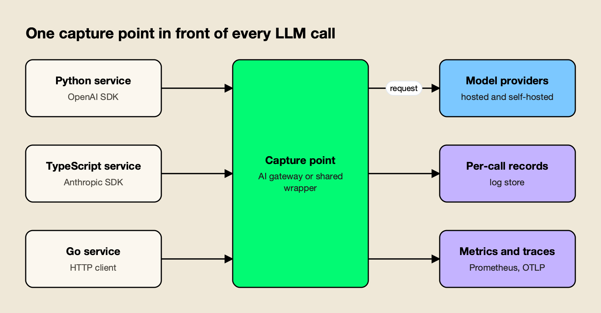
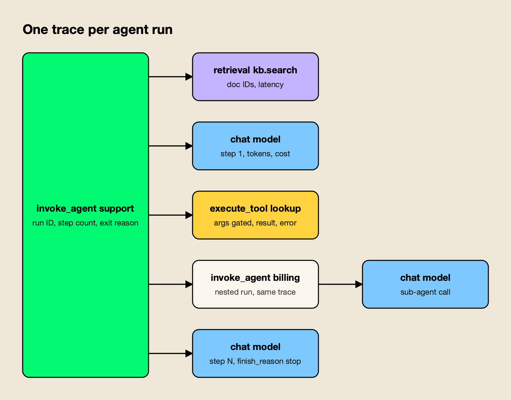

**TL;DR**
- LLM monitoring starts with one fixed record per call: requested and served model, provider, tokens, cost, total latency, time to first token, normalized error type, finish reason and attribution to user, feature and prompt version.
- Instrument at a single choke point (an AI gateway or one shared client wrapper) rather than per SDK, then add app-side spans only for retrieval, tools and agent loops.
- The OpenTelemetry GenAI semantic conventions are still in Development and now live in their own repository; pin the version you emit.
- Keep metrics at 100%, sample content, and always retain errors, slow requests, fallbacks and negatively rated responses.
- The open-source llm-observability-stack agent skill packages this checklist so a coding agent can audit a repository and apply it: `npx skills add build-with-ai-hq/llm-observability-stack`.

LLM monitoring is harder than monitoring an ordinary API because an HTTP 200 says nothing about whether the answer was correct, the cost of each request varies with its tokens, latency has two meanings for streamed responses, and the payload that explains a failure is often the most sensitive data in the system. A production setup has to capture all four dimensions on every call, keep the sensitive parts under control, and turn the result into dashboards and alerts that point to a specific request within minutes. This guide covers how to set that up, from the per-call record to alert thresholds.

The checklist below follows the structure of llm-observability-stack, an MIT-licensed Agent Skill published by build-with-ai-hq that teaches a coding agent such as Claude Code, Codex or Cursor to audit an LLM codebase and apply these practices. The skill is introduced in more detail near the end; it installs with one command:

```bash
npx skills add build-with-ai-hq/llm-observability-stack
```

## What LLM Monitoring Has to Answer

A working LLM monitoring setup answers five questions about any request: what was sent and returned, which provider and model served it, how long it took to the first token and in total, what it cost, and who or what triggered it. Quality, the sixth question, comes from feedback and evaluations joined to the same record.

The [llm-observability-stack skill](https://github.com/build-with-ai-hq/llm-observability-stack) frames the problem around four ways LLM calls differ from ordinary remote procedure calls, and they drive every design choice that follows:

- **The payload is the debugging signal.** A wrong answer is diagnosed from the prompt, the retrieved context and the output, which often contain personal data.
- **Cost is per request and variable.** Two calls to the same endpoint can differ in price by orders of magnitude depending on context length and output.
- **Latency has two meanings.** For a streamed chat response, users feel time to first token (TTFT); agents and timeouts feel total latency.
- **Success is not quality.** A response that hits its token limit (`finish_reason: length`), trips a content filter or returns unparseable JSON still arrives as HTTP 200.

The distinction between monitoring and observability matters less here than in classic infrastructure. Dashboards and alerts tell a team that error rate or spend crossed a line; records and traces explain why. Both come from the same per-call data, which is why the setup starts there. For a survey of the platforms that store and visualize that data, this site's guide to [LLM observability tools](/blog/llm-observability-tools/) compares the main options.

## The Per-Call Record to Capture

Every LLM call should produce one record with the same fields, whether it succeeds or fails. The minimum covers identity, routing, usage, timing, outcome and attribution, with content captured separately under policy. Missing any group leaves a class of incident that cannot be explained after the fact.

The table condenses the field list in the skill's `references/what-to-capture.md`:

| Group | Fields | Why it matters |
|---|---|---|
| Identity | `request_id` returned to the client, `trace_id`, parent span, session or conversation ID | Joins feedback and traces to the exact call |
| Routing | requested model, served provider and model, key or deployment, fallback flag, retry count | Detects silent degradation when a fallback serves traffic |
| Usage | input, output, cached and reasoning tokens, cost in USD computed at capture time | Explains bill changes; later recomputation loses the price in effect |
| Timing | total latency, TTFT for streams, provider latency versus own overhead | Separates provider slowness from application slowness |
| Outcome | status, normalized error type, provider error code, `finish_reason` | Catches failures that return HTTP 200 |
| Attribution | user or tenant (hashed if needed), feature, environment, prompt name and version, app version | Answers "which feature, which customer, which prompt change" |
| Content (gated) | input messages, output, tool calls and results | Debugging, evaluation; redacted, sampled and retained briefly |

Two details in that list cause most production gaps. The first is streaming usage. OpenAI-compatible APIs omit token counts from streamed responses unless the request asks for them, so every streamed call silently reports zero tokens and zero cost:

```python
stream = client.chat.completions.create(
    model=MODEL, messages=messages, stream=True,
    stream_options={"include_usage": True},  # usage arrives in the final chunk
)
```

The second is cardinality. Metric labels should stay low-cardinality (provider, model, feature, environment, team, error type), while user, session and request IDs belong on logs and spans. The skill's rule of thumb is that a label able to take more than a few hundred values does not belong on a metric, which matches the [Prometheus naming and labeling guidance](https://prometheus.io/docs/practices/naming/) against unbounded label values.

## Where to Instrument: Gateway, Shared Wrapper or SDK

The most reliable place to capture LLM telemetry is a single choke point that every call passes through. An AI gateway in front of all providers covers every service and language by changing a base URL; a shared client wrapper per language is the next best option; per-SDK auto-instrumentation works but drifts across languages and versions.



*Figure 1: One capture point produces identical records for every service, so instrumentation stops depending on which team wrote the call.*

Hand-instrumenting each call site tends to fail in predictable ways: one service forgets streaming usage, another swallows errors, a third logs raw prompts with the application logger. Figure 1 shows the alternative. The comparison below summarizes the three options in the order the skill recommends them:

| Approach | Coverage per unit of effort | Typical gaps |
|---|---|---|
| AI gateway in front of all providers | Every service and language after a base URL change | Cannot see retrieval, tool logic or business outcomes; needs app-side spans for those |
| One shared client wrapper per language | Every service that imports it, enforced by lint or review | Must be maintained per language; bypassed by direct SDK use |
| Auto-instrumentation per SDK | Quick to start in one service | Attribute names and versions drift across languages and libraries |

Several gateways can act as the capture point. [Bifrost](https://www.getmaxim.ai/bifrost), an [open-source AI gateway](https://github.com/maximhq/bifrost) maintained by Maxim AI, is the one the skill configures. Other gateways can fill the same role, and this site's [LLM gateway comparison](/blog/best-llm-gateways/) covers how they differ.

Bifrost's documentation lists the pieces a monitoring setup needs: a [built-in request log](https://docs.getbifrost.ai/features/observability/default) with a log API, [Prometheus metrics](https://docs.getbifrost.ai/features/observability/prometheus) on `/metrics`, and an [OpenTelemetry exporter](https://docs.getbifrost.ai/features/observability/otel) that can send traces to any OTLP collector.

Whichever capture point a team picks, the application still owns spans for what the gateway cannot see: the agent loop, retrieval and tool execution. The way to connect the two is W3C [Trace Context](https://www.w3.org/TR/trace-context/) propagation, so that the gateway's span for each model call nests under the application's step span instead of starting a separate trace. A gateway-level view of the same problem appears in the overview of [LLM monitoring tools at the gateway layer](https://www.getmaxim.ai/articles/top-5-llm-monitoring-tools-at-the-gateway-layer-in-2026/).

## OpenTelemetry GenAI Conventions in 2026

The OpenTelemetry GenAI semantic conventions define standard span names, attributes and metrics for model calls, tools and agents, so any tracing backend can read them. They remain in Development status, they moved into a dedicated repository in 2026, and several names have changed between releases, so teams should pin the version they emit.

The conventions now live in [open-telemetry/semantic-conventions-genai](https://github.com/open-telemetry/semantic-conventions-genai), and the old pages on opentelemetry.io carry a "Moved" notice pointing there. The repository's [GenAI overview](https://github.com/open-telemetry/semantic-conventions-genai/blob/main/docs/gen-ai/README.md) marks the conventions as Development and splits them into client inference, embeddings, agent spans, events, metrics and provider-specific documents for OpenAI, Anthropic, AWS Bedrock and Azure AI Inference, plus MCP and A2A.

The parts most monitoring setups use:

- **Span names.** The [client inference spec](https://github.com/open-telemetry/semantic-conventions-genai/blob/main/docs/gen-ai/client-inference.md) says a model call's span name should be `{gen_ai.operation.name} {gen_ai.request.model}`, for example `chat gpt-4o-mini`, with span kind `CLIENT` for remote calls.
- **Core attributes.** `gen_ai.provider.name`, `gen_ai.request.model`, `gen_ai.response.model`, `gen_ai.response.finish_reasons`, `gen_ai.usage.input_tokens` and `gen_ai.usage.output_tokens`, plus `gen_ai.conversation.id` for multi-turn sessions.
- **Content attributes.** `gen_ai.input.messages` and `gen_ai.output.messages` are Opt-In, because they carry user data.
- **Agent operations.** The [agent spans document](https://github.com/open-telemetry/semantic-conventions-genai/blob/main/docs/gen-ai/gen-ai-agent-spans.md) defines operations such as `invoke_agent` and `execute_tool`.

Names move. The skill's reference notes that `gen_ai.system` became `gen_ai.provider.name` and `gen_ai.usage.prompt_tokens` became `gen_ai.usage.input_tokens`. The current repository also defines token metrics in a separate [inference token metrics document](https://github.com/open-telemetry/semantic-conventions-genai/blob/main/docs/gen-ai/gen-ai-token-metrics.md), with names such as `gen_ai.client.inference.usage.input_tokens`, and client-side TTFT as `gen_ai.client.inference.time_to_first_chunk`. Dashboards built against an older metric name will go quiet after an upgrade, which is why pinning matters.

Attributes the conventions do not cover, such as cost, feature and prompt version, should use an application namespace (`app.cost_usd`, `app.feature`, `app.prompt.version`) rather than inventing `gen_ai.*` names that may collide with a future release.

## Tracing Multi-Step Agents

An agent run should appear as one trace, not as unrelated LLM calls. The root span represents the run, and child spans represent each model call, each tool execution, retrieval and any sub-agent, with the step index, tool outcomes and the loop's exit reason recorded so runaway loops are visible.



*Figure 2: A single trace per agent run makes step counts, tool failures and loop exits measurable.*

Figure 2 follows the trace layout in the skill's reference. In practice that means:

- **Root span** (`invoke_agent <name>`): run ID, session ID, hashed user, feature, final status, total tokens and cost summed from children, step count and exit reason (`final_answer`, `max_steps`, `error`, `user_cancelled`).
- **Model call spans** (`chat <model>`): step index, tokens, cost and finish reason. If a gateway exports these spans, the application propagates `traceparent` rather than creating duplicates.
- **Tool spans** (`execute_tool <name>`): tool call ID, argument payload gated like content, result size and any error. Side-effecting tools always record their outcome.
- **Sub-agents** (`invoke_agent <name>`): nested in the same trace.

Two alerts follow from this structure: a step count above a ceiling, and any run that exits on `max_steps`. Both indicate loops, and loops are where agent spend escapes. For multi-turn chat, one trace per turn with a shared `gen_ai.conversation.id` is the safer default. Bifrost's OTel exporter supports both: requests carrying an `x-bf-session-id` header get a `session.id` attribute on the root span, and a `group_traces_by_session` option folds a session into a single trace, according to its OpenTelemetry documentation. Session-level analysis for chat products is discussed further in an article on [session-level observability](https://www.getmaxim.ai/articles/session-level-observability/).

## Latency, Errors and Fallbacks

Latency should be tracked as three separate signals (time to first token, total latency and inter-token latency) and never as one percentile over mixed streaming and non-streaming traffic. Errors should be classified by whose fault they are, and fallbacks recorded as data, because a fallback that succeeds still changes cost, latency and quality.

On latency, the skill recommends normalizing total latency by output tokens when comparing models or prompts, since a longer answer is not a regression. Gateways measure TTFT at their edge; to measure what users see, time the first content chunk in the client too. With tool calls or reasoning models, the first chunk may not be visible text, so a team should decide whether TTFT means first visible token or first byte and record it consistently.

On errors, classifying by fault domain keeps on-call from being paged for the wrong thing:

| Fault domain | Examples | What it means |
|---|---|---|
| Caller | Unknown model name, malformed request | A bad deploy; roll back the calling service |
| Policy | Your own rate limit or budget refusing traffic | Limits too tight, or abuse by one key |
| Provider | 429, 5xx, timeout, revoked key | Buy capacity, spread load or fail over |
| Internal | Gateway queue full, unclassified errors | Scale the capture layer; unclassified should be zero |

The alert to page on is error rate excluding caller and policy errors. Treat `finish_reason` of `length` or `content_filter`, empty outputs and failed JSON parsing of structured output as errors in metrics, even though the HTTP call succeeded. And never wrap an LLM call in `except: pass`; return a typed failure and record it.

## Sampling and PII Controls

Metrics should be kept at 100%, metadata records at 100% if storage allows, and content sampled, except that every error, slow request, fallback and negatively rated response is retained in full. Personal data should be redacted before content leaves the process or gateway, not in the backend after ingestion.

The skill's sampling policy:

| Data | Rate | Notes |
|---|---|---|
| Metrics | 100% | Aggregates only |
| Metadata record without content | 100% | Needed for cost attribution and feedback lookup |
| Content and full trace, normal traffic | 1 to 10% | Per feature; raise after a prompt change |
| Errors, fallbacks, retried requests | 100% | Rare failures are the point |
| Latency above the feature's p95 | 100% | |
| Negative feedback | 100% | Needs a short raw buffer so content still exists when feedback arrives |
| Regulated routes | 0% content | Metadata only |

Head-based sampling cannot keep "all errors plus 5% of the rest", because the decision is made before the outcome is known. The OpenTelemetry Collector's [tail sampling processor](https://github.com/open-telemetry/opentelemetry-collector-contrib/tree/main/processor/tailsamplingprocessor) makes that decision after the trace completes, with policies for status code, latency and probability.

For redaction, a regular-expression pass catches structured identifiers (emails, phone numbers, card numbers, API keys) but misses names and addresses; the skill points to an NER-based detector such as the open-source [Presidio](https://github.com/data-privacy-stack/presidio) for free text. Redact both prompts and outputs, since models echo input, and redact tool arguments and results, which often carry the most personal data. One trap catches many teams: each export destination has its own content setting, so turning content off in the log store does not turn it off in the trace exporter. Bifrost, for example, documents separate `disable_content_logging` controls for its log store and its OTel exporter. Header values are another leak path; the skill warns never to put personal data in attribution headers, which are usually exported regardless of content settings.

## Dashboards and Alerts That Work

A single LLM dashboard should run top to bottom from health to errors, latency, spend, resilience and quality, with filters for provider, model, feature and team. Alerts should fire on error rate excluding caller and policy errors, provider rate limiting, latency and TTFT regressions, fallback share, cost burn and sudden growth in input tokens per request.

The layout in the skill's `references/dashboards-and-alerts.md`:

1. **Health:** request rate, error rate excluding caller errors, p95 latency, p95 TTFT, cost per hour, active requests.
2. **Errors:** by error type, by provider and model, and the count of unclassified errors.
3. **Latency:** p50, p95 and p99 provider latency by model; TTFT; inter-token latency; gateway overhead.
4. **Spend:** cost per hour by feature, team and model; tokens per minute; cost per request; output-to-input ratio.
5. **Resilience:** fallback share, retries, key rotations and key health.
6. **Quality:** evaluation scores by feature and prompt version, negative-feedback rate.

The starting thresholds it proposes are a useful baseline to tune against a team's own SLOs:

| Signal | Starting threshold | Adjust by |
|---|---|---|
| Error rate (non-caller, non-policy) | 5% for 5 minutes to page; 2% for 15 minutes to ticket | Providers carry routine 0.1 to 1% noise |
| Provider 429 share | 2% for 10 minutes | Higher if retries and fallbacks absorb them |
| p95 latency | 2x the 7-day baseline per model, or an absolute SLO | Separate streaming, non-streaming and reasoning models |
| p95 TTFT | 2x yesterday, or about 3 seconds for chat UIs | Segment by feature; long prompts raise TTFT |
| Fallback share | 10% for 10 minutes | Any sustained fallback is a quality and cost change |
| Cost per hour | 2x (daily budget / 24) | Compare against the same hour last week |
| Input tokens per request | 2x yesterday | Catches prompt bloat and runaway agent context |
| Unclassified errors | Any | Should always be zero |

With a gateway that exposes Prometheus metrics, these become short PromQL expressions. Bifrost's metric reference lists counters and histograms including `bifrost_upstream_requests_total`, `bifrost_error_requests_total`, `bifrost_upstream_latency_seconds`, `bifrost_stream_first_token_latency_seconds`, `bifrost_stream_inter_token_latency_seconds`, `bifrost_input_tokens_total`, `bifrost_output_tokens_total` and `bifrost_cost_total`. The paging alert from the skill looks like this:

```yaml
- alert: LLMHighErrorRate
  expr: |
    sum by (provider) (rate(bifrost_error_requests_total{error_type!~"(caller|policy)_.*"}[5m]))
      / sum by (provider) (rate(bifrost_upstream_requests_total[5m])) > 0.05
  for: 5m
  labels: { severity: page }
```

`for:` durations should be long enough to ride out single-minute provider blips, since LLM error bursts are spiky. Cost panels feed directly into chargeback; the mechanics of allocating LLM spend to teams are covered in a piece on [showback and chargeback for LLM spend](https://www.getmaxim.ai/articles/finops-for-ai-showback-and-chargeback-for-llm-spend/), and this site's analysis of [AI inference cost](/blog/ai-inference-cost/) explains why per-token prices alone mislead.

## Linking Feedback and Scoring Production Traffic

Quality monitoring depends on a request ID that travels from backend to client and back with every piece of feedback. Join thumbs, edits and regenerations to records by that ID, force-retain traces with negative feedback, and score a daily sample of production traffic so regressions are caught before users report them.

The flow the skill describes: generate a UUID before the model call, send it upstream as `x-request-id` so the gateway record shares it, return it to the client, and write feedback events against it. Implicit signals are often more plentiful than explicit ratings: regenerate clicks, copy events, a user rephrasing within 30 seconds, or abandoning the conversation right after an answer.

For scoring, a daily job samples successful records stratified by feature and model, oversamples errors, fallbacks and negative feedback, runs cheap deterministic checks first (schema validity, length bounds, required citations), then an LLM judge with a task-specific rubric, and tracks scores per feature and prompt version. Failures promoted into an offline regression set cannot ship twice. The skill includes a self-hosted Python example that pulls samples from Bifrost's `GET /api/logs` endpoint, sends the judge's own calls through the gateway with a separate feature tag, and skips records whose content logging was disabled.

## Applying the Checklist With the llm-observability-stack Skill

The llm-observability-stack skill turns this guide into instructions a coding agent can follow inside a real repository: it runs grep audits for LLM call sites and missing instrumentation, applies fixes in order of impact, configures gateway-level capture, builds dashboards and alerts, and verifies the result. It installs with the open-source skills CLI.

Agent Skills are folders containing a `SKILL.md` file that agents load on demand, an open format [originally developed by Anthropic](https://agentskills.io/home) and now read by Claude Code, Codex, Cursor and other tools. To preview this one without installing it:

```bash
npx skills add build-with-ai-hq/llm-observability-stack --list
```

To install it into the current project for Claude Code, or for Codex and Cursor:

```bash
npx skills add build-with-ai-hq/llm-observability-stack -a claude-code -y
npx skills add build-with-ai-hq/llm-observability-stack -a codex cursor -y
```

In a test install of another skill from the same publisher, the [skills CLI](https://github.com/vercel-labs/skills) cloned the repository, copied the skill to `.claude/skills/<name>` for Claude Code (or `.agents/skills/<name>` for Codex, Cursor, Gemini CLI and OpenCode), wrote a `skills-lock.json` with the source and a content hash, and printed a reminder to review skills before use because they run with full agent permissions. That reminder applies here: the skill is plain Markdown and can be read in full on GitHub before installing.

The repository contains the `SKILL.md` workflow and three references the agent loads when needed:

- `references/what-to-capture.md`: the per-call record, cardinality rules, OTel GenAI attributes, agent trace structure with Python and TypeScript examples, TTFT measurement, PII redaction, sampling, feedback linkage and the production eval job.
- `references/bifrost-telemetry.md`: log store, content logging, attribution headers, Prometheus labels, OTel export and response headers for Bifrost.
- `references/dashboards-and-alerts.md`: PromQL panels, alert rules, thresholds and an alert-to-action runbook.

Once installed, the skill activates on requests such as "we have no visibility into our LLM calls", "TTFT is slow", "silent 429s" or "token costs blew up and we don't know who", according to its description. Its verify section includes curl checks that a request returns correlation headers, appears in the log store with tokens and cost, and moves the metrics, plus a checklist that a forced provider failure produces an error record and an alert.

Readers who want the gateway side of this setup in more depth can compare Bifrost's [AI observability page](https://www.getmaxim.ai/ai-observability) with the project's post on [governance and observability in Bifrost](https://www.getmaxim.ai/bifrost/blog/ai-governance-and-observability-in-bifrost/).

The gateway's newer in-dashboard agent is covered in this site's report on [Bifrost Warp](/blog/bifrost-warp-llm-observability-agent/) and in the vendor's [Warp announcement](https://www.getmaxim.ai/bifrost/blog/meet-warp-an-agent-for-your-gateways-telemetry/).

**Enterprise tier.** [Log exports](https://docs.getbifrost.ai/enterprise/log-exports) that offload payloads to S3 or GCS object storage are part of Bifrost Enterprise; the request log, Prometheus metrics and OpenTelemetry export used in this guide are in the open-source gateway.

## Common Mistakes to Avoid

The failures that recur across LLM monitoring setups are small configuration gaps rather than missing tools: streaming without usage capture, user IDs as metric labels, content turned off in one sink but not another, and head sampling that discards the rare failures a team most needs to see.

The skill's list of common mistakes, condensed:

- Measuring only total latency for streams, so TTFT regressions go unseen.
- Streaming without `include_usage`, so dashboards undercount tokens and cost.
- Alerting on raw HTTP status codes instead of fault domain.
- Using user or request IDs as Prometheus labels.
- Disabling content in the log store but leaving it on in the trace exporter.
- Logging prompts "temporarily" with the application logger.
- Treating HTTP 200 as success when `finish_reason` is `length` or JSON did not parse.
- Head-sampling traces at 1% and losing every rare failure.
- Correlating feedback by timestamp instead of request ID.
- Running evaluations only before release, when drift happens in production.

Teams evaluating where to store and explore this data can use the [AI observability platforms](/blog/ai-observability-platforms/) survey alongside the [LLM observability tools](/blog/llm-observability-tools/) roundup; both assume the per-call record described here exists.

## The Takeaway

Good LLM monitoring is mostly a data-design problem. Once every call produces the same record through one capture point, with streaming usage, fault-classified errors, attribution and gated content, the dashboards, alerts and traces follow almost mechanically. The OpenTelemetry GenAI conventions give that record a shared vocabulary, with the caveat that they are still moving and need pinning.

What remains hard is discipline across services and over time, which is where packaging the checklist helps. Whether a team applies it by hand or hands it to a coding agent through the llm-observability-stack skill, the test is the same: pick any bad answer a user reported last week, and find its prompt, model, cost, latency and trace in under five minutes.
