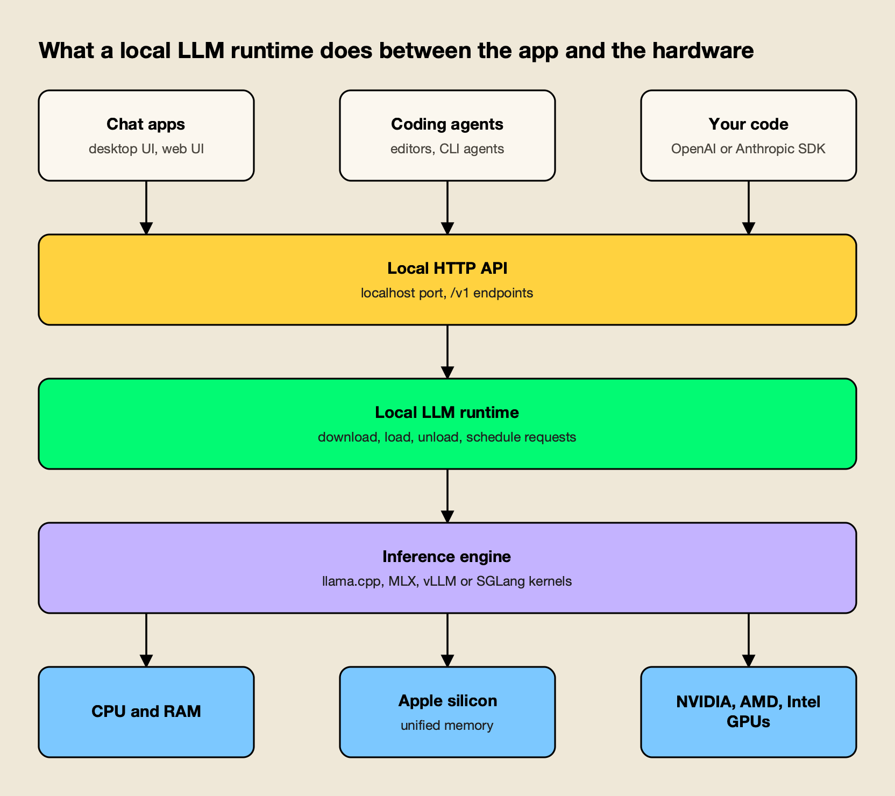
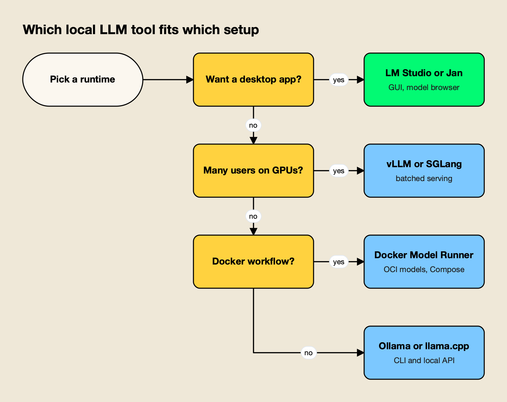
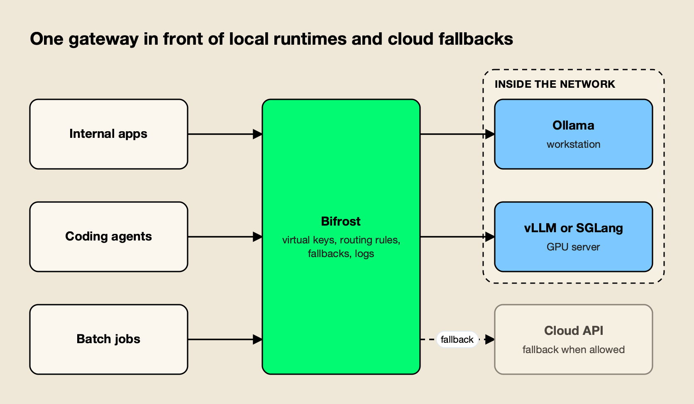

**TL;DR**
- Ollama is the best tool to run a local LLM for most people in 2026: one-command install on every desktop OS, a large model library, OpenAI- and Anthropic-compatible APIs on port 11434, and an MIT license.
- LM Studio is the best desktop app for local models, running GGUF models through llama.cpp and MLX models on Apple silicon, with a headless `llmster` daemon for servers.
- llama.cpp is the engine under much of this list and supports the widest range of hardware backends; vLLM and SGLang are the tools for serving a self-hosted LLM to many users on GPUs.
- Jan, Docker Model Runner and LocalAI fill specific niches: an open-source desktop app, models as OCI artifacts in the Docker toolchain, and a multimodal API server with users and quotas.
- Once more than one runtime or team is involved, an AI gateway such as Bifrost sits in front of the local servers to route requests, enforce keys and budgets, and fall back to cloud models where policy allows.

A local LLM is a large language model that runs on hardware you control, from a laptop to a rack of GPUs, rather than behind a vendor's API. US searches for "local LLM" now run at about 27,100 a month, more than 80 times the level of a year earlier according to DataForSEO keyword data, driven by stronger open-weight models and by teams that cannot send data to a third party. This guide ranks the eight best tools to run a local LLM in 2026, using each project's own documentation and release notes as of October 15, 2026.

## What a Local LLM Tool Actually Does

A local LLM tool, or runtime, downloads model weights, loads them into CPU or GPU memory, schedules incoming requests, and serves the results over a local HTTP API. The differences between tools sit mainly in the interface (command line, desktop app, container), the inference engine, and how well they handle several users at once.

*Figure 1: Most local LLM tools differ in the top two layers; many share llama.cpp or MLX underneath.*

As Figure 1 shows, the tools on this list are less independent than their branding suggests. Ollama lists llama.cpp as its supported backend and now also ships an MLX runner for Apple silicon. LM Studio and Jan bundle llama.cpp engines, and Docker Model Runner and LocalAI wrap llama.cpp and vLLM as interchangeable backends. Choosing a tool is therefore mostly a choice of workflow and serving model, not of raw kernel speed.

Nearly all of them expose an OpenAI-compatible API, and several now add an Anthropic-compatible `/v1/messages` endpoint so coding agents built for Claude can point at a local model. That shared API surface is what lets the same model sit behind a chat app, an editor plugin and production code, and it is the layer that a broader [LLM infrastructure stack](https://www.getmaxim.ai/articles/llm-infrastructure-explained-the-stack-behind-production-ai/) builds on.

## How These Local LLM Tools Were Ranked

The ranking weighs how well each tool serves the most common reasons to run an LLM locally: privacy, offline use, cost control and developer integration. Each criterion was checked against the project's own documentation, README or release notes fetched on October 15, 2026.

| Criterion | What was checked | Why it matters |
| --- | --- | --- |
| Setup effort | Install path and first-model steps in the official docs | Most local LLM projects stall at installation |
| API compatibility | OpenAI and Anthropic endpoints, default port | Determines which apps and agents can use the model |
| Hardware coverage | Documented CPU, Apple silicon and GPU backends | A tool is useless if it cannot use the hardware you own |
| Serving model | Single-user vs concurrent and batched serving | Separates desktop tools from shared servers |
| Model sources and formats | GGUF, safetensors, MLX, registries | Controls which open-weight models you can run |
| Licence and openness | Licence of the code you run | Matters for commercial and air-gapped deployments |
| Release activity | Latest tagged release | A proxy for model support keeping pace with new releases |

The list ranks runtimes, not models. For which open-weight models are worth running, see the agitracker overview of [China's open-weight models in 2026](/blog/china-open-weight-models-2026/) and the [best AI models of October 2026](/blog/top-ai-models/).

## Local LLM Tools Compared at a Glance

The table summarizes the eight tools on the criteria above. "Latest release" is the newest tagged release on each project's GitHub repository as of October 15, 2026; LM Studio publishes versions on its changelog rather than as an open-source repository.

| # | Tool | Interface | Default API port | API compatibility | Licence | Latest release |
| --- | --- | --- | --- | --- | --- | --- |
| 1 | Ollama | CLI, desktop app, Docker image | 11434 | OpenAI, Anthropic, native | MIT | v0.40.4 (Oct 12, 2026) |
| 2 | LM Studio | Desktop app, `lms` CLI, `llmster` daemon | 1234 | OpenAI, Anthropic, native REST | App not open source; CLI and SDKs MIT | 0.4.x |
| 3 | llama.cpp | CLI, `llama serve`, web UI | Set at launch | OpenAI, Anthropic | MIT | v0.6.0 (Oct 5, 2026) |
| 4 | vLLM | Python server and CLI | 8000 | OpenAI, Anthropic, gRPC | Apache 2.0 | v0.31.0 (Oct 5, 2026) |
| 5 | SGLang | Python server, Docker image | 30000 | OpenAI, Anthropic | Apache 2.0 | v0.5.21 (Oct 2, 2026) |
| 6 | Jan | Desktop app | 1337 | OpenAI | Apache 2.0 | v0.8.6 (Oct 9, 2026) |
| 7 | Docker Model Runner | Docker CLI, Docker Desktop, standalone `dmr` | 12434 | OpenAI, Ollama | Apache 2.0 | v1.2.8 (Aug 12, 2026) |
| 8 | LocalAI | Container, macOS app | 8080 | OpenAI, Anthropic, ElevenLabs | MIT | v4.11.0 (Oct 2, 2026) |

## 1. Ollama

Ollama is the best overall tool to run a local LLM in 2026 because it combines the shortest path from install to working model with an API that most AI tools already understand. It runs on macOS, Windows and Linux, ships an official Docker image, and is MIT-licensed.

- **Setup:** one install command per OS, then `ollama run gemma4` pulls and starts a model from the [Ollama library](https://ollama.com/library). Running `ollama` alone opens a menu that can connect coding agents such as Claude Code, Codex and OpenCode, and `ollama launch claude` wires Claude Code to local models directly.
- **APIs:** a native REST API plus [OpenAI compatibility](https://docs.ollama.com/api/openai-compatibility) for `/v1/chat/completions` and `/v1/responses`, and an Anthropic-compatible Messages endpoint. The server binds to 127.0.0.1:11434 by default and listens more widely only when `OLLAMA_HOST` is changed.
- **Hardware:** NVIDIA GPUs with compute capability 5.0 or newer and driver 550+, AMD GPUs, and Apple silicon. The v0.40.4 release notes describe an MLX runner on Apple silicon alongside the llama.cpp backend.
- **Concurrency:** the [Ollama FAQ](https://docs.ollama.com/faq) documents `OLLAMA_NUM_PARALLEL` (default 1 request per model) and `OLLAMA_MAX_LOADED_MODELS` (default three per GPU, or three on CPU), with memory scaling by parallel requests times context length.
- **Trade-offs:** the defaults favour one user on one machine. Ollama also offers optional cloud models through an account and API key, so teams with strict data rules should confirm which model names resolve locally.

**Best for:** Developers and small teams who want a local model running in minutes and reachable from editors, agents and scripts through a familiar API.

## 2. LM Studio

LM Studio is the most complete desktop application for running an LLM locally. It pairs a chat interface and a Hugging Face model browser with a local server, and on Apple silicon it can run models through Apple's MLX framework as well as llama.cpp.

- **Setup:** an installer for macOS, Windows and Linux; models download from inside the app. The [system requirements](https://lmstudio.ai/docs/app/system-requirements) call for Apple silicon on macOS 14 or newer, AVX2 on x64 Windows, and recommend at least 16 GB of RAM.
- **APIs:** the [developer docs](https://lmstudio.ai/docs/developer) list OpenAI-compatible `/v1/models`, `/v1/responses`, `/v1/chat/completions`, `/v1/embeddings` and `/v1/completions`, an Anthropic-compatible `/v1/messages` endpoint with a documented Claude Code setup, a native REST API, and TypeScript and Python SDKs. The default port is 1234.
- **Server use:** `llmster` packages the core of the app as a daemon with no GUI for Linux boxes and GPU rigs. Just-in-time loading starts a model on the first request and auto-unloads it after a period of inactivity.
- **Licence:** the desktop app is not among LM Studio's open-source repositories. The `lms` CLI, the SDKs and the MLX engine are MIT-licensed on GitHub, and the free plan covers running local models with llama.cpp and MLX.
- **Trade-offs:** Intel Macs are not supported, and teams that require open-source code for every component in the request path will prefer Jan or Ollama.

**Best for:** Individuals on Macs or Windows PCs who want to browse, compare and chat with local models in a polished app, and then serve the same models to other tools.

## 3. llama.cpp

llama.cpp is the C/C++ inference engine that made consumer-hardware LLMs practical, and it remains the most portable way to run a local LLM. It is the right choice when you want direct control over quantization, memory and server flags without a wrapper in between.

- **Hardware:** the [llama.cpp README](https://github.com/ggml-org/llama.cpp) lists backends for CUDA, HIP (AMD), Metal, Vulkan, SYCL (Intel), OpenCL for Adreno, CANN for Ascend NPUs, WebGPU and more, with hybrid CPU and GPU inference for models larger than available VRAM. Apple silicon is described as a first-class target.
- **Quantization:** integer quantization from 1.5-bit to 8-bit in the GGUF format, which is also the format most other tools on this list consume.
- **Server:** `llama serve -hf <repo>` downloads a GGUF model from Hugging Face and starts the [llama.cpp HTTP server](https://github.com/ggml-org/llama.cpp/tree/master/tools/server), which offers OpenAI-compatible chat completions, responses and embeddings, an Anthropic-compatible Messages API, continuous batching, parallel decoding, speculative decoding and a web UI. A router mode serves several models from one directory, loading up to four at once by default.
- **Release:** v0.6.0 on October 5, 2026, which added the extended batch API and new model support, and installs now come from a one-line script as well as prebuilt binaries and Docker images.
- **Trade-offs:** there is no model catalogue or desktop app beyond the built-in web UI, and the many flags assume familiarity with context sizes, GPU layer offload and quantization types.

**Best for:** Engineers who want maximum hardware coverage and fine-grained control, or who are embedding local inference in their own product.

## 4. vLLM

vLLM is the standard open-source engine for serving a self-hosted LLM to many concurrent users on GPUs. It began at UC Berkeley's Sky Computing Lab and now counts more than 2,000 contributors, according to its README. The [vLLM vs Ollama comparison](/blog/vllm-vs-ollama/) goes deeper on when the switch from a laptop runtime to a serving engine pays off.

- **Throughput:** PagedAttention for KV cache memory, continuous batching, chunked prefill, prefix caching, speculative decoding and disaggregated prefill and decode.
- **APIs:** an [OpenAI-compatible server](https://docs.vllm.ai/en/latest/serving/openai_compatible_server.html) plus Anthropic Messages and gRPC support, with tool calling and structured outputs.
- **Models and quantization:** 200+ model architectures from Hugging Face, including mixture-of-experts and multimodal models, and FP8, NVFP4, INT4, GPTQ, AWQ and GGUF quantization.
- **Hardware:** NVIDIA, AMD and Intel GPUs and x86, ARM and PowerPC CPUs, with plugins for TPUs, Intel Gaudi, Huawei Ascend and Apple silicon among others.
- **Release:** v0.31.0 on October 5, 2026, with 717 commits from 307 contributors and a new `vllm preload` command for faster restarts.
- **Trade-offs:** vLLM is built for Linux GPU servers. On a laptop it is more setup for less benefit than Ollama or LM Studio.

**Best for:** Platform teams serving open-weight models to an organization from their own GPU nodes or Kubernetes clusters. A separate survey of [gateways for vLLM, SGLang and Ollama](https://www.getmaxim.ai/articles/top-4-llm-gateways-for-self-hosted-models-vllm-sglang-and-ollama-2026/) covers how these servers are usually exposed to applications.

## 5. SGLang

SGLang is a high-performance serving framework for language, vision-language and diffusion models, hosted by the non-profit LMSYS. It targets the same production GPU serving role as vLLM, with a particular focus on agentic workloads, large-scale serving and reinforcement-learning rollouts.

- **Setup:** `docker pull lmsysorg/sglang:latest` or `uv pip install sglang`, then `sglang serve <model>` on port 30000. The [quickstart](https://docs.sglang.io/docs/get-started/quickstart) targets Linux with an NVIDIA GPU and a CUDA 13-compatible driver.
- **APIs:** OpenAI-compatible APIs for chat, completions, vision and embeddings, plus an Anthropic-compatible Messages API with documented Claude Code use.
- **Caching and routing:** a radix-tree prefix cache with session-aware variants, and the separate SGLang Model Gateway for cache-aware routing across replicas.
- **Hardware:** NVIDIA data-center and RTX 30, 40 and 50 series cards plus DGX Spark, AMD Instinct, Google TPUs, Intel GPUs and CPUs, Huawei Ascend, and Apple silicon through Metal and MLX.
- **Trade-offs:** like vLLM, it is a server framework rather than a desktop tool, and the cookbook-driven launch flags take more tuning than a one-command runtime.

**Best for:** Teams running agent-heavy or multi-turn workloads on GPU clusters where prefix reuse across requests drives cost and latency.

## 6. Jan

Jan is an open-source (Apache 2.0) desktop app from Menlo Research that runs local models and connects to cloud APIs from the same interface. It is the closest open-source counterpart to LM Studio.

- **Setup:** installers for Windows, macOS and Linux, including a Microsoft Store listing and a Flathub package; models download from Hugging Face inside the app.
- **APIs:** an OpenAI-compatible local server at `localhost:1337` so other applications can use the loaded model.
- **Features:** custom assistants, Model Context Protocol support for tool use, and optional connections to OpenAI, Anthropic, Mistral, Groq and other hosted providers.
- **Engine:** a bundled llama.cpp engine built for CPU, Vulkan, Metal, CUDA and ROCm variants. The README's guidance is about 8 GB of RAM for 3B models, 16 GB for 7B and 32 GB for 13B on macOS.
- **Trade-offs:** Jan is built for one person at a desk; it has no daemon mode comparable to `llmster` and no Anthropic-compatible endpoint listed in its README.

**Best for:** Users who want a desktop chat app for local models where every component is open source.

## 7. Docker Model Runner

[Docker Model Runner](https://docs.docker.com/ai/model-runner/) treats models like container images: they are pulled from Docker Hub, any OCI-compliant registry or Hugging Face, cached locally, loaded on the first request and unloaded when idle. It ships with Docker Desktop and Docker Engine, and as a standalone `dmr` binary for machines without Docker.

- **APIs:** OpenAI-compatible and Ollama-compatible APIs, with the standalone daemon listening on port 12434 by default.
- **Engines:** llama.cpp everywhere, plus vLLM and Diffusers on Linux with NVIDIA GPUs.
- **Packaging:** GGUF and safetensors files can be packaged as OCI artifacts and pushed to any container registry, and [Docker Compose can declare models](https://docs.docker.com/ai/compose/models-and-compose/) alongside the services that use them.
- **Hardware:** Apple silicon on macOS; NVIDIA GPUs and Qualcomm Adreno on Windows; CPU, CUDA, ROCm and Vulkan on Linux with Docker Engine.
- **Trade-offs:** the workflow assumes a team already organized around Docker, and GPU acceleration on Windows is documented for NVIDIA and Adreno only.

**Best for:** Teams that want local models versioned, distributed and deployed with the same registries and Compose files as the rest of their stack.

## 8. LocalAI

LocalAI is an MIT-licensed, self-hosted AI server built around a small core with pluggable backends. Each backend wraps an engine such as llama.cpp, vLLM, whisper.cpp, stable-diffusion or MLX in its own image, pulled only when a model needs it.

- **APIs:** drop-in compatibility with the OpenAI, Anthropic and ElevenLabs APIs across backends, covering text, vision, voice, image and video.
- **Multi-user features:** API key authentication, user quotas, role-based access and per-user usage metrics, which most desktop-first tools lack.
- **Hardware:** NVIDIA, AMD, Intel, Apple silicon, Vulkan or CPU only; the README states no GPU is required.
- **Release:** v4.11.0 on October 2, 2026, with a `docker run` quickstart on port 8080 and an unsigned macOS app.
- **Trade-offs:** the breadth adds moving parts; for text-only work on one machine, Ollama or llama.cpp is simpler.

**Best for:** Self-hosters who want one OpenAI-compatible endpoint for chat, speech and image models with basic user management built in.

## Other Local LLM Runtimes Worth Knowing

Several tools did not make the ranked list because they target a narrower platform or role. [MLX LM](https://github.com/ml-explore/mlx-lm) is Apple's Python package for running and fine-tuning models on Apple silicon; its `mlx_lm.server` exposes an OpenAI-like API on port 8080, though its own docs say it is not recommended for production. LM Studio maintains its own MIT-licensed MLX engine for the same hardware.

Front ends such as Open WebUI, AnythingLLM and LibreChat are not runtimes; they provide chat interfaces and retrieval on top of a runtime such as Ollama. Pick the runtime first, then add an interface.

## Which Local LLM Tool Fits Which Setup

The right local LLM tool depends on who uses the model and where it runs. A single developer at a desk, a team sharing a GPU server, and an organization standardized on containers each point to a different tool, as Figure 2 shows.

*Figure 2: The first question is who uses the model: one person at a desk, a developer's toolchain, or a team behind a server.*

| Scenario | Best fit | Runner-up | Why |
| --- | --- | --- | --- |
| First local model on a laptop | Ollama | LM Studio | One-command install and a large curated library |
| Comparing models in a GUI | LM Studio | Jan | Model browser, chat UI and local server in one app |
| Local model for a coding agent | Ollama | LM Studio | Both document Anthropic-compatible endpoints and Claude Code setup |
| Shared GPU server for a team | vLLM | SGLang | Batched, concurrent serving with OpenAI-compatible APIs |
| Long multi-turn agent sessions on GPUs | SGLang | vLLM | Radix prefix cache and cache-aware routing |
| Models in CI and Compose files | Docker Model Runner | LocalAI | Models as OCI artifacts in existing registries |
| Unusual hardware or embedded use | llama.cpp | Ollama | Widest backend list and no dependencies |
| Voice and images alongside text | LocalAI | Docker Model Runner | Multimodal backends behind one API |

The coding-agent row is where interest is growing fastest. For agent setups specifically, agitracker's comparison of [the best AI models for coding](/blog/best-ai-models-for-coding/) covers which open-weight models hold up, and a walkthrough of a [self-hosted gateway for Cursor with Claude or Ollama](https://www.getmaxim.ai/articles/self-hosted-ai-gateway-for-cursor-with-claude-or-ollama/) shows the plumbing between editor and runtime.

## Hardware for Running an LLM Locally

Memory, not compute, decides which local LLM a machine can run. The model's weights and its KV cache must fit in RAM or VRAM, so a quantized model and a modest context window go further than a faster chip with too little memory.

The tools' own documentation gives practical floors. LM Studio recommends 16 GB of RAM and, on Windows, at least 4 GB of dedicated VRAM. Jan suggests 8 GB for 3B-parameter models, 16 GB for 7B and 32 GB for 13B on Macs. Ollama's FAQ adds a less obvious cost: each parallel request multiplies the context allocation, so four parallel requests at a 2K context consume memory like an 8K context.

Three practical rules follow from those documents:

- **Use quantized weights.** GGUF quantization in llama.cpp, Ollama, LM Studio and Jan, or 4-bit MLX builds on Apple silicon, cut memory needs severalfold compared with 16-bit weights.
- **Apple silicon goes further than its specs suggest.** Unified memory lets a Mac load models that would need a large discrete GPU on a PC, which is why llama.cpp, LM Studio, Ollama and SGLang all invest in Metal or MLX paths.
- **Concurrency changes the tool.** Once several people share one model, batched servers such as vLLM and SGLang use GPU memory far more efficiently than desktop runtimes tuned for one user.

Data location is the other half of the hardware decision. Regulated teams often run these runtimes inside networks with no outbound route, a setup covered in agitracker's guide to [air-gapped and in-VPC AI gateways](/blog/air-gapped-ai-gateways/) and in a survey of [air-gapped and on-prem gateways for regulated industries](https://www.getmaxim.ai/articles/best-air-gapped-and-on-prem-ai-gateways-for-regulated-industries/).

## Putting a Gateway in Front of Local Models

A local runtime serves models; it does not decide who may call them, which runtime should answer, or what happens when a server is down. Once a team runs more than one runtime, or mixes local and cloud models, those decisions move to an AI gateway in front of the runtimes.

The pattern is common enough that agitracker ranks the options separately in [the top AI gateways for routing between vLLM, Ollama and cloud LLMs](/blog/ai-gateways-for-vllm-ollama-cloud-llms/). This section looks at the role itself, with one self-hosted gateway as the example.

*Figure 3: Applications keep one endpoint; the gateway decides which local runtime or cloud model answers.*

### Bifrost as the Self-Hosted Gateway Layer

[Bifrost](https://www.getmaxim.ai/bifrost), an [open-source AI gateway](https://github.com/maximhq/bifrost) built by Maxim AI, is a good fit for this layer because it runs on the same infrastructure as the runtimes.

It starts with `npx -y @maximhq/bifrost` or a single Docker container, per its [gateway setup guide](https://docs.getbifrost.ai/quickstart/gateway/setting-up). Bifrost exposes 25+ providers and 10,000+ models through one OpenAI-compatible API, and its [published benchmark](https://docs.getbifrost.ai/benchmarking/t3.xl) reports 11 µs of added overhead per request at 5,000 RPS on an AWS t3.xlarge. That overhead is negligible next to local inference time.

How it maps onto the runtimes in this list:

- **First-class local providers:** Bifrost has dedicated provider pages for [Ollama](https://docs.getbifrost.ai/providers/supported-providers/ollama), [vLLM](https://docs.getbifrost.ai/providers/supported-providers/vllm) and [SGLang](https://docs.getbifrost.ai/providers/supported-providers/sgl). The vLLM provider leaves the API key blank for local servers and can route chat through vLLM's Anthropic-compatible endpoint.
- **Setup guides:** step-by-step guides cover [Bifrost with Ollama](https://www.getmaxim.ai/bifrost/guides/providers/ollama), [with vLLM](https://www.getmaxim.ai/bifrost/guides/providers/vllm) and [with SGLang](https://www.getmaxim.ai/bifrost/guides/providers/sglang).
- **Any other OpenAI-compatible runtime:** LM Studio, llama.cpp's `llama serve`, Jan, Docker Model Runner and LocalAI can be added as [custom providers](https://docs.getbifrost.ai/providers/custom-providers) with an OpenAI base type and their local base URL.
- **Routing:** [routing rules](https://docs.getbifrost.ai/providers/routing-rules) written in CEL send requests by header, parameter, team or capacity, for example coding agents to a vLLM node and batch jobs to a workstation running Ollama.
- **Fallbacks:** [retries and fallbacks](https://docs.getbifrost.ai/features/retries-and-fallbacks) move a request to the next provider when a local server returns errors or times out, including to a cloud model when that is permitted. The reasoning behind those patterns is covered in a guide to [retries, fallbacks and circuit breakers in LLM apps](https://www.getmaxim.ai/articles/retries-fallbacks-and-circuit-breakers-in-llm-apps-a-production-guide/).
- **Governance:** [virtual keys](https://docs.getbifrost.ai/features/governance/virtual-keys) restrict which providers and models each team or app can reach, and [budgets and rate limits](https://docs.getbifrost.ai/features/governance/budget-and-limits) cap usage per key. Because governance checks every attempt, fallbacks included, a key limited to local providers fails closed instead of overflowing to a cloud API. That is the property regulated teams need from [AI governance](https://www.getmaxim.ai/ai-governance) at this layer.

**Enterprise tier.** Clustering, adaptive load balancing and managed guardrails are part of Bifrost Enterprise; the routing, fallbacks, virtual keys and budgets above are in the open-source gateway.

Teams weighing whether to run that layer themselves can start with agitracker's [self-hosted vs managed LLM gateway](/blog/self-hosted-vs-managed-llm-gateway/) comparison, and a broader roundup of the [best self-hosted AI gateways](https://www.getmaxim.ai/articles/best-self-hosted-ai-gateway-in-2026/) lists the alternatives. For a coding-agent setup in particular, the [Claude Code gateways](/blog/claude-code-gateways/) guide shows the same pattern with Claude Code pointed at local and hosted models.

## Choosing a Local LLM Tool

The local LLM tools of 2026 have converged on the same foundations: GGUF and MLX weights, llama.cpp or a GPU serving engine underneath, and OpenAI- and Anthropic-compatible APIs on top. What separates them is the job. Ollama is the best default for most people, LM Studio the best desktop experience, llama.cpp the most portable engine, and vLLM and SGLang the right choice once a model serves a team rather than a person. Jan, Docker Model Runner and LocalAI each fit a specific workflow well.

Because the APIs are shared, the choice is less permanent than it looks. Many teams end up running two or three of these tools at once: one on laptops, one on GPU servers, and sometimes a cloud model for the hardest tasks. The tool matters less than keeping applications pointed at an interface that survives the next model release, and the open-weight models released each month will keep testing that.
