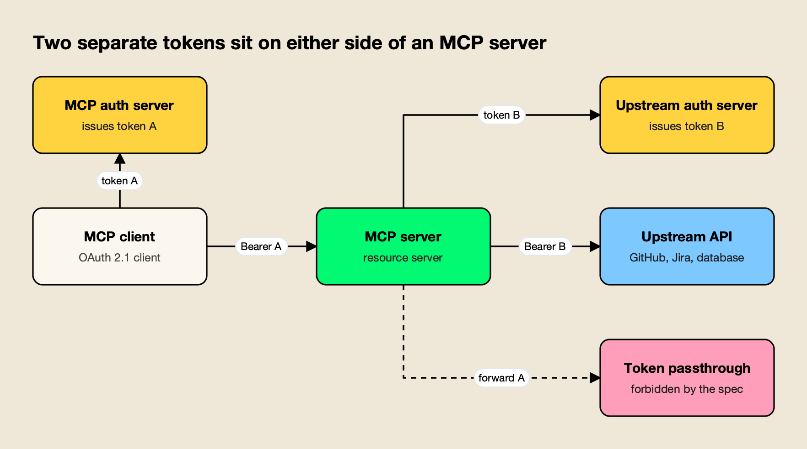
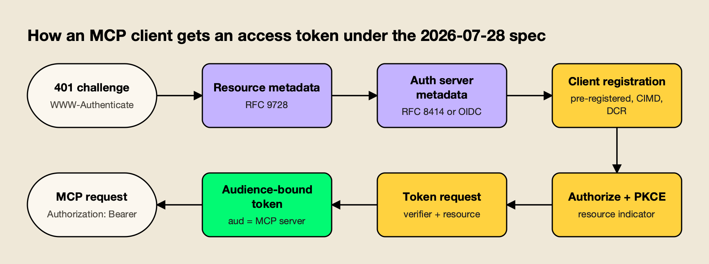
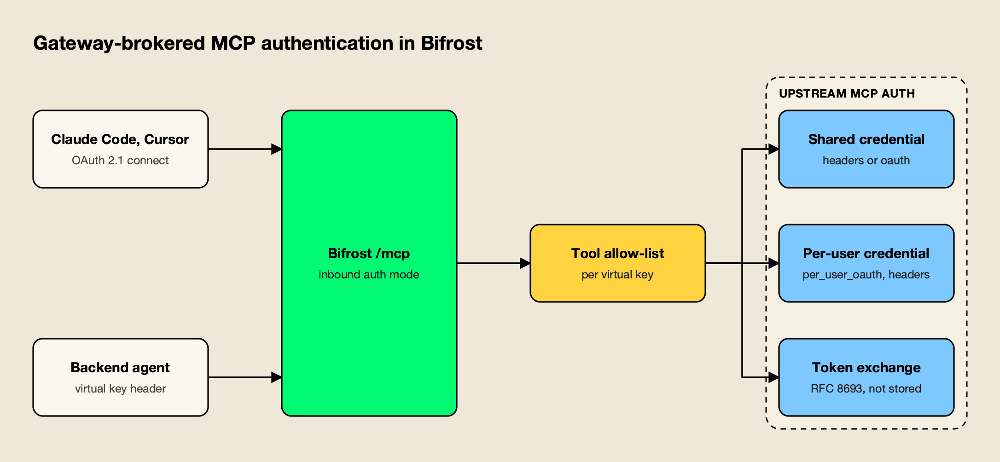

**TL;DR**
- MCP authentication for HTTP servers is OAuth 2.1: the MCP server is a resource server, the client discovers the authorization server through protected resource metadata (RFC 9728), and every request carries a bearer token.
- The 2026-07-28 spec deprecates Dynamic Client Registration in favor of Client ID Metadata Documents, and requires PKCE, resource indicators (RFC 8707) and issuer validation.
- The two rules that cause the most real-world mistakes: a server must reject tokens not issued for it, and it must never pass a client's token through to an upstream API.
- Local stdio servers sit outside the OAuth profile and read credentials from the environment, which makes process isolation, not token validation, the main control.
- Teams running many MCP servers usually move authentication into a gateway, which authenticates clients once and holds or exchanges upstream credentials per user or per key.

MCP authentication is the set of rules that decides who may call an MCP server and with what credential, and for remote servers the Model Context Protocol specifies it as a profile of OAuth 2.1. The current authorization spec, revision 2026-07-28, treats each HTTP-based MCP server as an OAuth resource server, requires clients to discover its authorization server from metadata, and binds every access token to one server. That design solves the hardest part of the problem, connecting a generic client to a server it has never seen, but it leaves teams to decide what happens behind the server, where most incidents start. This explainer covers the spec, the three authentication patterns used in production, and the mistakes that turn an MCP server into a confused deputy.

## What MCP Authentication Covers

MCP authentication covers how a client proves it may call an MCP server, how the server validates that proof, and how the server then authenticates to whatever API sits behind it. The specification defines only the first two hops for HTTP transports; the third is left to the server, under strict rules about which tokens it may use.

The [MCP authorization specification](https://modelcontextprotocol.io/specification/2026-07-28/basic/authorization) assigns three roles. The **MCP server** is an OAuth 2.1 resource server. The **MCP client** is an OAuth 2.1 client acting on behalf of a resource owner, usually a person. The **authorization server** authenticates the user and issues tokens; it may be hosted by the MCP server or be a separate identity provider such as Okta, Entra ID or [Keycloak](https://www.keycloak.org/).

Authorization is optional in the protocol. The spec says HTTP implementations "SHOULD" follow it, stdio implementations "SHOULD NOT" and should retrieve credentials from the environment instead, and other transports must follow the security practices of their own protocol. In practice, any remote server that touches private data needs it, which is why the [most widely used MCP servers](/blog/top-mcp-servers/) for GitHub, Notion, Sentry and similar services now ship OAuth.



*Figure 1: The token the MCP server receives stops at the MCP server; upstream calls use a token issued for the upstream API.*

Figure 1 is the mental model the rest of the spec follows. Token A belongs to the client-to-server hop and token B to the server-to-API hop, and the two never substitute for each other. Longer treatments of the same split appear in an [explainer on OAuth, API keys and token management for MCP](https://www.getmaxim.ai/articles/mcp-authentication-explained-oauth-api-keys-and-token-management/) and a [guide to securing agent tool access at the server](https://www.getmaxim.ai/articles/mcp-server-authentication-how-to-secure-agent-tool-access/).

## How the Spec Evolved From 2025 to 2026

The MCP authorization spec has changed in every revision since OAuth arrived in March 2025. Each change moved responsibility away from the MCP server and toward standard OAuth infrastructure, so a server written against an early revision may now be out of step with what clients expect.

| Revision | What changed for authentication |
|---|---|
| 2025-03-26 | First OAuth 2.1 profile; the MCP server could act as its own authorization server |
| 2025-06-18 | MCP server formally a resource server; protected resource metadata (RFC 9728) and resource indicators (RFC 8707) introduced |
| 2025-11-25 | Client ID Metadata Documents added as a registration mechanism |
| 2026-07-28 | Dynamic Client Registration deprecated; issuer validation (RFC 9207) required for authorization responses; MCP described as stateless with no protocol-level sessions |

The practical consequence is that "MCP OAuth" means different things depending on which revision a client or server implements. A client built for 2025-03-26 may expect the MCP server to host `/authorize` and `/token` itself. A 2026 client expects to find those endpoints through metadata and to send a `resource` parameter regardless of whether the authorization server understands it.

## The MCP OAuth 2.1 Flow Step by Step

The MCP OAuth flow is an authorization code grant with PKCE, preceded by two rounds of metadata discovery. A client with nothing but the server's URL can complete it, which is the reason the spec mandates discovery rather than configuration.



*Figure 2: Every step after the 401 is discovered from metadata, which is what lets a generic client connect to a server it has never seen.*

As Figure 2 shows, the flow runs in seven steps:

1. **Challenge.** The client calls the server without a token and receives `401 Unauthorized` with a `WWW-Authenticate` header. The header carries a `resource_metadata` URL and, ideally, a `scope` parameter naming the scopes this request needs.
2. **Protected resource metadata.** The client fetches the RFC 9728 document, either from the header URL or from `/.well-known/oauth-protected-resource`, and reads which authorization servers protect the resource.
3. **Authorization server metadata.** The client tries RFC 8414 and OpenID Connect discovery endpoints. The `issuer` in the document must match the URL it was fetched from exactly, or the client must discard it.
4. **Client registration.** The client uses pre-registered credentials if it has them, then a Client ID Metadata Document, then Dynamic Client Registration as a last resort.
5. **Authorization request.** The client opens a browser with a PKCE `S256` code challenge and a `resource` parameter set to the server's canonical URI, such as `https://mcp.example.com/mcp`. If the authorization server's metadata does not advertise `code_challenge_methods_supported`, the client must refuse to continue.
6. **Token request.** After the redirect, the client checks the `iss` parameter against the issuer it recorded, then exchanges the code with the PKCE verifier and the same `resource` value.
7. **Authenticated requests.** Every HTTP request carries `Authorization: Bearer <token>`. Tokens never go in the query string.

### Client ID Metadata Documents Replace Dynamic Registration

A **Client ID Metadata Document** (CIMD) lets a client use an HTTPS URL as its `client_id`. The URL points to a JSON document listing the client's name and redirect URIs, and the authorization server fetches and validates it during the flow. This fits MCP's typical case, where client and server have no prior relationship, without filling the authorization server with throwaway registrations.

The [client registration section of the spec](https://modelcontextprotocol.io/specification/2026-07-28/basic/authorization/client-registration) now labels Dynamic Client Registration deprecated. Authorization servers that adopt CIMD take on new risks of their own, including server-side request forgery when fetching metadata URLs and `localhost` redirect impersonation, which the spec asks them to mitigate with warnings and domain trust policies.

### Scopes and Step-Up Authorization

Scopes in MCP are meant to be granted incrementally. The spec asks servers to return the scopes a specific operation needs in the `WWW-Authenticate` challenge, and to answer a token with insufficient scope with `403` and `error="insufficient_scope"`. The client then re-authorizes with the union of its old and new scopes.

The [MCP security best practices](https://modelcontextprotocol.io/docs/2026-07-28/tutorials/security/security_best_practices) list the common errors: publishing every scope in `scopes_supported`, using wildcard scopes like `*` or `full-access`, and treating scopes in a token as sufficient without server-side authorization logic. A token stolen from a client that asked for everything up front gives the attacker everything.

## Token Audience Rules and the Confused Deputy Problem

The audience rules are the part of MCP authentication that most often fails in production. A server must accept only tokens issued specifically for it, and must never forward a client's token to an upstream API. Breaking either rule lets an attacker turn the MCP server into a proxy for someone else's access.

The [authorization security considerations](https://modelcontextprotocol.io/specification/2026-07-28/basic/authorization/security-considerations) state both rules as hard requirements. An MCP server "MUST NOT pass through the token it received from the MCP client" when calling an upstream API, and must reject tokens that do not name it in the audience claim. Resource indicators exist to make the second rule enforceable: because the client names the server in the `resource` parameter, the authorization server can mint a token whose `aud` claim matches only that server.

**Token passthrough** is dangerous for reasons beyond a single stolen token. The best-practices document lists four:

- **Control circumvention.** Rate limits and request validation keyed to the token's audience are bypassed.
- **Lost accountability.** The MCP server cannot tell clients apart, and upstream logs show the wrong caller.
- **Lateral movement.** A token accepted by several services lets an attacker who compromises one reach the others.
- **Painful migration.** A server that starts as a pure proxy has to rebuild its security model when it later needs controls.

The **confused deputy** problem is a specific variant that hits MCP proxy servers. It needs four conditions: the proxy uses one static client ID with a third-party authorization server, it lets MCP clients register dynamically, the third-party server sets a consent cookie, and the proxy does not ask for its own per-client consent. An attacker registers a client with a malicious redirect URI, sends the victim a link, the cookie skips the consent screen, and the authorization code lands on the attacker's server. The fix the spec requires is per-client consent at the proxy before it forwards anything to the third-party authorization server.

These are the same failure modes covered in a survey of [MCP security risks and their mitigations](https://www.getmaxim.ai/articles/mcp-security-risks-and-how-to-mitigate-them/), and several appear in the record of [AI agent security incidents in 2026](/blog/ai-agent-security-incidents/).

## Stdio vs HTTP: Two Different Security Models

Stdio and HTTP MCP servers are secured in different ways. HTTP servers are network services, so they authenticate each request with OAuth tokens. Stdio servers are child processes launched by the client, so they inherit credentials from environment variables and their security depends on what the process can reach.

| | Stdio (local) | Streamable HTTP (remote) |
|---|---|---|
| Spec guidance | Do not use the OAuth profile; read credentials from the environment | Follow the OAuth 2.1 profile |
| Typical credential | API key or personal access token in an env var | Short-lived, audience-bound access token |
| Per-user consent | None; the user who launches the process owns it | Browser consent at the authorization server |
| Main risk | Malicious or compromised server running with the user's privileges | Token theft, passthrough, confused deputy |
| Main control | Sandboxing, allow-listed commands, least-privilege env vars | Token validation, scope minimization, short lifetimes |

The best-practices document flags one escalation path that crosses the two models. When a local proxy spawns stdio servers on request, a cross-site scripting bug in the client can steal the proxy's own authentication token and use it to launch arbitrary commands. The spec's guidance is to sandbox spawned processes, restrict their file system access and log every stdio launch. Coding agents run more local MCP servers than any other client, which is why the [MCP servers commonly paired with coding agents](/blog/mcp-servers-for-coding-agents/) deserve the same review as any other installed software. Agent-to-agent traffic follows a different protocol with its own auth model, compared in the explainer on [A2A vs MCP](/blog/a2a-vs-mcp/).

## Three Patterns for Authenticating MCP Servers in Production

Production MCP deployments use three authentication patterns: per-user OAuth on each server, static API keys or headers, and gateway-brokered authentication. Most organizations end up with a mix, because hosted SaaS servers ship OAuth while internal servers often start with keys.

| Pattern | How it works | Strengths | Trade-offs |
|---|---|---|---|
| Per-user OAuth on each server | Every MCP server is a resource server; users consent per server | Spec-compliant, per-user audit trail, short-lived tokens | Each server needs correct audience validation; users repeat consent per server |
| API keys and static headers | Client sends a key or bearer token configured once | Simple to script; good for service accounts | No consent, no discovery, long-lived secrets, one identity for every caller |
| Gateway-brokered | Clients authenticate to a gateway; the gateway holds or exchanges upstream credentials | One place for identity, tool scoping and audit; upstream secrets never reach clients | Adds a hop; the gateway becomes a high-value system to harden |

### Per-User OAuth on Each Server

Per-user OAuth is what the specification describes: each server publishes resource metadata, trusts an authorization server, and validates audience-bound tokens. It gives the strongest attribution, since every tool call maps to one user's grant. The cost is that every server team has to get the validation details right, including issuer checks, scope challenges and refusing passthrough.

Platform tooling reduces that burden. Cloudflare's [MCP authorization documentation](https://developers.cloudflare.com/agents/model-context-protocol/authorization/) describes an OAuth Provider Library for Workers that can use Cloudflare Access, a third-party provider such as GitHub, or an existing OAuth server. When a third-party provider is used, the Worker issues its own token to the MCP client rather than handing over the upstream token, which is the separation Figure 1 shows.

### API Keys and Static Headers

Static credentials remain common for internal servers and machine-to-machine agents. A key in an `Authorization` or custom header is easy to automate and works with any MCP client that supports custom headers. It gives up everything the OAuth profile adds: consent, discovery, short lifetimes and audience binding.

Where keys are the right choice, the minimum hygiene is a separate key per consuming service, scopes or tool restrictions on the key, storage in a secret manager rather than a config file, and a rotation schedule. Microsoft's [guidance on securing MCP servers in Azure API Management](https://learn.microsoft.com/en-us/azure/api-management/secure-mcp-servers) shows both sides: subscription keys for simple inbound access, and Entra ID token validation through the `validate-azure-ad-token` policy when the deployment needs per-user identity.

### Gateway-Brokered Authentication

In the gateway pattern, clients authenticate once to a gateway that aggregates many MCP servers, and the gateway authenticates separately to each upstream server. This collapses identity, tool access and audit into one control point, and it keeps upstream secrets off developer laptops entirely. It is also the most direct way to satisfy the no-passthrough rule across dozens of servers at once.

Kong's [AI MCP OAuth2 plugin](https://developer.konghq.com/plugins/ai-mcp-oauth2/), part of its AI Gateway Enterprise offering and currently a tech preview, validates incoming MCP tokens against an external authorization server by introspection or JWKS, forwards selected claims to the upstream server as headers, and by default does not forward the access token itself. Other open-source options, including Docker's MCP Gateway and IBM ContextForge, are compared in the roundup of [open-source MCP gateways for self-hosting](/blog/open-source-mcp-gateways/), and the wider market is covered in the [MCP gateway comparison](/blog/top-mcp-gateways-compared/).

A [comparison of enterprise MCP gateways for authentication](https://www.getmaxim.ai/articles/top-enterprise-mcp-gateways-for-mcp-authentication-in-2026/) and a walkthrough of [OAuth 2.1 patterns for agent tool access](https://www.getmaxim.ai/articles/mcp-authentication-oauth-2-1-patterns-for-agent-tool-access/) go further into how these products divide the work between inbound and outbound auth.

## Worked Example: Gateway Authentication in Bifrost

[Bifrost](https://www.getmaxim.ai/bifrost) is an [open-source AI gateway](https://github.com/maximhq/bifrost) that also acts as an MCP gateway, aggregating tools from many MCP servers behind one `/mcp` endpoint. It serves as the worked example here because its documentation separates inbound and outbound MCP authentication into distinct settings, which maps cleanly onto the two-token model in Figure 1.



*Figure 3: Inbound and outbound credentials never mix: clients prove identity to the gateway, and the gateway holds or exchanges the upstream credential.*

### Inbound: How Clients Authenticate to the Gateway

Bifrost's [gateway authentication](https://docs.getbifrost.ai/mcp/gateway-auth) is controlled by one setting, `mcp_server_auth_mode`, with three values:

- **`headers`** (default): `/mcp` accepts a virtual key, API key or session header, and the OAuth discovery endpoints return 404.
- **`both`**: header credentials and Bifrost-issued JWTs are both accepted, and discovery is served.
- **`oauth`**: only Bifrost-issued JWTs are accepted.

In `both` or `oauth` mode, Bifrost runs as an OAuth 2.1 authorization server for its own `/mcp` resource. The documentation lists protected resource metadata (RFC 9728), Dynamic Client Registration, PKCE with `S256`, and resource indicators that bind tokens to `/mcp` through the `aud` claim, so clients such as Claude Code and Cursor connect without a key pasted into their config. At the consent screen, the user binds the grant to a virtual key, an anonymous session, or a signed-in SSO user. A request carrying both a JWT and a header credential is rejected outright, which closes off ambiguity about which identity a call runs under.

```json
{
  "client": {
    "mcp_server_auth_mode": "both",
    "oauth2_server_config": {
      "issuer_url": "https://bifrost.example.com",
      "access_token_ttl": 600
    }
  }
}
```

The `issuer_url` is required in both OAuth modes, so discovery documents never derive the issuer from an unauthenticated `Host` header. Issued grants appear on an OAuth Grants page with a revoke action.

### Per-Key Tool Access

Authentication decides who is calling; [MCP tool filtering](https://docs.getbifrost.ai/features/governance/mcp-tools) decides what that caller can run. A virtual key with no MCP configuration gets no MCP tools (deny by default), except from clients an admin marks Allow by Default. Each key lists allowed MCP clients and tools, with `*` for all tools on a client, and a caller-supplied `x-bf-mcp-include-tools` header can only narrow that list, never widen it. The allow-list is enforced again at execution time. Curated bundles of tools can also be published as [Virtual MCPs](https://docs.getbifrost.ai/mcp/virtual-mcps) at `/mcp/<slug>` and attached to keys.

### Outbound: How the Gateway Authenticates Upstream

The [MCP authentication overview](https://docs.getbifrost.ai/mcp/auth/overview) lists six upstream auth types:

| `auth_type` | Who authenticates | Suited to |
|---|---|---|
| `none` | Nobody | Public servers and local stdio tools |
| `headers` | Admin, once | Shared internal API keys |
| `oauth` | Admin, once | One team-wide OAuth app, with discovery, PKCE and automatic refresh |
| `per_user_headers` | Each user, on first use | Per-user API keys |
| `per_user_oauth` | Each user, on first use | SaaS servers such as Notion, GitHub and Sentry |
| `token_exchange` | Each caller, every call | Internal servers that trust the company identity provider |

[Per-user OAuth](https://docs.getbifrost.ai/mcp/auth/per-user-oauth) uses lazy authentication: the first tool call without a stored credential returns an `mcp_auth_required` payload with a consent URL instead of executing, and later calls run under that user's own token. [Token exchange](https://docs.getbifrost.ai/mcp/auth/token-exchange) swaps the caller's identity-provider token for a short-lived token scoped to the upstream server's audience through RFC 8693 (or Entra's on-behalf-of grant), stores nothing per user, and never sends the caller's original token upstream. That is a direct implementation of the spec's rule that a server uses a separate token for upstream APIs. Credentials for upstream servers are tracked on an [MCP Sessions](https://docs.getbifrost.ai/mcp/sessions) page, where each row can be re-authenticated or revoked, and removing a key's access to a server automatically orphans the matching credentials.

Bifrost routes model traffic for 25+ providers and 10,000+ models through one OpenAI-compatible API, and its published benchmark reports 11 µs of added overhead per request at 5,000 RPS on an AWS t3.xlarge, so adding the MCP layer to an existing LLM gateway does not add a separate proxy. The [MCP gateway resource page](https://www.getmaxim.ai/resources/mcp-gateway) and a post on [MCP gateway access control and cost governance](https://www.getmaxim.ai/bifrost/blog/bifrost-mcp-gateway-access-control-cost-governance-and-92-lower-token-costs-at-scale) cover the wider feature set, and an [overview of MCP as protocol, plumbing and gateway](https://www.getmaxim.ai/bifrost/blog/mcp-the-protocol-the-plumbing-and-the-gateway) places the auth layer in context.

**Enterprise tier.** SSO-bound user identity at consent, token exchange (which needs a SCIM identity provider), access profiles and audit logs are part of Bifrost Enterprise; the [governance overview](https://www.getmaxim.ai/resources/governance) describes that tier.

## MCP Server Security Checklist

MCP server security comes down to a short list of checks that apply whichever pattern a team picks. Each item below traces to a requirement or recommendation in the 2026-07-28 spec or its best-practices document.

- **Validate audience on every request.** Reject any token whose audience is not this server's canonical URI, and return `401` for invalid or expired tokens.
- **Never forward client tokens.** Upstream calls use a token issued by the upstream authorization server, or one obtained through token exchange.
- **Require PKCE and validate issuers.** Clients refuse authorization servers that do not advertise `code_challenge_methods_supported`, and compare `iss` to the recorded issuer.
- **Minimize scopes.** Publish a small baseline set and use `insufficient_scope` challenges for privileged tools.
- **Keep tokens short-lived.** Rotate refresh tokens for public clients and store tokens encrypted.
- **Get consent per client at proxies.** Any server that fronts a third-party API with a static client ID asks for its own consent before forwarding.
- **Sandbox stdio servers.** Limit file system and network access, and log every process launch.
- **Bind state to identity.** A state handle such as a workflow ID is never treated as authentication; key it to the user ID from the verified token.
- **Log tool calls with identity.** Every call records which user or key made it, which server ran it and which scopes applied.

The last item is where authentication meets governance. Teams formalizing it can compare the [enterprise MCP governance tools](/blog/mcp-governance-tools/) that sit on top of authentication, read the [MCP audit logging requirements for compliance](https://www.getmaxim.ai/bifrost/blog/mcp-audit-logging-requirements-for-enterprise-governance-and-compliance), and work through an [enterprise MCP security checklist](https://www.getmaxim.ai/articles/mcp-security-best-practices-enterprise-checklist-2026/).

## Choosing an MCP Authentication Approach

The right approach depends on how many MCP servers a team runs and who owns them. A team publishing one remote server should implement the OAuth 2.1 profile directly. A team consuming many servers, or exposing them to many agents, should centralize authentication in a gateway.

| Situation | Recommended approach |
|---|---|
| Publishing one public or SaaS MCP server | Implement the spec: protected resource metadata, audience-bound tokens, CIMD support |
| A few internal servers called by backend services | Scoped API keys from a secret manager, rotated on a schedule |
| Many servers used by developers in Claude Code or Cursor | Gateway with OAuth connect for clients and per-user upstream credentials |
| Internal servers that already trust the corporate identity provider | Gateway with token exchange, so no per-user secrets are stored |
| Developer machines running local stdio servers | Sandboxing and an allow-list of approved servers |

MCP authentication has settled on a clear shape: OAuth 2.1 for remote servers, metadata-driven discovery, and tokens bound to exactly one audience. The protocol now handles the client-to-server hop well; the risks that remain sit behind the server, in token passthrough, broad scopes and unsandboxed local processes. For a single server, implementing the 2026-07-28 spec carefully is enough. For an organization running dozens, putting a gateway in front so that identity, tool permissions and upstream credentials are managed in one place is the more reliable way to keep every server on the right side of those rules.
