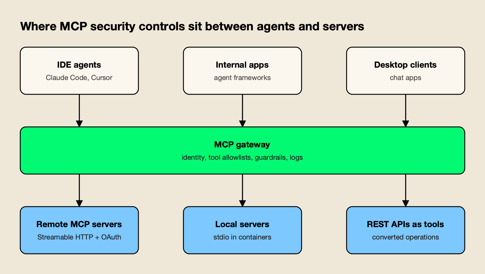
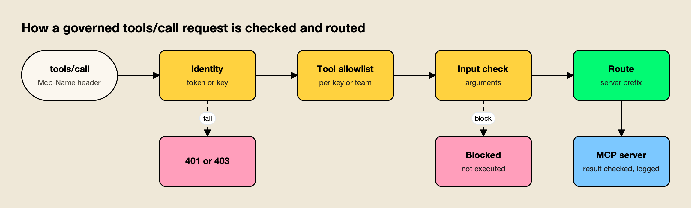
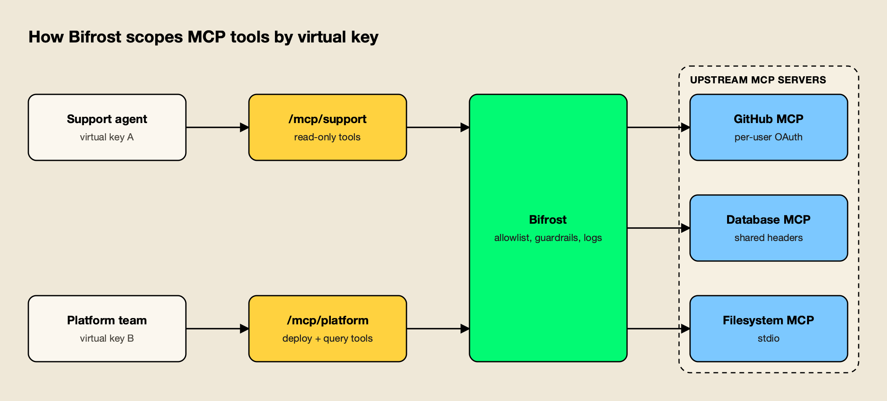

**TL;DR**
- MCP server security spans three layers: the protocol (OAuth tokens, scopes, consent), the server process (sandboxing, supply chain) and the tool calls themselves (allowlists, input and output checks, approvals, logs).
- In an enterprise, routing and security are the same decision: a gateway that every agent must pass through is where identity, tool allowlists and audit logging can be enforced once.
- The 2026-07-28 MCP revision made the protocol stateless and mirrors the method and tool name into HTTP headers, so load balancers and gateways can route and filter calls without parsing the body.
- The OWASP MCP Top 10 and the MCP project's security best practices agree on the core controls: no token passthrough, least-privilege scopes, sandboxed local servers and complete audit trails.
- Gateways such as Bifrost, Kong AI Gateway, Azure API Management, Cloudflare MCP server portals, Docker MCP Gateway and LiteLLM implement these controls differently, so the right choice depends on where the servers run.

MCP server security is the set of controls that decide who can reach a Model Context Protocol server, which tools an AI agent may call on it, what credentials it uses downstream and what record each call leaves behind. Enterprises adopting MCP usually start with a handful of servers on developer laptops and end up with dozens of local and remote servers shared by many agents. At that point, how traffic is routed to those servers becomes the main place where security is enforced. This guide covers the threat model, a reference architecture, a step-by-step hardening process and the gateway products that implement it.

## What MCP Server Security Covers

MCP server security covers three layers: the authorization protocol between clients and servers, the runtime of each server process, and the governance of individual tool calls. A gap in any layer can expose data, because an agent with a valid token can still call a poisoned tool, and a sandboxed server can still receive an over-scoped token.

The protocol layer is defined by the specification. [Authorization is optional for MCP implementations](https://modelcontextprotocol.io/specification/2026-07-28/basic/authorization#:~:text=Authorization%20is%20OPTIONAL%20for%20MCP%20implementations), and when it is used over HTTP it follows an OAuth 2.1 profile; stdio servers are expected to [retrieve credentials from the environment](https://modelcontextprotocol.io/specification/2026-07-28/basic/authorization#:~:text=retrieve%20credentials%20from%20the%20environment) instead. The OAuth details, from protected resource metadata to audience-bound tokens, are covered in depth in this site's [MCP authentication explainer](/blog/mcp-authentication/), so this guide treats them as one control among several.

The runtime layer is about the process itself. The MCP project's local server guidance states that [the client and a stdio server share one trust domain](https://modelcontextprotocol.io/docs/2026-07-28/tutorials/security/local-server-security#:~:text=the%20client%20and%20a%20stdio%20server%20share%20one%20trust%20domain): a local server inherits the user's environment variables, files and network access. The governance layer is about tool calls, which is where routing, allowlists, guardrails and audit logs apply.

| Layer | What can go wrong | Primary control | Where it is enforced |
|---|---|---|---|
| Protocol | Stolen or misused tokens, confused deputy, over-broad scopes | Audience validation, per-client consent, least-privilege scopes | Server, authorization server, gateway |
| Runtime | Malicious package, compromised dependency, local port exposed | Provenance checks, version pinning, containers or sandboxes | Host machine, container platform |
| Tool calls | Tool poisoning, prompt injection, data exfiltration, unlogged actions | Tool allowlists, input and output checks, approvals, audit logs | MCP gateway, client |
| Network | SSRF, DNS rebinding, shadow servers | Egress proxies, Origin validation, server inventory | Network edge, gateway, endpoint |

## The MCP Threat Model for Enterprises

The enterprise MCP threat model combines classic web risks (SSRF, injection, token theft) with risks specific to agents: tool descriptions that steer the model, tools that change after approval, and servers nobody approved. Two primary sources map it well: the OWASP MCP Top 10 and the MCP project's own security best practices.

The [OWASP MCP Top 10](https://owasp.org/www-project-mcp-top-10/#:~:text=a%20new%20class%20of%20vulnerabilities%20and%20attack%20surfaces) project, currently in beta, describes MCP as bringing a new class of vulnerabilities and attack surfaces. Its 2025 list runs from token mismanagement and secret exposure (MCP01) through tool poisoning (MCP03), prompt injection via contextual payloads (MCP06), lack of audit and telemetry (MCP08) and shadow MCP servers (MCP09). Several of these are routing problems as much as code problems: a server that is not behind the gateway cannot be logged, filtered or revoked centrally.

The MCP project's [security best practices](https://modelcontextprotocol.io/docs/2026-07-28/tutorials/security/security_best_practices#:~:text=identifies%20security%20risks%2C%20attack%20vectors) document covers the protocol-level attacks in detail:

- **Token passthrough.** Servers must not accept any token that was [not explicitly issued for the MCP server](https://modelcontextprotocol.io/docs/2026-07-28/tutorials/security/security_best_practices#:~:text=were%20not%20explicitly%20issued%20for%20the%20MCP%20server), and must not forward client tokens to downstream APIs.
- **Confused deputy.** Proxy servers that use a static client ID with a third-party API must [implement per-client consent and proper security controls](https://modelcontextprotocol.io/docs/2026-07-28/tutorials/security/security_best_practices#:~:text=implement%20per%2Dclient%20consent%20and%20proper%20security%20controls).
- **SSRF during discovery.** A malicious server can point OAuth metadata URLs at internal addresses such as cloud metadata endpoints; operators of server-side clients should consider [using an egress proxy that enforces network policies](https://modelcontextprotocol.io/docs/2026-07-28/tutorials/security/security_best_practices#:~:text=using%20an%20egress%20proxy%20that%20enforces%20network%20policies).
- **State handle hijacking.** Because the protocol is now stateless, servers that keep state mint handles, and they must not [treat possession of a state handle as authentication](https://modelcontextprotocol.io/docs/2026-07-28/tutorials/security/security_best_practices#:~:text=treat%20possession%20of%20a%20state%20handle%20as%20authentication).
- **Scope inflation.** The guidance calls for [a progressive, least-privilege scope model](https://modelcontextprotocol.io/docs/2026-07-28/tutorials/security/security_best_practices#:~:text=Implement%20a%20progressive%2C%20least%2Dprivilege%20scope%20model) rather than one token that unlocks every tool.

The agent-specific risks sit in the tool catalog. The local server guide warns that [tool names and descriptions are instructions your model reads](https://modelcontextprotocol.io/docs/2026-07-28/tutorials/security/local-server-security#:~:text=Tool%20names%20and%20descriptions%20are%20instructions%20your%20model%20reads), and that a server [can quietly change them after you approved it](https://modelcontextprotocol.io/docs/2026-07-28/tutorials/security/local-server-security#:~:text=a%20server%20can%20quietly%20change%20them%20after%20you%20approved%20it), a pattern usually called a rug pull.

The same guide notes that [every server you configure shares the same model context](https://modelcontextprotocol.io/docs/2026-07-28/tutorials/security/local-server-security#:~:text=Every%20server%20you%20configure%20shares%20the%20same%20model%20context), so one poisoned server can influence how the agent uses all the others. A longer catalogue of these attacks and their mitigations is in this write-up on [MCP security risks and how to mitigate them](https://www.getmaxim.ai/articles/mcp-security-risks-and-how-to-mitigate-them/).

## Why Routing Is a Security Decision

Routing decides which server receives each tool call, and in an enterprise that choice is where policy can be enforced. If every agent connects to one gateway endpoint, identity checks, tool allowlists and logging apply to all traffic. If agents connect directly to each server, every server must implement those controls itself, and unmanaged servers escape them entirely. The operating side of that decision, from tool budgets to per-agent grants and credential handling, is covered in this site's guide to [MCP best practices](/blog/mcp-best-practices/).

The 2026-07-28 revision of the specification made this easier. Its changelog lists the decision to [remove protocol-level sessions](https://modelcontextprotocol.io/specification/2026-07-28/changelog#:~:text=Remove%20protocol%2Dlevel%20sessions) and the `initialize` handshake, so each request carries its own protocol version and capabilities. Any gateway or server instance can handle any request, which removes the sticky-session constraint that complicated load balancing in earlier versions. Stateful work now runs through explicit handles, which is why the handle-binding rule above matters.

The Streamable HTTP transport also mirrors selected body fields into headers [so that intermediaries (load balancers, gateways, observability tooling) can route and inspect requests without parsing the body](https://modelcontextprotocol.io/specification/2026-07-28/basic/transports/streamable-http#:~:text=so%20that%20intermediaries,without%20parsing%20the%20body). Every POST carries `Mcp-Method`, and tool calls carry `Mcp-Name` with the tool name. A gateway or web application firewall can deny `tools/call` for a specific tool before the request reaches the server.

Header-based routing has one trap, and the spec names it. Servers must reject requests whose headers and body disagree, to prevent the case of [a load balancer routing on the header value while the MCP server executes based on the body value](https://modelcontextprotocol.io/specification/2026-07-28/basic/transports/streamable-http#:~:text=a%20load%20balancer%20routing%20on%20the%20header%20value%20while%20the%20MCP%20server%20executes%20based%20on%20the%20body%20value). A gateway that filters on headers should perform the same check, or it can be bypassed by a client that sends a harmless header with a dangerous body.

Tool names are the other routing key. Tool names only need to be unique within one server, so a gateway that aggregates many servers [should implement a disambiguation strategy such as prefixing tool names with a server identifier](https://modelcontextprotocol.io/specification/2026-07-28/server/tools#:~:text=implement%20a%20disambiguation%20strategy%20such%20as%20prefixing%20tool%20names%20with%20a%20server%20identifier). Prefixing is also a security control: without it, a malicious server can register a tool named `search` and intercept calls intended for a trusted one.

## A Reference Architecture for Securing and Routing MCP Servers

A secure enterprise MCP architecture puts a single MCP gateway between all clients and all servers. The gateway authenticates the caller, filters the tool list to what that caller may use, checks arguments and results, routes each call to the right server with the right upstream credential, and logs the result. Servers run isolated, and unmanaged servers are blocked.



*Figure 1: Identity and policy are enforced once at the gateway, while isolation is enforced where each server runs.*

As Figure 1 shows, the gateway sits on every path but does not replace controls on either side. Clients still need to show tool inputs and ask for confirmation; the tools specification says there [should always be a human in the loop with the ability to deny tool invocations](https://modelcontextprotocol.io/specification/2026-07-28/server/tools#:~:text=be%20a%20human%20in%20the%20loop%20with%20the%20ability%20to%20deny%20tool%20invocations). Servers still need to validate inputs and rate limit. The gateway adds the controls that only make sense centrally: one identity system, one allowlist, one log.

The architecture has three server types, each with a different isolation model:

- **Remote MCP servers** over Streamable HTTP, authenticated with OAuth or headers. The gateway brokers credentials so clients never hold upstream tokens. This guide on [connecting and securing remote SaaS MCP servers through one gateway](https://www.getmaxim.ai/articles/remote-mcp-servers-connecting-and-securing-saas-servers-through-one-gateway/) walks through the credential handling.
- **Local or internal servers** launched over stdio. These run in containers or sandboxes with restricted file system and network access, ideally on infrastructure the gateway controls rather than on laptops.
- **REST APIs exposed as tools.** Several gateways convert existing API operations into MCP tools, which keeps the API's existing authentication and avoids writing a new server.

The distinction between a gateway, a proxy and a server matters when assigning these controls; this comparison of [MCP gateway vs MCP proxy vs MCP server](https://www.getmaxim.ai/articles/mcp-gateway-vs-mcp-proxy-vs-mcp-server-key-differences/) draws the lines, and the site's [AI gateway vs API gateway](/blog/ai-gateway-vs-api-gateway/) explainer covers why a plain API gateway is not enough for agent traffic.

## How to Secure MCP Servers Step by Step

Securing MCP servers in an enterprise follows a predictable order: inventory what exists, put a gateway in front of it, authenticate callers, restrict tools by default, broker upstream credentials, isolate server processes, inspect tool traffic, require approval for risky actions and log everything. Each step below maps to a primary source.



*Figure 2: Cheap identity and allowlist checks run first, so most bad calls stop before any server is contacted.*

**1. Inventory servers and block shadow MCP.** Build a registry of approved servers with owner, source, version and transport. The local server guide's first recommendation is to remove unused servers and know [where each remaining one comes from and that its version is pinned](https://modelcontextprotocol.io/docs/2026-07-28/tutorials/security/local-server-security#:~:text=where%20each%20remaining%20one%20comes%20from%20and%20that%20its%20version%20is%20pinned). Registries are compared in this site's [MCP gateway registry guide](/blog/mcp-gateway-registry/), and the risk of servers outside the registry is covered in [shadow MCP servers: visibility and control at the gateway](https://www.getmaxim.ai/articles/shadow-mcp-servers-visibility-and-control-at-the-gateway/).

**2. Route every client through one gateway endpoint.** Point IDE agents, desktop clients and internal applications at the gateway, not at individual servers. Use the `Mcp-Method` and `Mcp-Name` headers for coarse filtering at the edge, and verify they match the body.

**3. Authenticate callers at the gateway.** Use OAuth 2.1 for interactive clients and scoped keys for services. Validate token audience on every request, and on HTTP endpoints validate the `Origin` header [on all incoming connections to prevent DNS rebinding attacks](https://modelcontextprotocol.io/specification/2026-07-28/basic/transports/streamable-http#:~:text=header%20on%20all%20incoming%20connections,to%20prevent%20DNS%20rebinding%20attacks). The full OAuth flow is in the [MCP authentication explainer](/blog/mcp-authentication/).

**4. Deny tools by default.** Give each team, key or agent an explicit allowlist of tools, not servers. A read-only support agent should see read tools only, even if the server also exposes write tools. The tools specification requires servers to [implement proper access controls](https://modelcontextprotocol.io/specification/2026-07-28/server/tools#:~:text=Implement%20proper%20access%20controls); a gateway allowlist adds a second layer that does not depend on each server getting it right. This piece on [MCP tool governance with filtering, allowlisting and access control](https://www.getmaxim.ai/articles/mcp-tool-governance-filtering-allowlisting-and-access-control-for-the-enterprise/) covers allowlist design.

**5. Broker upstream credentials.** The gateway, not the client, holds the credential for each upstream server, either a shared service credential or a per-user OAuth token. Clients never see upstream tokens, and a client token is never forwarded. For secrets in prompts and tool output, see [how to secure an MCP server and stop secret exfiltration](https://www.getmaxim.ai/articles/how-to-secure-an-mcp-server-and-stop-secret-exfiltration/).

**6. Isolate server processes.** Run stdio servers in containers or sandboxes. The security best practices recommend that clients [execute MCP server commands in a sandboxed environment with minimal default privileges](https://modelcontextprotocol.io/docs/2026-07-28/tutorials/security/security_best_practices#:~:text=Execute%20MCP%20server%20commands%20in%20a%20sandboxed%20environment%20with%20minimal%20default%20privileges), and that proxies [log all stdio transport usage for security monitoring](https://modelcontextprotocol.io/docs/2026-07-28/tutorials/security/security_best_practices#:~:text=transport%20usage%20for%20security%20monitoring). Local servers that must use HTTP should [bind only to localhost](https://modelcontextprotocol.io/specification/2026-07-28/basic/transports/streamable-http#:~:text=bind%20only%20to%20localhost).

**7. Inspect tool arguments and results.** Prompt injection arrives in tool results, and data exfiltration leaves through tool arguments. Run content checks on both, using the same guardrail providers the organization uses for model traffic. Clients [must consider tool annotations to be untrusted unless they come from trusted servers](https://modelcontextprotocol.io/specification/2026-07-28/server/tools#:~:text=consider%20tool%20annotations%20to%20be%20untrusted%20unless%20they%20come%20from%20trusted%20servers), so a tool marked read-only should not skip inspection.

**8. Require approval for destructive tools.** Keep auto-execution off by default and enable it per tool for low-risk reads. Writes, deletes, payments and deployments should return to a human or an approval workflow.

**9. Log every call with identity.** Record the caller, the tool, the server, the arguments (redacted where needed) and the result status. The tools specification lists [log tool usage for audit purposes](https://modelcontextprotocol.io/specification/2026-07-28/server/tools#:~:text=Log%20tool%20usage%20for%20audit%20purposes) among client obligations, and OWASP lists missing telemetry as MCP08. The [MCP audit logging requirements for enterprise governance and compliance](https://www.getmaxim.ai/bifrost/blog/mcp-audit-logging-requirements-for-enterprise-governance-and-compliance/) post lists which fields auditors ask for.

## Worked Example: Securing and Routing MCP Traffic With Bifrost

[Bifrost](https://www.getmaxim.ai/bifrost) is an [open-source AI gateway](https://github.com/maximhq/bifrost) that also acts as an MCP gateway: it connects to upstream MCP servers as a client and exposes their tools to agents through one endpoint. It is used here as the worked example because its documentation covers every step above, from inbound OAuth to per-tool allowlists, and because it can be self-hosted.



*Figure 3: Each key sees only the tools its Virtual MCP and allowlist grant, from the same gateway.*

**Inbound identity.** Clients authenticate to the `/mcp` endpoint with a virtual key header or through OAuth 2.1, in which [Bifrost acts as an OAuth authorization server](https://docs.getbifrost.ai/mcp/gateway-auth#:~:text=Bifrost%20acts%20as%20an%20OAuth%20authorization%20server) and issues a short-lived JWT after browser consent. The overview states that [every request to /mcp is scoped to what its credentials allow, so different clients see different tools from the same endpoint](https://docs.getbifrost.ai/mcp/overview#:~:text=so%20different%20clients%20see%20different%20tools%20from%20the%20same%20endpoint).

**Deny-by-default tool allowlists.** A virtual key with no MCP configuration gets [no MCP tools](https://docs.getbifrost.ai/features/governance/mcp-tools#:~:text=no%20MCP%20tools%20are%20available) unless a server is explicitly marked as allowed by default. Allowlists are set per server and per tool, and a caller-supplied filter header [can only narrow, never widen](https://docs.getbifrost.ai/features/governance/mcp-tools#:~:text=so%20the%20header%20can%20only%20narrow%2C%20never%20widen) the key's permissions. A minimal `config.json` entry from the documentation looks like this:

```json
{
  "governance": {
    "virtual_keys": [
      {
        "id": "vk-billing-support-only",
        "name": "VK for Billing and Support",
        "mcp_configs": [
          { "mcp_client_name": "billing-client", "tools_to_execute": ["check-status"] },
          { "mcp_client_name": "support-client", "tools_to_execute": ["*"] }
        ]
      }
    ]
  }
}
```

**Routing to curated endpoints.** [Virtual MCPs](https://docs.getbifrost.ai/mcp/virtual-mcps#:~:text=you%20curate%20a%20subset%20once%2C%20give%20it%20a%20stable%20URL) bundle selected tools from several servers behind one `/mcp/<slug>` URL that is reachable only through the virtual keys attached to it. In Figure 3, the support agent's key reaches read-only tools at one slug, while the platform team's key reaches deployment tools at another. [Tool names are prefixed with the MCP client name](https://docs.getbifrost.ai/mcp/tool-execution#:~:text=Tool%20names%20are%20prefixed%20with%20the%20MCP%20client%20name), which handles the collision problem the spec describes, and upstream server instructions are wrapped in tagged blocks so that [one server cannot forge a boundary](https://docs.getbifrost.ai/mcp/overview#:~:text=one%20server%20cannot%20forge%20a%20boundary) and attribute its text to another.

**Upstream credentials.** Each upstream server gets an auth type: [None, Headers, OAuth 2.0, Per-User OAuth, Per-User Headers, and Token Exchange](https://docs.getbifrost.ai/mcp/auth/overview#:~:text=Bifrost%20supports%20None%2C%20Headers%2C%20OAuth%202.0%2C%20Per%2DUser%20OAuth%2C%20Per%2DUser%20Headers%2C%20and%20Token%20Exchange). Per-user modes store each person's credential against their identity, so a GitHub server acts as the individual user rather than a shared bot. Registering a stdio server, which runs as a subprocess of the gateway, is [refused while dashboard authentication is disabled](https://docs.getbifrost.ai/mcp/connecting-to-servers#:~:text=is%20disabled%20or%20not%20yet%20configured%2C%20this%20call%20is%20refused), which closes a common path to remote command execution.

**Execution control and inspection.** [Bifrost does not automatically execute tool calls](https://docs.getbifrost.ai/mcp/overview#:~:text=Bifrost%20does%20NOT%20automatically%20execute%20tool%20calls) by default; applications approve and execute them explicitly, and [agent mode](https://docs.getbifrost.ai/mcp/agent-mode#:~:text=By%20default%2C%20no%20tools%20are%20auto%2Dexecuted) auto-executes only the tools listed for it. Guardrail rules can target the MCP boundary, and the docs describe how [MCP guardrails protect the actual tool-execution boundary](https://docs.getbifrost.ai/enterprise/guardrails#:~:text=MCP%20guardrails%20protect%20the%20actual%20tool%2Dexecution%20boundary) by inspecting arguments before execution and results before they return.

Rule examples are in the [MCP guardrails in Bifrost](https://www.getmaxim.ai/bifrost/blog/mcp-guardrails-in-bifrost/) post, and request logs record [every LLM and MCP log entry](https://docs.getbifrost.ai/features/observability/default#:~:text=every%20LLM%20and%20MCP%20log%20entry) with configurable metadata, and enterprise [audit logs](https://docs.getbifrost.ai/enterprise/audit-logs#:~:text=record%20administrative%20activity) record administrative changes.

**Performance and coverage.** The same gateway handles model traffic, with 25+ providers and 10,000+ models behind one OpenAI-compatible API. Bifrost's [published benchmark](https://docs.getbifrost.ai/benchmarking/getting-started#:~:text=5%2C000%20requests%20per%20second) reports 11 µs of added overhead per request at 5,000 RPS on an AWS t3.xlarge, so adding the MCP checks to the path adds little to the latency of each tool call. Further reading includes the [Bifrost MCP gateway resource page](https://www.getmaxim.ai/resources/mcp-gateway) and the [AI security overview for LLM requests and agent tool calls](https://www.getmaxim.ai/resources/ai-security).

**Endpoints.** For MCP servers configured directly inside desktop apps and coding agents, [Bifrost Edge](https://www.getmaxim.ai/edge), now generally available, extends the gateway's policy to employee machines: it [discovers the MCP servers configured in each AI app](https://docs.getbifrost.ai/edge/mcp-governance#:~:text=discovers%20the%20MCP%20servers%20configured%20in%20each%20AI%20app) and enforces allow or deny decisions on the device.

**Enterprise tier.** Guardrails, audit logs, access profiles, token exchange and clustering are part of Bifrost Enterprise; virtual keys, Virtual MCPs, tool allowlists and inbound OAuth are in the open-source gateway.

## Other Ways to Secure and Route MCP Servers

Several API gateways, edge platforms and AI gateways now route MCP traffic, and they split into three groups: API management platforms that add MCP to existing policy engines, edge platforms that tie MCP to zero-trust access, and AI or container gateways built around MCP. The table summarizes what each documents.

| Product | Routing model | Caller identity | Tool-level control | Server isolation |
|---|---|---|---|---|
| Bifrost | One `/mcp` endpoint plus curated `/mcp/<slug>` Virtual MCPs | Virtual keys, OAuth 2.1, SSO | Per-key, per-tool allowlists; MCP guardrails | Gateway-managed stdio, HTTP and SSE clients |
| Kong AI Gateway | AI MCP Proxy plugin on Kong routes | Kong auth plugins (Key Auth, OIDC) | Per-tool ACLs for consumers and consumer groups | Not published |
| Azure API Management | MCP servers exposed from REST APIs or existing servers | JWT validation with Microsoft Entra ID or other IdPs | Policies apply to all tools in a server | Backend-dependent |
| Cloudflare MCP server portals | Many servers behind one portal URL | Cloudflare Access with the organization's IdP | Curated tools and prompts per portal | Upstream servers run elsewhere |
| Docker MCP Gateway | Gateway starts servers from profiles on demand | Configured per profile | Server selection by profile | Containers with restricted privileges and network |
| LiteLLM | One MCP endpoint on the LiteLLM proxy | LiteLLM keys and teams | Server access by key and team | stdio servers off unless enabled |

**Kong AI Gateway.** Kong's AI MCP Proxy plugin can proxy existing MCP servers or convert REST APIs into MCP tools, and [the AI Gateway applies its authentication, traffic control, and observability features to MCP traffic](https://developer.konghq.com/plugins/ai-mcp-proxy/#:~:text=applies%20its%20authentication%2C%20traffic%20control%2C%20and%20observability%20features%20to%20MCP%20traffic). Its ACL feature means [consumers only interact with tools appropriate to their role](https://developer.konghq.com/plugins/ai-mcp-proxy/#:~:text=consumers%20only%20interact%20with%20tools%20appropriate%20to%20their%20role). It fits organizations already running Kong for APIs.

**Azure API Management.** Microsoft's documentation says API Management [provides centralized control over MCP server authentication, authorization, and monitoring](https://learn.microsoft.com/en-us/azure/api-management/mcp-server-overview#:~:text=provides%20centralized%20control%20over%20MCP%20server%20authentication%2C%20authorization%2C%20and%20monitoring), with rate limits, IP filtering and JWT validation as policies. Two trade-offs are documented: [policies apply to all API operations exposed as tools](https://learn.microsoft.com/en-us/azure/api-management/mcp-server-overview#:~:text=policies%20apply%20to%20all%20API%20operations%20exposed%20as%20tools%20in%20the%20MCP%20server), and the service [doesn't support MCP resources or prompts](https://learn.microsoft.com/en-us/azure/api-management/mcp-server-overview#:~:text=doesn%27t%20support%20MCP%20resources%20or%20prompts). Azure API Center adds a private registry for discovery.

**Cloudflare MCP server portals.** A portal puts several servers behind one URL protected by Cloudflare Access. On each call [the portal identifies the target server from the tool namespace, attaches the appropriate credentials, and proxies the request](https://developers.cloudflare.com/cloudflare-one/access-controls/ai-controls/mcp-portals/#:~:text=the%20portal%20identifies%20the%20target%20server%20from%20the%20tool%20namespace). Admins can curate tools per portal, and traffic can pass through Cloudflare Gateway for HTTP logging and [data loss prevention (DLP) scanning](https://developers.cloudflare.com/cloudflare-one/access-controls/ai-controls/mcp-portals/#:~:text=data%20loss%20prevention%20%28DLP%29%20scanning). It suits teams that already use Cloudflare One for zero-trust access.

**Docker MCP Gateway.** Docker's open-source gateway [runs MCP servers in isolated Docker containers with restricted privileges, network access, and resource usage](https://docs.docker.com/ai/mcp-catalog-and-toolkit/mcp-gateway/#:~:text=runs%20MCP%20servers%20in%20isolated%20Docker%20containers%20with%20restricted) and injects credentials at call time. Its strength is runtime isolation for local and developer workloads; it pairs with an identity-aware gateway for multi-team policy.

**LiteLLM.** The LiteLLM proxy provides an MCP gateway that lets teams [use a fixed endpoint for all MCP tools and control MCP access by Key, Team](https://docs.litellm.ai/docs/mcp#:~:text=use%20a%20fixed%20endpoint%20for%20all%20MCP%20tools%20and%20control%20MCP%20access%20by%20Key%2C%20Team). Its docs note that [stdio MCP servers are disabled unless the proxy is started with](https://docs.litellm.ai/docs/mcp#:~:text=stdio%20MCP%20servers%20are%20disabled%20unless%20the%20proxy%20is%20started%20with) an explicit environment flag, which is a sensible default for a shared proxy.

**Microsoft MCP Gateway.** Microsoft's open-source [MCP Gateway for Kubernetes](https://github.com/microsoft/mcp-gateway#:~:text=Each%20request%20carries%20its%20protocol%20metadata%20and%20is%20independently%20authorized) routes each request to a ready server instance, and each request is independently authorized. It is a reference point for teams building routing on Kubernetes rather than buying a product.

Other products in this space, including IBM ContextForge, AWS Bedrock AgentCore Gateway, Pomerium and Obot, are compared in the site's [top MCP gateways comparison](/blog/top-mcp-gateways-compared/), and governance features are ranked in the [enterprise MCP governance tools](/blog/mcp-governance-tools/) roundup. Self-hosting options are covered in [open-source MCP gateways](/blog/open-source-mcp-gateways/).

## Choosing Controls by Deployment Pattern

The right mix of controls depends on where MCP servers run and who calls them. Developer laptops need endpoint inventory and sandboxing first; shared internal platforms need a gateway with per-team allowlists; customer-facing agents need per-user credentials, strict approvals and complete audit logs.

| Deployment pattern | Main risk | Controls to prioritize | Gateway features that matter |
|---|---|---|---|
| Developers running local servers in IDEs | Malicious packages, shadow servers | Inventory, version pinning, containers, endpoint allow and deny | Endpoint discovery, server allowlists |
| Shared internal agent platform | Over-broad tool access across teams | Per-team tool allowlists, brokered credentials, central logs | Scoped keys, curated tool bundles, audit logs |
| Agents acting for individual users | Confused deputy, token misuse | Per-user OAuth, audience validation, consent | Per-user credential storage, token exchange |
| Customer-facing or regulated agents | Data exfiltration, unreviewed actions | Argument and result inspection, approvals, retention | MCP guardrails, approval flow, log export |

Regulated industries add retention and residency requirements on top. Banks and insurers, for example, typically need tool-call logs that can be exported to existing SIEM and archive systems; this overview of [AI gateway requirements for financial services and banking](https://www.getmaxim.ai/industry-pages/financial-services-and-banking) lists the usual controls. For a broader view of where MCP controls sit among agent security tools, see the site's [AI agent security tools](/blog/ai-agent-security-tools/) comparison, and for picking servers worth exposing in the first place, the [top MCP servers](/blog/top-mcp-servers/) list.

A practical rollout sequence is to inventory first, then route new servers through the gateway, then migrate existing client configurations, and only then enable auto-execution for a short list of read-only tools. Teams formalizing the rollout can work from this [MCP security best practices enterprise checklist](https://www.getmaxim.ai/articles/mcp-security-best-practices-enterprise-checklist-2026/) and the [MCP gateway observability guide to auditing every AI tool call](https://www.getmaxim.ai/articles/mcp-gateway-observability-audit-every-ai-tool-call/).

## Where MCP Server Security Is Heading

MCP server security in 2026 has moved from individual server hardening to centralized routing. The specification now supports that model directly: stateless requests, routing headers that must match the body, and explicit guidance on token audience, scope minimization and sandboxing. OWASP's MCP Top 10 gives security teams a shared vocabulary for the risks.

What remains organizational is deciding where the single enforcement point lives. For most enterprises the answer is an MCP gateway that every client must use, with deny-by-default tool allowlists, brokered credentials and complete logs, backed by container isolation for local servers and endpoint inventory for the servers developers add themselves. Among the gateways reviewed here, Bifrost documents the widest set of those controls in a self-hostable package, while Kong, Azure API Management and Cloudflare fit teams that want MCP policy inside platforms they already operate. The protocol details will keep changing; the routing pattern is likely to stay.
