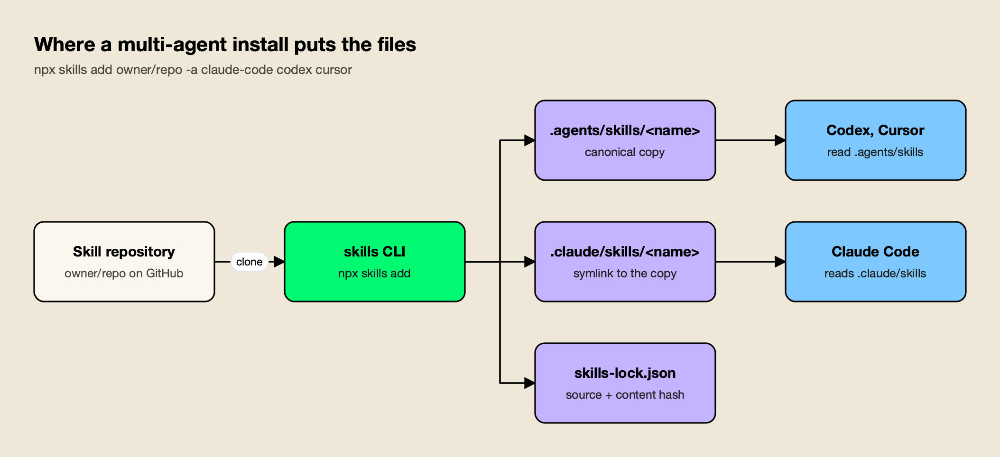
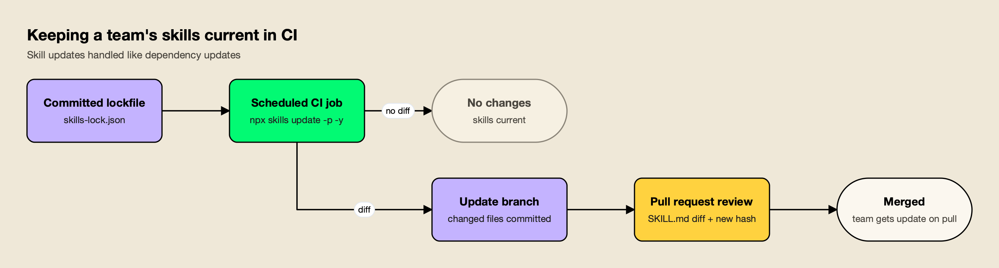

**TL;DR**
- `npx skills` runs the open-source skills CLI, which installs Agent Skills from a git repository into Claude Code, Codex, Cursor, Gemini CLI, OpenCode and other coding agents with one command.
- The core loop is preview, install, pin and update: `npx skills add owner/repo --list`, `npx skills add owner/repo -a claude-code`, commit `skills-lock.json`, then run `npx skills update` on a branch and review the lockfile diff.
- Claude Code reads `.claude/skills/`; Codex, Cursor, Gemini CLI and OpenCode read `.agents/skills/` in a project. Selecting several agents keeps one copy and symlinks the rest.
- Every skill runs with the agent's full permissions, so preview and read a skill before installing it.

`npx skills` is the quickest way to install Agent Skills into a coding agent: one command fetches a skill from a git repository and places it in the directory Claude Code, Codex, Cursor or another agent reads. This guide walks through every step with commands tested on October 28, 2026, using six open-source skills from the build-with-ai-hq organization as worked examples: previewing a repository, installing for one agent or several, choosing project or global scope, pinning versions, checking for updates and removing skills cleanly.

## What npx skills Is

`npx skills` runs the `skills` package from npm, a command-line tool from Vercel Labs for the open Agent Skills ecosystem. It installs, lists, checks, updates and removes skills, and it can scaffold a new `SKILL.md`. Because `npx` downloads and runs the package on demand, nothing needs to be installed globally first.

The [skills CLI README](https://github.com/vercel-labs/skills) states that it supports OpenCode, Claude Code, Codex, Cursor "and 75 more" agents, requires Node.js 22.20 or later, and is MIT licensed. Its companion directory, [skills.sh](https://www.skills.sh/), lists published skills, and each repository can show a skills.sh badge, as the six build-with-ai-hq repositories do.

A skill itself is a folder with a `SKILL.md` file. The [Agent Skills specification](https://agentskills.io/specification) requires YAML frontmatter with a `name` (up to 64 lowercase letters, numbers and hyphens, matching the folder name) and a `description` (up to 1,024 characters on what the skill does and when to use it), followed by Markdown instructions. Optional `scripts/`, `references/` and `assets/` folders hold material the agent loads only when the instructions call for it. Anthropic's [Claude Code skills documentation](https://code.claude.com/docs/en/skills) adds that a skill can trigger automatically when a request matches its description or be invoked directly as `/skill-name`.

The commands this guide covers:

| Command | What it does |
|---|---|
| `npx skills add <source>` | Install skills from a repository, URL or local path |
| `npx skills add <source> --list` | Show the skills in a source without installing |
| `npx skills use <source>@<skill>` | Generate a prompt for one skill without installing it |
| `npx skills list` | List installed skills |
| `npx skills find [query]` | Search for skills |
| `npx skills update [skills...]` | Update installed skills |
| `npx skills remove [skills...]` | Remove installed skills |
| `npx skills init [name]` | Create a new `SKILL.md` template |

## Step 1: Preview a Repository With --list

Preview a repository before installing anything. `npx skills add owner/repo --list` clones the repository, finds every `SKILL.md` in it and prints each skill's name and description, then exits without writing to your project.

```bash
npx skills add build-with-ai-hq/llm-cost-reduction --list
```

Run against [llm-cost-reduction](https://github.com/build-with-ai-hq/llm-cost-reduction), the CLI reported "Found 1 skill" and printed the full description, which begins "Find and cut LLM/AI API spend in applications and agents without breaking quality" and lists the phrases that trigger it, such as "our OpenAI/Anthropic bill spiked" and "route cheap queries to a smaller model". Each build-with-ai-hq repository holds exactly one skill.

Larger collections show why the preview matters. In the same session, `--list` found 20 skills in [Anthropic's skills repository](https://github.com/anthropics/skills) (including `skill-creator`, `mcp-builder`, `webapp-testing` and the `docx`, `pdf`, `pptx` and `xlsx` document skills) and nine in [Vercel's agent-skills repository](https://github.com/vercel-labs/agent-skills). Installing a whole collection loads every description into every session, so pick the skills you need with `--skill`.

## Step 2: Install a Skill for One Agent or Several

`npx skills add owner/repo` installs into the current project by default. Add `-a` to choose agents, `--skill` to choose skills from a multi-skill repository and `-y` to skip prompts. With one agent the CLI copies the files; with several it keeps one canonical copy and symlinks the others to it.

Install a skill for Claude Code only:

```bash
npx skills add build-with-ai-hq/llm-cost-reduction -a claude-code -y
```

In a test run inside a fresh git project, this command cloned the repository, copied the skill to `./.claude/skills/llm-cost-reduction`, wrote a `skills-lock.json` file and ended with the line "Review skills before use; they run with full agent permissions." Claude Code picks the skill up from that folder in the next session.

Install for Codex, Cursor, Gemini CLI or OpenCode the same way:

```bash
npx skills add build-with-ai-hq/secure-llm-apps -a codex -y
```

Each of `-a codex`, `-a cursor`, `-a gemini-cli` and `-a opencode` placed [secure-llm-apps](https://github.com/build-with-ai-hq/secure-llm-apps) in `./.agents/skills/secure-llm-apps`, the shared project directory those agents read.

Install for several agents at once:

```bash
npx skills add build-with-ai-hq/secure-llm-apps -a claude-code codex cursor -y
```

Here the CLI wrote one copy to `./.agents/skills/secure-llm-apps` and created `./.claude/skills/secure-llm-apps` as a symlink to it, so Claude Code, Codex and Cursor share a single source of truth.



*Figure 1: A multi-agent install keeps one copy on disk, so an update reaches every agent at once.*

As Figure 1 shows, the symlink layout is what keeps agents from drifting apart. The CLI's [installation reference](https://github.com/vercel-labs/skills/blob/main/docs/agents.md) lists symlinking as the recommended method and `--copy` as the fallback for file systems that do not support symlinks. To pick individual skills from a collection, name them:

```bash
npx skills add anthropics/skills --skill skill-creator -a claude-code -y
npx skills add vercel-labs/agent-skills --skill vercel-react-best-practices --skill web-design-guidelines
```

`--skill '*'` installs every skill in a repository, `-a '*'` targets every supported agent, and `--all` does both without prompts.

## Step 3: Choose Project or Global Scope

Project scope, the default, installs skills into the repository so the whole team gets them when they clone it. Global scope, with `-g`, installs into your user directory so the skill is available in every project on your machine but nowhere else.

The paths below come from the CLI's agent table and match where Claude Code's own documentation says it looks:

| Agent | `-a` value | Project directory | Global directory (`-g`) |
|---|---|---|---|
| Claude Code | `claude-code` | `.claude/skills/` | `~/.claude/skills/` |
| Codex | `codex` | `.agents/skills/` | `~/.agents/skills/` |
| Cursor | `cursor` | `.agents/skills/` | `~/.cursor/skills/` |
| Gemini CLI | `gemini-cli` | `.agents/skills/` | `~/.gemini/skills/` |
| GitHub Copilot | `github-copilot` | `.agents/skills/` | `~/.copilot/skills/` |
| OpenCode | `opencode` | `.agents/skills/` | `~/.config/opencode/skills/` |

Use project scope for skills the team should share and review, such as security or cost playbooks, and global scope for personal workflow skills:

```bash
npx skills add build-with-ai-hq/agent-skills-for-teams -g -a claude-code -y
```

Claude Code resolves name clashes in a fixed order: according to its documentation, an enterprise-managed skill wins over a personal one, and a personal skill in `~/.claude/skills/` wins over a project skill with the same name. A stale global copy can therefore shadow the team's project skill, which is one of the problems the [agent-skills-for-teams](https://github.com/build-with-ai-hq/agent-skills-for-teams) skill's audit checks for.

## Step 4: Pin Versions With skills-lock.json

Every install writes or updates `skills-lock.json` in the project root. It records where each skill came from and a hash of its contents, so the team can see exactly which version is installed and restore the same set on another machine. Commit it alongside the skill folders.

The file written by the test install looked like this:

```json
{
  "version": 1,
  "skills": {
    "llm-cost-reduction": {
      "source": "build-with-ai-hq/llm-cost-reduction",
      "sourceType": "github",
      "skillPath": "SKILL.md",
      "computedHash": "fb33bcf3b06631070cd0a847209600a4d91147bc30820e2768bcdf128151a8a0"
    }
  }
}
```

The `computedHash` changes whenever the skill's contents change, so a pull request that updates a skill shows the new hash next to the changed instructions. The CLI's experimental `npx skills experimental_install` command restores the project skills recorded in the lockfile; Vercel marks experimental commands as subject to change, so treat it as a convenience rather than a guarantee.

Skills declare their own version too. All six build-with-ai-hq skills carry `license: MIT` and `metadata.version: "1.0.0"` in their frontmatter, the convention the specification suggests for skills that are released and versioned.

## Step 5: List, Update and Remove Skills

`npx skills list` shows the skills installed in the project, and `npx skills ls -g` shows global ones. `npx skills update` pulls the latest version of installed skills, and `npx skills remove` deletes skills from one agent or all of them.

```bash
npx skills list                       # installed project skills (ls -g for global)
npx skills update                     # update everything (prompts for scope)
npx skills update llm-cost-reduction  # update one skill
npx skills update -p -y               # project skills only, no prompt
npx skills remove secure-llm-apps     # remove a skill
npx skills remove --agent cursor secure-llm-apps   # remove from one agent only
```



*Figure 2: Treat skill updates like dependency updates: pulled on a branch, merged through a reviewed pull request.*

Figure 2 shows the pattern that keeps a team's skills current without surprise behavior changes. A scheduled CI job runs `npx skills update -p -y` on a branch and opens a pull request when anything changed, so the diff to `SKILL.md`, the reference files and `skills-lock.json` goes through review like any dependency bump. Changes to instructions change what the agent does, so they deserve the same scrutiny as code.

## Installing the Six build-with-ai-hq Skills

The build-with-ai-hq organization publishes six MIT-licensed skills for teams shipping LLM features and rolling out coding agents. Each lives in its own repository and installs with one command. Every one follows the same structure: a quick diagnosis with shell commands, fixes ordered by impact, a verification section and a list of common mistakes.

| Skill | What it does | Install |
|---|---|---|
| [llm-cost-reduction](https://github.com/build-with-ai-hq/llm-cost-reduction) | Audits LLM call sites, attributes cost per feature, right-sizes models, caps loops, turns on prompt caching and batching | `npx skills add build-with-ai-hq/llm-cost-reduction` |
| [secure-llm-apps](https://github.com/build-with-ai-hq/secure-llm-apps) | Hardens LLM apps against the OWASP Top 10 for LLM Applications, from leaked keys to prompt injection | `npx skills add build-with-ai-hq/secure-llm-apps` |
| [mcp-gateway-best-practices](https://github.com/build-with-ai-hq/mcp-gateway-best-practices) | Audits MCP setups for tool sprawl, context bloat, scattered credentials and missing approvals | `npx skills add build-with-ai-hq/mcp-gateway-best-practices` |
| [llm-observability-stack](https://github.com/build-with-ai-hq/llm-observability-stack) | Sets up per-call records, OpenTelemetry traces, metrics, dashboards and alerts for LLM calls | `npx skills add build-with-ai-hq/llm-observability-stack` |
| [ai-coding-agent-governance](https://github.com/build-with-ai-hq/ai-coding-agent-governance) | Plans a governed rollout of Claude Code, Codex, Cursor and other agents with per-developer budgets | `npx skills add build-with-ai-hq/ai-coding-agent-governance` |
| [agent-skills-for-teams](https://github.com/build-with-ai-hq/agent-skills-for-teams) | Authors, versions, reviews and distributes skills across a team, with a bundled linter | `npx skills add build-with-ai-hq/agent-skills-for-teams` |

To install all six for Claude Code, Codex and Cursor in one pass:

```bash
for s in llm-cost-reduction secure-llm-apps mcp-gateway-best-practices \
         llm-observability-stack ai-coding-agent-governance agent-skills-for-teams; do
  npx skills add "build-with-ai-hq/$s" -a claude-code codex cursor -y
done
```

The `agent-skills-for-teams` skill bundles `scripts/lint_skills.py`, a standard-library Python linter for any directory of skills. Run across the six skills, it reported zero errors and zero warnings. The same linter checks name rules, weak descriptions, oversized bodies, broken links, missing versions, drift between copies and risky script patterns, and exits non-zero on errors, which makes it a natural CI check for the pull requests that skill updates produce.

For a ranked look at these six alongside Anthropic's and Vercel's skills, see this site's list of the [best Claude Code skills](/blog/best-claude-code-skills/).

## Using a Skill Without Installing It

`npx skills use <source>@<skill>` generates a prompt from a single skill without installing it, or launches a supported agent with it. It is useful for trying a skill once before deciding whether it belongs in the repository.

```bash
npx skills use build-with-ai-hq/llm-observability-stack@llm-observability-stack --agent claude-code
```

Omit `--agent` to print the prompt instead of launching an agent. Nothing is written to the project and no lockfile entry is created, so the trial leaves no trace in version control.

## Private Repositories, Other Sources and CI

`npx skills add` accepts more than GitHub shorthand. The CLI reference lists full GitHub URLs, a direct path to one skill inside a repository, GitLab URLs, Azure Repos URLs, any git URL including SSH, a local path and a direct download URL for a single `SKILL.md` or an archive.

```bash
npx skills add https://github.com/vercel-labs/agent-skills/tree/main/skills/web-design-guidelines
npx skills add git@github.com:acme/private-skills.git
npx skills add ./my-local-skills
```

Private repositories use the authentication already configured for the URL: the git credential helper, the GitHub CLI or SSH. `GITHUB_TOKEN` or `GH_TOKEN` can be set explicitly for GitHub API access and update checks. Direct downloads are capped by default at 10 MiB per download, 25 MiB extracted and 1,000 files per archive, limits the CLI lets you raise only through environment variables "when you trust the source".

For CI and scripted setups, combine `-y` with explicit `--skill` and `-a` values so the command never prompts:

```bash
npx skills add build-with-ai-hq/secure-llm-apps --skill secure-llm-apps -a claude-code -y
```

The CLI collects anonymous usage data; set `DISABLE_TELEMETRY=1` or `DO_NOT_TRACK=1` to turn it off, along with its security-audit requests.

## Distributing Skills Across a Team

A shared repository of skills plus `npx skills add` covers most small teams. Larger organizations add a registry so a skill can be published once, versioned immutably and rolled back centrally, and they route the agents that load those skills through a gateway with per-developer budgets.

The `agent-skills-for-teams` skill compares four distribution models: skills committed in each repository, a shared git repository installed with `npx skills add`, a plugin marketplace and a central registry. For the registry option it walks through the open-source [Bifrost Skills Repository](https://docs.getbifrost.ai/features/skills-repository), part of [Bifrost](https://www.getmaxim.ai/bifrost), an [open-source AI gateway](https://github.com/maximhq/bifrost). The docs describe creating skills in a dashboard, publishing immutable SemVer versions and registering the repository as a skills marketplace for Claude Code and Codex.

The same gateway can sit in front of the agents themselves. The `ai-coding-agent-governance` skill uses it as the default for per-developer virtual keys and budgets, following the [CLI agents setup docs](https://docs.getbifrost.ai/cli-agents/overview), and the vendor's [Bifrost CLI announcement](https://www.getmaxim.ai/bifrost/blog/bifrost-cli-v1-0-one-launcher-to-connect-your-coding-agents-to-the-gateway-and-manage-bifrost/) covers a launcher that connects coding agents to the gateway.

Per-agent walkthroughs exist for [Claude Code](https://www.getmaxim.ai/bifrost/blog/integrating-claude-code-with-bifrost-gateway/), [Codex CLI](https://www.getmaxim.ai/bifrost/blog/integrating-codex-cli-with-bifrost-gateway/) and [Gemini CLI](https://www.getmaxim.ai/bifrost/blog/integrating-gemini-cli-with-bifrost-gateway/).

For the wider picture, the vendor's [CLI agents resources](https://www.getmaxim.ai/resources/cli-agents) and [Bifrost CLI resources](https://www.getmaxim.ai/resources/bifrost-cli) collect related guides.

This site's comparisons of [Claude Code gateways](/blog/claude-code-gateways/) and [AI coding agents](/blog/ai-coding-agents/) cover the tools these skills are installed into.

## Security Checklist Before You Run npx skills add

A skill is code and instructions that your agent will follow with its full permissions. Treat installing one like adding a dependency: preview it, read it, prefer clear licenses, pin it and review every update.

- **Preview first.** `npx skills add owner/repo --list` shows what a repository contains without installing anything.
- **Read the instructions and scripts.** Open `SKILL.md`, every file in `scripts/` and anything the instructions tell the agent to run. Run the `lint_skills.py` linter from `agent-skills-for-teams` to flag risky script patterns.
- **Check the license and provenance.** The six build-with-ai-hq skills and the skills CLI are MIT licensed; Anthropic's example skills carry Apache 2.0 terms in each folder.
- **Prefer project scope for shared skills.** Committed skills go through code review; global skills on individual laptops do not.
- **Commit `skills-lock.json`** and review hash changes in pull requests.
- **Gate updates.** Run `npx skills update` on a branch and merge the changes through review.

The [secure-llm-apps](https://github.com/build-with-ai-hq/secure-llm-apps) skill extends the same thinking to the LLM features an agent builds, and the vendor's [AI security resources](https://www.getmaxim.ai/resources/ai-security) cover the gateway controls it recommends.

## Creating Your Own Skill With npx skills init

`npx skills init my-skill` creates a `my-skill/SKILL.md` template; run it without a name to create `SKILL.md` in the current directory. Fill in the `name` and `description` frontmatter, write the instructions, then install it from the local path to test it.

```bash
npx skills init release-notes
npx skills add ./release-notes -a claude-code -y
```

Write the description for the moment the skill should trigger: the specification's guidance is to describe both what the skill does and when to use it, with the keywords a user would actually type. Keep the body under 500 lines and move detail into `references/`, which the agent reads only when needed. Anthropic's [skill-creator](https://github.com/anthropics/skills/tree/main/skills/skill-creator) skill can draft a skill and run evals on it, and `agent-skills-for-teams` adds trigger-rate testing, SemVer and a CI lint once the skill is shared.

## Troubleshooting Common npx skills Problems

Most problems after an install come from four places: the Node.js version, the skill's description, a name clash between scopes, or a session that cannot see the directory the skill was installed into.

- **The command fails before installing anything.** The CLI requires Node.js 22.20 or later. Check with `node --version` and upgrade before retrying.
- **The skill is installed but never triggers.** The agent decides from the `description` field alone. Invoke it directly once (in Claude Code, `/llm-cost-reduction`) to confirm it loads, then rewrite the description with the phrases users actually type. The `agent-skills-for-teams` skill includes a trigger-rate eval for exactly this.
- **An old version of the skill keeps running.** A global copy in `~/.claude/skills/` takes precedence over a project copy with the same name in Claude Code. Compare `npx skills list` (project skills) with `npx skills ls -g` (global skills), then remove the stale one with `npx skills remove --global <name>`.
- **Symlinks break on a shared drive or in a container.** Reinstall with `--copy` so each agent gets an independent copy, and rely on `npx skills update` to keep them in step.
- **A scheduled or cloud session cannot find the skill.** Claude Code's documentation notes that a skill present only in `~/.claude/skills/` on one machine is not available to cloud sessions or cloud scheduled tasks. Commit the skill to the repository's `.claude/skills/` instead, which is what project scope does by default.

## Conclusion

`npx skills` reduces installing an agent skill to one command, and the rest of the CLI handles the work that follows: choosing agents and scope, pinning versions in a lockfile, checking for updates in CI and removing skills cleanly. The commands are simple; the habits around them (preview, read, commit, review) are what make skills safe to share. The six build-with-ai-hq skills are a practical place to start, since each targets a production problem, installs in one line and works across Claude Code, Codex, Cursor and the other agents the CLI supports.
