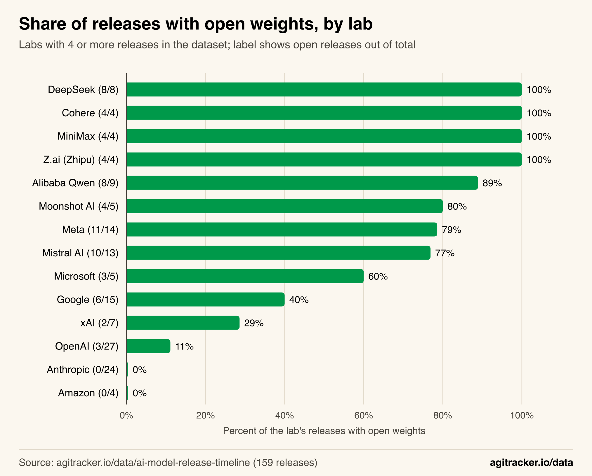
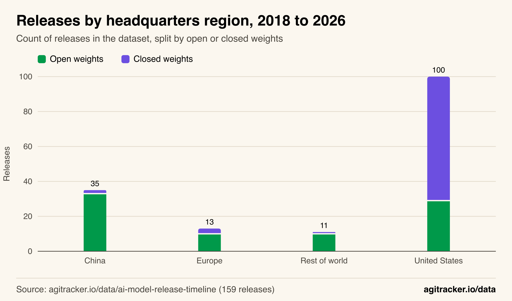
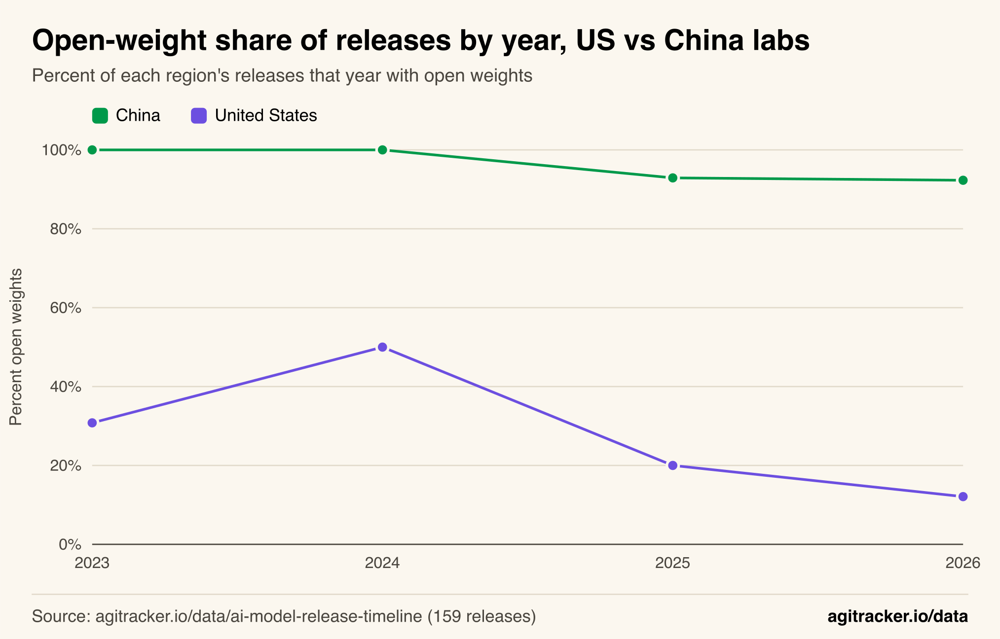
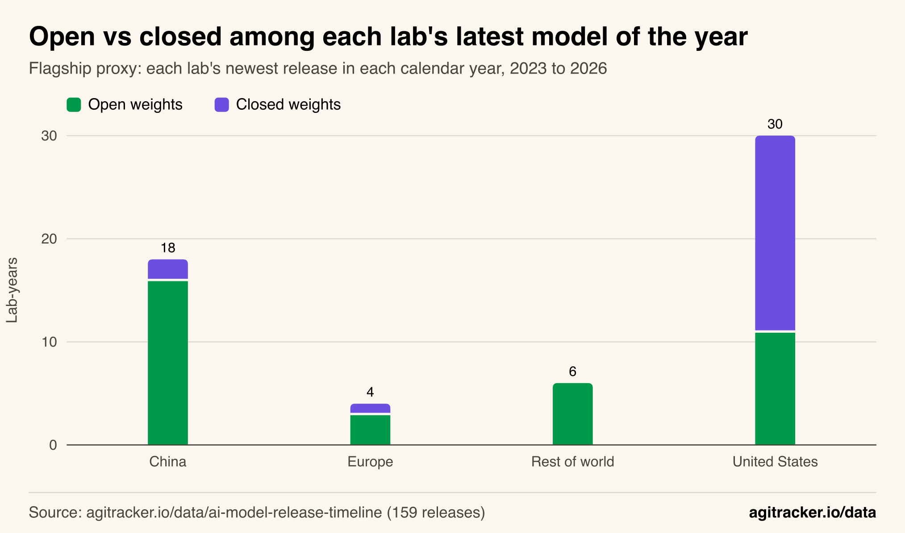

**TL;DR**
- In agitracker.io's dataset of 159 notable LLM releases, Chinese labs published open weights for 33 of 35 releases (94.3%) and US labs for 29 of 100 (29.0%).
- A lab's headquarters region alone correctly predicts whether a release has open weights 78.0% of the time; the release year alone manages 59.7%, barely above the 51.6% from always guessing "open".
- The gap is widening. US labs' open share went from 50% of releases in 2024 to 12% in 2026, while Chinese labs stayed between 92% and 100%.
- When US frontier labs do publish weights, the open model usually ships beside a larger closed sibling: gpt-oss-120b has a third of GPT-5's context window, and Gemma models an eighth to a quarter of Gemini's.
- Meta, the US lab most associated with open weights, released 10 open models before 2026 and then three closed ones in 2026, alongside one large open release.

Whether a new AI model comes with downloadable weights depends far more on where its lab is headquartered than on when it was released. Across the 159 releases in agitracker.io's [AI model release timeline](/data/ai-model-release-timeline/), 94.3% of models from Chinese labs shipped with open weights, compared with 29.0% from US labs, and that gap has grown from 50 percentage points in 2024 to about 80 in 2026. This analysis walks through the numbers, shows each step on charts, and lists every classification so a reader with the public CSV can reproduce it.

The finding sharpens a point this site made in [The open-weight frontier now speaks Mandarin](/blog/china-open-weight-models-2026/): the strongest open models now come mostly from Chinese labs. The data here shows that this is not only a story about a few standout models. It is a consistent difference in how labs in each region release almost everything they build.

## The Release Record by Lab

Open-weight shares sit at the two extremes for most labs, which is the first sign that the decision is a lab-level policy rather than a model-by-model call. Among the 14 labs with four or more releases in the dataset, four (three Chinese, one Canadian) published weights for every release, and two US labs never did.

*Figure 1: Most labs sit near 0% or near 100%; the mixed cases are Meta, Mistral, Microsoft, Google and xAI.*

The labs in the middle are informative. Google's 6 open releases out of 15 are all from its Gemma family or its earlier research models (BERT and T5); none of its Gemini models has open weights. Microsoft's 3 of 5 are its small Phi models, while its two MAI foundation models are closed. Mistral AI publishes most models under Apache 2.0 or research licenses but has kept three releases closed, including its first Mistral Large in 2024.

| Lab | Headquarters | Open / total | Open share |
|---|---|---|---|
| DeepSeek | China | 8 / 8 | 100% |
| MiniMax | China | 4 / 4 | 100% |
| Z.ai (Zhipu) | China | 4 / 4 | 100% |
| Cohere | Canada | 4 / 4 | 100% |
| Alibaba Qwen | China | 8 / 9 | 88.9% |
| Moonshot AI | China | 4 / 5 | 80.0% |
| Meta | United States | 11 / 14 | 78.6% |
| Mistral AI | France | 10 / 13 | 76.9% |
| Microsoft | United States | 3 / 5 | 60.0% |
| Google | United States | 6 / 15 | 40.0% |
| xAI | United States | 2 / 7 | 28.6% |
| OpenAI | United States | 3 / 27 | 11.1% |
| Anthropic | United States | 0 / 24 | 0% |
| Amazon | United States | 0 / 4 | 0% |

OpenAI's three open releases are GPT-1 (2018), GPT-2 (2019) and gpt-oss-120b (2025). Its other 24 releases, from GPT-3 to GPT-6.1 Terra, all kept their weights private. The full rows, with each release's source, are in the [dataset table](/data/ai-model-release-timeline/#data).

## Grouped by Region, the Split Is Stark

Grouping labs by headquarters makes the pattern plain. US labs account for 100 of the 159 releases, and 71 of those are closed. Labs everywhere else account for 59 releases, and 53 of those have open weights.

*Figure 2: Outside the United States, 53 of 59 releases in the dataset shipped with open weights.*

| Region | Open | Closed | Open share |
|---|---|---|---|
| United States | 29 | 71 | 29.0% |
| China | 33 | 2 | 94.3% |
| Europe (France) | 10 | 3 | 76.9% |
| Rest of world (Canada, Israel, UAE, international) | 10 | 1 | 90.9% |

To test whether geography or timing explains more, a simple check helps. For each grouping, predict that every release in a group follows that group's majority (open or closed) and count how many releases that rule gets right. Always guessing "open" is right for 82 of 159 releases (51.6%). Guessing by release year is right for 95 (59.7%). Guessing by headquarters region is right for 124 (78.0%). Guessing by lab is right for 137 (86.2%).

In plain terms: knowing the year a model came out adds little information about whether its weights are public, while knowing the region adds a lot, and knowing the specific lab adds a little more. That supports reading open weights as a policy each lab sets, and those policies cluster by country.

## The Gap Widened After 2024

The divergence is recent. US labs published open weights for half of their releases in 2024, a year that included Llama 3, Llama 3.1 405B, Gemma 2 and Phi-3. Since then the US share has fallen to 20% in 2025 and 12% in 2026, while the Chinese share stayed above 90% every year.

*Figure 3: The US open-weight share fell from 50% in 2024 to 12% in 2026; China's stayed between 92% and 100%.*

| Year | US open / total | US share | China open / total | China share | Gap (points) |
|---|---|---|---|---|---|
| 2023 | 4 / 13 | 30.8% | 2 / 2 | 100% | 69.2 |
| 2024 | 11 / 22 | 50.0% | 6 / 6 | 100% | 50.0 |
| 2025 | 5 / 25 | 20.0% | 13 / 14 | 92.9% | 72.9 |
| 2026 (to Oct) | 4 / 33 | 12.1% | 12 / 13 | 92.3% | 80.2 |

Two things drive the US decline. US labs released more models overall (33 in 2026 so far, against 13 in 2023), and most of the additional releases are closed: of the 29 closed US releases in 2026, 12 came from Anthropic and 8 from OpenAI. The other driver is Meta. Before 2026, every one of Meta's ten releases in the dataset had open weights. In 2026 Meta released Muse Spark, Muse Spark 1.3 and Muse Wonder as closed models, and one large open model, Muse Spark Open.

Meta's own statements track that shift. In July 2024, Mark Zuckerberg wrote that ["Meta is committed to open source AI"](https://about.fb.com/news/2024/07/open-source-ai-is-the-path-forward/). In his July 30, 2025 note on [personal superintelligence](https://www.meta.com/superintelligence/), he wrote that Meta would need to be "careful about what we choose to open source", citing novel safety concerns.

The 2023 Chinese figure rests on only two releases, so the earliest gap is the least reliable point on the chart. The 2025 and 2026 figures rest on 14 and 13 Chinese releases and 25 and 33 US releases.

## Flagship Models Show the Same Pattern

A count of releases treats a small model and a frontier model the same, so a lab that ships many small open models could look more open than it is at the top end. To check, this analysis uses a flagship proxy: each lab's newest release in each calendar year from 2023 to 2026, a stand-in for "the model the lab was leading with at year end". It is a proxy, not a capability ranking; the newest release is not always the strongest.

*Figure 4: Using each lab's newest model per year, US labs were open in 11 of 30 lab-years and Chinese labs in 16 of 18.*

On this measure the US open share is 36.7% (11 of 30 lab-years) and the Chinese share 88.9% (16 of 18). The US figure is higher than its share of all releases because the proxy counts one model per lab per year, so OpenAI's and Anthropic's many closed releases count once a year each. Meta's year-end model was open in four years, Microsoft's and NVIDIA's in two each, and Ai2's, xAI's and Thinking Machines Lab's in one each. xAI's open lab-year shows the proxy's weakness: its newest 2025 release was the Grok 2 weights, a model it had first shipped a year earlier. Among the six US labs that sell frontier models through an API (OpenAI, Anthropic, Google, Microsoft, Amazon and xAI), the newest release in the dataset is closed for all six as of October 29, 2026. Among the ten Chinese labs, the newest release is open for nine; the exception is Moonshot AI's Kimi K3.1 Pro, whose weights Moonshot says [will be released by November 4](https://www.kimi.com/en/blog/kimi-k3-1-pro).

## When US Labs Open Up, They Open a Smaller Model

US frontier labs do publish weights, but in this dataset the open model usually ships next to a larger closed one. Comparing each US open release from 2025 and 2026 with the same lab's closest closed release shows the gap in context window, one of the few specifications the dataset records for both.

| Open release | Date | Context | Nearest closed release | Date | Context |
|---|---|---|---|---|---|
| OpenAI gpt-oss-120b | 2025-08-05 | 131,072 | GPT-5 | 2025-08-07 | 400,000 |
| Google Gemma 3 | 2025-03-12 | 128,000 | Gemini 2.5 Pro | 2025-03-25 | 1,048,576 |
| Google Gemma 4 | 2026-04-02 | 256,000 | Gemini 3.1 Pro | 2026-02-19 | 1,048,576 |
| xAI Grok 2 (open weights) | 2025-08 | not published | Grok 4 | 2025-07-09 | 256,000 |
| Meta Muse Spark Open | 2026-10-15 | 1,000,000 | Muse Wonder | 2026-10-12 | 1,000,000 |

gpt-oss-120b arrived two days before GPT-5 with about a third of its context window; OpenAI's [model card](https://huggingface.co/openai/gpt-oss-120b) describes it as an Apache 2.0 model for reasoning and agentic tasks. Its default system message is indexed in the site's [official system prompts dataset](/data/ai-system-prompts/). Google's Gemma releases carried an eighth to a quarter of the context of the Gemini Pro models released within six weeks of them. xAI's Grok 2 weights, published in August 2025 under the [Grok 2 Community License](https://huggingface.co/xai-org/grok-2), are the weights of a model that xAI first released, closed, in August 2024, a year earlier, by which point Grok 4 was current.

Meta's Muse Spark Open is the exception: it matches Muse Wonder's 1-million-token context and came out three days later, and Meta [describes it](https://research.meta.ai/blog/muse-spark-open) as the most capable US open-weight model to date. It ships under the Muse Model License, which has limited commercial terms.

Chinese labs show the reverse pattern in this dataset: their largest models are usually the open ones. DeepSeek-V4-Pro (1.6 trillion total parameters), Moonshot's Kimi K3 (2.8 trillion), Alibaba's Qwen3.8-Max (2.4 trillion total) and Z.ai's GLM-5.3 all shipped with open weights. The two Chinese closed releases are Alibaba's Qwen3-Max-Preview, which was API-only, and Kimi K3.1 Pro, whose weights are announced but not yet out. Licenses vary here too, from MIT and Apache 2.0 to custom terms, and the [best open source LLMs](/blog/best-open-source-llms/) guide compares them.

## What Labs Say About Their Choices

The dataset records what labs did, not why, and this analysis does not attribute motives. The reasons labs have stated publicly are limited and specific:

- **Meta (2024):** Zuckerberg's [July 2024 letter](https://about.fb.com/news/2024/07/open-source-ai-is-the-path-forward/) argued that open models are good for developers, for Meta and for the world, comparing the situation to Linux.
- **Meta (2025):** the [July 2025 note](https://www.meta.com/superintelligence/) said superintelligence would raise "novel safety concerns" and that Meta would be careful about what it open sources.
- **OpenAI (2025):** the gpt-oss model card emphasizes a permissive Apache 2.0 license "without copyleft restrictions or patent risk".
- **Mistral AI (2026):** Mistral's [model page for Mistral Large 4](https://docs.mistral.ai/models/mistral-large-4-0) already describes it as an open-weight model in public preview, though the dataset counts it as closed until the weights are downloadable.

## How We Did This

**Data.** All figures come from the 159 rows of agitracker.io's [AI model release timeline](/data/ai-model-release-timeline/), downloadable as [CSV](https://agitracker.io/data/ai-model-release-timeline.csv), as published on October 29, 2026. Each row has a `lab`, a `released` date and an `openWeights` field (Yes or No). "Yes" means the trained weights were publicly downloadable for that release, whatever the license; the dataset's own methodology explains how each release was checked against the lab's announcement or model card. The definitions of open weights and open source are discussed in the dataset's section on that topic and in the [Open Source AI Definition](https://opensource.org/ai/open-source-ai-definition).

**Year.** The calendar year of the `released` date. 2026 covers January 1 to October 29.

**Headquarters classification (added for this article).** Each of the 26 labs was assigned a headquarters country and then a region (United States, China, Europe, rest of world):

| Lab | Country | Region | Basis |
|---|---|---|---|
| OpenAI, Anthropic, Google, Meta, Microsoft, Amazon, xAI, NVIDIA | United States | United States | Company headquarters (widely documented) |
| Ai2 | United States | United States | ["a Seattle based non-profit AI research institute"](https://allenai.org/about) |
| Thinking Machines Lab | United States | United States | San Francisco; listed as United States in [/data/biggest-ai-companies/](/data/biggest-ai-companies/) |
| DeepSeek, Moonshot AI | China | China | Listed as China in [/data/biggest-ai-companies/](/data/biggest-ai-companies/) |
| Alibaba Qwen, Baidu, Tencent, ByteDance Seed, Xiaomi | China | China | Parent company headquarters (widely documented) |
| MiniMax | China | China | Chinese AI company, Hong Kong-listed in January 2026 ([CNBC](https://www.cnbc.com/2026/01/09/minimax-hong-kong-ipo-ai-tigers-zhipu.html)) |
| Z.ai (Zhipu) | China | China | [Beijing address](https://www.zhipuai.cn/en) on the company site |
| 01.AI | China | China | ["founded in Beijing in May 2023"](https://www.01.ai/) |
| Mistral AI | France | Europe | Listed as France in [/data/biggest-ai-companies/](/data/biggest-ai-companies/) |
| Cohere | Canada | Rest of world | ["founded in 2019 in Toronto"](https://cohere.com/about) |
| AI21 Labs | Israel | Rest of world | [Terms of use](https://www.ai21.com/terms-of-use/) governed by Israeli law; Tel Aviv headquarters |
| TII (UAE) | United Arab Emirates | Rest of world | Part of the [Abu Dhabi government's](https://www.tii.ae/about-us) Advanced Technology Research Council |
| EleutherAI | International collaboration | Rest of world | A [non-profit AI research lab](https://www.eleuther.ai/about) that incorporated as a research institute in early 2023; no single country assigned |
| BigScience | International collaboration | Rest of world | A multi-institution research workshop that built [BLOOM](https://huggingface.co/bigscience/bloom) |

**Calculations.**
- *Open share* = open releases / all releases in the group.
- *Majority-rule accuracy* = for each group, take the larger of (open count, closed count); sum across groups; divide by 159. Groups are release year, region, or lab. The baseline treats all 159 releases as one group.
- *Flagship proxy* = for each lab and each year from 2023 to 2026, the release with the latest `released` date. 58 lab-years result (30 US, 18 China, 4 Europe, 6 rest of world).
- *Nearest closed release* = for each US open release from 2025 and 2026, the same lab's closed release with the smallest absolute difference in release date. Month-only dates are treated as the 15th.

## Limitations

- **Curated, not complete.** The dataset lists 159 notable releases chosen for coverage of major labs, not every model. US labs make up 100 of the rows, partly because they release more and partly because releases are counted per announced model, and families with many sizes count once.
- **Small samples in places.** China had 2 releases in 2023, Europe 2 to 4 per year, and several labs only one release. Shares for those groups move a lot with a single model.
- **Open weights is a binary here.** A Llama Community License, a CC-BY-NC license and Apache 2.0 all count as "open". Training data is rarely published by any lab, so none of this measures openness in the Open Source AI Definition sense.
- **Announced releases.** Kimi K3.1 Pro and Mistral Large 4 count as closed because their weights were not downloadable on October 29, 2026. If both ship as announced, China's 2026 share becomes 13 of 13 and Europe's 3 of 3; the US-China gap would widen slightly, not narrow.
- **Region is a proxy.** Headquarters does not capture where research staff sit, who funds a lab, or export rules that apply to a release. The analysis shows that open-weight policy clusters by headquarters, not why.

## The Takeaway

On the evidence of 159 releases, open weights are a regional norm more than a trend that rises or falls with time. Nearly every Chinese lab publishes the weights of nearly everything it builds, including its largest models, while US frontier labs publish selectively and usually below their flagship. The US open share has fallen for two years running, and Meta's move to closed frontier models in 2026 removed the main US counterweight, even as it shipped one large open model. For teams choosing [local LLM tools](/blog/local-llm-tools/) or planning deployments around models like [DeepSeek V4](/blog/deepseek-v4/), the practical implication is that the open-weight options at the top of the capability range will most likely continue to come from Chinese labs. The underlying data, updated as new models ship, is in the [release timeline dataset](/data/ai-model-release-timeline/).
