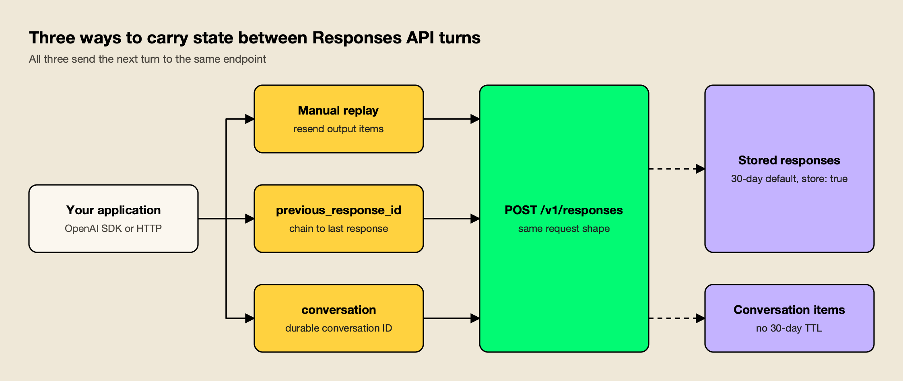
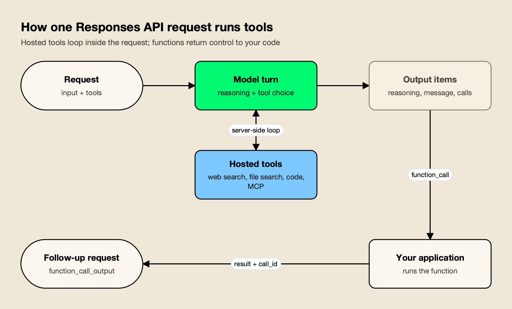
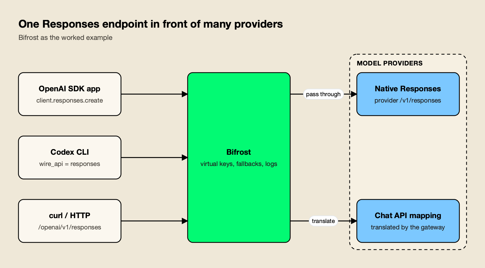

**TL;DR**
- The OpenAI Responses API (`POST /v1/responses`) is OpenAI's recommended interface for new projects. It takes `input` items and returns a typed `output` array: reasoning, messages, tool calls and results.
- State is optional: replay output items yourself, chain turns with `previous_response_id`, or attach turns to a durable conversation object. Stored responses are kept for 30 days by default, and earlier input tokens in a chain are still billed on every turn.
- Hosted tools (web search, file search, code interpreter, remote MCP servers, computer use) run inside one request, while your own functions return a `function_call` item that you answer with a matching `call_id`.
- There is no separate API fee. Cost comes from model tokens (reasoning bills as output), tool calls, containers and storage; OpenAI reports 40% to 80% better cache utilization than Chat Completions.
- Azure, xAI and DeepSeek serve Responses-compatible endpoints, the Open Responses specification standardizes the format, and gateways translate it for chat-only providers.

The OpenAI Responses API is the interface OpenAI now recommends for every new integration, and in 2026 it stopped being optional for some workloads: tool calling on GPT-6 Astra and GPT-6.1 Sol runs only through Responses, and the Assistants API it replaced was shut down on August 26, 2026. This guide covers how the OpenAI Responses API differs from Chat Completions, what requests and responses look like in Python and curl, how conversation state and storage work, the built-in tools, function calling, streaming events, reasoning items, what changes on the bill, a migration checklist, and how to run the same request format against other providers.

## OpenAI Responses API at a Glance

The OpenAI Responses API is a stateful-capable endpoint for generating model output that accepts text, images and files as input items, can run built-in and custom tools within a single request, and returns a list of typed output items rather than a single message. It is served at `POST /v1/responses`.

OpenAI's [migration guide](https://developers.openai.com/api/docs/guides/migrate-to-responses#:~:text=While%20Chat%20Completions%20remains%20supported%2C%20Responses%20is%20recommended%20for%20all%20new%20projects) states the position plainly: while Chat Completions remains supported, Responses is recommended for all new projects. The API launched in March 2025, and OpenAI's [deprecations page](https://developers.openai.com/api/docs/deprecations#:~:text=When%20we%20released%20the%20Responses%20API%20in%20March%202025) records that it announced the plan to fold Assistants features into it at the same time.

The current model lineup is built around it. OpenAI's [models page](https://developers.openai.com/api/docs/models#:~:text=our%20flagship%20model%20for%20complex%20reasoning%20and%20coding) names GPT-6 Astra as the flagship for complex reasoning and coding, GPT-6.1 Sol to balance cost and GPT-6 Luna for high-volume work. For GPT-6.1 Sol, the [GPT-6 guide](https://developers.openai.com/api/docs/guides/latest-model#:~:text=Use%20the%20Responses%20API%20for%20tool%20calling.%20Chat%20Completions%20supports%20requests%20without%20tools) says to use the Responses API for tool calling, because Chat Completions supports requests without tools only.

| | Chat Completions | Responses API |
|---|---|---|
| Endpoint | `POST /v1/chat/completions` | `POST /v1/responses` |
| Input | `messages` array | `input` (string or item list) plus top-level `instructions` |
| Output | `choices[].message` | `output[]` of typed items, plus `output_text` helper in SDKs |
| Multiple candidates | `n` parameter | One generation per request |
| Conversation state | Client resends history | Manual replay, `previous_response_id` or Conversations API |
| Hosted tools | Not available natively | Web search, file search, code interpreter, remote MCP, computer use and more |
| Structured Outputs | `response_format` | `text.format` |
| Streaming | Chunks with `delta` | Typed semantic events |
| Function strictness | Non-strict by default | Strict by default where the schema allows |

## Chat Completions vs Responses API

The core difference between Chat Completions and the Responses API is the unit of context. Chat Completions passes messages; Responses passes items, where a message is one type alongside reasoning, function calls, function outputs and hosted tool calls. That lets one request run several tools and carry reasoning between turns.

The practical consequences: the Responses API drops the `n` parameter, so [it returns only one generation](https://developers.openai.com/api/docs/guides/migrate-to-responses#:~:text=The%20Responses%20API%20omits%20this%20parameter) per request. Structured Outputs moved from `response_format` to `text.format`. Function definitions are internally tagged rather than nested under a `function` key, and [in Chat Completions, functions are non-strict by default](https://developers.openai.com/api/docs/guides/migrate-to-responses#:~:text=In%20Chat%20Completions%2C%20functions%20are%20non%2Dstrict%20by%20default), whereas Responses attempts strict mode when `strict` is omitted.

Reasoning models widen the gap. [Starting with GPT-5.4, Chat Completions does not support tool calling](https://developers.openai.com/api/docs/guides/migrate-to-responses#:~:text=Starting%20with%20GPT%2D5.4%2C%20Chat%20Completions%20does%20not%20support%20tool%20calling) with any reasoning effort other than `none`. OpenAI also claims a quality difference: its [internal evals reveal a 3% improvement in SWE-bench](https://developers.openai.com/api/docs/guides/migrate-to-responses#:~:text=Our%20internal%20evals%20reveal%20a%203%25%20improvement%20in%20SWE%2Dbench) with the same prompt and setup on Responses.

Chat Completions still fits an existing integration with no tools, code that depends on `n`, or a provider that only implements the chat format.

## Request and Response Shape

A minimal Responses API request needs only `model` and `input`. System guidance goes into a top-level `instructions` field, and the response is an object with an `id`, a `status` and an `output` array; SDKs add `output_text`, which joins the text of every message item.

In Python, with the official SDK:

```python
from openai import OpenAI

client = OpenAI()

response = client.responses.create(
    model="gpt-6.1-sol",
    instructions="You are a concise technical assistant.",
    input="Explain what an idempotency key is in two sentences.",
)

print(response.id)
print(response.output_text)
```

The same request with curl:

```bash
curl https://api.openai.com/v1/responses \
  -H "Content-Type: application/json" \
  -H "Authorization: Bearer $OPENAI_API_KEY" \
  -d '{
    "model": "gpt-6.1-sol",
    "instructions": "You are a concise technical assistant.",
    "input": "Explain what an idempotency key is in two sentences."
  }'
```

Most migration bugs come from the response body. A reasoning model usually returns a `reasoning` item first and a `message` item second, so code that reads `output[0]` as the answer gets the reasoning item. Use `output_text` when you only need text, and branch on each item's `type` when the flow uses tools or reasoning.

Text-only `messages` arrays can also be passed straight into `input`, so a first migration step can be as small as changing the method name.

## Conversation State: previous_response_id, Conversations and store

The Responses API gives three ways to carry context between turns: replay the previous `output` items yourself, pass `previous_response_id` so OpenAI loads the prior turn, or attach every turn to a Conversations API object with a durable ID. None of them makes earlier context free.



*Figure 1: Chaining and conversations move storage to OpenAI, but every earlier input token in the chain is still billed on each turn.*

As Figure 1 shows, the options differ in who stores what:

- **Manual replay.** Append the previous response's `output` items to the next `input`. This is the only option that works under Zero Data Retention and with providers that do not store responses.
- **`previous_response_id`.** Reference the last response and send only the new input. OpenAI's migration guide warns that this does not carry over the previous response's top-level `instructions`, so resend them on every request.
- **Conversations API.** Create a conversation once and pass it on each request. The [conversation state guide](https://developers.openai.com/api/docs/guides/conversation-state#:~:text=persist%20conversation%20state%20as%20a%20long%2Drunning%20object) describes it as a way to persist conversation state as a long-running object with its own durable identifier.

```python
first = client.responses.create(model="gpt-6.1-sol", input="Name three SQL isolation levels.")
second = client.responses.create(
    model="gpt-6.1-sol",
    previous_response_id=first.id,
    input="Which one prevents phantom reads?",
)


conversation = client.conversations.create()
reply = client.responses.create(
    model="gpt-6.1-sol",
    conversation=conversation.id,
    input="Name three SQL isolation levels.",
)
```

### Storage, Retention and store: false

[Responses are stored by default](https://developers.openai.com/api/docs/guides/migrate-to-responses#:~:text=Responses%20are%20stored%20by%20default); Chat Completions are too, but only for new accounts. OpenAI's documentation says [response objects are saved for 30 days by default](https://developers.openai.com/api/docs/guides/conversation-state#:~:text=Response%20objects%20are%20saved%20for%2030%20days%20by%20default), while [conversation objects and items in them are not subject to the 30 day TTL](https://developers.openai.com/api/docs/guides/conversation-state#:~:text=Conversation%20objects%20and%20items%20in%20them%20are%20not%20subject%20to%20the%2030%20day%20TTL). Set `store: false` to opt out.

Opting out does not mean losing reasoning continuity. For stateless and Zero Data Retention use, [OpenAI offers encrypted reasoning items](https://developers.openai.com/api/docs/guides/migrate-to-responses#:~:text=OpenAI%20offers%20encrypted%20reasoning%20items): the API returns reasoning in an opaque `encrypted_content` field, you replay it on the next request, and OpenAI decrypts it in memory and discards it. Data-residency trade-offs are covered in agitracker's explainer on [sovereign AI](/blog/what-is-sovereign-ai/).

## Built-in Tools: Web Search, File Search, Code Interpreter, MCP and Computer Use

Built-in tools are OpenAI-hosted capabilities that you enable in the `tools` array and that run on OpenAI's side within the same request. The [tools guide](https://developers.openai.com/api/docs/guides/tools#:~:text=These%20enable%20the%20model%20to%20search%20the%20web) lists web search, file search, tool search, remote MCP servers, computer use, code execution and image generation, alongside your own function definitions.

| Tool | `type` value | What it does | Billing (OpenAI pricing page) |
|---|---|---|---|
| Web search | `web_search` | Searches the web and returns answers with citations | $10 per 1,000 calls plus search content tokens at model rates |
| File search | `file_search` | Retrieves from your vector stores with semantic and keyword search | $2.50 per 1,000 calls; storage $0.10 per GB per day after 1 GB free |
| Code interpreter | `code_interpreter` | Runs Python in a sandboxed container | Per 20-minute container session, from $0.03 (1 GB) to $1.92 (64 GB) |
| Remote MCP | `mcp` | Calls tools on a remote or tunneled MCP server | Model tokens only |
| Computer use | `computer` | Operates a browser or desktop through screenshots and actions | Model tokens only |

OpenAI's own one-line definitions:

- **Web search** [allows models to access up-to-date information from the internet](https://developers.openai.com/api/docs/guides/tools-web-search#:~:text=Web%20search%20allows%20models%20to%20access%20up%2Dto%2Ddate%20information) and provide answers with sourced citations.
- **File search** lets models [retrieve information in a knowledge base of previously uploaded files](https://developers.openai.com/api/docs/guides/tools-file-search#:~:text=retrieve%20information%20in%20a%20knowledge%20base%20of%20previously%20uploaded%20files) stored in vector stores.
- **Code interpreter** [allows models to write and run Python code in a sandboxed environment](https://developers.openai.com/api/docs/guides/tools-code-interpreter#:~:text=allows%20models%20to%20write%20and%20run%20Python%20code%20in%20a%20sandboxed%20environment), using a container you create or one created automatically.
- **Remote MCP** servers [can be any server on the public Internet](https://developers.openai.com/api/docs/guides/tools-connectors-mcp#:~:text=can%20be%20any%20server%20on%20the%20public%20Internet) that implements the Model Context Protocol, and a Secure MCP Tunnel covers private servers.
- **Computer use** [lets a model operate a browser or desktop interface](https://developers.openai.com/api/docs/guides/tools-computer-use#:~:text=Computer%20use%20lets%20a%20model%20operate%20a%20browser%20or%20desktop%20interface), with your application supplying the driver that takes each action.

A request that combines web search with a remote MCP server looks like this:

```python
response = client.responses.create(
    model="gpt-6.1-sol",
    tools=[
        {"type": "web_search"},
        {
            "type": "mcp",
            "server_label": "openai_docs",
            "server_url": "https://developers.openai.com/mcp",
            "require_approval": "never",
        },
    ],
    input="Find the current Responses API streaming event names and cite sources.",
)
```



*Figure 2: Hosted tools finish inside a single request, while a function call always costs a second request carrying the matching call_id.*

Figure 2 is the mental model to keep: hosted tools loop on the server, so one request can search, read files and call MCP tools before answering. Remote MCP calls [can either be allowed automatically, or restricted with explicit approval](https://developers.openai.com/api/docs/guides/tools-connectors-mcp#:~:text=These%20tool%20calls%20can%20either%20be%20allowed%20automatically), and approval matters because a remote server sees whatever the model sends it. 

The risks are covered in agitracker's guide to [MCP server security](/blog/mcp-server-security/), and the layering with agent-to-agent protocols in [A2A vs MCP](/blog/a2a-vs-mcp/). A longer treatment of putting tool traffic behind a control point is in [enterprise MCP governance for AI agents](https://www.getmaxim.ai/bifrost/blog/enterprise-mcp-governance-access-audit-and-cost-controls-for-ai-agents-2/).

## OpenAI Function Calling in the Responses API

OpenAI function calling in the Responses API works as a two-request loop: the model returns a `function_call` item with a `call_id` and JSON arguments, your code runs the function, and you send back a `function_call_output` item with the same `call_id`. The model then answers or calls more tools.

The [function calling guide](https://developers.openai.com/api/docs/guides/function-calling#:~:text=The%20tool%20calling%20flow%20has%20five%20high%20level%20steps) breaks this into five steps, and the migration guide adds the rule that trips most ports: in Responses, [tool calls and their outputs are two distinct types of Items](https://developers.openai.com/api/docs/guides/migrate-to-responses#:~:text=tool%20calls%20and%20their%20outputs%20are%20two%20distinct%20types%20of%20Items) correlated by `call_id`, not a single assistant message with a `tool_calls` array.

```python
import json

tools = [{
    "type": "function",
    "name": "get_order_status",
    "parameters": {
        "type": "object",
        "properties": {"order_id": {"type": "string"}},
        "required": ["order_id"],
        "additionalProperties": False,
    },
}]

first = client.responses.create(
    model="gpt-6.1-sol", tools=tools, input="Where is order A-1042?"
)

follow_up = []
for item in first.output:
    if item.type == "function_call":
        args = json.loads(item.arguments)
        result = {"order_id": args["order_id"], "status": "shipped"}  # your code
        follow_up.append({
            "type": "function_call_output",
            "call_id": item.call_id,
            "output": json.dumps(result),
        })

final = client.responses.create(
    model="gpt-6.1-sol",
    tools=tools,
    previous_response_id=first.id,
    input=follow_up,
)
print(final.output_text)
```

With reasoning models and manual state, pass back every reasoning, function call and function output item since the last user message. The definition above is also flat (`name` at the top level); a Chat Completions definition nested under `"function"` will not validate.

## Streaming Events

Streaming in the Responses API uses typed server-sent events instead of the anonymous `delta` chunks of Chat Completions. Each event carries a `type` such as `response.created`, `response.output_text.delta` or `response.completed`, so a client subscribes to the events it needs and ignores the rest.

OpenAI's [streaming guide](https://developers.openai.com/api/docs/guides/streaming-responses#:~:text=The%20Responses%20API%20uses%20semantic%20events%20for%20streaming) describes this as semantic events with a predefined schema per type. The migration guide's point is that [Responses streaming uses typed server-sent events](https://developers.openai.com/api/docs/guides/migrate-to-responses#:~:text=Responses%20streaming%20uses%20typed%20server%2Dsent%20events), so old chunk handlers have to be rewritten rather than repointed.

```python
stream = client.responses.create(
    model="gpt-6.1-sol",
    input="Write a haiku about rate limits.",
    stream=True,
)

for event in stream:
    if event.type == "response.output_text.delta":
        print(event.delta, end="", flush=True)
    elif event.type == "response.function_call_arguments.done":
        print("\n[tool call]", event.arguments)
    elif event.type == "response.completed":
        print("\nusage:", event.response.usage)
```

The core text events are `response.created`, `response.output_text.delta`, `response.completed` and `error`. Function calls add `response.function_call_arguments.delta` and `.done`. Background jobs can also stream and resume from a `sequence_number` cursor after a disconnect.

## Reasoning Items, Effort and Background Mode

Reasoning items are the Responses API's container for a reasoning model's hidden thinking. The raw reasoning is never returned; instead the API returns an item that can be passed back on the next turn, optionally with a readable summary or, in stateless mode, an encrypted payload. Effort is set per request with `reasoning.effort`.

Three facts from OpenAI's [reasoning guide](https://developers.openai.com/api/docs/guides/reasoning#:~:text=While%20reasoning%20tokens%20are%20not%20visible%20via%20the%20API,billed%20as%20output) drive cost and reliability:

- **Reasoning tokens are billed as output.** They are not visible via the API, but they occupy context and are billed as output tokens.
- **Budget for them.** OpenAI [recommends reserving at least 25,000 tokens](https://developers.openai.com/api/docs/guides/reasoning#:~:text=OpenAI%20recommends%20reserving%20at%20least%2025%2C000%20tokens) for reasoning and outputs when you start; a response that hits `max_output_tokens` during reasoning returns `incomplete` with no visible text but still bills for the tokens used.
- **Summaries are opt-in.** A reasoning summary [will not be included unless you explicitly opt in](https://developers.openai.com/api/docs/guides/reasoning#:~:text=will%20not%20be%20included%20unless%20you%20explicitly%20opt%20in) through `reasoning.summary`.

Effort values are model-dependent, ranging from `none` through `max`. According to the reasoning guide, [GPT-6.1 Sol, GPT-6 Sol, and GPT-6 Luna also default](https://developers.openai.com/api/docs/guides/reasoning#:~:text=GPT%2D6.1%20Sol%2C%20GPT%2D6%20Sol%2C%20and%20GPT%2D6%20Luna%20also%20default) to `medium`, and GPT-6 Astra and GPT-6.1 Sol do not accept `none`. In stateless mode, reasoning items [include an encrypted_content property by default](https://developers.openai.com/api/docs/guides/reasoning#:~:text=include%20an%20encrypted_content%20property%20by%20default), so replaying the full `output` array keeps the chain intact.

For work that runs for minutes, set `background: true`. OpenAI's [background mode guide](https://developers.openai.com/api/docs/guides/background#:~:text=Background%20mode%20kicks%20off%20these%20tasks%20asynchronously) says it kicks off tasks asynchronously so developers can poll the response object until it leaves the `queued` or `in_progress` state, and cancel it if needed. For Zero Data Retention projects, background response data is [temporarily stored to disk for roughly 10 minutes](https://developers.openai.com/api/docs/guides/background#:~:text=temporarily%20stored%20to%20disk%20for%20roughly%2010%20minutes) to make polling possible.

## Responses API Pricing and Cost Implications

The Responses API has no separate access fee: a request is billed for the model's input, cached input and output tokens, plus any built-in tool calls, containers and storage it uses. The format still changes the bill, because state, caching, tools and reasoning all behave differently from Chat Completions.

Standard rates per million tokens on OpenAI's [pricing page](https://developers.openai.com/api/docs/pricing) for the current lineup:

| Model | Input | Cached input | Output |
|---|---|---|---|
| GPT-6 Astra | $10.00 | $1.00 | $50.00 |
| GPT-6.1 Sol | $2.00 | $0.10 | $10.00 |
| GPT-6 Luna | $0.10 | $0.01 | $0.50 |

Long-context prompts cost more, and Batch and Flex cost half. The detail behind the Sol and Luna price cuts is in agitracker's [GPT-6 pricing analysis](/blog/gpt-6-pricing/). The Responses-specific cost effects are:

- **Chaining is not free.** Even with `previous_response_id`, [all previous input tokens for responses in the chain are billed](https://developers.openai.com/api/docs/guides/migrate-to-responses#:~:text=all%20previous%20input%20tokens%20for%20responses%20in%20the%20chain%20are%20billed) as input tokens. Long conversations need compaction or trimming either way.
- **Caching improves.** OpenAI attributes lower costs to [improved cache utilization (40% to 80% improvement](https://developers.openai.com/api/docs/guides/migrate-to-responses#:~:text=improved%20cache%20utilization%20%2840%25%20to%2080%25%20improvement) versus Chat Completions in internal tests). In the Responses API, [you can choose a 12-hour minimum lifetime](https://developers.openai.com/api/docs/guides/prompt-caching#:~:text=In%20the%20Responses%20API%2C%20you%20can%20choose%20a%2012%2Dhour%20minimum%20lifetime) for cached prefixes at a higher write rate.
- **Tools add line items.** [Tokens used for built-in tools are billed at the chosen model](https://developers.openai.com/api/docs/pricing#:~:text=Tokens%20used%20for%20built%2Din%20tools%20are%20billed%20at%20the%20chosen%20model)'s rates on top of per-call fees, and [file search tool call pricing applies to the Responses API only](https://developers.openai.com/api/docs/pricing#:~:text=File%20search%20tool%20call%20pricing%20applies%20to%20the%20Responses%20API%20only).
- **Reasoning is output.** Output costs five times input on all three GPT-6 tiers, so effort settings often matter more than the per-token price.

Because the provider dashboard reports one number per organization, teams usually add attribution of their own. A primer on [monitoring LLM API costs in production](https://www.getmaxim.ai/articles/how-to-monitor-llm-api-costs-in-production/#:~:text=Native%20provider%20dashboards%20give%20you%20a%20single%20number%20per%20month) explains why native provider dashboards give a single number per month, and a separate guide on [cutting LLM token costs](https://www.getmaxim.ai/articles/how-to-cut-llm-api-and-token-costs-in-2026/#:~:text=Output%20tokens%20are%20priced%20three%20to%20eight%20times%20higher) covers output-heavy workloads.

## Migration Checklist from Chat Completions and the Assistants API

Migrating to the Responses API is three changes: send requests to `/v1/responses`, read output from the typed `output` array, and decide how each flow carries state. Because [Chat Completions remains supported, you can migrate one user flow at a time](https://developers.openai.com/api/docs/guides/migrate-to-responses#:~:text=Chat%20Completions%20remains%20supported%2C%20so%20you%20can%20migrate%20one%20user%20flow), starting with plain text generation.

A working checklist, adapted from OpenAI's rollout list and common errors:

1. **Endpoint and body.** Change `chat.completions.create` to `responses.create` and `messages` to `input`; move the system prompt into `instructions`.
2. **Output handling.** Replace `choices[0].message.content` with `output_text`, or iterate `output` by `type`.
3. **State.** Pick manual replay, `previous_response_id` or a conversation per flow, and resend `instructions` on chained turns.
4. **Storage.** Add `store: false` where data must not persist, and replay encrypted reasoning items.
5. **Functions.** Flatten definitions, decide on `strict`, and return every result with its matching `call_id`.
6. **Structured Outputs.** [Structured Outputs definitions have moved from](https://developers.openai.com/api/docs/guides/migrate-to-responses#:~:text=Structured%20Outputs%20definitions%20have%20moved%20from) `response_format` to `text.format`.
7. **Streaming.** Rewrite stream consumers to switch on event `type`.
8. **Hosted tools.** Replace home-grown search or code execution where OpenAI's tools fit.
9. **Compare.** Check behavior, latency, tokens and errors before shifting traffic.

### OpenAI Assistants API Sunset

For OpenAI Assistants API users the migration is no longer optional. OpenAI's [Assistants migration guide](https://developers.openai.com/api/docs/assistants/migration#:~:text=The%20Assistants%20API%20was%20officially%20sunset%20on%20August%2026%2C%202026) states that the Assistants API was officially sunset on August 26, 2026, and is no longer available. The mapping is direct: assistants become prompts (versioned in the dashboard), threads become conversations that store any item type, and runs become responses. Any integration still calling `/v1/assistants` or `/v1/threads` has been failing since late August.

## Open Responses and Multi-Provider Portability

The Responses format is no longer OpenAI-only. Open Responses is an open specification derived from the OpenAI Responses API, and several providers now serve Responses-compatible endpoints directly. Compatibility is partial, though: stateless request and response shapes travel well, while stored state, hosted tools and background mode often do not.

The [Open Responses project](https://www.openresponses.org/#:~:text=an%20open%2Dsource%20specification%20and%20ecosystem%20for%20building%20multi%2Dprovider) describes itself as an open-source specification and ecosystem for building multi-provider, interoperable LLM interfaces based on the OpenAI Responses API. Its [specification](https://www.openresponses.org/specification#:~:text=Internally%20hosted%20tools%20are%20ones%20where%20the%20implementation%20lives%20inside) separates externally hosted tools (functions and MCP) from internally hosted ones that live inside the provider's system, and it lets [providers choose never to expose raw reasoning](https://www.openresponses.org/specification#:~:text=Providers%20MAY%20choose%20to%20never%20expose%20raw%20reasoning), returning an opaque encrypted payload instead.

Provider support as documented in October 2026:

| Provider | Responses support | State (`previous_response_id`, `store`) | Notes |
|---|---|---|---|
| OpenAI | Native, reference implementation | Yes; 30-day default storage | Full hosted tool set |
| Azure OpenAI | Native | Yes | Entra ID or API key auth |
| xAI | Native, recommended API | Yes; 30-day storage | Chat Completions labeled legacy |
| DeepSeek | Native since V4 | No; stateless only | Function calls; web search on V4-Pro |

Microsoft's [Azure documentation](https://learn.microsoft.com/en-us/azure/foundry/openai/how-to/responses#:~:text=Use%20the%20Azure%20OpenAI%20Responses%20API%20to%20generate%20stateful%2C%20multi%2Dturn%20responses) says to use the Azure OpenAI Responses API to generate stateful, multi-turn responses. xAI, whose documentation now carries the SpaceXSI name, says [the Responses API is the recommended way to interact with SpaceXSI models](https://docs.x.ai/developers/model-capabilities/text/comparison#:~:text=The%20Responses%20API%20is%20the%20recommended%20way%20to%20interact%20with%20SpaceXSI%20models), and that [the responses will be stored for 30 days](https://docs.x.ai/developers/model-capabilities/text/generate-text#:~:text=The%20responses%20will%20be%20stored%20for%2030%20days) by default.

DeepSeek's [change log](https://api-docs.deepseek.com/updates#:~:text=The%20DeepSeek%20API%20now%20natively%20supports%20the%20OpenAI%20Responses%20API%20format) says the DeepSeek API now natively supports the OpenAI Responses API format, adapted for Codex. Its [compatibility notes](https://api-docs.deepseek.com/guides/responses_api#:~:text=Fields%20that%20depend%20on%20unsupported%20capabilities%20always%20take%20fixed%20values) list `previous_response_id`, `conversation`, `store` and `background` as unsupported, and fields that depend on unsupported capabilities always take fixed values such as `store: false`. Code that relies on server-side chaining breaks against it; code that replays items does not.

The model side is covered in agitracker's [DeepSeek V4 explainer](/blog/deepseek-v4/) and the companion [DeepSeek API guide](/blog/deepseek-api/).

The portable subset is therefore clear: `input` items, `instructions`, function tools with `call_id` round-trips, streaming text events and client-side state. Anything beyond that needs either a provider that implements it or a translation layer.

## Running the Responses API Across Providers Through a Gateway

A gateway lets one Responses-format client reach providers that implement the format natively and providers that only speak a chat API. The gateway accepts `/v1/responses`, picks the provider from the model name, and either forwards the call or translates it, while adding keys, budgets, fallbacks and logs in one place.

This is the [OpenAI-compatible API](https://www.getmaxim.ai/articles/top-5-llm-gateways-with-an-openai-compatible-api-in-2026/#:~:text=Endpoint%20coverage%20differs%20sharply) pattern applied to Responses, and endpoint coverage differs sharply between gateways. Three approaches with documented Responses support:

- **LiteLLM.** The proxy states that [LiteLLM provides an endpoint in the spec of](https://docs.litellm.ai/docs/response_api#:~:text=LiteLLM%20provides%20an%20endpoint%20in%20the%20spec%20of) OpenAI's `/responses` API. For OpenAI-compatible providers without their own Responses support, it [bridges /v1/responses through /v1/chat/completions](https://docs.litellm.ai/docs/response_api#:~:text=bridges%20%2Fv1%2Fresponses%20through%20%2Fv1%2Fchat%2Fcompletions). It is Python-based and widely deployed; teams weighing a move are covered in agitracker's [LiteLLM alternatives](/blog/litellm-alternatives/) comparison.
- **Vercel AI Gateway.** A managed option: [point your OpenAI SDK to AI Gateway](https://vercel.com/docs/ai-gateway/sdks-and-apis/responses#:~:text=Point%20your%20OpenAI%20SDK%20to%20AI%20Gateway)'s base URL and use `provider/model` identifiers to route Responses requests to OpenAI, Anthropic, Google and others. Vercel also states that [AI Gateway supports the OpenResponses API specification](https://vercel.com/docs/ai-gateway/sdks-and-apis/openresponses#:~:text=AI%20Gateway%20supports%20the%20OpenResponses%20API%20specification).
- **Bifrost.** An open-source, self-hosted gateway, covered in the worked example below because its documentation spells out how Responses requests are handled for each provider.

When comparing any of them, check the provider list, which Responses fields survive translation, and where the gateway runs. agitracker's comparison of [AI gateways for Anthropic, OpenAI and Gemini](/blog/ai-gateways-for-anthropic-openai-gemini/) covers reasoning translation, and a comparison of [multi-provider AI gateways for OpenAI, Anthropic and Bedrock](https://www.getmaxim.ai/articles/top-multi-provider-ai-gateways-for-openai-anthropic-bedrock/) widens the field.

### Worked Example: Bifrost

[Bifrost](https://www.getmaxim.ai/bifrost) is an [open-source AI gateway](https://github.com/maximhq/bifrost) from Maxim AI that serves 25+ providers and 10,000+ models through one OpenAI-compatible API, with Responses on the same base URL as Chat Completions. Its [provider support table](https://docs.getbifrost.ai/providers/supported-providers/overview#:~:text=Depending%20on%20the%20provider%2C%20Bifrost%20either%20uses%20a%20native%20responses%20endpoint) marks Responses and Responses streaming for providers including OpenAI, Azure, Anthropic, Bedrock, Vertex AI, Gemini, xAI, DeepSeek, Groq, Mistral and vLLM, and explains that, depending on the provider, Bifrost either uses a native responses endpoint or maps to an equivalent chat API.



*Figure 3: The client keeps one request shape; the gateway decides per provider whether to pass the call through natively or translate it.*

As Figure 3 shows, the client change is the base URL. Bifrost's [drop-in replacement docs](https://docs.getbifrost.ai/features/drop-in-replacement#:~:text=update%20your%20base_url%20to%20point%20to) describe it as a single-line change: update your `base_url` to point to the gateway. Its [OpenAI SDK integration](https://docs.getbifrost.ai/integrations/openai-sdk/overview#:~:text=Use%20multiple%20providers%20through%20the%20same%20OpenAI%20SDK%20format) then lets you use multiple providers through the same OpenAI SDK format by prefixing model names with the provider:

```python
from openai import OpenAI

client = OpenAI(
    base_url="http://localhost:8080/openai",  # Bifrost gateway
    api_key="sk-bf-...",                      # Bifrost virtual key
)

for model in ["openai/gpt-6.1-sol", "xai/grok-4.7", "deepseek/deepseek-flash"]:
    r = client.responses.create(
        model=model,
        instructions="Answer in one sentence.",
        input="What does an idempotency key prevent?",
    )
    print(model, "->", r.output_text)
```

In curl, the same request goes to `http://localhost:8080/openai/v1/responses` with the virtual key as a bearer token. Around that call, the gateway adds:

- **Access and budgets.** [Virtual keys are the primary governance entity in Bifrost](https://docs.getbifrost.ai/features/governance/virtual-keys#:~:text=Virtual%20Keys%20are%20the%20primary%20governance%20entity%20in%20Bifrost), carrying per-consumer provider permissions, budgets and rate limits. The background on why provider-side limits are not enough is in a guide to [managing OpenAI rate limits at scale](https://www.getmaxim.ai/articles/managing-openai-rate-limits-at-scale-a-practical-guide/#:~:text=OpenAI%20rate%20limits%20are%20enforced%20across%20five%20independent%20dimensions).
- **Failover.** When a provider fails, [Bifrost moves on to the next provider in your fallback chain](https://docs.getbifrost.ai/features/fallbacks#:~:text=Bifrost%20moves%20on%20to%20the%20next%20provider%20in%20your%20fallback%20chain), with retries and key rotation within each provider first; a walkthrough is in [automatic fallback with Bifrost](https://www.getmaxim.ai/bifrost/blog/your-primary-llm-provider-failed-enable-automatic-fallback-with-bifrost/).
- **Async jobs.** For providers without OpenAI's background mode, the gateway's [async inference](https://docs.getbifrost.ai/features/async-inference#:~:text=submit%20a%20normal%20inference%20payload%20to%20an%20async%20endpoint) lets clients submit a normal inference payload to an async endpoint, including `/v1/async/responses`, and poll for the result.
- **Coding agents.** For Codex CLI, [Bifrost connects it through a named custom provider](https://docs.getbifrost.ai/cli-agents/codex-cli#:~:text=Bifrost%20connects%20it%20through%20a%20named%20custom%20provider) backed by the Responses API, and Codex's session header means [a session sticks to the provider and key](https://docs.getbifrost.ai/cli-agents/codex-cli#:~:text=so%20a%20session%20sticks%20to) that served it, keeping prompt-cache hits. A setup walkthrough is in [running Codex CLI with multiple model providers](https://www.getmaxim.ai/articles/using-openai-codex-cli-with-multiple-model-providers-using-bifrost/).

On performance, Bifrost's [published benchmark](https://www.getmaxim.ai/resources/benchmarks) reports 11 µs of added overhead per request at 5,000 RPS on an AWS t3.xlarge; agitracker's guide to [LLM gateway benchmarks](/blog/llm-gateway-benchmark/) explains how to measure that kind of figure on your own traffic.

Teams on LiteLLM can follow the [LiteLLM migration guide](https://www.getmaxim.ai/resources/migrating-from-litellm), the [OpenAI provider guide](https://www.getmaxim.ai/bifrost/guides/providers/openai) covers key setup, and an article on [using any provider with the OpenAI SDK](https://www.getmaxim.ai/articles/use-any-llm-provider-with-the-openai-sdk-bifrosts-universal-integration/#:~:text=Bifrost%20acts%20as%20a%20protocol%20adapter) describes the gateway as a protocol adapter.

**Deployment note.** The gateway starts from an npx package or a Docker image, so the Responses endpoint can run inside the same network as the applications calling it.

## What the Responses API Means for Teams Building Agents

The OpenAI Responses API is now the default way to build on OpenAI models: typed items make tool loops and reasoning continuity explicit, hosted tools remove orchestration code, and the newest models reserve tool calling for it. Teams on Chat Completions without tools can move at their own pace; Assistants API users already had to.

The decisions that matter are about state and portability. Server-side chaining is convenient but ties a workload to providers that store responses, and still bills the full history each turn. Client-side replay with `store: false` runs unchanged on OpenAI, Azure, xAI, DeepSeek and any Open Responses implementation. A sound default for multi-provider systems is to treat that stateless subset as the contract, use hosted tools where OpenAI-specific behavior is acceptable, and keep translation, keys and failover in one layer rather than in each application, a pattern agitracker's [API integration](/blog/api-integration/) guide covers in more depth.
