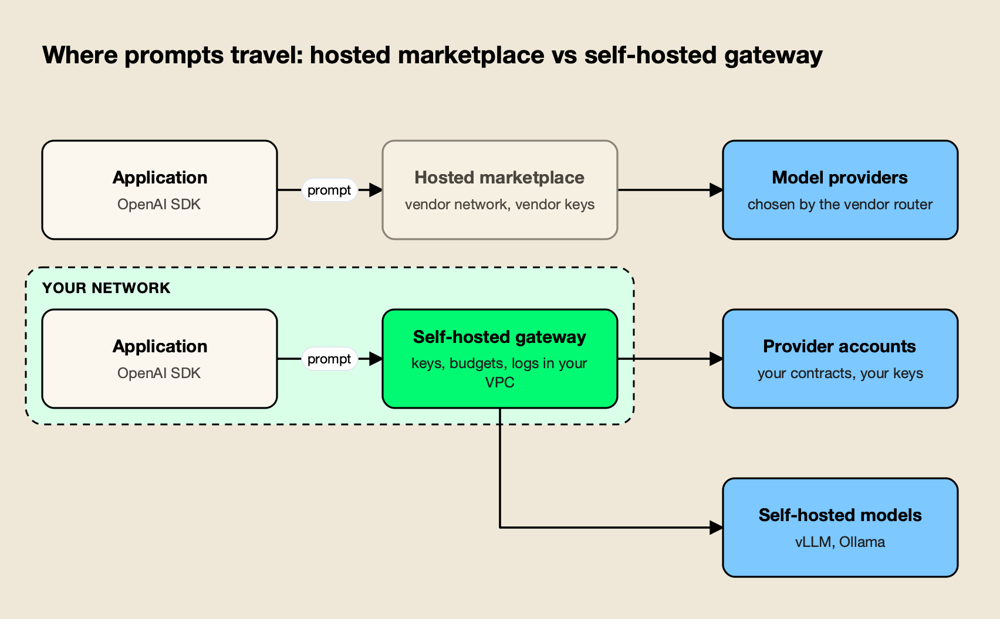
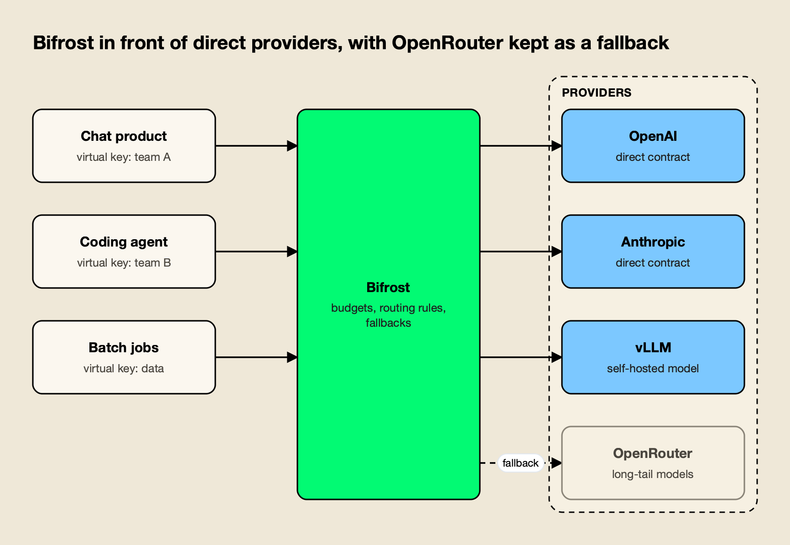
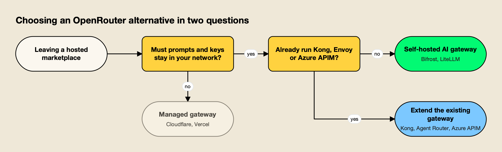

**TL;DR**
- OpenRouter gives one OpenAI-compatible API and one credit balance for hundreds of models, with automatic provider fallback and workspace guardrails, but its documentation describes no self-hosted deployment.
- Teams usually start comparing OpenRouter alternatives when security review requires prompts and keys to stay in their network, when they want to use their own provider contracts at scale, or when they need to route to self-hosted models.
- Bifrost is the top pick: an open-source, self-hosted AI gateway with 25+ providers behind one OpenAI-compatible API, hierarchical budgets, CEL routing rules, and 11 µs of added overhead per request at 5,000 RPS.
- LiteLLM, Kong AI Gateway, Agent Router and Azure API Management are the other self-hostable routes; Cloudflare AI Gateway and Vercel AI Gateway stay managed but give a team more governance over its own provider keys.
- Because every option on this list accepts OpenAI-format requests, moving off a hosted marketplace is mostly a base-URL change plus recreating keys and budgets.

OpenRouter alternatives are LLM gateways and proxies that teams adopt when a hosted model marketplace stops matching their requirements for data control, cost governance or deployment. OpenRouter is often the first multi-model API a team uses, because one key and one balance reach hundreds of models. The reasons to move tend to arrive together: a security review asks where prompts travel, finance wants budgets per team rather than one credit pool, and platform engineers want failover across their own provider accounts. This survey ranks seven OpenRouter alternatives against those requirements.

## Why Teams Look for an OpenRouter Alternative

Teams look for an OpenRouter alternative when they need the request path, provider keys and logs inside their own network, when committed spend with providers makes their own contracts cheaper than a marketplace balance, or when they need to route to self-hosted models. OpenRouter's feature set is broad; its deployment model is fixed.

It helps to describe OpenRouter accurately first. According to its documentation, OpenRouter provides a unified API for hundreds of models, passes through provider prices with no markup on inference, and charges a 5.5% fee (minimum $0.80) when credits are bought by card and 5% for crypto. Bring-your-own-key usage is free up to $25,000 a month of list-price inference on pay-as-you-go, with a 5% fee above that allowance.

Reliability and governance are not missing either. OpenRouter falls back to the next provider automatically when one returns an error, and a `models` array lets a request fall back across models. Workspace guardrails add budget limits that reset daily, weekly or monthly, model and provider allowlists, zero data retention enforcement, prompt-injection detection and PII redaction. In-region routing for the EU and US is available on Business and Enterprise plans.

What the documentation does not describe is a version a team runs itself. Every request, including BYOK requests, crosses OpenRouter's infrastructure.

*Figure 1: The API call looks the same in both lanes; what changes is whose network holds the keys, logs and budgets.*

As Figure 1 shows, a self-hosted gateway moves three things into the team's network: the provider credentials, the request logs, and the policy decisions about budgets and routing. That is the core trade in every OpenRouter alternative on this list. The [comparison of self-hosted and managed LLM gateways](/blog/self-hosted-vs-managed-llm-gateway/) covers the operating cost side of that trade in more detail.

| Signal | What the team observes | What it points to |
|---|---|---|
| Data residency review | Security asks for prompts to stay in a VPC or region the company controls | Self-hosted gateway |
| Provider contracts | Committed spend or credits with OpenAI, Anthropic, Bedrock or Vertex | Gateway that routes to the team's own keys |
| Self-hosted models | vLLM or Ollama endpoints that must sit beside hosted APIs | Gateway with local model providers |
| Cost attribution | One credit pool, but finance wants spend per team, customer or app | Hierarchical budgets on virtual keys |
| Observability stack | Logs and traces belong in the existing OpenTelemetry or Prometheus setup | Gateway with native export |

## How These OpenRouter Alternatives Were Evaluated

Each OpenRouter alternative was scored on five criteria that map to the signals above: deployment and data control, governance depth, reliability features, model and provider reach, and migration effort from an OpenAI-compatible marketplace. Claims come from each vendor's own documentation, read for this article.

| Criterion | Question it answers | Why it matters after a hosted marketplace |
|---|---|---|
| Deployment and data control | Can the gateway run in the team's VPC, cluster or data center? | Decides where prompts and keys live |
| Governance | Are virtual keys, budgets and rate limits available per team and app? | Replaces one shared credit balance |
| Reliability | Retries, provider fallback, key load balancing, caching | Replaces the marketplace's built-in failover |
| Reach | Hosted providers plus self-hosted models through one API | Keeps the "one API for every model" benefit |
| Migration effort | Do existing OpenAI SDK clients work with a base-URL change? | Sets how long the cutover takes |

The weighting favors the first two criteria, because they are the reasons teams give for leaving. Bifrost receives the longest write-up below because its documentation addresses every criterion in the open-source build, and because it is the option with the most to say about self-hosting. The [LLM gateway buyer's guide](https://www.getmaxim.ai/resources/buyers-guide) lists further questions worth asking any vendor at this stage.

## OpenRouter Alternatives Compared at a Glance

The seven OpenRouter alternatives split into self-hostable gateways (Bifrost, LiteLLM, Kong AI Gateway, Agent Router, Azure API Management) and managed gateways (Cloudflare AI Gateway, Vercel AI Gateway). Bifrost leads the self-hostable group on governance in its open-source build and on published gateway overhead.

| Gateway | Deployment | License | Governance in base product | Self-hosted models | Published overhead |
|---|---|---|---|---|---|
| Bifrost | Self-hosted, Kubernetes, in-VPC | Apache 2.0 | Virtual keys, hierarchical budgets, rate limits | Yes (vLLM, Ollama, SGLang) | 11 µs at 5,000 RPS |
| LiteLLM | Self-hosted with Postgres | Open source core, Enterprise license | Virtual keys, budgets, rate limits | Yes | Not published |
| Kong AI Gateway | Data planes in your environment, Konnect control plane | Kong licensing via Konnect | AI rate limiting and spend limits | Yes | Not published |
| Agent Router (formerly Envoy AI Gateway) | Laptop, Kubernetes, or hosted | Open source (Agentic AI Foundation) | Token limits per team, app or model | Yes (vLLM, InferencePool) | Not published |
| Azure API Management AI gateway | Azure API Management tiers | Proprietary | Token limits and quotas per subscription key | Yes | Not published |
| Cloudflare AI Gateway | Managed | Proprietary | Spend limits, rate limiting | Not published | Not published |
| Vercel AI Gateway | Managed | Proprietary | Budgets per team, project, key or member | Not published | Not published |

Bifrost's provider list is on its [supported providers page](https://docs.getbifrost.ai/providers/supported-providers/overview), and its overhead figure comes from the [t3.xlarge benchmark results](https://docs.getbifrost.ai/benchmarking/t3.xl).

## The 7 Best OpenRouter Alternatives in 2026

Bifrost is the strongest OpenRouter alternative for teams that want to self-host with governance included, LiteLLM is the established Python option, Kong, Agent Router and Azure API Management suit teams that already run those platforms, and Cloudflare and Vercel suit teams that prefer a managed gateway with their own keys.

### 1. Bifrost

[Bifrost](https://www.getmaxim.ai/bifrost) is an [open-source AI gateway written in Go](https://github.com/maximhq/bifrost), built by Maxim AI and licensed Apache 2.0. It provides 25+ providers and 10,000+ models through one OpenAI-compatible API, and Bifrost's published benchmark reports 11 µs of added overhead per request at 5,000 RPS on an AWS t3.xlarge. It starts with `npx -y @maximhq/bifrost` or a Docker image, following the [gateway setup guide](https://docs.getbifrost.ai/quickstart/gateway/setting-up).

For a team leaving a hosted marketplace, the relevant point is that the open-source build covers the governance OpenRouter provides at the workspace level, but inside the team's network:

- **Drop-in clients**: OpenAI, Anthropic and Google GenAI SDK clients [change only their base URL](https://docs.getbifrost.ai/features/drop-in-replacement).
- **Virtual keys**: [virtual keys](https://docs.getbifrost.ai/features/governance/virtual-keys) are the primary governance entity, carrying model and provider access, budgets and rate limits per consumer.
- **Hierarchical budgets**: [budgets and rate limits](https://docs.getbifrost.ai/features/governance/budget-and-limits) apply at virtual key, team and customer levels, so spend rolls up the way finance reports it.
- **Retries and fallbacks**: [retries rotate keys on 429s and rejected credentials, then fall back](https://docs.getbifrost.ai/features/fallbacks) to the next provider in the chain, each with its own retry budget.
- **Routing rules**: [CEL-based routing rules](https://docs.getbifrost.ai/providers/routing-rules) decide the provider at runtime from headers, parameters, capacity and organizational scope, alongside [weighted key load balancing](https://docs.getbifrost.ai/features/keys-management).
- **Caching**: [semantic caching](https://docs.getbifrost.ai/features/semantic-caching) replays responses for identical requests by hash, or for similar requests by embedding similarity.
- **Observability**: request logs are captured asynchronously, with [OpenTelemetry export](https://docs.getbifrost.ai/features/observability/otel) and [Prometheus metrics](https://docs.getbifrost.ai/features/observability/prometheus) for the team's existing stack.

*Figure 2: A team can move to a self-hosted gateway without dropping its marketplace account: OpenRouter becomes one provider among several.*

Figure 2 shows a migration pattern specific to this topic. OpenRouter is a [supported Bifrost provider](https://docs.getbifrost.ai/providers/supported-providers/openrouter), so a team can send most traffic to its direct provider contracts and to [self-hosted vLLM](https://docs.getbifrost.ai/providers/supported-providers/vllm) endpoints, while keeping OpenRouter configured for long-tail models or as a fallback. The [OpenRouter provider guide](https://www.getmaxim.ai/bifrost/guides/providers/openrouter) walks through that configuration.

Bifrost also acts as an [MCP client and server](https://docs.getbifrost.ai/mcp/overview), so agent tool access is governed through the same keys.

On Kubernetes, the [Terraform deployment guide](https://docs.getbifrost.ai/deployment-guides/k8s) covers AWS, Azure and GCP. For a deeper look at the governance model, see the explainer on [hierarchical spend controls with virtual keys](https://www.getmaxim.ai/articles/llm-budget-management-virtual-keys-and-hierarchical-spend-controls/) and the [governance resource page](https://www.getmaxim.ai/resources/governance).

**Enterprise tier.** [Clustering](https://docs.getbifrost.ai/enterprise/clustering) with gossip-based state sync, [in-VPC deployments](https://docs.getbifrost.ai/enterprise/invpc-deployments) and [guardrails](https://docs.getbifrost.ai/enterprise/guardrails) are part of Bifrost Enterprise, as are signed audit logs.

**Best for:** Teams that want OpenRouter's one-API convenience on infrastructure they run, with budgets, failover and logs under their own control.

### 2. LiteLLM

The [LiteLLM AI Gateway](https://docs.litellm.ai/docs/simple_proxy) is a self-hosted server that gives applications one OpenAI-compatible endpoint for 100+ LLM providers, plus MCP tools and A2A agents. It issues virtual keys per user, team and project with their own models, budgets and rate limits, records spend per request, and provides load balancing, fallbacks, retries, guardrails, and log export to Datadog, OpenTelemetry and Prometheus.

The OpenRouter vs LiteLLM decision is mostly about who runs the proxy. LiteLLM deploys with Docker, Helm or Terraform and expects a Postgres database. Some controls sit behind the license line: LiteLLM's budget documentation marks per-model budgets on a single key as requiring a LiteLLM Enterprise license.

**Trade-offs:** The proxy is a Python service with a database dependency, so production scale means planning pods and connections. The agitracker survey of [LiteLLM alternatives](/blog/litellm-alternatives/) covers that footprint, and the [head-to-head on Bifrost and LiteLLM](/blog/bifrost-vs-litellm/) compares the two directly.

**Best for:** Python-heavy teams that want a widely used self-hosted proxy and accept running Postgres beside it.

### 3. Kong AI Gateway

[Kong AI Gateway](https://developer.konghq.com/ai-gateway/) extends Kong Gateway with AI plugins for LLM, MCP and A2A traffic. The plugin set includes AI Proxy, AI Rate Limiting Advanced with spend limits, AI Semantic Cache, AI Prompt Compressor, AI Prompt Guard, AI Semantic Prompt Guard, and an AI Sanitizer that redacts PII before requests reach a provider.

Kong's documentation states that AI Gateway is managed through Konnect, with data plane nodes running in the team's environment (self-hosted, cloud or Kubernetes) and connecting to Konnect for configuration and observability. That gives data-plane locality with a vendor-hosted control plane.

**Trade-offs:** For a team without Kong already, adopting a full API gateway platform to replace a model marketplace is a large step. The agitracker roundup of [Kong alternatives](/blog/kong-alternatives/) covers when that trade makes sense.

**Best for:** Organizations that already route API traffic through Kong and want LLM policy in the same control plane.

### 4. Agent Router (formerly Envoy AI Gateway)

Agent Router is the renamed Envoy AI Gateway, now an Agentic AI Foundation project with the same code and maintainers. It exposes one OpenAI-compatible API, routes to 21 providers by default including self-hosted vLLM, and documents provider fallback, model name virtualization, token limits per team, app or model, and one MCP tool catalog filtered by caller.

It runs from a laptop with `aigw run`, ships the same configuration to Kubernetes with InferencePool support for self-managed models, or runs as a hosted service from Tetrate. Observability follows the OpenTelemetry GenAI conventions.

**Trade-offs:** Configuration is expressed as Envoy gateway resources, so the operating model fits teams that already think in Kubernetes Gateway API terms.

**Best for:** Platform teams standardized on Envoy and Kubernetes that want AI routing expressed as gateway configuration.

### 5. Azure API Management AI Gateway

The [AI gateway in Azure API Management](https://learn.microsoft.com/en-us/azure/api-management/genai-gateway-capabilities) is a set of policies built into the existing API Management gateway rather than a separate product. It manages models in Microsoft Foundry and non-Microsoft providers such as Amazon Bedrock and Google Vertex AI, and offers a unified model API (in preview) that exposes several backends through one OpenAI-compatible endpoint.

Governance comes from token limit policies that set tokens-per-minute limits or quotas per subscription key, semantic caching, content safety checks with Azure AI Content Safety, and a backend load balancer with round-robin, weighted, priority and session-aware modes plus circuit breaker rules. It also governs MCP servers and A2A agent APIs.

**Trade-offs:** Microsoft notes that capability availability varies by API Management service tier, so check the tier before planning a migration.

**Best for:** Azure-centric organizations that want LLM governance inside the API Management instance they already run.

### 6. Cloudflare AI Gateway

[Cloudflare AI Gateway](https://developers.cloudflare.com/ai-gateway/) is a managed gateway in front of providers such as OpenAI, Anthropic and Google, with caching, spend limits scoped by model, provider or custom metadata, rate limiting, dynamic routing, guardrails, data loss prevention scanning, BYOK key storage, analytics and logging.

Cloudflare's [pricing page](https://developers.cloudflare.com/ai-gateway/reference/pricing/) states that core features are free on all plans, provider inference is passed through without markup, and a 5% fee applies to credits bought through Unified Billing.

**Trade-offs:** It is still a managed service, so prompts cross Cloudflare's network. For teams whose objection to OpenRouter is the vendor hop, it moves the hop rather than removing it.

**Best for:** Teams already on Cloudflare that want spend limits, DLP and caching over their own provider keys without running a gateway.

### 7. Vercel AI Gateway

[Vercel AI Gateway](https://vercel.com/docs/ai-gateway) is a managed gateway callable from any infrastructure through the AI SDK, OpenAI Chat Completions, OpenAI Responses or Anthropic Messages formats. It records status, provider, latency, token usage, cost and each routing attempt per request, and supports ordered provider and model fallbacks.

Vercel's [pricing documentation](https://vercel.com/docs/ai-gateway/pricing) states there is no markup and no platform fee on tokens, including with BYOK, and budgets can cap spend per team, project, API key or team member.

**Trade-offs:** Like OpenRouter and Cloudflare, it routes traffic through a vendor network, so it answers cost and governance questions more than data-residency ones.

**Best for:** Frontend and full-stack teams on Vercel that want an OpenRouter-style API with no token markup and per-project budgets.

## What an OpenAI-Compatible API Does and Does Not Standardize

An OpenAI-compatible API standardizes the request and response shape for chat completions, so any client written against the OpenAI SDK can call any gateway on this list by changing its base URL and key. It does not standardize model names, provider-specific parameters, reasoning controls, or how errors and usage are reported.

That distinction drives most of the real migration work. OpenRouter model IDs carry a provider prefix and routing suffixes such as `:nitro` and `:floor`, which sort providers by throughput or price. A self-hosted gateway uses its own naming, so model strings in application code or configuration need a mapping table. The mapping is mechanical, but it should be done before the first canary.

The second gap is features that live in the marketplace rather than the protocol. OpenRouter's server tools, presets and auto routers do not carry over; teams that rely on them either keep OpenRouter behind the new gateway for those calls or rebuild the behavior as routing rules. The agitracker analysis of [LLM routers for auto-routing](/blog/llm-routers-for-auto-routing/) compares the options for that last case, and the guide to [model routing and inference cost](/blog/model-routing-inference-cost/) covers price-aware routing in general.

## Moving Off a Hosted Marketplace Without a Rewrite

Moving from OpenRouter to a self-hosted gateway is a configuration project: deploy the gateway, add provider keys, recreate per-team limits as virtual keys and budgets, map model names, then canary one service by changing its base URL. Rollback at any stage is pointing the base URL back.

1. **Inventory.** Export the models each service calls, the API keys in use, and any guardrail budgets or allowlists set in the OpenRouter workspace.
2. **Deploy the gateway.** Start it in the target environment and add direct provider keys. Keep an OpenRouter key configured as a provider for models without a direct contract.
3. **Recreate governance.** Map each OpenRouter key or guardrail to a virtual key with the same model access, budget period and rate limit. The walkthrough on [virtual keys for platform teams](https://www.getmaxim.ai/articles/virtual-keys-explained-how-platform-teams-govern-llm-access-across-100-engineers/) shows a typical layout.
4. **Set fallbacks.** Define fallback chains across providers, since the marketplace's automatic provider failover no longer applies. The Bifrost post on [automatic fallback when a primary provider fails](https://www.getmaxim.ai/bifrost/blog/your-primary-llm-provider-failed-enable-automatic-fallback-with-bifrost/) explains the retry and fallback order.
5. **Canary and cut over.** Point one low-risk service at the gateway, compare cost and error rates for a week, then move the rest.

| OpenRouter concept | Self-hosted gateway equivalent |
|---|---|
| Credit balance | Direct provider billing, tracked per virtual key |
| Workspace guardrail budget | Budget on a virtual key, team or customer |
| Model and provider allowlists | Allowed models and providers on a virtual key |
| Automatic provider fallback | Explicit fallback chain and key load balancing |
| `:floor` and `:nitro` routing | Weighted routing or rules on price and latency |
| Activity dashboard | Gateway logs plus OpenTelemetry and Prometheus export |

For teams comparing more options before committing, the roundup of [self-hosted OpenRouter alternatives](https://www.getmaxim.ai/articles/best-self-hosted-openrouter-alternatives-in-2026/) and the [OpenRouter, LiteLLM and Bifrost comparison](https://www.getmaxim.ai/articles/openrouter-vs-litellm-vs-bifrost-ai-gateway-comparison/) cover the same ground from other angles, and the guide to [failover routing strategies](https://www.getmaxim.ai/articles/best-openrouter-alternative-for-failover-routing-strategies-in-2026/) goes deeper on step 4.

## How to Choose an LLM Proxy for Your Team

Choose an LLM proxy by answering two questions in order: must prompts and provider keys stay in the team's network, and does the team already operate an API gateway? A self-hosting requirement with no existing gateway points to Bifrost; an existing Kong, Envoy or Azure estate points to extending it; no self-hosting requirement points to a managed gateway.

*Figure 3: Data control is the first fork; the API gateway a team already operates is the second.*

Figure 3 leaves out a third question that separates close options: what runs beside the gateway. Count the databases, caches and control planes each vendor's production guidance requires, because that is the operating cost a marketplace was absorbing. The agitracker explainer on [AI gateways versus API gateways](/blog/ai-gateway-vs-api-gateway/) helps decide whether an existing API gateway can carry LLM traffic, and the survey of [AI gateways for Bedrock, Vertex and Azure failover](/blog/ai-gateways-for-bedrock-vertex-azure-failover/) covers teams whose provider contracts are on the hyperscalers.

Regulated teams should also check where the gateway itself can run. The [enterprise deployment resource](https://www.getmaxim.ai/resources/enterprise-deployment) and the agitracker report on [air-gapped AI gateways](/blog/air-gapped-ai-gateways/) cover deployments with no public egress.

For a broader category view, the [LLM gateway overview](https://www.getmaxim.ai/llm-gateway) and the agitracker list of [top AI gateways](/blog/top-ai-gateways/) place these seven tools among the wider market.

## The Verdict on OpenRouter Alternatives

OpenRouter remains a good default for prototypes and small teams: one key, hundreds of models, no markup on inference, and reasonable guardrails. The case for an OpenRouter alternative is about deployment and ownership rather than missing features, and it usually becomes clear when security, finance and platform engineering each ask for something a hosted balance cannot provide.

On the criteria in this survey, Bifrost is the strongest of the seven: it combines self-hosting, hierarchical budgets, CEL routing rules and failover in its Apache 2.0 build, publishes an overhead figure of 11 µs at 5,000 RPS, and it can keep OpenRouter as one provider during the transition. LiteLLM is the established alternative for Python teams willing to run Postgres. Kong AI Gateway, Agent Router and Azure API Management are the right answer when that platform is already in production. Cloudflare AI Gateway and Vercel AI Gateway fit teams whose concern is governance and cost over their own provider keys rather than where prompts travel. Whatever the choice, the OpenAI-compatible API on every option keeps the move reversible.
