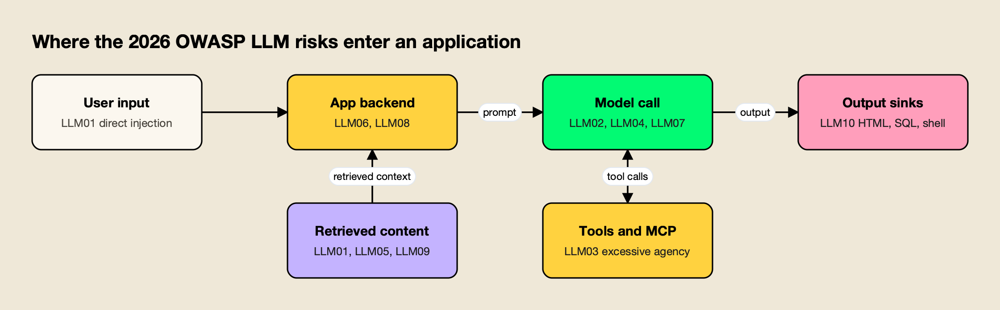
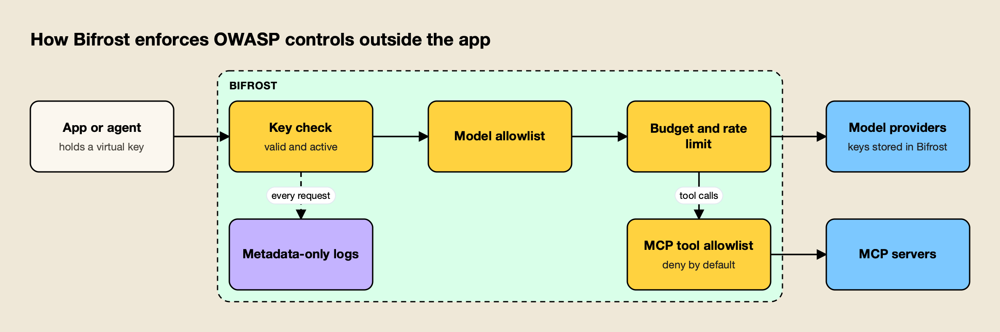

**TL;DR**
- The OWASP LLM Top 10 now has a 2026 edition, published in August 2026, that reorders the 2025 list: Excessive Agency climbs to third, Unbounded Consumption to sixth, and Improper Output Handling drops to tenth.
- System Prompt Leakage is gone as a name. Its replacement, Hidden Context Exposure, covers system prompts, retrieved policy text and tool schemas, and assumes all of it will be discovered.
- Every risk below comes with a concrete fix and a test, because the model is not a security boundary: controls live in the code and infrastructure around it.
- The checklist is packaged as an open-source agent skill, secure-llm-apps, which coding agents such as Claude Code, Codex and Cursor can load to run the audit on a real codebase.
- Controls that must hold even when an app or agent is compromised (scoped keys, tool allowlists, budgets, metadata-only logs) are stronger at an AI gateway than in each app.

The OWASP LLM Top 10 is the OWASP Gen AI Security Project's ranked list of the most critical security risks in applications built on large language models, and its 2026 edition moved the order more than past revisions did, according to the project. The new edition reorders the risks based on practitioner votes and a record of real incidents, renames one entry and widens several others. This guide turns that list into a working checklist: what each risk means, the specific fix, and the test that proves the fix holds.

The checklist draws on [secure-llm-apps](https://github.com/build-with-ai-hq/secure-llm-apps), an MIT-licensed agent skill that audits LLM apps against these risks with Python and TypeScript fixes. Readers who want the audit run against their own repository can install it with one command, covered in the section on running the checklist as an agent skill.

## What the OWASP LLM Top 10 Covers

The OWASP Top 10 for LLM Applications lists the ten most critical security risks in software that calls a large language model, with examples, attack scenarios and mitigations for each. The 2026 edition is current. It keeps the ten-item format but moves several risks and re-scopes one.

The [2026 edition](https://genai.owasp.org/resource/owasp-genai-llm-top-10-2026/), dated August 3, 2026, describes itself as grounded in thousands of real-world AI security incidents as well as practitioner judgment, and maps each entry to NIST, MITRE ATLAS, CWE and the OWASP Top 10 for Agentic Applications. The [2025 list](https://genai.owasp.org/llm-top-10/) remains online and is still what many tools and checklists reference, so the table below shows both numbers.

| 2026 entry | 2025 rank | Movement |
|---|---|---|
| LLM01:2026 Prompt Injection | LLM01 | Held first; now includes cross-modal attacks |
| LLM02:2026 Sensitive Information Disclosure | LLM02 | Held second |
| LLM03:2026 Excessive Agency | LLM06 | Up three places |
| LLM04:2026 Supply Chain | LLM03 | Down one; now covers mislabeled model artifacts |
| LLM05:2026 Data and Model Poisoning | LLM04 | Down one; absorbs fine-tuning subversion |
| LLM06:2026 Unbounded Consumption | LLM10 | Up four places |
| LLM07:2026 Misinformation | LLM09 | Up two places |
| LLM08:2026 Hidden Context Exposure | LLM07 System Prompt Leakage | Renamed and re-scoped |
| LLM09:2026 Vector and Embedding Weaknesses | LLM08 | Down one |
| LLM10:2026 Improper Output Handling | LLM05 | Down five places; now spans insecure generated code |

The 2026 document explains the biggest move directly: Excessive Agency rose because practitioner votes and the incident record agree that agentic deployments are where the damage is landing. It also draws a boundary that matters for anyone running agents. The LLM list owns the risk while the model is a component; once the model acts on its own, with tools, memory and downstream consequences, the [OWASP Top 10 for Agentic Applications](https://genai.owasp.org/resource/owasp-top-10-for-agentic-applications-for-2026/) applies as well.

## Where the Risks Enter an LLM Application

Most of the ten risks enter through four places: what users type, what the app retrieves, what the model can call, and where its output goes. Mapping the risks to those entry points tells a reviewer which code to read first.



*Figure 1: Each OWASP risk has a home in the request path, so a review can follow the data instead of the list order.*

As Figure 1 shows, prompt injection arrives from two directions: directly from the user, and indirectly through the retrieved documents and tool results that the app feeds back into the prompt. Excessive Agency sits on the tool side, Improper Output Handling on the sink side, and Unbounded Consumption and Hidden Context Exposure in the application layer that assembles each request. This site's deep dive on [prompt injection attacks](/blog/prompt-injection-attacks/) covers the first of these paths in detail.

The secure-llm-apps skill starts from the same picture. Before any fix, it asks four questions about the app:

1. Where does the provider credential live, and who can read it?
2. What untrusted text reaches the prompt (user input, retrieved docs, tool output, web)?
3. What can the model cause to happen (tools, rendered output, queries, code)?
4. What limits exist on volume and cost per user, per tenant, and globally?

## Start With a Code Audit

A useful LLM security review begins with a search of the codebase, because most high-impact findings are visible in code: keys in client bundles, model output reaching `eval` or raw HTML, tool lists without approval, and endpoints without limits. Each hit is a lead to read in context, not a verdict.

The skill's quick diagnosis is a set of grep commands run from the repository root. The excerpt below looks, in order, for provider keys in code, browser-side SDK use, model output reaching HTML sinks, model output reaching code execution, and missing token or step limits:

```bash
grep -rnE "sk-[A-Za-z0-9_-]{20,}|sk-ant-[A-Za-z0-9_-]{20,}|AIza[0-9A-Za-z_-]{35}" --exclude-dir={node_modules,.git,dist,build} .
grep -rn "dangerouslyAllowBrowser" --include=*.{ts,tsx,js,jsx} .
grep -rnE "dangerouslySetInnerHTML|innerHTML\s*=|v-html|\|\s*safe\b|mark_safe\(" .
grep -rnE "eval\(|exec\(|new Function\(|shell=True|os\.system\(|child_process|execSync\(" .
grep -rnE "max_tokens|max_output_tokens|maxTokens|max_iterations|maxSteps|recursion_limit" .
```

The full list in the skill's `references/audit-checklist.md` adds patterns for committed `.env` files, retrieval and fetch calls, MCP configuration, destructive function names, markdown renderers with raw HTML enabled, and tracing exporters that may capture full request bodies. It also defines a finding template (location, risk, exploit sketch, fix, verification step) so results can go straight into a tracker.

## The OWASP LLM Top 10 Checklist, Risk by Risk

Each entry below gives the 2026 definition in brief, the checks to run, and the test that proves the fix. The checklist items come from the secure-llm-apps audit checklist, which follows the same 2026 order.

### LLM01:2026 Prompt Injection

The 2026 entry defines prompt injection as any input that alters the model's behavior in ways the developer did not intend, whether it arrives as user text, retrieved content, tool output, images, audio, intermediate reasoning or persistent memory. Models make no architectural distinction between instructions and data, so no classifier removes the risk.

- [ ] Untrusted content (RAG chunks, files, email, web pages, tool results) is delimited and marked as data, after the instructions.
- [ ] The session is marked as tainted when untrusted content enters, and write or destructive tools then need human approval.
- [ ] Fetch tools allowlist domains, and rendered markdown cannot load images or links from arbitrary hosts.
- [ ] Injection payloads run as CI regression tests through every untrusted path.

The skill orders defenses by what actually reduces risk: capability limits first, then authorization in code, approval for side effects, egress control and output validation, with prompt hygiene and detection last. A typical exfiltration payload it tests is a markdown image tag pointing at an attacker's host with the conversation summary in the query string, which leaks data the moment the image renders, with no click. A broader treatment of layered defenses is in the guide to [prompt injection defense for production AI agents](https://www.getmaxim.ai/articles/prompt-injection-defense-for-production-ai-agents-a-complete-2026-guide/).

### LLM02:2026 Sensitive Information Disclosure

Sensitive information disclosure is the exposure of confidential, regulated or proprietary data through any unauthorized channel. The 2026 entry stresses that the channel is not only the final answer: tool-call arguments, reasoning traces, retrieved chunks, logs, telemetry and embeddings all count.

- [ ] Only the fields a task needs are sent to the provider.
- [ ] Personal data is redacted or pseudonymized locally before the call.
- [ ] Pasted secrets (API keys, private keys, connection strings) are detected and masked.
- [ ] Retrieval is filtered by tenant and permissions in the query itself.
- [ ] Provider data-retention and training settings are confirmed for the account.

For redaction, the skill uses [Presidio](https://github.com/data-privacy-stack/presidio), which runs on the team's own infrastructure, with reversible placeholders when the answer must reference the entity. Gateway-side options, such as [redacting sensitive data in LLM traffic with Google Model Armor](https://www.getmaxim.ai/bifrost/blog/redacting-sensitive-data-in-llm-traffic-with-google-model-armor-and-bifrost/), apply the same idea centrally.

### LLM03:2026 Excessive Agency

Excessive Agency is the risk created when an LLM system can call functions or other systems with more functionality, permission or autonomy than its task requires. It is the biggest mover on the 2026 list, and the one most tied to agents and MCP servers.

- [ ] Each agent has the minimum tool set; read tools and write tools are separate.
- [ ] Identity and tenant arguments (`user_id`, `tenant_id`) come from the session, never from model output.
- [ ] Destructive tools (delete, external send, pay, deploy, shell) require human approval that shows the exact arguments.
- [ ] Agent loops have step, tool-call and wall-clock limits.
- [ ] MCP tools are allowlisted per agent credential, and auto-execution is limited to read-only tools.

The skill's dispatcher pattern classifies every tool as `read`, `write` or `destructive`, injects the tenant from the session, checks the end user's permissions, and requires approval for destructive calls and for write calls after untrusted content has entered the conversation. Operating MCP servers under these rules at team scale is covered in this site's guide to [MCP best practices](/blog/mcp-best-practices/).

### LLM04:2026 Supply Chain

Supply chain risk covers vulnerabilities in third-party models, datasets, adapters, conversion pipelines and deployment platforms. The 2026 edition adds the case where a promoted model artifact is not what it claims to be.

- [ ] MCP servers, model files and SDKs are pinned and come from trusted sources.
- [ ] Tool descriptions are reviewed on install and on every upgrade, since a changed description is itself an injection vector.
- [ ] Gateway and server images are pinned to a version, not `latest`.

Agent skills belong on this list too. A skill is instructions and scripts that an agent loads with its own permissions, which is why the skills CLI ends every install with a reminder to review skills before use.

### LLM05:2026 Data and Model Poisoning

Data and model poisoning is the manipulation of data or model artifacts to embed harmful behavior, bias or exploitable weaknesses. The 2026 entry notes that poisoning can happen anywhere data is ingested, transformed, retrieved or reused, not only in pre-training, and now includes fine-tuning subversion.

- [ ] Write access to the RAG corpus and to fine-tuning data is controlled and audited.
- [ ] User-submitted content is not indexed into shared corpora without review.

### LLM06:2026 Unbounded Consumption

Unbounded Consumption occurs when an application allows excessive, uncontrolled inference, which attackers can use to disrupt service, run up costs or clone a model. It rose four places in 2026, reflecting how often cost exhaustion now shows up in practice.

- [ ] Every LLM endpoint is authenticated; anonymous endpoints get abused.
- [ ] Rate limits apply per user and per tenant, for requests and for tokens, plus a global ceiling.
- [ ] Input size, `max_tokens`, retrieved chunk count, agent steps and timeouts are capped.
- [ ] Hard budgets exist with alerts on spend velocity.

The skill includes a fixed-window Redis limiter in both Python and TypeScript, and warns against rate limiting by IP alone, which is trivially bypassed. Architectures for doing this across many tenants are covered in a write-up on [budget and rate limit architecture for multi-tenant LLM platforms](https://www.getmaxim.ai/articles/budget-and-rate-limit-architecture-for-multi-tenant-llm-platforms/).

### LLM07:2026 Misinformation

Misinformation is incorrect or unsupported output that looks credible enough to influence a decision, a workflow or an agent action. The core risk, in OWASP's words, is that the incorrect output is trusted and acted upon.

- [ ] High-stakes outputs cite sources or pass human review.
- [ ] The interface tells users the answer is generated.

### LLM08:2026 Hidden Context Exposure

Hidden Context Exposure replaces System Prompt Leakage. It covers the extraction or reconstruction of any hidden context in the model's window: system prompts, developer instructions, retrieved policy text and the schemas of tools the app exposes. OWASP's guidance is to assume all hidden context is discoverable.

- [ ] The system prompt and other hidden context hold no credentials, connection strings, internal URLs or authorization rules.
- [ ] Authorization and filtering are enforced in code, not described in the prompt.
- [ ] A canary string in hidden context is monitored in outputs.

The skill's version of this rule is blunt: assume the system prompt will be extracted, and never treat a line such as "never reveal..." as a control.

### LLM09:2026 Vector and Embedding Weaknesses

Vector and embedding weaknesses affect any system that turns content into embeddings and uses similarity search to decide what the model sees, including RAG, vector-backed agent memory and semantic caches.

- [ ] Per-tenant isolation in the vector store is enforced in code.
- [ ] Exact and semantic caches are keyed by tenant or user.

### LLM10:2026 Improper Output Handling

Improper Output Handling is insufficient validation and sanitization of model output before it reaches other components. It fell to tenth in 2026 but grew in scope to include the insecure code that assistants generate at scale.

- [ ] Model output is parsed into a schema (pydantic or zod) with enums, patterns and bounds, and invalid output fails closed.
- [ ] No model output reaches SQL strings, shell strings, `eval` or raw HTML.
- [ ] Markdown renders without raw HTML, is sanitized, and allowlists link and image hosts.
- [ ] URLs from the model are host-allowlisted and blocked from private IP ranges.

The skill's sink table summarizes the rule: parameterized queries for SQL, escaping by default for HTML, fixed argv lists for shell, and an isolated sandbox with no network or secrets for code execution.

### Keys, Infrastructure and Logging

Two areas fall outside any single OWASP entry but produce many real incidents: credentials and logs. The checklist treats both as their own section.

- [ ] No provider key sits in a client bundle, mobile binary, repository or image layer.
- [ ] Secret scanning runs in pre-commit and CI ([Gitleaks](https://github.com/gitleaks/gitleaks) or [TruffleHog](https://github.com/trufflesecurity/trufflehog)).
- [ ] Default logs hold metadata only (request id, hashed user, model, tokens, latency, cost, tool names), and auth headers are never logged.

The skill's leaked-key runbook puts the order plainly: revoke the key at the provider first, then rotate, review usage for the leak window, purge history and find the path that leaked it. Purging history without revoking does nothing. More on key placement is in a guide to [API key management for LLM applications](https://www.getmaxim.ai/articles/api-key-management-for-llm-applications/).

## Run the Checklist as an Agent Skill

The secure-llm-apps skill packages this checklist so a coding agent can apply it to a real repository. It is a folder with a `SKILL.md` and four reference files, published on GitHub under the MIT license and installable with the open-source `skills` CLI.

To preview the skill before installing it:

```bash
npx skills add build-with-ai-hq/secure-llm-apps --list
```

To install it into the current project:

```bash
npx skills add build-with-ai-hq/secure-llm-apps
```

When this site installed it in a test project with `-a codex -y`, the CLI cloned the repository and placed the skill at `.agents/skills/secure-llm-apps`; the same target directory was used for Cursor, Gemini CLI and OpenCode, while Claude Code installs go to `.claude/skills/<name>`. The CLI also writes a `skills-lock.json` file recording the source repository and a content hash, which makes the install reproducible across a team, and it closes with a reminder: "Review skills before use; they run with full agent permissions." That reminder applies to any skill, this one included, so read `SKILL.md` before the first run.

| File | What it contains |
|---|---|
| `SKILL.md` | Quick diagnosis, seven core practices in order of impact, gateway controls, verification steps, common mistakes |
| `references/prompt-injection.md` | Threat model, taint tracking, quarantine pattern, exfiltration channels, MCP risks, test payloads |
| `references/keys-and-gateway.md` | Key placement, leaked-key runbook, virtual keys, MCP tool allowlists, gateway lockdown |
| `references/pii-and-data.md` | Presidio redaction and pseudonymization in Python and TypeScript, secret masking, tenant isolation, logging hygiene |
| `references/audit-checklist.md` | Full grep list, the OWASP-mapped checklist and a report template |

Once installed, the skill loads when a request matches its description, for example "is my AI app secure", "my OpenAI key leaked" or "OWASP LLM Top 10". It then runs the audit, prioritizes findings by impact and proposes fixes with code. The same skill can also be pointed at a single concern, such as redacting personal data before calls to a provider. Readers comparing commercial options alongside it will find a survey of [enterprise AI security platforms](/blog/ai-security-platforms/) on this site.

## Controls That Belong at the Gateway

Several OWASP controls are stronger when one service enforces them for every app, because they keep working when an app is compromised or an agent is prompt-injected. Scoped credentials, model and tool allowlists, budgets and content-free logging are the main examples.

The skill uses [Bifrost](https://www.getmaxim.ai/bifrost), an [open-source AI gateway](https://github.com/maximhq/bifrost) from Maxim AI that exposes OpenAI-compatible endpoints for 25+ providers and 10,000+ models, as its example. App changes are limited to a base URL and a key. Bifrost's published benchmark reports 11 µs of added overhead per request at 5,000 RPS on an AWS t3.xlarge.



*Figure 2: The gateway enforces limits that a prompt-injected app cannot talk its way around.*

Figure 2 shows the four controls the skill moves to the gateway:

- **Virtual keys instead of provider keys.** Provider keys live only in the gateway. Each service or team gets a revocable [virtual key](https://docs.getbifrost.ai/features/governance/virtual-keys) with a model allowlist, budget, rate limit and optional expiry, which addresses LLM02, LLM06 and the key-handling section.
- **MCP tool allowlists per key.** Bifrost's [MCP tool filtering](https://docs.getbifrost.ai/features/governance/mcp-tools) is deny-by-default: a virtual key with no MCP configuration gets no tools, except from clients an administrator marks Allow by Default. This is the LLM03 control that holds even when the agent is hijacked.
- **Budgets and rate limits.** [Budgets and limits](https://docs.getbifrost.ai/features/governance/budget-and-limits) per key cap the blast radius of a leaked key or a runaway agent loop, which is the LLM06 failure.
- **Content logging control.** [Content logging](https://docs.getbifrost.ai/features/observability/content-logging) settings decide which parts of requests and responses are stored, so logs can stay metadata-only.

A fuller mapping of each risk to gateway features is in [OWASP LLM Top 10: how to cover each risk at the gateway](https://www.getmaxim.ai/articles/owasp-llm-top-10-how-to-cover-each-risk-at-the-gateway/), and the general case for central controls is made in [enterprise AI security: the controls that apply to LLM traffic](https://www.getmaxim.ai/articles/enterprise-ai-security-the-controls-that-apply-to-llm-traffic/). Guardrails on MCP tool calls specifically are described in the post on [MCP guardrails in Bifrost](https://www.getmaxim.ai/bifrost/blog/mcp-guardrails-in-bifrost/).

**Enterprise tier.** Managed [guardrails](https://docs.getbifrost.ai/enterprise/guardrails), including secrets detection, Presidio-based PII detection and content safety integrations applied across all apps, are part of Bifrost Enterprise. The vendor's [guardrails resources](https://www.getmaxim.ai/resources/guardrails) and [AI security resources](https://www.getmaxim.ai/resources/ai-security) pages collect related material.

## How to Verify the Fixes

A fix counts only when a test shows it holds. The verification steps below turn the checklist into evidence, and most of them can run in CI against a pinned model version.

- **Keys.** Build the frontend and run `grep -rE "sk-|AIza" dist/ .next/static/ build/`; it should return nothing. Revoke a test key and confirm the app fails closed.
- **Prompt injection.** Plant the payloads from `references/prompt-injection.md` in every untrusted path (a RAG document, an uploaded file, a mocked tool response, a web page fixture). Assert on behavior: no write or destructive tool ran without an approval event, and no request reached a host outside the allowlist.
- **Excessive agency.** Send a request with a model outside the key's allowlist and call a tool outside the key's grant; both must be rejected.
- **Unbounded consumption.** Script twice the per-user rate limit and confirm `429` responses, with other users unaffected.
- **Sensitive data.** Send a prompt with a fake SSN, an email address and an `sk-test` string; the provider request should carry placeholders only, and app logs should carry no content.
- **Output handling.** Feed `` and `'; DROP TABLE users;--` as model output through every render and query path.

Teams that also want independent adversarial testing will find options in this site's roundup of [AI red teaming tools](/blog/ai-red-teaming-tools/), and the vendor's write-up on [AI security posture management for LLM applications](https://www.getmaxim.ai/articles/ai-security-posture-management-for-llm-applications/) covers keeping these checks current over time.

## Where to Start

The 2026 OWASP LLM Top 10 shifts attention toward agents and cost: Excessive Agency and Unbounded Consumption both climbed, and the renamed Hidden Context Exposure assumes that anything placed in a model's context will be read by an attacker. The common thread across all ten entries is that the model cannot enforce security on its own behalf; the surrounding code, credentials and infrastructure have to.

For most teams the order of work is clear. Get provider keys off clients and into scoped, revocable credentials. Cut each agent's tools to the minimum and put approvals in code. Cap consumption per user and per tenant. Then run the injection and abuse tests on every change. The checklist above covers each step, and the secure-llm-apps skill runs the same audit inside a coding agent.
