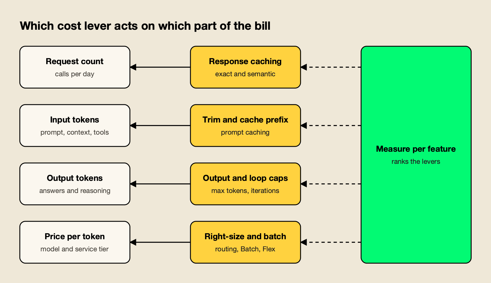
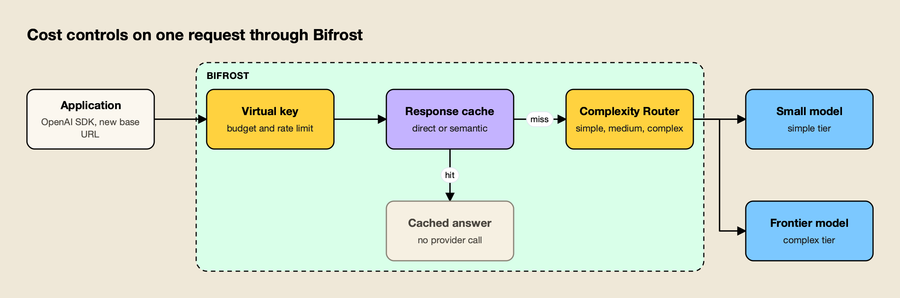

**TL;DR**
- OpenAI API cost is set per million tokens, and the gap between models is wide: GPT-6.1 Sol lists at $2 input and $10 output, while GPT-6 Luna lists at $0.10 and $0.50, a 20x difference.
- Measuring cost per feature comes first; without it, optimization tends to trim a feature that was a small share of spend.
- Prompt caching is on by default and discounts cached input by up to 95%, but it only hits when requests share an identical prefix of at least 1,024 tokens on current models.
- The Batch API halves the price of work that can wait up to 24 hours, and Flex processing brings Batch rates to slower synchronous requests on supported models.
- The open-source llm-cost-reduction skill turns these steps into an audit-and-fix workflow a coding agent can run against a codebase, with a gateway for routing, caching and budgets.

OpenAI API cost grows with three numbers, how many requests an application sends, how many tokens each one carries, and the price of the model that answers, so most reductions come from changing one of those three rather than from negotiating the rate card. In production, the usual pattern behind a surprise invoice is a few call sites sending every request to a frontier model with no output limit, prompts that change at the start and never hit the cache, and offline jobs running through the synchronous API. This guide covers current OpenAI pricing, the levers that cut each part of the bill, how to verify that quality held, and an open-source agent skill that runs the audit inside a codebase.

## How OpenAI API Pricing Works

OpenAI charges per million tokens, with separate rates for input, cached input and output, plus a cache-write rate on GPT-5.6 and later models. Batch and Flex processing run at lower rates, long-context requests at higher ones, and regional processing endpoints add a 10% uplift on newer models.

The figures below are standard short-context prices per million tokens from OpenAI's [API pricing page](https://developers.openai.com/api/docs/pricing), alongside Batch prices:

| Model | Input | Cached input | Output | Batch input / output |
|---|---|---|---|---|
| gpt-6-astra | $10.00 | $1.00 | $50.00 | $5.00 / $25.00 |
| gpt-6.1-sol | $2.00 | $0.10 | $10.00 | $1.00 / $5.00 |
| gpt-6.1-terra | $1.00 | $0.05 | $5.00 | $0.50 / $2.50 |
| gpt-5.6-terra | $2.00 | $0.20 | $12.00 | $1.00 / $6.00 |
| gpt-5.4-mini | $0.75 | $0.075 | $4.50 | $0.375 / $2.25 |
| gpt-6-luna | $0.10 | $0.01 | $0.50 | $0.05 / $0.25 |

Several pricing rules change the effective cost of the same traffic:

- **Output costs more than input.** On every model in the table, output is five to six times the input price, so long answers and verbose reasoning dominate many bills.
- **Cache writes have a price on newer models.** For GPT-5.6 and later, OpenAI's [prompt caching guide](https://developers.openai.com/api/docs/guides/prompt-caching) states that cache writes cost 1.25 times the uncached input rate for the default 30-minute lifetime, or 2.5 times for a 12-hour lifetime in the Responses API. Reads cost 0.1 times the input rate on most of these models and 0.05 times on GPT-6.1 Sol and GPT-6.1 Terra.
- **Long context costs more.** The pricing page lists separate long-context rates, roughly double the short-context input price on the newest models.
- **Region matters.** Regional processing (data residency) endpoints carry a 10% uplift for models released on or after March 5, 2026.

For a wider view of how OpenAI's prices compare with the other major labs, this site's breakdown of [AI inference cost](/blog/ai-inference-cost/) covers the main providers and the drivers behind an inference bill.

## The Cost Formula and Where Bills Go Wrong

Every LLM bill reduces to one formula: requests times the sum of input tokens times input price and output tokens times output price. Each cost lever attacks one factor of it, which is why measuring the factors first shows which lever is worth pulling.

The llm-cost-reduction skill, covered in detail below, opens with exactly that formula and the instruction to "measure, then fix the biggest line item, then verify quality did not drop." Its list of situations that call for it reads like a catalog of common OpenAI billing problems:

- The invoice jumped and nobody can say which feature, team or customer caused it.
- Classification, extraction and short chat turns all go to a frontier model.
- The same or near-identical prompts are sent repeatedly.
- System prompts, tool schemas, few-shot examples or retrieved chunks run to thousands of tokens per call.
- No output limit is set, agents run without an iteration or spend cap, or retries stack up.
- Prompt caching is available but `cached_tokens` stays at zero.
- Nightly or backfill jobs call the synchronous API one item at a time.



*Figure 1: Each lever attacks one factor of the cost formula, which is why measuring the factors first shows which lever is worth pulling.*

Figure 1 maps the levers covered in the rest of this guide to the factor each one reduces. Response caching and deduplication cut the request count; trimming and prompt caching cut input cost; output caps and loop limits cut output tokens; model choice, routing and Batch pricing cut the price per token.

## Measure Cost per Feature First

Cost reduction starts with attribution: every model call should record which feature made it, the model used, input tokens, output tokens and cached tokens. With a day of that data, features can be ranked by spend, and the first fix goes to the largest line item.

The usage fields come back on every response. In the Chat Completions API they sit under `usage.prompt_tokens`, `usage.completion_tokens` and `usage.prompt_tokens_details.cached_tokens`. The skill's first fix is a thin wrapper that logs them with a feature name:

```python
def llm_call(feature: str, **kwargs):
    resp = client.chat.completions.create(**kwargs)
    u = resp.usage
    log.info(json.dumps({
        "feature": feature, "model": resp.model,
        "input_tokens": u.prompt_tokens, "output_tokens": u.completion_tokens,
        "cached_tokens": getattr(u.prompt_tokens_details, "cached_tokens", 0) if u.prompt_tokens_details else 0,
    }))
    return resp
```

Multiplying the logged tokens by the current price sheet turns them into dollars per feature, and a gateway can do that calculation centrally. The skill also warns against two blind spots. Embeddings, classifier calls, evaluation judges and retries cost money too, so counting only chat calls understates the bill. And dashboards built on list prices drift from the invoice when a contract includes discounts.

The Bifrost team's guides on [monitoring LLM API costs in production](https://www.getmaxim.ai/articles/how-to-monitor-llm-api-costs-in-production/) and [tracking token usage across providers, teams and workloads](https://www.getmaxim.ai/articles/tracking-llm-token-usage-across-providers-teams-and-workloads/) cover dashboard design in more depth.

## Right-Size the Model per Task

Most production traffic does not need the most capable model. Classification, extraction and short rewrites usually run well on a small model, summaries and standard retrieval answers on a mid-tier one, and only multi-step reasoning and long synthesis on a frontier model. An evaluation set decides which call sites can move.

The price spread in OpenAI's lineup makes this the largest single lever for many applications. Moving a classification feature from gpt-6.1-sol to gpt-6-luna cuts its per-token price by a factor of 20 on both input and output, if quality holds. The skill's guidance on task shape:

| Task shape | Typical right size |
|---|---|
| Classification, routing, extraction, short rewrites, yes/no checks | Small, fast model |
| Summaries, standard retrieval answers, routine code edits | Mid-tier model |
| Multi-step reasoning, hard debugging, design, long synthesis | Frontier model |

The safe way to switch, in the skill's words, is to "compare quality, not vibes": build an evaluation set of 50 to 200 real inputs per feature with expected outputs or a rubric, run the current model and the cheaper candidate on it, and move only the call sites that pass. Model IDs in the skill are examples; the point is to test the models the project already has access to.

Reasoning models add a second dial. The skill recommends setting reasoning effort or thinking budget explicitly, because "the default can dominate the bill" on reasoning-heavy models.

## Route Requests by Complexity

When one endpoint receives both easy and hard requests, such as a chat box or a coding assistant, a fixed model per call site wastes money on the easy ones. Per-request routing classifies each prompt and sends simple ones to a cheap model and complex ones to a frontier model.

Routing can be built into the application or placed in a gateway. The skill's gateway default is [Bifrost](https://www.getmaxim.ai/bifrost), an [open-source AI gateway](https://github.com/maximhq/bifrost) that accepts OpenAI SDK traffic by changing only the base URL. Its [Complexity Router](https://docs.getbifrost.ai/features/complexity-router) assigns each request a simple, medium or complex tier, using either a decision model or a semantic classifier that matches the request against reference phrases. The tier is exposed to routing rules, so a rule such as `complexity_tier == "SIMPLE"` can rewrite the target model while the application keeps sending the model it sends today.



*Figure 2: Budget, cache and routing run before any provider is called, so a cache hit or a simple prompt never pays frontier-model prices.*

As Figure 2 shows, routing sits after budget and cache checks in the request path. Bifrost's documentation notes two operating details worth knowing: classification runs only when a routing rule references the tier, and a request the classifier cannot place continues through normal routing. The skill recommends rolling out with one rule or one team first, then filtering logs by tier and comparing quality and cost. The vendor's [benchmark of the upgraded complexity router](https://www.getmaxim.ai/bifrost/blog/benchmarking-bifrosts-upgraded-complexity-router/) reports its results, and this site's comparison of [model routing tools for inference cost](/blog/model-routing-inference-cost/) covers the alternatives.

## Cap Output Tokens and Agent Loops

Output tokens cost five to six times input on OpenAI's current models, so an output limit sized to the task is one of the cheapest fixes available. Agents need caps on three axes, iterations, total tokens and wall time, and retries need a limit too.

The skill's rules for output and loops:

- **Always set an output limit.** Use `max_output_tokens` in the Responses API or `max_completion_tokens` in Chat Completions, sized to the task: single digits for a classifier, a few hundred for a summary.
- **Ask for the format needed.** "Answer in at most 3 bullets," or structured outputs with a JSON schema instead of prose plus parsing.
- **Cap agent loops** on iterations, total tokens and wall time, and return a partial result when any cap is hit.
- **Cap retries** at two or three with exponential backoff and jitter, and never retry 400-class errors, which "fail identically and still cost time."
- **Stop repeated tool calls.** The same tool with the same arguments twice in a row is a loop signal.

A loop cap is the control that turns a runaway agent from an invoice problem into a logged incident. The skill's example caps an agent at 12 steps and 200,000 tokens per run, checking `usage.total_tokens` after each step.

## Trim Prompts, Context and Tool Schemas

Input tokens are paid on every call, including every turn of a conversation, so a bloated system prompt or a retrieval step that returns too many chunks multiplies across all traffic. Trimming is measured with a tokenizer before and after.

The skill's checklist for input reduction:

- **System prompt:** remove duplicated instructions, examples the model no longer needs and boilerplate.
- **Retrieved context:** lower `top_k`, add a reranker, deduplicate overlapping chunks, and strip markup before indexing.
- **Conversation history:** keep the last few turns verbatim and replace older turns with a running summary from a small model.
- **Tool definitions:** send only the tools relevant to the current step; twenty tool schemas "can cost thousands of tokens per call."
- **Tool results:** truncate or summarize large outputs such as logs, HTML and JSON before appending them.
- **Images and files:** downscale images and send extracted text instead of whole PDFs where possible.

Trimming and caching interact. A shorter prompt costs less every time, but the stable part of a prompt should stay long enough, and identical enough, to keep hitting the cache, which is the next lever.

## Make Prompt Caching Hit

OpenAI caches repeated prompt prefixes automatically on supported models and discounts cached input by up to 95%. A cache hit requires an identical prefix of at least the model's minimum length, so prompts must place static content first and variable content last.

OpenAI's prompt caching guide explains the mechanics. The cache stores the model's intermediate state for the unchanged tokens at the start of a prompt, and "cache reuse requires the entire rendered prefix to match." For GPT-5.6 and later, the minimum cacheable length is 1,024 tokens, and the guide spells out the economics: "writing a prefix once and fully reusing it once costs 1.35× its ordinary input cost, compared with 2× for processing it twice without caching. Across ten requests, one write and nine full reads cost 2.15× at that rate, compared with 10× without caching."

Model generation changes the details:

| Behavior | GPT-5.6 and later | Earlier models |
|---|---|---|
| Minimum cacheable prefix | 1,024 visible input tokens | Varies by request settings |
| Cache write charge | 1.25x (30 minutes) or 2.5x (12 hours) | No separate write charge |
| Cache read charge | 0.1x input (0.05x on GPT-6.1 Sol and Terra) | Model-dependent cached rate |
| Routing hint | `prompt_cache_key` optional | Stable `prompt_cache_key` recommended |

The skill's rules for making prefixes cacheable apply to any provider:

- Put static content first: system prompt, tool definitions, few-shot examples, long reference documents.
- Never inject the current time, request IDs or user names into the system prompt; move them to the final user message.
- Keep tool order and JSON serialization deterministic.
- Keep a conversation on the same provider, model and key, because switching lands on a cold cache.
- Check `usage.prompt_tokens_details.cached_tokens` to confirm hits.

Settings matter too. OpenAI's guide lists the model, tools, structured output format and reasoning effort among the request settings that affect the cached prefix, so changing any of them mid-conversation can cause a miss. The vendor's [LLM cost optimization guide](https://www.getmaxim.ai/bifrost/blog/llm-cost-optimization-in-bifrost-part-1/) covers session affinity at the gateway, which keeps a conversation on the key where its cache lives.

## Cache Whole Responses

When the same question arrives repeatedly, the cheapest request is the one never sent. An exact cache keyed on the model, normalized messages and parameters is safe and simple; a semantic cache serves stored answers for paraphrases, with a higher hit rate and a threshold that needs careful tuning.

Response caching suits FAQ bots, support flows, dashboards and evaluation runs. The skill draws the safety line clearly: do not cache responses that depend on private per-user data unless the cache key includes the user, and do not cache tool-call responses blindly. A semantic cache with a low threshold or a key shared across users can serve "wrong or private answers."

At the gateway, Bifrost's [semantic caching](https://docs.getbifrost.ai/features/semantic-caching) runs in two modes, direct hash matching for exact repeats and embedding-based similarity for paraphrases, and caching engages only for requests that carry a cache key. The skill suggests starting the similarity threshold at 0.8 to 0.9 for FAQ-style traffic and raising it the moment a sampled hit answers a different question. The vendor's post on [the grey zone problem in semantic caches](https://www.getmaxim.ai/bifrost/blog/your-semantic-cache-has-a-grey-zone-problem-2/) and this site's survey of [semantic caching solutions](/blog/semantic-caching-solutions/) go deeper.

## Move Offline Work to Batch and Flex

Work that can wait does not need synchronous prices. OpenAI's Batch API charges 50% less, offers higher rate limits and completes each batch within 24 hours; Flex processing applies Batch rates to synchronous requests that can tolerate slower responses.

OpenAI's [Batch API guide](https://developers.openai.com/api/docs/guides/batch) lists running evaluations, classifying large datasets and embedding content repositories as typical uses. Batches start from a JSONL file of requests, each with a unique `custom_id`, and support the Responses, Chat Completions, Embeddings, Completions, Moderations and Images endpoints.

[Flex processing](https://developers.openai.com/api/docs/guides/flex-processing) covers the middle ground. Setting `service_tier` to `flex` on a Responses or Chat Completions request prices its tokens at Batch rates "in exchange for slower response times and occasional resource unavailability." OpenAI lists Flex as beta with limited model availability.

The skill's caution applies to both: "batch is for work that can wait hours." Moving interactive traffic to Batch trades a cost problem for a latency problem. Embeddings deserve their own fix: key stored embeddings by a hash of model and normalized text, re-embed only changed chunks, and batch many inputs per call.

## Set Budgets and Attribute Spend

Cost reductions hold only when spend has an owner and a ceiling. Budgets and rate limits per team, feature or customer stop a regression from becoming an invoice, and tags on each request let reports split spend by any dimension.

For per-feature and per-customer budgets that work across several providers, the skill moves the controls to the gateway:

- **Virtual keys** per team, feature or customer, each with budgets, rate limits and allowed models, as described in Bifrost's [budget and limits documentation](https://docs.getbifrost.ai/features/governance/budget-and-limits). Budgets are checked at every level of the hierarchy, from key to team to customer.
- **Request tags** through `x-bf-dim-<name>` headers, such as `x-bf-dim-feature: summarize`, which flow to logs, traces and metrics labels.
- **Cost metrics** such as `bifrost_cost_total` on the [Prometheus endpoint](https://docs.getbifrost.ai/features/observability/prometheus), so spend can be charted by provider, model and key.
- **[Custom pricing](https://docs.getbifrost.ai/providers/custom-pricing)** that overrides catalog prices with negotiated rates, so reported cost matches the invoice.

The skill also covers application behavior when a budget runs out: degrade to a shorter or cached answer, or a smaller model, and do not retry a request the budget has refused. The vendor's guides to [enforcing AI budgets](https://www.getmaxim.ai/articles/enforce-ai-budgets/) and [managing OpenAI rate limits](https://www.getmaxim.ai/articles/how-to-manage-openai-rate-limits-in-2026/) cover the operational side.

## The llm-cost-reduction Skill

The llm-cost-reduction skill is an open-source Agent Skill, published under the MIT license, that teaches a coding agent to find and cut LLM API spend in a codebase. It runs a grep audit, adds per-feature cost logging, applies fixes in order of impact and verifies that quality held.

The skill lives in the [build-with-ai-hq/llm-cost-reduction](https://github.com/build-with-ai-hq/llm-cost-reduction) repository and installs with the open-source [skills CLI](https://github.com/vercel-labs/skills) from Vercel:

```bash
npx skills add build-with-ai-hq/llm-cost-reduction
```

Running `npx skills add build-with-ai-hq/llm-cost-reduction --list` for this article cloned the repository and reported one skill with its description, without installing anything. Installing it with `-a claude-code -y` placed it in `./.claude/skills/llm-cost-reduction` and wrote a `skills-lock.json` file recording the source repository and a content hash, which makes the install reproducible across a team. Codex, Cursor, Gemini CLI and OpenCode installs land in `./.agents/skills/` instead. The CLI closes every install with "Review skills before use; they run with full agent permissions," which is good practice for any skill.

Once installed, the skill gives the agent:

- **A quick diagnosis** of seven grep commands: every LLM call site and the models it uses, calls with no output limit, uncapped loops, retry wrappers, missing usage logging, prompt-cache killers such as timestamps at the top of prompts, and embeddings recomputed on every run.
- **Fixes ordered by impact**, with Python and TypeScript code for attribution, loop caps and caching.
- **Gateway controls** for routing, caching, budgets and attribution, with configuration examples.
- **Three reference files** on complexity routing, caching and budgets with attribution.

The diagnosis is the part that makes it practical for an existing codebase. A coding agent can run the seven commands, read the surrounding code at each hit and produce a ranked list of fixes, which is the starting point most cost reviews lack.

## Verifying the Savings

A cost reduction is real only if cost per request fell for comparable traffic and quality held on the evaluation set. Verification also checks that caches hit where they should, stay cold where they must, and that caps stop runaway runs.

The skill's verification list:

1. **Cost moved.** Compare cost per 1,000 requests per feature for equal traffic windows, not totals, so traffic changes do not hide the result.
2. **Quality held.** Rerun the evaluation set for every feature whose model, prompt or context changed, and spot-check routed and cached production traffic.
3. **Caches hit.** `cached_tokens` is above zero on repeated prefixes; the response-cache hit rate is non-zero where expected and zero for personalized answers.
4. **Caps work.** Force an agent into a loop in a test and confirm it stops; send a request on a key with a tiny budget and confirm it is refused.
5. **Latency is acceptable.** Smaller models are usually faster, but a classifier or embedding lookup adds latency per request, so check p95.

## The Takeaway

Most OpenAI API cost reductions come from a short list of changes, applied in the order the numbers dictate. Per-feature measurement shows where the money goes; right-sizing and routing cut the price per token; output caps, trimming and prompt caching cut the tokens; response caching and Batch processing cut the requests that pay full price.

None of these requires a different provider, and most require only disciplined prompts and an evaluation set. Teams that want the levers in one place can add a gateway for routing, caching, budgets and attribution. The llm-cost-reduction skill packages the whole sequence for a coding agent, from the first grep to the verification that quality held, which makes it a practical starting point for a team facing its first unexpected invoice.
