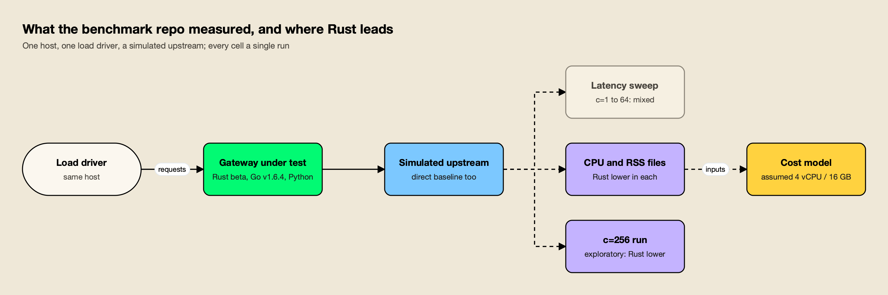
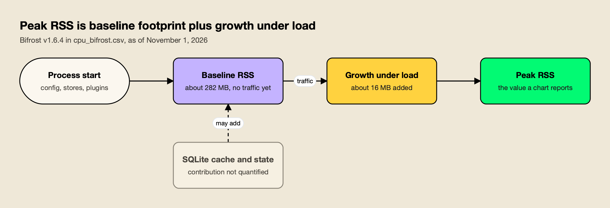
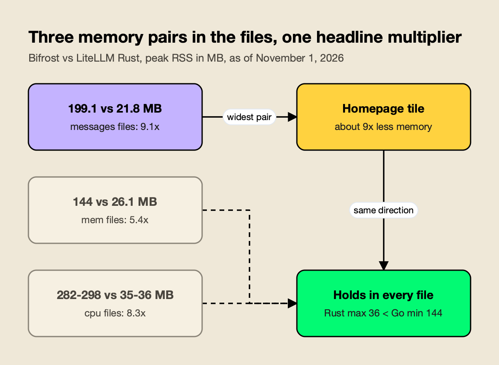

**TL;DR**
- LiteLLM's Rust gateway beta leads Bifrost v1.6.4 on CPU in LiteLLM's own files: 0.66% vs 2.59% mean, and 15.9% vs 79.5% peak (as of November 1, 2026).
- Rust is smaller on memory in every file: its highest figure (about 36 MB) is below Bifrost's lowest (about 144 MB).
- In an exploratory concurrency 256 run, Rust records p50 of 55.5 ms vs 89.3 ms and p99 of 2,667.8 ms vs 5,421.3 ms, from one run with no RPS field, excluded from the main sweep.
- The modelled cost is $0.0099 vs $0.0434 per hour, and Rust is far ahead of LiteLLM's own Python proxy.
- For Rust vs Go performance, those wins are real, but they do not support the homepage's specific multipliers: the 7x overhead figure is not reproduced by the sweep, and the 9x memory figure uses the widest of three pairs.

Rust vs Go performance is one of the most argued questions in backend engineering, and in November 2026 it acquired a concrete test case: LiteLLM's new Rust gateway, benchmarked against Bifrost, a gateway written in Go. LiteLLM published its raw CSV and JSON files, and those files do not support several of its headline numbers. They also show, in plain terms, the places where the Rust gateway is ahead.

Those concessions deserve their own account, because the useful engineering information sits in the details: which resource Rust used less of, under what load, in which file, and with what caveats. The sections below set out each of Rust's leads with its source figure, explains what the metric means for anyone running an AI gateway, and then explains why those leads still do not add up to the specific 7x and 9x multipliers on LiteLLM's homepage. Every figure is as of November 1, 2026.

## The Benchmark Behind the Comparison

The comparison comes from LiteLLM's public [ai-gateway-bench](https://github.com/BerriAI/ai-gateway-bench) repository, which tested a LiteLLM Rust beta, the LiteLLM Python proxy and Bifrost v1.6.4 on one host with one load driver and a simulated upstream. Each cell appears to be a single run, with no repeats or error bars.

LiteLLM's [benchmark blog post](https://docs.litellm.ai/blog/rust-ai-gateway-benchmarks) describes the method as "same mock and load driver on one host" and says the results are "single-host, per-scenario runs (for example n=5000 on the overhead panel) without repeated-trial error bars". It also asks readers to "treat them as order-of-magnitude differences" and calls the exercise "a vendor-run benchmark". The raw data sits in the repo's [results directory](https://github.com/BerriAI/ai-gateway-bench/tree/main/results).

Three details shape how every number below should be read:

- **Versions.** The blog lists "LiteLLM Rust beta, LiteLLM Python v1, Bifrost v1.6.4". It describes the Rust gateway as "an early beta, streaming and the full feature surface are still landing". Bifrost v1.6.4 is an older build; its changelogs list v1.6.5 to v1.6.11 and then v2.0.0 to v2.4.0 after it.
- **Hardware.** No machine type, core count or worker count is stated for the benchmark runs of any gateway. The only stated hardware, a 4 vCPU / 16 GB instance, appears in the cost model.
- **Scope.** The blog itself says "It is not a full-feature comparison."

*Figure 1: Rust's leads sit in the resource files and the exploratory run; the main latency sweep is mixed.*

As Figure 1 shows, the repo produces different kinds of evidence. The latency sweep at concurrency 1 to 64 is mixed, the resource files favour Rust throughout, the concurrency 256 run favours Rust with heavy caveats, and the cost model is derived from the resource files. Keeping those categories apart is the first step to a fair reading.

For readers new to gateway benchmarking, agitracker.io's guide to [measuring LLM gateway overhead](/blog/llm-gateway-benchmark/) explains why a direct-to-upstream baseline matters and why tail percentiles separate gateways better than medians.

## Rust Leads on CPU

LiteLLM's CPU files show the Rust gateway averaging 0.66% CPU with a 15.9% peak, against 2.59% mean and 79.5% peak for Bifrost v1.6.4, as of November 1, 2026. That is approximately 3.9x the mean and 5x the peak, measured for the whole process under the tested configurations.

The figures come from [cpu_rust.csv](https://github.com/BerriAI/ai-gateway-bench/blob/main/results/cpu_rust.csv) and [cpu_bifrost.csv](https://github.com/BerriAI/ai-gateway-bench/blob/main/results/cpu_bifrost.csv). This is the cleanest of Rust's leads: Rust records lower CPU usage.

| Metric (as of Nov 1, 2026) | LiteLLM Rust beta | Bifrost v1.6.4 |
|---|---:|---:|
| Mean CPU | 0.66% | 2.59% |
| Peak CPU | 15.9% | 79.5% |
| Source file | cpu_rust.csv | cpu_bifrost.csv |

The context matters for interpreting the size of the numbers, not their direction. The CPU samples are averaged over a 30-second window of which about 2.3 seconds was active, and the Go gateway's peak falls inside the roughly two-second request burst. One inference, not confirmed: the CPU samples appear to come from a short burst, probably the concurrency 16 cost runs, so CPU may be paired with a different load than the homepage's 2,800 req/s figure. The files do not separate request handling from background work.

### Why CPU Matters for a Gateway

A gateway sits on the path of every model request, so its CPU cost is paid on every call, by every replica. Lower CPU per request means more headroom on the same instance, smaller instances for the same traffic, or room for features (policy checks, logging, routing logic) inside the same budget. A lower peak during a burst also leaves more of the machine for other work, which matters for sidecar deployments and dense clusters.

That is a real engineering advantage. The caveat is about attribution, not direction: these are whole-process measurements of two configurations that, as covered below, were not doing the same work.

## Rust Is Smaller on Memory in Every File

Across all three memory pairs in LiteLLM's files, Rust is smaller. Its highest recorded figure, about 36 MB, is below the Go gateway's lowest, about 144 MB. This lead does not depend on which file a reader picks.

The three pairs:

| Files | Bifrost v1.6.4 | LiteLLM Rust beta | Ratio |
|---|---:|---:|---:|
| mem_bifrost_messages.csv / mem_litellm_rust_release.csv | 199.1 MB | 21.8 MB | 9.1x |
| mem_bifrost.csv / mem_litellm_rust.csv | 144 MB | 26.1 MB | 5.4x |
| cpu_bifrost.csv / cpu_rust.csv | 282 to 298 MB | 35 to 36 MB | 8.3x |

These are peak resident set size (RSS) figures: the most physical memory the process held at any sampled moment. LiteLLM's blog correctly calls the 21.8 MB vs 199.1 MB pair "peak memory".

For a gateway, memory per instance sets how many replicas fit on a node, whether the gateway can run as a sidecar next to each application, and how much a fleet costs to keep warm. A process that stays in the tens of megabytes is easy to place anywhere. That is a genuine strength of the Rust beta in these runs.

### Where the Go Gateway's Memory Sits

One observation changes how the gap should be read, without reversing it. In cpu_bifrost.csv, the Go gateway's RSS is already about 282 MB before the first request, and load adds only about 16 MB.

*Figure 2: Most of the Go gateway's recorded memory was present before traffic arrived, which points to baseline footprint rather than load.*

As Figure 2 shows, that pattern points primarily to a baseline footprint rather than growth in a log buffer, although RSS alone cannot identify which components account for it. One candidate is SQLite. Bifrost v1.6.4 opens a disk-backed logs.db at startup and configures `_cache_size=10000`, a suggested limit of 10,000 pages per connection, approximately 39.1 MiB at a 4 KiB page size. That cache grows on demand and is not preallocated in full, but SQLite's caches and connection state can contribute to baseline RSS before traffic. The files do not quantify that contribution or isolate logging's share of the gap. The relevant code is in the v1.6.4 [SQLite log store setup](https://github.com/maximhq/bifrost/blob/transports/v1.6.4/framework/logstore/sqlite.go), and the [SQLite cache_size documentation](https://www.sqlite.org/pragma.html#pragma_cache_size) explains the setting.

Bifrost 2.x has since substantially reduced memory use by changing what data it retains and how it stores it, and the v1.6.4 benchmark does not reflect those improvements. No figure for the reduction is published yet; a like-for-like retest is planned to quantify it.

None of that removes Rust's lead in any file.

## Rust Leads at Concurrency 256

In a concurrency 256 run left in LiteLLM's results directory, the Rust beta records p50 latency of 55.5 ms against 89.3 ms for the Go gateway, and p99 of 2,667.8 ms against 5,421.3 ms. That is about 1.6x better at p50 and 2.0x at p99. It is an exploratory result: one run, no RPS field, excluded from the sweep.

The figures come from the per-gateway c256 JSON files in the [results directory](https://github.com/BerriAI/ai-gateway-bench/tree/main/results), including litellm_rust_messages_c256.json and bifrost_messages_c256.json.

| Concurrency 256 (as of Nov 1, 2026) | p50 latency | p99 latency |
|---|---:|---:|
| Direct to upstream | 48.1 ms | 434.8 ms |
| LiteLLM Rust beta | 55.5 ms | 2,667.8 ms |
| Bifrost v1.6.4 | 89.3 ms | 5,421.3 ms |
| LiteLLM Python | 1,513 ms | 10,733.6 ms |

The caveats come with the result, and they are significant:

- **One run.** Each gateway ran 5,000 requests once, with no errors recorded.
- **No throughput.** The files carry no RPS field, so the run cannot show how many requests each gateway completed per second at this load.
- **Excluded from the sweep.** The repo's [README](https://github.com/BerriAI/ai-gateway-bench) says concurrency 256 "was dropped because its p99 exceeded twice the single-client floor". The direct baseline itself was outside the benchmark's own threshold.

With the baseline already beyond the threshold, this is an exploratory result rather than a reliable capacity comparison. The direction still favours Rust, and that is worth stating: under the heaviest load in the repo, the Rust beta's median and tail were both lower than the Go gateway's.

The main sweep has one more Rust lead. At concurrency 16, Rust's added p99 latency is +0.33 ms against +0.89 ms for the Go gateway, a 0.56 ms difference. That is 2.7x the added latency but about 2.4% of total p99. It is a measured lead in the sweep, from a single run per cell.

## The Modelled Cost Ratio

LiteLLM's cost model puts the Rust gateway at $0.0099 per hour against $0.0434 for the Go gateway, a 4.4x ratio, and 283,833 against 63,246 requests per dollar-hour, which is the homepage's "~4.5x more requests per dollar". The arithmetic holds.

Both figures are in [rps_per_dollar.csv](https://github.com/BerriAI/ai-gateway-bench/blob/main/results/rps_per_dollar.csv). The cost lead is a direct consequence of the CPU and memory leads: a model that prices resources will favour the process that uses fewer of them.

What the model is, and is not, matters for anyone tempted to plug it into a budget:

- **It is a model, not a measurement.** The blog describes it as "estimated USD per one million requests from measured CPU, peak RSS, and sustained throughput on a 4 vCPU / 16 GB instance". That instance is a modelling assumption, not the benchmark machine.
- **Three ratios appear.** The homepage uses 4.5x per dollar-hour. The blog says "roughly 6x" ($0.001008 vs $0.000175 per million requests), which works out to about 5.8x and is a different metric. The hourly figure is 4.4x.
- **The inputs carry the configuration gap.** The Go gateway's logging cost is inside the resource measurements the model uses.
- **Token cost is excluded.** The blog says so explicitly.

The ratio is derived from resource measurements, rather than an independent result demonstrating the same savings in production. That does not make the direction wrong. A gateway that uses less CPU and memory will cost less to host, other things equal. The open question is how much less once both gateways do the same work.

## The Gain Over LiteLLM Python

The largest improvement in LiteLLM's files is not Rust against Go; it is Rust against LiteLLM's own Python proxy. At concurrency 64, Python adds about 546 ms of p99 latency, roughly 13.6x the Rust port's +40.28 ms, and reaches 179.8 requests per second against 2,722.2 for Rust.

The figures come from [latency_vs_concurrency.csv](https://github.com/BerriAI/ai-gateway-bench/blob/main/results/latency_vs_concurrency.csv).

| Concurrency | Direct p99 | Rust added p99 | Python added p99 | Rust RPS | Python RPS |
|---:|---:|---:|---:|---:|---:|
| 1 | 21.98 ms | +0.89 ms | +9.79 ms | 45.2 | 34.4 |
| 4 | 22.42 ms | +0.61 ms | +26.95 ms | 181.2 | 92.7 |
| 16 | 22.67 ms | +0.33 ms | +251.34 ms | 721.8 | 158.4 |
| 64 | 24.02 ms | +40.28 ms | +546.04 ms | 2,722.2 | 179.8 |

This is the result LiteLLM's engineers have most reason to be proud of. The Python proxy reaches about 6% of direct throughput at concurrency 64, while the Rust port keeps 95.3%. At concurrency 256 the gap persists: Python's p50 is 1,513 ms against Rust's 55.5 ms. For a team running the Python proxy, the Rust path is a large step.

Across gateways, the fairest summary is that LiteLLM Rust caught up to where the Go gateway already was, which itself concedes the scale of the improvement over Python.

There is a deployment caveat. LiteLLM's [Rust gateway documentation](https://docs.litellm.ai/docs/proxy/rust_gateway), as checked on November 1, 2026, warns that the Python proxy on main:latest uses Rust only for /ocr across providers and /audio/transcriptions for Bedrock. Chat Completions and Messages still run on Python, and the per-model `rust: true` flag currently has no effect. LiteLLM's migration tracker reports 24% of major APIs built as of v1.107.0-rc.2. The benchmarked Rust numbers describe the beta, not what most current LiteLLM proxy users run today. agitracker.io's survey of [LiteLLM alternatives](/blog/litellm-alternatives/) covers what that means for teams planning a migration.

## What Rust Engineering Buys a Gateway

The files show the Rust beta using less CPU and memory than a Go gateway and leading under the heaviest load. They also show both compiled gateways within 1% on throughput from concurrency 1 to 64, with mixed added p99.

This is where the general Rust vs Go argument meets data. Rust compiles to native code and manages memory through ownership rather than a garbage collector. Go also compiles to native code, with a garbage-collected runtime and goroutines scheduled by that runtime; Bifrost's [concurrency architecture documentation](https://docs.getbifrost.ai/architecture/core/concurrency) describes its worker pools and goroutine management. Engineers often expect a Rust service to have a smaller resident footprint and steadier CPU, and the resource files are consistent with that expectation.

Consistent with is not the same as caused by. The files do not attribute the memory or CPU gap to the language, and RSS alone cannot identify which components account for the Go gateway's footprint. The two processes were also not doing the same work, as the next sections show. The fair statement is that the Rust beta's resource profile in these runs is what a careful Rust implementation is supposed to deliver, and that the files cannot say how much of the difference is language, how much is configuration, and how much is version.

The latency data adds the other half of the picture. On request-path speed at concurrency 1 to 64, language did not produce a clear winner:

| Concurrency (as of Nov 1, 2026) | Rust added p99 | Bifrost added p99 | Rust RPS | Bifrost RPS |
|---:|---:|---:|---:|---:|
| 1 | +0.89 ms | +0.75 ms | 45.2 | 44.8 |
| 4 | +0.61 ms | +0.63 ms | 181.2 | 180.2 |
| 16 | +0.33 ms | +0.89 ms | 721.8 | 722.7 |
| 64 | +40.28 ms | +28.68 ms | 2,722.2 | 2,719.1 |

Rust is lower at 16; the Go gateway is lower at 1 and 64; at 4 the 0.02 ms gap is noise. Every throughput gap is under 1%. With one run per cell and no confidence intervals, these throughput gaps are noise. For teams weighing a rust ai gateway against a Go one, that is the practical lesson: from concurrency 1 to 16, both compiled designs add under a millisecond of p99 over a direct call, and resource efficiency, not raw latency, is where the Rust beta separates itself in these files.

## Why the Wins Do Not Support 7x and 9x

Rust's genuine leads are in CPU, memory, the exploratory concurrency 256 run and the cost model. LiteLLM's homepage headlines are more specific: about 7x lower overhead and about 9x less memory than Bifrost. The 7x is not reproduced by the sweep, and the 9x uses the widest of three memory pairs.

### The 7x Overhead Figure

The blog's "roughly 7x lower overhead" compares about 0.7 ms at p99 for Rust against about 4.5 ms for the Go gateway, from [overhead_comparison.csv](https://github.com/BerriAI/ai-gateway-bench/blob/main/results/overhead_comparison.csv) (4.544 vs 0.66 ms). No row of LiteLLM's own concurrency sweep is near 4.54 ms for that gateway: the sweep shows +0.75, +0.63, +0.89 and +28.68 ms. The CSV states no concurrency for the 4.54 ms figure.

So the CPU, memory and concurrency 256 leads cannot be read back into an overhead claim; the overhead multiplier is a separate number. The [benchmark section of litellm.ai](https://www.litellm.ai/#benchmark) also carries a different claim, "3.5x lower overhead than the next AI gateway", which compares Rust's 0.66 ms with a different gateway at 2.29 ms, not Bifrost. The page's 3.5x and the blog's 7x are two different comparisons.

### The 9x Memory Figure

The homepage uses the widest pair in plain terms: 199.1 vs 21.8 MB, a 9.1x ratio, where the other two pairs give 5.4x and 8.3x.

*Figure 3: Rust is smaller in every pair; the homepage multiplier comes from the widest one.*

As Figure 3 shows, the direction holds in every file, which is exactly why the choice of pair and its label are the only things in question. The homepage's "memory at rest" label is mislabelled: the figure is peak RSS. The same chart uses "memory at rest", "peak RSS" and "idle", and the column in the file is peak_rss_mb. The scope matters here. The pairs may come from different scenarios or builds, so the issue is the label, not that Rust is smaller.

| Homepage claim | What the files show | Status |
|---|---|---|
| About 7x lower overhead than Bifrost | 4.544 vs 0.66 ms in overhead_comparison.csv; sweep shows Bifrost +0.75 to +28.68 ms | Not reproducible from LiteLLM's published sweep |
| About 9x less "memory at rest" | 199.1 vs 21.8 MB peak RSS, widest of three pairs (9.1x vs 5.4x and 8.3x) | Direction holds; mislabelled (peak RSS, not memory at rest); headline uses the widest pair |
| About 4.5x more requests per dollar | 283,833 vs 63,246 requests per dollar-hour | Arithmetic holds; modelled on an assumed instance |
| Lower CPU | 0.66% vs 2.59% mean; 15.9% vs 79.5% peak | Supported by the files |

CPU and memory direction are supported outright; the cost ratio is correct arithmetic on modelled inputs; the overhead multiplier is not supported as stated.

## The Configuration Gap and Its Hedge

LiteLLM's blog says every gateway ran "with no logging callbacks, spend tracking, or persistence enabled". The published Bifrost config leaves logging on by default, which would add log buffering and SQLite writes. That finding is inferred from v2.4.0 code and not yet confirmed on v1.6.4.

The benchmark's [Bifrost gateway config](https://github.com/BerriAI/ai-gateway-bench/tree/main/gateways/bifrost) sets a simulated upstream, `config_store: enabled: false` and no plugins. It never sets `logs_store` or `enable_logging`. In the gateway's code:

- `enable_logging` defaults to true when unset.
- A missing `logs_store` creates a default SQLite log store.
- The logging plugin is built in, so "no plugins" in a config does not turn it off.
- `config_store.enabled: false` only leaves the config store nil; it does not turn off the log store or the plugins.
- `disable_content_logging` defaults to false, so request and response bodies are logged too.

Bifrost's own [client configuration docs](https://docs.getbifrost.ai/deployment-guides/config-json/client) document the `enable_logging` and `disable_content_logging` settings, and the [storage configuration docs](https://docs.getbifrost.ai/deployment-guides/config-json/storage) cover `logs_store`. The [log store architecture page](https://docs.getbifrost.ai/architecture/framework/log-store) describes what the store persists.

The hedge matters, and it has to travel with the finding. The logging-on conclusion is inferred from v2.4.0 code and not confirmed on v1.6.4, and the files do not quantify how much of the CPU or memory gap logging accounts for. Disabling logging alone would not remove other plugins' hooks: telemetry, governance, routing and compat plugins load independently. In v1.6.4, the [log store config](https://github.com/maximhq/bifrost/blob/transports/v1.6.4/framework/logstore/config.go) flushes at 1,000 entries, 5 seconds from the first entry, or 300 MiB of estimated payload, with a 10,000-entry queue; these are entry-count bounds, not a total memory cap.

Rust records lower CPU and memory usage, but the configurations perform different work. Both halves of that sentence are the fair position: Rust leads, and the benchmark does not isolate why. The version gap compounds it, since an older Bifrost build was compared with a Rust beta that has no streaming yet.

For a broader comparison of the two projects beyond this benchmark, agitracker.io's [Bifrost vs LiteLLM comparison](/blog/bifrost-vs-litellm/) covers governance, MCP and migration, and the [guide to the best LLM gateways](/blog/best-llm-gateways/) sets both in the wider field.

## How Engineers Should Read Rust's Lead

The fair reading is that LiteLLM's Rust beta is a well-engineered, resource-efficient gateway that uses less CPU and memory than the Go gateway in every published file, and that the benchmark does not isolate how much of that comes from Rust, configuration or version.

For a team evaluating gateways, the practical steps follow from what the files leave open:

- **Match the configuration.** Run both gateways with logging off, then with logging on, so the resource numbers compare the same work.
- **Use current builds.** Compare the versions that would actually be deployed, not a beta against an older release.
- **Repeat the runs.** Single runs cannot separate a 0.02 ms gap from noise; repeated trials with error bars can.
- **Publish the hardware.** State machine type, cores, workers, upstream latency and concurrency for every run.
- **Profile the memory.** A heap profile shows which components hold the baseline footprint, which RSS cannot.

A like-for-like retest has been announced with the same conditions: both gateways with logging off and on, a current build of the Go gateway, repeated trials with error bars, full hardware and worker disclosure, and heap profiles of the memory gap. If Rust still leads on memory under those conditions, that is a result worth reporting as plainly as this one.

Teams that want to run their own numbers can start from LiteLLM's repo, which publishes its load driver and raw files, or from the Go gateway's [guide to running your own benchmarks](https://docs.getbifrost.ai/benchmarking/run-your-own-benchmarks). agitracker's [test plan for choosing an LLM gateway](/blog/llm-gateway-test-plan/) lays out the steps above as a runnable plan. Further reading on the vendor side:

- A [buyer's guide for LLM gateways](https://www.getmaxim.ai/resources/buyers-guide) with an evaluation checklist.
- A [LiteLLM migration guide](https://www.getmaxim.ai/resources/migrating-from-litellm) and a [LiteLLM alternative overview](https://www.getmaxim.ai/resources/litellm-alternative).
- An article on [choosing a LiteLLM alternative for performance and governance](https://www.getmaxim.ai/articles/best-litellm-alternative-for-performance-and-governance/) and an explainer on [what an LLM gateway does](https://www.getmaxim.ai/articles/what-is-an-llm-gateway/).
- The [Bifrost repository](https://github.com/maximhq/bifrost) and [product page](https://www.getmaxim.ai/bifrost), which document the current gateway.

For general guidance on vetting published numbers, agitracker.io's piece on [how to read an AI benchmark](/blog/how-to-read-an-ai-benchmark/) applies the same discipline to model leaderboards, and its [10-question checklist for reading an AI gateway benchmark](/blog/how-to-read-an-ai-gateway-benchmark/) applies it to gateways.

## The Fair Verdict

LiteLLM's Rust gateway genuinely leads in this benchmark on CPU, on memory in every file, at concurrency 256 in an exploratory run, on modelled cost, and by a wide margin over LiteLLM's own Python proxy. Those are the merits of a careful Rust implementation, and they hold in LiteLLM's own data.

They do not carry the specific homepage multipliers: the 7x rests on a number the sweep does not reproduce, and the 9x is the widest of three pairs. On request-path latency and throughput at concurrency 1 to 64, the Rust beta and the Go gateway are close enough that single runs cannot separate them. The Rust vs Go performance question, for gateways at least, is not settled by this benchmark; it is sharpened by it, and like-for-like runs are where the remaining gap will either hold or narrow.

Source: [Debunking LiteLLM Rust Benchmarking: Part 1](https://www.getmaxim.ai/bifrost/blog/debunking-litellm-rust-benchmarking-part-1), by Akshay Deo of Maxim AI, which builds the Bifrost gateway.
