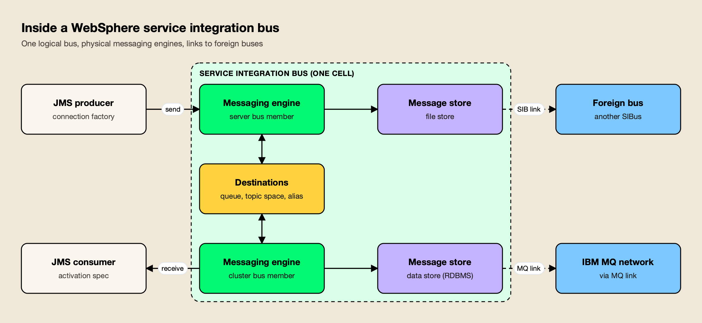
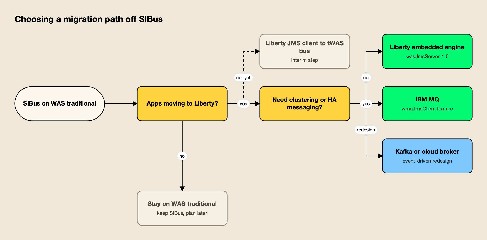
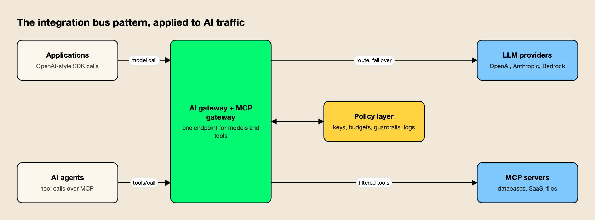

**TL;DR**
- A service integration bus usually means one of two things: IBM WebSphere Application Server's Service Integration Bus (SIBus), the messaging system behind its default JMS provider, or the broader enterprise service bus (ESB) architecture pattern.
- SIBus is built from bus members (servers or clusters), messaging engines with their own message stores, destinations (queue, topic space, foreign, alias), links to foreign buses and IBM MQ, and optional Java mediations.
- The ESB pattern centralizes routing, transformation and protocol conversion in shared middleware; microservices and event streaming moved most of that logic back into the services ("smart endpoints and dumb pipes").
- Teams leaving SIBus usually move applications to Liberty first, then move messaging to the Liberty embedded engine, IBM MQ, or an event streaming platform.
- AI gateways and MCP gateways now play a bus-like role for model and tool traffic: one endpoint, one policy layer, many back ends.

A service integration bus is middleware that connects separate applications through a shared messaging layer, so that each application talks to the bus rather than to every other application. The term has two common uses. In IBM WebSphere Application Server, the Service Integration Bus (SIBus) is the built-in asynchronous messaging system behind the default JMS provider. In general architecture writing, "integration bus" refers to the enterprise service bus (ESB) pattern. This guide covers both from primary sources: SIBus architecture and how it works, the ESB pattern, how it compares with microservices and Kafka, migration paths off SIBus, and how the same idea now reappears in AI infrastructure.

## What Is a Service Integration Bus

A service integration bus is a shared messaging layer that lets applications exchange messages through named destinations instead of direct connections. Producers send to a destination, consumers read from it, and the bus handles delivery, persistence and routing. In IBM's product the term is a proper noun; in architecture it describes the ESB pattern.

IBM's own definition is specific. Its WebSphere documentation describes a service integration bus as [a group of one or more application servers or server clusters](https://www.ibm.com/docs/en/was-nd/9.0.5?topic=integration-service-buses#:~:text=a%20group%20of%20one%20or%20more%20application%20servers%20or%20server%20clusters) in a WebSphere cell that cooperate to provide asynchronous messaging services. The same page notes the bus is [sometimes referred to as the messaging bus](https://www.ibm.com/docs/en/was-nd/9.0.5?topic=integration-service-buses#:~:text=sometimes%20referred%20to%20as%20the%20messaging%20bus) when it provides messaging for JMS applications that use the default messaging provider.

The broader pattern is older than any product. Gregor Hohpe and Bobby Woolf's *Enterprise Integration Patterns* describes a Message Bus as [a combination of a common data model, a common command set, and a messaging infrastructure](https://www.enterpriseintegrationpatterns.com/patterns/messaging/MessageBus.html#:~:text=a%20combination%20of%20a%20common%20data%20model%2C%20a%20common%20command%20set%2C%20and%20a%20messaging%20infrastructure) that lets different systems communicate through a shared set of interfaces. Commercial ESBs packaged that pattern with adapters, transformation tools and a registry.

| Meaning | What it is | Typical products |
|---|---|---|
| IBM SIBus | Built-in JMS messaging system in WebSphere Application Server traditional | WebSphere Application Server (default messaging provider) |
| Enterprise service bus (ESB) | Architecture pattern: central routing, transformation and protocol mediation | Apache ServiceMix, IBM Integration Bus / App Connect, MuleSoft, TIBCO |
| Cloud "service bus" | Managed message broker with queues and topics | Azure Service Bus |

## IBM WebSphere Service Integration Bus Architecture

SIBus architecture has five building blocks: the bus itself, bus members, messaging engines, message stores, and destinations. Two optional pieces extend it: links to foreign buses (including IBM MQ networks) and mediations, which are Java programs that process messages in flight. Applications usually reach all of this through JMS connection factories and destinations.

### Bus Members and Messaging Engines

[The members of a service integration bus can be application servers, server clusters, or IBM MQ servers](https://www.ibm.com/docs/en/was/9.0.5?topic=integration-bus-members#:~:text=The%20members%20of%20a%20service%20integration%20bus%20can%20be%20application%20servers%2C%20server%20clusters%2C%20or%20IBM%20MQ%20servers). Each server or cluster member contains [a component called a messaging engine](https://www.ibm.com/docs/en/was/9.0.5?topic=integration-messaging-engines#:~:text=a%20component%20called%20a%20messaging%20engine), which processes send and receive requests and hosts destinations. An IBM MQ server member has no messaging engine; it gives the bus a direct client connection to queues on an MQ queue manager.

Messaging engines are created automatically when a member is added, and each one carries a UUID. IBM warns that [if you delete and recreate a messaging engine, it will have a different UUID](https://www.ibm.com/docs/en/was/9.0.5?topic=integration-messaging-engines#:~:text=If%20you%20delete%20and%20recreate%20a%20messaging%20engine%2C%20it%20will%20have%20a%20different%20UUID), so the bus treats it as a new engine that cannot read the old engine's message store. That detail matters during migrations and disaster recovery.

The SIB Service that runs this machinery is off until needed: [by default, the SIB Service is disabled](https://www.ibm.com/docs/en/was-nd/9.0.5?topic=integration-service-buses#:~:text=By%20default%2C%20the%20SIB%20Service%20is%20disabled) and is enabled automatically when a server joins a bus.

### Message Stores

[Each messaging engine has one and only one message store](https://www.ibm.com/docs/en/was/9.0.5?topic=integration-message-stores#:~:text=Each%20messaging%20engine%20has%20one%20and%20only%20one%20message%20store), either a file store on the file system or a data store in a relational database. The store holds messages, transaction states and channel states so the engine can recover after a failure. The choice is hard to reverse: IBM states that [there are currently no facilities available for migrating from a data store to a file store](https://www.ibm.com/docs/en/was/9.0.5?topic=integration-message-stores#:~:text=There%20are%20currently%20no%20facilities%20available%20for%20migrating%20from%20a%20data%20store%20to%20a%20file%20store).

### Bus Destinations

SIBus has four destination types: [queue, topic space, foreign, and alias](https://www.ibm.com/docs/en/was/9.0.5?topic=integration-bus-destinations#:~:text=queue%2C%20topic%20space%2C%20foreign%2C%20and%20alias). Each JMS queue or topic an application uses maps to one of them.

| Destination type | Used for | Key behavior |
|---|---|---|
| Queue | Point-to-point messaging | Localized in one bus member; the messaging engine holds messages until a consumer is ready |
| Topic space | Publish/subscribe | Not localized; the bus matches each publication against subscriptions and delivers a copy to each subscriber |
| Foreign | Point-to-point to another bus | Overrides defaults or security for a destination defined on a foreign bus or IBM MQ network |
| Alias | Either model | Maps an alternative name (for example an MQ-compliant name) to a target destination |

Two supporting concepts round out the model. Exception destinations hold messages that cannot be delivered or discarded; IBM's documentation says [exception destinations prevent the loss of messages](https://www.ibm.com/docs/en/was/9.0.5?topic=integration-bus-destinations#:~:text=Exception%20destinations%20prevent%20the%20loss%20of%20messages) when the quality of service requires it. Routing paths chain destinations: [a routing path defines a sequential list of intermediary bus destinations](https://www.ibm.com/docs/en/was/9.0.5?topic=integration-bus-destinations#:~:text=A%20routing%20path%20defines%20a%20sequential%20list%20of%20intermediary%20bus%20destinations) that a message passes through, applying each one's mediations.

### Foreign Buses and IBM MQ Links

A bus can connect to other messaging networks through a foreign bus connection, which represents either another service integration bus or an IBM MQ queue manager or queue-sharing group. [A foreign bus connection can be direct or indirect](https://www.ibm.com/docs/en/was/9.0.5?topic=buses-foreign#:~:text=A%20foreign%20bus%20connection%20can%20be%20direct%20or%20indirect): messages route either straight to the other bus or through intermediate buses.

The physical link is either a service integration bus link (engine to engine) or an IBM MQ link to a gateway queue manager, in which case [the linked IBM MQ network appears as a foreign bus](https://www.ibm.com/docs/en/was/9.0.5?topic=buses-foreign#:~:text=the%20linked%20IBM%20MQ%20network%20appears%20as%20a%20foreign%20bus). One rule surprises newcomers: [applications cannot receive messages from destinations in a foreign bus](https://www.ibm.com/docs/en/was-nd/9.0.5?topic=integration-service-buses#:~:text=applications%20cannot%20receive%20messages%20from%20destinations%20in%20a%20foreign%20bus). To consume, an application must connect to that bus directly, which makes it a local bus.

### Mediations

A mediation is a Java program attached to a destination that processes messages between the producer and the consumer. IBM lists four kinds of work, starting with [transforming a message from one format into another](https://www.ibm.com/docs/en/was/9.0.5?topic=integration-mediations#:~:text=Transforming%20a%20message%20from%20one%20format%20into%20another.), then routing to additional destinations, enriching from a data source, and conditional delivery. Compared with a message-driven bean that re-sends a message, a mediation has an advantage IBM states plainly: [it preserves the message identity](https://www.ibm.com/docs/en/was/9.0.5?topic=integration-mediations#:~:text=It%20preserves%20the%20message%20identity.).

Mediations are the most ESB-like part of SIBus, and the part that most often complicates migration, because no other IBM messaging runtime runs them unchanged.

## How the Service Integration Bus Works

A JMS application looks up a connection factory and a destination, connects to any messaging engine on the bus, and sends a message. The bus routes it to the messaging engine that owns the destination's queue point, persists it in that engine's message store if the quality of service requires, runs any mediations, and delivers it to a consumer when one is ready.

*Figure 1: Applications see one logical bus; the messaging engines, message stores and links underneath are an administrator's concern.*

Three properties explain why teams built on it:

- **Location transparency.** After an application connects, [the bus behaves as a single logical entity](https://www.ibm.com/docs/en/was-nd/9.0.5?topic=integration-service-buses#:~:text=the%20bus%20behaves%20as%20a%20single%20logical%20entity); producers and consumers can attach through any messaging engine.
- **Asynchronous delivery.** A producer places a message and continues, whether or not the consumer or destination is available at that moment.
- **Scale through clustering.** [If you add server clusters as members of a bus](https://www.ibm.com/docs/en/was-nd/9.0.5?topic=integration-service-buses#:~:text=If%20you%20add%20server%20clusters%20as%20members%20of%20a%20bus), the bus gains scalability and high availability through WebSphere's own clustering.

On the client side, Liberty's documentation summarizes the dependency: [to use the default messaging provider, your applications must connect to a service integration bus](https://www.ibm.com/docs/en/was-liberty/nd?topic=providers-service-integration-bus-messaging-provider#:~:text=To%20use%20the%20default%20messaging%20provider%2C%20your%20applications%20must%20connect%20to%20a%20service%20integration%20bus). JMS queues map to bus queue destinations and JMS topics map to topic spaces, so most application code never touches SIBus APIs directly.

## The Enterprise Service Bus Pattern

An enterprise service bus is an architecture pattern in which shared middleware handles routing, data transformation, protocol conversion and orchestration between applications. Applications publish to the bus; the bus converts and forwards data to whoever needs it. SIBus is a messaging core that can form part of an ESB, but the pattern is wider than any one product.

AWS's explainer defines the ESB as [a software architectural pattern that supports synchronous and asynchronous data exchange](https://aws.amazon.com/what-is/enterprise-service-bus/#:~:text=a%20software%20architectural%20pattern%20that%20supports%20synchronous%20and%20asynchronous%20data%20exchange) between separate applications, built from endpoints, adapters and the bus itself. The underlying patterns come from Hohpe and Woolf:

- **Canonical Data Model.** [Design a Canonical Data Model that is independent from any specific application](https://www.enterpriseintegrationpatterns.com/patterns/messaging/CanonicalDataModel.html#:~:text=design%20a%20Canonical%20Data%20Model%20that%20is%20independent%20from%20any%20specific%20application), so each new system needs one translation rather than one per partner.
- **Message Router.** A router chooses the destination and [does not modify the message contents](https://www.enterpriseintegrationpatterns.com/patterns/messaging/MessageRouter.html#:~:text=does%20not%20modify%20the%20message%20contents).
- **Message Translator.** A filter between systems used to [translate one data format into another](https://www.enterpriseintegrationpatterns.com/patterns/messaging/MessageTranslator.html#:~:text=translate%20one%20data%20format%20into%20another).

### ESB Products and Open-Source Building Blocks

Open-source ESBs were assembled from Apache projects. [Apache ServiceMix](https://servicemix.apache.org/#:~:text=enterprise%20ready%20ESB%20exclusively%20powered%20by%20OSGi) combined ActiveMQ, Camel, CXF and Karaf into an ESB runtime, though its homepage now states that [this project has retired](https://servicemix.apache.org/#:~:text=This%20project%20has%20retired).

Two of its components remain active projects. [Apache Camel](https://camel.apache.org/manual/faq/what-is-camel.html#:~:text=integration%20framework%20based%20on%20known%20Enterprise%20Integration%20Patterns), an integration framework based on the Enterprise Integration Patterns, and [Apache ActiveMQ](https://activemq.apache.org/#:~:text=multi%2Dprotocol%2C%20Java%2Dbased%20message%20broker), a multi-protocol, Java-based message broker, are commonly used on their own rather than inside a full ESB container.

Commercial ESBs in the same category include IBM Integration Bus, MuleSoft and TIBCO.

Cloud brokers carry the "service bus" name without being full ESBs. Microsoft describes [Azure Service Bus](https://learn.microsoft.com/en-us/azure/service-bus-messaging/service-bus-messaging-overview#:~:text=fully%20managed%20enterprise%20message%20broker%20with%20message%20queues%20and%20publish%2Dsubscribe%20topics) as a fully managed enterprise message broker with queues and publish-subscribe topics, plus sessions for FIFO ordering, transactions and a secondary subqueue [called a dead-letter queue (DLQ)](https://learn.microsoft.com/en-us/azure/service-bus-messaging/service-bus-messaging-overview#:~:text=called%20a%20dead%2Dletter%20queue%20%28DLQ%29). Its queues and topics map closely to SIBus queue and topic space destinations, which makes it a common target for cloud migrations of JMS workloads.

## ESB vs Microservices and Event Streaming

ESBs put integration logic in the middle; microservices and event streaming push it to the edges. The microservices view keeps the transport simple and lets each service own its domain logic, while event streaming platforms such as Apache Kafka keep a durable, replayable log rather than queues that empty on consumption.

Martin Fowler and James Lewis framed the contrast in their microservices article, noting that [ESB products often include sophisticated facilities](https://martinfowler.com/articles/microservices.html#:~:text=ESB%20products%20often%20include%20sophisticated%20facilities) for routing, choreography, transformation and business rules. [The microservice community favours an alternative approach](https://martinfowler.com/articles/microservices.html#:~:text=The%20microservice%20community%20favours%20an%20alternative%20approach): smart endpoints and dumb pipes.

AWS lists the operational reasons enterprises moved away from central buses, including that without high availability [ESB introduces a single point of failure](https://aws.amazon.com/what-is/enterprise-service-bus/#:~:text=ESB%20introduces%20a%20single%20point%20of%20failure), and concludes that ESB use is now [limited primarily to legacy systems with complex integrations](https://aws.amazon.com/what-is/enterprise-service-bus/#:~:text=limited%20primarily%20to%20legacy%20systems%20with%20complex%20integrations).

Kafka changes the storage model. In Kafka, [producers and consumers are fully decoupled and agnostic of each other](https://kafka.apache.org/intro/#:~:text=producers%20and%20consumers%20are%20fully%20decoupled%20and%20agnostic%20of%20each%20other), and unlike traditional messaging systems, [events are not deleted after consumption](https://kafka.apache.org/intro/#:~:text=events%20are%20not%20deleted%20after%20consumption). That makes replay, new consumers and stream processing cheap, at the cost of the per-message transactional semantics JMS applications often rely on.

| Dimension | SIBus / ESB | Microservices with API gateway | Event streaming (Kafka) |
|---|---|---|---|
| Where logic lives | In the bus (mediations, routing, transformation) | In each service | In producers, consumers and stream processors |
| Interaction style | Asynchronous messaging, some request/reply | Mostly synchronous HTTP or gRPC | Asynchronous, log-based |
| Message lifetime | Removed once consumed | Not stored | Retained for a configured period; replayable |
| Contract | Canonical data model, JMS destinations | API per service | Topic schema per event type |
| Governance point | Central bus administration | Gateway plus service owners | Topic ownership and schema registry |
| Typical weakness | Central team bottleneck, upgrade risk | Point-to-point sprawl | Ordering and exactly-once need careful design |

Most estates end up hybrid: an API gateway for synchronous calls, a broker or Kafka for events, and a residual bus for integrations that are not worth rewriting. Agitracker's comparison of [AI gateways and API gateways](/blog/ai-gateway-vs-api-gateway/) walks through how the same "which layer owns which traffic" question plays out for model calls, and the [API integration guide](/blog/api-integration/) covers the synchronous side in more depth.

## Migrating Off SIBus

Migrating off SIBus is usually a two-stage project: move applications from WebSphere Application Server traditional to Liberty, then move the messaging. Liberty can keep talking to an existing bus during the first stage, so the messaging decision does not have to block the application move.

*Figure 2: Most SIBus exits run in stages: move the applications first, then the messaging.*

Liberty supports three JMS providers: its embedded messaging engine, the service integration bus of WebSphere traditional, and IBM MQ. IBM's Liberty documentation describes the bridge option directly: applications can connect to IBM MQ, or [configure a service integration bus with links to the IBM MQ network](https://www.ibm.com/docs/en/was-liberty/base?topic=liberty-jms-messaging#:~:text=configure%20a%20service%20integration%20bus%20with%20links%20to%20the%20IBM%20MQ%20network) and reach it through the default messaging provider.

| Target | How it works | Fits when | Watch for |
|---|---|---|---|
| Stay on WAS traditional | Keep SIBus as is | Applications are stable and not moving | Skills and long-term platform plans |
| Liberty client to existing bus | Liberty apps use the wasJmsClient feature against the tWAS bus | Interim step while apps move | Two runtimes to operate |
| Liberty embedded engine | wasJmsServer-1.0 feature inside Liberty | Simple queues and topics per server | Runs inside one Liberty server; confirm HA needs first |
| IBM MQ | IBM MQ messaging provider in Liberty | Clustering, HA, cross-platform messaging | Liberty client restrictions; mediations must be rewritten |
| Kafka or a cloud broker | Re-platform to event streaming or Azure Service Bus | Event-driven redesign or cloud move | JMS semantics, ordering, transactions |

The embedded option is small: the Liberty feature page says wasJmsServer-1.0 [enables an embedded messaging server that is JMS compliant](https://www.ibm.com/docs/en/was-liberty/base?topic=features-message-server-10#:~:text=enables%20an%20embedded%20messaging%20server%20that%20is%20JMS%20compliant). IBM MQ is the heavier target, where [messaging is handled by a network of queue managers](https://www.ibm.com/docs/en/was-liberty/nd?topic=providers-mq-messaging-provider#:~:text=Messaging%20is%20handled%20by%20a%20network%20of%20queue%20managers), each with its own processes and administration. IBM lists Liberty restrictions to check first, including that [the IBM MQ classes for Java are not supported in Liberty](https://www.ibm.com/docs/en/was-liberty/nd?topic=providers-mq-messaging-provider#:~:text=The%20IBM%20MQ%20classes%20for%20Java%20are%20not%20supported%20in%20Liberty).

A practical order of work:

1. **Inventory the bus.** Export destinations, foreign bus connections, MQ links, alias destinations, routing paths and mediations. Mediations and routing paths are the items with no direct equivalent elsewhere.
2. **Classify each flow.** Plain JMS point-to-point or pub/sub moves easily; mediated, store-and-forward or foreign-bus flows need redesign.
3. **Use an MQ link as a bridge.** Linking the bus to an IBM MQ network lets flows move one at a time while both sides exchange messages.
4. **Replace mediations.** Move transformation into the consuming service, an integration runtime such as Apache Camel, or the target platform's own features.
5. **Drain before decommissioning.** Because engine identity is tied to its UUID and store, empty queues and exception destinations before removing members.

Regulated industries tend to carry the most SIBus and MQ estate, and they are also the earliest to put the same central-control model around AI traffic, as the [financial services and banking overview](https://www.getmaxim.ai/industry-pages/financial-services-and-banking) of AI gateway requirements shows.

## The Integration Bus Pattern in AI Infrastructure

The integration bus idea has returned in AI infrastructure as the AI gateway (or LLM gateway) and the MCP gateway. Applications and agents call one endpoint; the gateway translates to each model provider or tool server, applies policy, and records every call. The traffic is synchronous and token-priced rather than queued, but the role is the same: one connection point and one policy layer in front of many back ends.

*Figure 3: An AI gateway plays the role the bus once played: one entry point, one policy layer, many back ends.*

The mapping from bus concepts is close enough to be useful when explaining AI gateways to integration teams. Background on the category is in this explainer on [what an AI gateway is](https://www.getmaxim.ai/articles/what-is-an-ai-gateway/) and its MCP counterpart, [what an MCP gateway is](https://www.getmaxim.ai/articles/what-is-an-mcp-gateway/).

| Integration bus concept | AI gateway / MCP gateway equivalent |
|---|---|
| Canonical data model | One OpenAI-compatible request format translated to each provider's API |
| Bus destination | Model name, provider route, or MCP tool |
| Foreign bus link | Connection to an external LLM provider or remote MCP server |
| Mediation | Plugins and guardrails that inspect or rewrite prompts, responses and tool arguments |
| Destination security roles | Per-consumer keys with model and tool allow-lists |
| Exception destination | Fallback provider or blocked-request log |
| Message store | Request logs, traces and cost records |

### Named Approaches: Kong, Microsoft and Bifrost

Several products now implement this pattern, from API gateway vendors extending existing platforms to dedicated AI gateways. Agitracker's survey of [top AI gateways](/blog/top-ai-gateways/), its [MCP gateway comparison](/blog/top-mcp-gateways-compared/) and its [agent gateway roundup](/blog/agent-gateways/) cover the field; three examples show the range.

**Kong AI Gateway.** Kong extends its API gateway with AI plugins and entities. Its documentation describes the ability to [define a single endpoint for any traffic type: LLM, MCP, or A2A](https://developer.konghq.com/ai-gateway/#:~:text=Define%20a%20single%20endpoint%20for%20any%20traffic%20type%3A%20LLM%2C%20MCP%2C%20or%20A2A), with semantic caching, prompt guards and load balancing that can [automatically fail over to a different provider or model](https://developer.konghq.com/ai-gateway/#:~:text=Automatically%20fail%20over%20to%20a%20different%20provider%20or%20model). It suits organizations already standardized on Kong; see Agitracker's [Kong alternatives](/blog/kong-alternatives/) for how it compares with dedicated gateways.

**Microsoft Azure API Management.** Microsoft's AI gateway is a set of capabilities that [extends API Management's existing API gateway](https://learn.microsoft.com/en-us/azure/api-management/genai-gateway-capabilities#:~:text=extends%20API%20Management,existing%20API%20gateway) rather than a separate product. A unified model API (preview) [exposes multiple backends through a single OpenAI-compatible endpoint](https://learn.microsoft.com/en-us/azure/api-management/genai-gateway-capabilities#:~:text=exposes%20multiple%20backends%20through%20a%20single%20OpenAI%2Dcompatible%20endpoint), token limit policies cap consumption per consumer, and API Management can [expose any REST API managed in API Management as an MCP server](https://learn.microsoft.com/en-us/azure/api-management/mcp-server-overview#:~:text=Expose%20any%20REST%20API%20managed%20in%20API%20Management%20as%20an%20MCP%20server). It suits Azure-centric estates that want AI policy in the same console as their APIs.

**Bifrost.** [Bifrost](https://www.getmaxim.ai/bifrost) is an [open-source AI gateway](https://github.com/maximhq/bifrost) written in Go by Maxim AI that covers both model traffic and MCP tool traffic, which makes it a clear worked example of the bus pattern applied to AI. It routes requests to 25+ providers and 10,000+ models through one OpenAI-compatible API, and applications adopt it by [changing just the base URL](https://docs.getbifrost.ai/overview#:~:text=Replace%20existing%20AI%20SDK%20connections%20by%20changing%20just%20the%20base%20URL) of their existing SDK. 

Bifrost's published benchmark reports 11 µs of added overhead per request at 5,000 RPS on an AWS t3.xlarge; the [benchmark resource page](https://www.getmaxim.ai/resources/benchmarks) has the methodology.

The bus parallels are direct:

- **Consumer identity and allow-lists.** [Virtual Keys are the primary governance entity in Bifrost](https://docs.getbifrost.ai/features/governance/virtual-keys#:~:text=Virtual%20Keys%20are%20the%20primary%20governance%20entity%20in%20Bifrost), carrying each consumer's permitted models, budgets and rate limits, much as destination roles control who may send to a bus destination. The [governance resource page](https://www.getmaxim.ai/resources/governance) shows how keys, teams and customers stack.
- **Fallback routing.** When a primary provider fails, Bifrost moves to the next provider in the chain, and [each fallback provider gets its own full retry budget](https://docs.getbifrost.ai/features/retries-and-fallbacks#:~:text=Each%20fallback%20provider%20gets%20its%20own%20full%20retry%20budget).
- **Mediation equivalents.** Plugins run pre- and post-processing hooks on each request, with [failure isolation](https://docs.getbifrost.ai/architecture/core/plugins#:~:text=Failure%20Isolation) so plugin errors do not crash the core; [guardrails](https://docs.getbifrost.ai/enterprise/guardrails#:~:text=content%20safety%2C%20security%20validation%2C%20and%20policy%20enforcement%20for%20LLM%20traffic%20and%20MCP%20tool%20executions) apply content safety and policy checks to both LLM traffic and MCP tool executions.
- **Tool traffic.** As an MCP gateway, [Bifrost acts as both an MCP client and server](https://docs.getbifrost.ai/overview#:~:text=Bifrost%20acts%20as%20both%20an%20MCP%20client%20and%20server), aggregating tools from many MCP servers behind one endpoint. Per-key filtering lets administrators [create a strict allow-list of MCP clients and tools](https://docs.getbifrost.ai/features/governance/mcp-tools#:~:text=create%20a%20strict%20allow%2Dlist%20of%20MCP%20clients%20and%20tools), and by default [Bifrost does NOT automatically execute tool calls](https://docs.getbifrost.ai/mcp/overview#:~:text=Bifrost%20does%20NOT%20automatically%20execute%20tool%20calls) unless agent mode is configured for specific tools.

**Enterprise tier.** Guardrails, clustering and adaptive routing are part of Bifrost Enterprise; the gateway, virtual keys, fallbacks, plugins and MCP gateway are in the open-source build.

For deeper reading on the agent side, [MCP: the protocol, the plumbing and the gateway](https://www.getmaxim.ai/bifrost/blog/mcp-the-protocol-the-plumbing-and-the-gateway/) explains why tool traffic needs its own control point, the [MCP gateway resource page](https://www.getmaxim.ai/resources/mcp-gateway) covers access and audit controls, and this [MCP gateway comparison covering Bifrost, Docker, Microsoft, Kong and Cloudflare](https://www.getmaxim.ai/articles/mcp-gateway-comparison-2026-bifrost-docker-microsoft-kong-cloudflare/) lines the options up.

On the policy model, [policy-based governance at the gateway](https://www.getmaxim.ai/articles/policy-based-governance-at-the-gateway-one-control-plane-for-every-ai-call/) argues for one control plane for every AI call, and a [five-way AI gateway vs API gateway comparison](https://www.getmaxim.ai/articles/ai-gateway-vs-api-gateway-5-options-compared-for-llm-traffic-in-2026/) shows where API gateway extensions such as Kong and Azure API Management fit.

Agitracker's own pieces on [A2A vs MCP](/blog/a2a-vs-mcp/), [MCP authentication](/blog/mcp-authentication/) and [MCP server security](/blog/mcp-server-security/) cover the protocols the new bus carries.

### Where the Analogy Stops

The comparison is useful but not exact. A service integration bus stores messages and guarantees delivery later; an AI gateway proxies a live request and returns a response, often streamed, in the same connection. Its unit of cost is tokens, not messages, so limits and budgets are measured differently. And where an ESB's canonical model was negotiated across an enterprise, AI gateways inherit a de facto canonical format, the OpenAI-style chat API, which is why a gateway can usually be introduced without rewriting applications.

## Choosing an Integration Bus in 2026

The service integration bus remains a sound piece of engineering: transactional, location-transparent JMS messaging with persistence, foreign-bus links and in-flight mediation. Teams running SIBus today do not need to rip it out, but they should know which flows depend on mediations, routing paths and foreign buses, because those determine the cost of any move to Liberty, IBM MQ, Kafka or a cloud broker. Plain JMS queues and topics migrate easily; bus-resident logic does not.

The broader lesson of the ESB era also applies to AI. Centralizing connectivity and policy in one layer gave enterprises control and visibility; putting business logic in that layer created bottlenecks. AI gateways and MCP gateways are the integration bus for model and tool traffic, and the teams that get the most from them keep the gateway focused on routing, identity, budgets, guardrails and logging, while leaving application logic in the applications.
