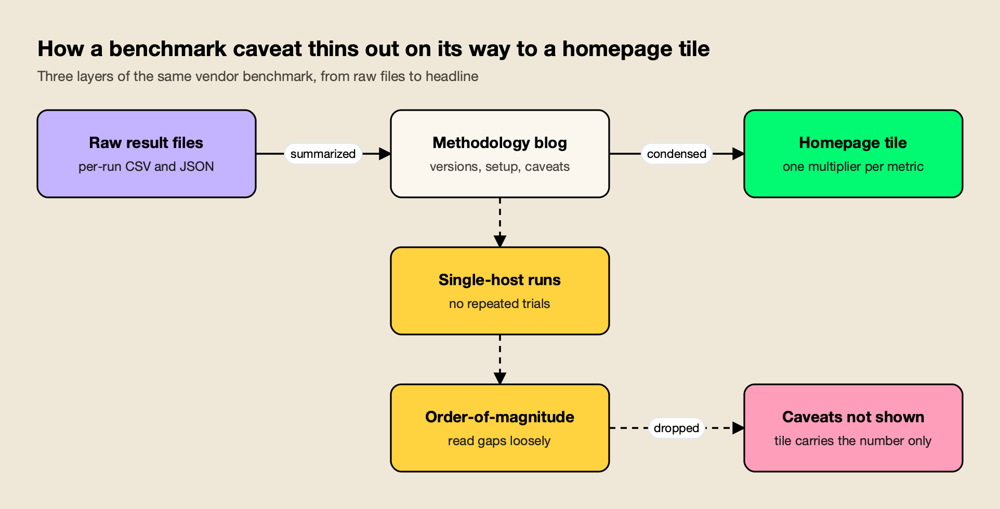
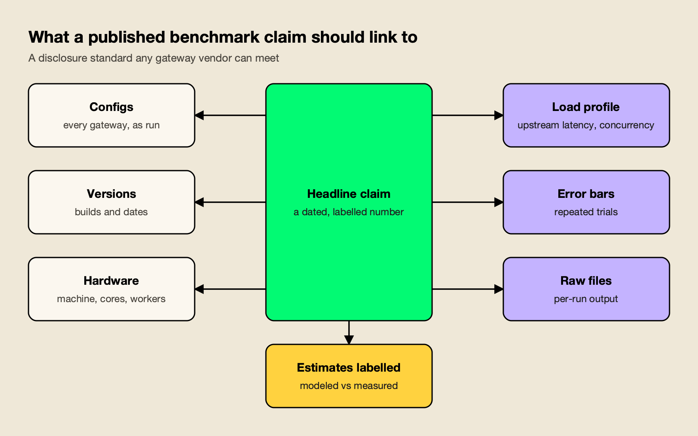

**TL;DR**
- Benchmarketing is not a matter of fake numbers. It is a matter of real numbers published without the conditions needed to check them.
- LiteLLM's Rust gateway benchmark, as of November 1, 2026, shows the pattern: the blog says the runs are single-host and should be read as "order-of-magnitude differences," but the homepage tiles do not repeat that caveat.
- In LiteLLM's own files, the ranking at concurrency 64 flips between two CSVs, and neither the homepage nor the blog gives a machine type, core count or worker count.
- A workable disclosure standard for vendor benchmarks has seven parts: configs, versions, hardware and workers, load profile, error bars from repeated trials, raw files, and labelled estimates.
- The standard only works if every gateway vendor meets it, including the ones that come out ahead in a given comparison.

A benchmark number on a vendor homepage is a claim, and a claim is only as good as the evidence a reader can reach from it. **Benchmarketing** is the habit of publishing performance numbers as marketing, with the headline kept and the conditions that would let anyone check it left behind. AI infrastructure is going through its own round of it now, as gateways compete on milliseconds and megabytes.

This piece uses one recent case, LiteLLM's benchmark of its new Rust gateway, to show how that happens in practice and what a fix would look like. The case is useful because LiteLLM published its raw files, which made a detailed check possible. The argument is about practice, not motive: these are problems any vendor can fall into when a results table becomes a homepage tile, and the standard proposed at the end applies to every vendor in the category.

## The Benchmarketing Problem in AI Infrastructure

Benchmarketing in AI infrastructure means publishing a performance comparison in a form the reader cannot verify. The numbers may come from real runs. What goes missing is the context: which versions ran, with which settings, on what hardware, how many times, and what the raw output looked like. Without that, a buyer cannot separate a real gap from noise.

The pattern is old. Wikipedia's entry on [computer benchmarks](https://en.wikipedia.org/wiki/Benchmark_%28computing%29) records the "benchmark wars" between relational database makers in the 1980s and 1990s and notes that "companies commonly report only those benchmarks (or aspects of benchmarks) that show their products in the best light." None of that requires bad faith. A marketing page has room for one number per tile, and a single number cannot carry its own error bars.

AI gateways make the problem sharper for three reasons:

- **The measured effect is small.** In LiteLLM's sweep, gateways add under a millisecond at low concurrency against a direct p99 of about 22 ms, so run-to-run noise can be as large as the gap being advertised.
- **Configuration changes the result.** Logging, plugins, persistence and routing all add work on the request path. Two gateways with different features switched on are not running the same benchmark.
- **Versions move quickly.** A comparison against a build several releases old says little about what a buyer would deploy today.

This site's guide to [measuring LLM gateway overhead](/blog/llm-gateway-benchmark/) covers the mechanics of a fair test. The question here is narrower: what should a vendor publish so that anyone else can check its numbers?

## The LiteLLM Rust Benchmark in Brief

LiteLLM's homepage and benchmark blog claim that its Rust gateway has about 7x lower overhead, 9x less memory and about 4.5x more requests per dollar than Bifrost. Checked against LiteLLM's own CSV and JSON files, some of those claims hold and some do not, and the gaps are mostly about disclosure.

The claims live in three layers: the [benchmark section of litellm.ai](https://www.litellm.ai/#benchmark), LiteLLM's [benchmark blog post](https://docs.litellm.ai/blog/rust-ai-gateway-benchmarks), and the [results folder of the ai-gateway-bench repo](https://github.com/BerriAI/ai-gateway-bench/tree/main/results). The table below sets each claim against the files, as of November 1, 2026.

| Claim | Where it appears | What LiteLLM's files show | Verdict |
|---|---|---|---|
| About 7x lower overhead than Bifrost | Homepage, blog | Rests on a 4.54 ms Bifrost figure vs 0.66 ms for Rust; no row of the concurrency sweep is near 4.54 ms | Not reproducible from their own sweep |
| "3.5x lower overhead than the next AI gateway" | Homepage | 0.66 ms vs a different gateway at 2.29 ms, not Bifrost | Not a Bifrost number |
| 9x less memory, labelled "memory at rest" | Homepage | 199.1 vs 21.8 MB, the widest of three memory pairs; the column is peak RSS | Mislabelled |
| Rust throughput "2,800+ req/s", Bifrost cell blank | Homepage | 2,744 vs 2,814 req/s in one file; 2,719 vs 2,722 in the sweep | The blank cell hides a gap of 2.5% or less |
| About 4.5x more requests per dollar | Homepage | 283,833 vs 63,246 requests per dollar-hour | Arithmetic holds; it is a model |
| Every gateway ran with no logging, spend tracking or persistence | Blog | Bifrost's published config never sets `enable_logging` or `logs_store` | Logging likely on for Bifrost (inferred from v2.4.0 code, not confirmed on v1.6.4) |

The same files show real wins for the Rust gateway. Rust is smaller on memory in every file: its highest figure (about 36 MB) is below Bifrost's lowest (about 144 MB). It records lower CPU, 0.66% mean against 2.59% (peak 15.9% against 79.5%). It also leads in an exploratory concurrency-256 run, which was one run of 5,000 requests per gateway with no RPS field and a direct baseline already outside the benchmark's own latency threshold, so it is an exploratory result rather than a capacity comparison.

That balance matters for the argument here. The Rust gateway may well be a strong piece of engineering. The issue is that the published presentation does not let a reader see which of its advantages are stable and which are artifacts of one run, one configuration or one file.

## Caveats That Stayed in the Blog

LiteLLM's benchmark blog carries honest caveats. It describes "single-host, per-scenario runs (for example n=5000 on the overhead panel) without repeated-trial error bars," tells readers to "treat them as order-of-magnitude differences," and calls the work "a vendor-run benchmark." The homepage tiles that most buyers see do not repeat any of those caveats.

That is the most common way benchmarketing happens: not by inventing a number, but by moving it from a page that explains it to a page that does not. Figure 1 shows the three layers.

*Figure 1: Each layer is shorter than the one before it, and in the LiteLLM case the caveats stopped at the blog.*

An "order-of-magnitude" caveat sits awkwardly next to a precise multiplier. If the author of a benchmark tells readers that single runs should be read only as order-of-magnitude differences, a tile that says "7x" or "9x" is asking the reader to trust a precision the author has already disclaimed. The blog and the tile cannot both be the right way to read the same data.

The memory tile shows a second form of drift. LiteLLM's blog correctly calls its 21.8 MB vs 199.1 MB figures "peak memory." On the homepage, the same pair becomes "memory at rest," and the chart's note describes "resident memory with the gateway idle," while the underlying column is `peak_rss_mb`. The homepage label is a mislabel of peak RSS. The homepage also uses the widest of the three Bifrost and Rust memory pairs in the files (199.1 vs 21.8 MB); the others are 144 vs 26.1 MB and 282 to 298 vs 35 to 36 MB. The pairs may come from different scenarios or builds, so the clear problem is the label, not the size of the headline multiplier.

None of this needs a judgment about intent. Marketing pages compress. A disclosure standard exists so that compression does not change what a number means.

## A Ranking That Flips Between Files

When the same benchmark produces two files that rank the same gateways in opposite order at the same concurrency, the gap between them is inside the noise. LiteLLM's files do exactly that at concurrency 64: one file puts Bifrost ahead on total p99 latency, and another puts Rust ahead.

The two files are the [concurrency sweep](https://github.com/BerriAI/ai-gateway-bench/blob/main/results/latency_vs_concurrency.csv) and the [requests-per-dollar file](https://github.com/BerriAI/ai-gateway-bench/blob/main/results/rps_per_dollar.csv). Both report total p99 at concurrency 64.

| File (concurrency 64) | Bifrost total p99 | LiteLLM Rust total p99 | Lower in this file |
|---|---:|---:|---|
| `latency_vs_concurrency.csv` (sweep) | 52.7 ms | 64.3 ms | Bifrost |
| `rps_per_dollar.csv` | 32.2 ms | 26.9 ms | LiteLLM Rust |

Neither file is wrong. Each cell appears to be a single run, and single runs at high concurrency vary. That is why LiteLLM's blog warns against reading small gaps closely. The problem is that a homepage tile picks one cell, and the reader has no way to know that another file in the same repo points the other way.

The sweep shows how mixed the overhead picture is once every concurrency level is visible. Added p99 latency over a direct call, from LiteLLM's sweep, as of November 1, 2026:

| Concurrency | LiteLLM Rust | Bifrost | LiteLLM Python |
|---:|---:|---:|---:|
| 1 | +0.89 ms | +0.75 ms | +9.79 ms |
| 4 | +0.61 ms | +0.63 ms | +26.95 ms |
| 16 | +0.33 ms | +0.89 ms | +251.34 ms |
| 64 | +40.28 ms | +28.68 ms | +546.04 ms |

Bifrost adds less at 1 and 64, Rust adds less at 16, and the 0.02 ms gap at 4 is noise. Throughput at 64 is 2,722.2 RPS against 2,719.1. The honest reading is that LiteLLM Rust caught up to where Bifrost already was, not that Rust beats it. The homepage's 4.54 ms figure comes from a separate [overhead file](https://github.com/BerriAI/ai-gateway-bench/blob/main/results/overhead_comparison.csv) that states no concurrency, and nothing in the sweep is near it.

Repeated trials with error bars would settle which of these gaps are real. Without them, the honest summary of the sweep is "close at most levels, no single winner," which is far less marketable than a single multiplier and far more useful to a buyer.

## Links, Hardware and a CPU Figure That Cannot Be Checked

A benchmark claim should point to evidence that a reader can open and rerun. On litellm.ai, as of November 1, 2026, several of the supporting statements point nowhere a reader can follow: the "See the benchmark" link, the "identical hardware" claim, the "single client" footnote and a "~21% CPU" figure.

Each one is small on its own. Together they explain why the homepage cannot be checked from the homepage.

- **"See the benchmark" goes to an in-page anchor.** The link resolves to `#benchmark` on the same page, not to the raw data or a methodology document. A reader who clicks it to find receipts lands back on the tiles.
- **"Identical hardware" has no hardware.** No machine type, core count or worker count is given for either gateway, on the page or in the blog. The only machine description in LiteLLM's materials is a 4 vCPU / 16 GB instance, and it appears in the cost model, not as the benchmark machine.
- **"Single client" does not match the runs.** The sweep runs concurrency 1 to 64, and the throughput point uses `ceiling_concurrency = 64`. The footnote is wrong: the throughput figure did not come from one connection at a time.
- **"~21% CPU" has no file behind it.** The homepage pairs "2,800+ req/s" with "at ~21% CPU." The Rust CPU file, [`cpu_rust.csv`](https://github.com/BerriAI/ai-gateway-bench/blob/main/results/cpu_rust.csv), peaks at 15.9%, and the Rust CPU, throughput, cost and overhead files contain no ~21% figure. That finding covers those files, not every file in `results/`.

The cost claim shows the same gap between measurement and model. The 4.5x requests-per-dollar arithmetic holds (283,833 / 63,246), but it is an estimate built on an assumed 4 vCPU / 16 GB instance, and the page does not show its inputs. The blog's own cost line says "roughly 6x" ($0.001008 against $0.000175 per million requests, about 5.8x), which is a different metric from the page's 4.5x, and the hourly figures give 4.4x ($0.0434 against $0.0099). Three ratios for one comparison is a sign that the label "estimate" belongs on the tile itself.

## Configuration and Version Parity

A comparison is only like-for-like if every system runs the same work on comparable builds. LiteLLM's blog says every gateway ran "with no logging callbacks, spend tracking, or persistence enabled," but the published Bifrost config leaves default logging in place, and the build tested was v1.6.4, several releases old, against a Rust beta.

The configuration gap comes from defaults. LiteLLM's [Bifrost config](https://github.com/BerriAI/ai-gateway-bench/tree/main/gateways/bifrost) sets a simulated upstream, `config_store: enabled: false` and no plugins. It never sets `logs_store` or `enable_logging`. In Bifrost's code, `enable_logging` defaults to true when unset ([`config.go`](https://github.com/maximhq/bifrost/blob/transports/v1.6.4/transports/bifrost-http/lib/config.go)), a missing `logs_store` creates a default SQLite log store, and the built-in logging plugin loads regardless of an empty plugin list ([`plugins.go`](https://github.com/maximhq/bifrost/blob/transports/v1.6.4/transports/bifrost-http/server/plugins.go)). The links point to the v1.6.4 tag, but the reading itself is inferred from v2.4.0 code and not yet confirmed on v1.6.4. If it holds, Bifrost's numbers include log buffering and SQLite writes that LiteLLM's numbers do not.

The same defaults cut both ways: a vendor that ships logging on by default should expect benchmarkers to run it that way unless the switch is obvious. Bifrost's current [observability documentation](https://docs.getbifrost.ai/features/observability/default) shows the `enable_logging` and `disable_content_logging` settings in `client_config`. A disclosure standard solves this from both sides: the benchmarker publishes the full effective configuration, and the vendor publishes which defaults add work on the request path.

Memory shows why the setting matters, and why the hedge matters too. Bifrost v1.6.4 opens a disk-backed SQLite log store at startup ([`sqlite.go`](https://github.com/maximhq/bifrost/blob/transports/v1.6.4/framework/logstore/sqlite.go)), but the files do not quantify SQLite's share of RSS or isolate logging's share of the gap. Bifrost's RSS is already about 282 MB before the first request, which points mainly to baseline footprint rather than log-buffer growth.

Versions are the second parity problem. LiteLLM's blog lists a LiteLLM Rust beta, LiteLLM Python v1 and Bifrost v1.6.4, and says of the Rust build that "streaming and the full feature surface are still landing." Bifrost's changelogs list v1.6.5 to v1.6.11 and then v2.0.0 to v2.4.0 after the tested build, and the homepage shows no version for it at all; the version appears only in the blog and the gateway README. The 2.x line has since reduced memory use, with no figure published yet; the [v2.0 release post](https://www.getmaxim.ai/bifrost/blog/bifrost-v2-0-is-here/) describes that release.

## What the Published Files Made Possible

LiteLLM did something many vendors do not: it committed per-run CSV and JSON files to a public repository. Every finding in this piece, including the ones that favor the Rust gateway, is possible only because those files are public. Any disclosure standard should start by crediting that practice.

Publishing raw data is the hard part, because it exposes the vendor to exactly this kind of check. Carrying the blog's caveats onto the tiles, linking "See the benchmark" to the repo and adding a line for hardware and worker counts are easy by comparison.

Several of LiteLLM's statements also check out cleanly against its files:

- The 4.5x requests-per-dollar arithmetic is correct for the inputs given.
- The blog correctly says "peak memory" for the 21.8 MB vs 199.1 MB pair.
- The blog states its own limits plainly, including "single-host," "without repeated-trial error bars" and "vendor-run."
- The Rust gateway's lower memory and CPU figures appear consistently across the files.

Incentives matter here. If only the vendors that publish raw files get audited, the industry learns to stop publishing raw files. A standard has to make full disclosure the baseline for everyone.

## Precedent From SPEC's Fair Use Rule

Other parts of computing settled this question long ago. The Standard Performance Evaluation Corporation (SPEC) publishes a [Fair Use Rule](https://www.spec.org/fairuse/) that governs any public use of its results, and its requirements map closely onto the gaps in AI gateway marketing.

SPEC opens with the principle that "consistency and fairness are guiding principles." The specific requirements that matter most here:

| SPEC Fair Use requirement | What it prevents | AI gateway equivalent |
|---|---|---|
| "A claim must state a date as of which data was retrieved." | Stale numbers presented as current | Date and version on every tile |
| "The basis for comparison must be stated." | Comparisons across unlike setups | Configuration and feature parity stated next to the number |
| Sources "must be publicly available" | Claims that cannot be traced | Link to raw files, not an in-page anchor |
| "Estimates must be clearly identified as such," and in graphs "the word 'estimated' or 'est.' must be plainly visible" | Models presented as measurements | Cost-per-request and per-dollar figures labelled as modeled |

The last row is the most direct parallel. Under SPEC's rule, a cost model like the 4.5x requests-per-dollar figure would need "estimated" on the tile itself, not only in a blog footnote. Nothing in that requirement is hard to meet. It simply moves the caveat to where the number is read.

AI gateways have no SPEC-style body. A voluntary standard is weaker than an enforced one, but it gives buyers a checklist and vendors a public bar to meet.

## A Disclosure Standard for Vendor Benchmarks

A disclosure standard for AI gateway benchmarks needs seven items, and each one closes a gap visible in the LiteLLM case. The list below draws on what the announced like-for-like rerun of this benchmark ("Part 2") commits to publish: logging on and off, a current build, repeated trials with error bars, and hardware, worker counts, mock latency and concurrency for every run.

*Figure 2: A claim that links to all seven receipts can be checked by anyone; a claim that links to none can only be believed.*

| Receipt | What to publish | Gap it closes in the LiteLLM case |
|---|---|---|
| 1. Configs | The effective configuration of every system, as it ran, including defaults that add request-path work | Logging likely on for Bifrost while the blog says it was off (inferred, not confirmed on v1.6.4) |
| 2. Versions | Exact build of every system and the run date, shown next to each number | Bifrost v1.6.4 hidden on the homepage; Rust beta without streaming; no Python v1 version named |
| 3. Hardware and workers | Machine type, core count and worker count for each system | None given; "identical hardware" cannot be checked |
| 4. Load profile | Simulated upstream latency and concurrency for every result | The 4.54 ms overhead file states no concurrency |
| 5. Error bars | Repeated trials with confidence intervals for every cell | Single runs; the c=64 ranking flips between two files |
| 6. Raw files | Per-run output, linked from every claim | Raw files exist, but "See the benchmark" points to an in-page anchor; "~21% CPU" has no file behind it |
| 7. Labelled estimates | "Estimated" on any modeled figure, with its assumptions | 4.5x per dollar is a model on an assumed 4 vCPU / 16 GB instance |

Two practices follow. The headline should carry the methodology's caveats: if the blog says to read gaps as order-of-magnitude, the tile should say so or show a range. And the full sweep should be shown before any single cell is promoted, because one cell from a sweep that points both ways is a cherry-picked result, whatever the intent.

For heavier claims, such as memory, the Part 2 plan adds one more receipt worth adopting generally: a heap profile that attributes the footprint to components, so "the gap is the log buffer" or "the gap is baseline" becomes something a reader can see rather than infer. This site's guide on [how to read an AI benchmark](/blog/how-to-read-an-ai-benchmark/) explains why sample size and error bars decide whether a gap is meaningful; the same arithmetic applies to latency cells.

## The Standard Applies to Bifrost Too

A disclosure standard proposed in response to one vendor's benchmark only earns credibility if it also binds the vendor on the other side of the comparison. The standard above applies to Bifrost's own published benchmarks exactly as it applies to LiteLLM's. Every gateway vendor should be invited to meet it, Bifrost explicitly included.

[Bifrost](https://www.getmaxim.ai/bifrost) publishes its own performance material:

- a [benchmark resource page](https://www.getmaxim.ai/resources/benchmarks) and [benchmarking documentation](https://docs.getbifrost.ai/benchmarking/getting-started)
- a guide to [running the benchmarks yourself](https://docs.getbifrost.ai/benchmarking/run-your-own-benchmarks)
- an open [benchmarking repository](https://github.com/maximhq/bifrost-benchmarking)

This piece does not assess those pages or quote their figures, because an article about benchmark rigor should not repeat a vendor number it has not examined. The test for them is the same seven receipts.

Part 2 is where that commitment becomes checkable. The announced rerun commits to:

- Run both gateways with logging off, and again with logging on.
- Use a current Bifrost build, with repeated trials and error bars.
- Publish hardware, worker counts, mock latency and concurrency for every run.
- Take a heap profile to measure how much of the memory gap is the log buffer.

Readers should hold Part 2 to those promises, and to the remaining receipts on the list. If Part 2 shows that the Rust gateway still leads on memory with logging off, that result should be reported as plainly as the findings above. The memory, CPU and c=256 results above already favor the Rust gateway, and the rerun should be read the same way, whichever way it falls.

The invitation extends to LiteLLM and every other gateway vendor. For LiteLLM, the fastest route is to publish its Rust config next to the Bifrost one (it has not yet been checked against the blog's stated setup), add hardware and worker counts, rerun with repeated trials and carry the blog's caveats onto the homepage.

Teams comparing gateways on features rather than speed can read a [feature-by-feature comparison with LiteLLM](https://www.getmaxim.ai/articles/litellm-vs-bifrost-feature-by-feature-comparison/) and a [builder's guide to LLM gateways](https://www.getmaxim.ai/articles/best-llm-gateways-in-2026-features-benchmarks-and-builders-guide/) from the same vendor, with the same critical eye as any vendor's material.

## What Buyers Can Do Before the Standard Exists

Buyers do not need to wait for vendors to adopt a standard. They can apply it themselves: ask for the seven receipts before trusting any published number, treat any figure without them as unverified, and run a short test of their own with the configuration they plan to deploy. agitracker's [LLM gateway test plan](/blog/llm-gateway-test-plan/) sets out one such test. A vendor that cannot supply receipts has answered the question.

A practical sequence for a gateway evaluation:

1. **Ask for the raw files and configs behind every number in the sales deck.** If the answer is a link to the same marketing page, note it.
2. **Check the version against what is current.** A comparison against an old build of a competitor, or a beta of the vendor's own product, describes neither product as deployed.
3. **Match the configuration to production.** If production will run logging, budgets and routing, benchmark with them on. One vendor's [governance and observability overview](https://www.getmaxim.ai/bifrost/blog/ai-governance-and-observability-in-bifrost/) lists the kinds of features that sit on a gateway's request path; other gateways have their own equivalents.
4. **Run more than once.** Only repeated trials per cell show whether a sub-millisecond gap survives.
5. **Read the full sweep, not one cell.** A gateway that leads at one concurrency and trails at another has not "won."

For the performance side, agitracker's [checklist for reading an AI gateway benchmark](/blog/how-to-read-an-ai-gateway-benchmark/) expands these steps into ten questions. This site's overview of [LiteLLM alternatives](/blog/litellm-alternatives/) and its [self-hosted vs managed gateway](/blog/self-hosted-vs-managed-llm-gateway/) guide cover the non-performance criteria that usually decide a gateway choice.

For teams already moving off LiteLLM, the same vendor publishes a [LiteLLM migration resource](https://www.getmaxim.ai/resources/migrating-from-litellm) and a [buyer's guide](https://www.getmaxim.ai/resources/buyers-guide). As with any vendor's guide, their claims deserve the same receipts. AI model benchmarks tend to [saturate and lose meaning](/blog/why-benchmarks-saturate/) once they become targets; gateway benchmarks risk losing meaning sooner, because their numbers travel without their conditions.

## Receipts as the Price of a Headline

The LiteLLM case is not a story about a bad number. Most of its numbers come from real runs, and some of them, especially on memory and CPU, favor the Rust gateway in every file. It is a story about numbers that lost their conditions on the way to a homepage: caveats left in the blog, a ranking that flips between files, a link that loops back to the page, no hardware, a CPU figure with no file and a Bifrost build several releases old.

The fix is cheap. Every gateway vendor already has the configs, versions, hardware details and raw output; publishing them next to the headline costs a few lines of text and a link. The vendors that meet the seven-receipt standard first, whichever product they sell, will be the ones whose numbers buyers can actually use. Until then, a benchmark without receipts is a claim, and should be read as one.

Source: [Debunking LiteLLM Rust Benchmarking: Part 1](https://www.getmaxim.ai/bifrost/blog/debunking-litellm-rust-benchmarking-part-1), by Akshay Deo of Maxim AI, which builds the Bifrost gateway.
