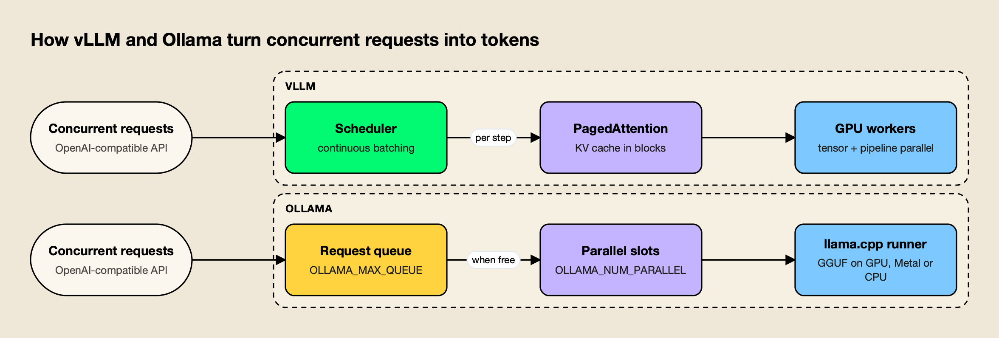
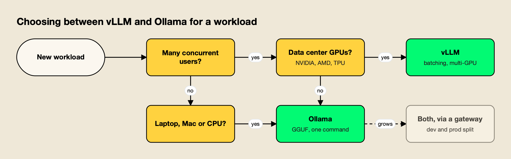
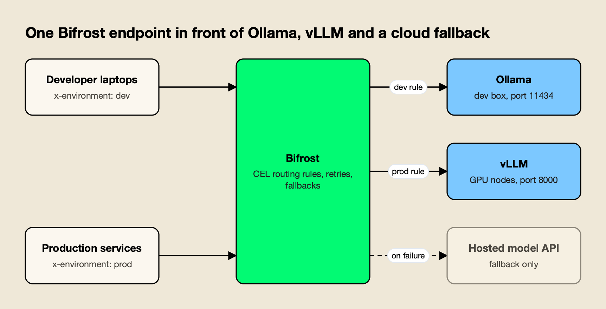

**TL;DR**
- In the vLLM vs Ollama choice, vLLM is a GPU-first inference server built around PagedAttention and continuous batching; Ollama is a local-first runtime that packages llama.cpp and GGUF models behind a one-command CLI and API.
- Under concurrent load vLLM is far faster: Red Hat's published benchmark measured a peak of 793 output tokens per second for vLLM against 41 for Ollama on one A100 with Llama 3.1 8B.
- Ollama wins on setup, hardware reach (laptops, Apple Silicon, CPU-only machines) and GGUF quantization; vLLM wins on throughput, multi-GPU scaling and production metrics.
- Both expose OpenAI-compatible APIs, so most teams run Ollama for development and vLLM for production, and switch between them by changing a base URL.
- An AI gateway such as Bifrost can route one endpoint to Ollama in development, vLLM in production and a hosted API as fallback, without application changes.

vLLM vs Ollama is the first decision most teams face when they move a self-hosted LLM from a laptop to a shared service. Both are open-source engines that load open-weight models and serve them over an OpenAI-compatible HTTP API, but they are built for different workloads: vLLM maximizes throughput for many concurrent users on data center GPUs, while Ollama makes a single model easy to run on almost any machine. This explainer compares the two on architecture, throughput, hardware, quantization, multi-GPU support, APIs and operations, using each project's own documentation and published benchmarks.

## vLLM vs Ollama at a Glance

vLLM and Ollama differ mainly in who they serve. vLLM is a serving system for production traffic on GPUs, with batching and parallelism built for many simultaneous requests. Ollama is a developer runtime that downloads, quantizes and runs a model with one command, tuned for one user or a small team on a workstation.

The table summarizes the differences covered in the rest of this piece. Every row is drawn from the projects' own documentation or the benchmarks cited below.

| Dimension | vLLM | Ollama |
|---|---|---|
| Primary use | Multi-user production serving | Local development, single-host apps |
| Core engine | Own scheduler, PagedAttention, CUDA/HIP kernels | llama.cpp runner |
| Batching | Continuous batching, chunked prefill, prefix caching | Fixed parallel slots per model (`OLLAMA_NUM_PARALLEL`) plus a queue |
| Model format | Hugging Face weights; GGUF via an experimental plugin | GGUF; imports Safetensors and GGUF |
| Quantization | FP8, MXFP4, NVFP4, INT8, INT4, GPTQ, AWQ, compressed-tensors and more | GGUF quant levels; K/V cache quantization (`q8_0`, `q4_0`) |
| Hardware | NVIDIA, AMD, Intel XPU, x86/ARM CPUs; plugins for TPU, Gaudi, Ascend | NVIDIA, AMD (ROCm, Vulkan), Apple Metal, CPU |
| Multi-GPU | Tensor, pipeline, data, expert and context parallelism; multi-node via Ray | Splits a model across local GPUs when it does not fit on one |
| APIs | OpenAI-compatible (Chat, Completions, Responses, embeddings, audio), Anthropic Messages, Cohere rerank | OpenAI-compatible `/v1` (chat, completions, responses, embeddings, models), native `/api`, Anthropic subset |
| License | Apache 2.0 | MIT |

The gap in the batching row explains most of the gap in throughput. The rest of the table explains why Ollama is still the default on developer machines.

## What vLLM Is

vLLM is an open-source library and server for LLM inference and serving, originally developed in the Sky Computing Lab at UC Berkeley and now maintained by a community of more than 2,000 contributors. Its [documentation](https://docs.vllm.ai/en/latest/) describes it as "easy, fast, and cheap LLM serving for everyone."

The project's feature list centers on throughput. It manages attention key and value memory with PagedAttention, applies continuous batching of incoming requests with chunked prefill and prefix caching, runs optimized attention kernels such as FlashAttention and FlashInfer, and supports speculative decoding. It loads 200+ model architectures from Hugging Face, including dense decoder models such as Llama, Qwen and Gemma, mixture-of-experts models such as DeepSeek-V3 and GPT-OSS, multimodal models and embedding models.

A typical deployment is one command on a GPU host:

```bash
vllm serve meta-llama/Llama-3.1-8B-Instruct --tensor-parallel-size 2
```

That starts an HTTP server on port 8000 that any OpenAI client can call. vLLM is the engine underneath many production stacks, which is why it appears in most guides to [the stack behind production AI](https://www.getmaxim.ai/articles/llm-infrastructure-explained-the-stack-behind-production-ai/).

## What Ollama Is

Ollama is an MIT-licensed runtime for running open-weight models locally, available for macOS, Windows, Linux and as the official `ollama/ollama` Docker image. Its [GitHub README](https://github.com/ollama/ollama) lists llama.cpp, the C/C++ inference project founded by Georgi Gerganov, as its supported backend.

Ollama's design goal is that a developer can go from nothing to a running model in two commands: `ollama pull` downloads a quantized model from the Ollama library, and `ollama run` starts it. The server listens on `127.0.0.1:11434` by default, keeps a model in memory for five minutes after the last request, and loads and unloads models automatically as requests arrive. Custom models are built from a Modelfile that points at Safetensors weights or a GGUF file.

That convenience is why Ollama dominates local experimentation and desktop tools. Many coding assistants and chat front ends list Ollama as a local model option, and guides to running an [AI gateway for Cursor with Claude or Ollama](https://www.getmaxim.ai/articles/self-hosted-ai-gateway-for-cursor-with-claude-or-ollama/) assume it is already on the developer's machine.

## Architecture: PagedAttention and Continuous Batching vs llama.cpp and GGUF

The architectural difference is memory management for concurrent requests. vLLM stores each request's KV cache in fixed-size blocks and adds new requests to the running batch at every decoding step. Ollama gives each loaded model a fixed number of parallel slots, each with its own context allocation, and queues requests until a slot frees up.

### How vLLM Schedules Requests

The [PagedAttention paper](https://arxiv.org/abs/2309.06180) (SOSP 2023) starts from a memory problem: the KV cache for each request is large and grows and shrinks dynamically, so contiguous allocation wastes memory through fragmentation and limits batch size. PagedAttention borrows virtual-memory paging from operating systems and stores the cache in non-contiguous blocks. The [vLLM launch post](https://blog.vllm.ai/2023/06/20/vllm.html) reports that memory waste then occurs only in the last block of a sequence, under 4% in practice, and that block sharing cuts the memory cost of parallel sampling and beam search by up to 55%.

Continuous batching, also called iteration-level scheduling, is the second half. Anyscale's [explainer on continuous batching](https://www.anyscale.com/blog/continuous-batching-llm-inference) shows why static batching wastes GPU time: a batch runs until its longest sequence finishes, so short requests leave idle slots behind them. Continuous batching inserts a new request as soon as any sequence emits its end token. Combined with PagedAttention's memory savings, Anyscale measured up to 23x throughput over naive static batching with vLLM on an A100, while also reducing median latency.

### How Ollama Schedules Requests

Ollama's [FAQ](https://docs.ollama.com/faq) describes two levels of concurrency. Several models can be loaded at once if they fit in memory, up to `OLLAMA_MAX_LOADED_MODELS` (default three per GPU). Within one model, `OLLAMA_NUM_PARALLEL` sets how many requests run at the same time, with a current documented default of 1, and memory scales with `OLLAMA_NUM_PARALLEL` multiplied by the context length. Requests beyond that wait in a queue of up to 512 (`OLLAMA_MAX_QUEUE`); past that the server returns a 503.



*Figure 1: vLLM grows the batch every step; Ollama serves a fixed number of parallel slots and queues the rest.*

As Figure 1 shows, both engines accept the same OpenAI-format request. The difference is what happens when the tenth or hundredth request arrives: vLLM folds it into the next decoding step if KV blocks are free, while Ollama holds it until a slot opens. The default context window matters here too. Ollama uses 4,096 tokens unless `OLLAMA_CONTEXT_LENGTH` or `num_ctx` raises it, and each increase multiplies across parallel slots.

## Throughput and Latency Benchmarks

On concurrent workloads, published benchmarks consistently show vLLM delivering many times Ollama's throughput. The clearest head-to-head comes from Red Hat, which tested both on identical hardware and models; vLLM's own papers compare it with other serving systems rather than with Ollama.

[Red Hat's benchmark](https://developers.redhat.com/articles/2025/08/08/ollama-vs-vllm-deep-dive-performance-benchmarking) ran vLLM 0.9.1 and Ollama 0.9.2 on a single NVIDIA A100-PCIE-40GB, serving Llama 3.1 8B Instruct at full precision, and used the GuideLLM tool to hold between 1 and 256 concurrent users for 300 seconds per level. Results:

- **Peak throughput.** vLLM reached 793 output tokens per second; Ollama reached 41.
- **Tail latency.** At peak throughput, P99 latency was 80 ms for vLLM and 673 ms for Ollama.
- **Tuned Ollama.** Raising `OLLAMA_NUM_PARALLEL` to 32, the highest stable value on that GPU, still left Ollama's throughput on a plateau well below vLLM's at every concurrency level, and its inter-token latency became erratic under load.
- **Where Ollama held up.** With default settings and more than 16 concurrent users, Ollama's inter-token latency stayed lower and steadier than vLLM's, because it throttles active work; the cost was a sharply rising time to first token as requests waited in the queue.

| Benchmark | Setup | Reported result |
|---|---|---|
| Red Hat, Ollama vs vLLM | A100 40GB, Llama 3.1 8B, 1 to 256 concurrent users | vLLM peak 793 tok/s vs Ollama 41 tok/s; P99 80 ms vs 673 ms |
| vLLM launch post | LLaMA-7B on A10G, LLaMA-13B on A100 40GB | Up to 24x throughput vs Hugging Face Transformers, up to 3.5x vs TGI |
| PagedAttention paper | Popular LLMs vs FasterTransformer and Orca | 2x to 4x throughput at the same latency |
| Anyscale continuous batching | OPT-13B on A100 40GB | Up to 23x throughput vs naive static batching |

Two cautions apply when reading these numbers. They measure server throughput under many simultaneous users, not the speed a single developer sees in a chat window, where both engines are limited by the same GPU memory bandwidth. And the hardware, model and engine versions all move results, which is why the guide to [reading an AI benchmark](/blog/how-to-read-an-ai-benchmark/) recommends rerunning any published test on your own workload before deciding.

## Hardware Support: GPUs, Apple Silicon and CPUs

Ollama runs on more consumer hardware; vLLM runs on more data center accelerators. Ollama supports NVIDIA GPUs from compute capability 5.0, AMD GPUs through ROCm and Vulkan, Apple GPUs through Metal, and CPU-only machines. vLLM targets NVIDIA, AMD and Intel GPUs plus CPUs, with plugins for TPUs, Gaudi and Ascend.

Ollama's [hardware documentation](https://docs.ollama.com/gpu) covers NVIDIA cards from the GTX 750 to Blackwell (driver 550 or newer), AMD GPUs through ROCm v7 with Vulkan for cards ROCm does not support, and Apple Silicon through the Metal API. On a Mac, that means the same install uses the GPU without any driver setup, which is the main reason Ollama is the default local runtime for Apple Silicon developers.

vLLM's [installation guide](https://docs.vllm.ai/en/latest/getting_started/installation/) lists NVIDIA CUDA, AMD ROCm and Intel XPU GPUs, Apple Silicon through the separate vLLM-Metal project, and CPU builds for x86, ARM AArch64, Apple silicon and IBM Z. Hardware plugins extend it to Google TPUs, Intel Gaudi, IBM Spyre, Huawei Ascend and others. The practical center of gravity is still NVIDIA and AMD data center GPUs, where its kernels and batching pay off.

| Hardware | vLLM | Ollama |
|---|---|---|
| NVIDIA data center GPUs (A100, H100, H200) | Primary target | Supported |
| NVIDIA consumer GPUs | Supported | Supported (compute capability 5.0+) |
| AMD GPUs | ROCm | ROCm v7, plus Vulkan |
| Apple Silicon | Via vLLM-Metal and CPU builds | Metal by default |
| CPU only | x86, ARM, IBM Z builds | Supported through llama.cpp |
| TPU, Gaudi, Ascend | Hardware plugins | Not listed |

## Quantization: GGUF vs GPTQ, AWQ and FP8

Quantization reduces model weights to fewer bits so a model fits in less memory. Ollama is built around GGUF, the llama.cpp file format with quantization levels such as Q4_K_M and Q8_0. vLLM is built around GPU-oriented formats such as FP8, INT8, INT4, GPTQ and AWQ, and treats GGUF as experimental.

The [vLLM documentation](https://docs.vllm.ai/en/latest/) lists FP8, MXFP8/MXFP4, NVFP4, INT8, INT4, GPTQ/AWQ, GGUF, compressed-tensors, ModelOpt and TorchAO among its quantization options. Its [GGUF page](https://docs.vllm.ai/en/latest/features/quantization/gguf/) warns that GGUF support is "highly experimental and under-optimized" and has moved to an out-of-tree `vllm-gguf-plugin`. A team that wants the same file on a laptop and in production therefore usually ends up with two artifacts: a GGUF build for Ollama and a GPTQ, AWQ or FP8 build for vLLM.

Ollama's [import guide](https://docs.ollama.com/import) accepts Safetensors directories and single or split GGUF files, but notes that it does not quantize GGUF models during import; that step happens beforehand with llama.cpp's `llama-quantize`. Most users skip it entirely by pulling prequantized models from the Ollama library. Ollama can also quantize the K/V cache: setting `OLLAMA_KV_CACHE_TYPE=q8_0` uses about half the memory of the default f16 cache with a very small loss in precision, and `q4_0` uses about a quarter, according to its FAQ.

The format choice compounds with model choice. Open-weight releases, such as the [open-weight models from Chinese labs in 2026](/blog/china-open-weight-models-2026/), are typically published as Hugging Face weights, which vLLM loads directly, while Ollama users rely on a GGUF build being available or create one themselves.

## Multi-GPU and Tensor Parallelism

vLLM supports tensor, pipeline, data, expert and context parallelism, so one model can span many GPUs and many nodes. Ollama places a model on a single GPU when it fits and spreads it across all local GPUs only when it does not, with no tensor parallelism and no multi-node mode.

vLLM's [parallelism guide](https://docs.vllm.ai/en/latest/serving/parallelism_scaling/) gives a simple rule. If the model fits on one GPU, use one GPU. If it fits on one node but not one GPU, set `--tensor-parallel-size` to the number of GPUs. If it needs several nodes, set tensor parallelism to the GPUs per node and pipeline parallelism to the number of nodes, for example `tensor_parallel_size=8` and `pipeline_parallel_size=2` for two 8-GPU nodes. Multi-node runs use Ray. The guide also notes that on GPUs without NVLink, such as the L40S, pipeline parallelism can give higher throughput than tensor parallelism.

At startup vLLM prints its KV cache size and the maximum concurrency it can sustain at the model's context length, which turns capacity planning into arithmetic. If those numbers fall short of the target load, the answer is more GPUs.

Ollama's FAQ describes its approach in one paragraph: if a model fits on any single GPU, Ollama loads it there to avoid PCIe transfers; otherwise it spreads the model across all available GPUs. That is enough to run a 70B model on two consumer cards, but it is a capacity feature rather than a throughput feature.

## OpenAI-Compatible APIs and Client Code

Both engines speak the OpenAI API format, so the same client code works against either by changing the base URL. vLLM covers more of the API surface, including Responses, audio transcription, Anthropic Messages and Cohere-compatible rerank. Ollama covers chat, completions, Responses, embeddings and model listing on `/v1`, plus its own native `/api` endpoints.

vLLM's [online serving reference](https://docs.vllm.ai/en/latest/serving/online_serving/) lists Completions, Chat Completions, a batch chat endpoint, the Responses API, embeddings, transcription and translation, an Anthropic Messages endpoint with token counting, Cohere Embed and Rerank, plus `/health` and a Prometheus `/metrics` endpoint. Ollama's [OpenAI compatibility page](https://docs.ollama.com/api/openai-compatibility) documents `/v1/chat/completions`, `/v1/completions`, `/v1/responses`, `/v1/embeddings` and `/v1/models`, and its examples pass an API key that is "required but ignored."

```python
from openai import OpenAI

client = OpenAI(base_url="http://localhost:11434/v1/", api_key="ollama")  # Ollama

client.chat.completions.create(
    model="llama3.1:8b",  # on vLLM, use the Hugging Face model ID
    messages=[{"role": "user", "content": "Summarize this ticket."}],
)
```

Compatibility is close but not identical. Model names differ (Ollama uses library tags such as `llama3.1:8b`; vLLM uses the Hugging Face repository ID), default context windows differ, and some parameters are ignored by one engine or the other. Those small differences are the main reason teams put a routing layer in front, rather than editing base URLs and model names in every service.

## Operations and Security in Production

Operating vLLM means running a GPU service: containers with CUDA drivers, health checks, Prometheus metrics and authentication in front. Operating Ollama means running a lightweight daemon that loads and unloads models on demand, binds to localhost by default and has no built-in authentication on its API.

vLLM ships an official `vllm/vllm-openai` container image and exposes `/health`, `/load` and Prometheus `/metrics` endpoints, which slot into Kubernetes probes and existing dashboards. Its [security guide](https://docs.vllm.ai/en/latest/usage/security/) is explicit that the `--api-key` flag only protects endpoints under the `/v1`, `/v2`, `/inference` and `/cohere` prefixes, that other sensitive endpoints on the same server are not authenticated, and that production deployments need additional controls.

Ollama's operational model suits a single host. Models load on first request and unload after five minutes idle (`OLLAMA_KEEP_ALIVE` changes that), the server binds to `127.0.0.1:11434`, and exposing it to a network means setting `OLLAMA_HOST` and putting a reverse proxy with authentication in front. Cold starts after an unload add seconds of latency, which is harmless on a laptop and noticeable in a user-facing service.

| Operational concern | vLLM | Ollama |
|---|---|---|
| Deployment unit | GPU container or Kubernetes pod | Desktop app, system service or container |
| Model lifecycle | One model per server, loaded at start | Loaded on demand, unloaded after idle timeout |
| Health and metrics | `/health`, `/load`, Prometheus `/metrics` | Not published in the FAQ or API pages reviewed |
| Authentication | `--api-key` on API prefixes only; proxy recommended | None built in; proxy required for network exposure |
| Scale-out | Replicas, routers, multi-node parallelism | One process per host |

Both gaps, authentication and cross-service visibility, are the reason self-hosted engines usually sit behind a gateway. The trade-off between running that layer yourself and buying it is covered in the comparison of [self-hosted vs managed LLM gateways](/blog/self-hosted-vs-managed-llm-gateway/), and fully disconnected setups are covered in the roundup of [air-gapped AI gateways](/blog/air-gapped-ai-gateways/).

## When to Use vLLM vs Ollama

Use vLLM when a model serves many concurrent users on data center GPUs, needs to span several GPUs, or needs production metrics and a broad API surface. Use Ollama when one person or a small team runs models on a laptop, a Mac, a CPU-only server or a single workstation, and setup time matters more than throughput.



*Figure 2: Concurrency and hardware decide most cases before raw speed does.*

Figure 2 reduces the decision to two questions. A few patterns cover most real deployments:

- **Prototyping and local development.** Ollama. One install, prequantized models, and the same OpenAI client the application will use later.
- **Internal tools with a handful of users.** Ollama on a single GPU host is often enough; raise `OLLAMA_NUM_PARALLEL` and watch time to first token.
- **Customer-facing or high-concurrency services.** vLLM. The Red Hat numbers show roughly an order of magnitude more throughput on the same GPU.
- **Models larger than one GPU.** vLLM, with tensor and pipeline parallelism.
- **Batch jobs, embeddings and reranking at volume.** vLLM, for continuous batching and its embedding and rerank endpoints.
- **Both environments at once.** The common answer: Ollama for development, vLLM for production, with the same logical model behind one endpoint.

Cost follows the same split. A GPU node is cheapest per token when it is busy, and continuous batching is what keeps it busy; the analysis of [how model routing cuts inference cost](/blog/model-routing-inference-cost/) works through that arithmetic for mixed local and hosted fleets.

## Running vLLM and Ollama Behind One Gateway

Running both engines works best when applications call one endpoint and a gateway decides which engine serves each request. The gateway maps a request to Ollama in development and vLLM in production, retries and falls back to a hosted model API when a self-hosted server fails, and applies keys and logging in one place.

Bifrost, an open-source AI gateway written in Go, is a useful worked example because it ships native providers for both engines rather than treating them as generic OpenAI endpoints. [Bifrost](https://www.getmaxim.ai/bifrost) routes 25+ providers and 10,000+ models through one OpenAI-compatible API, its source is on [GitHub](https://github.com/maximhq/bifrost), and its [published benchmark](https://www.getmaxim.ai/resources/benchmarks) reports 11 µs of added overhead per request at 5,000 RPS on an AWS t3.xlarge, which is negligible next to model inference time.

### Native Providers for Both Engines

The two provider pages show how much engine-specific handling a gateway takes on:

- **Ollama.** The [Ollama provider documentation](https://docs.getbifrost.ai/providers/supported-providers/ollama) covers Chat Completions, text completions, embeddings and model listing, converts Responses API requests to chat internally, needs no API key for a local server, and takes the server address from `ollama_key_config.url`.
- **vLLM.** The [vLLM provider documentation](https://docs.getbifrost.ai/providers/supported-providers/vllm) covers Chat Completions, a native Responses path, text completions, embeddings, rerank, transcription and token counting. Each key carries its own server URL and model name, a `use_anthropic_endpoints` option sends chat traffic through vLLM's Anthropic-compatible Messages endpoint, and Bifrost normalizes vLLM's HTTP 200 error payloads into standard errors.

Setup walkthroughs for each are in the Bifrost guides for [connecting a vLLM server](https://www.getmaxim.ai/bifrost/guides/providers/vllm) and [connecting Ollama](https://www.getmaxim.ai/bifrost/guides/providers/ollama).

### Routing Development to Ollama and Production to vLLM

[Routing rules](https://docs.getbifrost.ai/providers/routing-rules) are CEL expressions evaluated per request against headers, team, budget and usage, each with weighted targets and its own fallback list. A pair of rules keyed on an environment header is enough for the dev and prod split:

```json
{
  "governance": {
    "routing_rules": [
      {
        "name": "dev-to-ollama",
        "enabled": true,
        "cel_expression": "headers[\"x-environment\"] == \"dev\"",
        "targets": [{ "provider": "ollama", "model": "llama3.1:8b", "weight": 1 }],
        "fallbacks": [],
        "scope": "global",
        "priority": 0
      },
      {
        "name": "prod-to-vllm",
        "enabled": true,
        "cel_expression": "headers[\"x-environment\"] == \"prod\"",
        "targets": [{ "provider": "vllm", "model": "meta-llama/Llama-3.1-8B-Instruct", "weight": 1 }],
        "fallbacks": ["openai/gpt-4o-mini"],
        "scope": "global",
        "priority": 1
      }
    ]
  }
}
```



*Figure 3: Applications keep one base URL; a routing rule decides which engine serves each environment.*

As Figure 3 shows, the application code stays the same in both environments; only the header changes. The development rule has an empty fallback list, so a stopped Ollama daemon fails fast instead of sending test prompts to a paid API. The production rule ends in a hosted model, and per the [retries and fallbacks documentation](https://docs.getbifrost.ai/features/retries-and-fallbacks), 5xx and network errors from vLLM are first retried on the same server with exponential backoff (500 ms initial, 5 s maximum by default) before the request moves to the fallback, which gets its own retry budget. A walkthrough of [automatic fallback when a primary provider fails](https://www.getmaxim.ai/bifrost/blog/your-primary-llm-provider-failed-enable-automatic-fallback-with-bifrost) shows the same mechanism with hosted providers.

Teams with regulated data usually invert that last choice for restricted traffic and leave the fallback list empty, so a vLLM outage fails closed rather than leaving the network. The site's ranking of [AI gateways for routing between vLLM, Ollama and cloud LLMs](/blog/ai-gateways-for-vllm-ollama-cloud-llms/) compares how five gateways handle that policy. A separate survey of [LLM gateways for vLLM, SGLang and Ollama](https://www.getmaxim.ai/articles/top-4-llm-gateways-for-self-hosted-models-vllm-sglang-and-ollama-2026/) looks at self-hosted provider support specifically.

Broader background on the category is in the [LLM gateway overview](https://www.getmaxim.ai/llm-gateway), a guide to [how an LLM router works](https://www.getmaxim.ai/articles/what-is-an-llm-router-how-model-routing-works/), and a buyer's guide to [LLM failover platforms](https://www.getmaxim.ai/articles/top-llm-failover-platforms-in-2026-a-buyers-guide/).

## Other Self-Hosted LLM Engines: llama.cpp and SGLang

vLLM and Ollama are not the only options. llama.cpp is the engine inside Ollama and can be run directly for finer control, and SGLang is a GPU serving framework that competes with vLLM on throughput. Both also expose OpenAI-compatible servers, so the same gateway pattern applies.

[llama.cpp](https://github.com/ggml-org/llama.cpp) suits teams that want Ollama's hardware reach without its model library and lifecycle management: it reads GGUF files directly, and its `llama-server` binary serves them over HTTP. [SGLang](https://docs.sglang.ai/basic_usage/openai_api.html) targets the same production workloads as vLLM and adds its own cache-aware router, the SGLang Model Gateway, for multi-replica deployments. The choice between SGLang and vLLM usually comes down to model support on day one and results on your own benchmark, using a method like the one in the guide to [benchmarking LLM gateway and serving overhead](/blog/llm-gateway-benchmark/).

| Engine | Closest to | Typical reason to choose it |
|---|---|---|
| vLLM | SGLang | Broadest model and hardware support for GPU serving |
| SGLang | vLLM | GPU serving with a cache-aware multi-replica router |
| Ollama | llama.cpp | One-command setup, model library, desktop integrations |
| llama.cpp | Ollama | Direct GGUF control, embedded and edge builds |

Lists of [open-source LLM gateways for self-hosted deployments](https://www.getmaxim.ai/articles/5-best-open-source-llm-gateways-for-self-hosted-deployments-in-2026/) and the [best self-hosted AI gateways](https://www.getmaxim.ai/articles/best-self-hosted-ai-gateway-in-2026/) cover the routing layer that sits in front of any of these engines. A wider ranking of [tools to run a local LLM](/blog/local-llm-tools/) covers LM Studio, Jan, Docker Model Runner and LocalAI as well.

## The Verdict for Self-Hosted LLM Teams

vLLM vs Ollama is less a contest than a division of labor. vLLM is the stronger engine whenever many users share a GPU: PagedAttention and continuous batching deliver roughly an order of magnitude more throughput in Red Hat's published test, and tensor and pipeline parallelism let one model span a cluster. Ollama is the better tool whenever one person needs a model running now, on whatever hardware is at hand, from a GGUF file.

Most teams that self-host end up running both, with Ollama on developer machines and vLLM on production GPUs. The work then shifts from choosing an engine to keeping the two interchangeable: one logical model name, one endpoint, and a routing layer that decides which engine, or which hosted fallback, serves each request. Teams that design for that split from the start avoid rewriting client code when a prototype becomes a service.
