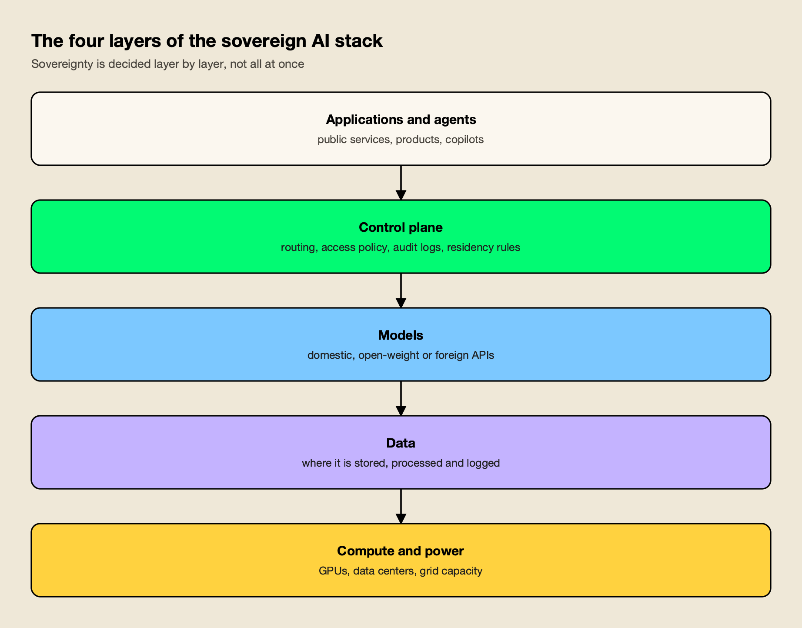
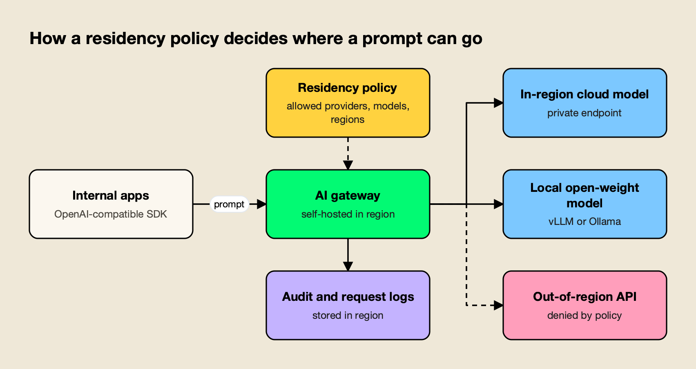
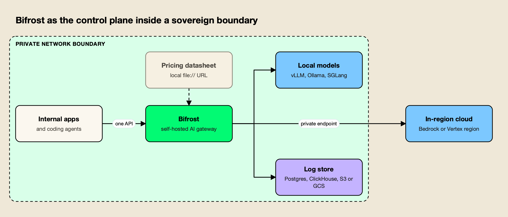

**TL;DR**
- **Sovereign AI** is the capacity to build, run and govern AI on infrastructure, models and data you control, rather than on someone else's terms. Nations pursue it for economic and security reasons; enterprises pursue it for compliance and bargaining power.
- The stack has four layers: **compute, models, data and the control plane**. Governments mostly buy compute first; companies get more sovereignty per dollar from the data and control-plane layers.
- 2026 turned announcements into procurement: the EU opened its call for up to seven AI gigafactories, India pushed public GPU capacity past 58,000, the UK launched a £500 million Sovereign AI Unit, and Japan adopted an "open" sovereignty strategy.
- Regulation is the enterprise driver: GDPR transfer rules, the US CLOUD Act's reach over US providers, and EU AI Act deadlines now running to 2027 and 2028.
- Full independence is out of reach for almost everyone, since the chips come from a handful of suppliers. In practice, sovereignty means **choice and control** at each layer, not autarky.

Sovereign AI is a country's or an organization's ability to develop, deploy and govern artificial intelligence using infrastructure, models and data that it controls. Search interest in the term grew more than forty-fold year on year by October 2026, and the reason is visible in the budgets: governments from Brussels to New Delhi to Riyadh are paying for domestic GPUs, home-grown models and local cloud regions. This explainer covers what sovereign AI means, the four layers of the stack, the national programs of 2026, the rules pushing companies in the same direction, and how an enterprise can get real sovereignty without building a data center.

## Sovereign AI Meaning

Sovereign AI means keeping the decisive parts of an AI system under your own jurisdiction and control: where the compute sits, who owns the model weights, where the data is stored and processed, and who sets the rules on each request. The term covers two different actors, nations and enterprises, whose goals overlap but are not the same.

NVIDIA's Jensen Huang popularized the phrase at the World Governments Summit in Dubai on 12 February 2024, arguing that each country should build its own AI capabilities rather than let others do it. "You cannot allow that to be done by other people," he said, according to [Gulf News' report of the session](https://gulfnews.com/uae/world-government-summit-2024-in-dubai-every-country-must-build-sovereign-ai-infrastructure-says-nvidia-ceo-jensen-huang-1.101023366), adding that "data ownership is crucial, encompassing culture, societal intelligence, common sense, and history." A chip vendor arguing that every nation needs its own chips has an obvious interest, but the idea has outlived the sales pitch because it names a real dependency.

### National vs Enterprise AI Sovereignty

**National AI sovereignty** is about strategic autonomy: a country wants AI that speaks its languages, reflects its laws, keeps sensitive data under domestic jurisdiction and cannot be switched off by a foreign government or company. **Enterprise AI sovereignty** is narrower and more practical: a company wants to know where each prompt goes, prove it to a regulator, and keep the option to move providers.

| Dimension | National sovereignty | Enterprise sovereignty |
| --- | --- | --- |
| Main goal | Strategic autonomy, economic growth, security | Compliance, data control, bargaining power with vendors |
| Typical first investment | Data centers and GPUs | A self-hosted control plane and approved model list |
| Model strategy | Fund domestic foundation models | Mix in-region cloud models with self-hosted open weights |
| Data concern | Data stays under national law | Data stays in approved regions and accounts |
| Proof required | Political: capacity built, models launched | Audit: logs showing where every request went |
| Typical budget | Billions of euros or dollars | A platform team and a gateway deployment |

The two meet in the middle. A European bank that self-hosts a French open-weight model in a German sovereign cloud region benefits from national programs while solving an enterprise problem.

## The Sovereign AI Stack: Compute, Models, Data and the Control Plane

The sovereign AI stack has four layers, and an actor can be sovereign at one while dependent at another. Compute is the GPUs, data centers and power. Models are the weights. Data is where information is stored and processed. The control plane is the software that decides which model receives which request under which policy.

*Figure 1: Nations usually start at the bottom with compute; enterprises usually start near the top with the control plane.*

As Figure 1 shows, each layer depends on the one beneath it, but control does not flow automatically upward. A country can own every GPU in a data center and still route its civil servants' prompts to a foreign API.

- **Compute and power.** The scarcest layer. Frontier-scale AI campuses now draw around a gigawatt each, and the constraint is often substations and turbines rather than chips, as the agitracker analysis of [the year AI campuses hit 1 GW](/blog/gigawatt-ai-data-centers/) shows. Compute is also where the industry's own [three levers of AI progress](/blog/three-levers-of-ai-progress/) meet national budgets.
- **Models.** Sovereignty here means either training a domestic model or being able to host someone else's weights. Open-weight releases changed the economics: a model whose weights can be downloaded can be run inside a national or corporate boundary. Most of the strongest open-weight models in 2026 come from Chinese labs, as the review of [the open-weight frontier](/blog/china-open-weight-models-2026/) documents, which creates its own sovereignty question for Western buyers.
- **Data.** The layer regulators care about most: where prompts, outputs, embeddings and logs are stored, processed and accessible from.
- **The control plane.** Routing, access control, budgets, guardrails and audit logs. It is the layer that turns policy into enforcement, and the one most often left to a vendor by default. The architecture behind it is laid out in an explainer on [the LLM infrastructure stack behind production AI](https://www.getmaxim.ai/articles/llm-infrastructure-explained-the-stack-behind-production-ai/).

## National AI Strategy Programs in 2026

In 2026 sovereign AI moved from summit speeches to procurement calls. Most national AI strategy programs fund compute first, then subsidized access for startups and researchers, then domestic or locally tuned models. The table below summarizes the major programs and their status as of mid-October 2026.

| Country or bloc | Program | Headline figure | 2026 status |
| --- | --- | --- | --- |
| European Union | InvestAI and AI Gigafactories | €200 billion mobilization target, €20 billion gigafactory fund | Call for up to seven gigafactories opened 30 July 2026; bids due 12 November 2026 |
| United Kingdom | Sovereign AI Unit | Up to £500 million | Launched April 2026; equity and supercomputer access for UK AI startups |
| France | National AI investment pledges | €109 billion in announced private investment | Data-center build-out, including a planned UAE-funded 1 GW campus |
| India | IndiaAI Mission | ₹10,300+ crore outlay | 38,000+ GPUs at ₹65 per hour; 20,000 more announced February 2026 |
| Japan | Second AI Basic Plan | Domestic GPU cloud subsidies | Plan adopted July 2026 with an "open approach to AI sovereignty" |
| Canada | Canadian Sovereign AI Compute Strategy | Up to C$2 billion | Compute challenge, public supercomputing and SME compute access |
| United Arab Emirates | Stargate UAE | 1 GW cluster in a 5 GW campus | First 200 MW targeted for 2026 |
| Saudi Arabia | HUMAIN (PIF-backed) | 250 MW by end of 2026 | Targets 1.7 GW in 2027, around 6 GW by 2034 |
| United States | American AI Exports Program | Full-stack export packages | First call closed 30 June 2026 |

### Europe: AI Gigafactories and Sovereign Clouds

The European Union's plan has two stages. In February 2025, at the Paris AI Action Summit, the Commission launched [InvestAI](https://digital-skills-jobs.europa.eu/en/latest/news/commission-launches-new-investai-initiative-mobilise-eu200-billion-investment-ai) to mobilize €200 billion for AI, including a €20 billion fund for AI gigafactories with around 100,000 latest-generation AI chips each, roughly four times today's AI factories. On 30 July 2026 the EuroHPC Joint Undertaking [opened the AI Gigafactories call](https://eurohpc-ju.europa.eu/eurohpc-joint-undertaking-launches-ai-gigafactories-call-2026-07-30_en) for up to seven facilities, with proposals due 12 November 2026, selection expected in early 2027 and operations within 18 months of selection. The EuroHPC network already counts 19 AI Factories and 13 AI Factory Antennas.

France has run its own track. Ahead of the Paris summit in February 2025, President Emmanuel Macron announced [€109 billion in private AI investment](https://www.nbcnewyork.com/news/business/money-report/france-unveils-109-billion-euro-ai-investment-as-europe-looks-to-keep-up-with-u-s/6143067/), calling it "the equivalent for France of what the United States announced with Stargate." The package included a UAE commitment of €30 billion to €50 billion for a 1 GW AI data center in France, plus plans from Iliad, Orange, Thales and Mistral AI.

### The UK Sovereign AI Unit

The United Kingdom chose an investment model rather than a single national data center. The Department for Science, Innovation and Technology launched the [Sovereign AI Unit](https://www.sovereignai.gov.uk/) in April 2026 with up to £500 million. It describes itself as Britain's sovereign venture fund, writing cheques of £1 million to £10 million and offering startups up to 1 million GPU hours on the country's largest AI supercomputers, plus fast-tracked visas and access to national datasets. It is the clearest working example of what people mean when they search for a "sovereign AI fund."

### India, Japan and Canada

India's approach is subsidized public compute. A government briefing from the [India AI Impact Summit](https://static.pib.gov.in/WriteReadData/specificdocs/documents/2026/feb/doc2026217795001.pdf) on 17 February 2026 says the ₹10,300+ crore IndiaAI Mission has made more than 38,000 high-end GPUs available at ₹65 per hour, and that 20,000 more would be added, taking capacity past 58,000. The same document highlights several "sovereign AI models" launched at the summit.

Japan's Cabinet approved a [second AI Basic Plan](https://www.mlex.com/mlex/artificial-intelligence/articles/2500643/japan-adopts-second-ai-basic-plan-targets-agentic-ai-and-sovereignty) in July 2026 that sets out an "open approach to AI sovereignty" designed to avoid dependence on any single vendor or country. That phrasing matters: it treats sovereignty as optionality rather than self-sufficiency, which is closer to the enterprise definition than most national plans.

Canada launched its Sovereign AI Compute Strategy on 5 December 2024, according to Innovation, Science and Economic Development Canada: up to C$2 billion, split between a C$700 million AI Compute Challenge for new data centers, up to C$1 billion for public supercomputing, and up to C$300 million to help smaller firms buy compute.

### The Gulf: Stargate UAE and HUMAIN

The Gulf states are building sovereign AI infrastructure at a scale meant to serve other countries as well as their own. Stargate UAE is a 1 GW cluster inside a planned 5 GW UAE-US AI campus in Abu Dhabi, built by G42's Khazna Data Centers with OpenAI, Oracle, NVIDIA, Cisco and SoftBank. A G42 spokesperson told [Gulf News](https://gulfnews.com/business/markets/stargate-uae-first-phase-of-200mw-to-complete-by-2026-1.500310364) the first 200 MW was expected to be completed in 2026; no timeline has been confirmed for the rest.

Saudi Arabia's HUMAIN, set up by the Public Investment Fund in May 2025, plans 250 MW of capacity online by the end of 2026, scaling to 1.7 GW in 2027, around 3 GW by 2030 and around 6 GW by 2034, chief executive Tareq Amin told [EnterpriseAM](https://enterpriseam.com/ai/2026/09/30/humain-plans-a-1-7-gw-saudi-datacenter-build-next-year/) in September 2026.

### The United States: Exporting the Stack

The US position is the mirror image. Rather than seeking sovereignty from someone else's stack, Washington wants other countries' sovereign AI to run on American technology. The Commerce Department's [American AI Exports Program](https://www.trade.gov/press-release/department-commerce-begins-inaugural-call-proposals-american-ai-exports-program) opened its first call on 1 April 2026 for industry consortia offering "full-stack" packages across five layers: AI-optimized hardware, data pipelines, models, security and sector applications. Applications closed on 30 June 2026. For a buyer, that means a "sovereign" data center may still run a foreign vendor's chips, models and software under a local flag, which is why the definition of sovereignty keeps getting argued over.

## Sovereign Cloud: How Hyperscalers Responded

A sovereign cloud is a cloud region that is physically located in a jurisdiction and operated and governed so that foreign parties have limited or no operational access to it. The large US cloud providers launched sovereign offerings in Europe between 2025 and 2026 to keep regulated customers who might otherwise leave.

AWS made its [European Sovereign Cloud generally available](https://press.aboutamazon.com/aws/2026/1/aws-launches-aws-european-sovereign-cloud-and-announces-expansion-across-europe) on 15 January 2026, starting with a region in Brandenburg, Germany. Amazon says the cloud is physically and logically separate from other AWS regions, is "operated exclusively by EU residents," keeps metadata such as IAM roles and billing inside the EU, and sits under a new European parent company. It plans to invest more than €7.8 billion in Germany and to add sovereign Local Zones in Belgium, the Netherlands and Portugal.

Microsoft announced [Microsoft Sovereign Cloud](https://blogs.microsoft.com/blog/2025/06/16/announcing-comprehensive-sovereign-solutions-empowering-european-organizations/) in June 2025 with three options: a Sovereign Public Cloud across its European regions, a Sovereign Private Cloud on Azure Local for hybrid or air-gapped environments, and National Partner Clouds run by independent operators (Bleu in France and Delos Cloud in Germany).

The open question with every hyperscaler offer is legal rather than technical. A region can be operated by EU residents and still belong to a US parent, which is why the CLOUD Act sits at the center of the debate (see the next section). Customers that want to stay portable across these options tend to put their own control plane in front of whichever cloud they choose, a pattern compared in a survey of [AI gateways for data residency and multi-region deployments](https://www.getmaxim.ai/articles/top-5-ai-gateways-for-data-residency-and-multi-region-deployments-in-2026/).

## Data Sovereignty and the Regulatory Drivers

Data sovereignty is the principle that data is subject to the laws of the place where it is stored and processed, and to the laws governing whoever controls it. For enterprises it is the main reason sovereign AI moved from a policy topic to an infrastructure requirement, because prompts and model outputs often contain personal, financial or health data.

Three sets of rules do most of the work:

- **EU data transfer rules.** Under EU data protection law, personal data leaving the European Economic Area must be covered by an adequacy decision, standard contractual clauses, binding corporate rules or another approved mechanism, so that, in the Commission's words, ["the protection travels with the data."](https://commission.europa.eu/law/law-topic/data-protection/international-dimension-data-protection/rules-international-data-transfers_en) Sending a prompt with customer data to a model hosted outside the EEA is a transfer.
- **The US CLOUD Act.** Enacted in March 2018, it [clarified that US warrants reach data](https://www.wilmerhale.com/en/insights/client-alerts/congress-enacts-law-clarifying-reach-of-warrants-for-overseas-data) within a US provider's possession, custody or control, wherever that data is stored, and created a framework for [bilateral data-access agreements](https://www.justice.gov/criminal/cloud-act-resources). This is the main reason European buyers ask who controls a cloud, not only where it sits.
- **The EU AI Act.** It entered into force on 1 August 2024. Prohibited practices applied from 2 February 2025 and general-purpose AI model obligations from 2 August 2025. The AI Omnibus, in force since 27 July 2026, moved high-risk rules for Annex III use cases to 2 December 2027 and for AI embedded in regulated products to 2 August 2028, according to the [Commission's AI Act page](https://digital-strategy.ec.europa.eu/en/policies/regulatory-framework-ai).

| Driver | What it governs | What it asks of an AI deployment |
| --- | --- | --- |
| EU data transfer rules | Personal data leaving the EEA | Approved transfer mechanism, or keep processing in the EEA |
| US CLOUD Act | Data controlled by US providers anywhere | Assess who controls the provider, not only where it runs |
| EU AI Act (GPAI rules) | General-purpose AI models since August 2025 | Provider documentation and transparency |
| EU AI Act (high-risk rules) | Annex III systems from December 2027 | Logging, human oversight, risk management |
| Sector rules | Banking, healthcare, government | Audit trails and approved processing locations |

Sector requirements stack on top of these. Banks, hospitals and public agencies tend to ask for the strictest version: approved regions, approved models, no content retention by providers and an audit trail. Industry overviews for [government](https://www.getmaxim.ai/industry-pages/government), [financial services](https://www.getmaxim.ai/industry-pages/financial-services-and-banking) and [healthcare](https://www.getmaxim.ai/industry-pages/healthcare-life-sciences) AI deployments describe how those obligations translate into gateway policy.

A review of [AI governance tools for regulatory compliance](https://www.getmaxim.ai/articles/top-5-ai-governance-tools-for-regulatory-compliance-in-2026/) compares the products that enforce them.

## Enterprise AI Sovereignty: Owning the Control Plane

For an enterprise, the most practical path to AI sovereignty is to own the control plane: a self-hosted layer that every AI request passes through, which enforces where data can go, which models may be used and what gets logged. It is cheaper than building compute, faster than training a model and portable across clouds.

*Figure 2: The routing decision, not the model, is where an enterprise turns a data residency rule into an enforced one.*

As Figure 2 shows, the control plane is usually an AI gateway: a proxy that exposes one API to applications and decides, per request, which provider and region receives it. The mechanics are covered in agitracker's comparison of [AI gateways and API gateways](/blog/ai-gateway-vs-api-gateway/), and the trade-off between running one yourself and renting one is in the guide to [self-hosted vs managed LLM gateways](/blog/self-hosted-vs-managed-llm-gateway/). For sovereignty, a managed gateway can recreate the dependency the program was meant to remove, so self-hosting is the norm.

A sovereign control plane needs to do five things:

1. **Run inside the boundary.** In a company's own VPC or data center, ideally with no runtime dependency on a vendor's cloud. The hardest version, a fully disconnected network, is covered in the comparison of [air-gapped AI gateways](/blog/air-gapped-ai-gateways/).
2. **Restrict providers, models and regions.** A deny-by-default list of approved endpoints per team or application.
3. **Route to local models.** Support for an **on-premise LLM** served by vLLM, SGLang or Ollama, so the most sensitive workloads never leave the building. Gateways that route between self-hosted and cloud models are compared in [this review of vLLM, Ollama and cloud LLM routing](/blog/ai-gateways-for-vllm-ollama-cloud-llms/).
4. **Keep logs in region.** Request logs and audit trails stored in the company's own databases and buckets, with the option to drop prompt content entirely.
5. **Stay portable.** One OpenAI-compatible API in front of many providers, so moving from a US model to a European or self-hosted one is a configuration change.

Several self-hosted gateways meet some or all of these. [LiteLLM](https://docs.litellm.ai/) is an open-source Python proxy with broad provider coverage, [Kong AI Gateway](https://konghq.com/products/kong-ai-gateway) extends Kong's API gateway with AI plugins, and [Apache APISIX](https://apisix.apache.org/) can run AI routing from a local configuration file.

The wider field is surveyed in agitracker's list of [open-source AI gateways](/blog/open-source-ai-gateways/) and in a comparison of [open-source gateways for in-VPC teams](https://www.getmaxim.ai/articles/top-5-open-source-ai-gateway-platforms-for-in-vpc-teams/).

## Worked Example: Bifrost as a Sovereign AI Control Plane

[Bifrost](https://www.getmaxim.ai/bifrost) is an open-source AI gateway written in Go and released under the [Apache 2.0 licence](https://github.com/maximhq/bifrost), built by Maxim AI. It serves here as the worked example because its documentation covers each of the five control-plane requirements above explicitly, from offline startup to in-region log storage, so every claim can be traced to a published page.

*Figure 3: Every component the gateway depends on at runtime, including its pricing data, can sit inside the boundary.*

Figure 3 maps the requirements onto a deployment:

- **Runs inside the boundary.** The [air-gapped deployment guide](https://docs.getbifrost.ai/deployment-guides/how-to/airgapped) lists the only two things the gateway fetches from the internet, a pricing and model-parameter datasheet and an MCP server catalog, and shows how to load both from local `file://` URLs or switch the catalog sync off. [In-VPC deployments](https://docs.getbifrost.ai/enterprise/invpc-deployments) are documented for AWS, Google Cloud and Azure Kubernetes clusters.
- **Restricts providers and models.** [Virtual keys](https://docs.getbifrost.ai/features/governance/virtual-keys) are deny-by-default: a key can only use the providers and models listed in its configuration. [Routing rules](https://docs.getbifrost.ai/providers/routing-rules) written in CEL can steer requests by header, model or team, for example sending any request tagged as EU customer data to an EU-region deployment.
- **Routes to local and in-region models.** vLLM, Ollama and SGLang are supported providers (see the [vLLM provider page](https://docs.getbifrost.ai/providers/supported-providers/vllm)), and cloud providers such as [AWS Bedrock](https://docs.getbifrost.ai/providers/supported-providers/bedrock) and Vertex AI take an explicit region per key. Across hosted and self-hosted options, it exposes 25+ providers and 10,000+ models through one OpenAI-compatible API.
- **Keeps logs in region.** Request logs go to a log store the operator runs (SQLite, Postgres or ClickHouse), with optional [payload offload](https://docs.getbifrost.ai/enterprise/log-exports) to the operator's own S3 or GCS buckets. [Content logging](https://docs.getbifrost.ai/features/observability/content-logging) can be turned off so only metadata such as model, tokens, cost and latency is kept.
- **Records who changed what.** [Audit logs](https://docs.getbifrost.ai/enterprise/audit-logs) capture administrative activity with HMAC-signed events, configurable retention and archival to object storage.

The [cross-region deployment notes](https://docs.getbifrost.ai/enterprise/moving-from-oss/cross-region) explain why per-region gateway pods are practical: each pod loads its configuration into memory at boot, and the request path never reads from the database. A company can run gateway pods in each jurisdiction it serves without adding database latency to every call. On overhead, Bifrost's [published benchmark](https://www.getmaxim.ai/resources/benchmarks) reports 11 µs of added overhead per request at 5,000 RPS on an AWS t3.xlarge.

Teams applying this pattern to specific workloads can follow guides on [running an open-weight model in production without code changes](https://www.getmaxim.ai/articles/run-an-open-weight-model-in-production-without-code-changes/), [configuring vLLM behind the gateway](https://www.getmaxim.ai/bifrost/guides/providers/vllm) and [PII filtering at the gateway layer](https://www.getmaxim.ai/articles/pii-filtering-and-compliance-at-the-ai-gateway-layer/).

**Enterprise tier.** In-VPC deployment with an SLA, audit logs, log exports, guardrails, clustering and secret management are part of Bifrost Enterprise; the [enterprise deployment overview](https://www.getmaxim.ai/resources/enterprise-deployment) and [governance overview](https://www.getmaxim.ai/resources/governance) describe what that tier adds.

## Sovereign AI Infrastructure Trade-offs

Sovereign AI infrastructure costs more and moves slower than renting the global frontier, and no program in 2026 removes every dependency. The useful question is which dependencies matter most for a given workload, and which can be accepted with a clear exit path.

- **Chips are not sovereign.** Almost every program above, including the EU's gigafactories, relies on a small number of chip designers and one leading-edge foundry. Sovereignty at the compute layer means owning the hardware and the power, not the supply chain.
- **The capability gap.** Domestic models usually trail the frontier. Open-weight models narrow the gap but bring their own provenance questions, especially when the best available weights come from a strategic rival.
- **Sovereignty washing.** A "sovereign" region owned by a foreign parent, or a national data center running a foreign export package, may satisfy a procurement checklist without changing who can be compelled to hand over data. Buyers should ask who controls the provider, not only where the servers are.
- **Utilization risk.** Gigawatt campuses and national GPU pools only pay off if they are used. India's ₹65-per-hour pricing is a deliberate attempt to keep public GPUs busy.
- **Operational burden.** Self-hosting models and gateways moves work from a vendor to an internal platform team. The trade is usually worth it for regulated workloads and not for everything else, which is why most enterprises run a split: sensitive traffic on local or in-region models, the rest on frontier APIs, all behind one control plane. Governance tooling for that split is compared in agitracker's list of [enterprise AI governance platforms](/blog/enterprise-ai-governance-platforms/) and in a broader guide to [AI governance](https://www.getmaxim.ai/ai-governance).

## What to Watch Next

The next twelve months will test whether sovereign AI programs deliver capacity on schedule. EuroHPC's gigafactory selections are due in early 2027. Stargate UAE's first 200 MW and HUMAIN's first 250 MW are both promised by the end of 2026. India's GPU count, Japan's subsidized domestic GPU clouds and the UK unit's first investments will show whether public money turns into working capacity. On the rules side, the EU's high-risk AI obligations now land in December 2027, giving enterprises a fixed date to have logging and oversight in place.

The pattern across all of it is the same. Sovereign AI is a set of choices about which layer of the stack to control, and nobody controls all four. Nations are spending at the bottom of the stack because only they can; enterprises get the most sovereignty per euro at the top, by deciding where every prompt goes and keeping the records to prove it. The organizations that come out ahead will be the ones that can change a model, a region or a provider without rebuilding anything, which is the practical meaning of AI sovereignty in 2026.
